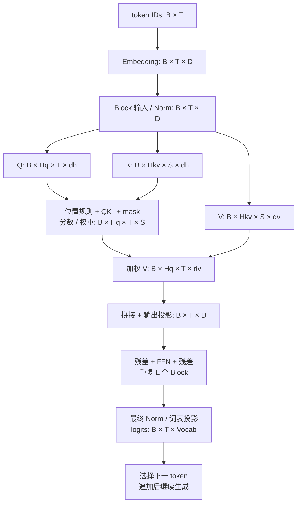
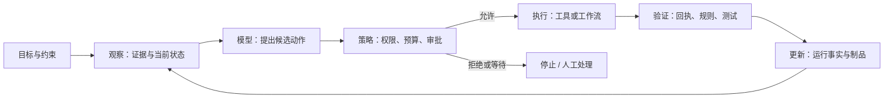

# 第1章 从 Transformer 到 Agent：模型结构如何影响系统能力

语言模型可以解释退款政策、生成补丁，也可以输出一段工具参数。但“生成了什么”与“系统已经完成什么”之间，还有事实、权限、执行与验证。本章先拆开一次模型前向计算，再把它放回受控行动的系统，回答两个相连的问题：模型的候选能力从哪里来，哪些责任必须由模型之外的组件承担？

以下退款和代码修复场景均为教学假设。它们不代表某个企业系统的实际实现，也不把某个模型家族的配置当作行业通用配置。我们将用同一套张量符号解释 Transformer、头共享和缓存，再沿预训练、后训练、推理期计算走到 Agent；后续章节分别展开训练与运行细节。

## 1.1 从序列预测到可扩展模型

语言模型估计序列出现的概率。对 token 序列 \\(x_1,\ldots,x_N\\)，自回归分解为：

\\[
p(x_1,\ldots,x_N)=\prod_{t=1}^{N}p(x_t\mid x_{<t}).
\\]

这是概率的条件分解，不是在宣称模型拥有人的理解或业务权限。早期 n-gram 用局部计数估计条件分布，长窗口会面临稀疏组合；神经概率语言模型联合学习词的连续表示与预测函数，让相近表达共享统计信息。Bengio 等的工作是这条路线的重要节点。[[1]](#ref-1)

表示共享解决了部分泛化问题，却没有消除序列计算的瓶颈。循环网络沿时间步传递状态，后一状态依赖前一状态，同一条样本的训练难以完全按位置并行。早期编码器—解码器还把整个输入压入固定长度表示。Bahdanau 等让解码器在生成时对输入位置做软对齐，针对的是固定向量瓶颈；其模型仍包含循环计算，不能把“出现 Attention”直接写成“已经是 Transformer”。[[2]](#ref-2)

Transformer 的转折在于，用注意力组织位置之间的信息交换，不再依赖循环结构串行形成全部隐藏状态。原论文在机器翻译上验证了这种结构的并行潜力。训练时目标序列已知，可以同时构造各位置的条件预测；因果掩码阻止读取未来标签，所以并行不等于泄漏答案。生成时未来 token 尚不存在，下一步仍依赖刚选出的 token。训练并行与生成串行可以同时成立。[[3]](#ref-3)

因此，从循环模型到 Transformer 的因果链是：序列依赖限制计算并行，注意力改变信息传递路径，并行训练让更大规模的数据与参数组合成为可能。它不是“注意力一出，所有任务自然解决”的历史。成本也随之移动：不用把远距离关系逐步压进一个循环状态，却要计算许多位置间的关系，维护更大中间状态，并处理位置和可见性。

对工程师而言，这个转折带来一个可检验的问题：一次失败来自模型没学会任务，还是输入并未按预期进入计算？若文本被截断、因果边界错位或缓存复用了其他请求的状态，更大的模型也无法修复输入契约。我们先把“字符串进、字符串出”拆成可以逐轴检查的前向路径，再讨论它如何形成能力。

## 1.2 一次前向计算的完整路径

### 统一符号与两种长度

全章以批量优先的语义形状表达张量；实际框架可能转置、融合或分片。\\(B\\) 是批量大小，\\(T\\) 是当前查询长度，\\(S\\) 是键值长度，\\(D\\) 是残差流宽度，\\(H_q\\) 与 \\(H_{kv}\\) 分别是查询头和键值头数，\\(d_h\\) 是每头 Q/K 维度，\\(d_v\\) 是每头 V 维度。\\(L\\) 为层数，\\(V_{\mathrm{ocab}}\\) 表示输出词表投影行数，避免与 Value 张量 \\(V\\) 混用。普通教学示例设 \\(d_h=d_v\\)、\\(D=H_qd_h\\)，这些等式不是所有模型的定义。

训练的自注意力通常有 \\(T=S\\)。增量生成时，单个新查询可以有 \\(T=1\\)，而 \\(S\\) 包含历史缓存与当前 token。只写一个“序列长度”会掩盖这种差别。跨注意力的查询和键值来自不同序列，二者长度也可以不同。中文教材《动手学深度学习》用批量、时间步、隐藏维三轴解释 Transformer，适合作为本节形状阅读的补充。[[4]](#ref-4)

Tokenizer 把输入文本编码为整数 ID，得到 \\([B,T]\\)。Embedding 是可学习表 \\(E\in\mathbb{R}^{V_{\mathrm{ocab}}\times D}\\)，按 ID 查表得到 \\(X\in\mathbb{R}^{B\times T\times D}\\)。这里没有按汉字直接索引的保证：一个汉字、一个英文词、一个空格与代码片段可能对应不同数量的 token。文字看起来相同，也应先确认实际 token ID、特殊符号和聊天模板是否一致。

Embedding 后需要让计算知道位置，但位置机制不总是一个加法。原始正弦位置编码可与输入表示相加；RoPE 则在注意力中的 Q/K 上施加旋转。所以下图把位置规则标在 Block 内，不把所有模型都画成“Embedding 加一个位置向量”。位置如何影响点积，在1.4节继续解释。

图中的 \\(S\\) 在无缓存自注意力中等于 \\(T\\)；使用缓存时，K/V 节点含“历史状态加当前投影”。残差连接在图中简写为输出阶段，实际 Pre-Norm Block 的两条残差路径见1.4节公式。最终 Norm 是常见现代布局，原始 Transformer 的归一化位置不同。图是形状契约，不是某个框架的逐算子执行图。

### 隐藏状态、logits 与标签

每个 Block 保持残差流的 \\([B,T,D]\\) 形状。经过全部层后，输出投影 \\(W_U\in\mathbb{R}^{D\times V_{\mathrm{ocab}}}\\) 将隐藏向量映成每个词表项的分数。logits 还不是概率；沿词表轴应用 softmax，才得到当前位置预测下一个 token 的条件分布。输出表是否与 Embedding 共享权重，取决于具体结构，不能仅因维度兼容就默认共享。

把教学序列写成“开始、我、想、退款、结束”。训练时输入可为前四个位置，标签为后四个位置：用“开始”预测“我”，用“开始、我”预测“想”，依次类推。输入位置的隐藏状态可以含当前位置的 token，因为它预测的是下一个 token。标签若没有右移，模型可能学到复制输入；若被右移两次，又会训练错误目标。检查 loss 降低之前，要先打印一小条输入和监督位置。

生成时先处理提示前缀，即 prefill，得到最后一个有效输入位置的 logits；选出的 token 追加进序列，再进行下一步 decode。Padding 批次不能无条件取数组最后一格：右侧补齐时，那里可能是无效位置，调用方需要按实际实现找到最后有效位置。停止符、最大生成长度和后处理，也会影响用户最终看见的字符串。

由形状还可得到资源上的教学推导：若训练保留全部 \\([B,T,V_{\mathrm{ocab}}]\\) logits，词表维会带来明显中间量；实现可以用融合损失等方法改变实际内存分配，因此“写出了这个形状”不代表一定完整物化它。相同原则贯穿本书：先写语义张量和依赖，再讨论框架如何节省存储，不把数学对象与实际分配强行等同。

## 1.3 Attention 与 Q/K/V 的计算

### 匹配空间与内容空间

对单层输入 \\(X\\)，标准多头自注意力通过不同的可学习投影得到 Query、Key 和 Value。暂设 \\(H_q=H_{kv}=H\\)，且各头维度相同：

\\[
Q=XW_Q,\qquad K=XW_K,\qquad V=XW_V.
\\]

其中 \\(W_Q,W_K\in\mathbb{R}^{D\times Hd_h}\\)，\\(W_V\in\mathbb{R}^{D\times Hd_v}\\)；再把最后一轴拆成头轴并转置，形成 \\(Q,K:[B,H,T,d_h]\\) 与 \\(V:[B,H,T,d_v]\\)。原始多头机制是在多个投影子空间中分别计算，再拼接输出。[[3]](#ref-3)

Q 表达“当前位置按什么特征寻找信息”，K 表达“各位置按什么特征被匹配”，V 提供被聚合的内容。这是帮助理解的类比，不意味着某个向量有稳定、可直接命名的语义字段。Q/K 的最后一轴必须兼容，才能计算点积；V 只需与 K 在来源位置轴上一一对应，其特征宽度可以不同。

因此，把三个投影合成一个权重矩阵做一次大矩阵乘法，是实现上的融合，并不使三种角色相同。若强行令 Q 与 K 共享同一投影，就给匹配关系增加结构约束；模型是否接受这种约束，要靠训练与评估决定，而不是因代码更短就视为等价替换。跨注意力进一步说明了角色区别：Q 可以来自目标序列，K/V 来自源序列，查询与被查询内容并不必来自同一组输入。

例如本书构造两条信息：第一条键表示“退款政策”，值是政策摘要；第二条键表示“物流时效”，值是配送说明。查询需要按主题匹配，输出却需要聚合具体内容。若用 V 直接替代 K，匹配就被迫使用内容空间；当内容维度不同，甚至无法与 Q 点积。即使维度相同，令 \\(W_K=W_V\\) 也改变了原来的参数化，原有模型的权重与结果不再自动保持。这个反例说明可以设计共享参数的结构，却不能无损删掉既有模型的 K。

### 缩放从哪里来

对每个头，计算为：

\\[
A=\operatorname{softmax}_{S}\left(\frac{QK^{\mathsf T}}{\sqrt{d_h}}+M\right),
\qquad Z=AV.
\\]

\\(K^{\mathsf T}\\) 只转置最后两轴；\\(QK^{\mathsf T}\\) 的形状是 \\([B,H,T,S]\\)。softmax 沿键位置 \\(S\\) 归一化，让一个查询对可见来源分配权重。它既不是沿头轴归一化，也不是在整个批次上分配概率。\\(M\\) 是可广播到分数形状的加性掩码，允许位置取零，禁止位置概念上取负无穷。

原论文用一个简化假设解释缩放：若 Q/K 各分量独立、零均值、单位方差，点积是 \\(d_h\\) 项乘积之和，方差随 \\(d_h\\) 增长；除以 \\(\sqrt{d_h}\\) 后保持量级。真实训练向量未必满足独立假设，不能把这个推导当作训练全程的精确分布模型。其作用是解释为什么大维度未缩放点积容易把 softmax 推向饱和区，而不是保证任何输入都得到均匀梯度。[[3]](#ref-3)

用一条教学查询手算可见性：假设三个键位置的未缩放匹配分数为零、零、很大的正数，但第三个位置被禁止。先加掩码，第三项不参与归一化，前两项权重各为二分之一；再乘 V，输出为前两个内容向量的平均。若先 softmax 再把第三个权重清零，却不重新归一化，前两项的和通常小于一，已经改变了数学定义。大匹配分数也不等于事实可信度，只说明当前参数表示下的匹配程度。

### 多头如何回到残差流

每个头输出 \\(Z_h\in\mathbb{R}^{B\times T\times d_v}\\)，拼接得到 \\([B,T,Hd_v]\\)，再乘 \\(W_O\in\mathbb{R}^{Hd_v\times D}\\) 回到残差流宽度。输出投影会混合各头的信息，不能把一个头的权重图直接当作最终答案的完整解释。多头允许学习不同的匹配与内容子空间，但不保证每头分别负责语法、数学或权限。

固定总宽度 \\(D=Hd_h\\) 时，增加头数会缩小每头宽度。它提供更多独立匹配分布，同时减少各头的特征空间；“头越多越好”没有从该等式中得到证明。若固定每头宽度再增加头数，总投影宽度和参数成本则会变化，已经不是同预算比较。评估应说明固定了哪个量，并把任务质量和运行成本一起记录。

一个常见错误是把转置后的 \\([B,H,T,d_v]\\) 直接按连续内存 reshape 成 \\([B,T,Hd_v]\\)。语义上要先把头轴与位置轴交换；某些框架的 view 还要求内存布局满足条件。只检查输出元素总数相同，无法发现位置与头被打乱。练习中应让不同头、不同位置具有可区分值，防止全零或重复输入掩盖轴顺序错误。

标准稠密注意力的分数对象含 \\(BHTS\\) 个元素，点积和内容聚合的计算随 \\(TS\\) 增长。自注意力 \\(T=S\\) 时出现二次项；这不等于整个 Transformer 的全部计算都只有这个项，投影与 FFN 也有成本。先确认工作负载受哪个量主导，再讨论长上下文优化，避免把一种局部复杂度写成整个平台的容量结论。

### 因果掩码、Padding 与全屏蔽行

因果掩码按绝对位置阻止查询读取未来。无缓存教学输入中，查询位置 \\(i\\) 可见 \\(j\leq i\\) 的键，因为该位置预测下一 token。Padding mask 则阻止读取无效的补齐键。两者组合表达“既有效、又在时间上可见”，不能把一个三角矩阵当作所有批次的完整有效性定义。原论文的遮蔽与输出错位共同维护自回归条件。[[3]](#ref-3)

缓存后的查询位置要加上前缀偏移。若前缀长为 \\(P\\)，当前块内第 \\(i\\) 个查询对应绝对位置 \\(P+i\\)，它可见的键界限是这个位置，而不是局部下标 \\(i\\)。直接生成 \\(T\times S\\) 的左上角三角阵，可能错误屏蔽大部分历史缓存。反过来，训练中把不同样本拼接时若没隔开样本边界，会让一个样本读取另一个样本；仅有因果性仍不足以保证数据隔离。

全屏蔽行需要单独定义。本节数学式对一行全为负无穷的分数没有正常的概率分布；直接相减最大值可能产生未定义值。用有限极小数代替又可能得到看似正常的均匀权重，所以“没出现 NaN”不能证明掩码正确。本书教学参考规定：有效查询至少有一个可见键；若输入违反，显式报错。用于处理 padding 查询的优化实现也可以约定零输出，但必须与调用方契约和测试一致，不能悄悄把无效行当正常预测。

## 1.4 Block 的稳定性与位置信息

### 残差与逐位置前馈

注意力让不同位置交换信息，FFN 在每个位置对特征作非线性变换。一个简化的 Pre-Norm Block 可写为：

\\[
U=X+\operatorname{Attention}(\operatorname{Norm}(X)),\qquad
Y=U+\operatorname{FFN}(\operatorname{Norm}(U)).
\\]

这里 Attention 包含输出投影。两次加法要求分支回到 \\([B,T,D]\\)；残差提供跨子层的直接路径，子层学习对现有表示的增量。它有助于优化深网络，却不保证每层输出都保留某个业务事实，更不是一个可以替代运行时状态的记事本。

普通两层 FFN 为 \\(\operatorname{FFN}(x)=\phi(xW_1+b_1)W_2+b_2\\)，先从 \\(D\\) 映到中间宽度 \\(D_{ff}\\)，经非线性再映回 \\(D\\)。同一组权重用于各位置，“逐位置”表示它在这一步不再跨 token 聚合，并不表示每个位置拥有一套不同参数。原始论文与中文教材均区分了注意力聚合和逐位置网络。[[3]](#ref-3) [[4]](#ref-4)

没有非线性时，两层线性变换仍可合成一个线性变换；中间扩维只有与非线性等机制结合，才提供不同的表达形式。现代门控变体会增加投影分支，不能拿普通两矩阵参数公式直接估算所有 FFN。教学层面可先把 Attention 理解为位置间的信息混合，把 FFN 理解为位置内的特征加工；但不要进一步声称“全部知识只存在 FFN”，因为最终行为依赖多层联合计算。

### LN、RMSNorm 与 BN 比较什么

LayerNorm 在单个位置的特征维上计算统计量。对 \\(x\in\mathbb{R}^{D}\\)，其形式为：

\\[
\mu=\frac1D\sum_i x_i,\quad
\sigma^2=\frac1D\sum_i(x_i-\mu)^2,\quad
\operatorname{LN}(x)_i=\gamma_i\frac{x_i-\mu}{\sqrt{\sigma^2+\epsilon}}+\beta_i.
\\]

它不依赖另一条请求是否放进同一个 batch，训练与推理沿用相同的归一化计算方式。Ba 等提出这种按样本归一化的思路，针对了批量统计在序列任务中的使用问题。[[5]](#ref-5)

RMSNorm 以均方根做缩放，通常写为：

\\[
\operatorname{RMSNorm}(x)_i=\gamma_i\frac{x_i}{\sqrt{D^{-1}\sum_jx_j^2+\epsilon}}.
\\]

它省去显式减均值，不等同于把 LN 中心化结果换个名字。论文在多种任务上验证了简化方案，但具体耗时收益与硬件、算子融合、精度有关，不能引用一组实验比例承诺所有大模型都同幅提速。\\(\epsilon\\) 防止分母过小，其位置和计算精度属于实现契约，需要在复现时检查。[[6]](#ref-6)

归一化放在哪里也影响优化。Post-Norm 对“输入加子层输出”再归一化，Pre-Norm 则先归一化输入、再走子层与残差相加。Xiong 等分析了两者初始化时的梯度差异，并在研究配置中探索减轻 warmup 需求。不能把它推广为任何 Pre-Norm 大模型都无需学习率预热；优化器、深度与训练规模仍需共同验证。[[7]](#ref-7)

BN 的典型统计轴包含 mini-batch，而 LN 的本节定义沿特征轴；BN 训练时估计批量统计、推理时常用累计统计，所依赖的信息不同。Ioffe 与 Szegedy 提出了 BN 的机制与实验。对本书序列教学场景，批大小变化、可变长度和在线单请求会使批量统计契约更复杂，这是选择 LN 类方案时应考虑的条件，而不是“BN 在任何序列模型里都错误”的结论。[[8]](#ref-8)

| 归一化 | 本节统计范围 | 是否减均值 | 训练与推理关注点 |
| --- | --- | --- | --- |
| BN | 包含批量轴的同类特征统计 | 是 | 批量估计与累计统计的差异 |
| LN | 单位置的特征轴 | 是 | 不依赖其他样本；核对特征维 |
| RMSNorm | 单位置的特征均方根 | 否 | 不具有同样的平移不变性；核对精度与epsilon |

替换归一化还会改变已训练模型的函数，不能把相近用途等同于无损兼容。对已有权重，应在转换方案、继续训练和回归证据齐备后再判断是否可替换；对新训练配置，则应记录归一化位置和参数，避免制品同名而计算不同。

用教学输入可以检查统计轴：令两条样本完全不同，只改第二条样本，第一条样本某位置的 LN 结果不应因第二条而变。再对同一位置各特征加同一个常数，忽略数值误差时，LN 的中心化会消去这个平移；RMSNorm 一般没有同样的不变性。这些是公式可推得的性质，适合用来识别错误的归一化轴，不需要用模型跑分代替基础算术验证。

### 顺序如何进入计算，扩窗为何还要验证

如果没有任何位置机制，单纯的自注意力难以区分仅由位置置换造成的差异；因果可见性虽引入方向约束，仍不能代替完整的位置表示。原始 Transformer 使用正弦位置编码；不同频率为不同距离提供可组合信号。绝对位置表、旋转位置与分数偏置是不同设计，不能在图中随意互换。[[3]](#ref-3)

RoPE 将成对特征按位置旋转。用 \\(R_m\\) 表示位置 \\(m\\) 的旋转，匹配可写为 \\((R_mq)^{\mathsf T}(R_nk)=q^{\mathsf T}R_m^{\mathsf T}R_nk\\)；成对旋转具有相对位移结构，使点积包含 \\(n-m\\) 的关系。这个等式解释位置怎样进入匹配，不证明模型在训练外的任意距离都能可靠推理。[[9]](#ref-9)

ALiBi 不向 Embedding 加位置向量，而是在分数上加入与距离有关的线性偏置。论文展示了特定模型与语料上的长度外推实验；这种证据应保留配置前提，不能写成“加偏置就无限上下文”。RoPE 与 ALiBi 都改变了模型使用距离信息的方式，但其作用位置和归纳偏好不同。[[10]](#ref-10)

因此，扩窗至少要分别检查三个层面：算子能否接受更大位置索引，计算与缓存是否装得下，模型是否真正用上远处证据。窗口字段变大，只能说明某项配置允许更长输入；若关键条款在中段仍被忽略，业务能力并未因配置通过而自动达标。教学评估可把同一事实放到开头、中间和末尾，再插入干扰与否定条件，分别观察检索、引用和判断是否变化。这里的评估方案是本书建议，不能当作位置论文已经证明的产品结论。

## 1.5 架构变体与资源代价

### 架构、可见性与目标要一起读

Encoder、Decoder 和 Encoder–Decoder 首先描述信息如何连接，训练目标再决定模型因什么监督信号更新。BERT 用双向上下文学习表征，适合通过任务头等方式进行理解任务微调；它的掩码语言建模不是直接从左到右预测完整文本的同一个目标。[[11]](#ref-11) T5 将不同任务统一成 text-to-text 接口，其迁移学习框架并不要求所有模型都改为单一 Decoder。[[12]](#ref-12) GPT-3 则展示了自回归模型在无需参数更新的上下文少样本设置下完成多种任务的能力与限制。[[13]](#ref-13)

| 路线 | 典型可见性与信息路径 | 本节采用的目标描述 | 适用判断与限制 |
| --- | --- | --- | --- |
| Encoder / BERT | 输入位置双向交互 | 遮蔽位置的表征学习 | 可做分类和检索表征；不能直接把普通MLM当自回归聊天生成 |
| Encoder–Decoder / T5 | 源序列编码；目标因果生成，并跨注意力读取源 | 统一文本到文本的迁移框架 | 输入输出边界清楚；两侧状态与目标需分别理解 |
| Decoder-only / GPT路线 | 同一流内因果可见 | 下一token预测 | 提示与生成接口统一；仍受训练分布和输入证据限制 |

具体到原始 LLaMA，它属于因果生成路线，并在报告中采用 Pre-Norm、RMSNorm 与旋转位置机制；与 BERT 的双向遮蔽表征路线相比，差别同时包括训练目标、可见范围与常见输出用途，不能只按开源与否分类。[[14]](#ref-14) 这段结论限定在原版报告，不代替后续代际的配置核验。

T5 的跨度破坏会把连续缺失片段换成 sentinel 标记，目标序列用这些标记串起待恢复片段；解码器通过跨注意力读取编码器结果。[[12]](#ref-12) GPT-2 则用因果语言建模连续预测后续文本，采用 Transformer 语言模型结构；它没有 T5 那样独立的源序列编码器与编码器—解码器跨注意力。[[15]](#ref-15) 因此，接口都能返回文本，不等于它们的监督位置和条件路径相同。

从本书工程视角推导，Decoder-only 可将提示、示例与输出组织在同一序列中，接口与部署链路较统一；Encoder–Decoder 则显式区分源输入与目标生成，适合比较输入输出职责清晰的条件生成任务。这些是结构取舍，不是对“流行程度”的市场统计，也不证明前者在所有任务、长度和预算上更优。

表格用于选择阅读方式，不是永久的能力分区。Encoder 可以参与生成系统，Decoder 也可提取表示；是否适合任务，还要看训练方法、输出接口和评测结果。不能从“只有 Decoder”推断它没有理解能力，也不能从“能读取完整输入”推断它获得了正确授权的最新事实。

### MHA、MQA 与 GQA 减少了什么

MQA 让不同查询头共享一组 K/V，以减少增量生成时需要写入和读取的缓存。它保留多个查询头，而不是把整个模型改成一个注意力头。Shazeer 的工作指出了这种共享与解码带宽之间的关系。[[16]](#ref-16) GQA 位于 MHA 与 MQA 之间：\\(H_q\\) 个查询头分为 \\(H_{kv}\\) 组，每组共享一个 K 头和 V 头；\\(H_{kv}=H_q\\) 回到 MHA，\\(H_{kv}=1\\) 回到 MQA。[[17]](#ref-17)

按本章约定，Q 的形状仍为 \\([B,H_q,T,d_h]\\)，K/V 的头轴缩为 \\(H_{kv}\\)。令每组查询数 \\(g=H_q/H_{kv}\\)，教学实现要求 \\(H_q\\) 能被 \\(H_{kv}\\) 整除，第 \\(h\\) 个查询头使用第 \\(\lfloor h/g\rfloor\\) 个 KV 头。这是分组映射，不是把 \\(H_q\\) 写成 \\(H_{kv}\\) 后让输出头数跟着减少。框架若显式复制 KV 作为正确性参考，实际内存节省要另由原生分组算子实现。

对普通、未压缩且 K/V 每头宽度相等的缓存，可按维度推得：

\\[
\text{KV bytes}=2BL S H_{kv}d_hs,
\\]

其中 \\(s\\) 是每元素字节数；一般宽度不同则为 \\(BLSH_{kv}(d_h+d_v)s\\)。这个式子只计算缓存载荷，不含权重、激活、页表、分配碎片、复制与其他工作区，也没有自动给出多卡分片后的单卡值。它帮助比较同一口径下的头共享，不是生产显存总账。

例如在教学假设 \\(H_q=8,H_{kv}=2\\) 下，若其他轴与精度相同，GQA 缓存载荷是 MHA 的四分之一；这不表示请求延迟也变成四分之一。投影、FFN、调度、缓存读取与硬件利用率共同影响实际延迟。将既有 MHA 权重改成 GQA 也不是只改配置，原论文的 checkpoint 转换和继续训练正说明结构变化需要适配。[[17]](#ref-17)

### MLA 不是把头数改小

DeepSeek-V2 的 MLA 用低秩向量联合承载 K/V 的内容表示，并为位置部分采用解耦 RoPE。按该论文缓存设计，需要保留压缩内容向量和解耦的位置键；若维度分别为 \\(d_c\\) 与 \\(d_r\\)，其对应载荷为 \\(BLS(d_c+d_r)s\\)。这是该结构的限定口径，不能把 \\(d_c\\) 填进标准 GQA 公式后再机械乘二、乘头数。重建向量、投影吸收以及位置支路是否物化，会影响实际执行。[[18]](#ref-18)

| 注意力结构 | 缓存的主要语义对象 | 本节可以据此判断什么 |
| --- | --- | --- |
| MHA | 每个查询头对应的K与V | 头数直接参与标准KV载荷 |
| MQA | 所有查询共享的一组K与V | 缓存缩小，查询子空间仍可多个 |
| GQA | 每组查询共享的K与V | 在共享程度与容量间选配置 |
| MLA（DeepSeek-V2） | 联合压缩内容及解耦位置状态 | 必须按潜变量与位置支路重新记账 |

这里没有按结构给模型质量排永久名次。论文中的比较来自具体训练和实验，不能把“缓存小”直接推出“准确率高”，也不能把模型采用 MLA 当作它已经具备事务恢复能力的依据。缓存保存的是前向计算所需状态，不是任务完成的证明。

### Dense、MoE 与算子的不同取舍

稀疏专家混合把部分网络计算分给门控选择的专家，早期工作用条件计算扩大参数容量而不同比增加每个样本的计算。[[19]](#ref-19) Switch Transformer 进一步研究简单稀疏路由及其通信、稳定性与扩展问题。[[20]](#ref-20) 专家通常是参数子网络，不是多个会独立规划和执行工具的 Agent，也不必天然对应“财务”“法律”等人类部门。

因此总参数、每 token 激活参数、常驻权重和通信量要分开计。只激活少数专家，仍可能需要存放全部专家权重或安排跨设备访问；路由不均会使部分设备忙、部分设备闲。Dense 布局没有同样的专家路由成本，MoE 则提供另一种容量与计算折中。两者都不能仅凭模型名称或激活参数数字判断单机是否装得下。

FlashAttention 优化的是另一层：通过分块和减少 GPU 高带宽内存与片上存储之间的数据搬运，实现精确注意力计算。它不是 GQA 的同义词，也不是以减少注意力头获得同样收益；普通稠密注意力的二次算术项并未因此自动消失。[[21]](#ref-21) 这也解释了为什么结构设计、算子实现、服务调度要分别记录：某层的节省不能重复算进另一层账本。

### 有版本依据的 Qwen 侧栏

仅以 Qwen2 技术报告 v4 的 7B Dense 配置为例：残差宽度3584、28层、28个查询头、4个KV头、每头128维，采用 GQA、RoPE、RMSNorm 等设计。[[22]](#ref-22) 官方 Qwen2-7B 配置页面显示文件修订9b039ab，对应头数、层数和宽度一致；其 Embedding 表行数为152064，而报告列出的有效词表为151646，不能混同。[[23]](#ref-23)

这组配置每个 KV 头服务7个查询头。若只做形状阅读，读者可将 \\(D,H_q,H_{kv},d_h\\) 代入前述张量约定；若要估算缓存，还须另给 \\(B,S,s\\) 等工作负载。这里没有据此给出设备吞吐、真实窗口质量或最新版 Qwen 的保证。产品家族的代际更新可能同时改变注意力、词表与模板，所以模型制品应绑定具体配置和版本，再交给评估与发布流程。

## 1.6 从基础能力到可用行为

理解结构后，仍不能仅从参数规模预测任务表现。预训练通过数据和目标塑造表示与生成分布；同一结构换用不同语料、训练预算或目标，会得到不同能力边界。GPT-3 的上下文少样本设置在请求中给示例，无需梯度更新，所以“本次请求会做新格式”不等于模型权重已经永久学习该知识。[[13]](#ref-13) 第2章将讨论数据、Tokenizer、目标与规模的共同约束。

后训练进一步改变默认行为。InstructGPT 用示范进行监督微调，再利用输出排序与人类反馈做强化学习；其结果也仍包含错误，不能把更受偏好的回答当作事实保证。[[24]](#ref-24) DPO 从偏好优化目标的重参数化得到更直接的训练方式，在其研究条件下简化了训练链路；这不意味着所有后训练都等同于 DPO，也不意味着无需检查数据分布与行为回归。[[25]](#ref-25) 第3章负责这些目标、数据与优化闭环。

推理期计算改变的是一次请求怎样产生和检查候选。CoT 的研究表明，给出中间步骤的示例可以改善若干算术、常识与符号推理任务。[[26]](#ref-26) 但一段流畅解释仍可能建立在错误前提上。本书据此采用的工程判断是：增加计算前，先问结果能否由测试、数值条件、引用证据或业务规则验证；若不可验证，多生成一些候选也可能只是积累更有说服力的错误。第4章讨论如何分配预算与停止。

把三者放回一个代码修复教学场景：预训练使模型有机会识别程序模式；后训练让它更可能按要求返回补丁和测试说明；推理期策略可以安排多次尝试与运行测试。但“当前分支有哪些文件”“测试刚才是否通过”“用户允许修改哪个目录”，都需要从实际环境取得，不能靠训练知识猜测。能力形成与当前任务事实因此有明确分工。

| 阶段 | 改变的主要对象 | 本书要求独立验证的结果 |
| --- | --- | --- |
| 预训练 | 参数中的基础分布与可迁移表示 | 数据覆盖、泛化与任务能力 |
| 后训练 | 默认行为和任务响应方式 | 指令、格式、偏好与能力回归 |
| 推理期策略 | 本次请求的候选、搜索和验证预算 | 成功率、验证误判、延迟与成本 |
| 行动系统 | 观察、授权、工具执行和持久状态 | 外部事实、副作用与恢复证据 |

表格不是一条必须全部自建的流水线。应用可以使用现有模型，也可以从确定性工作流起步；阶段划分的作用是避免把每种失败都送回训练。知识过期先查来源，格式截断先查输出契约，工具越权先查权限执行，确定需要改变模型行为时再研究训练。

## 1.7 从生成到行动系统

ReAct 将推理和动作交错，使模型可以通过行动取得环境信息，再调整后续路径。[[27]](#ref-27) Toolformer 研究了学习何时调用 API、传递什么参数以及怎样利用返回结果。[[28]](#ref-28) 这些工作支撑“模型能参与工具使用”的技术方向，却没有替应用实现持久状态、权限审批或业务事务。本节以下控制流程是本书的教学设计，不是对某个论文系统或 Hermes 已实现能力的承诺。

一个最小循环为观察、提出下一步、执行、验证、更新状态。与直接把输出交给工具相比，教学系统在建议与执行之间放置策略判断：哪些读取允许自动执行，哪些写入需要预览或审批，预算耗尽时怎样退出。工具返回也应先作为观察核对，再用于下一轮推理，不能因为模型说“成功”就把任务设为完成。

Function Calling 主要提供动作名称和参数的表达接口。即使参数完全符合 schema，也可能指向错误订单、违反用户权限或重复执行已成功的操作。结构合法、语义正确、权限允许、外部已提交，是四个不同判断。后训练可以提高提出合适参数的概率，执行系统仍需检查身份、对象范围与真实回执。

### 状态不是一段聊天记录

设想企业助手先查政策、再创建退款申请，随后网络超时。重新生成一段相似工具调用，不能回答上次请求究竟有没有提交。教学设计中，应先用操作标识查询外部事实：若已成功，记录已有回执；若明确未提交，再按重试规则处理；若状态未知，进入待核对流程。这里只定义问题和责任，幂等、持久化与恢复协议由第11章展开，不能宣称一次状态落库就获得恰好一次业务效果。

运行记录至少要能区分用户目标、一次 Run、其中的 Step、工具请求、外部结果与产生的 Artifact。模型上下文可以包含这些对象的摘要，但不能把摘要当作权威提交日志。模型重新措辞不应改写历史回执；日志重放也不应默认再次执行写操作。后续章节会细化 Run/Step/Event 与 Operation 的契约，本章只冻结二者分别承载执行事实与业务动作的边界。

企业知识助手的主要验证对象是引用与授权可见的证据，Coding Agent 的主要验证对象还包含仓库 diff、编译与测试结果，Hermes 案例则用于讨论个人助手的任务组织与教学扩展。三个案例共享“目标—观察—候选—控制—结果”的框架，但不共享未经核验的能力保证。尤其不能把本书建议的 Checkpoint、Outbox 或补偿流程反过来写成某个开源项目已经实现的事实。

输入扩大到图像、语音、屏幕时，还要保留页码、区域、时间等定位，否则“模型看见了”也无法转成可追溯证据。动作进入物理环境后，碰撞、速度与急停又需要独立控制闭环。第5章和第6章分别讨论这些边界。本章的迁移原则是：输入的证据形式和动作后果变了，验证契约也必须跟着改变，不能只换一个模型接口继续沿用纯文本验收。

## 1.8 用责任层定位一次失败

以下分层是本书教学诊断法。先冻结实际输入和版本，再按“数据是否到达—计算是否符合约定—行动是否授权—结果是否有证据”的顺序定位。把所有错误标成幻觉，会把完全不同的修复路径混在一起。

| 现象 | 优先取得的证据 | 对应责任与验证 |
| --- | --- | --- |
| 长输入遗漏关键例外 | token化结果、截断记录、实际上下文 | 先看证据是否到达，再做位置与任务能力评估 |
| 相同前缀逐步生成与整段结果不一致 | mask、位置ID、KV版本和长度 | 核对绝对位置偏移、分组映射与缓存读取 |
| JSON缺字段或被截断 | 原始输出、停止原因、schema | 区分生成约束、长度限制和解析器问题 |
| 政策回答错误 | 授权来源、文档版本、召回与最终上下文 | 区分未召回、未装配、误读和规则缺失 |
| 工具重复执行或越权 | 身份、操作ID、审批与外部回执 | 工具网关、业务操作与Runtime联合核对 |
| 升级后质量或成本回退 | 模型、Tokenizer、模板、精度与评估版本 | 比较同一任务切片与资源口径 |

### 从错误退款回答走到可修复证据

设想助手回答“可以全额退款”，并准备调用退款工具。先查订单渠道、购买时间和商品状态是否完整；再查最新政策是否对该用户可见、是否被召回；接着核对例外条款是否进入最终上下文；最后观察模型是否正确引用条件，以及工具执行前的规则与授权是否通过。这里任一环节失败，都可能产生同一句错误回答。

若条款没进入上下文，优先修召回、过滤或装配；若条款清楚在场而判断错误，可构造包含否定条件的模型回归用例；若答案正确但工具重复提交，应查操作状态和幂等边界。修复后分别复测这些条件，而不是仅凭新模型在一条演示上答对就关闭事故。稳定的回归单元应绑定输入、版本、证据和断言，后续第10章再定义 Eval Case。

结构层也有自己的排查方法。若因果训练 loss 异常低，先看标签右移与未来可见性；若改 batch 排列就改变单样本结果，先看 mask 广播、归一化轴和状态隔离；若长前缀 decode 错乱，先看 \\(T\\) 与 \\(S\\)、位置偏移和缓存归属。推理质量问题与实现正确性问题可能叠加，只有逐个控制变量，才知道更换架构解决了什么。

这些诊断不要求应用团队先重写一个 Transformer。使用托管模型时，无法看到内部张量，也仍可记录最终输入、请求版本、停止原因、工具结果与评估切片；自建推理时，则可以增加前缀一致性与算子对照。可见性决定能直接验证到哪一层，不能取得的证据应标为未知，不能用对模型内部的猜想填满事故报告。

### 练习卡 Q262：手写缩放点积与多头注意力

**状态：练习设计完成；独立实现未提供，未实测。** 采用教学输入 \\(B=2,T=S=4,D=8,H_q=H_{kv}=2,d_h=d_v=4\\)，关闭 dropout，以 float64 慢速参考为对照。依次实现投影、拆头、缩放点积、因果与 padding mask、softmax、聚合、拼接和输出投影；在独立实验仓库实现，不把代码放进书稿临时目录作为运行依赖。

**验收断言：** 每个中间张量满足本章形状；有效查询的允许权重和为一，禁止位置权重为零；改变未来位置的 V 不改变较早查询输出；不同样本的 padding 长度不互相干扰；全屏蔽有效行显式报错。教学误差阈值可设为最大绝对误差小于 \\(10^{-8}\\)，仅适用于该双精度参考条件，不能用它要求所有低精度设备。

**失败回收：** softmax 轴错、mask后置、未先转置就拼头、全屏蔽行产生伪分布，都应有能稳定触发的非对称输入。只让全零输入通过或最终形状正确，不算完成计算验证；运行结果、环境和断言输出需要单独保存，不能由本卡的存在推断已运行。

### 练习卡 Q261：GQA 与增量缓存的一致性

**状态：练习设计完成；独立实现未提供，未实测。** 设 \\(B=2,T=S=4,D=8,H_q=4,H_{kv}=2,d_h=d_v=2\\)。先按分组索引计算，再用显式展开KV的慢速版本作为正确性参考。两者在同一参数、输入、mask和位置规则下比较；显式展开仅用于对照，不声称它实现了缓存节省。

**验收断言：** 输出保留4个查询头，KV缓存只按2个KV头计；拒绝查询头数不能被KV头数整除的输入；全前缀计算与逐token缓存计算在有效位置接近；前缀绝对位置偏移正确；两条请求不能复用彼此缓存。固定教学条件下沿用 \\(10^{-8}\\) 参考阈值；同时打印缓存元素数，确认没有因先复制KV而把节省吃回去。

**迁移问题：** 再加入非零前缀长度、分块decode、不同有效长度及位置旋转，观察哪些错误只有在 \\(T\ne S\\) 时出现。MLA不属于本练习的等价替换：它要定义不同的缓存状态与对照路径。没有完成这些实现和运行记录前，两张卡均只标设计，不能上调为手写能力或硬件实测。

## 1.9 本章小结

Transformer 改变了序列的信息交换与并行方式；Q/K 负责匹配，V 负责聚合，输出投影与 FFN 把计算接回残差流。归一化、位置、可见性与头共享共同决定结构如何运行，也各自引入前提。读懂它们的价值，是能从 token、轴、缓存与证据开始定位问题。

预训练形成基础能力，后训练塑造行为，推理期策略组织候选与验证；当模型参与行动，还需要外部系统承担当前事实、权限、提交与恢复。结构决定一种计算方式，训练决定它学到什么，评估与控制决定它能被允许做什么。下一章回到预训练的数据、目标与规模，沿这条因果链继续展开。

## 1.10 参考资料

1.  Bengio et al.，[A Neural Probabilistic Language Model](https://www.jmlr.org/papers/v3/bengio03a.html)，2003 / JMLR 3。核验日期：2026-10-16。
2.  Bahdanau, Cho, Bengio，[Neural Machine Translation by Jointly Learning to Align and Translate](https://arxiv.org/abs/1409.0473v7)，2015 ICLR / arXiv v7。核验日期：2026-10-16。
3.  Vaswani et al.，[Attention Is All You Need](https://arxiv.org/html/1706.03762v7)，2017 / arXiv v7。核验日期：2026-10-16。
4.  张阿斯顿、Zachary C. Lipton、李沐、Alexander J. Smola，[动手学深度学习：10.7 Transformer](https://zh.d2l.ai/chapter_attention-mechanisms/transformer.html)，中文在线版 2.0.0 / 2026-10-16。核验日期：2026-10-16。
5.  Ba, Kiros, Hinton，[Layer Normalization](https://arxiv.org/abs/1607.06450v1)，2016 / arXiv v1。核验日期：2026-10-16。
6.  Zhang, Sennrich，[Root Mean Square Layer Normalization](https://arxiv.org/abs/1910.07467v1)，2019 NeurIPS / arXiv v1。核验日期：2026-10-16。
7.  Xiong et al.，[On Layer Normalization in the Transformer Architecture](https://arxiv.org/abs/2002.04745v2)，2020 ICML / arXiv v2。核验日期：2026-10-16。
8.  Ioffe, Szegedy，[Batch Normalization: Accelerating Deep Network Training by Reducing Internal Covariate Shift](https://arxiv.org/abs/1502.03167v3)，2015 / arXiv v3。核验日期：2026-10-16。
9.  Su et al.，[RoFormer: Enhanced Transformer with Rotary Position Embedding](https://arxiv.org/abs/2104.09864v5)，2021 preprint / arXiv v5 2023。核验日期：2026-10-16。
10.  Press, Smith, Lewis，[Train Short, Test Long: Attention with Linear Biases Enables Input Length Extrapolation](https://arxiv.org/abs/2108.12409v2)，2022 ICLR / arXiv v2。核验日期：2026-10-16。
11.  Devlin et al.，[BERT: Pre-training of Deep Bidirectional Transformers for Language Understanding](https://aclanthology.org/N19-1423/)，2019 NAACL。核验日期：2026-10-16。
12.  Raffel et al.，[Exploring the Limits of Transfer Learning with a Unified Text-to-Text Transformer](https://www.jmlr.org/papers/v21/20-074.html)，2020 JMLR 21(140)。核验日期：2026-10-16。
13.  Brown et al.，[Language Models are Few-Shot Learners](https://arxiv.org/abs/2005.14165v4)，2020 / arXiv v4。核验日期：2026-10-16。
14.  Touvron et al. / Meta AI，[LLaMA: Open and Efficient Foundation Language Models](https://arxiv.org/html/2302.13971v1)，2023 / arXiv v1。核验日期：2026-10-16。
15.  Radford et al. / OpenAI，[Language Models are Unsupervised Multitask Learners](https://cdn.openai.com/better-language-models/language_models_are_unsupervised_multitask_learners.pdf)，2019 official report。核验日期：2026-10-16。
16.  Shazeer，[Fast Transformer Decoding: One Write-Head is All You Need](https://arxiv.org/abs/1911.02150v1)，2019 / arXiv v1。核验日期：2026-10-16。
17.  Ainslie et al.，[GQA: Training Generalized Multi-Query Transformer Models from Multi-Head Checkpoints](https://arxiv.org/html/2305.13245v3)，2023 EMNLP / arXiv v3。核验日期：2026-10-16。
18.  DeepSeek-AI，[DeepSeek-V2: A Strong, Economical, and Efficient Mixture-of-Experts Language Model](https://arxiv.org/html/2405.04434v5)，2024 / arXiv v5。核验日期：2026-10-16。
19.  Shazeer et al.，[Outrageously Large Neural Networks: The Sparsely-Gated Mixture-of-Experts Layer](https://arxiv.org/abs/1701.06538v1)，2017 / arXiv v1。核验日期：2026-10-16。
20.  Fedus, Zoph, Shazeer，[Switch Transformers: Scaling to Trillion Parameter Models with Simple and Efficient Sparsity](https://www.jmlr.org/papers/v23/21-0998.html)，2022 JMLR 23(120)。核验日期：2026-10-16。
21.  Dao et al.，[FlashAttention: Fast and Memory-Efficient Exact Attention with IO-Awareness](https://arxiv.org/abs/2205.14135v2)，2022 / arXiv v2。核验日期：2026-10-16。
22.  Yang et al. / Qwen team，[Qwen2 Technical Report](https://arxiv.org/html/2407.10671v4)，2024 / arXiv v4。核验日期：2026-10-16。
23.  Qwen，[Qwen2-7B config.json](https://huggingface.co/Qwen/Qwen2-7B/blob/main/config.json)，file revision 9b039ab / checked 2026-10-16。核验日期：2026-10-16。
24.  Ouyang et al.，[Training language models to follow instructions with human feedback](https://arxiv.org/abs/2203.02155v1)，2022 / arXiv v1。核验日期：2026-10-16。
25.  Rafailov et al.，[Direct Preference Optimization: Your Language Model is Secretly a Reward Model](https://arxiv.org/abs/2305.18290v3)，2023 / arXiv v3 2024。核验日期：2026-10-16。
26.  Wei et al.，[Chain-of-Thought Prompting Elicits Reasoning in Large Language Models](https://arxiv.org/abs/2201.11903v6)，2022 / arXiv v6 2023。核验日期：2026-10-16。
27.  Yao et al.，[ReAct: Synergizing Reasoning and Acting in Language Models](https://arxiv.org/abs/2210.03629v3)，2023 ICLR / arXiv v3。核验日期：2026-10-16。
28.  Schick et al.，[Toolformer: Language Models Can Teach Themselves to Use Tools](https://arxiv.org/abs/2302.04761v1)，2023 / arXiv v1。核验日期：2026-10-16。
