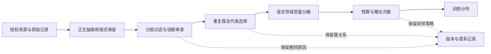
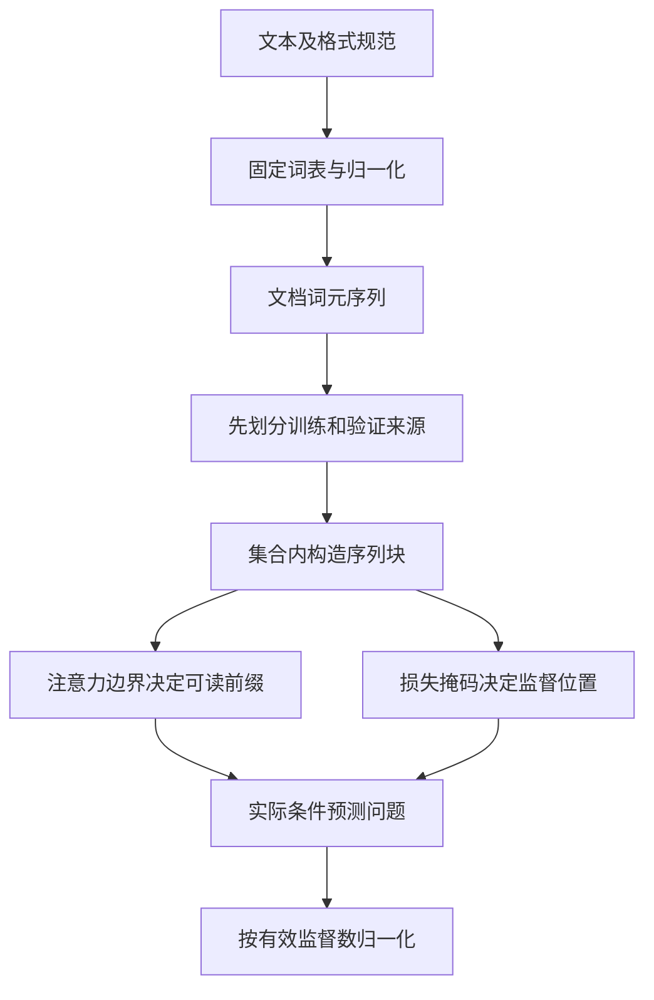
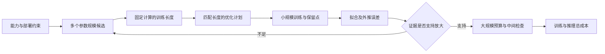
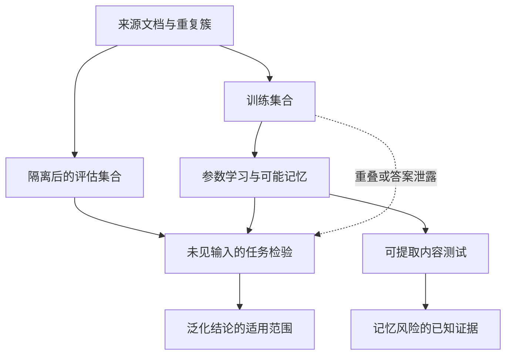
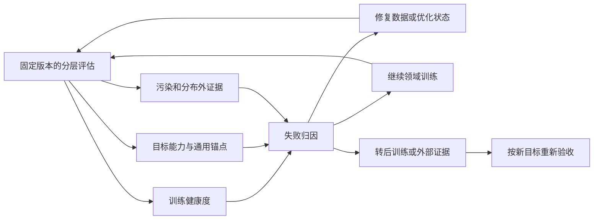
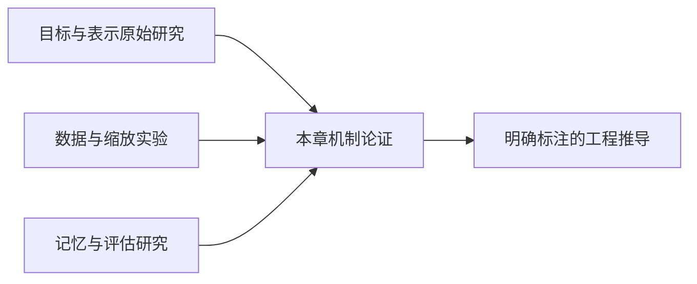

# 第2章 预训练：能力的来源

模型结构说明了 Transformer 为什么能成为大模型的计算底座，也说明了模型要表现出可迁移的语言、知识和模式能力，结构只是必要条件之一。但“模型变大”本身并不能解释这些能力从何而来：一个随机初始化的 Transformer，为什么经过数万亿 token 的训练后，会表现出语言理解、代码生成、数学表达和一定程度的推理能力？

本章的判断是：基础能力不是参数规模单独带来的属性，而是训练目标、数据分布、Tokenizer、模型规模、算力预算和评估证据共同塑造的结果。预训练让模型学习广泛而稳定的模式，却不直接提供时效事实、可靠引用或可控行为；第 3 章将继续讨论后训练如何塑造默认行为。

本章面向有后端和传统机器学习经验、准备进入大模型开发的读者。重点放在能帮助工程决策的知识上：哪些问题由预训练解决，哪些问题其实应该交给后训练或推理系统；数据质量为什么会改变能力上限；Scaling Law 如何变成成本估算；以及怎样判断一个模型是真的学会了能力，还是只是在测试集上复现了训练数据。

## 2.1 预测目标如何形成能力：从概率拟合到可迁移表示

图中最重要的反馈是损失作用于共享参数，而不是只修改某条句子的概率表。一次更新会同时影响以后许多输入的表示，因此模型既可能把规律迁移到没有见过的句子，也可能把数据中的偏差带到新场景。独立任务检验位于训练反馈之外，提醒我们：被优化的是一个可计算的预测目标，最终要求的却可能是正确解释、稳定组合或符合约束的行动。这两个目标有联系，但不是同一个函数。

### 从词概率到分布式表示

语言模型最初的任务是估计一段序列的概率。给定 token 序列 \\(x_1,\ldots,x_T\\)，自回归语言模型把联合概率分解为：

\\[
P(x_1,\ldots,x_T)=\prod_{t=1}^{T}P(x_t\mid x_{<t}).
\\]

早期系统使用 n-gram 和平滑技术，用有限窗口统计词共现。它们易于解释，却会遇到两个根本问题：词表一大，组合空间迅速爆炸；窗口一长，统计计数变得稀疏。Bengio 等人把词表示为可学习的稠密向量，并用神经网络估计下一个词的概率，证明了“学习表示”和“学习语言概率”可以在同一个目标中完成 [[1]](#ref-1)。Word2Vec 进一步把大规模词向量训练变成高效的局部预测问题，使分布式表示成为许多 NLP 系统的基础组件 [[2]](#ref-2)。

这一步解决的是“如何把离散符号放到可泛化的连续空间”。相似上下文中的词，会被优化到相近区域；模型因此不必把“猫”和“狗”当成完全独立的类别，而能利用它们在语料中的相似分布。局限也很清楚：静态词向量不能根据上下文改变词义，词级表示难以处理未登录词、形态变化和长篇上下文。

**从固定表示到可选择的上下文。**

Seq2Seq 模型把输入序列编码成隐状态，再由解码器逐步生成输出，推动了机器翻译和端到端序列任务的发展 [[3]](#ref-3)。但单一固定长度的编码向量难以承载长输入，编码器和解码器之间需要一种动态选择信息的机制。第 1 章 1.1 节介绍的软对齐缓解了固定向量瓶颈；随后 Transformer 直接以 Self-Attention 为核心，取消了循环结构，并行处理同一序列中的多个位置 [[4]](#ref-4)。

Transformer 的改变不是简单地“换了一个网络层”。循环模型的时间依赖限制了训练吞吐；自注意力允许每个位置直接与其他位置建立关系，使长距离依赖路径从多步递归缩短为一步矩阵运算。对标准多头自注意力，点积与加权聚合的计算量为 \\(O(BHT^2d_h)\\)；当 \\(Hd_h=D\\) 时可写成 \\(O(BT^2D)\\)。普通实现若物化每个头的分数或概率矩阵，其存储量是 \\(O(BHT^2)\\)，不能把这两个口径写成同一个复杂度。第 1 章 1.5 节介绍的 FlashAttention 通过分块减少高带宽内存读写，并避免在高带宽内存中保存完整分数矩阵，但精确注意力的二次算术项仍然存在。因此，长上下文训练同时受计算、激活和系统实现约束。

### 预训练成为主范式

GPT 的生成式预训练把 decoder-only Transformer 与无监督文本训练结合起来，再用少量任务数据进行迁移 [[5]](#ref-5)。BERT 证明了 masked language modeling 可以用双向上下文学习强大的文本表示 [[6]](#ref-6)；T5 则把分类、问答、翻译等任务统一改写成 text-to-text 形式，减少了不同任务之间的接口差异 [[7]](#ref-7)。这几条路线并没有“谁完全淘汰谁”，而是在回答不同问题：decoder-only 更适合连续生成和统一接口，encoder-only 擅长理解和表示，encoder-decoder 在输入输出结构差异较大的转换任务中仍然有价值。

GPT-3 进一步展示了大规模自回归模型的上下文学习能力：在不更新参数的情况下，仅通过提示和少量示例就能完成多种任务 [[8]](#ref-8)。这改变了模型开发方式。过去是“为每个任务训练一个模型”，之后逐渐变成“先训练一个基础模型，再通过 Prompt、后训练、检索和工具把它适配到任务”。不过，上下文学习并不等于模型真正掌握了任务规则；它可能依赖示例格式、表面相关性或训练语料记忆，必须通过独立评估和分布外测试确认泛化。

从历史上看，预训练解决了三个连续问题：第一，标注样本不足时如何利用海量无标注数据；第二，不同任务如何共享语言和世界知识；第三，如何用同一基础模型覆盖更多任务。它也留下了三个长期问题：数据偏差进入参数后很难定位，训练语料可能包含隐私和版权风险，模型输出的流畅性不等于事实可靠性。

### Next-token Prediction 与交叉熵

给定 token 序列 \\(x_{1:T}\\)，decoder-only 模型根据输入前缀 \\(x_{<t}\\) 预测目标 \\(x_t\\)，使用 causal mask 保证当前位置不能读取未来 token。单个样本的平均训练损失通常写为：

\\[
\mathcal{L}(\theta)=-\frac{1}{T}\sum_{t=1}^{T}\log p_\theta(x_t\mid x_{<t}).
\\]

在实现上，模型输出每个位置对词表的 logits，经过 softmax 得到概率，再用交叉熵与真实 token 做比较。优化器只看到“正确 token 的概率是否提高”，并不知道我们以后想让模型会写代码、做数学题或调用工具。代码模式、数学关系和工具格式等能力由这一训练目标间接诱导；某些能力是否表现为突然出现，还会受到评测指标、阈值和采样方式影响，因此本章不把“涌现”当作无需解释的因果机制。

从机器学习角度看，这相当于用一个参数化分布逼近训练语料分布。模型会同时学习语法约束、词义关系、篇章结构、代码格式、常见事实、问答模式和文档布局。一个代码仓库里的函数调用模式能降低代码 token 的预测损失；一条数学推导中的符号依赖能降低公式 token 的损失；多轮对话中的角色标记能降低特定格式的损失。模型不需要被显式告知“这是一条规则”，只要规则在数据分布中足够稳定，就可能被压缩到参数中。

**熵、交叉熵与分布逼近。**

以下均用自然对数，单位为nat。在固定上下文下，令 \\(p_i\\) 是目标分布，\\(q_i=p_\theta(i\mid x_{<t})\\) 是模型预测，二者定义在相同离散词表上且各自求和为一。不要把目标分布 \\(p\\) 与模型分布 \\(q\\) 的方向互换。中文教材对softmax、负对数似然和熵的定义可作基础参照。[[9]](#ref-9)

\\[
H(p)=-\sum_i p_i\log p_i,\qquad
H(p,q)=-\sum_i p_i\log q_i,
\\]

\\[
D_{KL}(p\Vert q)=\sum_i p_i\log\frac{p_i}{q_i}
=H(p,q)-H(p).
\\]

最后一式由前两式直接相减得到。约定 \\(0\log0=0\\)；如果某项 \\(p_i>0\\) 而 \\(q_i=0\\)，交叉熵与该方向KL为无穷。KL不是对称距离，也一般不满足三角不等式。固定 \\(p\\) 时熵不随模型参数变化，最小化交叉熵等价于最小化这个方向的KL；若目标由同步更新的另一个模型生成，就不能无条件把它当固定常量。

对单个one-hot标签 \\(y\\)，交叉熵只剩 \\(-\log q_y\\)。这不表示现实语言在该上下文中只有一种合理续写，而是该样本只观测到一个目标，训练在许多样本上估计分布。对教学分布 \\(p=(1/2,1/2)\\)、\\(q=(3/4,1/4)\\)，熵约为0.6931，交叉熵约为0.8370，KL约为0.1438，三者满足分解。这些数值由公式计算，不是模型实验。

Token监督还要计入有效位置。设 \\(m_t\\) 为是否参与损失的二元mask，则平均NLL为 \\(-\sum_tm_t\log q_{t,y_t}/\sum_tm_t\\)。若分母为零，应拒绝样本或按明确规则跳过；不能除以包含padding的总长度后，把loss变小误认为学得更好。不同长度样本先逐句平均再平均，与按全部有效token平均也不等价，需要固定统计口径。

对logits \\(z\\)，softmax后交叉熵可写为 \\(\log\sum_i e^{z_i}-z_y\\)。令 \\(c=\max_i z_i\\)，用 \\(c+\log\sum_i e^{z_i-c}\\) 计算第一项，避免直接指数溢出。将原始logits交给已融合log-softmax的损失接口，不应再手动softmax一次。这里讨论的是分类形式如何组成语言模型目标，通用分类的完整损失选型不在本章扩写。

**交叉熵梯度为何适合词元预测。**

以下用二分类说明，不另扩一套分类教材。令预测概率 \\(q=\sigma(z)\\)、标签 \\(y\in\{0,1\}\\)。交叉熵对logit的梯度为 \\(q-y\\)，而取平方损失 \\(L_{MSE}=\tfrac12(q-y)^2\\)，链式法则给出梯度 \\((q-y)q(1-q)\\)。CE梯度可由前述softmax推导退化得到，平方损失的结果是本书直接求导。[[9]](#ref-9)

当模型自信地预测错误，如 \\(y=1,q\approx0\\)，CE梯度仍接近负一，MSE还要乘很小的 \\(q(1-q)\\)，纠正信号可能很弱。CE也与分类分布的负对数似然一致，因此是token分类常用目标。这里不能推断“MSE不能分类”：概率上的平方误差可作为Brier型评分，用途不同。选损失要看输出参数化、优化与校准，不能仅因为标签是数字就把类别当有序回归值。

**能力与默认行为之间仍有距离。**

“模型学会了知识”容易造成误解。预训练权重不是一个带版本号、权限和更新时间的数据库。更准确的说法是，模型在参数中压缩了训练数据中的统计规律和部分可重复模式。它可能记住某些长字符串，也可能只学到“某类问题通常这样回答”；两者在表面输出上很难区分。

可以把预训练产生的内容分为四层：

| 层次 | 训练中体现的对象 | 适合的工程判断 |
|:---|:---|:---|
| 表示 | token、词法、句法、跨语言映射 | 能否理解输入形式 |
| 模式 | 文档结构、代码惯用法、解题步骤 | 能否生成符合分布的输出 |
| 事实 | 训练语料反复出现的实体关系 | 是否需要检索和时效校验 |
| 行为 | 角色、格式、拒答和服从指令 | 主要由后训练和运行时策略塑造 |

推理也需要分层看待。预训练可以让模型见过大量“问题—解答—推导”的文本，学习到可复用的组合模式；但在新组合、长链条或高可靠任务中，单次生成可能仍不稳定。训练阶段学到的是能力先验，推理时是否成功还取决于采样、上下文、验证器和额外计算。把预训练损失直接等同于生产正确率，是从训练目标跨越到业务目标的常见错误。

**不同目标改变可用证据与迁移接口。**

Causal LM 只利用左侧上下文，训练目标与生成过程一致，部署为聊天模型时接口简单。Masked LM 随机遮挡输入中的部分 token，让模型利用左右文恢复缺失内容，能获得较强的双向理解表示 [[6]](#ref-6)。Encoder-decoder 结构把输入和输出分开建模，在翻译、摘要等条件生成任务上具有清晰的结构优势 [[7]](#ref-7)。

选择目标函数时，应先问产品需要什么：如果核心任务是连续生成、代码补全和对话，Causal LM 的训练—推理一致性更重要；如果核心任务是分类、检索表示或句子级理解，双向 encoder 可能更高效；如果输入与输出是两个不同序列，encoder-decoder 能显式建模条件信息；如果目标是一个统一基础模型，decoder-only 便于把各种任务转成同一种 token 预测接口。

中文工程实践还要考虑词表和语料比例。Qwen 技术报告展示了多语言、代码和中文数据共同训练时，词表设计、数据混合和评估集合会直接影响模型使用体验 [[10]](#ref-10)；InternLM2 技术报告也说明，中文基础模型不能只用英文模型的 benchmark 推断能力，需要建立中文、代码、知识和对话的分层评估 [[11]](#ref-11)。

训练目标与能力之间的联系，可以通过一个贯穿本章的教学场景来具体理解。设一个已有通用基础模型需要适应企业公开授权的技术文档，文档包含产品术语、版本说明、接口例子和故障分析。这里不假设已有实测收益，也不把企业数据天然视为高质量。如果同一个术语在不同文档中承担相近功能，模型降低后续词元损失的一种有效方式，是让有关上下文的隐藏表示包含这种功能关系。当接口名字变化而调用结构相似时，共享参数可以复用结构；当错误码含义因版本变化时，模型还必须利用版本上下文，才有可能预测正确说明。训练不显式要求“建立接口知识库”，却会奖励有助于预测的内部计算。

但是，存在一种同样能降低损失的捷径：记住常见例子的后半段。如果训练集大量复制同一份接口教程，模型可能只需识别开头就复现整个代码块，对新的参数组合却不敏感。两条路径都能让训练损失下降。单看目标值无法知道模型究竟形成了可组合的规则，还是学会了强关联模板。为区分二者，我们可以在独立评估中替换变量名、改变合法参数组合、加入不满足前置条件的调用，并要求解释错误原因。这些实验是本书从目标函数推出的诊断设计，不是宣称语言模型内部一定存在某种人类可读规则。

教师强制进一步解释了训练表现与自由生成的差距。在预测技术说明的第十个词元时，训练输入通常包含文档中真实的前九个词元。模型即使在上一个位置分配错了最大概率，也不会因此改变当前输入前缀。生成时则不同：模型已经输出的错误版本号会成为后续上下文，它可能在错误前提上继续给出非常连贯的接口说明。于是，局部条件预测变好并不自动保证完整回答正确。这不是自回归分解本身有问题，而是评估完整轨迹时需要计入模型自己造成的前缀变化。第4章的采样、搜索和验证正是在这个缺口上增加决策机制。

还应区分“目标相同”与“学习问题相同”。对一段原始接口文档预测每个词元，对一个带角色标记的回答只预测助手位置，形式上都可以使用交叉熵，但经验分布和受监督位置不同。前者会花预算学习目录、代码注释和描述顺序，后者把梯度集中到给定用户请求之后的响应。即使两批样本含有相同事实，更新方向也可能不同。把任务全部写成文本有助于统一接口，却不会抹去任务分布、上下文结构和监督权重的差别。

从公式看，训练真正逼近的是经过处理和采样后的分布，而不是一个抽象的“全人类知识分布”。若同一接口存在两个版本，而样本没有版本标记，模型在相同可见前缀下看到两个不同续写，正确的概率拟合可能就是给两种答案都分配概率。我们不能要求损失函数凭空辨认当前用户使用的是哪一版。增加模型容量也不能补回输入中缺失的判别信息。此时应当补充版本条件、提供检索证据或要求用户说明环境，不能仅凭回答不确定就认定预训练不足。

有效监督的归一化也会改变这种学习问题。假设一个教学批次只有一份很短的发布说明和一份很长的接口手册，两份文档平均每词元的损失不同。按文档分别求平均再取均值，两份文档拥有相同权重；将所有有效词元的负对数概率相加后除以总词元数，长手册拥有更大权重。两种口径都可以定义合理目标，但它们回答的是不同问题。前者更接近平均文档表现，后者更接近平均词元表现。若训练使用后一种而仪表盘显示前一种，曲线不一致未必是实现错误；若团队不知道二者不同，则很容易把数据长度分布变化误判为优化进步。

对单个样本，概率模型给正确续写较低概率会付出较大损失，但这个惩罚没有业务严重度的概念。把“可以”误写为“不可以”，和把常见标点预测错，在词元层面都只是某个目标类别的负对数概率。前者可能改变操作含义，后者可能几乎不影响任务。我们可以在后续阶段加入有针对性的样本和评价，却不应倒过来声称预训练平均损失已经自动表达了业务风险。正文中的“学会”因此总要绑定一个可观察能力：是减少困惑度、提高类型识别率，还是在陌生版本上正确处理接口约束。

这一点也关系到所谓能力突然出现。若一项任务只有整段答案完全正确才计一分，而较小模型已经能正确完成其中大部分步骤，连续的局部进步可能在越过评分阈值后表现为分数跳变。关于表观涌现的研究说明，指标选择本身可能制造这种现象；它不证明所有规模相关转折都不存在。[[12]](#ref-12) 因此在技术文档任务中，除了最终成功率，还应观察参数解释、前置条件识别、错误定位等连续或分项指标。这样才知道需要补哪一种学习信号，而不是把所有变化归结为无法操作的“智能涌现”。

## 2.2 数据分布如何被制造：清洗、去重与预算配比

### 数据管线的基本分层

预训练数据可以按加工阶段分成 raw、filtered、deduplicated、mixed 和 packed 五种状态。raw 是抓取或采购得到的原始文档；filtered 去除明显垃圾、乱码和不合适内容；deduplicated 处理重复和近重复；mixed 根据训练目标配比；packed 才是按序列长度组织成训练样本。每一层都应保留版本、规则和统计信息，否则出现能力退化时无法回答“是模型问题还是数据版本问题”。

C4 的公开文档化工作提醒我们，网页语料的过滤规则会改变数据集组成，并可能引入语言、主题和站点偏差 [[13]](#ref-13)。The Pile 通过多源语料组合和来源说明，把“我们收集了一堆网页”推进到更可追溯的数据集治理 [[14]](#ref-14)。RefinedWeb 则显示，网页清洗、质量过滤和去重可以使相对简单的数据管线得到有竞争力的基础模型结果 [[15]](#ref-15)。这些工作共同说明：数据工程不是训练前的杂务，而是模型能力的组成部分。

### 清洗：过滤噪声而不是消灭多样性

常见清洗规则包括语言识别、文档长度、特殊字符比例、HTML 模板、广告密度、重复行、链接比例和质量分类器。工程上不能把“越干净”当成“越好”。过度过滤可能删除低资源语言、口语、代码注释、表格、论坛问答和专业文档，结果是模型在主流测试集上变好，却在真实用户输入上变窄。

更稳妥的做法是把过滤分成硬规则和软评分：硬规则负责删除明显违规或无法学习的内容；软评分保留分布，按桶采样并记录阈值。每次改变过滤器，都要比较文档数、token 数、语言比例、领域比例、平均长度、重复率和评估指标，而不是只看最终 loss。

质量分类器本身也会带来偏差。它可能把方言、短文本或非标准格式误判为低质量；它还可能与目标模型共享训练数据，形成循环偏差。因此数据质量评估应包含人工抽样、规则解释、分层统计和模型结果四个维度。中文、英文、代码、数学和长文档最好分别抽样，不要用一个总体平均分掩盖少数分布被删除的问题。

**去重改变的不只是文件大小。**

重复文档会让模型多次看到同一个训练信号，浪费 token 预算，并增加记忆和 benchmark 泄露风险。精确去重可以通过文档哈希实现；近重复去重通常使用 n-gram、MinHash、局部敏感哈希或 embedding 相似度。Lee 等人的实验显示，去重不仅减少训练数据，还能改善泛化并降低模型对重复文本的记忆 [[16]](#ref-16)。

去重的粒度需要根据文档类型选择：网页正文适合段落或文档级去重；代码需要同时考虑文件、函数和仓库级重复；书籍和法规文本可能存在合法的版本差异，简单按相似度删除会误伤；问答数据中相同问题的不同高质量答案不能全部删掉。对工程团队而言，最重要的不是宣称“去重率达到某个数字”，而是记录算法、阈值、抽样误删率和跨数据集重复率。

### 数据配比：把训练预算投向目标能力

如果总训练 token 固定，增加一种数据就会减少另一种数据。数据混合因此是一个预算分配问题，而不是越多越好。通用网页提供覆盖面，书籍和长文增强篇章结构，代码改善程序模式，数学和科学文本提供符号推导，多语言数据扩大覆盖，合成数据可以定向补齐稀缺能力。

一个实用的数据配比表应至少记录：来源、语言、领域、质量分桶、token 数、采样权重、重复率、版权状态和对应评估集。T5 的系统实验说明，预训练数据规模、任务混合和训练步数之间存在耦合，不能只凭直觉选择数据比例 [[7]](#ref-7)。LLaMA 的报告也把公开数据组成、训练 token 和模型规模放在一起讨论，说明开放模型的效果并非只由参数量决定 [[17]](#ref-17)。

数据混合通常有三种策略：固定比例、温度采样和阶段性配比。固定比例容易复现；温度采样可以避免大语种或大数据源完全支配训练；阶段性配比则先用广覆盖数据学习基础，再提高代码、数学、长上下文或领域数据的权重。阶段性训练的风险是分布切换造成遗忘，因此需要在通用评估和目标评估上同时监控。

**合成数据需要独立的质量证据。**

合成数据可以生成题目、解答、代码、偏好对和长上下文样本，特别适合补齐人工数据稀缺的能力。但生成器的错误会被蒸馏到训练集，模板化样本会降低多样性，模型还可能反复学习自身的错误。Shumailov 等人关于递归训练的研究提示，持续使用模型生成内容替代真实分布，可能导致分布尾部消失、错误累积和模式退化 [[18]](#ref-18)。

因此合成数据不能只看数量。至少应有四个门槛：生成器与目标模型尽量隔离；使用规则、程序执行器或人工抽样验证答案；保留真实数据作为锚点；用独立测试集检查多样性和分布外能力。对代码数据，要运行单元测试、静态检查和依赖审计；对数学数据，要执行符号或数值验证；对事实数据，要与独立来源交叉核对。合成数据是能力定向工具，不是廉价 token 生产器。

加工链的每一次选择都能写成对分布的重新加权。令原始文档来自某个分布，抽取器决定哪些文字被保留，过滤器决定文档是否进入候选池，去重策略决定哪些副本代表一个簇，采样器再决定训练时看见多少次。最终影响梯度的是这些操作的组合。即使原始抓取源完全相同，两个团队也可能训练出分布明显不同的模型。所谓“使用同一个网页数据集”若没有处理版本和采样定义，并不足以构成可复现条件。

继续使用技术文档场景：假设一份教程的正文只有少量文字，大部分有价值内容都在代码块、参数表和注意事项里。如果正文抽取器只保留连续自然语言段落，这份文档在过滤之前已经损失了关键语义。后续质量分类器看到的可能只是几个孤立标题，于是将其判为低质量。此时调低分类阈值只能保留残缺样本，真正需要修正的是抽取器。相反，如果抽取器保留网页侧栏和自动推荐，某些高频产品名可能被过度曝光。把全部问题归因于“清洗不够”会掩盖错误发生的阶段。

评估抽取器应对照原始结构与清洗结果，而不仅审查最终纯文本。参数表中的单位、代码缩进、否定词、脚注条件、标题层级都是可以改变意思的元素。一个适合新闻正文的抽取器可能不适合接口参考；一个把重复行全部删除的规则可能删掉合法的代码分支。这里的目标不是保留所有页面结构，而是确定哪些结构是任务相关证据。可以对不同文档类型分别建立小规模人工核验样本，观察语义保留率和无关内容残留，再决定是否需要不同的抽取路径。

过滤阈值也应接受条件化解释。一个质量评分器把“正式、完整、语法规范”当作高质量，可能适合长篇说明，却会低估真实故障日志和论坛问答。若未来用户经常粘贴残缺日志，训练中完全清除这类内容反而会扩大输入分布差距。C4文档化研究对过滤结果的不均衡影响提供了具体警示；FineWeb的过滤与去重消融也说明，处理规则应靠比较而不是直觉累加。[[19]](#ref-19) 本书据此建议同时记录保留样本和被删样本的分层审查结果，让“为什么删除”成为可以修订的判断。

可以把一次过滤实验设计成两种不同问题。若固定原始抓取量，比较过滤前后最终得到的训练数据，测到的是质量与可用规模共同变化的效果；若固定模型实际消费的有效词元数，并从两个候选池各自抽够预算，才更接近比较每次曝光的价值。后一种也有前提：被保留池必须足够大，不能因为数据不足而偷偷多轮重复。若新管线过滤更强，固定曝光预算时重复次数上升，应将这一变化显式报告，否则模型表现变化无法只归因于质量改善。

去重的簇代表选择同样会产生方向性偏差。对于接口文档，最早版本可能信息不全，最新版本可能删除了旧接口，正文最长的副本又可能混入网站模板。随意保留第一个抓到的文档，会让抓取顺序成为隐藏的训练权重。可以根据版本字段、正文完整性和来源可信度选择代表；确实需要保留多个版本时，则给出清晰版本条件并把它们视为有关联的不同样本，而不是因为相似度高就全删。去重簇是组织证据的工具，不是“语义相同”的自动判决。

再考虑曝光次数。设某领域去重后有一份大小为U的词元池，总训练预算为N，目标采样比例为w，在均匀抽样的教学近似下，平均曝光轮数约为wN/U。这条算术关系说明，一个看起来很小的领域比例也可能让稀少文档重复很多次。反过来，大规模通用池即使占主要预算，其中大部分文档也可能只出现一次。团队因此不能仅看配比饼图，而应同时看每个桶的独立数据量、平均曝光和高频尾部。Muennighoff等人研究了数据受限时重复使用数据的收益递减；其结果支持区分独立数据和重复曝光，不能给出所有项目通用的重复轮数上限。[[20]](#ref-20)

有意重采样与意外副本的区别在于是否掌握权重。假设一份关键错误处理说明只出现一次，但任务要求模型可靠理解它，可以有意识地提高对应类型样本的曝光，并在独立例子上观察效果。若该说明被几十个镜像站重复转载，采样器却把它们当成几十份独立证据，同样的权重增长就不可解释。去重之后再明确重采样，通常比依赖网页副本数来决定重要性更容易分析。这里不是反对重复，而是要求重复成为受控变量。

配比调整还要面对代理模型迁移的问题。DoReMi使用较小代理模型优化数据混合，再把权重用于更大模型，展示了用实验选择配比的路径。[[21]](#ref-21) 但不同容量、词表和训练阶段对领域数据的边际收益可能不同。某个桶损失高，可能因为它含有有价值但难学的规律，也可能因为乱码、随机字符串或严重抽取错误；简单提高所有高损失桶权重，会把优化预算投向不可预测噪声。因此先检查数据语义，再用对照实验评价配比，不应把“难”直接当成“有价值”。

合成样本也应进入相同的谱系账本。由同一个模板替换实体生成的大量题目，在独立样本数意义上可能远少于文件条数。验证器只检查语法或代码能运行，也无法确保解答真的对应题目意图。更有用的生产记录包括原始题目来源、生成器版本、生成条件、验证方法、拒收原因以及与已有样本的关联。这样发现一批系统性错误时，可以沿生成批次撤回，而不是仅依赖模型训练后的表现猜测问题来自哪里。

## 2.3 从文本到有效监督：Tokenizer、边界与长上下文

### Tokenization 的模型影响

模型看到的不是字符、单词或句子，而是 tokenizer 产生的 token。词表大小影响 embedding 和输出层参数，分词粒度影响序列长度、跨语言效率和稀有词处理。英文常见词可能被编码成一个或几个 token；中文字符、英文缩写、数字、代码符号和路径的切分模式可能完全不同。

这会影响三类成本：同一段内容需要多少 token，决定训练和推理计算；一个概念被切成多少片，影响模型学习稳定性；特殊格式被如何分割，影响代码、JSON、URL 和工具调用格式的可靠性。比较模型成本时不能只比较“每百万 token 价格”，还要看目标语言和业务文本的 token 化膨胀率。

词表不是越大越好。更大的词表可能减少序列长度，却会增加 embedding、softmax 和通信成本；更小的词表参数压力较低，但长序列会增加注意力和位置编码负担。最终选择应基于目标语料的 token/字符比、词表覆盖率、训练速度、显存占用和下游格式稳定性。中文基础模型尤其要在中文字符、英文单词、代码标识符、数字和混合文本上做分层统计，而不是只报告一个平均压缩率。

**先固定中文与代码的测量对象。**

以下退款问句和代码只用于展示 Tokenizer 对中文、字母、数字、标点与缩进的处理。它们是固定输入的教学例子，用于说明测量对象，不代表已经完成分词实验。

BPE用高频子词组合缓解稀有词问题，SentencePiece提供从原始句子训练子词模型的方法；它们是算法与工具路线，具体词表仍由训练数据和配置确定。[[22]](#ref-22)[[23]](#ref-23) 本书教学输入可以固定为“订单A-123可以退款吗？”与代码 `if (order_id == "A-123") return refund(100);`，另加路径、连续空格、换行和emoji。它们用于暴露中文、字母、数字、标点和缩进的切分差别，不预先声称会产生多少token。

测量时记录Tokenizer制品修订、词表与merge文件哈希、normalization、特殊token策略及chat template；分别输出token ID、可见片段、长度和decode后文本。先验证round-trip是否符合该Tokenizer的规范，再比较各语言和代码样本的长度分布。不能把一种Tokenizer的整数ID送给另一模型，也不能假设相同字符串在不同词表下成本相同。上述输入只是待执行测量规约，本章没有编造实测ID或跨模型压缩率。

把教学对话装成“user问退款、assistant给答复”时，角色标记、换行与EOS也是输入契约。模板改变后，正文文字可能不变，模型读到的协议却已变化。预训练可对全部合法位置预测，SFT则可能只监督assistant位置；阶段差异由目标与mask决定，不能仅按数据文件后缀判断。模板与Tokenizer需要和模型权重一起版本化；第 3 章展开后训练样本的监督位置与对齐方式。

### 文档边界、Packing 与样本泄露

本书以下流程建议用于定义有效训练信号。训练样本通常组织成token block。把多个短文档拼接到一个 block 可以减少 padding，提高 token 利用率，但必须正确处理文档边界，否则模型会学到本来不存在的跨文档关系。对于对话、代码文件、JSON 和书籍章节，边界 token 的设计会影响模型是否知道“一个样本在这里结束”。

Packing 内允许跨文档读取，与训练、测试集合之间的污染是两个问题。前者取决于建模策略，后者取决于样本来源和划分是否隔离。管线应在 packing 前完成文档级切分，在评估时按文档、主题或去重簇隔离集合，再检查重复片段。验证集不能只是随机抽取训练网页的另一段，因为随机切分可能让高度相似内容同时出现在训练和评估中。

边界符告诉模型内容在何处结束，却不自动阻止跨文档注意力。连续语料预训练可以显式选择允许跨文档读的策略；独立对话或任务样本若要求隔离，则需block-diagonal等可见性约束，并正确重置或延续位置ID。Attention mask决定能读哪里，loss mask决定哪些目标产生梯度，两者职责不同。先按原始文档、仓库或去重簇划分训练/验证，再分别packing，避免一个源文档的相邻切块落入不同集合。所有隔离策略都应进入数据manifest。

### 长上下文数据

把最大上下文从 4K 直接扩到 128K，不等于模型自动获得了长文档能力。模型需要在训练中看到足够多的长序列、跨段引用、远距离检索和结构化文档。长序列还会显著增加 attention 计算和激活内存，训练预算不能只按 token 数粗略估计。

长上下文数据至少分成四类：自然长文档、人工拼接文档、远距离依赖任务和长上下文问答。人工拼接可以测试位置和检索能力，但不能替代真实长文档；长文档问答可以测试使用能力，但如果答案总在开头或结尾，不能说明模型能稳定处理中间信息。评估时要改变答案位置、干扰内容、文档数量和引用距离，避免得到虚假的“长上下文支持”。

图中的两个掩码不能互相代替。假设把文档甲和文档乙装入同一个序列块，甲是一段接口定义，乙是另一段无关说明。若希望乙完全独立，即使不对甲计算损失，乙仍可能通过注意力读到甲；必须在可见性上阻断这条边。相反，允许乙读取甲而仅监督乙，可以定义一种条件生成训练，但它不再等于两个独立文档分别训练。EOS只是一种内容标记，模型可能学会在它之后切换话题，却不负责实施访问控制。独立样本packing文档对边界元数据的强调，正是为了保留原样本的注意力语义；该官方文档主要面向SFT与PEFT，不能直接当成所有预训练框架的实现规范。[[24]](#ref-24)

更细的边界出现在标签移位。自回归训练常把一段序列左移作为输入、右移作为目标。如果两个独立样本直接相邻，甲末尾的位置可能被要求预测乙的第一个词元；若设计目标是独立文档，需要明确这个跨界目标是否屏蔽，乙开头是否有自己的起始标记。仅在注意力矩阵里画出两个三角块，还不能证明损失索引正确。类似地，重置位置编号会改变位置条件，延续位置编号则可能让短文档习惯出现在较大位置。二者都是训练定义的一部分，应与推理输入约定一致，而不是只为提高装箱率临时选择。

对训练吞吐，也至少有三种计数。设备处理的序列位置包括填充；有效文本词元排除了填充；有效监督词元还要扣除不参与损失的位置。为了说明差别，可以假设一个序列块有十个位置，其中两个是填充，另有两个合法输入位置仅提供上下文、不产生监督，那么这三个数分别是十、八、六。它们是教学假设，不是某个系统的效率测量。提高装箱率通常改善第二个数与第一个数的比例，但若监督规则同时变化，第三个数未必同比增加。训练预算、损失分母和吞吐报告应采用明确的对应关系。

Tokenizer又改变了这些计数的单位。假设两种词表对同一文档分别产生不同数量的词元，较少词元可能降低部分序列计算，却不能仅据此断言模型更准确。较大的词表增加输出类别，还可能让低频完整词缺少足够学习机会。比较困惑度时问题更加直接：每词元平均负对数似然的分母变了，两个数不再在同一测量单位上。若要以原始文本长度归一化，可以在完全相同的字节文本和规范化条件下比较总负对数似然除以字节数，但仍应说明分词方式定义了模型如何为该文本分配概率，不能把这个指标误写成与编码完全无关。

归一化也不是无害的文本美化。全角与半角、组合字符、换行和连续空格，在自然语言中有时可视为同义变体，在代码、标识符或数学表达式中却可能有意义。若预处理先把不同字符串折叠成相同形式，解码无法恢复被丢弃的信息。正确的round-trip要求应对照Tokenizer声明的规范化结果，而非笼统要求每个原始字节永远不变。对企业接口材料，版本号、大小写敏感参数和缩进代码应进入专项检查；只验证普通中文句子会漏掉高价值边界。

长上下文则同时改变信息范围与训练成本。把很多互不相关的短文装成一个长块，可以让设备处理更长位置，却不一定提供远距离依赖的学习信号。若所有预测只依赖附近句子，模型没有强烈理由利用遥远前缀。因此应把“序列很长”和“目标确实需要远处证据”分开。技术手册可以包含跨章节的类型定义和使用限制，教学检索样本则可以显式改变关键字段的位置；两者分别检验自然结构与受控位置依赖，不能相互替代。

Lost in the Middle在其多文档问答和键值检索实验中发现了信息位置对表现的影响，这提醒我们窗口长度不是有效使用能力的同义词。[[25]](#ref-25) 据此，本章案例应将同一接口约束放在开头、中间和结尾，同时改变干扰文档数量，观察是否仍能引用正确版本。若模型只在短上下文成功，下一步可以检查长序列训练分布与位置机制；若不同位置都能找到字段却误解适用条件，问题更可能在语义组合。这样才能避免把所有长文失败都归结为窗口不够大。

## 2.4 缩放规律与优化轨迹：把算力变成可检验的预算

### 经验规律与工程意义

Scaling Law 的核心观察是，在一定规模范围内，验证损失会随模型参数量、训练 token 数和计算量以相对平滑的幂律下降 [[26]](#ref-26)。它不是物理定律，也不能保证任何新架构都服从同一曲线，但它提供了一个重要工程工具：在真正投入大规模训练之前，可以用小模型和短训练估算不同预算下的趋势。

为避免与模型结构的隐藏宽度 \\(D\\) 冲突，本节用 \\(P\\) 表示参数量，\\(N_{tok}\\) 表示训练 token 数，\\(C_{train}\\) 表示训练计算。Kaplan 等分别拟合了模型规模、数据规模和计算规模与损失的幂律关系，并讨论固定计算预算下的配置；其具体表达和拟合区间不能与后续工作互换。[[26]](#ref-26) Hoffmann 等在 Chinchilla 研究中采用参数量与 token 数的联合形式，可概括为：

\\[
\widehat{\mathcal{L}}(P,N_{tok})=\mathcal{L}_\infty+aP^{-\alpha}+bN_{tok}^{-\beta}.
\\]

这个联合式属于 Chinchilla 的参数化口径，用于描述给定架构族与数据配方中的经验趋势。[[27]](#ref-27) 对普通 Dense 训练，可在特定计数口径下用 \\(C_{train}\approx6PN_{tok}\\) 作粗估；长序列 Attention、重计算、不同算子和稀疏激活都会使实际账本偏离。参数与 token 在固定计算下相互约束，不能把 Kaplan 与 Chinchilla 的拟合系数、指数或最优比例混用。

实际拟合需要固定Tokenizer、数据分布、优化器和架构族，并报告测量范围与误差。一个实验若同时改变数据质量、参数和训练步数，就不能只归因于参数scaling。不要把经验系数和最优比例照搬到中文业务语料，更不能把验证损失下降直接换算成业务正确率。

### Chinchilla 与 compute-optimal

早期行业实践倾向于优先扩大参数量，但 Chinchilla 研究指出，在固定训练计算下，很多大模型实际上训练 token 不足；适当减少参数并增加训练数据，可以得到更低的验证损失 [[27]](#ref-27)。这不是“模型越小越好”，而是说明容量和训练充分度必须成比例设计。

计算最优只回答给定训练计算下怎样降低目标验证分布的损失，不自动优化模型上线后的总成本。若同一模型要服务大量请求，参数量会长期影响权重显存、带宽、延迟和每 token 推理成本；工程上可能接受更长的训练，用较小模型处理未来的大量推理需求。反过来，推理量很小或训练窗口受限时，训练成本可能占主导。这里给出决策变量，不声称存在跨模型、跨硬件通用的比例；第 5 章 5.2 节将用明确假设计算参数、token、训练计算和推理需求之间的账本。

对项目规划可以采用如下顺序：先估计目标推理量、延迟和可接受的激活参数量；再依据目标能力和可获得的高质量数据估计训练 token；最后反推训练计算、集群时长和 checkpoint 存储。若数据质量不足，继续堆 token 可能只是重复噪声；若模型容量不足，增加同分布数据的收益会变小；若训练没有收敛，盲目做后训练会把基础缺陷包装成行为问题。

需要区分三种“规模”：总参数、激活参数和训练 token。MoE 模型可以拥有更大的总容量而只激活部分参数，但路由和通信有额外代价；密集模型每个 token 都使用全部参数，算力结构简单但激活成本高。第 8 章给出 Infra 总览，第 9 章展开训练平台，第 10 章展开推理系统；本章保留的判断原则是，训练规模必须和目标能力、数据质量、推理预算一起设计。

**平均损失与能力曲线必须同时观察。**

验证 loss 是重要指标，但它不是所有能力的充分统计量。它对高频 token 和常见格式非常敏感；一个模型可以通过更好地预测模板文本降低 loss，却未必提高少数复杂任务的准确率。反过来，针对数学、代码或工具格式的定向数据可能提高业务能力，却让总体 loss 变化很小。

因此训练曲线应与分层能力曲线一起看：通用 loss、按语言 loss、按领域 loss、长上下文 loss、代码执行成功率、数学答案准确率、结构化输出通过率和安全回归。每一项都要固定评估版本，记录置信区间和样本数量。不能从一次 benchmark 的涨跌推断模型整体进步，尤其当测试集较小、污染未知或评测提示未公开时。

### Batch、学习率与训练预算

在 token 级训练中，global batch size 决定一次更新看到多少 token。增大 batch 可以提高硬件利用率并降低梯度噪声，但可能需要调整学习率、warmup 和正则化；batch 太大也可能减少参数更新次数，使模型在固定 token 预算下的优化轨迹改变。中文教材对小批量梯度估计的分析有助于理解噪声与效率的权衡，但具体学习率规则仍需按训练条件验证。[[28]](#ref-28)

学习率通常经历 warmup、稳定训练和衰减阶段。warmup 用于避免随机初始化或大 batch 下的早期更新过大；衰减让模型在后期更稳定地收敛。实际训练还需要监控梯度范数、logit 范围、loss spike、NaN、激活溢出和不同数据桶的 loss。混合精度能节约显存和提高吞吐，但数值稳定性、loss scaling 和归一化实现都可能改变结果。

**优化器和数据顺序共同决定轨迹。**

Adam 类优化器用一阶和二阶动量调整每个参数的更新尺度，适合 Transformer 这种参数尺度差异明显的网络。AdamW 将权重衰减与自适应梯度更新解耦；在Adam中把L2正则项直接加进梯度，并不等同于这种权重衰减。[[29]](#ref-29)工程上不要把优化器当成可随意更换的实现细节：优化器、学习率、权重衰减、梯度裁剪、batch 和数据顺序共同决定训练轨迹，改变其中任何一个都可能需要重新做小规模校准。

数据顺序也会影响能力形成。若模型过早大量看到某一领域，可能在该领域快速下降但损害通用分布；若高质量数据只在训练尾部出现，可能改善最终 checkpoint 却减少可用训练步数。数据混合应与学习率和阶段计划联合设计，并在中间 checkpoint 上做评估，确认收益来自稳定学习而不是最后一次偶然波动。

**中间评估使故障归因成为可能。**

成熟训练项目不会等到最终模型才评估。每隔固定 token 或 step 保存 checkpoint，并对固定小集合执行快速评估：通用语言、中文、多语言、代码、数学、长上下文、格式遵循和安全。遇到 loss spike 时，先区分数据异常、数值不稳定、节点故障、恢复错误和学习率问题；遇到某领域退化时，再检查数据配比、过滤和遗忘，而不是立即扩大模型。

故障归因需要可重放。至少要保存 tokenizer 版本、数据 manifest、采样权重、随机种子、优化器状态、学习率状态、代码版本、配置和评估版本。Checkpoint 只保存模型权重而没有 optimizer state，通常无法严格恢复训练；只保存最后一个 checkpoint，则无法比较退化发生的时间点。第 5 章定义恢复训练所需的状态契约，第 9 章展开训练平台如何保存和恢复这些状态。

联合缩放式的价值不在于记住某个推荐比例，而在于能够明确推导预算之间的替代关系。令参数与词元的经验损失项分别为aP的负α次方和bN的负β次方，并以C约等于6PN约束计算。将N替换为C除以6P，损失就变为一个关于P的函数：增大参数会降低容量相关项，却因为训练长度缩短而提高另一项。在系数为正且适用范围不变的条件下，对这个函数求导，最优点满足两项的边际变化相抵。这是把经验模型用于决策的数学步骤，不是新的模型训练测量。

具体地，在本节符号约定下，本书由联合式得到：

\\[
\alpha aP^{-\alpha}=\beta bN_{tok}^{-\beta},\qquad
P_*\propto C_{train}^{\beta/(\alpha+\beta)},\quad
N_{tok,*}\propto C_{train}^{\alpha/(\alpha+\beta)}.
\\]

如果两个指数接近，最优参数和词元数随计算增长的速度也接近；如果指数、系数或数据条件改变，比例就跟着变化。因此“固定每参数多少词元”只是某些拟合条件下的近似，不是所有模型的训练终点。Hoffmann等人的联合拟合和计算约束提供了这个推导的原始模型；这里省略其具体拟合系数，避免将一套历史实验参数直接代入新的中文技术语料。[[27]](#ref-27)

还要分清最优问题的边界。训练计算最优是在固定训练预算下比较最终损失；数据受限最优还要约束可获得的独立样本；部署最优则会考虑模型一生被调用多少次。假设两个候选达到相近的目标任务表现，较小模型需要更长预训练，但每次生成更便宜。当未来调用量足够大时，额外训练成本可能被推理节省抵消。可以把生命周期成本写成训练成本加预期调用次数乘平均调用成本，再把显存、延迟和可靠性作为约束。这是本书工程推导，平均调用成本仍需按真实输入长度、输出长度、批量和后端测量，不能仅按参数比换算。

例如，若企业文档服务要求单设备部署，某个大模型即使在训练计算上更合算，也可能因常驻权重与运行时缓存放不下而不满足方案边界。相反，调用量很小的离线任务未必值得用大量额外预训练换取一点推理成本下降。预算选择因此应先排除不满足部署约束的候选，再比较可行集合里的能力与总成本。缩放曲线帮助缩小搜索空间，但不会代替需求定义。

拟合本身也会误导。若所有小实验都沿用为长训练设计的学习率衰减计划，短训练在停止时可能仍处于高学习率区间；将这样的中间损失当成“短预算能达到的最佳损失”，会低估短训练方案。Chinchilla研究明确讨论了训练长度与学习率计划匹配对估计的影响。[[27]](#ref-27) 因而实验表中应记录目标训练长度和衰减终点，不能把某次长训练的所有中间checkpoint都无条件当作独立的预算最优样本。

一个可操作的教学设计是先选若干规模和若干计算档位，在每档保持词表、数据管线和评估文本一致，分别配置相应训练长度。拟合时留出一部分运行作为检验点，观察预测误差是否随规模系统性扩大。若只挑拟合最好看的曲线展示，就无法发现外推失效。若更换数据配方、上下文长度或模型族，应至少增加桥接实验，不能把新条件下的结果放进旧曲线就宣布规律不变。桥接实验的成本也是规模规划的一部分。

优化轨迹的另一个隐藏轴是更新次数。固定有效词元总量时，扩大每次更新的全局batch会减少更新步数。即使学习率按某个经验规则调整，也不能保证路径等价，因为动量状态、梯度噪声和数据顺序都变化了。小批量梯度均值的方差在独立抽样假设下随样本数增加而下降，中文教材给出了这一基础分析；长序列中的词元彼此相关，不能把词元数直接当成同样多的独立样本。[[28]](#ref-28) 这也是为什么“每秒处理更多词元”应和“每单位计算取得更多能力进步”分开报告。

从计算量到墙钟时长，还需经过设备利用率和非训练开销。理论FLOPs描述算术工作，实际作业还会经历数据等待、通信、检查点保存、验证和故障恢复；重计算可能节约显存却增加工作量。若用理论峰值除总FLOPs直接给出交付日期，就隐含假设所有时间都在高效执行目标算子。较可靠的估算应以短时间稳定运行的有效吞吐为基础，再为实际验证和保存频率计入开销。没有测量时可给情景区间，但应明确是假设，不能伪装成平台性能。

最后，扩大预算的依据应是尚未被其他瓶颈挡住的边际收益。如果目标领域损失仍下降，而独立任务不动，可能是新数据只改进了格式预测；如果通用能力下降，可能是配比或阶段过长；如果各切片都波动，先检查数值与数据状态。只有在这些替代解释被合理排查后，增加参数或词元才是有证据的下一步。这样使用缩放规律，才能把昂贵训练从一次押注变成可逐阶段修正的实验。

## 2.5 污染与记忆：划清泛化证据的边界

### Benchmark contamination

如果测试集内容或近似内容出现在训练语料里，模型在测试集上的高分就不能代表泛化。污染既可能是完全重复，也可能是题目、选项、解答和网页讨论的近似重复。HellaSwag 等基准的设计展示了如何用对抗性候选和常识完成任务，但任何公开 benchmark 长期存在，都必须面对进入训练语料的可能性 [[30]](#ref-30)。

污染检查应在训练前和评估前都做。训练前对数据与 benchmark 做精确和近似匹配；评估前记录 benchmark 版本、发布时间和是否可能被抓取；发布结果时披露污染检测方法。只给出一个分数而不说明训练数据边界，会让读者无法判断结果是推理、记忆还是泄露。

### Memorization 与隐私风险

模型可能逐字复现部分训练序列。Carlini 等人展示了从语言模型中抽取训练数据的风险 [[31]](#ref-31)，后续研究量化了模型容量、训练数据重复次数和提示上下文长度与记忆复现的关系 [[32]](#ref-32)。这些证据不能简化成“只有稀有样本才被记住”，也不意味着公开网页中的内容可以无风险地再生成。

工程上要把隐私治理前移：在数据进入训练前识别手机号、邮箱、密钥、地址和内部标识；对必须保留的敏感数据做权限和用途审计；对模型做 canary、成员推断、提示抽取和长字符串复现测试；对发布模型设置使用政策和响应过滤。去重、减少罕见敏感样本重复和抽取攻击回归可以帮助发现风险，但不能把它们当作隐私保证。

### 版权与数据治理

版权问题不只是法务问题，也影响工程可追溯性。每个数据源最好记录获取方式、许可信息、抓取时间、保留理由、过滤版本和退出机制。若模型出现某类受保护内容复现，团队需要知道哪些来源可能贡献了该模式，才能进行风险评估或数据修订。数据卡、模型卡和评估报告的价值在于让训练决策可解释，而不是为报告增加形式化章节。

图里两条检验支路回答不同问题。泛化评估问模型在未用于训练的任务输入上是否成功，记忆测试问能否通过特定提示恢复训练中的内容。一个模型可以同时具有泛化能力和逐字记忆，也可以在某次抽取攻击中失败却仍受污染影响。把二者压成一个“是否背答案”的二元判断，会丢掉真正需要修正的数据边界。

污染首先是一个集合关系问题，但集合元素如何定义并不简单。在企业技术文档案例中，训练集有某接口的官方说明，测试要求解释该接口，这本身未必是不允许的重叠：如果目标就是检验模型能否使用学到的领域知识，知识覆盖是任务设定的一部分。若测试题及标准答案已经作为完整问答进入训练，却仍宣称测到了陌生问题上的迁移，就改变了证据含义。再进一步，如果测试要求处理一个从未公开的新版本，而训练中混入了该版本内部解答，则违反了原本的时间与来源隔离条件。因此应先声明评估想排除什么，再定义污染检测对象。

精确匹配通常只能发现最明确的一层。网页可能重复题目全文，也可能只包含正确选项、详细解说或把题目翻译成另一种语言。对文档做哈希能识别同字节内容，却无法识别改写；对规范化文本做片段匹配能覆盖部分格式差异，却可能把通用模板也当成污染。检测器越宽泛，候选越多，人工复核压力越大。一个命中率数字若不说明文本单位、归一化、匹配长度和复核规则，无法比较不同数据管线。

例如，两份接口问题都含有“返回值为空时应如何处理”，这段常见表达不足以证明题目重复；如果它们同时含有独特参数组合、相同边界条件和相同错误解释，证据就强得多。反过来，题目被改成另一种语言后，词面重叠可能很低，但逻辑结构和答案仍相同。可以先用廉价匹配产生候选，再对高价值评估样本做结构与来源检查。这里的语义相似只是检索线索，不应由一个向量距离直接宣判所有相似题目失效。

划分单位通常应尽量贴近相关性的来源。随机按段切分一本手册，很容易让训练段落包含测试段落的定义；随机按文件切分代码仓库，可能让训练和测试共享复制的函数与文档。按文档、仓库、站点或重复簇划分能够减少相应相关性，但隔离越粗也越可能改变评估难度。例如按站点划分既排除了近重复，也引入新模板和文风；它测到的可能是来源迁移而不是同来源任务表现。应把这些差别写成评估切片，而不是寻找一个对所有问题都正确的划分粒度。

污染发现后的处理也不能只是删除题目再报一个更好看的分数。若命中主要集中在简单题，移除后评估会更难；若集中在困难但热门题，移除又可能改变任务覆盖。较透明的报告应保留原始集合和筛后集合的定义，说明删除原因，并按相关切片给出结果，而不是把筛后集合冒称原基准。对于无法充分判定的候选，可以单列敏感性分析：分别按保留与排除口径观察结论是否变化。这样读者才能判断模型比较是否依赖不确定的污染标签。

记忆风险还与攻击者掌握的前缀有关。随机提示没有复现某段训练文本，不等于提供长而接近原文的前缀后仍不能恢复。Carlini等人的量化研究把提示长度作为影响抽取表现的变量之一。[[32]](#ref-32) 因而一份记忆测试报告至少要说明查询预算、提示构造、重复检测方式和确认原文的依据。成功抽取提供了具体风险证据，失败则只限定于已经尝试的攻击条件。对外声称“没有记忆”超出了有限测试能支持的范围。

敏感内容处理也应沿生命周期展开。进入训练前发现来源不适当，可以阻止进入样本池；已经生成数据快照后，需要追踪哪些快照包含它；模型训练完成后，删除源文件并不会自动修改权重。响应过滤或访问控制可以降低某些暴露路径，但与参数中的学习状态不是同一层。这些工程边界不要求本章给出法律结论，而是要求模型团队知道自己实际采取的措施作用在哪里，避免用文件删除记录冒充模型遗忘证明。

对于需要持续修订的企业材料，可给每个文档保留稳定来源标识、版本、获取时间和派生关系。当一个版本因事实错误被撤回时，能够识别受影响的样本和训练运行，才能决定重新生成数据、追加纠正训练还是在应用层提供明确版本证据。并非每次改动都要重新预训练；若变化主要是时效事实，外部检索往往更容易审计。这个决策将在下一节与能力收益、评估独立性一起讨论。

## 2.6 用评估决定下一阶段：继续训练、修正数据还是改变目标

### 三层评估框架

可以把预训练评估分成三层。第一层是训练健康度：loss、困惑度、梯度、吞吐和数值稳定性，回答“训练是否正常”。第二层是能力覆盖：语言、知识、代码、数学、多语言、长上下文和结构化输出，回答“模型学到了什么”。第三层是风险与泛化：污染、记忆、偏见、安全、分布外和真实任务，回答“这些能力是否可信、是否可用”。

HELM 提倡从准确性、校准、鲁棒性、公平性、偏见、毒性和效率等多个维度评估模型 [[33]](#ref-33)。这个思路对基础模型尤其重要：一个总体平均分会掩盖中文能力、长上下文、拒答行为和推理成本的变化。评估集最好分为开发集、冻结测试集和真实任务集；开发集用于迭代，冻结集用于发布决策，真实任务集连接模型指标和产品成功标准。

### 评估设计的常见陷阱

第一，测试集过小导致偶然波动被误认为进步；第二，提示模板改变导致模型分数变化，却被解释成训练收益；第三，使用模型自己生成的评判结果，形成自评偏差；第四，只看准确率，不看格式、延迟、成本和拒答；第五，训练数据和评估数据分布高度重叠。

解决方式是固定提示、记录版本、报告样本数和置信区间，并用程序化判定代替主观判断。代码任务尽量执行测试，数学任务尽量验证最终答案，JSON 任务使用 schema 校验，检索任务拆分召回和生成，安全任务同时看攻击成功率与过度拒答率。评估不是发布前的一次考试，而是训练闭环中的反馈信号。

**不同阶段应接受不同的能力检验。**

不同阶段的模型要用不同的证据。base model 评估关注语言建模与潜在能力，测的是“压缩了什么”；SFT、偏好优化和推理强化之后，评估才关注指令遵循、格式、安全和推理策略，测的是“默认行为是什么”。把不同阶段的失败混在一起归因，会得到错误的解决方案：事实过期属于证据问题，格式不稳属于输出契约问题，推理不足才可能需要后训练或更强的基座。

对工程师来说，最有价值的评估表不是“模型总分排名”，而是能力—成本矩阵：代码生成通过率、每次调用 token、首 token 延迟、失败类型分布、需要人工修复的比例。只有把模型输出放进真实任务，才能判断预训练能力是否转化成工程价值。

**公开配方提供证据，也留下不可识别因素。**

不同基础模型报告的共同点，不是使用了完全相同的网络配置，而是都把数据、训练阶段和评估作为一个整体说明。LLaMA 代表了用相对克制的架构和公开数据进行高效训练的路线 [[17]](#ref-17)；Llama 3 则进一步强调更大规模、高质量数据、合成数据、长上下文和严格后训练之间的联动 [[34]](#ref-34)。这类报告对工程师最有价值的地方，不是记住某个模型的层数，而是看到能力提升通常来自多项配方同时变化，不能把结果简单归因于参数量。

复现一个训练结果时，应先列出可比条件：同一 tokenizer、相近数据分布、相同 token 预算、相同上下文长度、相近优化器和一致的评估脚本。如果只能复现网络结构，却拿不到数据配比和过滤规则，那么复现的只是一个外形相似的模型，不能复现能力。报告中的“使用了某类数据”也不够，最好知道来源数量、采样权重、去重策略和阶段变化。

**领域收益需要与保留能力一起判断。**

继续训练某一领域时，目标能力可能增强，通用能力也可能退化。这个现象可以从分布变化理解：梯度更新更频繁地服务新分布，原有预测也会随参数改变。Gururangan等人在四个领域、八项分类任务上研究了领域和任务自适应预训练，说明额外预训练可以在其任务条件下带来收益；这不是现代生成模型不会遗忘的保证。[[35]](#ref-35) 对语言模型而言，本书建议增加语言、领域、长度和格式四个维度的保留能力检查。

一个可操作的实验是保留三组数据：通用锚点、目标领域、分布外挑战。每个 checkpoint 都在三组数据上测试，不只看目标领域是否上升。如果目标领域上升、通用锚点下降，说明需要降低领域采样权重、混入回放数据、调整学习率或缩短继续训练阶段；如果三组都不变，则可能是数据量不足、任务目标不匹配或模型容量已成为瓶颈。

### 训练结果的可解释记录

训练报告应能回答五个问题：模型看过多少有效 token；每类数据占比是多少；在哪个阶段出现能力变化；哪些评估结果来自冻结测试集；哪些风险仍然未知。建议把每次实验记录为一条不可变 manifest，关联数据版本、代码提交、配置、硬件、随机种子、checkpoint 和评估结果。这样做的收益和后端系统中的事件审计类似：失败之后可以重放，成功之后也知道为什么成功。

**预训练、中间训练与后训练的衔接。**

预训练使用大规模、相对广泛的数据，让模型形成语言和领域先验；mid-training 或 continued pretraining 仍然常用 next-token prediction，但把数据分布定向到代码、数学、中文、长上下文或行业语料；post-training 则使用指令、偏好、轨迹和环境反馈，让模型学习“如何按要求行动”。三者的边界不是由文件名决定，而是由目标、数据和损失共同决定。

本章只保留与预训练直接相关的判断：当模型缺少稳定领域语料中的术语、文档结构或分布模式时，continued pretraining 可以成为候选；验证时必须同时保留通用锚点、目标领域和分布外切片，以观察能力增益与遗忘。指令与偏好问题由第 3 章处理，推理时搜索与验证由第 4 章处理，参数高效适配由第 6 章处理，时效事实则应在系统侧提供可审计证据。

以教学 8B 企业问答方案为例，先按去重簇冻结授权文档的训练、验证和测试划分，再在相同有效 token 预算下比较通用与领域配比。记录 held-out NLL、领域成功率、通用回归、污染与成本；测试集不能拿去调配比。领域词汇改善但问答格式不稳时，应转到第 3 章的后训练问题，而不是继续把原始文档当作指令数据。这里没有实际训练结果。

**从输入到证据的评审顺序。**

先查来源与划分，再查目标和有效监督位置，接着查参数、token 与计算预算，最后比较分层评估及成本。单位时间吞吐、有效 token 比例与单位计算的能力收益是不同指标。算法与 Infra 应共享数据 manifest、更新步定义和评估版本，避免把硬件更忙直接写成学习更有效。第 5 章把这些输入契约组成训练流程，第 9 章负责训练平台与数据管线的实现。

把这些原则用于贯穿案例，最终要形成的是一个可执行的阶段选择，而不仅是一张分数表。假设候选模型在独立技术文档上能解释术语，却经常输出过期接口；先检查提问是否提供版本以及检索证据是否可得。若加入明确版本材料后就能正确回答，继续扩大原始文档训练不一定是最直接的投入。如果即使给出短而明确的定义，模型仍混淆参数类型或前置条件，再考虑基础能力、任务数据或训练目标是否不足。两种失败表面上都是“答错”，干预位置却不同。

又假设领域准确率上升，但通用锚点下降。不能仅凭这个现象认定“发生灾难性遗忘”，因为评估模板、采样随机性和数据切片也可能变化。应先复用相同评价脚本，做成对样本比较，定位新增失败是否集中在某些任务或输出风格。如果变化稳定存在，再比较减少领域曝光、加入通用回放或缩短阶段的候选。这里的回放是把希望保留的分布继续纳入优化目标，并不保证所有旧能力完整保留；验证必须跟随最终模型，而不是跟随方法名称。

成对比较比两个独立总分更能揭示问题。同一批问题上，候选模型可能修复了一批错误，同时引入另一批错误，总分恰好不变。若新失败集中在高风险边界条件，总分相等也不能视为无差别。对于抽样产生的回答，还应区分训练随机性与生成随机性：重复生成主要反映解码波动，重新训练多个种子才涉及训练方差。预算不足以覆盖全部不确定性时，报告应说明实际重复了哪一层，而不是给一个含义模糊的“稳定性分数”。

统计区间也依赖样本结构。如果一份手册派生了许多近似问题，把它们当作完全独立观测会让区间显得过窄。可按原始文档或任务簇组织汇总，至少报告独立来源数与问题数。一个只有少量来源却大量改写的问题集，可以很好地检查这些来源的行为稳定性，但不能据此声称覆盖整个业务分布。此处是本书的实验设计判断，不是某个公开基准天然具备的保证。

阶段门槛应在看到最终结果前约定。比如目标任务需要获得可确认的增益，通用锚点不能超出可接受退化，关键失败类型必须逐项复核，而成本需满足部署约束。具体阈值由应用需求和样本量决定，本章不提供通用百分比。若每次看到新结果就改变通过条件，评估会变成追认已有模型的工具。冻结测试集也应控制访问频率：反复查看失败样本并修改数据，实际上已经让它参与了开发，即使没有把原题直接放进训练。

当候选通过阶段门槛，交付的不只是权重，还包括说明它在哪些条件下有效的证据：文本与Tokenizer版本、独立评估范围、已知污染候选、实际训练预算以及尚未解决的能力缺口。后训练团队据此决定示范与偏好数据，应用团队据此决定检索、工具和人工复核边界。若证据仍不支持扩大能力声明，可以交付较窄的适用范围。预训练工程的成熟程度，体现在能否解释下一笔预算为什么投入这里，而不只体现在训练完成了多少词元。

## 本章小结

在实际项目中，还应保留被否决方案的证据。例如，某次更强过滤虽然提高短文本测试，却删除了关键表格；某个更大模型虽然降低损失，却无法满足部署显存。记录这些结果不是为了维护实验流水账，而是避免后续团队在约束没有变化时重复投入。只有当数据来源、任务范围、硬件或调用规模发生变化，才有理由重新打开相应选择。这样的记录让预训练决策能够随条件演进，同时保留当时判断的适用边界。

预训练的作用，是让模型在大量数据中压缩语言、知识、代码和任务模式；数据、目标、Tokenizer、规模和算力共同决定这种压缩覆盖什么、遗漏什么，以及训练成本是否值得。可靠的预训练并不等于只追求更低 loss 或更多 token，而是建立一条来源可追踪、配比可解释、过程可恢复、评估可比较的能力生产链路。

但参数中形成的能力仍是行为的原材料。预训练模型会延续训练分布中的文本，却不会自动可靠地遵循当前用户的目标、输出格式、安全边界和协作方式；更不会自动区分“回答得像”与“应该这样回答”。后训练因此从这一缺口出发，回答如何用示范、偏好和可验证奖励，把原始能力塑造成可用行为。

## 参考资料

1.  Bengio, Y., Ducharme, R., Vincent, P., & Jauvin, C，[A Neural Probabilistic Language Model](https://www.jmlr.org/papers/v3/bengio03a.html)，2003。核验日期：2026-10-31。
2.  Mikolov, T., Chen, K., Corrado, G., & Dean, J，[Efficient Estimation of Word Representations in Vector Space](https://arxiv.org/abs/1301.3781)，2013。核验日期：2026-10-31。
3.  Sutskever, I., Vinyals, O., & Le, Q. V，[Sequence to Sequence Learning with Neural Networks](https://arxiv.org/abs/1409.3215)，2014。核验日期：2026-10-31。
4.  Vaswani, A., et al，[Attention Is All You Need](https://arxiv.org/abs/1706.03762)，2017。核验日期：2026-10-31。
5.  Radford, A., et al，[Improving Language Understanding by Generative Pre-Training](https://cdn.openai.com/research-covers/language-unsupervised/language_understanding_paper.pdf)，2018。核验日期：2026-10-31。
6.  Devlin, J., Chang, M.-W., Lee, K., & Toutanova, K，[BERT: Pre-training of Deep Bidirectional Transformers for Language Understanding](https://arxiv.org/abs/1810.04805)，2019。核验日期：2026-10-31。
7.  Raffel, C., et al，[Exploring the Limits of Transfer Learning with a Unified Text-to-Text Transformer](https://www.jmlr.org/papers/v21/20-074.html)，2020。核验日期：2026-10-31。
8.  Brown, T. B., et al，[Language Models are Few-Shot Learners](https://arxiv.org/abs/2005.14165)，2020。核验日期：2026-10-31。
9.  Zhang, A., Lipton, Z. C., Li, M., & Smola, A. V，[动手学深度学习：softmax回归](https://zh.d2l.ai/chapter_linear-networks/softmax-regression.html)，中文在线版 2.0.0。核验日期：2026-10-31。
10.  Bai, J., et al，[Qwen Technical Report](https://arxiv.org/abs/2309.16609)，2023 / original Qwen。核验日期：2026-10-31。
11.  Cai et al. / InternLM，[InternLM2 Technical Report](https://arxiv.org/abs/2403.17297)，2024。核验日期：2026-10-31。
12.  Schaeffer, R., Miranda, B., & Koyejo, S.，[Are Emergent Abilities of Large Language Models a Mirage?](https://arxiv.org/abs/2304.15004)，2023，v2。核验日期：2026-10-31。
13.  Dodge, J., et al，[Documenting Large Webtext Corpora: A Case Study on the Colossal Clean Crawled Corpus](https://aclanthology.org/2021.emnlp-main.98/)，2021。核验日期：2026-10-31。
14.  Gao, L., et al，[The Pile: An 800GB Dataset of Diverse Text for Language Modeling](https://arxiv.org/abs/2101.00027)，2020。核验日期：2026-10-31。
15.  Penedo, G., et al，[The RefinedWeb Dataset for Falcon LLM: Outperforming Curated Corpora with Web Data Only](https://arxiv.org/abs/2306.01116)，2023。核验日期：2026-10-31。
16.  Lee, K., Ippolito, D., Nystrom, A., et al，[Deduplicating Training Data Makes Language Models Better](https://aclanthology.org/2022.acl-long.577/)，2022。核验日期：2026-10-31。
17.  Touvron, H., et al，[LLaMA: Open and Efficient Foundation Language Models](https://arxiv.org/abs/2302.13971)，2023。核验日期：2026-10-31。
18.  Shumailov, I., et al，[The Curse of Recursion: Training on Generated Data Makes Models Forget](https://arxiv.org/abs/2305.17493)，2023初稿／2024 v3，作者预印本。核验日期：2026-10-31。
19.  Penedo, G., et al.，[The FineWeb Datasets: Decanting the Web for the Finest Text Data at Scale](https://arxiv.org/html/2406.17557v2)，2024，v2。核验日期：2026-10-31。
20.  Muennighoff, N., et al.，[Scaling Data-Constrained Language Models](https://arxiv.org/abs/2305.16264)，2023初稿，2025 v5。核验日期：2026-10-31。
21.  Xie, S. M., et al.，[DoReMi: Optimizing Data Mixtures Speeds Up Language Model Pretraining](https://arxiv.org/abs/2305.10429)，NeurIPS，2023，v4。核验日期：2026-10-31。
22.  Sennrich, Haddow, Birch，[Neural Machine Translation of Rare Words with Subword Units](https://arxiv.org/abs/1508.07909)，2016 ACL。核验日期：2026-10-31。
23.  Kudo, Richardson，[SentencePiece: A simple and language independent subword tokenizer and detokenizer for Neural Text Processing](https://arxiv.org/abs/1808.06226)，2018 EMNLP。核验日期：2026-10-31。
24.  NVIDIA，[Packed Sequences — Megatron Bridge](https://docs.nvidia.com/nemo/megatron-bridge/latest/training/packed-sequences.html)，官方在线文档，主要适用于SFT/PEFT独立样本。核验日期：2026-10-31。
25.  Liu, N. F., et al.，[Lost in the Middle: How Language Models Use Long Contexts](https://arxiv.org/abs/2307.03172)，2023，v3。核验日期：2026-10-31。
26.  Kaplan, J., et al，[Scaling Laws for Neural Language Models](https://arxiv.org/abs/2001.08361)，2020。核验日期：2026-10-31。
27.  Hoffmann, J., et al，[Training Compute-Optimal Large Language Models](https://arxiv.org/abs/2203.15556)，2022。核验日期：2026-10-31。
28.  张阿斯顿等，[动手学深度学习：小批量随机梯度下降](https://zh.d2l.ai/chapter_optimization/minibatch-sgd.html)，中文在线版2.0.0。核验日期：2026-10-31。
29.  Loshchilov, Hutter，[Decoupled Weight Decay Regularization](https://arxiv.org/abs/1711.05101)，2019 / arXiv v3。核验日期：2026-10-31。
30.  Zellers, R., et al，[HellaSwag: Can a Machine Really Finish Your Sentence?](https://aclanthology.org/P19-1472/)，2019。核验日期：2026-10-31。
31.  Carlini, N., et al，[Extracting Training Data from Large Language Models](https://arxiv.org/abs/2012.07805)，2020 preprint / USENIX Security 2021。核验日期：2026-10-31。
32.  Carlini, N., et al，[Quantifying Memorization Across Neural Language Models](https://arxiv.org/abs/2202.07646)，2023。核验日期：2026-10-31。
33.  Liang, P., et al，[Holistic Evaluation of Language Models](https://arxiv.org/abs/2211.09110)，2023。核验日期：2026-10-31。
34.  Grattafiori et al. / Llama Team，[The Llama 3 Herd of Models](https://arxiv.org/abs/2407.21783)，2024 / arXiv v3。核验日期：2026-10-31。
35.  Gururangan, S., et al.，[Don’t Stop Pretraining: Adapt Language Models to Domains and Tasks](https://aclanthology.org/2020.acl-main.740/)，ACL，2020。核验日期：2026-10-31。
