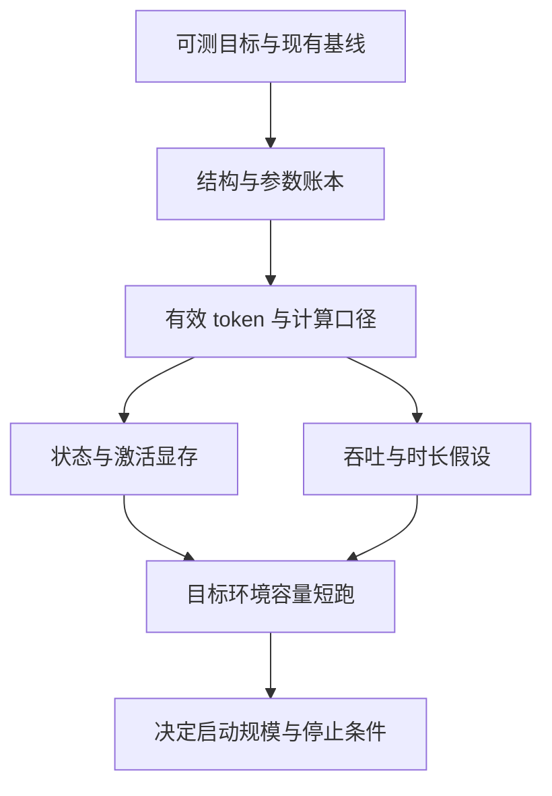
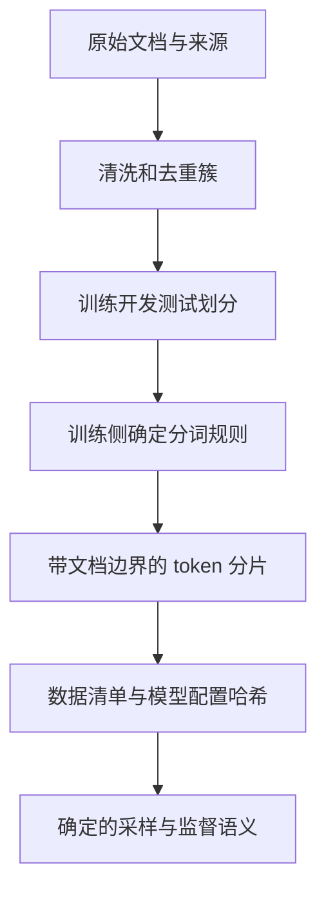
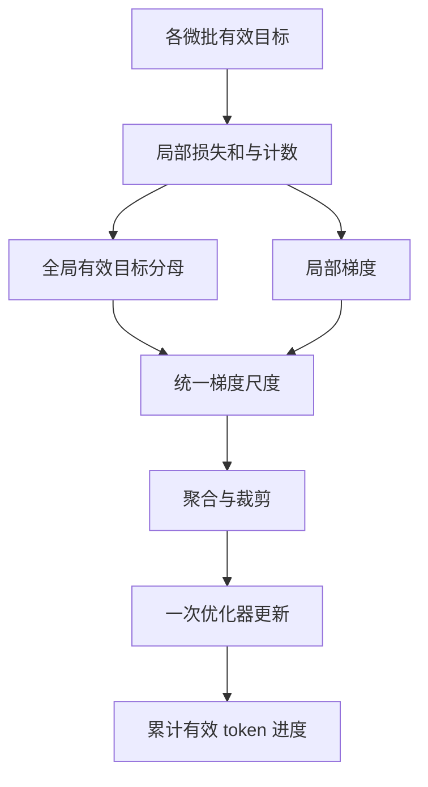
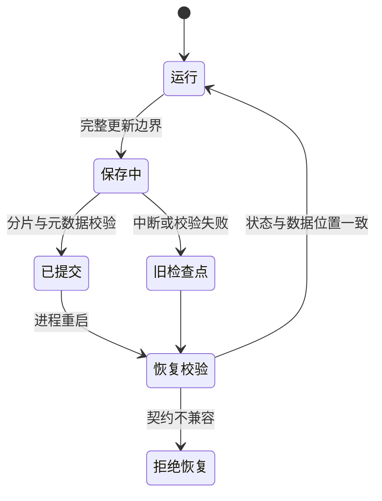
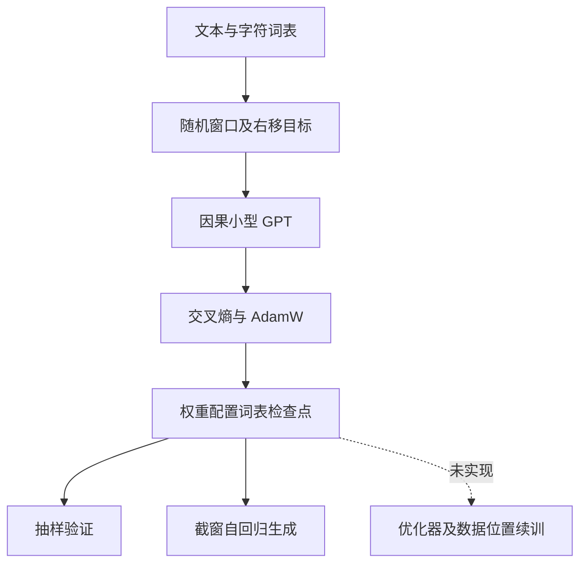
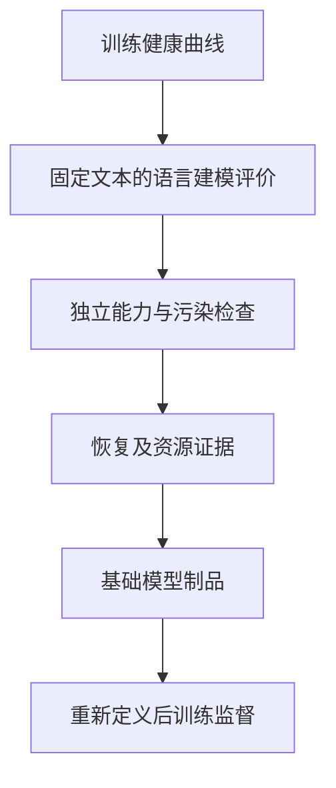

# 第5章 从零训练一个 LLM：一条可复现的工程路径

前四章分别解释了 Transformer 的一次前向计算、预训练如何形成基础能力、后训练如何塑造行为，以及推理期怎样用额外计算改善候选结果。本章把这些原理收束成一次可以立项、执行、恢复和验收的训练工程：先证明为什么需要从随机初始化开始，再把参数、数据、计算和显存放进同一份预算，最后用训练记录和分层评估说明模型究竟学到了什么。

本章讨论两个尺度。第一个是仓库中可以在普通开发环境运行的字符级 GPT 实验，用来观察 next-token prediction、因果注意力、反向传播、评估和生成的完整闭环。第二个是 1,147,766,784 参数、230 亿 token 的教学计划，用来练习真实项目中的预算和门禁。后者只是一组经过复算的设计值，本书没有执行这次大规模训练，也没有测得相应的吞吐、时长或能力结果。

文中的数字分为三类：引用公开论文或项目记录的事实；由明确公式得到的教学算例；需要在目标环境实测后才能决定的工程参数。三者不能互相替代。公开项目可以说明训练配方和数量级，却不能证明本书的计划会得到相同结果。

## 5.1 立项与可审计的训练预算

从零训练意味着模型参数从随机初始化开始，通过预训练语料学习 token 的条件分布。它交付的是基础模型及其训练证据，而不是天然会对话、能访问实时事实或拥有工具权限的助手。第 2 章 已经区分预训练、继续预训练和后训练；第 3 章进一步解释 SFT 与偏好优化。本章只负责从训练立项到基础模型验收的工程闭环。

### 先证明“从零”是必要变量

从零训练通常有四类合理目标：

- 教学或研究需要完整观察数据、模型、优化器和评估之间的因果关系；
- 目标语言、领域或符号体系与现有模型的 Tokenizer 和预训练分布差距很大；
- 模型结构、参数规模或部署形态有明确约束，现有权重无法满足；
- 数据来源、训练过程和中间制品需要由团队完整掌握，以支持审计或复现实验。

立项之前应建立一个成本更低的基线。知识需要实时更新时，先比较检索；模型已经懂任务但输出协议不稳定时，先比较 SFT 或约束解码；只需降低延迟时，先比较更小的现有模型、量化和推理优化。若这些基线已经满足验收条件，从零训练便没有可解释的增量目标。

一份合格的立项说明至少回答：现有模型在哪些冻结测试集上失败；失败来自知识、Tokenizer、结构还是行为；从零训练准备改变哪个变量；成功门槛是什么；预算耗尽但没有达到门槛时怎样停止。没有这些条件，训练结束后只能看到一个新的 checkpoint，却无法说明这笔计算换来了什么。

TinyLlama 公开了 1.1B 小型语言模型的训练路线，可用于观察小模型怎样采用成熟的 Llama 类结构与大规模语料。[[1]](#ref-1) 本章以固定版本论文说明预算原则，以本地字符 GPT 的固定代码基线说明实现边界，不用移动的项目 README 推导性能。

这些项目没有替本章完成复现。硬件、数据、框架版本、算子、训练 token 和评估脚本只要有一项不同，时长和质量就不能直接横向比较。公开记录用于提出可检验假设，目标环境中的结论仍需本项目证据。

Transformer 用注意力和逐位置前馈网络处理序列，原始论文奠定了这条可并行训练的结构路线。[[2]](#ref-2) 但“模型定义正确”只是训练成功的一个前提。完整工程还需要把以下证据连接起来：

| 决策 | 必须留下的证据 | 失败时首先回查 |
| --- | --- | --- |
| 数据 | 来源、许可、去重簇、切分、Tokenizer 和分片哈希 | 泄漏、污染、配比和边界 |
| 模型 | 完整配置、参数计数、初始化和代码版本 | 形状、权重共享和数值范围 |
| 优化 | 有效 token、全局批、学习率、优化器和精度 | loss 归一化、梯度与调度 |
| 系统 | 峰值显存、吞吐、通信和故障记录 | 激活、临时缓冲和数据等待 |
| 评估 | 固定数据、提示、指标、样本数和 checkpoint | 污染、随机波动和口径变化 |

这张表也是本章的责任边界：第 1、2 章提供结构和预训练理论，第 5 章把它们变成一次可验收执行；分布式训练框架的内部实现留给后续 Infra 章节。

训练预算应先固定参数量 \\(P\\)、训练 token 数 \\(N_{\mathrm{tok}}\\)、上下文长度 \\(T\\)、全局批大小和可用设备，再决定训练日程。Chinchilla 的工作说明，在给定训练计算下，模型规模与训练数据需要联合配置；它并没有规定所有项目都必须永久采用一个固定的“每参数 token 数”。[[3]](#ref-3) 将预期推理成本纳入目标后，较小模型训练更多 token 可能更经济。[[4]](#ref-4) 当唯一数据不足时，重复使用也存在收益递减，必须在自己的数据与规模上测量。[[5]](#ref-5)

### 参数计数：先写假设，再报总数

教学计划采用一个现代 Decoder-only 配置：

| 配置项 | 取值 |
| --- | ---: |
| 残差宽度 \\(D\\) | 2,048 |
| 层数 \\(L\\) | 24 |
| Query 头数 \\(H_q\\) | 16 |
| KV 头数 \\(H_{kv}\\) | 4 |
| 每头维度 \\(d_h\\) | 128 |
| SwiGLU 中间宽度 \\(D_{ff}\\) | 5,632 |
| 词表 \\(V\\) | 32,000 |
| 输入输出 Embedding | 共享 |

忽略线性层 bias，使用两组 RMSNorm 参数。GQA 注意力的 Q、K、V 和输出投影参数合计为

\\[
P_{\mathrm{attn}}
=D d_h\left(2H_q+2H_{kv}\right).
\\]

式中第一个 \\(H_q\\) 来自 Q，两个 \\(H_{kv}\\) 来自 K/V，第二个 \\(H_q\\) 来自输出投影。SwiGLU 使用 gate、up、down 三个矩阵，参数为 \\(3DD_{ff}\\)。逐项结果是：

| 部分 | 参数量 |
| --- | ---: |
| 每层注意力 | 10,485,760 |
| 每层 SwiGLU FFN | 34,603,008 |
| 每层两组 RMSNorm | 4,096 |
| 24 层合计 | 1,082,228,736 |
| 共享 Embedding | 65,536,000 |
| 最终 RMSNorm | 2,048 |
| **总计** | **1,147,766,784** |

若输出投影不与输入 Embedding 共享，还需增加 65,536,000 个参数，总计 1,213,302,784。这个差异必须写进配置，不能只用“约 1.15B”掩盖权重共享假设。

### FLOP 口径与训练时长

本章把一次浮点乘法和一次浮点加法各计为 1 FLOP，因此矩阵乘法的一个 multiply-add 计 2 FLOPs。对 Dense Transformer，\\(6PN_{\mathrm{tok}}\\) 是常用的模型参数相关训练 FLOPs 粗估：前向约 \\(2P\\)，反向约为前向的两倍。它没有精确覆盖注意力分数计算、激活重计算、Embedding 查表、归一化、优化器和通信。此处假定近似全监督、没有大量补齐，监督目标数近似实际执行的 token 位置数；loss mask 为零的位置仍可能参与前向与反向，padding 也可能占用稠密计算。存在这些开销时，应分别记录监督 token 与执行位置，按实际形状估算计算，不能直接用监督计数代替全部算力。

为显式表示长序列注意力的影响，本书使用教学近似：

\\[
F_{\mathrm{tok}}
\approx 6P+\kappa LTD,\qquad \kappa\in[6,12].
\\]

\\(\kappa=12\\) 近似完整计算 QK 与 AV 的前向和反向；\\(\kappa=6\\) 表示实现利用因果三角结构跳过约一半分数计算。不同内核的实际执行量可能偏离这个区间。激活检查点带来的重计算属于硬件实际执行 FLOPs；若性能报告的“模型 FLOPs”仍采用理论前向—反向口径，就不能把重计算悄悄加入 MFU 分子。

教学计划固定 \\(N_{\mathrm{tok}}=23{,}000{,}000{,}000\\)，它不是精确的 \\(20P\\)：后者为 22,955,335,680。230 亿 token 相当于每参数约 20.039 个 token。复算得到：

| 计数口径 | 总训练 FLOPs |
| --- | ---: |
| 仅 \\(6PN_{\mathrm{tok}}\\) | \\(1.5839\times10^{20}\\) |
| 加注意力项，\\(\kappa=6\\) | \\(1.8617\times10^{20}\\) |
| 加注意力项，\\(\kappa=12\\) | \\(2.1396\times10^{20}\\) |

为演示时长换算，假设 8 个加速器、每个设备的计算峰值取 \\(3.12\times10^{14}\\) FLOP/s。这个峰值只是算术输入，执行前必须替换为目标硬件和目标精度下的规格。设模型 FLOPs 利用率为 \\(u\\)，则

\\[
t=\frac{C_{\mathrm{train}}}{8F_{\mathrm{peak}}u}.
\\]

| FLOP 口径 | \\(u=0.3\\) | \\(u=0.4\\) | \\(u=0.5\\) |
| --- | ---: | ---: | ---: |
| 仅 \\(6PN_{\mathrm{tok}}\\) | 58.8 h | 44.1 h | 35.3 h |
| \\(\kappa=6\\) | 69.1 h | 51.8 h | 41.4 h |
| \\(\kappa=12\\) | 79.4 h | 59.5 h | 47.6 h |

这些时间由假设推导，不是训练记录。Llama 3 报告过不同大规模配置下约 38%–43% 的 BF16 MFU，并说明了多维并行与大量中断处理。[[6]](#ref-6) Megatron-LM 也报告过大规模 GPU 集群上的并行训练效率。[[7]](#ref-7) 它们只证明相关范围曾在不同工作负载上出现，不能用来预设本计划的利用率。

MFU 衡量理论模型 FLOPs 与设备峰值的比值；硬件 FLOPs 利用率还会计入重计算等实际操作。两者分子不同。若两份报告没有采用同一 FLOP 模型、精度和峰值定义，百分比不能直接比较。

设序列长度 4,096，每卡微批 8 条序列，8 个数据并行 rank，梯度累积 4 次，则名义全局批为

\\[
B_{\mathrm{tok}}
=4096\times8\times8\times4
=1{,}048{,}576\ \text{token}.
\\]

精确处理 230 亿 token 需要

\\[
\left\lceil
\frac{23{,}000{,}000{,}000}{1{,}048{,}576}
\right\rceil
=21{,}935\ \text{step}.
\\]

最后一步只有 534,016 个有效 token。若仍运行一个完整批次，总量会变成 23,000,514,560，多出 514,560 个 token。训练代码必须选择“最后一批裁短”或“接受超额 token”，并在 manifest 中记录，不能同时声称精确 230 亿 token 和 21,935 个满批。

显存也必须说明精度布局。在“bf16 参数 2 字节、bf16 梯度 2 字节、fp32 主参数 4 字节、fp32 Adam 一阶和二阶状态各 4 字节”的假设下，模型状态为 \\(16P\\) 字节，即 18.364 GB（17.103 GiB）。这不是所有优化器和框架的固定值：有的实现不保留 fp32 主参数，有的梯度使用 fp32，还有的状态被量化。

ZeRO 将优化器状态、梯度和参数逐级切分；在上述 16 字节布局和数据并行度 \\(N_d\\) 下，三个阶段的每卡模型状态可分别近似为 \\(4P+12P/N_d\\)、\\(2P+14P/N_d\\) 和 \\(16P/N_d\\)。[[8]](#ref-8) 8 路完全切分的理论模型状态约为每卡 2.296 GB。这个数字不含激活、临时 all-gather、通信 bucket、CUDA context、内核 workspace、碎片和数据 batch，不能据此断言配置一定放得下。

PyTorch FSDP 也以参数、梯度和优化器状态切分来降低每个 worker 的常驻模型状态，并把通信重叠与初始化作为扩展问题。[[9]](#ref-9) 采用它仍需实测完整训练 step 的峰值，不能用理论分片值替代运行证据。

GQA 对推理缓存的影响可以独立计算。批量为 1、上下文 4,096、24 层、4 个 KV 头、头维 128、bf16 时：

\\[
M_{\mathrm{KV}}
=2\times24\times4096\times4\times128\times2
=201{,}326{,}592\ \text{bytes}
=192\ \text{MiB}.
\\]

同条件下 16 个 KV 头的 MHA 为 768 MiB。这里计算的是单序列 KV Cache，不是训练激活。参数预算、训练显存和推理缓存必须分账。

预算首先是一组相互约束的选择，而不是把目标参数量填入计算器。在本章的教学计划里，宽度和层数决定大部分参数，词表影响输入输出表，序列长度影响注意力与激活，训练 token 决定处理总量。若把序列长度加倍而保持每步序列数不变，名义全局 token 批也加倍，固定总 token 下更新次数减少；若保持全局 token 批不变，则必须减少序列数或调整累积。两个实验都叫“扩展上下文”，实际同时改变的优化条件可能完全不同。

可以沿着词表变更追踪一次预算传播。假设仍用共享嵌入，将词表扩大一倍，会直接增加词表矩阵参数；若新的切分让文本更短，同一原始语料的 token 数又会减少。此时按“训练二百亿 token”比较，两模型看到的原始文本量已经不同；按相同原始文本比较，输出层计算和更新步数又不同。公平比较需要同时报告原始字节、有效目标 token、参数与计算，说明固定的是哪一项。一个单独的参数或 token 数字不能表达完整实验。

训练 token 还要与唯一数据量分开。假设有十亿个清洗后 token，遍历二十轮会处理二百亿个 token，却没有获得二百亿个独立内容。重复仍然可能改善优化，但后续收益、记忆与过拟合风险不同。数据约束研究为这种区别提供了经验依据，不能由某次实验的有效轮数推出所有语料都可重复相同次数。预算表应把唯一文本规模、重复采样次数和有效训练总量分列，数据新增与算力新增才不会被混成同一种投入。

时长表中的利用率也不是一个从模型名称就能确定的常数。它汇总了算子效率、通信、数据等待、设备闲置等因素，并受到使用何种理论 FLOP 分子的影响。教学计划若用只含参数主项的分子，测得利用率后又在估算时加入注意力项，等于换了标尺。正确流程是先固定计数模型，用相同计数模型解释短跑，再按相同工作负载外推；若长度、精度或并行拓扑改变，应重新检查利用率。报告中较高的百分比只有在口径一致时才具有可比意义。

还应区分连续计算时间与项目日历时间。前者可以用计算量和有效速率估算，后者包括准备数据、评估、保存、设备排队、故障重算及人工分析。假设每次完整检查点之间发生故障，未提交工作需要重做，这部分不能从模型 FLOP 主项中自动得到。为教学估计增加一个明确标注的中断预算是合理的，但不能把未经测量的固定百分比写成所有集群的标准。先记录短跑中实际保存与评估时间，至少可以把这两项从未知量变成有条件的测量值。

训练容量与交付容量也不是同一个约束。使用状态分片能降低训练期间每卡常驻模型状态，却不意味着最终单设备推理就装得下全部权重和长上下文缓存。相反，一个推理可以运行的小模型，训练时还需要梯度、优化器和反向激活。立项时可以分别设训练资源上限与部署资源上限，再检查同一结构是否同时满足。若部署约束是主要驱动力，训练更久的小模型、蒸馏或压缩都应进入候选比较，而不是只选择训练阶段吞吐最高的结构。

最后一批的精确性看似只有几十万个 token，却代表整个账本的定义是否一致。若最后一步按有效目标裁短，梯度仍需除以这一批实际目标数；若为了静态形状补齐，补齐位置不能贡献损失；若选择超额训练，则累计进度必须记录真实值。学习率调度与日志也要沿用同一选择。不能把预算表的“计划总量”直接写成训练完成的“实际总量”，这两列只有在计数证据一致时才能相等。

因此本节的输出应是一份可重算的假设集合：哪个参数由配置确定，哪个数量由数据统计得到，哪个效率来自引用，哪个性能必须由目标设备测量。预算中的未知项不是缺点，未标明的未知项才会使评审失去作用。后面的数据、更新和恢复流程，都是在逐步把这些未知项转成能够检查的状态。

## 5.2 数据与配置成为不可变输入

第 2 章 已经解释清洗、去重、Tokenizer、样本边界和污染。本节把这些原则落成两个不可变制品：数据 manifest 与模型 config。训练任务只接收经过验收的制品哈希，不在启动时临时改变过滤规则或模型结构。

### 从来源到 token 分片

数据管线建议按以下顺序执行：

1. 定义目标分布，列出语言、领域、代码、文档类型和时间范围；
2. 保存来源、许可、快照和退出机制，过滤明显无效或敏感内容；
3. 在全量文档上做精确与近似去重，形成去重簇；
4. 按去重簇划分训练、验证和冻结测试集；
5. 仅用训练侧规则确定 Tokenizer 与采样配比，检查各切片 token/字符或 token/字节比例；
6. 编码并写入有校验和的分片，显式记录文档边界和是否允许跨文档注意力；
7. 在训练前对评估集做污染比对，并冻结评估版本。

FineWeb 展示了大规模网页数据过滤和数据消融的公开路线，可用于理解每项处理如何影响数据质量；它的规模和许可检查不能由“公开可下载”四个字代替。[[10]](#ref-10) Pythia 公开了训练数据顺序及大量中间 checkpoint，说明数据顺序本身也是可复现实验的一部分。[[11]](#ref-11)

manifest 至少包含：

| 类别 | 字段 |
| --- | --- |
| 来源 | 数据集名称、原始位置、许可、快照、采样权重 |
| 处理 | 过滤规则版本、去重算法、去重簇与切分方法 |
| Tokenizer | 模型文件哈希、词表大小、特殊 token 和归一化规则 |
| Packing | 序列长度、文档分隔符、跨文档可见性、loss mask |
| 统计 | 每个切片的文档数、字节数、token 数和重复轮数 |
| 污染 | 基准版本、精确/近似匹配方法和处理结果 |
| 顺序 | 分片列表、采样器状态定义和恢复位置 |

表内每个字段都要写入实值。训练入口遇到未知哈希、空 token 分片或未完成的污染记录时应拒绝启动。恢复依赖“下一份尚未消费数据的逻辑位置”，仅保存一个全局 step 无法在可变长度或动态采样下还原数据位置。

数据验收不能只看总 token 数。对每个主要切片，应随机抽取编码前文本、token 序列和解码结果，检查 Unicode 归一化、控制字符、代码缩进、数字、URL 与特殊 token。再统计文档长度、token/字节比、重复次数、语言置信度和被过滤原因。总体分布正常但某个低占比切片损坏时，总平均很难暴露问题；切片报告必须保留样本量和分位数。

文档边界需要同时约束注意力和损失。如果允许多个文档 packing 到同一序列，要明确后一文档能否读取前一文档；若禁止跨文档读取，就生成 block-diagonal 可见性，而不只是插入 EOS。无论是否跨读，EOS 是否参与 next-token loss、序列尾部怎样补齐、被截断文档是否保留，都要写入 manifest。训练和验证必须复用同一套边界语义，否则 loss 差异可能来自样本构造而非泛化。

Tokenizer 的验收至少覆盖三组指标：压缩效率看各语言和格式的 token/字节比；可逆性检查正常文本的编码解码；鲁棒性检查未知字节、异常 Unicode 与超长连续字符串。词表越大，序列可能更短，但 Embedding 参数和输出计算也会增加。应把词表大小与模型总参数、目标语言切分和推理成本一起比较，而不是只追求更低 token 数。

### 配置来自预算约束

模型 config 要完整表达第 1 章的前向计算：词表、上下文长度、宽度、层数、Q/KV 头、每头维度、FFN 类型与宽度、位置机制、归一化、dropout、bias、Embedding 是否共享、初始化和精度。LLaMA 采用 Pre-Norm、RMSNorm、RoPE 与门控激活，提供了现代 Decoder-only 配置的一种成熟参照。[[12]](#ref-12) 这不表示同一组合在所有规模和语言上都最优。

教学计划选择 GQA、RoPE、RMSNorm 和 SwiGLU，是为了演练现代结构的参数与缓存账本。选定后仍需先在小模型上检查：

- 参数计数脚本与框架实际参数总数一致；
- Q 头数可以被 KV 头数整除，旋转维度与每头维度一致；
- Causal Mask、Padding Mask 和文档边界符合第 1 章的注意力小节 的可见性定义；
- 权重共享在模型对象和 checkpoint 中都成立；
- 初始化后 logits、激活和梯度没有异常尺度；
- 同一随机种子和环境下，短序列前向结果满足约定容差。

改变上下文长度不仅改变位置范围，也改变注意力 FLOPs 和训练激活。改变词表既改变序列长度，又改变 Embedding 与输出层参数。配置评审应重新计算整张预算表，不能只改一个配置字段。

配置还要带有可执行的不变量。例如 \\(D=H_qd_h\\)、\\(H_q\bmod H_{kv}=0\\)、最大位置不小于训练序列长度、共享 Embedding 时两个模块引用同一参数。加载 checkpoint 时先比对 config 和 Tokenizer 哈希，再分配大张量；这样可以在占用大量显存前拒绝不兼容制品。每次结构变更都重新运行参数计数、短前向、反向和保存加载往返，避免“文件能读”掩盖语义变化。

### 两个模型尺度不能混写

本章的 1.15B 计划使用 GQA、RoPE、RMSNorm、SwiGLU 和共享 Embedding。仓库实验则是一个字符级小型 GPT：它使用普通 MHA、学习式绝对位置 Embedding、LayerNorm、GELU FFN，并且输入 Embedding 与语言模型输出层没有共享。两者的目标也不同：前者用于预算演练，后者用于验证最小训练闭环。

把实验跑通不能证明 1.15B 配置正确；把 1.15B 的参数表写对，也不能证明实验代码实现了 GQA 或分布式训练。后续所有观察都必须注明来自哪个尺度。

数据清单的价值在于使“同一训练数据”成为可检验命题。仅保存一个下载地址不够：远端文件可能更新，清洗脚本可能改变，Tokenizer 也可能使用另一套归一化。一次训练需要能回答某个窗口来自哪个原始文档、经过哪些处理、属于哪个划分以及为何被采样。哈希能够识别文件内容，却不能单独说明内容的语义来源；处理版本和来源记录则解释数据为什么变成现在这样。二者共同构成复查链，而不是彼此替代。

去重与划分的先后顺序会影响验证集的独立性。设同一文章被转载三次，标题、空格和标点略有差异。按文件随机切分，三份文本可能落入不同集合；精确哈希无法发现轻微改写，近似去重簇却可以把它们关联起来。先形成簇再划分，减少的是跨集合共享事实与表达的捷径。若近似算法把不同文档误并，也会减少数据覆盖，因此去重不能只有一个过滤比例，还需要抽样检查误合并与漏合并，说明阈值对应的取舍。

训练配比同样是一种目标定义。假设代码占原始语料很小比例，却被高频重采样，它在梯度中的影响可能远大于磁盘占比；长文档按 token 采样，与每文档等概率选择，也会产生不同权重。应记录最终被消费的有效 token 配比，而不仅是下载时的文档配比。某个来源样本很多但文本很短，另一来源样本少却每条很长，仅比较行数容易得出相反结论。变化中的配比还需要按阶段记录，才能解释模型在不同时间偏向哪些分布。

文档边界可以用两个短例子讲清。把文档甲末尾的“答案是”与文档乙开头的一个数字直接拼接，普通下一 token 目标会把这个数字当成甲的续写。若任务定义允许连续文档流，这可能就是选择的训练语义；若希望各文档独立，则需要在可见性与目标上处理边界。仅插入结束符不会使后文不可见于前文之后的查询，也不会自动删除所有跨边界预测。模型训练的是实际提供的条件序列，不能靠清洗文档中的一句说明改变注意力。

截窗还会改变每个目标获得的上下文。相同文本被切成互不重叠块时，块首目标缺少上一块历史；使用重叠滑窗则可能多次监督同一个目标。两种策略都可用，但总 token 计数要说明是否包含重复目标，评价也要采用一致的上下文窗口。若一个模型在长上下文条件下得到更低 loss，另一个在频繁重置条件下评估，差别不能全部解释成模型能力。窗口规则是评估协议的一部分，应与 Tokenizer 一起固定。

Tokenizer 的训练也属于数据处理学习。字符词表只需要收集不同字符，子词词表却会依据频率与合并规则决定如何分段。若用冻结测试文本帮助选择词表或归一化规则，测试信息已经进入开发流程，即使测试答案没有直接进入模型梯度。严格实验应在训练侧确定规则，再让验证与测试使用同一编码器。遇到无法编码内容时，需要按已定义的未知字符或字节回退策略处理，而不是临时查看测试内容扩词表后继续报原协议分数。

模型配置的不变量可以分成形状与语义两层。形状检查确保矩阵能乘、头能分组、位置范围足够；语义检查确保这些轴的含义正确，例如输出投影是否回到残差宽度、KV 分组是否与查询头对应、共享权重是否真是同一个参数。两个模型可能拥有完全相同的参数数量，却使用不同的归一化或位置机制。参数总数核对是必要的，但不足以证明实现相同；还应把少量可手算输入的前向和梯度行为纳入检查。

共享嵌入尤其容易在保存加载时被误解。两个张量数值相同不等于共享同一个可训练参数；若创建两个独立参数并分别复制数值，后续更新可能使它们分离。真正共享还影响优化器状态与参数计数，不能在预算中按一份计算、代码却更新两份。恢复时应检查对象绑定关系或框架提供的共享契约，而不只是比较加载后数值。检查点可以保存足够信息来重建共享关系，但加载程序必须执行同一结构定义。

配置版本还应区分“改变训练函数”与“改变执行安排”。调整宽度、位置机制或损失边界会改变模型或目标；调整预取线程可能只改变性能，也可能通过随机流顺序间接改变样本。不能预先把某项配置标成纯工程参数后就不记录。比较实验时应列出变化项，并说明预期它影响数学定义、样本顺序还是执行效率。观测到不符合预期的差异，才有明确的排查入口。

对本章两种尺度，最有用的做法是保存两份独立配置说明。字符实验的学习式位置和普通多头注意力是一套真实实现，现代教学计划的旋转位置和分组键值是另一套设计。共同的下一 token 目标允许它们用于解释同一学习原理，但不能让前者自动成为后者的实现验证器。若未来要建立同结构代理，应单独实现并核对现代结构的小配置，再讨论从代理到大模型的迁移。

数据与模型清单在训练启动后应保持身份稳定。发现清洗错误时可以停止、修正并创建新版本，不能原地替换分片而让旧日志继续引用同一个哈希名。恢复程序若读到不匹配的数据或配置，应给出明确原因。这样的约束让异常轨迹可以回放：不是因为所有数据永远正确，而是因为错误发生时能够确定模型究竟吃到了哪一版输入。

## 5.3 一次参数更新究竟优化什么

训练循环的核心不是调用反向传播接口，而是定义“哪些 token 贡献了怎样的梯度”。第 2 章 2.2 给出了 next-token cross entropy，第 3 章的监督契约与 SFT 小节 进一步讨论监督位置。预训练通常让所有合法目标位置参与损失；padding、跨文档禁读位置和无效样本必须按训练契约处理。

### 有效 token 归一化

设第 \\(r\\) 个数据并行 rank 在一个梯度累积窗口内的有效 token 集合为 \\(\mathcal{T}_r\\)，局部未归一化负对数似然和为

\\[
S_r=\sum_{t\in\mathcal{T}_r}-\log p_\theta(y_t\mid y_{<t}),
\qquad
N=\sum_{r=1}^{W}|\mathcal{T}_r|.
\\]

目标损失是 \\(L=(\sum_r S_r)/N\\)。在默认且没有改变通信语义的配置下，PyTorch DDP 在反向传播中对 \\(W\\) 个 rank 的梯度取平均。若每个 rank 直接反传 \\(S_r/N\\)，最终梯度会额外缩小 \\(W\\) 倍。因此在“DDP 平均梯度”的语义下，每个 rank 应反传

\\[
\widetilde L_r=\frac{W}{N}S_r,
\\]

DDP 平均后得到

\\[
\frac1W\sum_{r=1}^{W}\nabla\widetilde L_r
=\nabla\frac{\sum_rS_r}{N}.
\\]

采用这一前置损失缩放方案时，需要在第一次 backward 前知道整个累积窗口的全局有效 token 数 \\(N\\)：先准备窗口内的 microbatch，统计本地 mask，再对计数做一次全局求和。若框架对梯度求和而非求平均，缩放因子就不能乘 \\(W\\)；实现必须按框架语义写测试。DDP 文档说明梯度聚合及 no_sync 的作用范围；自定义通信 hook 和非均匀输入 join 配置需要另核对。[[13]](#ref-13)

下面是语义示意，并非仓库实验当前 API。示例假设全局有效计数大于零，各 rank 参与相同的同步序列；no_sync 范围同时包含 forward 与 backward，不能只包住 backward：

~~~python
microbatches = prefetch_accumulation_window()
local_tokens = sum(batch.loss_mask.sum() for batch in microbatches)
global_tokens = all_reduce_sum(local_tokens)

optimizer.zero_grad(set_to_none=True)
for index, batch in enumerate(microbatches):
    with ddp_no_sync(enabled=index + 1 < len(microbatches)):
        logits = model(batch.input_ids)
        local_loss_sum = cross_entropy_sum(
            logits.float(), batch.labels, batch.loss_mask
        )
        ddp_scaled_loss = local_loss_sum * world_size / global_tokens
        ddp_scaled_loss.backward()

clip_grad_norm_(model.parameters(), max_norm)
optimizer.step()
~~~

对每个 microbatch 先按自己的有效 token 数求平均，再把这些平均值相加，会让短批与长批获得相同权重；各 rank 有效 token 不等时，先求本地均值再由 DDP 平均也会产生同类偏差。日志中的全局 loss 应另外对 \\(S_r\\) 与 token 计数做求和，再相除，不能把 rank 的平均 loss 再简单平均。

### 全局批、优化器与日程

中文教材用小批量样本均值解释梯度聚合与向量化效率。[[14]](#ref-14) 在本章中，全局批用有效 token 表达，才能跨序列长度比较。批越大，单位更新的梯度噪声通常越小，但固定 token 预算下的更新次数也会减少。梯度噪声尺度提供了一种测量“有用批大小”的方法，其结论依赖任务和训练阶段。[[15]](#ref-15)

可以用两 rank 的手算暴露错误归一化。假设 rank 1 有 3 个有效 token，局部 loss 和为 6；rank 2 有 1 个有效 token，loss 和为 4。正确全局均值是 \\((6+4)/(3+1)=2.5\\)。若先算局部均值再由 DDP 平均，结果是 \\((6/3+4/1)/2=3\\)，短 rank 被放大。按前述公式，每个 rank 分别反传 \\(2S_r/4\\)，DDP 再平均，才恢复全局 token 均值。这个测试不需要大模型，应成为分布式训练入口的单元契约。

一次“step”也要固定语义：本章把它定义为完成一个全局梯度累积窗口并调用一次 optimizer step。日志同时记录累计有效 token，学习率日程优先按 token 推进。若最后一批裁短，按固定 step 调度和按 token 调度会产生轻微差异；230 亿计划应明确采用哪一种，恢复时也必须沿用。

优化器采用 AdamW 时，权重衰减与 Adam 的自适应梯度更新解耦；这与把 L2 项直接加入 Adam 梯度不是同一更新。[[16]](#ref-16) 需要保存并评审的参数包括峰值学习率、\\(\beta_1\\)、\\(\beta_2\\)、\\(\epsilon\\)、权重衰减作用范围、梯度裁剪、warmup、稳定段、衰减段和最小学习率。Norm 与 bias 是否衰减也要明确。

当总 token 预算可能变化时，Warmup-Stable-Decay 可以让稳定段 checkpoint 分叉进入不同长度的衰减阶段。MiniCPM 报告了 WSD 与小模型训练策略。[[17]](#ref-17) 关于固定时长之外的 scaling 研究也说明，稳定训练后再冷却有助于复用一次主体训练做不同预算比较。[[18]](#ref-18) 这些结果来自特定模型和数据，本计划必须通过代理模型扫描学习率与衰减长度，不能直接照抄公开数值。

### 小规模预演与数值精度

大模型训练中的某些不稳定现象可以在小模型、高学习率实验中提前出现，例如注意力 logit 和输出 logit 异常增长。[[19]](#ref-19) 因此主训练前应构造同架构族的代理模型，逐步增加学习率，记录 loss、梯度范数、激活、logit、更新范数和溢出次数。代理实验用于发现危险区间，不保证大模型的最佳值能按比例直接迁移。

μTransfer 研究表明，在满足 μP 参数化条件时，可以从较小模型迁移一部分最优超参数。[[20]](#ref-20) 这需要改变初始化和参数化规则；普通参数化的小模型搜索结果不能贴上 μP 标签后直接迁移。

bf16 与 fp32 具有相同的指数位宽范围，相关研究在多类训练任务中观察到它可以保持 fp32 的结果。[[21]](#ref-21) 具体项目仍需检查归一化、softmax、loss 累加和优化器状态的精度。可执行的门禁是：先得到一个小规模 fp32 参考曲线，再比较 bf16 的 loss、梯度和输出分布；出现 NaN/Inf、异常 logit 或持续偏离时停止扩大规模。

梯度裁剪阈值没有跨项目通用常数。应先记录未裁剪梯度范数分布，再确定阈值并监控裁剪比例。若大多数 step 都被裁剪，问题通常不只是“阈值太小”，还可能来自学习率、异常数据或错误归一化。

上述求和与计数并不只影响日志，它们决定每个目标在参数更新中的权重。把样本长度作为一个变化因素即可看到：一段很短的回答若先单独求均值，再与长回答等权平均，短回答的每个 token 会获得更大权重。预训练希望优化全体有效目标平均时，这不是实现误差的小扰动，而是更换了目标。反过来，如果研究明确希望每篇文档等权，那么文档均值也可以合理；关键是写明目标，不用一个含混的 mean 参数代替建模选择。

可以把一个完整更新窗口视为一个大集合，再把它任意切成微批和 rank。若目标及前向计算相同，正确归一化后的梯度应尽可能接近不切分的参考梯度。这个等价性存在前提：参数在窗口中不更新，监督目标相同，随机性受到控制；若模型含跨样本统计、随机掩码或不同数值规约，比较还要明确容差。测试时可以先关闭 dropout，使用小型确定输入，逐项排除这些因素，避免把随机差异误判成聚合错误。

前置损失缩放不是唯一方案。另一种数学上可行的路径是，各微批先反传未归一化损失和，累积并按默认 DDP 语义得到各 rank 梯度和的平均，等到全局有效目标数确定，再将所得梯度统一乘世界大小除以全局计数，然后裁剪和更新。它利用梯度对常数缩放的线性关系。两种方案的数值路径可能不同，后缩放期间梯度的动态范围也可能更大；混合精度、通信 hook 和溢出处理必须配合验证，不能把代数等价直接当作任意框架实现等价。

不论选择哪条路径，都不应再机械除以累积次数。若已经按整个窗口有效 token 总数归一化，再除一次微批数，就额外缩小了梯度；若仅把每个等长微批的均值相加，则通常需要相应平均。所谓“梯度累积要除以几”没有脱离损失定义的统一答案。先写清每次 backward 所表示的量，再沿通信与缩放追到 optimizer step，才知道最终分母是什么。学习率不应被用来长期补偿一个未被解释的归一化错误。

零目标窗口需要单独定义。如果某 rank 的所有位置都被屏蔽，但其他 rank 仍有有效目标，该 rank 不能随意提前退出而破坏共同的集合通信次序；它需要按实现契约参与相应计算或同步。如果全局计数为零，则本窗口没有可定义的平均监督损失，应由所有 rank 一致跳过更新并记录原因。不能以加一个很小的分母常数掩盖数据问题，也不能让某个 rank 更新而另一个不更新。这个边界在大量过滤、变长样本与异常数据处理时尤其重要。

梯度裁剪应放在目标梯度已经成形的位置。若每个微批先独立裁剪，再把结果相加，得到的通常不同于先汇总再裁剪；若各 rank 本地裁剪后再平均，也会改变全局方向。全局范数裁剪把整体梯度按同一个比例缩小，以限制其范数，但它不修正标签错误，也不保证优化一定稳定。对分片梯度，所需范数还要包含所有相关分片，不能把局部范数当作全模型范数。顺序与统计范围都是算法语义，不只是性能细节。

混合精度又增加一层尺度。使用动态损失缩放时，同一累积窗口内 scale 必须固定，各微批梯度始终以同一尺度累加。待本次更新的全部微批反向完成后，每个 optimizer 只调用一次 `scaler.unscale_(optimizer)`，再检查和裁剪未缩放梯度；`scaler.step` 与 `scaler.update` 都在完整窗口边界执行，多优化器时在各自 step 后统一 update。不能在每个微批后 unscale，也不能中途改变 scale，否则不同尺度的梯度会混在一起。[[22]](#ref-22) 若检测到溢出而跳过更新，学习率日程、成功更新计数和数据消费计数不一定同步前进，需要明确策略。数据可以已经被读取甚至前向过，但参数没有改变；只保存一个 step 数就无法区分这些进度。

AdamW 的状态说明了为什么梯度相同还不等于下一步参数相同。它使用历史一阶、二阶估计和更新位置，当前梯度经过这些状态后才变成参数变化。重启时只加载权重、重新创建优化器，即使接着读取同一批数据，也相当于从新的优化历史开始。权重衰减还直接作用于参数，其强度与学习率和更新次数有关。固定 token 总量但改变全局批，更新次数会变化，因此不能只保留相同衰减系数就认定正则化效果相同。

日程也有多个进度坐标：已经读取的 token、实际参与损失的 token、已经成功更新的 token，以及 optimizer 调用次数。固定等长无异常训练中，它们可能按简单比例对应；遇到过滤、尾批或溢出跳过就会分离。本章建议至少记录有效监督累计量与成功更新次数，再明确日程依赖哪一个。若采用按 token 变化的学习率，恢复时必须重建相同累计量；若日程根据阶段边界进入衰减，也要保存阶段身份而不仅是当前学习率值。

小批量噪声的直觉同样需要保留假设。对独立、同分布样本，平均可以降低随机估计的方差；语言训练窗口却可能重叠，来自同一文档或重复语料，梯度相关性使名义目标数不等于独立信息数。增大批量还减少固定预算下的更新次数，可能改变到达相同损失所需计算。梯度噪声尺度研究提供了分析工具，并没有规定每个项目都应把全局批开到显存所允许的最大值。吞吐最优与训练效率最优不一定重合。

一个小型更新审计可以把这些因素串起来。先使用四条已知目标，计算不切分的损失与梯度；再分成两个不同有效长度的微批；然后把同样数据分配给两个 rank。比较损失和、计数、裁剪前梯度和更新后的参数。先验证没有裁剪与权重衰减的简单情况，再逐项加入真实配置，才能定位差异来自分母、通信、裁剪还是优化器状态。这是建议的实验设计，本章没有提供其分布式实现，也没有把纸面等式当作测试通过记录。

最后，健康日志应保留归一化之前的量。只保存一个平均 loss，无法知道它下降是模型更好，还是某类长难样本被过滤了；只保存裁剪后的范数，也无法知道原始梯度是否长期异常。把有效目标数、损失和、未裁剪范数、溢出次数与更新是否执行一起记录，异常就能追溯到具体窗口。训练循环由此不再只是反复调用三个接口，而成为一个能够核对“这一步到底学了什么”的过程。

## 5.4 从代理试跑到故障恢复

多 GPU 数据并行的基本原理，是划分样本后聚合梯度，中文教材可作为概念入口。[[23]](#ref-23) 并行策略解决两个不同问题：模型和激活能否放入设备，以及在满足显存约束后能否达到合理吞吐。选型顺序应从实测峰值显存开始，而不是仅根据参数量断言某种并行“必需”或“不需要”。

### 用峰值显存决定并行阶梯

先在缩小的层数、序列和 batch 上测量参数、梯度、优化器、激活和临时缓冲，再逐项外推并用目标配置短跑校验。激活与 batch、层数、宽度、序列长度、注意力实现和重计算有关；临时 all-gather 与通信 bucket 又与 FSDP 配置有关。任何只列 \\(16P\\) 的预算都不完整。

可以按以下顺序增加复杂度：

| 实测结果 | 候选方案 | 新增验证 |
| --- | --- | --- |
| 单卡可容纳模型状态与激活 | 单卡训练，再扩展数据并行 | 多卡 loss 与单卡参考是否一致 |
| 单卡放不下模型状态，单层与激活可容纳 | ZeRO 或 FSDP 切分状态 | all-gather 峰值、通信占比、保存和恢复 |
| 单层或目标激活仍放不下 | 张量并行、序列/上下文并行 | 切分维度、数值误差和集合通信 |
| 多节点规模需要提高流水利用率 | 流水线并行与多维组合 | stage 均衡、气泡、重计算和故障域 |

FSDP 的公开经验说明，完全切分可以支持超过单卡容量的模型，同时把通信和计算重叠作为性能问题。[[9]](#ref-9) Megatron-LM 展示了张量、流水线和数据并行的组合。[[7]](#ref-7) 这些技术带来新的状态和通信边界；1.15B 计划是否需要其中任何一种，必须由目标设备上的峰值测量决定。即使理论模型状态只有每卡约 2.296 GB，4,096 上下文的激活和临时 gather 仍可能主导峰值。

吞吐记录至少包括全局有效 token/s、每卡 token/s、step 时间分解、数据等待、集合通信、激活重计算和峰值显存。MFU 使用第 5.1 节声明的模型 FLOP 口径；若开启重计算，另报硬件实际执行量或明确其未进入 MFU 分子。这样才能区分“模型计算更快”“设备做了更多重计算”和“数据加载不再等待”三种变化。

容量短跑要覆盖稳态之前的峰值：首次优化器更新会创建 Adam 状态，首次保存会产生序列化缓冲，评估可能使用不同 batch，通信库也可能延迟分配 workspace。只测一次前向或第一个 microbatch 会系统性低估峰值。建议依次执行若干训练 step、一次评估和一次 checkpoint，并采集分配峰值、保留峰值与进程常驻内存。随后改变序列长度和 microbatch，验证外推模型是否与实测一致。

### 检查点是一份恢复契约

PyTorch 保存加载教程区分推理权重与包含优化器的通用检查点。[[24]](#ref-24) 本书在此基础上进一步要求数据与随机流一致；用于受控环境精确续训的 checkpoint 至少保存：

- 模型参数和完整模型 config；
- 优化器状态、学习率日程状态与当前更新位置；
- CPU、加速器和各 rank 的随机数状态；
- 数据加载器、采样器、分片、文档偏移和梯度累积窗口边界；
- 动态 loss scaling 或其他数值状态；
- 数据 manifest、Tokenizer、代码和评估版本的哈希；
- 世界大小、并行拓扑与分片元数据。

保存过程应先写临时制品，校验所有 rank 的分片和元数据后再原子发布完成标记。只看到某个文件存在不能证明 checkpoint 完整。分布式恢复还要验证世界大小变化是否受支持；若不支持，就在元数据不匹配时明确失败。

恢复测试应在正式训练前完成：运行到第 \\(k\\) 步保存，分成“不间断继续 \\(m\\) 步”和“重启后继续 \\(m\\) 步”两条路径，比较数据位置、学习率、loss、梯度统计和参数差异。PyTorch 官方复现说明指出，跨版本、平台或 CPU/GPU 并不保证逐位相同。[[25]](#ref-25) 因而验收标准应是同一受控环境中的确定性检查，以及其他环境中预先声明的数值容差，不能把逐位一致扩展成跨平台承诺。

### 用可重放证据诊断故障

训练故障至少分为四类：

| 现象 | 优先证据 | 可能动作 |
| --- | --- | --- |
| 单个或少量 loss spike | 触发批次、token 分布、梯度与 logit | 隔离数据，复现后决定修数据或调优化 |
| NaN/Inf | 首个异常算子、精度、Norm、softmax 和 loss | 回退，用 fp32 或算子级检查缩小范围 |
| 曲线缓慢偏离 | 数据配比、学习率、恢复位置和代码版本 | 与健康 checkpoint 做控制变量比较 |
| 吞吐突然下降 | 数据等待、通信、设备频率和 straggler | 定位节点或阶段，避免盲目扩大 batch |

Llama 3 的大规模训练报告记录了计划内和意外中断，说明恢复能力是训练系统的一等需求。[[6]](#ref-6) OLMo 2 则公开了模型、数据、训练配方、日志和大量中间制品，为分析训练轨迹提供了参照。[[26]](#ref-26) 本书的 1.15B 计划没有产生同类运行证据；这里给出的是应当建立的记录结构。

代理模型能够节省试错成本，但必须先定义准备迁移哪一种结论。第一种是发现某类失败，例如高学习率下 logits 失控；第二种是比较候选配方的相对次序；第三种是预测大模型最终损失或能力；第四种是估算目标硬件的速度与峰值。这四种结论需要不同证据。一个小模型复现了数值异常，可以支持优先排查某机制，却不能同时证明某个超参数最优、某个能力能达到目标以及大模型需要多少小时。

结构相似也有不同层次。字符实验与教学计划都使用因果 Transformer，但位置机制、归一化、前馈和键值头配置不同；这些差异会改变梯度和资源特性。因此字符实验适合验证训练概念，不是现代大配置的可靠超参数风洞。若目标是研究现代结构的稳定性，应建立同架构族的小配置，保持所关心的机制，再改变规模。即便如此，深度、宽度、批量与数据变化仍可能改变最佳区间，迁移结论应逐步在中间尺度验证。

μP 的价值在于为特定参数化下的尺度迁移提供约束，而不是给所有小模型扫描结果加一个新的名字。使用普通初始化和学习率规则的小模型，不能在放大时仅乘一个经验系数就宣称完成 μTransfer。若本章只讨论风险发现，可以谨慎使用代理扫描；若要声称超参数跨尺度转移，则必须进一步核对参数化、宽度相关缩放和适用模型族。将论断停留在已验证范围，比把每次代理收益都解释成普遍缩放规律更可靠。

资源外推也需要分项。参数和优化器状态可按参数量近似计算，普通注意力中间张量可能随序列长度平方增长，部分激活随批量和长度线性增长，通信则依赖切分与拓扑。把小配置总峰值乘参数倍数，会把不同增长规律错误绑在一起。可以先根据张量形状建立预测，再测几个变化点检查哪项主导，最后用目标配置短跑确认。若实测偏离，优先寻找延迟分配、内核切换和通信缓冲，不要用任意安全系数替代原因分析。

检查点的完整性可以用一次中断故事解释。假设模型已经完成第十次更新，数据加载线程又预取了第十一和十二次的输入。此时保存恢复位置，应该对应下一份尚未消费的数据，而不是线程已经读取到的最远位置。若保存最远读取位置，重启后会跳过未训练数据；若只保存文件起点，则可能重复许多已完成样本。预取队列与采样器的状态必须共同说明哪些输入已被提交消费，或者恢复时有确定的重建办法。

随机种子与随机状态在这里也不同。种子指定随机流起点，状态指定流中当前位置。训练运行一段时间后仅重新设置原种子，会重新生成开头的随机序列，而不会自动回到中断处。还要区分全局随机流与独立生成器：数据采样、dropout、数据增强和不同 worker 可能各有状态。恢复全局 CPU 状态并不自动恢复所有独立对象，恢复某张设备的状态也不代表其他 rank 一致。状态清单应按实际使用者建立，而不是笼统保存一个 seed 字段。

最容易验收的策略是在完整 optimizer step 边界发布检查点。半个累积窗口中断后，从上一已提交边界重新计算未提交工作；这会重读部分数据，但保持参数更新语义。若确实要支持半窗口恢复，就要额外保存当前梯度、已处理微批数、相关随机状态及混合精度状态，还需确保分布式各 rank 进度一致。两种恢复级别成本不同，应明确选择，不能一边只存完整 step 状态，一边承诺任意中断点零重算。

保存动作本身也需要一致边界。若参数仍在更新，异步写线程逐个复制张量可能读到不同更新时刻的内容；文件成功写完并不证明它代表一个有效训练状态。应先取得同一逻辑时刻的快照，或使用框架提供的安全机制，再完成后台持久化。分布式检查点还要等待所有必要分片与元数据完成校验，最后发布可发现的清单。恢复端只接受已提交清单，不能通过目录里“看见几个文件”判断保存成功。

原子发布的实现取决于存储系统。单文件系统内的重命名与对象存储中的多对象写入，不具有相同事务语义；跨设备分片更不是一次普通 rename 就能同时提交。可以把不可变分片写入新版本位置，核对大小与校验和，再让一个完成清单引用它们。清单发布之前发生中断，恢复端仍选择上一完整版本。这个状态模型的重点是读者只接受完整版本，不是要求所有存储后端使用同一命令。

恢复演练也需要明确比较对象。在同一环境中，从第 k 步分叉，一条不中断运行，另一条保存重启，两条路径使用相同后续输入和解码外的训练随机流。首先比较下一批数据和学习率，再比较 loss、梯度与参数；若数据已经不同，继续追究浮点末位没有意义。只有前面的离散状态一致，数值容差才有解释。为了测试故障提交，还可以在分片未完成时中断，检查系统是否拒绝不完整版本，而不是仅测试正常保存加载。

世界大小变化则属于另一种恢复能力。某框架能够把分片重新分配到更多设备，不代表新的规约顺序、数据分配和随机流映射与旧运行逐位一致。可以支持“状态可加载并继续优化”，同时不承诺“轨迹完全相同”。验收应将功能恢复、同环境轨迹恢复和跨环境统计可接受分开记录。把这三种能力混成一个恢复成功标签，会使用户误解系统能够提供的保证。

故障排查最后应回到第一处异常，而不是最后的 NaN。一个损坏样本可能先造成异常激活，再放大梯度，最后污染优化器状态；如果只在最终 loss 非有限时保存日志，关键输入可能已经丢失。可记录触发窗口、首次异常层和最近健康状态，先在更小范围重放。回退到健康检查点后仍应修正原因，否则重算只是再次到达同一个失败点。恢复缩短损失，诊断阻止复发，二者是相互连接但不同的工作。

## 5.5 字符 GPT 的最小训练闭环

[书稿仓库中的 `books/ai-book/labs/llm-from-scratch/`](https://github.com/wxquare/wxquare.github.io/tree/f1783a63f97b9137e156f7039c938985f825f61c/books/ai-book/labs/llm-from-scratch) 是本章的最小实验。它从随机初始化训练 Decoder-only GPT，输入是 UTF-8 文本，Tokenizer 以字符为 token。实验用于观察训练闭环，不以生成通用语言模型为目标。

### 运行命令

在实验目录中创建 Python 3.10+ 环境并安装 PyTorch 与 pytest：

~~~bash
cd books/ai-book/labs/llm-from-scratch
python3.12 -m venv .venv
source .venv/bin/activate
python -m pip install -r requirements.txt
~~~

用仓库附带的小段 Shakespeare 文本运行 smoke 配置：

~~~bash
python train.py \
  --input data/tiny-shakespeare.txt \
  --preset smoke \
  --max-steps 100 \
  --out-dir out/smoke

python evaluate.py \
  --checkpoint out/smoke/checkpoint.pt \
  --input data/tiny-shakespeare.txt

python generate.py \
  --checkpoint out/smoke/checkpoint.pt \
  --prompt "ROMEO" \
  --max-new-tokens 80 \
  --temperature 0.8 \
  --top-k 10

python -m pytest -v
~~~

训练输出目录必须位于实验目录的 `out/` 下，代码会拒绝其他路径。设备默认按 CUDA、Apple MPS、CPU 的顺序选择，也可以用 `--device` 明确指定。确定性算法以 `warn_only=True` 启用；不同 PyTorch 版本与后端仍可能出现不支持的确定性算子，因此固定 seed 不等于跨环境逐字复现。

本章没有运行这些命令，不报告 loss、速度或生成样例。读者应保存实际终端输出、环境版本和 checkpoint 哈希，再讨论观察结果。

### 源码与概念映射

| 文件 | 已实现的概念 | 重要边界 |
| --- | --- | --- |
| `config.py` | smoke/default 模型与训练配置 | 没有分布式或混合精度配置 |
| `data.py` | 字符词表、编码/解码、随机固定窗口与右移目标 | 未知字符报错；没有 BPE、分片、packing manifest |
| `model.py` | MHA、因果 mask、Pre-LayerNorm、GELU FFN、next-token loss | 学习式位置；没有 GQA、RoPE、RMSNorm、SwiGLU 或权重共享 |
| `train.py` | AdamW、反向传播、梯度裁剪、固定 seed、保存 checkpoint | 单进程；没有学习率日程、梯度累积和精确续训 |
| `evaluate.py` | 随机窗口 loss 与 perplexity | 只采样 4 个 batch，每批 8 条；没有全量验证和 BPB |
| `generate.py` | 温度与 Top-k 自回归采样 | 温度必须大于零；没有 Top-p、KV Cache 或约束解码 |
| `tests/` | Tokenizer、目标右移、因果性、反向传播、loss 趋势、加载与 CLI 行为 | 测试存在不表示本章已执行 |

字符词表通过整份输入文本拟合，然后才按 token 序列前 90%/后 10% 连续切分训练与验证。这意味着词表已经看见验证段出现过哪些字符，虽然模型参数没有用验证窗口训练。更严格的数据实验应先按文档或去重簇切分，再仅用训练集拟合 Tokenizer。

训练集和验证集都用随机窗口估计 loss；它们共享同一个随机生成器，评估采样会推进后续训练采样状态。当前训练只在开始和结束估计 loss，`eval_interval` 配置尚未用于循环中的定期评估。因此本实验适合验证“能否学习重复局部模式”，不提供完整、固定窗口的验证曲线。

checkpoint 仅保存模型权重、模型配置和字符词表，足以重新加载进行评估和生成；它没有保存 AdamW 状态、随机数状态、数据位置和当前 step，所以不能从中精确继续训练。测试名称中的“恢复”验证的是模型与 Tokenizer 可以加载，不是中断训练的严格恢复。

### 应观察什么

执行实验时优先检查可证伪的性质：

- `targets[:, :-1]` 是否等于 `inputs[:, 1:]`；
- 改变未来 token 时，较早位置的 logits 是否保持不变；
- 少量重复语料上，训练后 loss 是否低于初始化 loss；
- checkpoint 重新加载后，参数和词表是否一致；
- 温度与 Top-k 改变时，生成分布是否变化；
- 提示包含词表外字符时，是否明确失败。

这些观察只证明对应代码路径。若要向 1.15B 计划演进，需要依次增加子词 Tokenizer、按去重簇切分、分片 manifest、固定评估窗口、BPB、混合精度、梯度累积、分布式归一化、完整 checkpoint、恢复测试和分层能力评估。SFT 与偏好优化也尚未实现，应作为第 3 章对应的独立扩展。

下面的代码解释绑定本地基线 f1783a63f97b9137e156f7039c938985f825f61c；本次复核时实验目录相对该提交没有变化。它是静态读码证据，不是训练运行记录。固定基线的作用，是让读者知道下述结论针对哪一版实现；如果未来新增调度、分布式或恢复功能，需要同时更新边界描述，而不能继续沿用本章的旧结论。

字符 Tokenizer 用排序后的不同字符建立 ID。以教学字符串“甲乙甲丙”为例，词表只有三个字符，编码是一串离散索引；这些索引只代表类别，不表示“丙比甲大多少”。模型通过嵌入表学习每个索引的向量。未知字符没有回退路径，会明确报错，因此替换语料后，原检查点的词表不一定能编码新输入。把新文本单独拟合一份词表再送入旧权重更危险：同一个 ID 可能已经指向另一个字符，形状正确但语义完全错位。

窗口采样从合法起点随机选择长度为 T 的输入，并取向后移动一个位置的 T 个目标。假设文本片段是“甲乙丙丁戊”，窗口长度三，某个起点得到输入“乙丙丁”、目标“丙丁戊”。第一个位置用“乙”预测“丙”，第二个位置可读“乙丙”预测“丁”，第三个位置预测“戊”。目标右移与因果遮罩共同保证预测条件没有提前读到对应未来字符；只做其中一项都不足以完整定义自回归训练。

本实验的窗口等长，而且每个位置都有合法目标，所以模型直接展平批量与位置维后计算平均交叉熵，正好对应这批目标的平均。它没有实现变长 padding、assistant-only mask 或跨文档分段，因此不能把前文的 DDP 不等长归一化问题描述成当前实验已有的错误。更准确的说法是：这个最小实现避开了那些复杂边界，扩展时必须重新加入相应契约。理解简化条件比盲目把生产框架选项搬进来更有教学价值。

模型参数也可以按代码独立复算。两张未共享的词表矩阵贡献两倍词表大小乘宽度，位置表贡献上下文长度乘宽度；每层四个注意力投影和两层前馈的主项合计十二倍宽度平方，再加线性偏置与 LayerNorm 参数；最终还有一组归一化。以源码符号表示，总量为两倍词表与宽度之积，加位置表，再加层数乘以十二倍宽度平方与十三倍宽度之和，最后加两倍宽度。这个公式属于静态形状推导，不能冒称框架运行时统计输出。

附带语料有四十九个不同字符。在这个词表假设下，smoke 配置的推导参数量为六万二千八百八十，default 为一千零七十三万四千三百三十六。词表随输入文本变化，所以 default 不是对任意语料都固定的同一个总数。它的层宽、层数与上下文默认值固定，词表矩阵仍可能增减。读者若要声明实际参数统计，应实例化所用配置并统计参与模型的参数，再与公式比较。

训练函数先估计初始训练损失，然后执行指定更新次数，最后再估计训练与验证损失。每次更新使用全部模型参数组成的单个 AdamW 参数组，因而本实现没有把 Norm 与 bias 排除出权重衰减；它也没有使用学习率日程。写入配置的 eval_interval 并没有被训练循环读取，不能据此绘制每隔一百步验证的曲线。分析代码应追踪字段是否实际使用，而不是只看配置名就推断功能存在。

训练和验证数据对象共享一个显式随机生成器，采样窗口会推进它的状态；模型的随机初始化与 dropout 又依赖其他随机状态。训练前的初始 loss 估计已经消费了一批窗口采样，因此删掉这次监控会改变随后训练遇到的窗口。这个细节说明观察代码也可能影响实验路径。若要比较两个优化器而保持数据顺序一致，可以先固定窗口序列或使用独立、可恢复的采样器；本实验没有自动替读者完成这种严格对照。

独立评估脚本并不把传入全文的每个目标都评价一遍。它先使用检查点词表编码，再取文本后十分之一作为验证段，用固定种子零采样四批、每批八个窗口。固定种子有利于相同输入下比较检查点，但小样本仍不足以代表所有文本；窗口可能重叠，也不是三十二份独立文档。训练末尾的估计默认采用另一组采样状态和十批、每批三十二个窗口，两种 loss 不应被当成同一固定集合上的前后值。

生成过程则每一步截取最近 block_size 个字符，重新执行完整前向，并把局部位置从零开始编号。它没有 KV 缓存，也没有保持超出窗口的完整历史；当序列增长超过窗口，较旧内容被丢弃。使用学习式位置表的这个截窗规则是实际模型函数的一部分，不能套用现代旋转位置缓存的等价性解释。小实验运行较慢也可能来自重复前向，而不只是模型参数多。

Top-k 在本实现中按第 k 大 logit 作为阈值，保留不小于阈值的项；若多个候选在边界并列，实际保留数量可能超过 k。它随后按温度调整后的分布随机抽样，而不是直接选择最大概率。生成 CLI 没有 seed 参数，也没有自动继承训练进程的随机状态，所以不能承诺相同命令在独立进程中总给相同文本。判断生成行为时，应区分概率函数、采样设置与随机流三件事。

检查点重新加载会创建模型并恢复权重与词表，调用评估和生成的函数会负责切换评估模式。仅调用加载函数并不代表所有调用方都自动进入推理状态，dropout 是否关闭仍取决于模式管理。更重要的是，没有优化器与采样状态的文件只能证明模型可重新用于前向，不足以证明训练能从中断位置继续。将这些可观察事实写清，可以让最小实验保持简洁，同时不把简化实现误包装成完整训练平台。

## 5.6 分层评估与主训练交付

评估要依次回答三个问题：训练过程是否健康，基础模型是否学到目标分布，模型能否进入后训练。最终 checkpoint 的一个总分无法回答这三件事。

### Loss、Perplexity 与 BPB

对固定 Tokenizer 和同一评估集，token 平均负对数似然为 \\(L_{\mathrm{tok}}\\)，困惑度为

\\[
\mathrm{PPL}=\exp(L_{\mathrm{tok}}).
\\]

Perplexity 只在相同 token 化和 loss mask 下具有直接可比性。两个 Tokenizer 对同一文本产生不同 token 数时，应把总负对数似然归一到相同的原始字节：

\\[
\mathrm{BPB}
=\frac{\sum_t-\ln p_\theta(y_t\mid y_{<t})}
{\ln 2\cdot N_{\mathrm{byte}}}.
\\]

若平均每 token NLL 为 2.3 nat，每个 token 平均对应 4.0 字节，则教学算例的 BPB 为

\\[
\frac{2.3}{4\ln2}\approx0.8295.
\\]

这只是公式演示，不是实验结果。BPB 仍要求使用相同原始字节、相同边界和无污染的验证集；它不会自动消除数据配比和上下文处理差异。

训练健康度应按 token 间隔记录训练/验证 loss、梯度范数、学习率、吞吐、峰值显存和异常计数。能力评估再按语言、领域、代码、数学、文档类型和长度切片。小模型若在某基准上接近随机水平，应先报告随机基线、样本数和重复区间，不能把噪声解释成能力提升。

Pythia 的密集 checkpoint 适合研究能力何时出现和数据顺序怎样影响轨迹。[[11]](#ref-11) OLMo 2 的开放训练制品可用于比较日志与配方组织。[[26]](#ref-26) 由于它们与本计划的数据、Tokenizer 和模型配置不同，适合比较方法和趋势，不适合直接比较绝对 loss。

### 评估冻结与污染边界

开发集用于日常选择超参数，冻结测试集只用于阶段和发布判断。只要某个测试结果被拿去调整数据配比、学习率或清洗规则，它就已经参与开发，必须另建冻结集。训练前对语料与基准做精确和近似匹配；评估时记录数据快照、提示、few-shot 示例、解码参数和判分脚本。

基础模型首先评估语言建模和潜在能力。指令遵循、拒答、工具协议和偏好属于第 3 章的后训练目标。预训练结束后可以选择 SFT，但要重新建立聊天模板、监督位置和行为回归；不能用 SFT 后的格式改善反向证明基础模型训练正确。

进入后训练的门槛可以设为：训练曲线稳定，关键数据切片没有异常退化；恢复测试通过；冻结基础评估高于约定基线；污染检查完成；模型、Tokenizer、数据和代码制品可追溯。未满足这些条件时，应先定位基础训练中的问题，避免把 SFT 带来的行为改善误认为原有根因已经解决。

每个汇总指标都应能下钻到样本。语言建模评估保存文档 ID、切片、有效字节、token 数和总 NLL；任务评估保存输入、期望、输出、判分器版本和失败类型。这样，当平均 loss 下降但代码切片变差时，可以判断是少数长文档权重变化、Tokenizer 差异、数据污染还是能力退化。

评估报告还应给出比较的不确定性。对有限任务集可用 bootstrap 或重复采样估计区间；对随机窗口 loss，应固定窗口集合后再比较 checkpoint，并把随机窗口估计作为独立的训练监控。多个 checkpoint 反复在同一开发集上选择也会过拟合评估，因此最终门禁需要未参与选择的冻结集合。

能力与成本要成对报告。同一质量改善如果需要更长上下文、更高精度或更多生成 token，会改变部署价值。基础模型阶段至少记录模型大小、评估 token/s、峰值显存和每项任务的有效 token；进入后训练时再增加模板、输出长度和行为指标。第 4 章的 test-time scaling 只能在这条基线之上比较，否则训练收益与推理预算会混在一起。

下面把 1.15B / 230 亿 token 算例整理成一份可评审计划。所有结果均为公式推导或待测目标，没有大规模运行记录。

| 项目 | 教学计划 |
| --- | --- |
| 模型 | 1,147,766,784 参数；24 层、宽度 2,048、GQA、SwiGLU |
| 数据 | 精确目标 23,000,000,000 个有效 token |
| 上下文 | 4,096 |
| 名义全局批 | 1,048,576 token |
| 更新步数 | 21,935；最后一步 534,016 个有效 token |
| 模型 FLOPs | \\(1.5839\times10^{20}\\)，另报注意力口径 |
| Adam 状态假设 | 16 字节/参数，共 18.364 GB；激活和临时缓冲另算 |
| 日程 | 代理模型校准后的 warmup、stable、decay |
| 硬件 | 待目标环境峰值显存和短跑测量后确定 |
| 最终产物 | Base model、Tokenizer、config、manifest、日志、评估和恢复证据 |

### 主训练前的递进试跑

不能从字符实验直接跳到 230 亿 token 主训练。更稳妥的路径由五次递进试跑组成。第一步是单 batch 过拟合：关闭 dropout，用很小数据反复更新，确认目标右移、loss 和梯度方向。第二步是单设备短跑：恢复真实数据与精度，观察几百个 step 的数值范围、数据等待和显存峰值。第三步是多设备等价性：固定完全相同的有效 token，在单进程参考与 DDP/FSDP 路径上比较一个更新后的参数差异，专门验证第 5.3 节的 loss 缩放。第四步是恢复演练：在累积窗口边界与非边界位置分别中断，确认系统从已提交的完整 step 恢复，允许重算未提交窗口，但不能重复提交已经完成的更新，也不能漏掉未处理目标。第五步才是接近目标序列与 batch 的容量短跑，并包含评估和 checkpoint。

每次试跑只改变一个主要变量，并保存“输入制品—运行配置—输出指标”的对应关系。若同时更换数据、模型宽度、精度和并行策略，即使结果变好也无法归因。试跑通过还不等于主训练一定稳定，但它能把形状、归一化、内存和恢复错误挡在昂贵阶段之前。

主训练的监督 token 账本以实际参与 loss 的有效目标为准，而不是已读取字节、已分词 token 或包含 padding 的张量元素。计算账本另记实际执行位置与形状；本章 6PN 算例仅在近似全监督、少补齐时用监督量近似执行量。每个 step 记录本地与全局有效 token、累计 token、被丢弃样本和最后一批处理方式。这样才能证明最终数字确实是 230 亿，并让学习率、评估间隔和 checkpoint 间隔在恢复后保持同一进度。

| 阶段 | 必须产出 | 通过条件 | 失败后回到 |
| --- | --- | --- | --- |
| 立项 | 现有模型基线与失败切片 | 从零训练的增量目标可测量 | 改用检索、适配或现有模型 |
| 数据 | 来源表、去重簇、切分、Tokenizer、manifest | 许可与污染记录完整；往返和边界抽样正确 | 过滤、去重或切分 |
| 配置 | 参数脚本、实际参数统计、短前向 | 参数与形状一致；mask 和共享权重测试通过 | 模型 config |
| 代理训练 | 学习率/精度扫描与健康曲线 | 无系统性数值异常；候选区间明确 | 初始化、优化器或精度 |
| 容量短跑 | 峰值显存、step 分解、通信和吞吐 | 目标序列与 batch 可运行；口径明确 | batch、重计算或并行 |
| 恢复演练 | 中断与不中断两条轨迹 | 数据位置一致，数值在约定容差内 | checkpoint 与采样器 |
| 主训练 | 不可变日志与中间 checkpoint | 告警可定位，预算和数据量按计划推进 | 最近健康 checkpoint |
| 基础评估 | 切片 loss、PPL/BPB、能力和污染报告 | 达到冻结门槛，无关键切片异常 | 数据、配置或训练阶段 |
| 后训练交接 | Base 制品与第 3 章回归计划 | 模板、监督和行为目标重新评审 | 后训练数据与目标 |

主训练开始前还应设置停止条件：出现无法恢复的制品损坏；连续多个评估点显著偏离代理预测且原因不明；数据许可或污染结论改变；预算消耗超过上限；目标能力不再具有业务价值。停止训练不是失败隐藏，而是预算控制的一部分。

可以按风险递增完成四组练习：

1. 在字符实验中固定一组验证窗口，比较“随机窗口均值”和“固定窗口均值”的波动；
2. 为实验 checkpoint 增加优化器、step、随机数和采样位置，做中断/不中断恢复对照；
3. 构造不同有效长度的两个 rank，验证局部均值平均与全局 token 均值的梯度差异；
4. 用两个 Tokenizer 编码同一冻结文本，分别报告 token loss 和 BPB，说明为什么前者不可直接横比。

练习只有在保存代码版本、输入、命令和断言输出后才算执行。设计存在、测试文件存在或算术正确，都不能替代运行证据。

语言建模评价首先要确定求平均的单位。假设两篇文档分别有十个与一百个有效目标，先分别算平均 loss 再等权平均，回答的是“平均一篇文档的预测难度”；把全部 NLL 相加再除以总目标数，回答的是“平均一个目标的预测难度”。两者都可用于分析，但不能在不同检查点之间静默切换。主指标应固定一种口径，切片报告再说明不同长度、语言与来源的表现。否则分数变化可能只是权重变化。

困惑度是平均负对数似然的指数，因此也不能把若干批困惑度直接平均来代替全局困惑度。先汇总 NLL 与有效目标数，再取指数，才对应定义。尤其当批次长短不同或难度差异很大时，指数的非线性会使“先指数后平均”产生不同结果。随机窗口估计在等长批次下可以先平均 batch loss，但若扩展成变长窗口，就必须保留每批计数。一个评估脚本的 reduction 选择与训练脚本一样需要审查。

BPB 改用字节分母，解决的是不同切分颗粒度导致的部分不可比问题，不会自动消除文本处理差异。若一个管线把换行统一为单字节，另一个保留不同编码，原始字节数就不相同；若某些上下文 token 只作条件、不参与目标，分母也应对应真正计分的原始内容。对不可逆归一化，需要说明评价的是归一化后的文本还是原始文本。只有两模型面对同一事件定义，单位换算才有意义。

能力评价则回答另一个问题。较低语言建模损失说明对目标分布的概率预测改善，并不保证模型能够按某种指令接口稳定完成任务。一个基础模型可能知道相关信息，却不会输出指定 JSON；后训练可以改善这种行为，但也可能改变长度、拒答和偏好。应分别保存基础模型与后训练模型的评价，避免把后训练改善归因于预训练配方，也避免仅因基础模型不擅长聊天就否认其语言建模进展。

有限测试集还存在样本相关性。随机窗口来自同一篇短文时，许多相邻窗口共享大部分字符，不能把每个 token 都当独立试验来得到极窄置信区间。对文档级任务，可以按文档或来源簇重采样；对固定问题集，可以按题目保留配对差异。选择统计单位应与数据生成过程相匹配。增加重复采样次数有助于估计随机波动，却不能把一个狭窄来源变成广泛代表性。

检查点选择会消耗评估独立性。假设训练保存很多版本，每次都查看同一冻结集并挑最好的一次，即使没有对测试样本反向传播，选择过程已经利用测试噪声。应把日常选择留给开发集，最终结论使用未参与选择的数据。若最终测试失败，回到开发流程并保留失败记录，不要继续在同一测试上试到满意再称其独立。这个原则与去重一起控制了两类不同泄漏：内容进入训练和评估进入决策。

训练健康曲线也需要与数据进度对齐。某个时间点 loss 突然上升，可能是模型数值异常，也可能是配比切到更难来源；若只按 wall-clock 作图，两者更难区分。日志应记录累计有效目标、阶段、来源比例和学习率，使观察者能比较同一训练进度下的变化。对于不同吞吐实现，按小时比较质量回答的是资源效率，按 token 比较质量回答的是样本效率，两种曲线都可有用，但结论不能互换。

一个完整的验收反例是“总体 loss 降了，关键数字抽取变差”。排查可以先固定相关样本，比较分词、上下文、预测分布和输出，再看它们在数据混合中的权重是否变化。若只是某个低占比但关键切片退化，总平均可能继续变好；若生成预算或提示变了，也可能与模型无关。汇总分负责发现趋势，样本与配置负责解释原因。只有后者能支持下一步修复，而不是泛泛增加训练轮数。

成本比较也需要把失败算进去。一个模型单次生成更便宜，但经常需要重试、回退到大模型或人工修正，单位成功任务成本可能更高。基础模型阶段未必已经有真实业务流量，可以先声明教学成本模型，把训练固定成本、推理成本与验证成本分别列出，再说明哪些项尚待测量。不能用未经执行的 GPU 时长假设推导精确财务收益，也不能把公开项目的单次训练成本直接套到本计划。

交付基础模型时，最有用的制品记录不是一张最高分截图，而是可追踪到数据、代码、配置与评估协议的证据集合。权重文件描述模型状态，Tokenizer 定义离散输入，配置定义函数，训练日志记录过程，恢复报告说明中断语义，评估报告限定能力范围。缺少其中某项，不一定使模型完全不可用，却会削弱某类可验证声明。交付文档应明确已有证据与仍待验证内容，而不是把所有文件放在同一目录就称为可复现。

本章最终希望读者能够区分三个结论：公式和账本已经复算，最小代码路径具备某些实现，某个训练项目在目标环境实际通过验收。前两者是第三者的重要准备，但没有自动蕴含第三者。字符实验可以帮助建立直觉，教学计划可以训练预算判断，真正的主训练则必须用自己的运行记录完成最后一段论证。这样的边界不会减弱教程，反而让读者知道下一步该收集什么证据。

## 本章小结

从零训练把模型结构、数据治理、优化和分布式系统连接成一条证据链。先用基线证明需要从随机初始化开始，再固定参数、token、FLOP 和显存口径；数据 manifest 与模型 config 决定训练输入，按全局有效 token 归一化的损失决定梯度含义，峰值实测决定并行方式，完整 checkpoint 和恢复演练决定中断后能否继续。

1.15B / 230 亿 token 计划说明了口径为何重要：230 亿并不等于精确 \\(20P\\)；1,048,576 token 的全局批需要 21,935 步且最后一批不是满批；16 字节/参数只描述一种 Adam 精度布局；理论分片后的模型状态也没有覆盖激活和临时缓冲。把这些条件写清，预算才可审计。

字符级 GPT 实验提供了可以运行的最小闭环，同时明确暴露了边界：它没有子词 Tokenizer、分布式训练、BPB、完整续训 checkpoint 或 SFT。读者应先用它验证目标右移、因果性、loss 下降和制品加载，再逐项增加复杂度。训练完成后的基础模型若要成为可用助手，还需进入第 3 章的后训练流程；生成阶段的采样与搜索则由第 4 章负责。

## 参考资料

本章以原始论文、官方文档与中文教材支持方法和边界；具体阅读范围保存在来源核验记录中。教学算例与静态代码分析不代表论文复现或已完成训练。

1.  Zhang, P., et al.，[TinyLlama: An Open-Source Small Language Model](https://arxiv.org/abs/2401.02385v2)，2024；元数据与摘要核验；核验日期：2026-10-31。
2.  Vaswani, A., et al.，[Attention Is All You Need](https://arxiv.org/abs/1706.03762v7)，2017；核验日期：2026-10-31。
3.  Hoffmann, J., et al.，[Training Compute-Optimal Large Language Models](https://arxiv.org/abs/2203.15556v1)，2022；元数据与摘要核验；核验日期：2026-10-31。
4.  Sardana, N., et al.，[Beyond Chinchilla-Optimal: Accounting for Inference in Language Model Scaling Laws](https://arxiv.org/abs/2401.00448v3)，ICML 2024；元数据与摘要核验；核验日期：2026-10-31。
5.  Muennighoff, N., et al.，[Scaling Data-Constrained Language Models](https://arxiv.org/abs/2305.16264v5)，2023；元数据与摘要核验；核验日期：2026-10-31。
6.  Grattafiori, A., et al. / Llama Team，[The Llama 3 Herd of Models](https://arxiv.org/abs/2407.21783v3)，2024；第 3.3 节 MFU 与第 3.3.4 节恢复记录；核验日期：2026-10-31。
7.  Narayanan, D., et al.，[Efficient Large-Scale Language Model Training on GPU Clusters Using Megatron-LM](https://arxiv.org/abs/2104.04473v5)，SC 2021；元数据与摘要核验；核验日期：2026-10-31。
8.  Rajbhandari, S., et al.，[ZeRO: Memory Optimizations Toward Training Trillion Parameter Models](https://arxiv.org/abs/1910.02054v3)，SC 2020；第 3.1–3.2、5.1–5.3 节；核验日期：2026-10-31。
9.  Zhao, Y., et al.，[PyTorch FSDP: Experiences on Scaling Fully Sharded Data Parallel](https://arxiv.org/abs/2304.11277v2)，2023；元数据与摘要核验；核验日期：2026-10-31。
10.  Penedo, G., et al.，[The FineWeb Datasets: Decanting the Web for the Finest Text Data at Scale](https://arxiv.org/abs/2406.17557v2)，2024；元数据与摘要核验；核验日期：2026-10-31。
11.  Biderman, S., et al.，[Pythia: A Suite for Analyzing Large Language Models Across Training and Scaling](https://arxiv.org/abs/2304.01373v2)，2023；元数据与摘要核验；核验日期：2026-10-31。
12.  Touvron, H., et al.，[LLaMA: Open and Efficient Foundation Language Models](https://arxiv.org/abs/2302.13971v1)，2023；核验日期：2026-10-31。
13.  PyTorch Contributors，[DistributedDataParallel](https://docs.pytorch.org/docs/2.15/generated/torch.nn.parallel.DistributedDataParallel.html)，PyTorch 2.15 官方文档，梯度聚合与 no_sync；核验日期：2026-10-31。
14.  Zhang, A., Lipton, Z. C., Li, M., & Smola, A. V.，[《动手学深度学习》：小批量随机梯度下降](https://zh.d2l.ai/chapter_optimization/minibatch-sgd.html)，中文在线 2.0.0，第 11.5 节；核验日期：2026-11-01。
15.  McCandlish, S., et al.，[An Empirical Model of Large-Batch Training](https://arxiv.org/abs/1812.06162v1)，2018；元数据与摘要核验；核验日期：2026-10-31。
16.  Loshchilov, I., & Hutter, F.，[Decoupled Weight Decay Regularization](https://arxiv.org/abs/1711.05101v3)，ICLR 2019；核验日期：2026-10-31。
17.  Hu, S., et al.，[MiniCPM: Unveiling the Potential of Small Language Models with Scalable Training Strategies](https://arxiv.org/abs/2404.06395v3)，2024；元数据与摘要核验；核验日期：2026-10-31。
18.  Hägele, A., et al.，[Scaling Laws and Compute-Optimal Training Beyond Fixed Training Durations](https://arxiv.org/abs/2405.18392v3)，NeurIPS 2024；元数据与摘要核验；核验日期：2026-10-31。
19.  Wortsman, M., et al.，[Small-scale Proxies for Large-scale Transformer Training Instabilities](https://arxiv.org/abs/2309.14322v2)，2023；元数据与摘要核验；核验日期：2026-10-31。
20.  Yang, G., et al.，[Tensor Programs V: Tuning Large Neural Networks via Zero-Shot Hyperparameter Transfer](https://arxiv.org/abs/2203.03466v2)，2022；元数据与摘要核验；核验日期：2026-10-31。
21.  Kalamkar, D., et al.，[A Study of BFLOAT16 for Deep Learning Training](https://arxiv.org/abs/1905.12322v3)，2019；元数据与摘要核验；核验日期：2026-10-31。
22.  PyTorch Contributors，[Automatic Mixed Precision Examples：Gradient Accumulation](https://docs.pytorch.org/docs/2.15/notes/amp_examples.html#gradient-accumulation)，PyTorch 2.15 官方文档，梯度累积与裁剪段；核验日期：2026-11-01。
23.  Zhang, A., Lipton, Z. C., Li, M., & Smola, A. V.，[《动手学深度学习》：多 GPU 训练](https://zh.d2l.ai/chapter_computational-performance/multiple-gpus.html)，中文在线 2.0.0，第 12.5 节；核验日期：2026-10-31。
24.  PyTorch Contributors，[Saving and Loading Models](https://docs.pytorch.org/tutorials/beginner/saving_loading_models.html)，PyTorch 官方教程，General Checkpoint 段；核验日期：2026-10-31。
25.  PyTorch Contributors，[Reproducibility](https://docs.pytorch.org/docs/2.15/notes/randomness.html)，PyTorch official documentation；核验日期：2026-10-31。
26.  Team OLMo, et al.，[2 OLMo 2 Furious](https://arxiv.org/abs/2501.00656v3)，2025；元数据与摘要核验；核验日期：2026-10-31。
