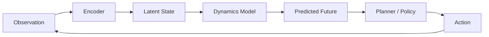
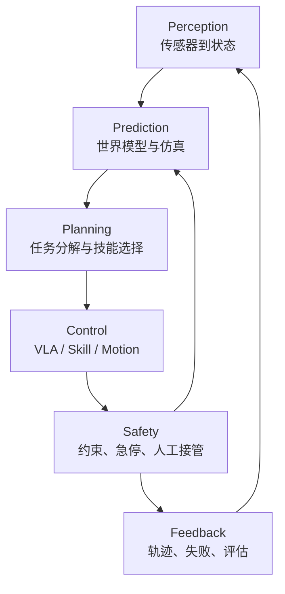
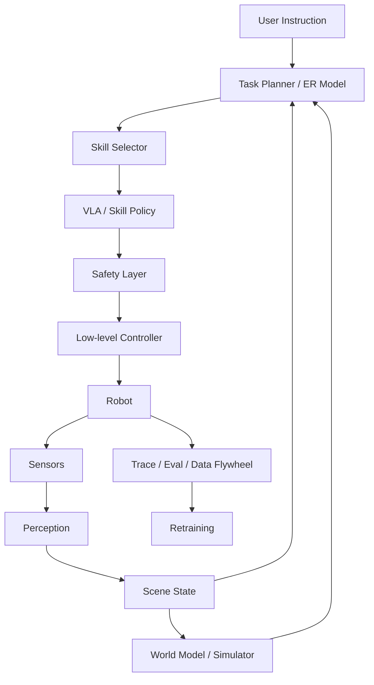

# 第6章 具身智能与 Physical AI


前面几章讨论的大模型，大多运行在文本、图像、代码、检索结果和工具调用这些“数字空间”里。世界模型和具身智能把问题推进了一步：模型不仅要回答“下一句话是什么”，还要理解“下一秒世界会怎样变化”“如果我采取这个动作，会发生什么”“这个动作在当前身体和环境里是否可行”。

这些任务把模型能力接到环境反馈上。本章按预测、规划和行动接口比较研究路线，范围以列明来源为准，不把它们视作已经成熟的通用产品。

一句话先建立直觉：

> 世界模型是智能体对环境状态、动态变化和行动后果的内部预测模型；具身智能是智能体带着身体、传感器和执行器，在环境中通过感知、决策、行动和反馈完成任务的能力。

注意，这里的“世界模型”不是哲学意义上的世界观，也不是知识图谱，更不是数据库。它强调的是：智能体能不能在内部模拟世界，预测行动后果，并据此规划或学习。

## 6.1 概念、边界与语言模型的关系

很多工程师第一次听到世界模型，会觉得它离 LLM Agent 很远，好像只属于机器人或自动驾驶。但从系统视角看，它和 Agent 工程有同一条主线：

- LLM 通过语言上下文预测下一个 token；
- RAG 通过外部知识约束模型回答；
- Agent 通过工具调用影响数字世界；
- 世界模型通过预测环境状态支持规划；
- 具身智能通过身体在物理世界执行行动。

它们都在解决一个问题：智能体如何在不确定环境中做出更好的下一步动作。

只是动作空间不同：

```text
LLM:
  action = 生成下一个 token

软件 Agent:
  action = 调用工具、编辑文件、访问网页、执行命令

具身智能体:
  action = 移动、抓取、推拉、避障、导航、与人协作
```

如果你能理解 KV cache、RAG、工具调用和 eval，那么世界模型和具身智能也可以用熟悉的工程语言来理解：状态表示、动作空间、反馈信号、评估指标、安全边界和闭环迭代。

### 预测器的输入与输出

世界模型可以理解为一个“可用于预测的内部环境模型”。给定当前观察、历史状态和候选动作，它输出未来可能发生的事情。

最简化的表达是：

```text
current observation + history + action
  -> world model
  -> predicted next state / reward / risk / affordance
```

其中：

- **observation**：智能体看到或感知到的东西，可以是图像、视频、激光雷达、触觉、文本状态、游戏画面或传感器数据；
- **state**：环境内部状态，可能是显式的，也可能是模型学到的 latent state；
- **action**：智能体可以采取的动作，例如转向、抓取、点击、移动、发出工具调用；
- **prediction**：下一状态、奖励、碰撞风险、任务进度、可行动性或未来视频帧；
- **policy / planner**：根据预测结果选择下一步动作。

所以世界模型不是“知道很多事实”的模型，而是“能预测状态变化”的模型。

可以用驾驶来类比。一个新手看到前车刹车，只知道“前面红灯了”。一个熟练司机会预测：前车可能急停，右侧电动车可能插入，自己如果不减速，短时间后距离可能不安全（驾驶类比，不是制动距离计算）。后者脑中有一个粗糙但有效的世界模型。

对于 AI 系统也是一样：仅仅识别物体不够，还要预测物体、自己和其他智能体之间的动态关系。

### 术语的四种使用范围

“World Model”在不同论文和公司报告里含义略有差异。阅读材料时要先判断对方说的是哪一种。

### Model-based RL 里的环境动力学模型

这是最经典的技术含义。智能体学习一个模型来预测环境如何变化，然后在模型里“想象”未来，训练策略或做规划。这里关注状态、动作和回报之间可供策略利用的预测关系。

例如 Ha 和 Schmidhuber 的 World Models 工作，用视觉编码器学习压缩表示，用循环网络建模时间动态，再用一个很小的 controller 做决策 [[1]](#ref-1)。PlaNet在隐空间预测并在线规划 [[2]](#ref-2)；Dreamer则在学到的隐状态动态中展开想象轨迹来训练actor和critic [[3]](#ref-3)[[4]](#ref-4)。

这里的关键不是生成漂亮视频，而是让策略能利用预测结果提高样本效率和泛化能力。表示学习的基本观点也是先得到适合下游决策的抽象，而不是把所有原始细节等权保留 [[5]](#ref-5)。

### 生成式视频 / 交互式环境模型

近年来，大模型社区开始把“能生成可交互环境”的视频模型也称为世界模型。Genie研究动作可控的生成环境，Cosmos报告世界基础模型平台；两者目的与接口不同，不能当成互换的模拟器 [[6]](#ref-6)[[7]](#ref-7)。

普通视频生成模型更像“根据提示生成一段看起来合理的视频”。世界模型要求更高：它要能根据用户或智能体动作持续更新场景，并保持物体、空间、因果和交互的一致性。

差别可以这样看：

```text
视频生成:
  prompt -> video

交互式世界模型:
  prompt + action sequence -> evolving environment
```

如果用户向左走，场景要随视角改变；如果智能体推开门，门的状态要在后续保持；如果物体被移动，它不能下一秒凭空回到原位。这些一致性才是世界模型难的地方。

### JEPA 类的表征预测模型

JEPA 路线强调在 latent space 中做预测，而不是重建像素。V-JEPA研究视频特征预测，V-JEPA 2进一步展示动作条件后训练与规划；二者都不要求把每个像素重建出来 [[8]](#ref-8)[[9]](#ref-9)。

这条线很重要，因为物理世界里很多细节不需要逐像素重建。机器人抓杯子时，不需要预测桌面每个纹理像素，但需要知道杯子位置、姿态、可抓取区域和动作后果。

latent prediction 的优势是更接近决策需要的抽象，可能更高效，也更少陷入像素级生成的噪声。

### 自动驾驶和机器人仿真的世界模型

在自动驾驶、机器人和工业仿真里，世界模型常常是数据生成、极端场景测试和策略训练的一部分。

例如自动驾驶系统需要大量罕见长尾场景：突然横穿的行人、施工改道、异常天气、遮挡后的车辆、复杂无保护左转。真实路测很难穷尽这些情况，生成式世界模型可以帮助构造可控、可重复、可扩展的仿真环境。CARLA 等开放仿真器说明，标准化场景、传感器和交通参与者是评估自动驾驶策略的重要基础 [[10]](#ref-10)。

这个方向的核心指标不是“视频好不好看”，而是：

- 场景是否物理合理；
- 其他交通参与者行为是否可信；
- 传感器观测是否接近真实；
- 被训练或评估的策略是否能迁移到真实世界；
- 长尾风险是否被覆盖。

### 与语言模型的关系

LLM 和世界模型有相似之处，也有关键差异。

相似之处：

- 都是通过大规模数据学习预测；
- 都把历史上下文压缩成内部表示；
- 都可以作为更大智能体系统的一部分；
- 都依赖数据分布和训练目标；
- 都会在分布外场景失败。

关键差异：

```text
LLM:
  输入输出主要是离散 token
  目标是 next-token prediction
  强项是语言、知识、代码、抽象推理和工具协议

World Model:
  输入输出可以是视频、状态、动作、传感器和 latent representation
  目标是预测环境演化和动作后果
  强项是动态、空间、物理、交互和规划
```

从 Agent 系统看，LLM 更像“高层任务先验和语言接口”，世界模型更像“环境预测器和行动模拟器”。未来很多系统会把二者结合起来：LLM 负责理解任务、分解目标和调用工具，世界模型负责预测动作后果、生成训练场景或辅助规划。

## 6.2 隐状态动力学：从World Models到Dreamer

早期世界模型路线主要来自 model-based reinforcement learning。

典型流程如下：



### Ha 和 Schmidhuber 的 World Models

经典 World Models 架构可以拆成三块 [[1]](#ref-1)：

- **VAE**：把高维图像压缩到 latent vector；
- **MDN-RNN**：预测 latent state 的时间演化；
- **Controller**：基于 latent state 选择动作。

这个工作的启发在于：智能体可以先学一个紧凑的环境表示，再在这个内部模型中训练策略。论文在所研究的任务环境中展示了梦境训练后迁移回原任务环境；这里的原环境不能误读成已验证真实机器人安全。

对工程师来说，最值得记的是：世界模型把“感知表示”和“行动策略”解耦了。策略不必直接处理原始像素，而可以基于压缩后的状态进行决策。

### PlaNet、Dreamer 和 DreamerV3

PlaNet在线规划与Dreamer想象学习是两种利用隐动态的方式 [[2]](#ref-2)[[3]](#ref-3)。核心思想是：

1. 从真实交互数据中学习 latent dynamics；
2. 在 latent space 中 rollout 未来轨迹；
3. 用 imagined trajectories 训练 policy 和 value；
4. 把学到的策略放回真实或仿真环境中执行。

DreamerV3 的重要性在于它用单一配置覆盖了很多任务，并在 Minecraft 等复杂环境中展现了从像素和稀疏奖励中学习远期策略的能力 [[4]](#ref-4)。

这条路线说明：世界模型的价值不只是“生成环境”，更重要的是提升学习效率。真实机器人数据很贵，真实自动驾驶路测很贵，真实工业试错也很贵。如果能在学到的模型里进行想象和试错，就可能减少真实世界探索成本。

### 世界模型的训练目标与状态表示

世界模型并不只有一个统一损失。像素重建要求预测视觉细节，latent prediction 要求保持对决策有用的信息，奖励预测要求理解任务进展，动作条件预测要求学习“采取动作后会发生什么”。这些目标可以联合训练，但各自的误差含义不同：视频看起来清晰，不代表动作因果正确；奖励预测准确，不代表空间细节足够；latent 表示稳定，也不代表能处理未见物体。

状态表示通常包含视觉、语言、机器人本体状态和历史动作。显式状态便于调试和约束，例如物体位姿、速度、关节角和碰撞标志；隐式状态更容易压缩复杂环境，但不易解释和验证。实际系统可以采用混合表示：世界模型维护 latent dynamics，同时由感知模块提供可审计的对象、关系和安全状态。

动作条件是世界模型区别于普通视频模型的关键。训练样本不能只有连续观察，还要记录动作发生的时间、动作参数、执行结果和失败原因。若数据里动作与环境变化没有对齐，模型学到的只是相关性，无法在规划时比较不同动作。对于机器人，还要区分高层技能、轨迹、关节控制和实际执行反馈，避免把计划动作误当成已经完成的动作。

### 长时预测与不确定性

短时预测可能看起来准确，连续 rollout 后却逐渐漂移。误差会在每一步进入下一状态，导致物体消失、场景重复或物理关系崩坏。解决方向包括 latent 状态校正、真实观察重置、分层时间尺度、短 horizon 规划和多候选未来。世界模型不必总是预测唯一未来，更应表达多个可能结果和相应不确定性。

不确定性对安全规划尤其重要。预测道路参与者下一步动作时，模型应给出多个行为假设；预测抓取是否成功时，应保留滑落和遮挡等风险；当模型对某个新物体没有经验时，应触发更保守的动作、重新感知或人工确认。把不确定性压成一个看似确定的视频，会让下游策略过度信任错误预测。

### 观察更新与想象展开不能混用

中文序列模型教材区分用历史观测预测与多步外推，为理解误差积累提供了基础。[[11]](#ref-11) 世界模型还必须处理动作条件：策略发出的命令、执行器接受的命令和实际测到的运动可能不同，训练记录应保留它们的时间与关联标识。本书用抽象接口表示：观察更新从历史、当前观测和上一步实际动作修正隐状态；想象展开从当前隐状态与候选动作预测下一状态。前者接触真实传感器，后者是预测，两种状态不能共享一个“已发生”标记。

若隐状态压掉了决定未来的变量，例如杯中液体、接触状态或被遮挡的人，单帧预测仍可看似准确，动作比较却可能完全错误。状态是否足够不是看向量维度，而是看相同表示下不同历史是否导致不同后果。历史窗口和记忆可以补充信息，但也会引入更长的校准和计算成本；不能默认编码器输出已满足马尔可夫假设。

本书建议先在短闭环中验证：给同一初始观察两个可执行动作，分别预测结果与不确定性，再用独立观测核对差异；继续比较无动作条件、打乱动作与正确动作三组。如果打乱动作后质量不变，模型可能主要利用视觉惯性而未学到有效控制响应。这个检验是教学实验设计，尚未实现，也不单凭相关性实验宣称因果识别。发现不一致时缩短预测范围、重新观测或拒绝当前计划，比继续叠加想象步数更可检查。

## 6.3 世界基础模型与动作条件生成

2024 之后，“World Foundation Model”开始成为产业关键词。它的目标类似 LLM：先用大规模通用数据训练一个基础世界模型，再针对机器人、自动驾驶、游戏、仿真、视频生成等任务做后训练或适配。

可以这样类比：

```text
Language Foundation Model:
  大规模文本/代码/多模态数据 -> 通用语言和知识能力 -> 下游任务适配

World Foundation Model:
  大规模视频/仿真/传感器/动作数据 -> 通用物理和交互先验 -> 下游场景适配
```

### Genie与UniSim的动作条件

Genie从无标注互联网视频学习动作可控的虚拟环境，研究中的潜在动作接口与真实机器人关节命令有区别 [[6]](#ref-6)。UniSim把不同维度的数据结合，研究高层指令与低层控制条件下的视觉结果模拟，并在其设置中用于策略训练 [[12]](#ref-12)。它们说明生成模型可以参与交互研究，但不能从画面一致推导摩擦、接触力、传感器噪声或安全控制都被正确模拟。

选择训练环境时，应问动作是何种语义、是否有外部状态可校验、可维持多长闭环、失败后如何重置，以及用它训练的策略能否在独立环境受益。动作可控是比视频观感更强的条件，仍不足以证明仿真保真或现实安全。

### NVIDIA Cosmos

NVIDIA Cosmos 更偏向 Physical AI 平台：世界基础模型、视频 tokenizers、数据处理、后训练和仿真生态结合起来，服务机器人和自动驾驶开发 [[7]](#ref-7)。

这代表了一个工业趋势：世界模型不会单独存在，它会和数字孪生、仿真引擎、数据管线、策略模型、评估系统和 GPU 推理平台一起组成栈。

## 6.4 感知、预测与任务规划

具身智能不是“机器人 + LLM”。它的核心是把模型放进一个会被动作改变的环境中，并让系统在感知、预测、规划、控制和安全反馈之间持续闭环。身体、传感器、执行器、环境、任务目标和数据回流都属于这个闭环的一部分，缺任何一环都不能称为可部署系统。



本章涉及的 Dreamer、Genie、Cosmos、V-JEPA、RT-2、PaLM-E、RT-X、Octo、π0 与 Gemini Robotics，可以放回这张图里理解：有的强化预测环境动态，有的强化视觉和语言到动作的映射，有的强化跨机器人数据，有的强化连续控制。技术路线很多，但工程问题只有一个：系统能否在真实环境中连续观察、预测、行动、验证并安全恢复。

真实世界比文本世界更苛刻。动作有速度、力、扭矩和碰撞约束；物体会滑落、遮挡、反光、变形或被人移动；传感器有噪声和延迟；失败可能造成硬件损坏或人身风险；真实试错昂贵，不能靠无限重试换正确率。因此，本章后半部分不再按模型名罗列，而按可部署闭环展开。

### 感知：从传感器到可行动状态

感知层把摄像头、深度、触觉、IMU、激光雷达、麦克风和机器人本体状态转换成可决策状态。这个状态不只是“图像里有什么”，还包括对象位置、姿态、关系、可通行区域、抓取候选、机器人关节状态、环境变化和不确定性。感知错误会直接污染后续规划：例如教学假设中杯子位置估计偏了几厘米，语言计划再正确也可能抓空。

可行动性，或者 affordance，是感知层与规划层之间的关键概念。它回答的是：在当前环境、当前身体和当前技能集合下，某个动作是否可执行。杯子可以抓，但装满热水时抓取策略要变；抽屉可以拉，但前方有障碍物时不可拉；“把碗放进微波炉”对塑料碗和金属碗安全性不同。SayCan 的核心思想之一，就是把 LLM 的高层语义知识和机器人技能的可行动性结合起来 [[13]](#ref-13)。

生产系统通常会把感知输出写成结构化状态，而不是把原始图像直接交给高层模型自由解释：

```text
SceneState {
  objects: id, class, pose, confidence, affordance
  robot: joints, gripper, battery, fault_state
  map: free_space, obstacle, restricted_zone
  task_context: instruction, goal, constraints
  freshness: timestamp, sensor_source, uncertainty
}
```

这个状态要有版本、时间和置信度。按本书的系统设计，若状态过期、置信度不足或关键对象不可见，系统应重新感知、移动视角或请求人工，而不是让语言模型猜测。感知层越结构化，后续规划、控制、安全和评估越容易连接。

### 预测：世界模型、仿真与数字孪生

世界模型在闭环中回答“如果采取这个动作，环境可能怎样变化”。它可以用于生成合成训练数据、预测候选动作后果、做 model-predictive control、生成长尾测试场景、支持自动驾驶和机器人离线评估，也可以作为数字孪生的一部分帮助调试。关键不是画面是否漂亮，而是预测是否能服务行动。

Sim2Real、Real2Sim 和数字孪生是世界模型落地时最常见的系统形态。Sim2Real 在仿真中训练或测试，再迁移到真实世界，难点是材质、摩擦、接触、传感器噪声、执行器磨损和人类行为造成的 simulation gap [[14]](#ref-14)[[15]](#ref-15)[[16]](#ref-16)。Real2Sim 从真实失败构建仿真场景，用于复现长尾、做反事实测试和验证修复策略。数字孪生偏工程系统和结构化仿真，世界模型偏学习到的生成式或预测式模型，二者可以结合。

世界模型必须和真实数据闭环校准。一个看起来真实但物理不可信的模型，会让策略学到错误行为；一个在短视频上表现稳定的模型，不一定能支持多轮交互和长时记忆。评估时要比较同一 planner 在真实环境、世界模型和混合环境中的任务成功率、动作分布和失败类型。若策略只在模型内部变好，却不能迁移到真实环境，说明当前决策价值证据不足，需要定位模型偏差、策略利用漏洞或分布差异，不能仅凭迁移失败重新定义模型类别。

### 规划：把语言目标变成技能图

任务规划层把自然语言目标、场景状态和技能集合转成可执行任务图。例如“把桌上的杯子放进水槽”不能直接变成一个动作，而要拆成找杯子、靠近桌子、选择抓取姿态、抓起杯子、移动到水槽、放下杯子和检查结果。每个节点都需要前置条件、预期结果、失败策略和安全约束。

LLM 或 embodied reasoning model 适合做高层语义理解和任务分解，但必须接收环境状态、技能可用性、affordance、安全规则和失败反馈。它能提出“语义上合理”的步骤，却不能单独证明步骤在当前身体和环境中可执行。规划层应把候选计划交给规则、仿真、世界模型或技能库验证，再进入控制层。

以下为本书教学技能图，retry=2仅表示有限重试示例，不是物理操作默认安全次数：

```text
SkillPlan {
  goal: "cup_to_sink"
  steps: [
    {skill: "locate", target: "cup", precondition: "visible_or_searchable"},
    {skill: "navigate", target_pose: "table_front", safety: "no_human_collision"},
    {skill: "grasp", object: "cup", affordance: "graspable", retry: 2},
    {skill: "place", target: "sink", postcondition: "cup_in_sink"}
  ]
}
```

计划是版本化候选，而不是事实。执行中环境变化、对象丢失、抓取失败或安全约束触发，都可能要求重新规划。这个设计和后续 Agent Runtime 一致：模型提出候选，运行时保存状态、验证前置条件、执行动作、记录观察，再决定继续、回退或人工接管。

## 6.5 VLA、技能策略与低层控制

VLA，Vision-Language-Action，是近几年具身智能的重要范式。它把视觉、语言和动作放进同一个模型或同一套训练目标中，输入可以是图像、视频、机器人状态和语言指令，输出可以是离散 action token、末端执行器位姿、关节角、轨迹 waypoint、diffusion/flow 生成的连续动作序列，或高层技能调用。

不同代表工作可以按控制接口理解。RT-2 把动作表示成 token，便于复用视觉语言模型能力 [[17]](#ref-17)；PaLM-E 把真实传感器接入语言模型，强调 grounding [[18]](#ref-18)；Open X-Embodiment 和 RT-X 通过跨机器人数据推动跨 embodiment 学习 [[19]](#ref-19)；Octo 提供开源通用机器人策略，方便比较架构和数据 [[20]](#ref-20)；π0、π0.5 和后续路线强调从 VLM 走向连续控制和开放环境泛化 [[21]](#ref-21)[[22]](#ref-22)；2025年Gemini Robotics的官方研究说明将VLA动作输出与Robotics-ER空间推理/低层控制接口分别介绍；本文仅引用该版本，不代表后续产品通用保证 [[23]](#ref-23)。

但生产系统很少只依赖一个端到端模型。更常见的结构是高层模型负责泛化和任务理解，中层 VLA 或 skill policy 负责抓取、放置、导航、操作等技能，低层控制器和运动规划器负责轨迹可行性、频率、稳定性和安全限制。端到端模型可以提供更强泛化，但解释和验证困难；模块化系统更可控，却需要清晰接口和大量技能维护。实际系统通常在二者之间取折中。

### 动作契约与控制时钟

以下为本书的接口设计：一段动作至少记录坐标系、单位、目标身体、动作持续时间、采样时刻、有效期和控制模式。归一化token对应的是位置、位姿增量还是速度，必须由schema解释；轴顺序、左右手系和角度单位错了，合法形状也会执行错误动作。动作反归一化还要使用对应机器人与训练版本的统计量，不从另一台机器复制参数。

高层计划、动作块与低层伺服不必同频。模型一次生成一段未来动作，运行时仍要检查时间戳与新观测；网络延迟或人进入场景时，应允许安全控制器中断剩余动作块。动作块越长，模型调用开销可能越低，但对环境变化反应更慢；更短的块增加反馈机会，也增加调度和计算压力。本章不指定统一控制频率或通信时限，具体值必须由设备、任务和安全工程验证。

跨身体迁移也不是只改输出维度：相机外参、夹具形状、可达空间、自由度、载荷和技能语义都可能变化。RT-X的跨机器人数据和Octo的适配结果提供研究证据 [[19]](#ref-19)[[20]](#ref-20)，不能证明任意新身体无需标定即可执行。部署前应先核对接口、在隔离条件检查低能量动作，并由设备团队确定合格边界。

## 6.6 安全反馈、恢复与数据飞轮

具身系统的安全不是输出过滤，而是控制闭环的一部分。常见机制包括速度、力、扭矩和加速度限幅，碰撞检测，安全区域，硬件和软件急停，远程或本地人工接管，任务级危险动作拒绝，以及对用户指令的语义安全判断。LLM 的安全提示不能替代控制安全；应由专门控制与安全工程设置底层约束。官方机器人研究也区分语义安全与低层碰撞、力和稳定性控制 [[23]](#ref-23)；下面的envelope和恢复流程是本书教学设计，不是认证标准或安全证明。

安全边界应被写成一份可计算的 **physical-action envelope**，而不是一段“请小心”的提示。它至少约束工作空间、末端速度、关节速度、接触力、载荷、人与设备的最小距离、可见性、定位质量、允许工具和允许姿态。每一项约束都需要说明数据来源、测量频率、失效默认值和执行 owner：视觉模型可以建议“桌面上没有人”，但距离传感器失效时，安全控制器应按保守规则降速或停止；语言模型可以选择“拿起杯子”，但不得修改安全区、急停逻辑或力矩上限。机器人控制中的这一层旨在把概率性策略限制在经校验的可行动集合内；约束仍依赖传感器和控制器的可靠性；它也解释了为何 VLA 的高层泛化不能替代传统的运动学、碰撞检测和互锁。

安全 envelope 还应区分三种动作。第一类是只读或虚拟动作，例如在世界模型中 roll out、在数字孪生中规划、在相机画面上标注候选抓取点；它们可由较宽松的模型策略产生。第二类是可逆、低能量的受控动作，例如经设备评估后在隔离区域低速移到观察位、调整无载夹爪或请求更多视角；它们是否允许自动执行仍由设备和场景风险评估决定。第三类是不可逆或高危动作，例如接近人、切换重载工具、快速运动、开门、搬运液体或跨越安全区；它们必须经过额外门禁，必要时要求双通道传感器和人工批准。把动作按后果而非按“模型是否自信”分级，能避免置信度被误用为安全证明。

上线前的评估门禁应沿着这三类动作建立证据链。离线阶段先检查数据覆盖、标注质量、策略在已知回归集上的成功与拒绝；仿真阶段再对遮挡、摩擦变化、动作延迟、传感器丢帧和危险接近做对抗性扰动。CausalWorld 这类可控基准的价值正在于能把“动作改变了什么”明确化 [[24]](#ref-24)，而 domain randomization 的经验提醒我们，仿真覆盖不是现实保证 [[14]](#ref-14)[[15]](#ref-15)[[16]](#ref-16)。进入真实环境时，系统先以 shadow mode 记录候选而不执行，然后在围栏区域、低速度、有限物体集合中进行受监护执行；每推进一级都要证明上一阶段的失败模式已被观测、分类和处理，而不能只凭总体成功率放行。

一个可审计的门禁记录至少包含场景版本、机器人和工具版本、策略版本、世界模型版本、传感器健康、候选动作、envelope 判定、拒绝原因、人工决定与结果。对于每个高风险失败，应能回答：模型是否提出了错误候选，状态估计是否遗漏了关键物体，安全层是否正确拒绝，还是执行器在已获许可后偏离了轨迹。把这几个层次混为“机器人失败”，会让后续训练把安全控制器的正确拒绝误标成坏样本，或把执行器故障错误归因于世界模型。

运行中的干预也必须有状态语义。人工接管不是简单抢走遥控器，而是一次有版本的状态迁移：冻结新的高危动作、保留当前传感器与控制快照、标记被中断的技能、给出恢复条件，并把控制权转给预先授权的操作者。恢复时，系统不能从旧的语言计划直接继续；它要重新感知、重新建立环境状态、重新检查 envelope，并确认人、物体和工具仍处于允许位置。若动作已造成不可逆外部变化，例如物体已被放入容器或门已被打开，恢复策略应从事实状态重新规划，而非“回放”模型的旧动作序列。

回滚在 Physical AI 中也有边界。软件配置、模型路由、技能版本和策略阈值通常可以回滚；机器人在空间中的位置、物体形态、人与环境的反应不能回滚。因此发布方案要同时准备软件回滚和物理收敛方案：停止、退回到安全姿态、释放或稳定载荷、隔离故障设备、通知现场人员、保存证据。对可能损坏物体或伤害人的步骤，补偿动作本身也要放入 envelope，不能让“为了恢复”成为绕过安全限制的理由。这个原则与 Agent Runtime 的补偿语义一致，但物理系统的补偿必须先保证人和设备安全，才谈业务目标。

安全评价不应只汇总一次部署的平均数字。建议按动作风险等级分别报告：任务成功率、拒绝的正确率、危险近失率、超限触发率、人工接管率、恢复成功率、传感器失效下的安全停机率，以及从仿真到真实的性能差。每个指标还应给出场景覆盖和置信区间；例如“未发生碰撞”在少量固定场景中不足以支持扩大开放范围。Open X-Embodiment 与 Bridge Data 所展示的跨形态与跨环境数据价值 [[19]](#ref-19)[[25]](#ref-25)，同样适用于安全评估：系统必须证明其约束在新相机、新夹具、新物体和新布局下仍然保守有效。

数据飞轮决定具身智能能否规模化。一个机器人样本通常包含时间戳、摄像头/深度/触觉/本体状态、语言指令、动作轨迹、成功失败标签、环境元数据和操作者元数据。真实机器人昂贵，任务失败可能损坏硬件，不同机器人动作空间不同，人类遥操作质量不稳定，成功率评估还需要环境状态判断。因此数据来源通常是组合的：遥操作、机器人自主执行日志、仿真数据、视频和网页数据、失败恢复样本、人工示范、偏好反馈和跨机器人共享数据集。Bridge Data 等工作也说明，跨任务和跨环境共享数据可以改善其研究范围内的泛化 [[25]](#ref-25)。

```text
部署 -> 采集轨迹 -> 标注成功失败 -> 挖掘长尾
  -> 仿真扩增 -> 训练 -> 回归评估 -> 再部署
```

这条飞轮和 Agent 系统中的 trace / eval / regression loop 很像，只是成本和风险更高。软件 Agent 的一次错误大多可以回滚，机械臂撞到人不能简单 revert。物理世界把所有约束放大，所以具身系统更需要仿真、限幅、人工接管、长尾评估和清晰的责任边界。

## 6.7 闭环评估与证据边界

评估是这个方向最难的部分之一。

### 世界模型评估

不能只看视频质量。CausalWorld 等基准强调因果交互和可控操作，说明世界模型应评估动作改变环境后的结果，而不是只评估单帧视觉质量 [[24]](#ref-24)。更有用的指标包括：

- **预测一致性**：物体是否在时间上保持身份和位置一致；
- **动作可控性**：给定动作后，环境变化是否对应；
- **物理合理性**：碰撞、重力、遮挡、接触是否合理；
- **长时记忆**：离开视野的物体再次出现时是否仍然存在；
- **交互稳定性**：多轮动作后是否崩坏；
- **任务有效性**：用它训练或评估的策略能否迁移到真实环境；
- **安全覆盖**：是否能生成高风险和长尾场景。

评估时还要把预测模型放回真实策略闭环：让同一个 planner 分别使用真实环境、世界模型和混合环境，比较任务成功率、动作分布和失败类型。如果世界模型生成的场景只让策略在模型内部变好，却不能迁移到真实环境，说明当前模型尚缺乏跨环境决策效用证据，需继续核对误差来源与分布。对长时任务要记录误差随 rollout 长度的增长，而不是只报告第一帧或短片段指标。

具身评估还要覆盖硬件和人的因素：不同摩擦、负载、传感器延迟、光照、遮挡和操作者指令都可能改变结果。一个只在固定实验台上成功的策略，不能直接推断在家庭、仓库或道路上可靠。评估报告应明确训练内、训练外、仿真、真实和长尾场景的边界。

为了避免“模型分数好但上线不可用”，评估还应把安全层本身当作被测对象。为每个动作准备允许、拒绝、降级和人工接管四类 oracle：当障碍物进入缓冲区时，系统是否在规定控制周期内停止；当相机置信度下降但触觉仍正常时，是否按策略降低速度；当两个传感器对物体位置冲突时，是否选择保守路径；当模型建议的抓取点在工作空间外时，是否拒绝并留下可解释证据。世界模型可帮助生成这些反事实场景，但评估结论必须来自独立的控制日志和真实或高保真仿真观测，而不是由同一个生成模型自评。

这套评估边界决定了世界模型能否真正服务训练、规划和安全验证。没有闭环验证，生成质量不能代表行动价值，也不能代表真实世界中的安全和泛化能力。本章关注的动作条件模型需要证明对行动的帮助；不能把这个工程目标当作所有研究路线已经达到的属性。

### 具身智能评估

机器人任务不能只看单次 demo。需要：

- 多场景、多物体、多指令测试；
- 成功率、完成时间、碰撞次数、人工接管次数；
- 新物体、新布局、新语言表达的泛化；
- 失败恢复能力；
- 安全违规率；
- 对人的协作体验；
- 长任务完成率；
- 数据和模型版本的回归测试。

设计评审里如果被问“怎么评估一个家务机器人”，不要只说“看能不能完成任务”。更完整的回答是：

```text
我会拆成任务成功率、泛化、效率、安全和可恢复性五类指标。
每类指标都要覆盖训练内、训练外和长尾场景。
同时保留完整传感器、动作和模型 trace，失败样本进入回归集。
```

## 6.8 系统案例与Agent接口
### 和 Agent 系统设计的关系

本书主要讨论 LLM Agent。世界模型和具身智能看似更偏机器人，但它们对 Agent 系统有直接启发。

### Agent 也需要“局部世界模型”

软件 Agent 没有机械臂，但它也在环境中行动。它的环境可能是代码库、浏览器、数据库、CI 系统、企业知识库。

一个强的 coding agent 应该理解：

- 修改某个文件会影响哪些测试；
- 执行某个命令会产生什么副作用；
- 依赖升级会破坏哪些 API；
- 当前 repo 的架构约束是什么；
- 一个错误修复会不会引入回归。

这里称为局部环境预测的类比；代码依赖分析和测试反馈本身并不证明Agent已经学习了可迁移的动力学模型。

### Tool use 是数字世界的 embodiment

LLM 如果只能生成文本，行动能力有限。接入工具后，它有了“数字身体”：可以搜索、读文件、运行测试、发邮件、调用 API、修改代码。

这是接口层面的教学类比，不能把软件工具调用与物理具身的风险和控制问题等同。它同样需要：

- action schema；
- 权限控制；
- 环境反馈；
- 失败恢复；
- trace；
- eval；
- 安全边界。

### 物理世界把所有约束放大

物理具身智能比软件 Agent 更难，因为行动不可轻易回滚，反馈更嘈杂，风险更真实。

写错一行代码可以 revert，机械臂撞到人不能简单 revert。这个差异决定了具身系统必须更重视安全层、仿真、限幅、人工接管和验证。

### 系统设计题：设计一个家务机器人助手

这类题可以按下面框架回答。

### 需求澄清

先问清楚：

- 机器人形态：单臂、双臂、人形、移动底盘？
- 场景：家庭、酒店、医院、仓库？
- 任务：拿取、整理、清洁、递送、对话？
- 是否允许接触人？
- 延迟要求和安全等级？
- 是否联网？
- 是否需要持续学习？
- 评估指标是什么？

### 架构草图



### 核心设计点

1. 高层用 LLM / ER 模型理解用户目标、拆解任务。
2. 感知层维护场景状态，包括对象、位置、关系和可行动区域。
3. VLA 或 skill policy 负责具体动作。
4. 世界模型用于预测候选动作后果、生成仿真场景和离线评估。
5. 安全层做硬约束：速度、力、碰撞、禁区、危险动作拒绝。
6. 失败时先暂停、回退、重新感知，再请求人工确认。
7. 所有传感器、动作、模型输出和安全事件进入 trace。
8. 失败样本进入回归集和数据飞轮。

### 关键 trade-off

- 端到端 VLA 泛化强，但可解释性和安全验证难；
- 模块化系统可控性强，但可能受限于手写技能和接口；
- 仿真数据便宜，但 simulation gap 会影响真实表现；
- 真实数据质量高，但采集成本和风险大；
- 云端模型能力强，本地模型低延迟且隐私更好。

### 系统设计题：设计一个世界模型服务

如果题目是“设计一个给机器人团队使用的世界模型平台”，回答重点会不同。

### 输入

- 文本 prompt；
- 初始图像或视频；
- 结构化场景描述；
- 机器人或车辆动作；
- 地图、物体、天气、交通参与者等约束；
- 真实日志片段。

### 输出

- 未来视频或状态轨迹；
- 可交互环境；
- 多个候选未来；
- 风险评分；
- 场景元数据；
- 可用于训练或评估的数据包。

### 服务架构

```text
Scenario API
  Prompt / Scene Parser
  Condition Builder
  World Model Inference
  Physics / Rule Consistency Checker
  Scenario Store
  Evaluation Harness
  Data Export Pipeline
```

### 评估重点

- 是否可控：能否指定动作、天气、道路结构、物体行为；
- 是否一致：多步交互后场景是否稳定；
- 是否真实：传感器和物理是否接近真实；
- 是否有用：用它训练或评估的策略是否提升真实表现；
- 是否安全：能否覆盖高风险场景且避免生成误导性数据。

### 常见误区

以下误区回顾用于核对上文模型、环境和评估的边界，不新增独立能力结论。

### 误区 1：把世界模型当知识图谱

知识图谱表示实体和关系，世界模型预测状态变化和动作后果。二者可以结合，但不是一回事。

### 误区 2：把视频生成模型等同于世界模型

像素视频生成不是所有世界模型的必要条件，latent模型也可支持决策；交互路线则需验证动作条件、长时一致与任务有效。会生成视频，不代表能支持智能体学习。

### 误区 3：以为具身智能就是给机器人接 ChatGPT

语言理解只是高层能力。机器人还需要感知、控制、可行动性、安全、仿真和数据闭环。

### 误区 4：只看 demo，不看评估分布

机器人 demo 往往展示最成功的一次。工程上要看多场景、多物体、多任务、多轮失败恢复和安全违规率。

### 误区 5：认为仿真可以完全替代真实数据

仿真很重要，但 simulation gap 长期存在。高质量系统通常是仿真、真实数据、世界模型和在线反馈的组合。

### 自测问题

读完本章后，应该能回答：

- 世界模型和 LLM 的主要区别是什么？
- 为什么说世界模型不是知识图谱，也不是普通视频生成？
- model-based RL 中的世界模型如何帮助策略学习？
- Dreamer 为什么强调在 latent space 中想象未来？
- Genie、Cosmos、V-JEPA 2分别代表什么路线，动作接口如何区分？
- 具身智能为什么不能只靠 LLM？
- Affordance 如何连接语言计划和物理行动？
- VLA 模型的输入输出是什么？
- 为什么跨 embodiment 数据很重要？
- 如何评估一个家务机器人或自动驾驶世界模型？
- 真实系统为什么需要安全层、仿真和数据飞轮？


### 仓库机器人的分阶段验收

以下为教学场景与门禁设计，未进行实体设备实验。


**场景：** 仓库机器人需要识别货箱、规划取放并在人员靠近时停止。视觉/语言模型负责候选物体、任务意图和异常说明；运动规划器、碰撞检测、速度限制和急停回路保持确定性并独立于语言模型。世界模型可用于离线模拟罕见遮挡、抓取失败和路径冲突，但不能成为绕过实体安全互锁的依据。

上线采用分阶段门禁：先离线回放和仿真，再在隔离区域只读观察并记录候选动作，最后才在人工监护和设备许可范围内低速执行。每次动作记录传感器快照、规划版本、模型版本、置信度和安全控制器的拒绝原因；成功率之外，还评估碰撞近失、人工接管率、分布外拒绝率和从仿真到真实的性能落差。


## 6.9 本章小结

世界模型的核心价值要从预测对象、动作条件和下游决策来判断。隐状态模型可以支持规划或想象学习，视频特征预测可以形成表示，生成式环境可以提供交互研究材料；这些路线的任务、接口和证据不同。VLA把视觉语言能力接到动作，但仍要由身体、感知、控制和安全反馈构成闭环。

对后端工程师，最有用的迁移是状态与预测分开、命令与实际执行分开、模型建议与安全许可分开，以及每一次恢复从新观察的事实出发。仿真与离线分数是阶段性证据，不能替代物理验证；本章架构和案例均为设计说明，不包含机器人上线、安全认证或性能实测。后续章节再把类似的版本、反馈与恢复原则应用于数字Agent系统。

## 6.10 参考资料

<a id="ref-1"></a>[1] Ha, D., & Schmidhuber, J. *World Models*. NeurIPS Workshop, 2018. https://arxiv.org/abs/1803.10122 访问日期：2026-10-16

<a id="ref-2"></a>[2] Hafner, D., et al. *Learning Latent Dynamics for Planning from Pixels*. ICML, 2019. https://arxiv.org/abs/1811.04551 访问日期：2026-10-16

<a id="ref-3"></a>[3] Hafner, D., et al. *Dream to Control: Learning Behaviors by Latent Imagination*. ICLR, 2020. https://arxiv.org/abs/1912.01603 访问日期：2026-10-16

<a id="ref-4"></a>[4] Hafner, D., et al. *Mastering Diverse Domains through World Models*. arXiv, 2023. https://arxiv.org/abs/2301.04104 访问日期：2026-10-16

<a id="ref-5"></a>[5] Bengio, Y., Courville, A., & Vincent, P. *Representation Learning: A Review and New Perspectives*. IEEE TPAMI, 2013. https://arxiv.org/abs/1206.5538 访问日期：2026-10-16

<a id="ref-6"></a>[6] Bruce, J., et al. *Genie: Generative Interactive Environments*. arXiv, 2024. https://arxiv.org/abs/2402.15391 访问日期：2026-10-16

<a id="ref-7"></a>[7] NVIDIA. *Cosmos: World Foundation Model Platform for Physical AI*. arXiv, 2025. https://arxiv.org/abs/2501.03575 访问日期：2026-10-16

<a id="ref-8"></a>[8] Bardes, A., et al. *Revisiting Feature Prediction for Learning Visual Representations from Video*. arXiv, 2024. https://arxiv.org/abs/2404.08471 访问日期：2026-10-16

<a id="ref-9"></a>[9] Assran, M., et al. *V-JEPA 2: Self-Supervised Video Models Enable Understanding, Prediction and Planning*. arXiv, 2025. https://arxiv.org/abs/2506.09985 访问日期：2026-10-16

<a id="ref-10"></a>[10] Dosovitskiy, A., et al. *CARLA: An Open Urban Driving Simulator*. CoRL, 2017. https://arxiv.org/abs/1711.03938 访问日期：2026-10-16

<a id="ref-11"></a>[11] Zhang, A., et al. 《动手学深度学习》：序列模型. 中文在线版2.0.0. https://zh.d2l.ai/chapter_recurrent-neural-networks/sequence.html 访问日期：2026-10-16

<a id="ref-12"></a>[12] Yang, S., et al. *Learning Interactive Real-World Simulators*. arXiv, 2023. https://arxiv.org/abs/2310.06114 访问日期：2026-10-16

<a id="ref-13"></a>[13] Ahn, M., et al. *Do As I Can, Not As I Say: Grounding Language in Robotic Affordances*. arXiv, 2022. https://arxiv.org/abs/2204.01691 访问日期：2026-10-16

<a id="ref-14"></a>[14] Tobin, J., et al. *Domain Randomization for Transferring Deep Neural Networks from Simulation to the Real World*. arXiv, 2017. https://arxiv.org/abs/1703.06907 访问日期：2026-10-16

<a id="ref-15"></a>[15] Peng, X. B., et al. *Sim-to-Real Transfer of Robotic Control with Dynamics Randomization*. arXiv, 2017. https://arxiv.org/abs/1710.06537 访问日期：2026-10-16

<a id="ref-16"></a>[16] Tremblay, J., et al. *Training Deep Networks with Synthetic Data: Bridging the Reality Gap by Domain Randomization*. CVPR Workshops, 2018. https://arxiv.org/abs/1804.06516 访问日期：2026-10-16

<a id="ref-17"></a>[17] Brohan, A., et al. *RT-2: Vision-Language-Action Models Transfer Web Knowledge to Robotic Control*. arXiv, 2023. https://arxiv.org/abs/2307.15818 访问日期：2026-10-16

<a id="ref-18"></a>[18] Driess, D., et al. *PaLM-E: An Embodied Multimodal Language Model*. arXiv, 2023. https://arxiv.org/abs/2303.03378 访问日期：2026-10-16

<a id="ref-19"></a>[19] Open X-Embodiment Collaboration. *Open X-Embodiment: Robotic Learning Datasets and RT-X Models*. arXiv, 2023. https://arxiv.org/abs/2310.08864 访问日期：2026-10-16

<a id="ref-20"></a>[20] Octo Model Team. *Octo: An Open-Source Generalist Robot Policy*. arXiv, 2024. https://arxiv.org/abs/2405.12213 访问日期：2026-10-16

<a id="ref-21"></a>[21] Black, K., et al. *π0: A Vision-Language-Action Flow Model for General Robot Control*. arXiv, 2024. https://arxiv.org/abs/2410.24164 访问日期：2026-10-16

<a id="ref-22"></a>[22] Physical Intelligence. *π0.5: A Vision-Language-Action Model with Open-World Generalization*. arXiv, 2025. https://arxiv.org/abs/2504.16054 访问日期：2026-10-16

<a id="ref-23"></a>[23] Google DeepMind. *Gemini Robotics Brings AI into the Physical World*. 2025. https://deepmind.google/blog/gemini-robotics-brings-ai-into-the-physical-world/ 访问日期：2026-10-16

<a id="ref-24"></a>[24] Ahmed, O., et al. *CausalWorld: A Robotic Manipulation Benchmark for Causal Structure and Transfer Learning*. arXiv:2010.04296, 2020. https://arxiv.org/abs/2010.04296 访问日期：2026-10-16

<a id="ref-25"></a>[25] Ebert, F., et al. *Bridge Data: Boosting Generalization of Robotic Skills with Cross-Domain Datasets*. RSS, 2022. https://arxiv.org/abs/2109.13396 访问日期：2026-10-16
