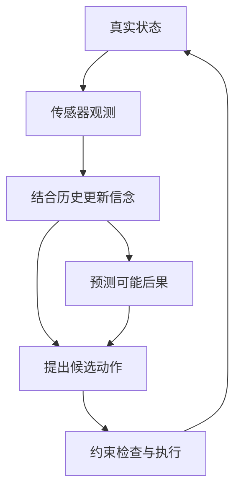
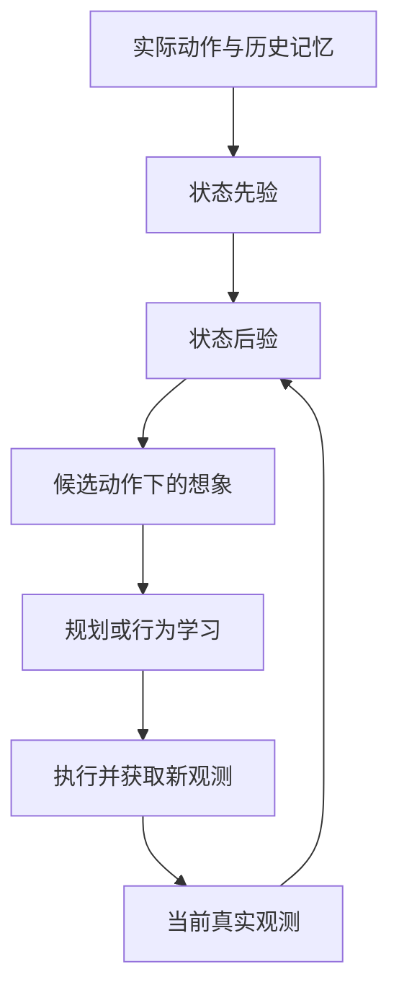
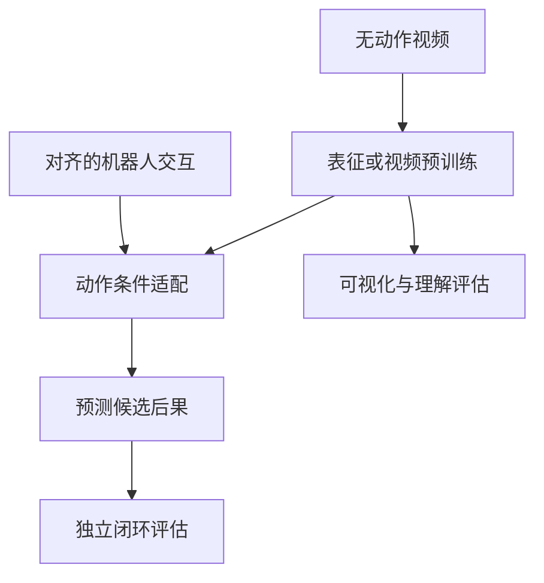
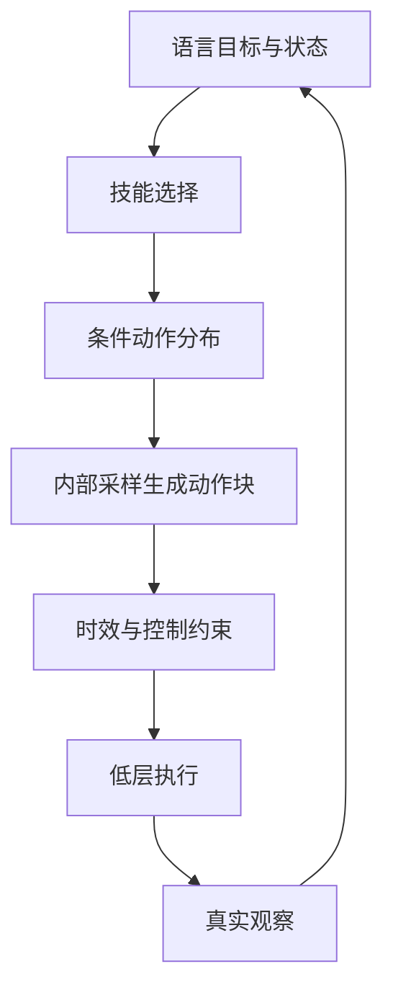
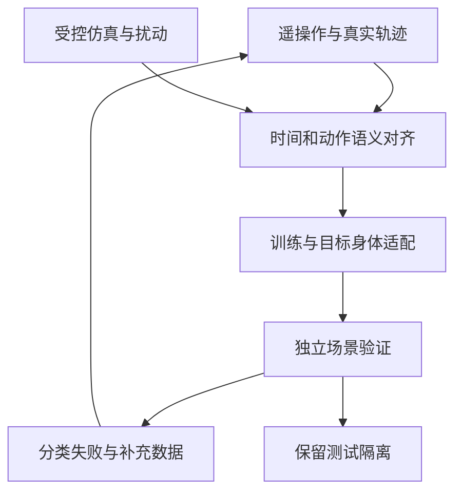
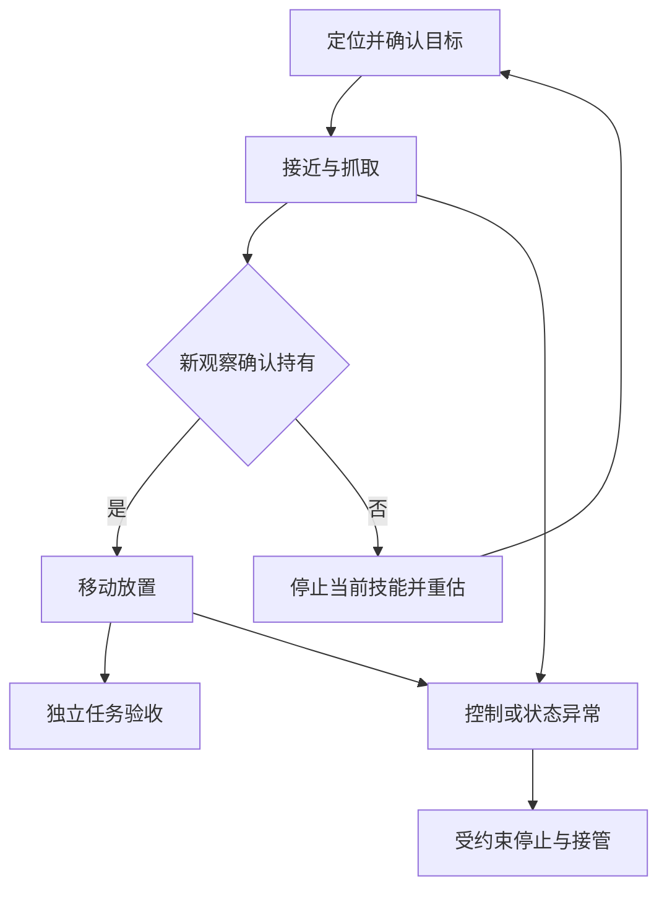

# 第7章 具身智能与 Physical AI

> 资料说明：本轮先核验原始论文、官方研究资料与中文教材并建立来源—论点映射，再展开机制与案例。核验日期为 2026 年 11 月 1 日；正文中的数值手算、状态示例和闭环任务均为教学构造，不代表真机实测。

具身智能要求模型在会被动作改变的环境中完成任务。它不仅需要识别“画面里有什么”，还要估计未被直接观察的状态，比较行动后果，把计划变成当前身体能够执行的动作，并用真实反馈修正判断。世界模型、视觉语言动作模型与传统控制器在这里解决不同问题，不能仅凭名称互相替代。

本章围绕一个问题展开：怎样判断一个学到的预测或策略，确实为闭环行动提供了有用信息。答案需要同时检查状态表示、动作条件、时间对齐、数据覆盖和任务验收。来源论文支持具体机制与研究边界，本书的算例用于解释这些条件如何影响系统设计。

<a id="71-概念边界与语言模型的关系"></a>
<a id="为什么这个差别值得单独讨论"></a>
<a id="预测器的输入与输出"></a>
<a id="术语的四种使用范围"></a>
<a id="model-based-rl-里的环境动力学模型"></a>
<a id="生成式视频--交互式环境模型"></a>
<a id="jepa-类的表征预测模型"></a>
<a id="自动驾驶和机器人仿真的世界模型"></a>
<a id="与语言模型的关系"></a>
<a id="77-具身算法与语言模型的关键差异"></a>
<a id="61-概念边界与语言模型的关系"></a>
<a id="67-具身算法与语言模型的关键差异"></a>
## 7.1 从观测到可行动状态



语言模型和具身算法都根据历史信息选择下一步，但它们面对的状态、动作后果和验证方式不同。语言模型主要处理离散 token，生成结果通常可以重放或重试；具身系统还要处理带噪声和延迟的传感器状态，并输出移动、抓取、推拉、避障或导航等连续或混合动作。动作会改变后续观察，有些后果无法撤销，因此状态表示、反馈来源、数据成本、评估方法和安全约束都随之变化。本节先从观测与状态的区别建立共同框架。

语言模型的很多工程直觉在具身场景里会失效。例如，纯文本生成的候选通常可以低成本重放或丢弃，物理动作的重试却可能撞坏物体；文本模型的置信度也不能直接充当事实或安全保证，机器人上的过度自信还会越过控制边界。文本系统同样需要真实服务路径评估、发布门禁与治理；具身系统除此之外还必须验证动作改变环境后的闭环状态。把这些约束差异讲清楚，比记住几个模型名更有用。

世界模型可以理解为一个“可用于预测的内部环境模型”。给定当前观察、历史状态和候选动作，它输出未来可能发生的事情。

最简化的表达是：

```text
current observation + history + action
  -> world model
  -> predicted next state / reward / risk / affordance
```

这里的 observation 是图像、激光雷达、触觉、本体状态等直接读数；state 是从当前与历史观察中估计出的环境状态，可以显式表示，也可以是 latent state；action 是转向、抓取、推拉、移动或导航等候选操作；prediction 可以是下一状态、奖励、碰撞风险、任务进度、可行动性或未来视频帧；policy 或 planner 再根据这些预测选择动作。世界模型的关键能力因此是预测状态怎样随动作变化，而不是存储多少静态事实。

可以用驾驶来类比。一个新手看到前车刹车，只知道“前面红灯了”。一个熟练司机会预测：前车可能急停，右侧电动车可能插入，自己如果不减速，短时间后距离可能不安全（驾驶类比，不是制动距离计算）。后者脑中有一个粗糙但有效的世界模型。

对于 AI 系统也是一样：仅仅识别物体不够，还要预测物体、自己和其他智能体之间的动态关系。

“World Model”在不同论文和公司报告里含义略有差异。阅读材料时要先判断对方说的是哪一种。

这是最经典的技术含义。智能体学习一个模型来预测环境如何变化，然后在模型里“想象”未来，训练策略或做规划。这里关注状态、动作和回报之间可供策略利用的预测关系。

World Models、PlaNet 和 Dreamer 都属于这一路线，但具体的隐状态、规划和策略学习机制放到 7.2 节展开 [[1]](#ref-1)[[2]](#ref-2)[[3]](#ref-3)[[4]](#ref-4)。

近年来，大模型社区也把能生成可交互环境的视频模型称为世界模型。普通视频生成关注提示到视频的视觉结果，交互式环境模型还接收动作序列，并维持物体、空间和交互状态。Genie 研究动作可控的生成环境，Cosmos 报告世界基础模型平台；两者的目标和接口不同，不能视为可互换的模拟器 [[5]](#ref-5)[[6]](#ref-6)。具体的表征预测与平台化机制在 7.3 节讨论。

JEPA 路线强调在 latent space 中预测与任务相关的表征，而不是重建每个像素；这种取舍延续了表示学习以任务相关抽象服务下游问题的基本思路 [[7]](#ref-7)。V-JEPA 研究视频特征预测，V-JEPA 2 进一步展示动作条件后训练与规划 [[8]](#ref-8)[[9]](#ref-9)。这种定义只说明预测对象不同；是否更适合某个决策任务仍需下游验证，不能由 latent prediction 本身推出。

这一项是应用范围，而不是第四种模型定义。在自动驾驶、机器人和工业仿真中，动力学模型、生成式环境或结构化模拟器都可以参与数据生成、极端场景测试和策略训练。CARLA 等开放仿真器说明，标准化场景、传感器和交通参与者是评估自动驾驶策略的重要基础 [[10]](#ref-10)；模型是否有用仍要由物理合理性、传感器逼真度、长尾覆盖和策略迁移结果共同判断。


### 观测、状态与信念不是同一个对象

先用一个贯穿全章的教学任务建立符号：固定机械臂把桌面上的空杯放到指定托盘中，任务范围限于隔离实验台、已评估的物体和动作，不包含真实设备操作参数。真实状态 \\(s_t\\) 可以包含杯子位姿、速度、是否被夹持、机械臂关节状态和接触关系；相机图像 \\(o_t\\) 只是这个状态的一次投影。动作 \\(a_t\\) 可能是末端位姿增量，也可能是某个底层控制器的目标。不同动作定义不能共用一个没有单位的向量。环境转移 \\(P(s_{t+1}\mid s_t,a_t)\\) 描述执行后怎样变化，观测模型 \\(P(o_t\mid s_t)\\) 描述真实状态怎样产生传感器读数。

即使一张图像显示杯子位于同一个像素位置，杯子也可能静止、向左滑动或刚被夹具挡住。三种真实状态对下一动作的响应不同。如果把单张图像直接当成完整状态，就违反了“当前状态足以预测下一状态”的建模愿望。历史能帮助辨别速度和接触，但保存全部视频又带来计算开销，因此具身模型需要压缩历史，同时尽量保留影响行动后果的变量。PlaNet 用部分可观测决策过程表达这一问题，其隐状态不是摄像头读数的另一个名字。[[2]](#ref-2)

信念状态 \\(b_t(s)\\) 是在已收到的信息下对真实状态的分布。它允许系统同时保留“杯子还在夹具里”和“杯子可能已经滑落”两种解释，而不是在证据不足时强行选一个。中文概率教材强调概率可以表达不同形式的不确定性；这里将其用于环境状态估计。[[11]](#ref-11) 在已知转移与观测模型的理想离散例子中，先预测再更新：

\\[
\bar b_t(s)=\sum_{s'}P(s\mid s',a_{t-1})b_{t-1}(s'),\qquad
b_t(s)=\frac{P(o_t\mid s)\bar b_t(s)}
{\sum_{\tilde s}P(o_t\mid\tilde s)\bar b_t(\tilde s)}.
\\]

第一步把上次信念沿实际执行动作推进；第二步用新证据调整各假设权重。这里的求和在连续状态下通常变成积分，学习系统往往只计算近似表示。本书写出精确公式是为了说明信息来源，不意味着机器人运行时能够精确求解整个后验，也不意味着神经网络输出的“置信度”自动等于经过校准的信念概率。

假设杯子是否仍被夹持只有两个状态，预测阶段认为被夹持的概率为零点八。某传感器报告“未检测到杯子”；教学假定在确实夹持时出现该读数的概率为零点一，在已经掉落时为零点九。更新后的夹持概率为 \\(0.8\times0.1/(0.8\times0.1+0.2\times0.9)\\)，约为零点三零八。这个读数显著改变了判断，却没有把概率直接变成零。把一个二值告警写成确定事实，会丢失误检与漏检的语义；反过来，忽略告警继续沿旧信念执行，也会把状态估计与环境脱节。

若再读取第二个传感器，能否直接相乘取决于条件独立假设。两个检测器若都使用同一张模糊图像，其错误可能共享同一个原因，不能当成两份完全独立证据。视觉检测、夹具编码器和触觉信号的互补性来自测量机制，而不是来自接口数量。融合设计应说明每项读数测量了什么、何时采集、受哪些共因影响；增加多个名字不同但输入相同的模型，不一定减少不确定性。

状态更新还与时间相关。机械臂控制器发出动作后，相机到达的下一帧可能实际上拍摄于动作开始之前。若按消息到达顺序拼接，就会把旧图像解释成新动作的结果。动作时间、传感器采样时间与接收时间因此需要分别记录。状态估计可以在可接受的延迟范围内做对齐或外推，但缺失的时间信息无法靠增大模型参数可靠恢复。这是轨迹数据与普通图文样本的根本区别之一：顺序和间隔也是监督信号。

### 决策所需的信息与预测误差

好表示不一定保留所有视觉细节，却必须保留当前任务需要区分的未来。杯子花纹可能对放置无关，杯口朝向、夹持关系与托盘边缘却可能决定动作是否成功。若两个真实状态被编码成同一个隐向量，而某个候选动作在两种状态下后果明显不同，那么下游规划器无法仅凭这个隐向量恢复丢掉的差别。表示压缩是否合适，要通过动作后果和任务误差判断，而不能只看隐向量维度小不小。

这也说明“与任务相关”不是一次永久决定。为抓取训练的表示可能忽略杯内液体，而对搬运液体的任务，液面、速度和倾角就成为必要变量。奖励模型改变时，原来足够的压缩也可能不够。迁移一个世界模型到新任务，应检查新目标依赖哪些状态量，以及训练时是否存在能够辨别这些量的传感器或监督；不能仅更换一行任务描述就认定旧表示仍是充分的。

本书用三个层次区分误差。测量不确定性来自噪声、遮挡和分辨率限制；动态随机性来自在同一可观测条件下仍有多种合理未来；模型认识不足则来自数据覆盖、参数学习或结构假设不充分。前两类不总能通过更多同分布训练消除，第三类也不会因为输出分布很宽就被修复。多个模型预测差异可提示认识不足，但模型共享训练偏差时也可能一致地错；窄区间只说明模型集中，不能单独说明环境确定。

动作会改变未来信息，这使观察本身也可以成为规划对象。例如从另一角度看杯把，可能比立刻尝试抓取更有价值。理想决策可以比较信息获取后的预期任务收益与耗时，而不只是比较当前最短路径。不过移动相机或机械臂也是物理动作，可能改变遮挡和可达范围；不能把“再观察一次”当成零成本、零风险。全章案例中的主动观察只表示一种候选策略，具体是否允许执行由设备与场景约束决定。

最后，语言接口与物理接口并非两个互不相交的世界。文本 Agent 调用真实工具也面对部分可观、延迟和不可逆副作用；纯语言模型的 token 状态只是生成器内部的条件历史，不是外部世界的完整状态。具身智能的特殊性在于传感器与身体动态持续参与闭环，控制误差会随时间传播，并且状态更新、动作持续与反馈必须在物理时钟上对齐。讨论差异时应限定比较对象，不能把“文本可以重写”泛化成“语言系统没有外部后果”。

<a id="72-隐状态动力学与世界基础模型"></a>
<a id="训练目标与状态表示"></a>
<a id="长时预测不确定性与观察更新"></a>
<a id="动作条件生成与平台化"></a>
<a id="62-隐状态动力学与世界基础模型"></a>
## 7.2 隐状态动力学与想象学习



Ha 和 Schmidhuber 的 World Models 把这条链拆成三块：编码器把高维图像压到 latent，循环网络预测 latent 的时间演化，一个很小的 controller 基于 latent 选动作 [[1]](#ref-1)。PlaNet 在隐空间预测并在线规划，Dreamer 在学到的隐动态中展开想象轨迹来训练策略与价值函数 [[2]](#ref-2)[[3]](#ref-3)[[4]](#ref-4)。三者的共同点是：策略不必直接处理原始像素，而可以基于压缩后的状态决策。

世界模型没有统一的损失。像素重建要求预测视觉细节，latent 预测要求保留对决策有用的信息，奖励预测要求理解任务进展，动作条件预测要求学习“采取动作后会发生什么”。这些目标可以联合训练，但误差含义不同：视频看起来清晰，不代表动作因果正确；latent 表示稳定，也不代表能处理未见物体。

状态表示通常混合视觉、语言、本体状态和历史动作。显式状态便于调试与约束，例如物体位姿、速度、关节角与碰撞标志；隐式状态更容易压缩复杂环境，但不易解释与验证。**对用于控制或规划的世界模型，动作条件是区别于普通视频预测的重要接口**：训练样本必须记录动作发生的时间、参数、执行结果与失败原因。表征预测模型不一定以动作作为预训练条件，但若要比较候选动作，仍需在后续阶段建立动作与状态变化的可检验关系。若动作与环境变化没有对齐，模型学到的只是相关性，无法在规划时比较不同动作。

预测误差还要区分来源。由传感器噪声、遮挡和多种合理未来造成的不确定性，不能简单归为模型失效；由训练覆盖不足、状态压缩丢失或动作时间错位造成的系统偏差，则需要修正数据与模型。工程上可以让模型输出候选未来或风险区间，并用后续观察更新状态，但区间本身也要校准。若模型在未见场景中始终给出很窄的区间，下游 planner 会把过度自信当成确定性；若区间始终过宽，预测又无法帮助动作排序。因此验收既要看点预测误差，也要看不确定性与真实失败频率是否对应。

中文序列模型教材区分“用历史观测预测”与“多步外推”，为理解误差积累提供了基础 [[12]](#ref-12)。短时预测可能看起来准确，连续展开后却逐渐漂移：误差在每一步进入下一状态，导致物体消失、场景重复或物理关系崩坏。缓解方向包括 latent 状态校正、真实观察重置、分层时间尺度、短 horizon 规划与多候选未来。世界模型不必预测唯一未来，更应表达多个可能结果与相应不确定性——把不确定性压成一个看似确定的视频，会让下游策略过度信任错误预测。

观察更新与想象展开必须分开。观察更新从历史、当前观测和上一步**实际**动作修正隐状态；想象展开从当前隐状态与**候选**动作预测下一状态。前者接触真实传感器，后者是预测，两种状态不能共享一个“已发生”标记。若隐状态压掉了决定未来的变量（杯中液体、接触状态、被遮挡的人），单帧预测仍可看似准确，动作比较却可能完全错误。本书建议先在短闭环中验证：给同一初始观察两个可执行动作，分别预测结果与不确定性，再用独立观测核对；并比较无动作条件、打乱动作与正确动作三组。若打乱动作后质量不变，模型可能主要利用视觉惯性而未学到有效的控制响应。这个检验是教学实验设计，尚未实现。


### RSSM：把记忆路径与不确定状态分开

循环状态空间模型可以用四个接口展开。确定性记忆 \\(h_t=f(h_{t-1},z_{t-1},a_{t-1})\\) 保留过去的动态信息；先验 \\(p_\theta(z_t\mid h_t)\\) 在没有当前观测时预测随机状态；后验 \\(q_\phi(z_t\mid h_t,o_t)\\) 结合观测修正状态；解码器与奖励头分别从 \\((h_t,z_t)\\) 预测观测和任务信号。PlaNet 的 RSSM 明确区分这两条路径。[[2]](#ref-2) “确定性”指网络更新方式，不是宣称环境没有随机性；“随机状态”也不是随意添加噪声，而是用分布表示预测中尚未确定的部分。

当真实相机帧到达时，系统可以走后验路径；在内部比较尚未执行的动作序列时，没有未来相机帧，只能沿先验展开。两条路径共享动力学，却使用不同证据。如果在评估长时预测时把每一步真实未来图像又喂给后验，得到的是连续校正的状态估计成绩，不能冒充纯模型多步外推成绩。训练日志应明确当前状态来自真实观测更新还是想象采样，否则较低的预测误差可能仅仅来自偷用了未来信息。

考虑一个纯教学张量例子：批量四条轨迹，每条十六步，每步观察为三通道六十四乘六十四图像，动作有七个连续分量。视觉编码器先为每帧得到一百二十八维特征，确定性状态设为二百五十六维，随机状态设为三十二维。循环模型在每个时间步读取上一记忆、上一随机状态和动作，而不是将整条动作序列当作当前已经发生的事实。后验头额外读本步图像特征，输出随机状态分布参数；奖励头读两种状态的拼接。这些维度只用于检查接口，不是原论文配置或推荐规格。

训练目标通常同时要求状态解释观察、预测奖励，并让后验与先验接近。简化的每步损失可写为负观测对数似然、负奖励对数似然与加权 KL 项之和。前两项要求表示保留可预测信息，KL 项要求没有当前观察时的动力学先验也能跟上状态估计。如果重建项压倒其他目标，模型可能专注背景纹理；如果过早压强 KL，后验可能失去利用观察的能力。实际算法使用的平衡、正则化与分布形式不同，应按具体版本理解，而不能把一条简化损失当成 Dreamer 各代的完整实现。

这种训练还包含一个容易忽略的权衡：能重建图像的状态不一定最适合动作排序。若背景像素占据大部分重建误差，优化器可以通过改善墙面纹理降低损失，却仍未学会夹具是否接触杯子。奖励或任务相关预测能提供另一种监督，但奖励稀疏时又可能不足。表示学习因此是信息分配问题，不能仅比较总训练损失。可观察的诊断是分别检查关键物体状态、接触事件、奖励和行动排序，而不是用单一像素误差代表全部能力。

### 在线规划、想象学习与误差传播

在线模型预测控制先在当前信念下比较有限长度的动作序列，再执行所选序列的第一项，获得新观测后重新规划。PlaNet 用交叉熵方法搜索候选序列：从参数化分布采样一批动作序列，在隐空间计算预测回报，选出较好的部分，用它们更新采样分布，再重复若干轮。[[2]](#ref-2) 这里的“交叉熵”是优化算法名称，不是语言模型逐 token 的训练损失。它只是在有限预算内搜索，不能保证找到全局最优，也不证明模型认为最好的动作在真实环境中同样最好。

用一维推物教学例子说明滚动执行。目标位置为一，当前估计为零点四，模型假定下一位置等于当前位置加动作。规划两步时，候选甲为零点三、零点三，候选乙为零点二、零点二；仅按终点距离，甲预测准确到达，乙还差零点二。执行甲的第一步后，真实物体因滑动只到零点六。滚动控制会用零点六重新估计下一动作，而不是继续把旧预测零点七当事实。重新观察改善了反馈机会，但若观测也有偏差或动作存在延迟，闭环仍可能失败；“每步重规划”不是无条件稳定性证明。

Dreamer 则把额外计算更多放在训练阶段：从经验数据编码出的状态出发，在学到的动态中想象轨迹，训练策略提出高价值动作，并训练价值函数估计更远回报。执行时可以直接调用策略，而不必每一步重新运行大规模候选搜索。原始 Dreamer 使用不同步长回报的加权组合，并通过可微模型传播行为学习信号。[[3]](#ref-3) 这与在线规划的区别在于决策计算何时付出；两者都可能受模型偏差影响，策略网络也可能把模型中的漏洞固化下来。

下面给出本书的回报截断例子。假设折扣为零点九，想象的前三步奖励为零、零、一，第三步之后价值估计为二；按三步自举计算，起点估计为 \\(0+0.9\times0+0.9^2\times1+0.9^3\times2=2.268\\)。如果把后续价值完全删去，得到零点八一，可能低估需要较长准备过程的策略；如果后续价值高估，较短想象又会过度依赖这个错误尾值。因此延长想象与依赖价值函数是在不同偏差、方差和计算开销之间取舍，不是越长必然越准确。

预测误差为什么会累计，可以用一个有明确假设的界说明。先限定为确定性教学系统，真实转移记为 \\(f\\)，模型转移记为 \\(\hat f\\)。假设在同一有效域内，真实转移对状态是 \\(L\\)-Lipschitz，模型单步误差至多 \\(\epsilon\\)，并比较同一动作序列、同一状态度量下的真实轨迹和模型轨迹，且两条轨迹始终留在上述统一误差界有效的区域内。则误差满足 \\(e_{t+1}\leq L e_t+\epsilon\\)。从零初始误差展开 \\(H\\) 步，得到 \\(e_H\leq\epsilon\sum_{i=0}^{H-1}L^i\\)。这是教学推导，不是对所有机器人接触动力学的统一保证；碰撞、摩擦切换和离散接触模式可能使假设不适用。随机转移还需另外定义耦合条件下的期望误差或分布距离界，不能直接套用这个确定性逐轨迹结论。

若教学值 \\(L=1\\)，误差上界随时域线性增长；若 \\(L>1\\)，较早误差可能被放大；若局部收缩且 \\(L<1\\)，累计项可有有限上界。由此不能说世界模型必然指数崩坏，也不能由短视频预测准确推出长时可靠。更重要的是，规划器会主动选择训练数据中少见的动作序列，单步误差界可能在这些区域根本不存在。优化搜索越强，越可能发现模型“误以为可行”的捷径，计算预算和模型可信区域必须一起考虑。

一个典型模型利用例子是预测器误判杯子可以穿过托盘边缘而不碰撞，规划器便选择这条短路径。此时 planner 确实优化了给定目标，错误不在它没有认真搜索，而在模型遗漏了约束。限制规划时域、对模型分歧加惩罚、保留真实观察校正或引入外部几何检查，都可能减少这类失败，但每种方法仍有盲区。模型一致可能是共同偏差，几何检查也可能忽略柔性物体和接触力，因此需要把拒绝、误差和真实结果分别记录。

短时准确与长时收益之间还隔着动作排序。即便两个候选的绝对预测都有小误差，只要误差超过它们的价值差，就可能颠倒次序。本书建议在相同初始状态下构造可执行候选对，比较模型预测的优劣与独立环境中的结果，而不是只测平均下一帧误差。若排序常在接触边界失效，应优先增加对应状态和动作覆盖；若大多数预测准确但最优候选总失败，则要检查搜索是否集中利用了误差尾部。


## 7.3 表征预测与生成式世界模型



2024 年之后出现的世界基础模型把这条路线推向平台化：先用大规模视频、仿真与传感器数据训练通用物理与交互先验，再针对机器人、自动驾驶等场景适配。Genie 从无标注视频学习动作可控的虚拟环境，UniSim 研究高层指令与低层控制条件下的视觉结果模拟 [[5]](#ref-5)[[13]](#ref-13)；NVIDIA Cosmos 把世界基础模型、视频 tokenizer、数据管线与仿真生态组成栈 [[6]](#ref-6)。它们说明生成模型可以参与交互研究，但不能从画面一致推导摩擦、接触力、传感器噪声或安全控制都被正确模拟。选择训练环境时，应问动作是何种语义、是否有外部状态可校验、可维持多长闭环、失败后如何重置，以及用它训练的策略能否在独立环境受益。

### 预测表征为什么需要防止塌缩

像素预测需要回答“未来每个像素是什么”，表征预测则要求回答“未来或被遮挡区域中哪些特征可从已见内容预测”。后者能够减少对不重要细节的重建负担，但也把任务是否保留必要信息的问题交给了表示。以杯子为例，颜色变化可能不影响抓取，手柄方向却影响可达姿态；一个能很好识别“杯子”类别的表示，未必保留足够精细的朝向。表征空间中的小距离不能自动解释成物理空间中的小距离，更不能直接等同于安全裕量。

V-JEPA 的训练以可见视频区域的编码预测目标区域的编码，目标位置由时空坐标指定。这里的目标区域可以是被遮挡的空间块或时间块，不应把所有这类训练样本都说成“只看过去预测未来”。原论文用目标编码器的移动平均参数、停止梯度以及预测器设计来防止简单回归出现表征塌缩。[[8]](#ref-8) 这些机制形成的是学习配方，其效果仍要用下游任务检验，而不是一个适用于所有网络与数据的数学保证。

为什么常数表示是问题，可以直接观察一个简化目标。如果编码器对所有输入都输出同一个向量 \\(c\\)，预测器也总输出 \\(c\\)，两者差异为零，却没有保存任何可用于辨别物体或动作的信息。仅检查训练回归损失，就会把完全无用的解误认作完美预测。停止梯度让目标分支不被当前损失直接拉动，移动平均使目标变化相对缓慢，预测器则承担从可见区域到目标区域的映射；还需要遮挡任务、网络结构和数据共同提供有效学习压力。

本书用一个教学例子说明损失与任务的区别。假设两个模型在杯子场景的总体特征预测误差接近，模型甲保留背景与物体类别，模型乙保留位置变化与夹持状态。对“图片里有什么”的评估，两者可能相近；对“抬起夹具后杯子是否跟随”的评估，乙才提供所需信息。这个例子不是说所有表征都天然分成这两类，而是提醒评估协议会决定读者看到哪种能力。把视觉问答分数直接当作机器人动作成功证据，会跨过未经验证的接口。

V-JEPA 2 在视频预训练之后，冻结视频编码器并利用机器人交互数据训练动作条件预测器，形成 V-JEPA 2-AC；规划时比较想象表征与目标图像表征，再滚动执行动作。[[9]](#ref-9) 因此“没有目标环境训练”不等于“完全没有机器人动作数据”。它也不意味着自然语言任务已经自动转成图像目标。输入目标图像、动作坐标和机器人控制方式都是方法条件，缺少其中一项就要重新设计接口。

这里有一个有启发性的边界：论文指出相机位置会影响对动作坐标轴的推断，若机器人基座没有进入画面，坐标关系可能无法充分确定；作者还报告了长时展开误差与图像目标要求的限制。[[9]](#ref-9) 本书据此推导，学习式表示并没有消除几何信息需求，它可能只是把部分标定关系隐含地学进了模型。把相机随意换位置后仍使用相同动作向量，未必只是图像风格变化，也可能改变了观测与动作的关系。

### 生成环境、潜动作与物理模拟的边界

生成式环境把模型预测变成可观察的图像或视频，便于人理解和交互。Genie 的潜动作模型从视频变化中压缩出有限的动作码，动力学模型再根据这些码和历史帧 token 生成后续。训练时可以看到相邻帧来推断潜动作，交互时则由用户选择动作码。[[5]](#ref-5) 训练推断用到了后一帧，不代表部署策略能提前读取真实未来；这是学习标签或表征与在线决策之间的差别。

潜动作码也不是具有固定物理单位的电机指令。某个码在一组场景中倾向产生向右移动，可以帮助构造可控交互，却没有自然保证它对应多少米、多少弧度或多少扭矩。把视频学到的潜动作接到机器人，需要额外建立码与真实动作之间的映射，并验证这种关系在不同状态下是否仍成立。Genie 的行为迁移实验也使用少量真实动作标注建立映射。[[5]](#ref-5) 因而“无动作标注视频预训练”与“最终完全无需动作信息”是两个不同命题。

普通视频中的变化还混合了智能体动作、相机移动和外部事件。杯子在画面中向左，可能是杯子真的移动，也可能是相机向右运动。若训练目标只要求下一帧逼真，模型可以利用相关性完成预测，而不必识别真正可控制的原因。动作标签、相机位姿、本体状态与干预数据的价值，在于帮助区分这些因素。即使模型能从历史推测外部事件，它也不能把不可控制的事件当成自己的动作能力。

本书建议把世界模型的输出分成三种接口看待。第一种是状态或表征预测，面向动作排序和策略训练；第二种是可视化预测，面向人工诊断、场景构造和视觉任务；第三种是带可检查状态的仿真转移，面向接触、碰撞、传感器与闭环评估。一个系统可以同时提供多种接口，但视频看起来连续，不代表它内部维护了可查询的质量、速度或接触约束。数字孪生和神经生成模型可以互补，不能只因都能显示三维画面就认为等价。

| 路线 | 主要预测对象 | 控制信息 | 关键验证问题 |
| --- | --- | --- | --- |
| 隐状态动力学 | 状态、奖励及延续关系 | 明确动作向量 | 规划选出的动作能否在独立环境受益 |
| 视频表征预测 | 被遮挡或未来的特征 | 预训练可无动作，控制需适配 | 表征是否保留任务需要的状态 |
| 潜动作生成环境 | 可交互视频 | 学到的动作码 | 控制语义能否稳定映射到目标任务 |
| 显式物理仿真 | 位姿、接触和传感器读数 | 指定控制接口 | 物理与传感器参数是否覆盖真实条件 |

UniSim 研究高层和低层条件下的视觉模拟，Cosmos 报告则将数据、tokenizer、预训练及下游适配放到平台中。[[13]](#ref-13)[[6]](#ref-6) 这些工作提供的是生成与适配路线，不能把平台的内容过滤视为机器人停止碰撞的低层机制。前者可能过滤不适合生成的画面，后者必须基于执行状态和控制反馈及时响应；名称中都有“安全”并不意味着两者处理同一种风险。

世界模型也可以生成训练样本，但合成数量不等于新增独立信息。若一个模型总把某类抓取预测为成功，使用它生成大量“成功轨迹”再训练策略，会反复强化同一偏差。有效的合成数据设计应说明哪些因素被主动改变、标签来自什么独立机制，以及真实回归是否改善。对接触状态没有依据的模型，增加画面细节只能让错误更逼真，而不能弥补缺失的物理约束。

最后，世界模型评估应把真实性、可控性与任务收益分开。一个视频可以逼真但不响应动作，也可以正确响应粗粒度动作却丢失长时对象身份；一个表征预测器可以没有可视化解码器，却能有效排序短时动作。评价应从使用目的出发，再决定需要什么证据。对本章的拿杯任务，关键是候选动作是否改变正确对象、是否能被当前身体执行、预测是否帮助闭环完成，而不是单独评选最清晰的一段未来视频。

<a id="73-感知预测与任务规划"></a>
<a id="感知从传感器到可行动状态"></a>
<a id="预测世界模型仿真与数字孪生"></a>
<a id="规划把语言目标变成技能图"></a>
<a id="74-vla技能策略与低层控制"></a>
<a id="动作契约与控制时钟"></a>
<a id="63-感知预测与任务规划"></a>
<a id="64-vla技能策略与低层控制"></a>
## 7.4 从语言技能到连续动作



VLA，Vision-Language-Action，是近几年具身智能的重要范式。它把视觉、语言和动作放进同一个模型或同一套训练目标中，输入可以是图像、视频、机器人状态和语言指令，输出可以是离散 action token、末端执行器位姿、关节角、轨迹 waypoint、diffusion/flow 生成的连续动作序列，或高层技能调用。

不同代表工作可以按控制接口理解。RT-2 把动作表示成 token，便于复用视觉语言模型能力 [[14]](#ref-14)；PaLM-E 把真实传感器接入语言模型，强调 grounding [[15]](#ref-15)；Open X-Embodiment 和 RT-X 通过跨机器人数据推动跨 embodiment 学习 [[16]](#ref-16)；Octo 提供开源通用机器人策略，方便比较架构和数据 [[17]](#ref-17)；π0、π0.5 和后续路线强调从 VLM 走向连续控制和开放环境泛化 [[18]](#ref-18)[[19]](#ref-19)。2025 年 Gemini Robotics 的官方研究说明分别介绍 VLA 动作输出与 Robotics-ER 的空间推理、低层控制接口；本章引用的是该版本的公开说明，不把它扩展成后续产品的通用保证 [[20]](#ref-20)。

一种便于分层验证的结构是高层模型负责任务理解，中层 VLA 或 skill policy 负责抓取、放置、导航、操作等技能，低层控制器和运动规划器负责轨迹可行性、频率、稳定性和安全限制。端到端模型减少了手工接口，却更难解释和验证；模块化系统便于约束和替换组件，同时需要清晰接口和技能维护。实际系统要依据任务、设备与验证成本选择组合。

任务规划层把自然语言目标、场景状态和技能集合转成可执行任务图。例如“把桌上的杯子放进水槽”不能直接变成一个动作，而要拆成找杯子、靠近桌子、选择抓取姿态、抓起杯子、移动到水槽、放下杯子和检查结果。每个节点都需要前置条件、预期结果、失败策略和安全约束。

LLM 或 embodied reasoning model 适合做高层语义理解和任务分解，但必须接收环境状态、技能可用性、affordance、安全规则和失败反馈。它能提出“语义上合理”的步骤，却不能单独证明步骤在当前身体和环境中可执行。规划层应把候选计划交给规则、仿真、世界模型或技能库验证，再进入控制层。

以下为本书教学技能图，retry=2仅表示有限重试示例，不是物理操作默认安全次数：

```text
SkillPlan {
  goal: "cup_to_sink"
  steps: [
    {skill: "locate", target: "cup", precondition: "visible_or_searchable"},
    {skill: "navigate", target_pose: "table_front", safety: "no_human_collision"},
    {skill: "grasp", object: "cup", affordance: "graspable", retry: 2},
    {skill: "place", target: "sink", postcondition: "cup_in_sink"}
  ]
}
```

计划是版本化候选，而不是事实。执行中环境变化、对象丢失、抓取失败或安全约束触发，都可能要求重新规划。模型提出候选计划，执行层保存状态、验证前置条件、执行动作、记录观察，再决定继续、回退或人工接管。

技能图还应显式记录每一步之后的观察点和失效去向。若抓取完成后没有重新检查夹具状态，后续“移动到水槽”可能在物体已经滑落时继续执行；若导航失败只返回布尔值，规划器也无法区分路径受阻、定位丢失和设备故障。把这些结果写入状态契约，才能让重新规划基于新事实，而不是重复原计划。

以下为本书的接口设计：一段动作至少记录坐标系、单位、目标身体、动作持续时间、采样时刻、有效期和控制模式。归一化 token 对应的是位置、位姿增量还是速度，必须由 schema 解释；轴顺序、左右手系和角度单位错了，合法形状也会执行错误动作。动作反归一化还要使用对应机器人与训练版本的统计量，不能从另一台机器直接复制参数。

### 从技能分数到动作分布

SayCan 将语言模型对技能的任务相关性与技能在当前状态的成功估计结合，再选择下一技能，执行后更新状态。[[21]](#ref-21) 用教学数字说明：候选甲“立即抓取”的语言相关分为零点九，但被遮挡时可行动分只有零点二，乘积为零点一八；候选乙“先移动到观察位”语言相关分为零点六，可行动分为零点八，乘积为零点四八。这个例子显示，语义最直接的动作未必是当前最合适的动作。

不过分数相乘并不自动成为经过校准的真实任务成功概率。语言分数受提示与技能描述影响，技能价值函数受训练分布与奖励定义影响；不同技能持续时间和失败代价也可能不同。如果把长技能与短技能直接按同一分数比较，还要考虑它们到达什么状态以及后续是否可继续。模型分数可以排序候选，但硬性不可执行约束不能被高语言分补偿。例如工作空间外的抓取目标，应先被动作接口拒绝，而不是允许另一项高分把它“平均”为可行。

从技能切换到连续控制，输出对象也变了。RT-2 将动作表示成离散 token，并和视觉语言任务共同微调；其论文把连续动作维度均匀离散到二百五十六个区间，同时限制动作任务的输出词表。[[14]](#ref-14) 这样可以复用语言模型的序列建模接口，但 token 的含义由动作编码协议决定。一个整数在自然语言任务中是数字，在机器人任务中可能是某个方向位移的区间编号；只有恢复单位、范围与坐标，才能解释为物理动作。

离散化误差可用简单模型估计。若教学假设某动作分量限定在长度为二的区间内，均匀分为二百五十六箱，并用箱中心解码，那么落在范围内的值，其量化误差至多为半个箱宽，即 \\(2/(2\times256)\\)。这只是编码误差界，不包含模型预测、标定、控制跟踪或范围裁剪误差。若真实所需动作超出区间，裁剪偏差可能远大于这个值；若高精度接触要求低于箱宽，增加语言语料也不会自动提高动作编码的分辨率。

另一种问题是动作具有多模态分布。杯子两侧都可接近，示范者有时绕左、有时绕右。若用平方误差训练单个确定动作，在相同输入下最优回归趋向条件均值；左右两种可行方向的平均可能指向中间障碍物。这里的“多模态”指同一条件下存在多个行动方式，不是视觉与语言等输入模态。Diffusion Policy 用条件生成分布表达动作序列，为这类问题提供了不同于单点回归的路线。[[22]](#ref-22)

动作扩散并不需要在真实环境里逐步执行噪声动作。训练时对示范动作块加噪，模型学习在观察条件下预测去噪所需信息；推理时从内部噪声样本反复更新，最终得到动作块，再交给执行接口。中间去噪结果属于模型计算状态，不是机器人已经走过的位置。这一点与世界模型中的想象状态类似：内部候选可以修改，真正下发的动作及其环境后果不能因此抹去。

π0 使用条件 flow matching 的动作 expert 连接 VLM 表示与连续动作块。[[18]](#ref-18) 为避免不同论文的时间方向记法混淆，本书独立规定插值 \\(A^\tau=(1-\tau)\epsilon+\tau A\\)，其中 \\(\tau\\) 从零走向一，\\(\epsilon\\) 是噪声，\\(A\\) 是示范动作块。该直线路径的速度为 \\(A-\epsilon\\)，用平方误差训练条件向量场近似它，再通过数值积分从噪声走向动作。这是机制示意，不声称覆盖原实现的噪声日程、权重或积分器细节。

流时间 \\(\tau\\) 与机器人时间 \\(t\\) 是两条坐标轴。动作块中的第十项可以表示将来某个物理时刻的目标，而生成它可能经历若干流积分步。增加积分步通常增加模型计算，却不直接延长动作块对应的物理时长；改变控制采样周期则改变每项动作在真实时间上的意义。把二者混在一起，会错误地把“去噪十步”解释成“机器人执行十次反馈修正”。

动作坐标的错误可以用二维教学例子看清。设相机坐标相对机器人基座旋转九十度，并有固定平移；一个在相机坐标中向右的位移，在基座坐标中可能对应向前，而不是同样的“右”。对位置点应使用 \\(p_B=R_{BC}p_C+t_{BC}\\)，对同一坐标变换下的纯位移则用 \\(\Delta p_B=R_{BC}\Delta p_C\\)。平移作用于点而不作用于位移，混用两种公式会在每次动作中重复添加固定偏移。这里的旋转和平移仅用于说明坐标关系，不是具体设备标定值。

假设教学旋转矩阵为 \\(\begin{bmatrix}0&-1\\1&0\end{bmatrix}\\)，相机中的位移为 \\((0.02,0)\\) 米，那么基座位移为 \\((0,0.02)\\) 米。若执行层错误地把相机向量直接下发，动作长度看似正确，方向却差九十度。这种错误不会被形状、数值范围或单独语言解释发现，必须把坐标变换与动作语义纳入检查。三维姿态还涉及旋转的组合顺序；姿态增量左乘还是右乘、表达在世界系还是工具系，都需要明确，不能用同一个“旋转三维向量”省略约定。

坐标变换也会传播不确定性。在局部线性近似下，若测量协方差为 \\(\Sigma\\)，变换的雅可比为 \\(J\\)，输出协方差可近似为 \\(J\Sigma J^\mathsf{T}\\)；若标定参数自身有误差，还应加入其影响。这个公式是本书用于解释误差传播的标准线性化示例，不代表任意非线性接触状态都服从高斯分布。它说明不确定范围会随着坐标与姿态变化，不能始终附上一个与几何无关的固定“置信度”。

传感器陈旧也可以进入同一误差账本。教学假设某物体沿一条轴以恒定速度每秒零点一米移动，观察年龄为二百毫秒，那么仅由未补偿运动造成的位置差就可能达到两厘米。若定位误差本来只有几毫米，却完全忽略时间对齐，这两厘米会成为主要误差来源。对静止物体则没有同样的运动项，因此不能把一个延迟数字脱离任务动态直接解释为可接受或不可接受。实际系统需要根据对象运动、控制目标与误差容许范围建立条件关系。

这类检查可以在模型训练前先完成。固定一组已知几何关系，验证正向与逆向变换是否互相一致；对同一段记录分别使用采样时间和到达时间，比较动作关联是否变化；对反归一化结果检查物理单位而不只是张量范围。如果这些接口已有系统偏差，训练可能学会部分补偿，却会把错误绑定到当前装配与时延；设备或软件一变，补偿就可能失效。先建立可解释的接口，再研究模型能否处理剩余不确定性，更容易判断学习究竟增加了什么能力。

### 动作块、三种时钟与跨块一致性

Diffusion Policy 区分观察历史长度、预测动作长度和实际执行长度：先根据一段观察生成更长的动作序列，只执行前面一部分，再读取新观察重新预测。[[22]](#ref-22) 预测长度提供局部时间一致性，执行长度决定多久重新利用环境反馈，两者可以不同。若每次都执行整段，未来动作基于越来越陈旧的观察；若每次只执行一项，反馈机会增加，但模型调用与调度开销也可能增大。

ACT 将动作序列作为一块来预测，并提出对多个历史块中指向同一执行时刻的预测做时序集成。[[23]](#ref-23) 关键是“同一时刻”：不能把现在的目标与下一秒的目标直接平均后当成现在应执行的命令。不同块对同一时刻的预测又可能来自不同观察，集成在平滑和响应新证据之间产生权衡。权重次序必须按实现核对，不能凭“新信息更重要”的直觉替论文补写规则；出现新障碍时，安全中断也不能被平滑平均冲淡。

教学设定中，策略每次预测十六个控制目标，每个目标在一个二十毫秒控制区间内保持，只执行前四个区间后重新规划。十六个保持区间共覆盖三百二十毫秒，前四个区间的执行窗口为八十毫秒；若只计算十六个等间隔目标时间戳的首尾跨度，则是三百毫秒。假设模型计算加传输耗时六十毫秒，这些动作到达时，最早目标的时间可能已经过去；调度器应使用实际时间对齐，明确丢弃、顺移或重规划策略，而不是从数组第一项盲目开始。这里的数值仅展示时间账本，不构成任何机器人推荐频率。

低层伺服还可能以更快周期跟踪目标，并在策略模型尚未产生新块时维持受约束控制。高层语言任务可以按技能事件更新，动作策略按观察窗口更新，伺服按硬件控制周期运行。三者互相依赖，但不必同频。在单工作器持续供给动作、没有额外缓冲且每个执行窗口需要一个新块的设定下，平均生成耗时短于窗口是避免长期供给不足的基本条件；异步或并行架构则要分别检查有效供给率、逐块截止时间和观测年龄。两者都还需核对尾延迟、队列积压与中断传递时间。若异常时仍继续发送旧块，平均吞吐再高也不能说明闭环及时。

模型架构会改变这笔时间账。Octo 在每次动作预测中只做一次 Transformer 骨干前向，多步去噪在较小动作头里完成；π0 的实现则能缓存不随流积分改变的观察相关键值。[[17]](#ref-17)[[18]](#ref-18) 因此不能简单用“去噪步数乘完整模型前向时间”估算所有架构，也不能只报告动作头耗时忽略视觉编码。正确预算应沿实际依赖图统计，并说明传感器处理、缓存更新与动作传输是否包含在内。

动作契约还要区分位置、位置增量和速度。若位置增量每步为同一数值，执行次数增加会累计更远位移；若是绝对目标，重复相同指令通常表示持续跟踪同一目标；若是速度，则位移还取决于持续时间。三者可以拥有完全相同的张量形状，却具有不同动力学含义。跨数据集训练时，如果只统一成七维向量而不统一语义，模型会面对互相矛盾的监督，损失下降也不意味着控制解释正确。

<a id="75-安全反馈恢复与数据飞轮"></a>
<a id="65-安全反馈恢复与数据飞轮"></a>
## 7.5 数据、身体与仿真迁移



世界模型在闭环中回答“如果采取这个动作，环境可能怎样变化”。它可以用于生成合成训练数据、预测候选动作后果、做 model-predictive control、生成长尾测试场景、支持自动驾驶和机器人离线评估，也可以作为数字孪生的一部分帮助调试。关键不是画面是否漂亮，而是预测是否能服务行动。

Sim2Real、Real2Sim 和数字孪生是世界模型落地时最常见的系统形态。Sim2Real 在仿真中训练或测试，再迁移到真实世界，难点是材质、摩擦、接触、传感器噪声、执行器磨损和人类行为造成的 simulation gap [[24]](#ref-24)[[25]](#ref-25)[[26]](#ref-26)。Real2Sim 从真实失败构建仿真场景，用于复现长尾、做反事实测试和验证修复策略。数字孪生偏工程系统和结构化仿真，世界模型偏学习到的生成式或预测式模型，二者可以结合。

世界模型必须和真实数据闭环校准。一个看起来真实但物理不可信的模型，会让策略学到错误行为；一个在短视频上表现稳定的模型，也不一定能支持多轮交互和长时记忆。本节关注数据与迁移条件；7.6 节进一步区分可查询真值的研究环境与真实部署中的对照评估。


跨身体迁移也不只是修改输出维度：相机外参、夹具形状、可达空间、自由度、载荷和技能语义都可能变化。RT-X 的跨机器人数据和 Octo 的适配结果为跨 embodiment 学习提供了研究证据 [[16]](#ref-16)[[17]](#ref-17)，但不能证明任意新身体无需标定即可执行。部署前仍要核对动作接口，在隔离条件下检查低能量动作，并由设备团队确定合格边界。

跨身体验收应把“模型能生成合法形状”与“动作在目标设备上具有相同语义”分开。至少要检查静止状态的坐标变换、关节和末端范围、夹具开合方向、速度与力限制、动作延迟，以及传感器时间戳对齐；随后用受控轨迹确认反归一化结果，再逐步增加负载和环境复杂度。若只替换动作头而沿用另一台机器的统计量，输出可能数值合法却在物理上偏离。跨身体数据可以提供初始化和共享表示，设备侧标定与闭环回归仍是独立验收项。

数据飞轮决定具身智能能否规模化。一个机器人样本通常包含时间戳、摄像头/深度/触觉/本体状态、语言指令、动作轨迹、成功失败标签、环境元数据和操作者元数据。真实机器人昂贵，任务失败可能损坏硬件，不同机器人动作空间不同，人类遥操作质量不稳定，成功率评估还需要环境状态判断。因此数据来源通常是组合的：遥操作、机器人自主执行日志、仿真数据、视频和网页数据、失败恢复样本、人工示范、偏好反馈和跨机器人共享数据集。Bridge Data 等工作也说明，跨任务和跨环境共享数据可以改善其研究范围内的泛化 [[27]](#ref-27)。

```text
部署 -> 采集轨迹 -> 标注成功失败 -> 挖掘长尾
  -> 仿真扩增 -> 训练 -> 回归评估 -> 再部署
```

这条飞轮和语言模型的训练迭代很像，只是成本和风险更高。文本生成的一次错误大多可以重试，机械臂撞到人不能简单 revert。物理世界把所有约束放大，所以具身系统更需要仿真、限幅、人工接管、长尾评估和清晰的责任边界。

### 一条轨迹中真正需要对齐的量

图像分类样本可以是一张图片和一个标签，机器人示范却是一段带时间关系的过程。至少需要知道观察来自哪个传感器、对应何时的机器人状态、操作者何时提出动作、执行器何时实际响应，以及之后的任务结果。若将“命令发送”与“动作完成”都写作一个时间戳，世界模型可能把通信延迟学成动力学，策略也可能学习对旧图像反应。扩充数据量前，先统一事件含义往往比增加样本更基础。

动作标签有三种常见来源：操作者提出的目标、控制器接受后的命令和传感器记录的实际运动。它们回答不同问题。被限幅的目标与实际命令不相同，执行器跟踪误差又使实际运动偏离命令。训练策略模仿哪一种，需要与部署接口一致；训练动力学时则要明确模型条件是命令还是已实现运动。若拿理想目标预测真实结果，却从未记录限幅和故障，模型会把控制链中的系统误差混进环境不确定性。

一个本书的教学时间片可以这样核对：相机在第一百毫秒曝光，图像在第一百三十毫秒到达，策略在第一百八十毫秒产生目标，控制器在第二百毫秒接受目标。若物体在这段期间移动，策略产出目标时的观察年龄为八十毫秒，控制器接受目标时则为一百毫秒。把四个事件压成“第二百毫秒的一步”，会掩盖这个差距。数据处理可以重采样或插值，但必须知道哪些量可插值：关节位置在已知条件下可连续处理，夹持接触状态或任务成功标记的跳变则不能简单线性平均。

动作归一化也不是无害的数值预处理。假设一台机械臂的某维动作均值为零、标准差为零点零二米，另一台为零、标准差为零点一米。归一化值为一时，反归一化结果相差五倍。若模型输出统一归一化坐标，却没有绑定机器人或数据统计版本，形状检查完全无法发现错误。统计量只能从训练数据或事先定义的物理范围得到，不能使用最终测试轨迹统计来改善部署结果，否则评估过程已经泄露了目标域信息。

Open X-Embodiment 提供统一数据格式与跨机器人训练的研究基础，Bridge Data 则展示多任务、多环境数据复用。[[16]](#ref-16)[[27]](#ref-27) 统一格式只是让样本可以被同一个加载器读取，还必须进一步统一坐标、控制模式、夹具语义和任务终止定义。相同的“夹爪一”可能在一个接口表示关闭，在另一个接口表示张开；不保留元数据的混合会制造隐藏标签冲突。跨身体能力的形成，依赖共同结构和适配机制，而非单纯拼接文件。

示范数据还存在选择偏差。只保留成功轨迹可能让策略很少见到抓偏、目标遮挡或物体滑落后的状态；只收集熟练操作者也可能缺少恢复动作。增加失败轨迹不是把所有失败直接当成要模仿的动作，而是区分错误行为、可用反例和有效恢复。被安全层拒绝的命令尤其需要单独标记：拒绝可以是系统正确工作，不应简单标为任务策略应该避免记录的“坏样本”。

训练与评估划分应按能泄漏信息的单位进行。相邻视频帧分到不同集合，几乎相同的桌面和动作会同时出现在训练与测试；同一家庭的不同视角也不等于新的环境。若声称跨物体，就要说明是否只是颜色不同，还是几何、材质、质量和可操作部位都变化；若声称跨身体，要说明训练中是否已包含同型号机器人、相同相机或相同动作统计。泛化不是一个统一标签，而是一组受控变化。

### 视觉差距、动力学差距与目标分布

领域随机化通过改变仿真参数，避免模型只适应一个渲染或物理配置。Tobin 与 Tremblay 的研究关注视觉随机化，Peng 的研究则涉及动力学随机化下的控制迁移。[[24]](#ref-24)[[26]](#ref-26)[[25]](#ref-25) 两类方法针对不同差距：纹理和光照变化可能改善物体定位，却不能直接教会策略应对摩擦改变；质量和执行延迟随机化也不会自动解决镜面反光造成的视觉误检。

若训练仿真只改变无关因素，模型可能看上去见过非常多场景，却仍未覆盖真正影响失败的变量。例如桌面颜色变化一千种，杯子与夹具的接触状态却始终理想，那么抓取滑落仍是分布外事件。随机化范围过窄会漏掉现实，过宽又可能生成不可实现或相互矛盾的组合，降低训练效率。因此应先根据失败因果链选择变量，再检查变量之间的约束，而不是把每个参数都独立均匀抽样。

本书构造一个两因素评估矩阵：视觉条件分正常与遮挡，动力学条件分训练范围内与范围外。若策略只在遮挡组失败，优先检查状态估计；若视觉正常但范围外摩擦组失败，优先检查动作或动力学适配；若二者同时变化才失败，可能存在交互影响。这个矩阵只是诊断起点，不宣称每个失败都能唯一归因。为了判断机制，还需要固定其他条件、重复实验，并观察中间状态误差，而不是仅看最终成功率。

Real2Sim 的价值是把具体真实失败转成可控对照。先确定失效发生前的状态与动作，再在模拟器里尽量重建关键因素，改变某一项以观察结果。可重建部分可能包括物体位姿、相机视角、动作延迟和碰撞几何；不可重建部分可能是柔性变形、触觉噪声或未知接触材料。模拟器无法复现时应保留这个缺口，不能因为得到一段相似视频就宣称真实故障已经解释清楚。

系统辨识同样需要足够激励。若训练轨迹总以很慢速度移动，可能无法区分两个在低速下行为相似、在高速下响应不同的动力学模型。更丰富数据可以提高可辨识性，但真实采集必须受到设备与场景约束，不能为辨识参数随意扩大动作能量。无法安全辨别的区域可以限制运行范围或借助独立测量，不能以“模型需要探索”为理由默认开放。

CausalWorld 通过可干预的物体与环境因素组织迁移评估，为区分外观变化和动力学变化提供了研究工具。[[28]](#ref-28) 仿真迁移的最后证据仍来自目标环境中预先定义的评估。可先在仿真中筛掉明显失败策略，再在受控目标条件下比较；仿真用于开发的场景与最终评估场景也应分开。若每发现一个测试失败就修改随机化范围，该测试集已经进入开发循环，应保留新的独立样本判断泛化。通过某个模拟器排名，只能说明该模拟器与协议下的性能，不能替代目标机器人和真实任务的证据。

合成数据、跨身体数据与目标域示范各自增加不同信息。合成数据便于控制因素和生成反例，跨身体数据扩大语义与技能结构覆盖，目标域示范则提供具体传感器和控制接口的校准关系。有效组合不必让三者样本数相等，而要检查哪些失败类型仍缺证据。如果目标域只占很小比例且动作语义特殊，还需要考虑采样权重与适配头，否则大数据的平均梯度可能掩盖少量关键控制条件。

<a id="76-闭环评估与证据边界"></a>
<a id="世界模型评估"></a>
<a id="具身智能评估"></a>
<a id="66-闭环评估与证据边界"></a>
## 7.6 闭环案例、评估与失败定位



具身系统的安全是控制闭环的一部分。常见机制包括速度、力、扭矩和加速度限幅，碰撞检测，安全区域，硬件和软件急停，远程或本地人工接管，任务级危险动作拒绝，以及对用户指令的语义安全判断。LLM 的安全提示不能替代控制安全；底层约束需要由控制与安全工程落实。官方机器人研究也区分语义安全与低层碰撞、力和稳定性控制 [[20]](#ref-20)。下面的 envelope、动作分级和恢复流程是本书提出的教学设计，用于说明接口与证据要求，不构成认证标准或已验证的安全方案。

安全边界应被写成一份可计算的 **physical-action envelope**，而不是一段“请小心”的提示。它至少约束工作空间、末端速度、关节速度、接触力、载荷、人与设备的最小距离、可见性、定位质量、允许工具和允许姿态。每一项约束都需要说明数据来源、测量频率、失效默认值和执行 owner：视觉模型可以建议“桌面上没有人”，但距离传感器失效时，安全控制器应按保守规则降速或停止；语言模型可以选择“拿起杯子”，但不得修改安全区、急停逻辑或力矩上限。机器人控制中的这一层旨在把概率性策略限制在经校验的可行动集合内；约束仍依赖传感器和控制器的可靠性；它也解释了为何 VLA 的高层泛化不能替代传统的运动学、碰撞检测和互锁。

安全 envelope 还应区分三种动作。第一类是只读或虚拟动作，例如在世界模型中 roll out、在数字孪生中规划、在相机画面上标注候选抓取点；它们可由较宽松的模型策略产生。第二类是可逆、低能量的受控动作，例如经设备评估后在隔离区域低速移到观察位、调整无载夹爪或请求更多视角；它们是否允许自动执行仍由设备和场景风险评估决定。第三类是在当前设备和场景中具有较高风险或不可逆后果的动作；其执行条件应由具体安全设计确定，不能仅根据动作名称或模型自信程度分类。把动作按后果而非按“模型是否自信”分级，能避免置信度被误用为安全证明。

运行中的干预也必须有状态语义。人工接管是一次有版本的状态迁移：冻结新的高危动作、保留当前传感器与控制快照、标记被中断的技能、给出恢复条件，并把控制权转给预先授权的操作者。恢复时，系统要重新感知、建立环境状态、检查 envelope，并确认人、物体和工具仍处于允许位置；若动作已经造成外部变化，恢复策略应从当前事实重新规划。任务中断、状态恢复与外部副作用的通用运行时语义见[第 17 章 Agent Runtime](../part3/04-agent-runtime.md)，本节只补充物理状态不能随软件会话一起回滚这一约束。

回滚在 Physical AI 中也有边界。软件配置、模型路由、技能版本和策略阈值通常可以回滚；机器人在空间中的位置、物体形态、人与环境的反应不能回滚。因此发布方案要同时准备软件回滚和物理收敛方案：依设备安全设计停止或稳定载荷、隔离故障设备、通知现场人员并保存证据。补偿动作本身也要放入 envelope。谁可以批准高风险动作、如何记录审计证据、怎样灰度和回退，由[第 18 章 Agent 治理与调优](../part3/06-agent-governance-optimization.md)统一定义；本章说明这些治理控制在物理动作上的额外约束。

安全评价不应只汇总一次部署的平均数字。建议按动作风险等级分别报告任务成功率、拒绝正确率、危险近失率、超限触发率、人工接管率、恢复成功率、传感器失效下的安全停机率，以及从仿真到真实的性能差，并同时给出场景覆盖和置信区间。“未发生碰撞”若只来自少量固定场景，不足以支持扩大开放范围。Open X-Embodiment 与 Bridge Data 展示了跨机器人、跨任务或跨环境数据在其研究设置中的泛化价值 [[16]](#ref-16)[[27]](#ref-27)，两项工作并未据此证明安全约束的泛化。本书进一步提出：安全约束也应在新相机、新夹具、新物体和新布局下单独验证，并将结果纳入治理门禁。

具身系统的评估要同时覆盖预测质量、策略决策、物理执行与安全控制。单个离线分数无法代表完整闭环，报告必须说明场景、身体、传感器、控制器和人工干预条件。

机器人任务不能用单次 demo 作为证据。评估矩阵至少包含五个维度：任务成功率衡量目标和长任务是否完成；泛化覆盖新物体、新布局和新语言表达；效率记录完成时间、动作数和资源消耗；安全记录碰撞、超限、拒绝与人工接管；可恢复性记录失败检测、重新规划和恢复成功率。每个维度都要覆盖训练内、训练外和长尾场景，并保留完整的传感器、动作、模型与控制 trace。失败样本进入带版本的回归集，才能区分模型改进与场景变化。

### 把拿杯任务走成一个可验收的闭环

下面将前面的模型接口串成一个完整教学案例。目标是在隔离实验台中把指定空杯移到托盘，使用已验证的运动技能与设备侧约束；所有阈值由具体系统另行确定，本例不提供可直接执行的控制参数。任务开始时，系统需要确认杯子身份、托盘区域、机器人自身状态与观察时间；“看到杯子”只是感知结果，“杯子可抓”是结合姿态、身体与技能的判断，“允许抓取”还包含独立执行约束。三个结论应分别保存。

正常路径中，视觉定位给出杯子与托盘的估计分布，历史观察帮助判断物体是否静止。规划器提出观察、接近、抓取、移动和放置的技能序列。世界模型可以比较候选接近动作，技能策略再给出连续动作块，执行层检查坐标、时效与范围后下发。夹具完成抓取后，系统读取新视觉、本体或接触信息，确认杯子随夹具移动，再进入搬运。放置完成后，还要检查杯子与托盘的关系以及夹具是否已释放，不能把“已发送放置命令”当成任务完成。

这个流程里至少有四种不同的“成功”：感知认为找到目标，策略提出可执行候选，控制器完成轨迹跟踪，任务验收确认杯子进入指定区域。前面某项成功不蕴含后面成功。尤其是跟踪成功只说明执行器按命令运动，命令本身仍可能选错对象；终点图像相似也可能是杯子被夹具遮住，而非真正放好。验收设计应围绕任务事实选择独立检查，不让同一个模型既预测结果又充当唯一裁判。

第一个异常是目标被临时遮挡。若当前信念仍保留杯子位置的合理范围，系统可以在允许的动作集合内选择补充观察；若状态不确定度已超出任务接口可接受范围，就停止该技能而不是继续使用上一次点估计。恢复不是将视觉置信度阈值降低到能够通过，而是获得新证据或缩小任务范围。若补充观察后发现杯子被移动，旧动作块应失效，新计划从当前状态重新建立。

第二个异常是抓取后滑落。控制器可能报告夹爪动作完成，但杯子没有随末端移动。此时应区分夹具命令完成与抓取事实失败，丢弃依赖“已持有杯子”的后续计划。简单重放同一抓取动作可能撞向新的物体位置，因为滑落改变了环境；合理恢复需要先重新确认物体和机器人状态，再决定是否存在受约束的恢复技能。若设备状态或物体姿态未知，停止与交由授权操作方处理也是合法的任务结果。

第三个异常是模型调用迟到。新动作块到达时，先前观察已经过期，或系统已进入人工接管状态。运行时不能因为输出格式正确就继续执行。动作块应绑定观测版本、任务阶段和有效时间，只有这些前提仍成立才可使用；否则记录为过期候选并触发重规划或等待。这个例子说明推理服务的尾延迟会转化成控制问题，不能只用平均每秒输出多少动作来评价模型。

| 阶段 | 已观察证据 | 仍需推断的量 | 独立完成条件 |
| --- | --- | --- | --- |
| 定位 | 图像、本体状态与时间 | 杯子姿态及遮挡状态 | 目标身份和位置范围满足技能输入 |
| 接近 | 执行轨迹与新图像 | 接触前状态和可达性 | 到达允许的预抓取状态 |
| 抓取 | 夹具读数与物体运动 | 是否稳定持有 | 多源证据满足持有判定 |
| 放置 | 目标区域及释放反馈 | 杯子是否稳定停留 | 任务关系成立且未出现未处理故障 |

真实系统中的安全停止不一定等于立即切断所有控制。某些设备需要受控减速或维持载荷，具体动作由设备安全设计决定。本书只要求模型策略不能绕过这套机制，也不能把“退回原位”写成普遍安全补偿：路径中可能出现新障碍，载荷可能改变，原位本身也可能不再可达。软件可以回滚版本，物理系统必须从当前状态寻找允许的收敛方式，两者的证据完全不同。

### 从结果数字定位真正的瓶颈

评估首先固定任务分布、成功定义和干预协议。假设一次任务允许最多两次受约束抓取尝试，那么“首次成功”和“允许重试后的成功”应分别报告；不能把失败后人工调整杯子、重新摆正夹具再成功都算成完全自主成功。若操作者只在某模型失败时帮助它，也会改变比较条件。教学报告应列出重置次数、接管次数、超时与拒绝，使不同策略付出的外部帮助可见。

用一组教学计数说明：一百次任务中，八十次感知满足要求，其中七十二次生成可执行计划，六十六次执行完成，六十次通过最终验收。端到端成功率为六成；条件通过率分别为八成、九成、约九成二和约九成一。只有当这些计数来自同一嵌套流程，才可以把条件比例相乘恢复总体成功率。不能将不同数据集上的感知准确率、规划成功率与控制成功率相乘，假装得到真实系统指标。

若世界模型预测误差很低，最终成功率却停留在六成，应沿链检查。可能是预测只覆盖训练分布，规划选择了误差大的边界动作；也可能是模型排序正确，但控制器的实际动作与模型条件不一致；还可能是任务验收比奖励定义更严格。三种情况分别需要修正模型覆盖、动作接口和目标定义。增加更多生成 token 或更深规划树，并不会自动解决任何一种接口错配。

开环测试和闭环测试应共享可比较的起始条件，但不能混用未来信息。开环可以用真实历史观察预测下一状态，然后比较留出观测；自由展开可以只提供起点，观察误差怎样随时域变化；闭环则让策略行动并接受它自己改变后的状态分布。后者测试的不仅是预测，还包括反馈纠正、动作选择和分布漂移。某策略在专家轨迹上模仿误差小，却可能在自身小误差积累后进入专家从未展示的状态。

世界模型辅助规划的对照也要保持公平。真实环境通常不能被免费复制并查询任意候选动作，因此“真实动力学作为规划 oracle”往往只能在具有真值模拟器的研究环境中实现，应标明这是 oracle 对照，而非自动成立的性能上界。只有在任务目标、信息与可行动集合可比，且优化与决策满足相应充分条件时，才可讨论上界；有限预算规划即便使用准确动力学，也未必优于另一策略。现实中更可行的对照是固定任务与控制器，比较不用世界模型、使用不同预测器和使用相同预测器但不同规划预算的策略，并把训练数据、推理成本和环境重置成本一起列出。

统计上，“零次危险事件”不等于风险为零。在理想独立同分布伯努利试验下，若观察了 \\(n\\) 次且零事件，单侧百分之九十五置信上界可写成 \\(1-0.05^{1/n}\\)。教学取三十次，约为百分之九点五；取三百次，约为百分之一。这个演算只说明有限样本仍存在很大不确定性，不是机器人认证方法。真实任务常有场景相关性、操作者选择与长尾分布变化，独立假设可能不成立，因此不能直接把公式当部署许可。

多次尝试也需要定义统计单位。同一次任务中的十帧不是十次独立成功，固定布局下重复一百次也不能代表一百种新布局。若只挑成功演示制作视频，会隐藏试验分母；若只报所有任务平均值，又可能掩盖某一材料或身体配置持续失败。按物体、布局、身体、光照、接触与时延切片，并保留失败样本，可以让读者判断改进是否覆盖目标使用范围。

最终应把证据分成可复查的层次：来源论文支持某种机制；离线数据支持特定预测表现；受控仿真支持指定参数范围内的交互；受监护的真实任务支持指定设备与场景条件下的闭环结果。任何一层都不能靠下一层的术语来升级自己。对于本章，全部案例仍停留在教学设计与手算层，目的在于训练读者检查机制与边界，而不是宣称已经建成或验证了具身系统。

<a id="68-本章小结"></a>
<a id="78-本章小结"></a>
## 本章小结

世界模型的核心价值要从预测对象、动作条件和下游决策来判断。隐状态模型可以支持规划或想象学习，视频特征预测可以形成表示，生成式环境可以提供交互研究材料；这些路线的任务、接口和证据不同。VLA把视觉语言能力接到动作，但仍要由身体、感知、控制和安全反馈构成闭环。

与纯文本离线生成相比，具身任务更直接受到部分可观测状态、可能不可逆的动作和闭环评估约束。这些性质并非具身独有，工具型 Agent 也会遇到；具身系统还必须满足连续物理动态下的观测时效、控制响应与误差传播要求。因此它需要结合历史更新状态、区分提议与执行，并将闭环验证与离线评估结合。隐状态动力学、动作条件生成和 VLA 是同一约束下的不同技术路线，接口和证据各不相同。仿真与离线分数只是阶段性证据，不能替代物理验证；本章架构与检验方案均为设计说明，不包含机器人上线、安全认证或性能实测。

<a id="69-参考资料"></a>
<a id="79-参考资料"></a>
## 参考资料

1. <a id="ref-1"></a> Ha, D., & Schmidhuber, J. [*World Models*](https://arxiv.org/html/1803.10122). arXiv，2018 v4. 访问日期：2026-11-01
2. <a id="ref-2"></a> Hafner, D., et al. [*Learning Latent Dynamics for Planning from Pixels*](https://arxiv.org/abs/1811.04551). ICML, 2019. 访问日期：2026-11-01
3. <a id="ref-3"></a> Hafner, D., et al. [*Dream to Control: Learning Behaviors by Latent Imagination*](https://arxiv.org/abs/1912.01603). ICLR, 2020. 访问日期：2026-11-01
4. <a id="ref-4"></a> Hafner, D., et al. [*Mastering Diverse Domains through World Models*](https://arxiv.org/html/2301.04104v2). arXiv，2024 v2（首版 2023）. 访问日期：2026-11-01
5. <a id="ref-5"></a> Bruce, J., et al. [*Genie: Generative Interactive Environments*](https://arxiv.org/abs/2402.15391). arXiv, 2024. 访问日期：2026-11-01
6. <a id="ref-6"></a> NVIDIA. [*Cosmos: World Foundation Model Platform for Physical AI*](https://arxiv.org/abs/2501.03575). arXiv, 2025. 访问日期：2026-11-01
7. <a id="ref-7"></a> Bengio, Y., Courville, A., & Vincent, P. [*Representation Learning: A Review and New Perspectives*](https://arxiv.org/abs/1206.5538). IEEE TPAMI, 2013. 访问日期：2026-11-01
8. <a id="ref-8"></a> Bardes, A., et al. [*Revisiting Feature Prediction for Learning Visual Representations from Video*](https://arxiv.org/abs/2404.08471). arXiv, 2024. 访问日期：2026-11-01
9. <a id="ref-9"></a> Assran, M., et al. [*V-JEPA 2: Self-Supervised Video Models Enable Understanding, Prediction and Planning*](https://arxiv.org/abs/2506.09985). arXiv, 2025. 访问日期：2026-11-01
10. <a id="ref-10"></a> Dosovitskiy, A., et al. [*CARLA: An Open Urban Driving Simulator*](https://arxiv.org/abs/1711.03938). CoRL, 2017. 访问日期：2026-11-01
11. <a id="ref-11"></a> Zhang, A., et al. [动手学深度学习：概率](https://zh.d2l.ai/chapter_preliminaries/probability.html)，中文在线 2.0.0。核验日期：2026-11-01。
12. <a id="ref-12"></a> Zhang, A., et al. [《动手学深度学习》：序列模型](https://zh.d2l.ai/chapter_recurrent-neural-networks/sequence.html). 中文在线版 2.0.0. 访问日期：2026-11-01
13. <a id="ref-13"></a> Yang, S., et al. [*Learning Interactive Real-World Simulators*](https://arxiv.org/abs/2310.06114). arXiv, 2023. 访问日期：2026-11-01
14. <a id="ref-14"></a> Brohan, A., et al. [*RT-2: Vision-Language-Action Models Transfer Web Knowledge to Robotic Control*](https://arxiv.org/abs/2307.15818). arXiv, 2023. 访问日期：2026-11-01
15. <a id="ref-15"></a> Driess, D., et al. [*PaLM-E: An Embodied Multimodal Language Model*](https://arxiv.org/abs/2303.03378). arXiv, 2023. 访问日期：2026-11-01
16. <a id="ref-16"></a> Open X-Embodiment Collaboration. [*Open X-Embodiment: Robotic Learning Datasets and RT-X Models*](https://arxiv.org/abs/2310.08864). arXiv, 2023. 访问日期：2026-11-01
17. <a id="ref-17"></a> Octo Model Team. [*Octo: An Open-Source Generalist Robot Policy*](https://arxiv.org/abs/2405.12213). arXiv, 2024. 访问日期：2026-11-01
18. <a id="ref-18"></a> Black, K., et al. [*π0: A Vision-Language-Action Flow Model for General Robot Control*](https://arxiv.org/abs/2410.24164). arXiv, 2024. 访问日期：2026-11-01
19. <a id="ref-19"></a> Physical Intelligence. [*π0.5: A Vision-Language-Action Model with Open-World Generalization*](https://arxiv.org/abs/2504.16054). arXiv, 2025. 访问日期：2026-11-01
20. <a id="ref-20"></a> Google DeepMind. [*Gemini Robotics Brings AI into the Physical World*](https://deepmind.google/blog/gemini-robotics-brings-ai-into-the-physical-world/). 2025. 访问日期：2026-11-01
21. <a id="ref-21"></a> Ahn, M., et al. [*Do As I Can, Not As I Say: Grounding Language in Robotic Affordances*](https://arxiv.org/abs/2204.01691). arXiv, 2022. 访问日期：2026-11-01
22. <a id="ref-22"></a> Chi, C., et al. [Diffusion Policy: Visuomotor Policy Learning via Action Diffusion](https://arxiv.org/html/2303.04137v5)，RSS 2023，2024 扩展版 v5。核验日期：2026-11-01。
23. <a id="ref-23"></a> Zhao, T. Z., et al. [Learning Fine-Grained Bimanual Manipulation with Low-Cost Hardware](https://arxiv.org/html/2304.13705v1)，2023 v1。核验日期：2026-11-01。
24. <a id="ref-24"></a> Tobin, J., et al. [*Domain Randomization for Transferring Deep Neural Networks from Simulation to the Real World*](https://arxiv.org/abs/1703.06907). arXiv, 2017. 访问日期：2026-11-01
25. <a id="ref-25"></a> Peng, X. B., et al. [*Sim-to-Real Transfer of Robotic Control with Dynamics Randomization*](https://arxiv.org/abs/1710.06537). arXiv, 2017. 访问日期：2026-11-01
26. <a id="ref-26"></a> Tremblay, J., et al. [*Training Deep Networks with Synthetic Data: Bridging the Reality Gap by Domain Randomization*](https://arxiv.org/abs/1804.06516). CVPR Workshops, 2018. 访问日期：2026-11-01
27. <a id="ref-27"></a> Ebert, F., et al. [*Bridge Data: Boosting Generalization of Robotic Skills with Cross-Domain Datasets*](https://arxiv.org/abs/2109.13396). RSS, 2022. 访问日期：2026-11-01
28. <a id="ref-28"></a> Ahmed, O., et al. [*CausalWorld: A Robotic Manipulation Benchmark for Causal Structure and Transfer Learning*](https://arxiv.org/abs/2010.04296). arXiv:2010.04296, 2020. 访问日期：2026-11-01
