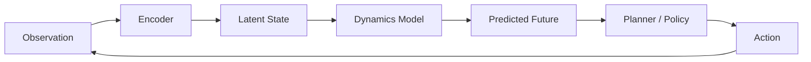
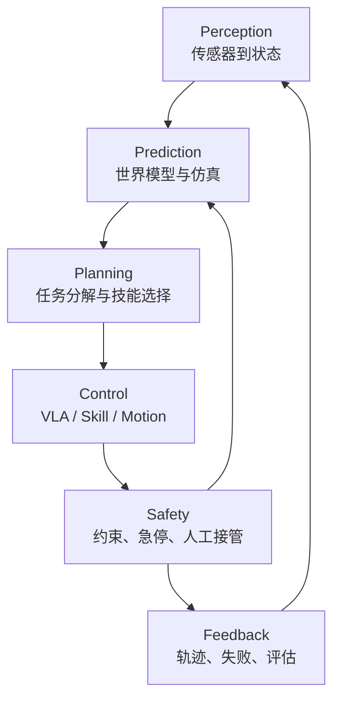

# 第7章 具身智能与 Physical AI

本章的机器人与物理环境任务是领域特殊案例，因为传感器、身体可供性和不可逆物理动作无法由只读 ALR 告警诊断承载；适用范围仅限本章。环境目标、感知证据、动作、世界状态和闭环评估，分别对照 ALR 的告警输入、Evidence、受控工具、Run 状态和报告验收；物理安全边界独立于 ALR 的建单授权。

前面几章讨论的模型，运行在文本、图像、代码、检索结果这些“数字空间”里。具身智能把问题推进了一步：模型不仅要回答“下一句话是什么”，还要理解“下一秒世界会怎样变化”“如果我采取这个动作，会发生什么”“这个动作在当前身体和环境里是否可行”。

本章的目标不是罗列研究路线，而是回答一个问题：**具身算法和语言模型到底差在哪里**。答案是三处根本差别——状态不可完全观测、动作不可逆、评估必须闭环——它们改变了状态表示、反馈形态、数据成本和安全约束。世界模型、动作条件生成、VLA 这些路线，都是在这三处约束下发展出来的。

本章范围以列明来源为准，不把研究路线视作已经成熟的通用产品。

> 世界模型是智能体对环境状态、动态变化和行动后果的内部预测模型；具身智能是智能体带着身体、传感器和执行器，在环境中通过感知、决策、行动和反馈完成任务的能力。

这里的“世界模型”不是哲学意义上的世界观，也不是知识图谱或数据库；它强调智能体能否在内部模拟世界、预测行动后果，并据此规划或学习。


<a id="61-概念边界与语言模型的关系"></a>
## 7.1 概念、边界与语言模型的关系

语言模型和具身算法都根据历史信息选择下一步，但它们面对的状态、动作后果和验证方式不同。语言模型主要处理离散 token，生成结果通常可以重放或重试；具身系统还要处理带噪声和延迟的传感器状态，并输出移动、抓取、推拉、避障或导航等连续或混合动作。动作会改变后续观察，有些后果无法撤销，因此状态表示、反馈来源、数据成本、评估方法和安全约束都随之变化。本章在 7.7 节统一对照这些差异。

### 为什么这个差别值得单独讨论

语言模型的很多工程直觉在具身场景里会失效。例如，纯文本生成的候选通常可以低成本重放或丢弃，物理动作的重试却可能撞坏物体；文本模型的置信度也不能直接充当事实或安全保证，机器人上的过度自信还会越过控制边界。文本系统同样需要真实服务路径评估、发布门禁与治理；具身系统除此之外还必须验证动作改变环境后的闭环状态。把这些约束差异讲清楚，比记住几个模型名更有用。

### 预测器的输入与输出

世界模型可以理解为一个“可用于预测的内部环境模型”。给定当前观察、历史状态和候选动作，它输出未来可能发生的事情。

最简化的表达是：

```text
current observation + history + action
  -> world model
  -> predicted next state / reward / risk / affordance
```

这里的 observation 是图像、激光雷达、触觉、本体状态等直接读数；state 是从当前与历史观察中估计出的环境状态，可以显式表示，也可以是 latent state；action 是转向、抓取、推拉、移动或导航等候选操作；prediction 可以是下一状态、奖励、碰撞风险、任务进度、可行动性或未来视频帧；policy 或 planner 再根据这些预测选择动作。世界模型的关键能力因此是预测状态怎样随动作变化，而不是存储多少静态事实。

可以用驾驶来类比。一个新手看到前车刹车，只知道“前面红灯了”。一个熟练司机会预测：前车可能急停，右侧电动车可能插入，自己如果不减速，短时间后距离可能不安全（驾驶类比，不是制动距离计算）。后者脑中有一个粗糙但有效的世界模型。

对于 AI 系统也是一样：仅仅识别物体不够，还要预测物体、自己和其他智能体之间的动态关系。

### 术语的四种使用范围

“World Model”在不同论文和公司报告里含义略有差异。阅读材料时要先判断对方说的是哪一种。

#### Model-based RL 里的环境动力学模型

这是最经典的技术含义。智能体学习一个模型来预测环境如何变化，然后在模型里“想象”未来，训练策略或做规划。这里关注状态、动作和回报之间可供策略利用的预测关系。

World Models、PlaNet 和 Dreamer 都属于这一路线，但具体的隐状态、规划和策略学习机制放到 7.2 节展开 [[1]](#ref-1)[[2]](#ref-2)[[3]](#ref-3)[[4]](#ref-4)。

#### 生成式视频 / 交互式环境模型

近年来，大模型社区也把能生成可交互环境的视频模型称为世界模型。普通视频生成关注提示到视频的视觉结果，交互式环境模型还接收动作序列，并维持物体、空间和交互状态。Genie 研究动作可控的生成环境，Cosmos 报告世界基础模型平台；两者的目标和接口不同，不能视为可互换的模拟器 [[5]](#ref-5)[[6]](#ref-6)。具体的平台化机制在 7.2 节讨论。

#### JEPA 类的表征预测模型

JEPA 路线强调在 latent space 中预测与任务相关的表征，而不是重建每个像素；这种取舍延续了表示学习以任务相关抽象服务下游问题的基本思路 [[7]](#ref-7)。V-JEPA 研究视频特征预测，V-JEPA 2 进一步展示动作条件后训练与规划 [[8]](#ref-8)[[9]](#ref-9)。这种定义只说明预测对象不同；是否更适合某个决策任务仍需下游验证，不能由 latent prediction 本身推出。

#### 自动驾驶和机器人仿真的世界模型

这一项是应用范围，而不是第四种模型定义。在自动驾驶、机器人和工业仿真中，动力学模型、生成式环境或结构化模拟器都可以参与数据生成、极端场景测试和策略训练。CARLA 等开放仿真器说明，标准化场景、传感器和交通参与者是评估自动驾驶策略的重要基础 [[10]](#ref-10)；模型是否有用仍要由物理合理性、传感器逼真度、长尾覆盖和策略迁移结果共同判断。

### 与语言模型的关系

LLM 和世界模型都从数据中学习预测，把历史压缩为内部表示，也都会在分布外失败。两者的训练接口不同：LLM 主要在离散 token 上学习 next-token prediction，擅长语言、代码、知识表达和工具协议；世界模型可以接收视频、传感器状态与动作，目标是预测环境演化和行动后果。工程系统可以让 LLM 负责理解任务与分解目标，让世界模型负责比较动作后果、生成训练场景或辅助规划，但这是一种系统分工，不代表任一模型天然具备另一方的能力。

<a id="62-隐状态动力学与世界基础模型"></a>
## 7.2 隐状态动力学与世界基础模型

具身算法的核心是：用可学的模型压缩环境动态，让决策不必依赖真实世界的无限试错。这条路线来自 model-based reinforcement learning，典型流程是：



Ha 和 Schmidhuber 的 World Models 把这条链拆成三块：编码器把高维图像压到 latent，循环网络预测 latent 的时间演化，一个很小的 controller 基于 latent 选动作 [[1]](#ref-1)。PlaNet 在隐空间预测并在线规划，Dreamer 在学到的隐动态中展开想象轨迹来训练策略与价值函数 [[2]](#ref-2)[[3]](#ref-3)[[4]](#ref-4)。三者的共同点是：策略不必直接处理原始像素，而可以基于压缩后的状态决策。

### 训练目标与状态表示

世界模型没有统一的损失。像素重建要求预测视觉细节，latent 预测要求保留对决策有用的信息，奖励预测要求理解任务进展，动作条件预测要求学习“采取动作后会发生什么”。这些目标可以联合训练，但误差含义不同：视频看起来清晰，不代表动作因果正确；latent 表示稳定，也不代表能处理未见物体。

状态表示通常混合视觉、语言、本体状态和历史动作。显式状态便于调试与约束，例如物体位姿、速度、关节角与碰撞标志；隐式状态更容易压缩复杂环境，但不易解释与验证。**对用于控制或规划的世界模型，动作条件是区别于普通视频预测的重要接口**：训练样本必须记录动作发生的时间、参数、执行结果与失败原因。表征预测模型不一定以动作作为预训练条件，但若要比较候选动作，仍需在后续阶段建立动作与状态变化的可检验关系。若动作与环境变化没有对齐，模型学到的只是相关性，无法在规划时比较不同动作。

预测误差还要区分来源。由传感器噪声、遮挡和多种合理未来造成的不确定性，不能简单归为模型失效；由训练覆盖不足、状态压缩丢失或动作时间错位造成的系统偏差，则需要修正数据与模型。工程上可以让模型输出候选未来或风险区间，并用后续观察更新状态，但区间本身也要校准。若模型在未见场景中始终给出很窄的区间，下游 planner 会把过度自信当成确定性；若区间始终过宽，预测又无法帮助动作排序。因此验收既要看点预测误差，也要看不确定性与真实失败频率是否对应。

### 长时预测、不确定性与观察更新

中文序列模型教材区分“用历史观测预测”与“多步外推”，为理解误差积累提供了基础 [[11]](#ref-11)。短时预测可能看起来准确，连续展开后却逐渐漂移：误差在每一步进入下一状态，导致物体消失、场景重复或物理关系崩坏。缓解方向包括 latent 状态校正、真实观察重置、分层时间尺度、短 horizon 规划与多候选未来。世界模型不必预测唯一未来，更应表达多个可能结果与相应不确定性——把不确定性压成一个看似确定的视频，会让下游策略过度信任错误预测。

观察更新与想象展开必须分开。观察更新从历史、当前观测和上一步**实际**动作修正隐状态；想象展开从当前隐状态与**候选**动作预测下一状态。前者接触真实传感器，后者是预测，两种状态不能共享一个“已发生”标记。若隐状态压掉了决定未来的变量（杯中液体、接触状态、被遮挡的人），单帧预测仍可看似准确，动作比较却可能完全错误。本书建议先在短闭环中验证：给同一初始观察两个可执行动作，分别预测结果与不确定性，再用独立观测核对；并比较无动作条件、打乱动作与正确动作三组。若打乱动作后质量不变，模型可能主要利用视觉惯性而未学到有效的控制响应。这个检验是教学实验设计，尚未实现。

### 动作条件生成与平台化

2024 年之后出现的世界基础模型把这条路线推向平台化：先用大规模视频、仿真与传感器数据训练通用物理与交互先验，再针对机器人、自动驾驶等场景适配。Genie 从无标注视频学习动作可控的虚拟环境，UniSim 研究高层指令与低层控制条件下的视觉结果模拟 [[5]](#ref-5)[[12]](#ref-12)；NVIDIA Cosmos 把世界基础模型、视频 tokenizer、数据管线与仿真生态组成栈 [[6]](#ref-6)。它们说明生成模型可以参与交互研究，但不能从画面一致推导摩擦、接触力、传感器噪声或安全控制都被正确模拟。选择训练环境时，应问动作是何种语义、是否有外部状态可校验、可维持多长闭环、失败后如何重置，以及用它训练的策略能否在独立环境受益。

<a id="63-感知预测与任务规划"></a>
## 7.3 感知、预测与任务规划

具身智能不是“机器人 + LLM”。它的核心是把模型放进一个会被动作改变的环境中，并让系统在感知、预测、规划、控制和安全反馈之间持续闭环。身体、传感器、执行器、环境、任务目标和数据回流都属于这个闭环的一部分，缺任何一环都不能称为可部署系统。



本章涉及的 Dreamer、Genie、Cosmos、V-JEPA、RT-2、PaLM-E、RT-X、Octo、π0 与 Gemini Robotics，可以放回这张图里理解：有的强化预测环境动态，有的强化视觉和语言到动作的映射，有的强化跨机器人数据，有的强化连续控制。技术路线很多，但工程问题只有一个：系统能否在真实环境中连续观察、预测、行动、验证并安全恢复。

真实世界比文本世界更苛刻。动作有速度、力、扭矩和碰撞约束；物体会滑落、遮挡、反光、变形或被人移动；传感器有噪声和延迟；失败可能造成硬件损坏或人身风险；真实试错昂贵，不能靠无限重试换正确率。因此，本章后半部分不再按模型名罗列，而按可部署闭环展开。

### 感知：从传感器到可行动状态

感知层把摄像头、深度、触觉、IMU、激光雷达、麦克风和机器人本体状态转换成可决策状态。这个状态不仅描述“图像里有什么”，还要包含对象位置、姿态、关系、可通行区域、抓取候选、机器人关节状态、环境变化和不确定性。感知错误会直接污染后续规划：在一个教学假设中，杯子位置估计偏了几厘米，语言计划即使语义正确也可能抓空。

可行动性，或者 affordance，是感知层与规划层之间的关键概念。它回答的是：在当前环境、当前身体和当前技能集合下，某个动作是否可执行。杯子可以抓，但装满热水时抓取策略要变；抽屉可以拉，但前方有障碍物时不可拉；“把碗放进微波炉”对塑料碗和金属碗安全性不同。SayCan 的核心思想之一，就是把 LLM 的高层语义知识和机器人技能的可行动性结合起来 [[13]](#ref-13)。

生产系统通常会把感知输出写成结构化状态，以便区分原始观察、状态估计和高层判断。具身系统只能看到世界的一部分，读数还带有噪声和延迟，所以感知输出必须显式携带“观察到什么、有多确定、何时观察”，不能把估计值当作事实。下面给出一个结构化场景状态的参考：

```text
SceneState {
  objects: id, class, pose, confidence, affordance
  robot: joints, gripper, battery, fault_state
  map: free_space, obstacle, restricted_zone
  task_context: instruction, goal, constraints
  freshness: timestamp, sensor_source, uncertainty
}
```

结构化状态的价值在于它把“感知”和“判断”分开：感知层负责给出对象、位姿、可行动性与不确定性，高层模型负责在给定状态上做任务级判断。这样，当结果出错时可以定位是感知错了（杯子位置偏了几厘米）、状态过期了（用的是上一次观测）、还是判断错了（状态正确但计划不合理）。如果直接把原始图像交给高层模型自由解释，这三类错误会混在一起，无法归因，也无法回归测试。

这个状态要有版本、时间和置信度。按本书的设计，若状态过期、置信度不足或关键对象不可见，系统应重新感知、移动视角或请求人工，而不是让语言模型猜测。感知层越结构化，后续规划、控制、安全和评估越容易连接。

### 预测：世界模型、仿真与数字孪生

世界模型在闭环中回答“如果采取这个动作，环境可能怎样变化”。它可以用于生成合成训练数据、预测候选动作后果、做 model-predictive control、生成长尾测试场景、支持自动驾驶和机器人离线评估，也可以作为数字孪生的一部分帮助调试。关键不是画面是否漂亮，而是预测是否能服务行动。

Sim2Real、Real2Sim 和数字孪生是世界模型落地时最常见的系统形态。Sim2Real 在仿真中训练或测试，再迁移到真实世界，难点是材质、摩擦、接触、传感器噪声、执行器磨损和人类行为造成的 simulation gap [[14]](#ref-14)[[15]](#ref-15)[[16]](#ref-16)。Real2Sim 从真实失败构建仿真场景，用于复现长尾、做反事实测试和验证修复策略。数字孪生偏工程系统和结构化仿真，世界模型偏学习到的生成式或预测式模型，二者可以结合。

世界模型必须和真实数据闭环校准。一个看起来真实但物理不可信的模型，会让策略学到错误行为；一个在短视频上表现稳定的模型，也不一定能支持多轮交互和长时记忆。本节只定义世界模型在系统中的职责，同一 planner 在真实环境、世界模型和混合环境中的对照实验统一放在 7.6 节。

### 规划：把语言目标变成技能图

任务规划层把自然语言目标、场景状态和技能集合转成可执行任务图。例如“把桌上的杯子放进水槽”不能直接变成一个动作，而要拆成找杯子、靠近桌子、选择抓取姿态、抓起杯子、移动到水槽、放下杯子和检查结果。每个节点都需要前置条件、预期结果、失败策略和安全约束。

LLM 或 embodied reasoning model 适合做高层语义理解和任务分解，但必须接收环境状态、技能可用性、affordance、安全规则和失败反馈。它能提出“语义上合理”的步骤，却不能单独证明步骤在当前身体和环境中可执行。规划层应把候选计划交给规则、仿真、世界模型或技能库验证，再进入控制层。

以下为本书教学技能图，retry=2仅表示有限重试示例，不是物理操作默认安全次数：

```text
SkillPlan {
  goal: "cup_to_sink"
  steps: [
    {skill: "locate", target: "cup", precondition: "visible_or_searchable"},
    {skill: "navigate", target_pose: "table_front", safety: "no_human_collision"},
    {skill: "grasp", object: "cup", affordance: "graspable", retry: 2},
    {skill: "place", target: "sink", postcondition: "cup_in_sink"}
  ]
}
```

计划是版本化候选，而不是事实。执行中环境变化、对象丢失、抓取失败或安全约束触发，都可能要求重新规划。模型提出候选计划，执行层保存状态、验证前置条件、执行动作、记录观察，再决定继续、回退或人工接管。

技能图还应显式记录每一步之后的观察点和失效去向。若抓取完成后没有重新检查夹具状态，后续“移动到水槽”可能在物体已经滑落时继续执行；若导航失败只返回布尔值，规划器也无法区分路径受阻、定位丢失和设备故障。把这些结果写入状态契约，才能让重新规划基于新事实，而不是重复原计划。

<a id="64-vla技能策略与低层控制"></a>
## 7.4 VLA、技能策略与低层控制

VLA，Vision-Language-Action，是近几年具身智能的重要范式。它把视觉、语言和动作放进同一个模型或同一套训练目标中，输入可以是图像、视频、机器人状态和语言指令，输出可以是离散 action token、末端执行器位姿、关节角、轨迹 waypoint、diffusion/flow 生成的连续动作序列，或高层技能调用。

不同代表工作可以按控制接口理解。RT-2 把动作表示成 token，便于复用视觉语言模型能力 [[17]](#ref-17)；PaLM-E 把真实传感器接入语言模型，强调 grounding [[18]](#ref-18)；Open X-Embodiment 和 RT-X 通过跨机器人数据推动跨 embodiment 学习 [[19]](#ref-19)；Octo 提供开源通用机器人策略，方便比较架构和数据 [[20]](#ref-20)；π0、π0.5 和后续路线强调从 VLM 走向连续控制和开放环境泛化 [[21]](#ref-21)[[22]](#ref-22)。2025 年 Gemini Robotics 的官方研究说明分别介绍 VLA 动作输出与 Robotics-ER 的空间推理、低层控制接口；本章引用的是该版本的公开说明，不把它扩展成后续产品的通用保证 [[23]](#ref-23)。

生产系统很少只依赖一个端到端模型。更常见的结构是高层模型负责任务理解，中层 VLA 或 skill policy 负责抓取、放置、导航、操作等技能，低层控制器和运动规划器负责轨迹可行性、频率、稳定性和安全限制。端到端模型减少了手工接口，却更难解释和验证；模块化系统便于约束和替换组件，同时需要清晰接口和技能维护。实际系统要依据任务、设备与验证成本选择组合。

### 动作契约与控制时钟

以下为本书的接口设计：一段动作至少记录坐标系、单位、目标身体、动作持续时间、采样时刻、有效期和控制模式。归一化 token 对应的是位置、位姿增量还是速度，必须由 schema 解释；轴顺序、左右手系和角度单位错了，合法形状也会执行错误动作。动作反归一化还要使用对应机器人与训练版本的统计量，不能从另一台机器直接复制参数。

高层计划、动作块与低层伺服不必同频。模型一次生成一段未来动作，运行时仍要检查时间戳与新观测；网络延迟或人进入场景时，应允许安全控制器中断剩余动作块。动作块越长，模型调用开销可能越低，但对环境变化反应更慢；更短的块增加反馈机会，也增加调度和计算压力。本章不指定统一控制频率或通信时限，具体值必须由设备、任务和安全工程验证。

跨身体迁移也不只是修改输出维度：相机外参、夹具形状、可达空间、自由度、载荷和技能语义都可能变化。RT-X 的跨机器人数据和 Octo 的适配结果为跨 embodiment 学习提供了研究证据 [[19]](#ref-19)[[20]](#ref-20)，但不能证明任意新身体无需标定即可执行。部署前仍要核对动作接口，在隔离条件下检查低能量动作，并由设备团队确定合格边界。

跨身体验收应把“模型能生成合法形状”与“动作在目标设备上具有相同语义”分开。至少要检查静止状态的坐标变换、关节和末端范围、夹具开合方向、速度与力限制、动作延迟，以及传感器时间戳对齐；随后用受控轨迹确认反归一化结果，再逐步增加负载和环境复杂度。若只替换动作头而沿用另一台机器的统计量，输出可能数值合法却在物理上偏离。跨身体数据可以提供初始化和共享表示，设备侧标定与闭环回归仍是独立验收项。

<a id="65-安全反馈恢复与数据飞轮"></a>
## 7.5 安全反馈、恢复与数据飞轮

具身系统的安全是控制闭环的一部分。常见机制包括速度、力、扭矩和加速度限幅，碰撞检测，安全区域，硬件和软件急停，远程或本地人工接管，任务级危险动作拒绝，以及对用户指令的语义安全判断。LLM 的安全提示不能替代控制安全；底层约束需要由控制与安全工程落实。官方机器人研究也区分语义安全与低层碰撞、力和稳定性控制 [[23]](#ref-23)。下面的 envelope、动作分级和恢复流程是本书提出的教学设计，用于说明接口与证据要求，不构成认证标准或已验证的安全方案。

安全边界应被写成一份可计算的 **physical-action envelope**，而不是一段“请小心”的提示。它至少约束工作空间、末端速度、关节速度、接触力、载荷、人与设备的最小距离、可见性、定位质量、允许工具和允许姿态。每一项约束都需要说明数据来源、测量频率、失效默认值和执行 owner：视觉模型可以建议“桌面上没有人”，但距离传感器失效时，安全控制器应按保守规则降速或停止；语言模型可以选择“拿起杯子”，但不得修改安全区、急停逻辑或力矩上限。机器人控制中的这一层旨在把概率性策略限制在经校验的可行动集合内；约束仍依赖传感器和控制器的可靠性；它也解释了为何 VLA 的高层泛化不能替代传统的运动学、碰撞检测和互锁。

安全 envelope 还应区分三种动作。第一类是只读或虚拟动作，例如在世界模型中 roll out、在数字孪生中规划、在相机画面上标注候选抓取点；它们可由较宽松的模型策略产生。第二类是可逆、低能量的受控动作，例如经设备评估后在隔离区域低速移到观察位、调整无载夹爪或请求更多视角；它们是否允许自动执行仍由设备和场景风险评估决定。第三类是不可逆或高危动作，例如接近人、切换重载工具、快速运动、开门、搬运液体或跨越安全区；它们必须经过额外门禁，必要时要求双通道传感器和人工批准。把动作按后果而非按“模型是否自信”分级，能避免置信度被误用为安全证明。

上线前的评估门禁应沿着这三类动作建立证据链。离线阶段先检查数据覆盖、标注质量、策略在已知回归集上的成功与拒绝；仿真阶段再对遮挡、摩擦变化、动作延迟、传感器丢帧和危险接近做对抗性扰动。CausalWorld 这类可控基准的价值正在于能把“动作改变了什么”明确化 [[24]](#ref-24)，而 domain randomization 的经验提醒我们，仿真覆盖不是现实保证 [[14]](#ref-14)[[15]](#ref-15)[[16]](#ref-16)。进入真实环境时，系统先以 shadow mode 记录候选而不执行，然后在围栏区域、低速度、有限物体集合中进行受监护执行；每推进一级都要证明上一阶段的失败模式已被观测、分类和处理，而不能只凭总体成功率放行。

一个可审计的门禁记录至少包含场景版本、机器人和工具版本、策略版本、世界模型版本、传感器健康、候选动作、envelope 判定、拒绝原因、人工决定与结果。对于每个高风险失败，应能回答：模型是否提出了错误候选，状态估计是否遗漏了关键物体，安全层是否正确拒绝，还是执行器在已获许可后偏离了轨迹。把这几个层次混为“机器人失败”，会让后续训练把安全控制器的正确拒绝误标成坏样本，或把执行器故障错误归因于世界模型。

运行中的干预也必须有状态语义。人工接管是一次有版本的状态迁移：冻结新的高危动作、保留当前传感器与控制快照、标记被中断的技能、给出恢复条件，并把控制权转给预先授权的操作者。恢复时，系统要重新感知、建立环境状态、检查 envelope，并确认人、物体和工具仍处于允许位置；若动作已经造成外部变化，恢复策略应从当前事实重新规划。任务中断、状态恢复与外部副作用的通用运行时语义见[第 17 章 Agent Runtime](../part3/04-agent-runtime.md)，本节只补充物理状态不能随软件会话一起回滚这一约束。

回滚在 Physical AI 中也有边界。软件配置、模型路由、技能版本和策略阈值通常可以回滚；机器人在空间中的位置、物体形态、人与环境的反应不能回滚。因此发布方案要同时准备软件回滚和物理收敛方案：停止、退回到安全姿态、释放或稳定载荷、隔离故障设备、通知现场人员、保存证据。补偿动作本身也要放入 envelope。谁可以批准高风险动作、如何记录审计证据、怎样灰度和回退，由[第 18 章 Agent 治理与调优](../part3/06-agent-governance-optimization.md)统一定义；本章说明这些治理控制在物理动作上的额外约束。

安全评价不应只汇总一次部署的平均数字。建议按动作风险等级分别报告任务成功率、拒绝正确率、危险近失率、超限触发率、人工接管率、恢复成功率、传感器失效下的安全停机率，以及从仿真到真实的性能差，并同时给出场景覆盖和置信区间。“未发生碰撞”若只来自少量固定场景，不足以支持扩大开放范围。Open X-Embodiment 与 Bridge Data 展示了跨机器人、跨任务或跨环境数据在其研究设置中的泛化价值 [[19]](#ref-19)[[25]](#ref-25)，两项工作并未据此证明安全约束的泛化。本书进一步提出：安全约束也应在新相机、新夹具、新物体和新布局下单独验证，并将结果纳入治理门禁。

数据飞轮决定具身智能能否规模化。一个机器人样本通常包含时间戳、摄像头/深度/触觉/本体状态、语言指令、动作轨迹、成功失败标签、环境元数据和操作者元数据。真实机器人昂贵，任务失败可能损坏硬件，不同机器人动作空间不同，人类遥操作质量不稳定，成功率评估还需要环境状态判断。因此数据来源通常是组合的：遥操作、机器人自主执行日志、仿真数据、视频和网页数据、失败恢复样本、人工示范、偏好反馈和跨机器人共享数据集。Bridge Data 等工作也说明，跨任务和跨环境共享数据可以改善其研究范围内的泛化 [[25]](#ref-25)。

```text
部署 -> 采集轨迹 -> 标注成功失败 -> 挖掘长尾
  -> 仿真扩增 -> 训练 -> 回归评估 -> 再部署
```

这条飞轮和语言模型的训练迭代很像，只是成本和风险更高。文本生成的一次错误大多可以重试，机械臂撞到人不能简单 revert。物理世界把所有约束放大，所以具身系统更需要仿真、限幅、人工接管、长尾评估和清晰的责任边界。

<a id="66-闭环评估与证据边界"></a>
## 7.6 闭环评估与证据边界

具身系统的评估要同时覆盖预测质量、策略决策、物理执行与安全控制。单个离线分数无法代表完整闭环，报告必须说明场景、身体、传感器、控制器和人工干预条件。

### 世界模型评估

视频质量只是世界模型评估的一部分。CausalWorld 等基准强调因果交互和可控操作，说明评估还要观察动作改变环境后的结果 [[24]](#ref-24)。预测一致性检查物体身份和位置能否跨时间保持；动作可控性检查环境变化是否响应给定动作；物理合理性检查碰撞、重力、遮挡和接触；长时记忆与交互稳定性检查多轮展开是否漂移；任务有效性检查模型训练或筛选出的策略能否迁移；安全覆盖则检查高风险和长尾场景是否进入测试集。这些指标服务不同问题，不能合并成一个视觉相似度分数。

评估时还要把预测模型放回策略闭环：让同一个 planner 分别使用真实环境、世界模型和混合环境，比较任务成功率、动作分布和失败类型。这是本章唯一的 planner 对照位置。若策略只在模型内部变好，却不能迁移到真实环境，当前证据只能说明它适配了模型环境，需要继续核对模型偏差、策略利用漏洞和分布差异。长时任务还要记录误差随 rollout 长度的增长，不能只报告第一帧或短片段指标。

具身评估还要覆盖硬件和人的因素：不同摩擦、负载、传感器延迟、光照、遮挡和操作者指令都可能改变结果。一个只在固定实验台上成功的策略，不能直接推断在家庭、仓库或道路上可靠。评估报告应明确训练内、训练外、仿真、真实和长尾场景的边界。

为了避免“模型分数好但上线不可用”，评估还应把安全层本身当作被测对象。为每个动作准备允许、拒绝、降级和人工接管四类 oracle：当障碍物进入缓冲区时，系统是否在规定控制周期内停止；当相机置信度下降但触觉仍正常时，是否按策略降低速度；当两个传感器对物体位置冲突时，是否选择保守路径；当模型建议的抓取点在工作空间外时，是否拒绝并留下可解释证据。世界模型可帮助生成这些反事实场景，但评估结论必须来自独立的控制日志和真实或高保真仿真观测，而不是由同一个生成模型自评。

开环与闭环回答不同问题。开环评估比较预测和真实观测的差距，例如视频相似度或物体位置误差；闭环评估让策略执行完整任务。世界模型即使开环指标良好，也可能因为策略利用模型偏差（policy exploitation）而在闭环中失败。生成质量因此不能单独代表行动价值，更不能代表真实世界中的安全与泛化。本章把“能帮助决策”作为动作条件模型的工程验收目标，不把它写成所有研究路线已经达到的能力。

### 具身智能评估

机器人任务不能用单次 demo 作为证据。评估矩阵至少包含五个维度：任务成功率衡量目标和长任务是否完成；泛化覆盖新物体、新布局和新语言表达；效率记录完成时间、动作数和资源消耗；安全记录碰撞、超限、拒绝与人工接管；可恢复性记录失败检测、重新规划和恢复成功率。每个维度都要覆盖训练内、训练外和长尾场景，并保留完整的传感器、动作、模型与控制 trace。失败样本进入带版本的回归集，才能区分模型改进与场景变化。

<a id="67-具身算法与语言模型的关键差异"></a>
## 7.7 具身算法与语言模型的关键差异

把前面几节放回一张表，可以看清两类算法的差别。它们共享“用数据学习预测”的框架，但处在不同的约束下。

| 维度 | 语言模型 | 具身算法 |
| --- | --- | --- |
| 状态 | 上下文窗口中的离散 token；状态即历史 | 传感器观测加隐状态；部分可观、带噪声与延迟 |
| 动作 | 生成下一个 token；离散、可重放、无物理后果 | 连续或混合动作；有速度、力与碰撞约束，部分不可逆 |
| 反馈 | 文本偏好、可验证奖励；反馈与动作解耦 | 物理反馈；稀疏、有延迟、可能损坏硬件 |
| 训练数据 | 文本与多模态语料，获取相对便宜 | 遥操作、自主执行日志、仿真与跨本体数据，采集昂贵 |
| 泛化 | 主要在语言与任务分布上泛化 | 还要跨物体、跨布局、跨身体泛化 |
| 评估 | 离线基准、人工评估与真实服务路径验证，可回放候选 | 必须闭环；仿真分数不能替代物理验证 |
| 安全 | 内容策略、权限、工具副作用控制、发布门禁与审计 | 在通用治理上增加控制闭环内的限幅、碰撞检测、急停与人工接管 |
| 失败代价 | 多数可以重试或回滚 | 可能损坏物体或伤害人，回滚在物理上不存在 |

三处差异值得单独说。

**状态不可完全观测。** 语言模型处理的是调用方显式放入上下文的 token；具身系统还面对未被传感器覆盖的外部状态，读数带有噪声和延迟。因此具身算法要维护“系统当前相信世界是什么样”的状态估计，并在新观察到来时修正它（7.2 节）。

**动作可能不可逆。** 文本输出通常可以重新生成，而移动机械臂、开门或加热液体会改变外部状态。具身系统因此把提议、授权和执行分开：高层提出候选，安全层检查可行动集合，低层控制器在控制频率上执行，任何一步都可能被急停打断。工具型 Agent 也需要运行时授权与副作用治理，具身系统在此基础上增加了连续控制和物理收敛要求。

**评估必须包含闭环。** 离线数据可以检查感知、预测和候选动作，但具身策略还要在真实或高保真环境中执行完整任务（7.6 节）。物理世界的失败样本成本更高，因此仿真、数字孪生和世界模型承担先筛选候选、再进入受控真机验证的角色。

本章涉及的路线——隐状态动力学、动作条件生成、VLA——都在回答同一个问题：怎样用可学的模型压缩环境动态，让决策在有限试错下更接近正确。它们的接口和证据不同，但都要回到这张表的约束上。

<a id="68-本章小结"></a>
## 7.8 本章小结

世界模型的核心价值要从预测对象、动作条件和下游决策来判断。隐状态模型可以支持规划或想象学习，视频特征预测可以形成表示，生成式环境可以提供交互研究材料；这些路线的任务、接口和证据不同。VLA把视觉语言能力接到动作，但仍要由身体、感知、控制和安全反馈构成闭环。

与语言模型相比，具身算法的差别集中在三点：状态不可完全观测、动作不可逆、评估必须闭环。这三点决定了它要维护显式隐状态、把提议与执行分开、用闭环验证代替离线分数。隐状态动力学、动作条件生成和 VLA 是同一约束下的不同技术路线，接口和证据各不相同。仿真与离线分数只是阶段性证据，不能替代物理验证；本章架构与检验方案均为设计说明，不包含机器人上线、安全认证或性能实测。

<a id="69-参考资料"></a>
## 7.9 参考资料

1. <a id="ref-1"></a> Ha, D., & Schmidhuber, J. [*World Models*](https://arxiv.org/abs/1803.10122). NeurIPS Workshop, 2018. 访问日期：2026-10-16
2. <a id="ref-2"></a> Hafner, D., et al. [*Learning Latent Dynamics for Planning from Pixels*](https://arxiv.org/abs/1811.04551). ICML, 2019. 访问日期：2026-10-16
3. <a id="ref-3"></a> Hafner, D., et al. [*Dream to Control: Learning Behaviors by Latent Imagination*](https://arxiv.org/abs/1912.01603). ICLR, 2020. 访问日期：2026-10-16
4. <a id="ref-4"></a> Hafner, D., et al. [*Mastering Diverse Domains through World Models*](https://arxiv.org/abs/2301.04104). arXiv, 2023. 访问日期：2026-10-16
5. <a id="ref-5"></a> Bruce, J., et al. [*Genie: Generative Interactive Environments*](https://arxiv.org/abs/2402.15391). arXiv, 2024. 访问日期：2026-10-16
6. <a id="ref-6"></a> NVIDIA. [*Cosmos: World Foundation Model Platform for Physical AI*](https://arxiv.org/abs/2501.03575). arXiv, 2025. 访问日期：2026-10-16
7. <a id="ref-7"></a> Bengio, Y., Courville, A., & Vincent, P. [*Representation Learning: A Review and New Perspectives*](https://arxiv.org/abs/1206.5538). IEEE TPAMI, 2013. 访问日期：2026-10-16
8. <a id="ref-8"></a> Bardes, A., et al. [*Revisiting Feature Prediction for Learning Visual Representations from Video*](https://arxiv.org/abs/2404.08471). arXiv, 2024. 访问日期：2026-10-16
9. <a id="ref-9"></a> Assran, M., et al. [*V-JEPA 2: Self-Supervised Video Models Enable Understanding, Prediction and Planning*](https://arxiv.org/abs/2506.09985). arXiv, 2025. 访问日期：2026-10-16
10. <a id="ref-10"></a> Dosovitskiy, A., et al. [*CARLA: An Open Urban Driving Simulator*](https://arxiv.org/abs/1711.03938). CoRL, 2017. 访问日期：2026-10-16
11. <a id="ref-11"></a> Zhang, A., et al. [《动手学深度学习》：序列模型](https://zh.d2l.ai/chapter_recurrent-neural-networks/sequence.html). 中文在线版 2.0.0. 访问日期：2026-10-16
12. <a id="ref-12"></a> Yang, S., et al. [*Learning Interactive Real-World Simulators*](https://arxiv.org/abs/2310.06114). arXiv, 2023. 访问日期：2026-10-16
13. <a id="ref-13"></a> Ahn, M., et al. [*Do As I Can, Not As I Say: Grounding Language in Robotic Affordances*](https://arxiv.org/abs/2204.01691). arXiv, 2022. 访问日期：2026-10-16
14. <a id="ref-14"></a> Tobin, J., et al. [*Domain Randomization for Transferring Deep Neural Networks from Simulation to the Real World*](https://arxiv.org/abs/1703.06907). arXiv, 2017. 访问日期：2026-10-16
15. <a id="ref-15"></a> Peng, X. B., et al. [*Sim-to-Real Transfer of Robotic Control with Dynamics Randomization*](https://arxiv.org/abs/1710.06537). arXiv, 2017. 访问日期：2026-10-16
16. <a id="ref-16"></a> Tremblay, J., et al. [*Training Deep Networks with Synthetic Data: Bridging the Reality Gap by Domain Randomization*](https://arxiv.org/abs/1804.06516). CVPR Workshops, 2018. 访问日期：2026-10-16
17. <a id="ref-17"></a> Brohan, A., et al. [*RT-2: Vision-Language-Action Models Transfer Web Knowledge to Robotic Control*](https://arxiv.org/abs/2307.15818). arXiv, 2023. 访问日期：2026-10-16
18. <a id="ref-18"></a> Driess, D., et al. [*PaLM-E: An Embodied Multimodal Language Model*](https://arxiv.org/abs/2303.03378). arXiv, 2023. 访问日期：2026-10-16
19. <a id="ref-19"></a> Open X-Embodiment Collaboration. [*Open X-Embodiment: Robotic Learning Datasets and RT-X Models*](https://arxiv.org/abs/2310.08864). arXiv, 2023. 访问日期：2026-10-16
20. <a id="ref-20"></a> Octo Model Team. [*Octo: An Open-Source Generalist Robot Policy*](https://arxiv.org/abs/2405.12213). arXiv, 2024. 访问日期：2026-10-16
21. <a id="ref-21"></a> Black, K., et al. [*π0: A Vision-Language-Action Flow Model for General Robot Control*](https://arxiv.org/abs/2410.24164). arXiv, 2024. 访问日期：2026-10-16
22. <a id="ref-22"></a> Physical Intelligence. [*π0.5: A Vision-Language-Action Model with Open-World Generalization*](https://arxiv.org/abs/2504.16054). arXiv, 2025. 访问日期：2026-10-16
23. <a id="ref-23"></a> Google DeepMind. [*Gemini Robotics Brings AI into the Physical World*](https://deepmind.google/blog/gemini-robotics-brings-ai-into-the-physical-world/). 2025. 访问日期：2026-10-16
24. <a id="ref-24"></a> Ahmed, O., et al. [*CausalWorld: A Robotic Manipulation Benchmark for Causal Structure and Transfer Learning*](https://arxiv.org/abs/2010.04296). arXiv:2010.04296, 2020. 访问日期：2026-10-16
25. <a id="ref-25"></a> Ebert, F., et al. [*Bridge Data: Boosting Generalization of Robotic Skills with Cross-Domain Datasets*](https://arxiv.org/abs/2109.13396). RSS, 2022. 访问日期：2026-10-16
