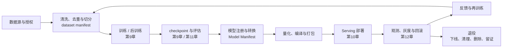
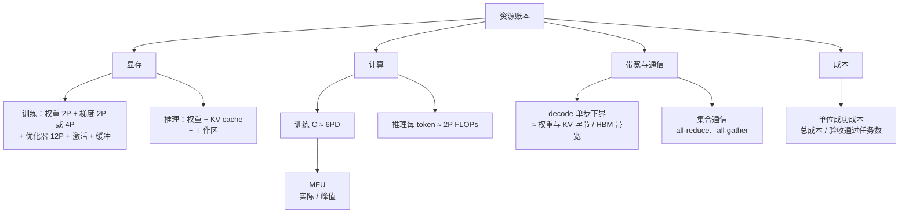
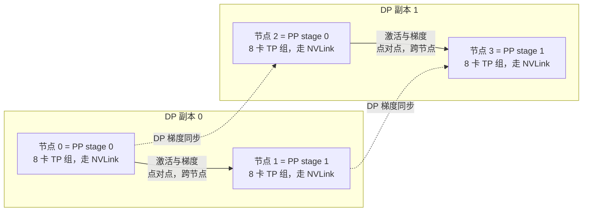
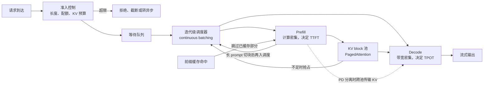
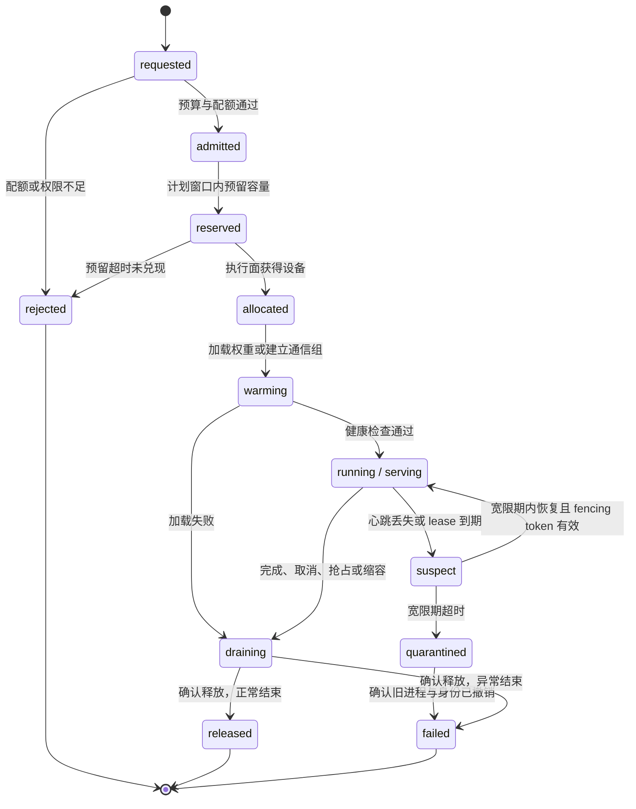
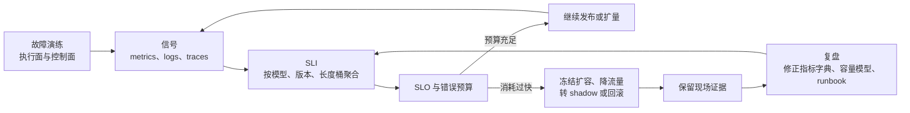
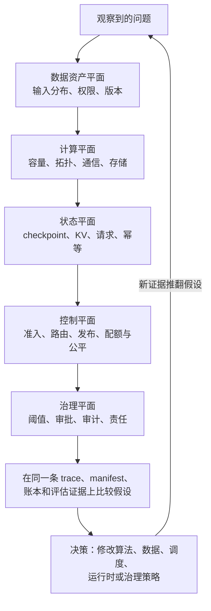
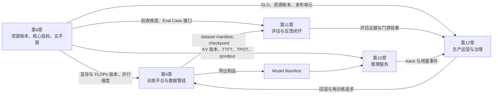
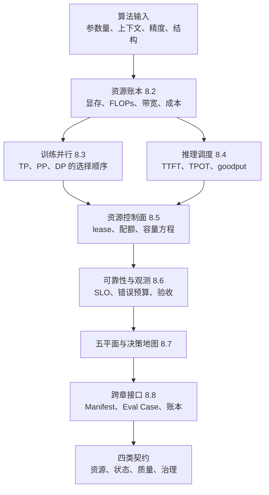

# 第8章 AI Infra 全景

> **版本与证据说明**：本章的资源账本、状态机、容量方程、门禁与成本数字是本书的教学设计或示例假设，不代表任何已实现平台；涉及 vLLM、Triton、TensorRT、NCCL、Kubernetes 等具体软件的行为，以参考资料所列文档及其核验日期为准。

前七章讨论了模型如何表示、学习、对齐、推理、从零训练、适配并扩展到具身系统。从本章开始进入大模型 Infra：同一个模型，怎样被稳定地训练出来、保存下来、部署出去、服务给用户，并在故障、扩容、升级和成本约束下持续运行。

大模型 Infra 不是“把模型放进一台 GPU 服务器”，而是一条跨越数据、计算、通信、存储、调度、服务、观测和治理的系统链路。训练侧关心有效 token/s、扩展效率、故障恢复和 checkpoint；推理侧关心首 token 时延（Time To First Token，TTFT）、每输出 token 时延（Time Per Output Token，TPOT）、吞吐、KV cache（注意力层为已处理 token 缓存的 Key/Value 张量）、排队和单位成功成本；平台侧还要处理模型版本、容量预测、租户隔离、权限、审计和回滚。

本章是后续四章的地图。模型结构、并行需求、精度要求和验证方式构成 Infra 的输入契约，Infra 负责让这些计算在真实约束下可重复、可观测、可恢复地执行。本章只给出全书共用的术语、资源账本、五平面和跨章接口；训练作业、推理服务、评估证据与运营治理的机制分别在第9、10、11、12章展开。

## 8.1 为什么大模型需要独立的 Infra 方法论

### 从模型文件到生命周期系统

传统后端服务通常把二进制、配置和数据库迁移打包发布。大模型服务的“可运行单元”更复杂：除了权重，还包括 tokenizer、chat template、量化配置、LoRA adapter、视觉预处理、采样参数、工具 schema、验证器、硬件 kernel 和安全策略。训练得到的 checkpoint 只是生命周期中的一个状态，不是可以直接交付的产品。

如图 8-1 所示，生命周期中的每个箭头都是接口：数据 manifest 不稳定，训练不可复现；checkpoint 不完整，故障无法恢复；模型转换不一致，线上质量会变；服务没有容量指标，流量一升高就排队；没有 trace，失败无法归因；没有回滚，任何升级都可能变成事故。

*图 8-1 大模型生命周期与系统链路*

链路的最后一段是退役，它最容易被推迟。退役不是一次删除，而是四类到期时间不同的收尾：模型下线要先确认没有在途请求，再撤销路由和凭据，以小时计；依赖清理要回收 adapter、量化制品、编译缓存和专用资源池，以周计；数据删除要沿血缘处理缓存、派生索引和评估样本，受保留策略与备份周期约束；证据留存保留审批、评估和事故记录，以年计。把它们压成一张工单，要么删掉仍需审计的证据，要么让已下线的模型继续持有权限和资源。删除与留存的做法见第12章 12.8 节。

### 算法与 Infra 的边界

算法层回答模型结构、损失、数据采样、推理策略和验证器判定；Infra 层回答这些计算如何分布到 GPU、如何读写和通信、如何在多请求下调度、如何保存和恢复状态、如何对外提供稳定接口。

边界不是绝对的。GQA（分组查询注意力，多个 query 头共享一组 KV 头）会改变 KV cache 大小，FlashAttention 同时涉及算法和 kernel，MoE（混合专家）路由会影响通信，RLVR 的 verifier 会占用 serving 资源，推理预算会改变排队和成本。因此算法指标和系统指标必须连成一条可测量的链路：

| 算法输入 | Infra 需要回答的问题 | 最终验收 |
|:---|:---|:---|
| 参数量、层数、hidden size | 单卡能否容纳，如何并行和分片 | 显存水位、扩展效率 |
| 上下文长度、KV heads | 每请求 cache 需要多少内存 | 并发、TTFT、TPOT |
| 训练 token、batch、序列长度 | 数据和 GPU 是否持续供给 | 有效 token/s、MFU（模型 FLOPs 利用率） |
| checkpoint、optimizer state | 保存、恢复和跨版本是否可靠 | 恢复时间、丢失工作量 |
| 量化、LoRA、视觉输入 | 转换和 kernel 是否兼容 | 质量、吞吐、回滚 |
| 验证器、工具和多步推理 | 如何调度额外计算 | 单位成功成本、尾延迟 |

### 验收维度与核心指标

一个训练脚本在 8 张 GPU 上跑通，只说明功能闭环成立，不说明系统可扩展：GPU 可能在等数据或通信，checkpoint 可能阻塞训练，故障后可能无法恢复，成本可能不可接受。一个推理服务能返回 token，也不代表可以上线：首 token 可能很慢，并发一高就 OOM，长请求会饿死短请求，模型升级无法灰度，工具请求没有审计。

因此，大模型 Infra 的验收要从“功能正确”扩展到性能、容量、可靠性、可观测性和治理五个维度。Google SRE 方法用服务等级目标（Service Level Objective，SLO，即某个可测指标在一个时间窗口内应达到的目标值）和错误预算把可靠性与发布决策联系起来 [[1]](#ref-1)；大模型系统还要把 token、上下文、模型版本和生成质量纳入同一套目标。下表是全书共用的核心指标，公式分别在 8.2 节和 8.4 节给出。

| 指标 | 含义 | 主要用途 | 公式位置 |
|:---|:---|:---|:---|
| TTFT | 请求到达至第一个输出 token 的时间 | 交互体验，反映排队与 prefill | 8.4 节 |
| TPOT | 首个与最后一个输出 token 之间的平均间隔 | 流式体验，反映 decode 效率 | 8.4 节 |
| goodput | 单位时间内同时满足 TTFT 与 TPOT SLO 的成功请求数 | 有效容量，替代裸吞吐 | 8.4 节 |
| MFU | 按模型理论计算量折算的实际 FLOPs/s 与硬件峰值之比 | 训练与 prefill 的计算效率 | 8.2 节 |
| 有效 token/s | 计入损失的训练 token 吞吐，不含 padding | 训练供给与扩展效率 | 第9章 9.2 节 |
| 单位成功成本 | 总成本除以通过业务验收的任务数 | 成本与质量联合决策 | 8.2 节 |

## 8.2 工作负载与资源模型：先算清楚再选组件

### 三种负载，三种资源画像

训练是长时间、高吞吐的批处理负载，可以容忍单步高延迟，却不能容忍 GPU 长时间空闲，并且要在节点故障后从保存的状态恢复。推理是在线或准在线负载，输入和输出长度差异巨大，重点是延迟、并发、容量和质量稳定。数据处理是 I/O、CPU、网络和存储的混合负载，常常是训练前端的隐形瓶颈。

| 负载 | 主要资源 | 主要瓶颈 | 关键指标 |
|:---|:---|:---|:---|
| 预训练 | GPU、网络、对象存储 | 通信、数据供给、故障恢复 | 有效 token/s、MFU、扩展效率 |
| 后训练 | GPU、CPU、评估环境 | rollout、验证器、数据混合 | 成功率、样本吞吐、成本 |
| 在线推理 | GPU 显存、带宽、调度 | KV cache、排队、batch 形状 | TTFT、TPOT、p95、goodput |
| 数据处理 | CPU、网络、对象存储 | 解码、去重、shuffle、序列化 | 有效 token/s、I/O 利用率 |
| 评估回放 | GPU、工具沙箱 | 并发执行和结果判定 | case/s、通过率、回归时间 |

用在线 serving 的 QPS 衡量训练，会忽略 GPU 是否被通信和数据拖慢；只用训练吞吐挑选推理 GPU，又会忽略单 token 延迟和显存容量。平台应先建立负载分类（workload taxonomy），再决定共享集群还是隔离资源池。图 8-2 把本节的资源账本分成显存、计算、带宽和成本四本分账。

*图 8-2 资源账本的分解*

### 训练显存账本

设参数量为 \\(P\\)。混合精度训练常用的 ZeRO 口径是：BF16 权重 \\(2P\\) 字节、BF16 梯度 \\(2P\\)，Adam 类优化器再保存 FP32 master weight、一阶动量和二阶动量共 \\(12P\\)，合计约 \\(16P\\) [[2]](#ref-2)；若梯度以 FP32 累加，梯度项变为 \\(4P\\)，合计约 \\(18P\\)。70B 模型按 \\(16P\\) 计为 \\(70\times10^9\times16\,\text{B}\approx1120\,\text{GB}\\)，已超过一台 8×80 GB 服务器的 640 GB 总显存，而这还没有计入激活。这正是需要 ZeRO、FSDP 分片乃至 CPU/NVMe offload 的原因 [[3]](#ref-3)。

激活不能用常数描述。它近似与层数 \\(L\\)、micro-batch 大小 \\(B\\)、序列长度 \\(T\\) 和 hidden size \\(h\\) 的乘积成正比，即 \\(\propto L\cdot B\cdot T\cdot h\\)；若不使用 FlashAttention 等融合 attention kernel，前向还要保存 \\(a\\) 个头的注意力分数与概率矩阵，多出一项 \\(\propto L\cdot B\cdot a\cdot T^2\\)，长上下文时它会成为主项。激活重算（activation checkpoint）以多一次前向换取少保存中间张量；通信 bucket、参数预取和分片临时聚合又会在关键路径上同时存活。

| 项 | 量级 | 是否随 batch/序列长度增长 | 主要缓解手段 |
|:---|:---|:---|:---|
| 权重（BF16） | \\(2P\\) | 否 | 量化、分片、offload |
| 梯度 | \\(2P\\)（BF16），FP32 累加时 \\(4P\\) | 否 | 梯度分片、reduce-scatter |
| 优化器状态（FP32 master + 两个动量） | \\(12P\\) | 否 | ZeRO-1/2/3、CPU offload |
| 激活 | \\(\propto LBTh\\)，无融合 attention 时另有 \\(T^2\\) 项 | 是 | 激活重算、序列并行、减小 micro-batch |
| 通信与预取缓冲 | 与并行度和 bucket 设置相关 | 部分 | 调整 bucket、限制在途快照 |
| 临时工作区与碎片 | 由 kernel 与分配器决定 | 部分 | 预留静态区、统一分配器 |

这张表是分类框架，不是可以直接套用的容量公式。不同优化器、精度策略和框架的字节口径不同，引用任何具体数字前必须先声明优化器、精度配置和分片策略；“能否放进显存”最终要在目标并行度下实测峰值。

### 推理显存与 KV 数值示例

推理显存主要由权重、KV cache、运行时工作区和 batch 中的临时张量组成。对 decoder-only 模型，在常规 MHA/GQA、K/V 维度相同且不做额外压缩时，一批序列的 KV 载荷近似为

\\[
M_{KV}\approx 2\times L\times B\times T\times H_{KV}\times d_{head}\times b,
\\]

其中 \\(L\\) 为层数，\\(B\\) 为同时驻留的序列数，\\(T\\) 为每条序列已缓存的 token 数，\\(H_{KV}\\) 为 KV 头数，\\(d_{head}\\) 为每头维度，\\(b\\) 为每元素字节数，系数 2 对应 K 和 V。长度不同的序列要逐条求和。

以 Llama-3-70B 为例（80 层、8 个 KV 头、\\(d_{head}=128\\)、BF16）：每 token 的 KV 为 \\(2\times80\times8\times128\times2=327{,}680\\) B，即 320 KiB；一条 8K（8192 token）上下文约 2.5 GiB；32 条 8K 序列同时驻留就需要约 80 GiB，超过一张 80 GB GPU 的容量，而 BF16 权重本身还要约 140 GB。若该模型的 64 个 query 头各自保留 KV 头，KV 会扩大 8 倍，这就是 GQA 通过减少 \\(H_{KV}\\) 换来的余量；但它是算法侧已决定的结构。Infra 要做的是把最大长度、并发和精度换算成准入控制（admission control）与容量上限。<!-- 待核验：Llama-3-70B 结构参数（80 层、64 个注意力头、8 个 KV 头、head_dim 128）未能访问官方 config.json（需登录），建议补引 Meta 官方模型卡或配置文件 -->

MoE 要分清两种口径。权重驻留与制品存储由总参数、共享层和放置方案决定；每 token 激活参数描述参与计算的专家，只能用来估计计算量。用总参数估每 token 计算、再用激活参数估权重内存，会同时高估算力需求和低估驻留成本；路由通信、负载偏斜和非专家计算也不会因为“激活少”而消失。

### 计算、带宽与 MFU

三个量级估算覆盖了大部分容量讨论。用 \\(D\\) 个 token 训练一个 \\(P\\) 参数的稠密模型，总计算量约为

\\[
C_{train}\approx 6PD,
\\]

其中前向约 \\(2PD\\)、反向约 \\(4PD\\) [[4]](#ref-4)，不含与上下文长度相关的注意力项和激活重算。例如 70B 模型训练 1T token 约需 \\(4.2\times10^{23}\\) FLOPs。推理时每生成一个 token 的前向约需 \\(2P\\) FLOPs，外加与上下文长度成正比的注意力计算。

训练效率常用模型 FLOPs 利用率（Model FLOPs Utilization，MFU）衡量 [[5]](#ref-5)：

\\[
\text{MFU}=\frac{6P\times \text{有效 token/s}}{N_{GPU}\times F_{peak}},
\\]

其中 \\(F_{peak}\\) 是单卡在所用精度下的峰值 FLOPs/s。分子只按模型理论计算量计，激活重算等额外计算不计入，因此 MFU 可以跨实现比较；常见的 GPU utilization 百分比只表示有 kernel 在运行，不等于 MFU。

Decode 往往受带宽而非算力约束。每个 decode step 都要把全部权重从 HBM 读一遍，batch 中各序列还要读各自的 KV，所以单步时间（也就是 TPOT）的下界约为

\\[
\text{TPOT}_{min}\approx\frac{W_{bytes}+\sum_i KV_i}{N_{TP}\times BW_{HBM}},
\\]

其中 \\(W_{bytes}\\) 为权重字节数，\\(BW_{HBM}\\) 为单卡显存带宽，TP 下权重和 KV 按卡分摊。以教学假设计算：70B 模型 BF16 权重约 140 GB，TP=8、单卡带宽按 3 TB/s 计，仅读权重就需 \\(140/(8\times3)\approx5.8\\) ms，再加 KV 读取与通信。增大 batch 可以把同一次权重读取摊给更多序列，这是连续批处理提升吞吐的根本原因；但 KV 读取随 batch 线性增长，下界也随之上升。

诊断时要同时看多层指标：计算利用率低而网络利用率高，多半是并行切分或 all-reduce 瓶颈；计算低而显存带宽接近上限，是 decode 或小 batch 的 memory-bound；GPU 和网络都低而 CPU 或对象存储高，说明数据供给是瓶颈。NCCL 为 GPU 集合通信提供 all-reduce、all-gather、reduce-scatter 等原语 [[6]](#ref-6)，但并行维度、通信时机和拓扑仍由应用层选择。

### 成本单位与任务结果关联

训练成本可以按每百万有效 token、每个 checkpoint 或每个实验比较；推理成本可以按每百万输入/输出 token、每个成功请求或每个完成任务比较。对推理密集型负载，输出 token 多不一定坏，关键是额外 token 是否换来成功率。本书使用的单位成功成本为

\\[
\text{单位成功成本}=\frac{C_{\text{GPU}}+C_{\text{CPU、存储、网络}}+C_{\text{评估与标注}}+C_{\text{失败重跑}}+C_{\text{人工接管}}}{\text{通过业务验收的任务数}}.
\\]

吞吐很高但失败率也高的模型，单位成功成本可能更差；低延迟模型若需要更多重试，高峰期总成本可能超过慢但稳定的模型。成本账本的计量与治理见第12章 12.6 节。

## 8.3 分布式训练：从单卡程序到 GPU 集群

本节只给出并行维度的地图和选择顺序；通信字节账本、ZeRO/FSDP 细节、数据管线与 checkpoint 协议见第9章。

### 并行维度一览

| 维度 | 切分对象 | 主要通信 | 解决什么 | 主要代价 | 详见 |
|:---|:---|:---|:---|:---|:---|
| 数据并行 DP | 样本（batch） | 梯度 all-reduce | 吞吐扩展 | 每卡完整副本，同步量随参数量增长 | 9.3 节 |
| ZeRO / FSDP | DP 组内的优化器状态、梯度、参数 | reduce-scatter、all-gather | 消除 DP 的冗余显存 | 通信量与调度复杂度上升 | 9.3 节 |
| 张量并行 TP | 层内矩阵（hidden 或 head 维） | 每层集合通信 | 单层放不下 | 通信频繁，需要机内高速互联 | 9.3 节 |
| 序列并行 SP | TP 组内逐 token 操作的激活，沿序列维 | 与 TP 通信合并 | 降低 TP 下的激活冗余 | 依附 TP，不单独增加维度 | 9.3 节 |
| 上下文并行 CP | 整条序列连同 attention，沿序列维 | attention 时交换 K/V | 超长上下文激活放不下 | 新增一个并行维度和通信 | 9.3 节 |
| 流水线并行 PP | 层，按 stage 划分 | stage 间点对点传激活与梯度 | 整个模型放不下 | bubble、stage 不均衡 | 9.3 节 |
| 专家并行 EP | MoE 专家 | token 的 all-to-all 分发 | 专家总参数放不下 | 负载偏斜、straggler | 9.3 节 |

数据并行让每张卡持有完整副本、处理不同样本，反向后同步梯度；它最简单，但模型越大越放不下，batch 越小同步占比越高。ZeRO [[2]](#ref-2) 与 PyTorch FSDP [[7]](#ref-7) 把优化器状态、梯度乃至参数在 DP 组内分片，计算前 all-gather、计算后释放或重新分片，用通信换显存。

张量并行把层内矩阵切到多卡，每层都要集合通信，所以 TP 组应放在同机 NVLink 域内，度数过大时通信会成为主耗时 [[8]](#ref-8)。序列并行（SP）在 TP 组内把 LayerNorm、Dropout 等逐 token 操作的激活沿序列维切开，消除这些激活在 TP 各卡上的重复保存；上下文并行（CP）则把整条序列连同 attention 一起切到多卡，用于单卡放不下的超长上下文，它是独立的一维。

流水线并行把层分成 \\(p\\) 个 stage，每个 global batch 拆成 \\(m\\) 个 micro-batch 依次流过。在 GPipe 或 1F1B（one-forward-one-backward，稳态中每个 stage 交替执行一个前向和一个反向）调度下，空闲 bubble 占总时间的比例约为

\\[
\frac{p-1}{m+p-1},
\\]

相对理想计算时间则为 \\((p-1)/m\\)。增大 \\(m\\) 能摊薄 bubble，但受全局 batch 和单个 micro-batch 的 kernel 效率约束。Interleaved 调度把每张卡上的层再分成 \\(v\\) 个虚拟 stage，bubble 约降为原来的 \\(1/v\\)，代价是 stage 间通信次数增加 [[9]](#ref-9)。stage 也不能只按层数平均切，还要考虑各层的计算、通信和激活成本。

MoE 的 router 为每个 token 选少数专家，token 需要在卡间 all-to-all 分发。专家负载不均会产生 straggler；在设容量上限并丢弃溢出 token 的实现里，capacity factor 过小会丢 token，过大则浪费显存。平台要观测专家负载、溢出率和路由稳定性，而不是只看总 FLOPS。

### 并行度的选择顺序

在 DP、TP、PP 三轴独立的稠密网格中，总进程数为

\\[
N_{world}=N_{DP}\times N_{TP}\times N_{PP}\;(\times N_{CP}),
\\]

启用 CP 时再乘 \\(N_{CP}\\)；SP 复用 TP 组，不增加因子。EP 通常与 DP 组相互划分或重叠，不能无条件再乘一个专家并行度，应先写清物理 rank 到各逻辑组的映射，再核对覆盖与重叠。

一个不产生循环依赖的选择顺序是：先在机内用 TP 让单层放得下，TP 度数通常不超过一个 NVLink 域的卡数；再跨机用 PP 让整个模型放得下，同时按 bubble 比例选择 micro-batch 数；剩余 GPU 全部用于 DP，并按显存余量决定 ZeRO 阶段；长上下文再加 CP，MoE 再按专家数和路由流量划分 EP。如图 8-3 所示，32 张 GPU 按 \\(N_{TP}=8\\)、\\(N_{PP}=2\\)、\\(N_{DP}=2\\) 排布时，TP 通信留在节点内，PP 的点对点通信跨节点，DP 的梯度同步在两个副本的对应卡之间进行。

*图 8-3 并行维度到 GPU 网格的映射（32 卡教学示例）*

扩展效率要相对一个能跑起来的基准规模 \\(N_0\\) 定义，因为大模型往往无法在单卡上运行：

\\[
E(N)=\frac{\text{throughput}(N)/N}{\text{throughput}(N_0)/N_0}.
\\]

当 \\(E(N)\\) 随规模明显下降时，继续扩容可能不划算。Megatron-LM 的研究展示了三种并行的组合取舍 [[8]](#ref-8)[[9]](#ref-9)，PaLM 的经验也说明大规模训练要统一处理计算、通信和故障 [[5]](#ref-5)。平台应把目标规模上的扩展曲线、通信占比、checkpoint 耗时和故障恢复时间作为发布门禁；小规模 benchmark 必须用真实拓扑和真实序列长度，不能用理论计算量外推。

### 数据供给与 checkpoint：训练系统的两端

GPU 只在拿到有效 batch 时产生价值。数据管线要完成读取、解码、去重、tokenization、混合采样、shuffle、packing 和 batch 组装，任何一环抖动都会让 GPU 等待；训练时还要记录 manifest hash、shard 游标和随机种子，恢复后才能得到一致或可解释的样本流（第9章 9.2 节）。可恢复 checkpoint 也不只是权重，还包括优化器状态、学习率调度器、随机状态、数据游标、并行拓扑和代码版本，并且要用临时前缀、校验和与完成标志保证不会把 step \\(t\\) 的权重和 step \\(t-1\\) 的优化器状态拼成一个恢复点（第9章 9.5 节）。可恢复 checkpoint 服务于训练重启；发布 checkpoint 则要经过评估、转换和注册才能交给推理。

### 横切关注点

以下几项同时影响训练和推理，不属于某一个并行维度，这里只标出边界：

- **Kernel 与 IO**：组合执行的效率取决于中间张量的 HBM 往返、kernel launch 次数和 layout。FlashAttention 用 IO-aware 的分块计算减少 attention 的 HBM 读写并保持精确结果 [[10]](#ref-10)[[11]](#ref-11)；其原理与 online softmax 见第9章 9.4 节。
- **精度**：BF16、FP16、FP8、INT8、INT4 的选择要同时看硬件支持、训练稳定性、通信量和质量。训练中的混合精度与异常处理见第9章 9.4 节，推理量化的兼容约束见第10章。
- **编译制品**：图捕获、autotune 和引擎构建会引入 shape 约束与设备绑定。TensorRT engine 默认只能被构建它的 TensorRT 版本反序列化，并且只能在相同计算能力（compute capability）的 GPU 上运行，需要在构建时显式启用版本兼容或硬件兼容模式才能放宽 [[12]](#ref-12)。因此编译产物要绑定模型 hash、GPU 架构、软件版本、输入 shape 与精度，并在发布前做冷启动和最大长度测试。
- **数据与制品安全**：训练数据、样本日志和 checkpoint 都可能包含敏感内容或数据记忆，其权限、脱敏、审计与删除归治理平面，见第9章 9.1 节和第12章 12.5 节。

## 8.4 推理平台与请求调度

本节只定义推理侧指标和调度术语；以 vLLM 为例的引擎机制、抢占、PD 分离实现和诊断见第10章。

### Prefill、Decode 与延迟指标

推理分为两个阶段。Prefill 一次性处理输入 prompt，为每个输入 token 建立 KV 并产生首个 logits，计算并行度高，主要决定 TTFT；decode 每步生成一个 token，读取全部历史 KV 并追加新的 KV，单步计算小、反复读权重和 KV，主要决定 TPOT 和并发上限（带宽下界见 8.2 节）。在线服务必须分别测量：

\\[
\text{TTFT}=t_{\text{first}}-t_{\text{arrival}},\qquad
\text{TPOT}=\frac{t_{\text{last}}-t_{\text{first}}}{N_{out}-1}\quad(N_{out}>1),
\\]

\\[
\text{E2E}=t_{\text{pre}}+t_{\text{queue}}+t_{\text{prefill}}+t_{\text{decode}}+t_{\text{post}},
\\]

其中 \\(t_{\text{first}}\\)、\\(t_{\text{last}}\\) 分别是第一个和最后一个输出 token 的时间，\\(N_{out}\\) 是输出 token 数。TPOT 取首末 token 之间的平均间隔，单 token 输出不定义该值；它仍会掩盖流式停顿，所以要同时保留逐 token 间隔的分布。

goodput 把延迟目标纳入吞吐：

\\[
\text{goodput}=\frac{\text{观测窗口内同时满足 TTFT SLO 与 TPOT SLO 的成功请求数}}{\text{观测时长}}.
\\]

DistServe 在容量优化中采用同一思想：以每 GPU 在超过 90% 的请求同时满足 TTFT 与 TPOT 约束时可承受的最大请求速率作为目标 [[13]](#ref-13)。只报告 tokens/s 会掩盖排队和尾延迟：批处理吞吐很高的服务可能让短请求等待长 prompt，单请求延迟低的服务可能在并发时显存耗尽。因此要按负载分布报告 p50、p95、p99、成功率和 goodput。

### Serving engine、副本与路由

推理引擎负责模型加载、权重分片、KV cache、batch 调度、采样、流式输出、量化 kernel、前缀缓存和错误处理。vLLM 以 PagedAttention 和连续批处理为核心 [[14]](#ref-14)[[15]](#ref-15)；Triton Inference Server 是完整的推理服务器，提供 HTTP/REST 与 gRPC 接口、多框架后端与可扩展的 Backend API、动态批处理、模型仓库管理和指标导出 [[16]](#ref-16)。二者可以组合部署，因此“模型服务框架”不应被当成单一组件。

服务接口还要处理 tokenizer 版本、chat template、停止词、结构化输出、工具调用、超时、取消和流式断开。客户端取消后 KV 是否立即释放、重试是否导致重复副作用，都是 Infra 的正确性问题。大模型的一个副本通常是一组 TP/PP 分片，扩副本既增加吞吐和容灾，也受模型加载与 warmup 时间限制；路由层要知道副本健康、可用 KV 容量、排队和模型版本，不能只按 round-robin 分发。多模型平台的 fallback 必须经过任务与安全评估，路由决定要写入 trace。

### 调度术语速查

如图 8-4 所示，请求先经准入控制进入队列，再由迭代级调度器在每一步决定哪些请求做 prefill、哪些做 decode；KV block 的分配、复用与传输贯穿两个阶段。

*图 8-4 Prefill/Decode 与调度机制的关系*

| 术语 | 解决的问题 | 代价与风险 | 详见 |
|:---|:---|:---|:---|
| Continuous batching（迭代级调度）[[17]](#ref-17) | 静态 batch 要等最慢的请求；改为每个迭代都可加入或退出请求 | 调度器要实时管理 KV 容量、优先级、取消和饥饿 | 第10章调度部分 |
| PagedAttention [[14]](#ref-14) | 连续分配 KV 造成的碎片和预留浪费；固定大小 block 按需分配，基本消除外部碎片，内部碎片仅限每条序列的最后一个 block | block 分配、回收、引用计数与驱逐成为系统问题，泄漏会逐渐 OOM | 第10章 KV cache 部分 |
| 前缀缓存（prefix cache） | 系统 prompt、工具 schema、长文档前缀的重复 prefill | key 设计错误会跨租户泄露上下文；命中率不是唯一指标 | 第10章 KV cache 部分 |
| Chunked prefill [[18]](#ref-18) | 长 prompt 的 prefill 占满多个迭代，阻塞正在 decode 的请求 | 块太小增加 launch 与调度开销，太大仍阻塞 decode | 第10章调度部分 |
| 准入控制 | 请求进入后才 OOM | 要按输入/输出上限、并发占用和租户配额提前拒绝、截断或转异步 | 第10章，8.5 节 |
| 抢占（preemption） | KV 不足时为其他请求腾出空间 | 被抢占的请求要换出或重算，尾延迟上升 | 第10章调度部分 |
| PD 分离（prefill/decode disaggregation）[[13]](#ref-13) | 两阶段资源画像不同，混跑时互相干扰 | KV 传输、取消与失败重做的复杂度；规模不够时收益抵不过通信 | 第10章 PD 分离部分 |

前缀缓存与 KV block 共享的安全前提是：只有会产生完全相同 KV 的输入才能命中同一份缓存。缓存 key 因此要覆盖模板展开后的完整 token 前缀（用链式哈希把每个 block 与其全部前缀绑定）、模型与 tokenizer 版本、LoRA adapter 标识、多模态输入的内容哈希（不同图片的占位 token 完全相同，只看 token 会误命中），以及按租户或信任组注入的 salt。vLLM 的 block 哈希即由父 block 哈希、块内 token 和 LoRA ID、多模态输入哈希、cache salt 等附加项组成；只有带相同 salt 的请求才能复用彼此的缓存，以防攻击者通过延迟差异推断他人的缓存内容 [[19]](#ref-19)。系统提示、工具 schema 或动态插入的上下文一旦变化，旧缓存自然失配。验收时除命中率外，还要测命中带来的 TTFT 降低、缓存占用和跨租户隔离测试结果。

## 8.5 资源调度、隔离与平台化

### GPU 编排与资源账本

Kubernetes 通过 device plugin 和资源请求调度 GPU [[20]](#ref-20)，但分布式训练还需要拓扑感知、gang scheduling（一组 GPU 必须同时就绪才启动，避免部分占用导致长期 pending）、优先级、抢占和节点健康检查；推理服务虽可弹性扩容，模型加载和 warmup 却使瞬时扩容不一定及时。因此集群要区分训练、推理、评估和交互式开发资源池：训练要长时间稳定的大 gang，推理要低延迟和滚动升级，评估要大量可并行任务，开发要快速反馈。混在一起时，低优先级训练可能挤占在线推理，交互式任务会把大块 GPU 切碎。

控制面首先维护的不是“有多少张卡”，而是一份可以结算的资源账本。资源请求给出 workload id、租户、优先级、GPU 型号与数量、节点与互联约束、预计长度分布或运行窗口以及预算；推理副本还要声明权重、量化格式、并发上限、KV 预算和加载时间。调度回执给出 reservation id、allocation id、真实设备与起止时间；用量事件再关联 token、GPU 时间、存储和失败重算。账本把 reserved、allocated、实际 usage 和 released 分开返回，并标明采样时间和未知部分：容量评估用可承诺资源而不是当前空闲数，成本评估同时展示失败与闲置分摊。

请求量与实耗量都要记。请求量用于准入与公平：八卡任务只申报四卡，就会挤占别人的容量；实耗量用于容量与成本：长期低利用率的 reservation 应回收或降级。两者的差距不是立即的违规证据，因为模型加载、checkpoint、通信同步和长上下文都会造成短时空闲，所以要按负载类型设观察窗口：训练看稳定 step 窗口内的有效 token/s 和通信等待，推理按长度分桶看排队、TTFT、TPOT 和 KV 水位，不能用一个全局 GPU 利用率阈值处罚所有任务。

拓扑也是账本的一部分。八张跨机 PCIe GPU 与八张同机高速互联 GPU 对 TP 和 MoE 的可用能力不同，控制面应把拓扑等级、故障域和网络带宽写成可调度属性，只在兼容集合中放置。Borg 关于优先级、配额和集群效率的讨论为这一控制逻辑提供了基本框架 [[21]](#ref-21)；Kubernetes 的资源请求是执行底座，但两者都不会自动判断一组 GPU 是否满足某种并行策略。

### Lease 与资源状态机

资源生命周期最难处理的是“僵尸占用”：worker 已失联而训练进程仍在运行，NCCL communicator 未释放，或对象存储上传卡住，调度器看到的状态与真实设备不一致。因此每个 allocation 都持有 lease（有期限的租约）并定期心跳，同时携带单调递增的 fencing token：新的持有者拿到更大的 token 后，执行面拒绝任何携带旧 token 的写入和启动请求。lease 到期只表示控制面可以开始调查，不表示可以把同一块 GPU 立刻交给另一个任务；只有执行面确认旧进程、容器、挂载和网络身份都已撤销，资源才算释放。无法确认的节点宁可摘除，也不要超卖。图 8-5 是资源分配的最小状态机。

*图 8-5 资源分配与 lease 状态机*

`admitted` 只表示预算与配额通过，`reserved` 表示容量在计划窗口内被预留，`allocated` 表示执行面已拿到设备；`warming` 对推理尤其重要，权重尚未加载完成时不能把容量算作可服务吞吐；`draining` 允许已开始的 decode 或 checkpoint 在 deadline 内收敛。心跳丢失先进入 `suspect`，宽限期内恢复且 fencing token 仍有效才回到运行；超时则进入 `quarantined`，设备既不继续运行原任务、也不分给新任务，直到撤销被确认后才以 `failed` 结束，长期无法确认的节点转人工处理。三个终态中，`rejected` 从未持有资源，`released` 与 `failed` 都以执行面的释放确认为前提，分别记录正常结束（含取消与抢占）和异常结束。每次迁移都带上执行者、策略版本、请求版本、资源快照和原因，避免“发布看起来完成、新副本其实未健康”或“训练已取消、却仍在消耗 GPU”的误判。

### 配额、公平与多租户隔离

多租户平台要隔离权重、adapter、KV cache、日志、数据和外部调用权限。GPU 共享能提高利用率，也会带来显存争抢、尾延迟互相影响和数据泄露。租户配额应覆盖并发请求、输入 token、输出 token、模型种类、外部调用和缓存大小。

公平不是平均分卡。交互式生产请求有严格 deadline，训练能等但需要连续 gang，评估适合在空档批量填充。控制面可以组合四种手段：hard quota 防止一个租户耗尽集群；reservation 为关键服务保留容量；借用让空闲容量被低优先级任务使用；回收在 reservation 需要时让可 checkpoint 的任务有序退出。借用必须有最大期限、可抢占标记和 checkpoint 协议。公平策略还应可解释：租户看到 pending 时，应能知道原因是配额、预算、拓扑、容量、优先级、数据权限还是发布冻结；管理员应能模拟“新增一个八卡训练作业会影响哪些在线 SLO”。这些都是控制平面的职责（8.7 节）。

### 容量方程

容量规划不能只按平均 QPS。prefill 和 decode 的单位成本不同，长短请求的可持续速率也不同，所以要按长度桶 \\(b\\) 分别计算。在目标配置上压测，得到满足 SLO 时单个副本可持续的输入 token 处理速率 \\(R^{in}_b\\) 与输出 token 生成速率 \\(R^{out}_b\\)，再用峰值流量 \\(\lambda^{in}_b\\)、\\(\lambda^{out}_b\\)（token/s）估算基础副本数：

\\[
n=\left\lceil \sum_b\left(\frac{\lambda^{in}_b}{R^{in}_b}+\frac{\lambda^{out}_b}{R^{out}_b}\right)\right\rceil.
\\]

两个比值相加，隐含了同一副本上 prefill 与 decode 按时间线性分摊的假设，必须用混合负载压测校正。冗余不按经验百分比估算，而按 \\(N+k\\)（任意 \\(k\\) 个副本故障后仍有 \\(n\\) 个可用）或按故障域（失去最大的一个故障域后仍不少于 \\(n\\)）计算；滚动发布期间同时下线的副本和长上下文专用池再单独加上。模型路由比例和缓存命中率的变化都会改变 \\(\lambda\\) 与 \\(R\\)，所以容量方程要随这些输入一起版本化。

### 成本归因

成本归因的粒度应与决策粒度一致：训练的最小单元通常是实验或数据集版本，推理是请求、会话或业务操作。每个用量事件至少包含用量 id、起止时间、资源类型、租户、项目、成本中心、模型或制品版本、计量值和计价规则版本，并且必须幂等：同一段 GPU 使用或同一组 token 即使被重复消费，也只能结算一次。账单不是观测 dashboard 的导出，而是独立、可重放的事实流。

成本链要能从总账钻取到单个动作。以一个教学假设为例：某次业务任务的归因成本为 12 元，其中模型 token 6 元、GPU reservation 分摊 2 元、搜索工具 1 元、重试 1 元、人工批准 2 元；若任务失败，还要显示失败来自模型质量、工具故障还是预算策略。负责人据此判断该调整路由、修复工具、优化缓存还是限制输入长度。共享成本（warm pool、公共索引、观测系统）按预先公布的规则分摊。只看“每百万 token 价格”会诱使团队通过缩短输出、拒绝困难任务来制造成本下降，因此成本单位必须与质量和延迟一起报告。成本治理见第12章 12.6 节。

### 发布单元与决策记录

模型发布的单元是不可变 manifest，而不是一个模型 tag：即使权重不变，tokenizer、chat template、工具 schema、采样默认值、前缀缓存、路由规则、驱动或 kernel 的变化也可能改变用户可见行为。manifest 列出所有输入制品的 hash、资源配置、评估集版本和批准记录；请求 trace 记录实际命中的 manifest，回滚也回到经过验证的 manifest，而不是拼凑“看起来相同”的旧配置。发布门禁要把“制品可启动”（签名、依赖、权重完整性、模板、量化 engine、回滚包）与“变更可接受”（质量、安全、容量、成本、业务 SLO）分开，两类证据都满足才进入影子流量和灰度。

关键取舍可以记为轻量的架构决策记录（Architecture Decision Record，ADR）：背景、决策驱动、候选方案、决策、获得什么、主动牺牲什么、接受哪些风险，以及何时重新评估。例如把长上下文流量分到独立资源池，换来更可预测的 KV 容量和普通请求延迟，代价是资源碎片和较低的瞬时总体利用率。灰度阶段划分、停止条件和回滚执行见第12章 12.3 节，ADR 在可靠性评审中的用法见第12章 12.7 节。

## 8.6 可靠性、观测与 Infra 验收

本节只给出 AI Infra 特有的观测字段和验收口径；SLO 设计、错误预算与燃烧率告警、事故响应和演练运营见第12章。

### SLO 分层与错误预算

在线 LLM 服务的 SLO 至少覆盖可用性、TTFT、TPOT、完成率、错误率、超时率和质量门禁。流式请求的“HTTP 200”不代表成功：可能只返回了部分 token、结构化输出损坏或用户中途取消；多步任务中，最终成功率和中间状态一致性比单次响应更重要。SLO 因此分三层：平台层保证可用和延迟，模型层保证格式与能力不回归，业务层保证任务成功率和人工接管率。

错误预算是 SLO 允许的不达标额度，例如 99.9% 的可用性目标对应 0.1% 的预算，它把可靠性目标转成决策边界 [[1]](#ref-1)。如图 8-6 所示，某个模型路由在窗口内消耗预算过快时，控制面可以冻结扩容、降低流量、增加副本或把新实验转为 shadow；质量门禁的预算消耗过快时，即使基础设施指标健康也要停止灰度。质量、成本和安全可以各有预算，但不能相互抵消：更便宜的模型不能用安全事件换取，吞吐提升也不能抵消结构化输出错误。预算口径与燃烧率告警见第12章 12.1 节。

*图 8-6 可靠性观测与决策闭环*

### Metrics、Logs 与 Traces

Metrics 适合聚合趋势，logs 记录单次错误与上下文，traces 记录跨服务和跨工具的因果链。Dapper 展示了如何把一次请求在多个服务中的路径串起来 [[22]](#ref-22)，OpenTelemetry 提供统一的 trace、metric、log 语义和上下文传播 [[23]](#ref-23)，Prometheus 提供指标采集、查询和告警 [[24]](#ref-24)。

大模型 trace 需要额外字段：模型与版本、manifest id、tokenizer、prompt hash、输入/输出 token 数、TTFT、TPOT、排队时间、缓存命中、采样参数、工具调用、verifier 结果、结束原因、安全决策和估算成本。观测的第一原则是把控制面的决定与执行面的结果连起来：一次慢请求的 trace 要能说明它命中了哪条路由规则、在哪个队列等待、由谁准入、分到哪种 GPU、KV 是否因配额被驱逐、成本归到哪个租户。默认不记录完整的敏感 prompt 和输出，只保留脱敏摘要，并做采样和访问审计。

高基数事实放 trace 或日志，可聚合维度放 metrics：按模型、版本、长度桶、区域、硬件池、路由原因和结果类别聚合 TTFT、TPOT、完成率、OOM、排队时间、缓存命中和成本，而不要把 request id 或用户作为指标标签。指标字典要写清名称、单位、分母、窗口、owner 与允许的标签；采样规则也要版本化，否则仅仅改变采样率，就会让趋势图看起来像质量变化。观测数据的分层留存见第12章 12.2 节。

### 训练与推理的观测重点

训练侧观测 loss、学习率、梯度范数、有效 token/s、MFU、显存、通信、数据等待、checkpoint 耗时和恢复时间；按数据桶、语言、长度和任务分层的 loss，往往比全局平均更早暴露数据或能力退化。dashboard 只能显示当前状态，experiment manifest 把代码、配置、数据、环境、并行拓扑、随机状态、checkpoint 和评估关联起来，才支持复现与审计；被取消的实验也要记录已消耗的资源和是否留下可复用的 checkpoint。训练观测的细节见第9章 9.7 节。

推理侧不能只看平均 tokens/s，至少需要输入/输出长度分桶、并发、排队、prefill 与 decode 时间、KV 使用、缓存命中、显存水位、OOM、取消、重试和路由结果；p99 的长请求往往决定体验和容量。性能回归要与质量回归同时做：量化后吞吐上升但代码通过率下降，不算成功；前缀缓存降低了 TTFT 但隔离测试失败，更不能上线。

### 故障模型与演练

上线前要列出故障：单 GPU、单节点、网络、对象存储、模型加载、KV OOM、kernel crash、tokenizer 不兼容、上游限流、工具超时、checkpoint 损坏和区域不可用，并为每种故障定义检测、降级、重试、隔离、回滚和人工处理路径。训练故障回到最近的完整 checkpoint；推理故障摘除副本、切到经过评估的备用模型或转异步；不可重试的副作用动作依赖幂等键和状态查询。

演练要覆盖执行面和控制面两层。执行面包括杀副本、注入 OOM、限速对象存储、让 KV 传输失败、中断 token 流；控制面包括错误路由、过期 reservation、重复计费事件、策略服务不可用和 manifest 不兼容。每项演练记录检测信号、告警延迟、恢复时间、丢失或重复的请求以及剩余风险。容器能自动重启只证明一个局部机制存在，不证明用户任务、资源账本和发布状态能收敛。演练组织与灾备见第12章 12.4 节和 12.7 节。

### Infra 验收清单

| 维度 | 验收问题 | 证据 |
|:---|:---|:---|
| 资源 | 权重、激活、KV、优化器状态、checkpoint 的内存账本是否清楚；reservation、allocation、usage 与释放能否对账 | 资源账本、实测显存峰值 |
| 训练 | 并行策略、通信拓扑、数据供给、恢复和扩展曲线是否在目标规模上验证 | 扩展曲线、MFU、恢复演练记录 |
| 推理 | TTFT、TPOT、goodput、排队、缓存、长上下文和 OOM 是否有分桶指标 | 压测报告、容量方程的输入 |
| 服务 | 模型版本、模板、量化、adapter、schema 是否进入不可变 manifest | manifest 与回滚包 |
| 调度 | 租户、优先级、配额、拓扑、故障域和滚动发布是否隔离 | 策略版本、模拟结果 |
| 观测 | metrics、logs、traces 能否关联一次请求的全链路 | trace 样例、指标字典 |
| 治理 | 成本、权限、脱敏、审计、灰度、回滚和错误预算是否可执行，每项是否有 owner | 审批记录、演练记录 |

任何一行缺少证据，都应缩小影响范围而不是扩大流量。责任上，模型团队对能力、评估集、已知限制和制品签名负责，Infra 团队对调度、容量、路由、计量、隔离和恢复负责，业务团队对成功定义、风险接受和人工路径负责，安全与治理团队对数据、权限、审计和发布政策负责。没有 owner 的指标、没有回滚路径的制品、没有成本中心的任务，都不进入生产资源池。

## 8.7 五平面与决策地图

### 五个平面

为了判断一个问题属于哪一层、需要什么证据才算解决，本书把 AI Infra 拆成五个平面。需要区分两个术语：数据资产平面管的是数据作为资产的版本、血缘和授权，与网络和分布式系统里“控制面/数据面”所说的数据面不是一回事；后者在本书中称为执行面，指请求和作业实际执行的路径，落在计算平面和状态平面上。

| 平面 | 管什么 | 典型问题 | 需要的证据 |
|:---|:---|:---|:---|
| 数据资产平面 | 训练数据、评估数据、线上反馈、血缘 | 数据是否可追溯、可授权、可重算 | snapshot、manifest、血缘、统计剖面 |
| 计算平面 | GPU、网络、存储、kernel、通信 | 资源是否足够、拓扑是否匹配、成本是否可解释 | 资源账本、拓扑快照、profiler、扩展曲线 |
| 状态平面 | checkpoint、KV、请求、操作记录 | 失败后从哪里恢复，重试是否重复副作用 | 完整快照标记、游标、幂等键、状态事件 |
| 控制平面 | 准入、调度、路由、配额与公平、发布、回滚 | 谁可以启动、升级、降级和停止，资源如何在租户间分配 | 策略版本、审批记录、发布 manifest、审计事件 |
| 治理平面 | SLO、安全、审计、供应链、责任 | 证据在哪里，风险由谁接受 | SLO 报告、风险登记、签名与扫描结果 |

8.1 节的五个验收维度、本表的五个平面和 8.9 节的四类契约是同一张地图的三种切法：验收维度回答“验什么”，平面回答“问题落在哪一层”，契约回答“层与层之间承诺什么”。三者的对应关系如下：

| 平面 | 主要承载的契约 | 主要对应的验收维度 | 详见 |
|:---|:---|:---|:---|
| 数据资产平面 | 质量契约（数据与评估证据） | 治理、可观测性 | 第9章 9.2 节、第11章 11.2 节 |
| 计算平面 | 资源契约 | 性能、容量 | 8.2 节、第9章 9.3–9.4 节、第10章 |
| 状态平面 | 状态契约 | 可靠性 | 第9章 9.5 节、第10章 KV cache 部分 |
| 控制平面 | 资源契约（准入、配额、公平）、状态契约（发布、回滚） | 容量、可靠性 | 8.5 节、第12章 12.3 节 |
| 治理平面 | 治理契约、质量契约的门槛 | 治理、可观测性 | 第11章 11.8 节、第12章 |

### 用五平面排查问题

五个平面不是组织架构，而是分析工具，它也给出一个排查顺序（图 8-7）：先确认数据资产平面是否改变了输入分布、权限或版本，再看计算平面有无容量、拓扑、通信或存储瓶颈，随后检查状态平面中的 checkpoint、KV、请求和幂等是否一致，检查控制平面是否做出了预期的准入、路由、发布和回收决定，最后检查治理平面的阈值、审批、审计和责任是否仍然有效。顺序不要求线性执行，但能防止团队只盯着模型输出，忽略让输出进入生产的其他边界。

*图 8-7 五平面排查顺序与决策回路*

以 ALR（本书 Agent 部分贯穿使用的业务诊断 Agent 案例）为例 <!-- 作者待补：ALR 首次定义所在章节号 -->：`ALR-20260429-017` 是 ALR 的一个诊断案例编号，这次运行创建了跟进工单 `INC-4821`。排查时，数据资产平面核对诊断所引用的证据与 Runbook 快照的来源和版本；计算平面排除查询链路的容量与延迟异常；状态平面核对运行记录 `run_0429_017`、对应的 Operation 与工单 `INC-4821` 是否一致；控制平面核对工具路由以及绑定草稿、资源版本的审批；治理平面检查旧 Runbook 导致的错误诊断为何未被验证器拦住。各平面的假设要在同一条 trace、manifest、资源账本和评估证据上比较；时间上邻近的部署 `deploy_8842` 不能直接证明就是根因，更不能据此回滚。

### 决策地图

| 观察到的问题 | 先看什么 | 不要先做什么 |
|:---|:---|:---|
| 训练越扩越慢 | step 时间线、通信拓扑、数据等待、checkpoint | 直接加 GPU |
| 推理 p99 上升 | 输入/输出长度、队列、prefill/decode、KV 水位 | 只看平均 tokens/s |
| 模型分数上涨但线上变差 | 评估集污染、线上分布、反馈偏差、任务成功率 | 只扩大 benchmark |
| 重试后出现重复副作用 | 操作标识、幂等键、外部状态、审批事件 | 让模型“更小心” |
| 成本异常 | 单位成功成本、重试、缓存命中、人工接管 | 只压低模型单价 |
| 安全或合规不确定 | 数据来源、权限、审计、供应链和责任人 | 只加输出过滤 |

每个提案应先写出它改变了哪些平面、依赖哪些事实、失败后由谁检测、如何降级和回滚、成本由谁承担，以及哪些观测可以推翻原假设。例如引入 speculative decoding（由小模型起草、大模型验证的加速解码），计算平面要证明吞吐与显存假设，状态平面要说明 draft/target 结果的取消与一致性，控制平面要说明何时启用与禁用，治理平面要说明质量与成本门槛；缺了这些，它仍是性能实验，而不是平台能力。跨平面决策还要避免局部最优：扩大 batch 改善了计算利用率，却可能突破控制平面的公平策略、饿死长请求；更激进的前缀缓存降低了成本，却提高了隔离风险；更严格的发布门禁提高了治理质量，却延长了紧急修复时间。

### 控制平面自身的失效

控制平面本身也会失败和滞后。调度器、策略服务、制品目录或配额账本不可用时，执行面不能临时“猜”该做什么，设计时要预先规定默认态：已持有 lease 的工作负载可以继续多久，尚未开始的高风险操作是拒绝、排队还是只允许只读，哪些紧急回滚可以绕过常规队列，恢复后如何对账离线期间的计量与状态变化。默认态应倾向于收缩权限和影响范围。策略变更要记录提案人、批准人、执行身份、范围、有效期和撤销条件；当队列或 KV 水位持续偏离预测、单位成功成本越过预算，或策略模拟与真实结果长期不一致时，先冻结放量、保留决策证据，再由对应 owner 修正模型或回滚策略。

## 8.8 跨章接口与部署决策

### 工作负载、状态与事实源

| 生产者/负载 | 核心输入 | 产出与持久事实 | 主要资源 | 不能混淆的边界 |
|:---|:---|:---|:---|:---|
| 数据处理 | 授权原始数据、规则版本 | dataset manifest、shard 与血缘 | CPU、存储与网络 | 加工完成不等于训练完成 |
| 训练/后训练 | 数据与目标、拓扑、训练配置 | 完整训练 checkpoint、候选制品 | 权重、状态、激活、通信、rollout | 可恢复不等于可发布 |
| Serving | 已批准的 Model Manifest、请求画像 | token 流、请求终态、用量事件 | 权重、KV、工作区与带宽 | KV 缓存不等于业务提交记录 |
| 评估实验 | Eval Case 集、候选版本与判定器 | 分切片结果、失败证据、统计区间 | 模型、CPU 和隔离沙箱 | 分数不等于业务效果保证 |
| 运维治理 | SLO、策略、账本和事件 | 发布、修复、删除、升级的证据 | 保留空间、值班与隔离容量 | 外部结果未确认时不能记为失败 |

存储位置相同不等于语义相同。训练 checkpoint 保存优化器状态和数据游标，推理 KV 是可重算的中间值，承载外部动作的持久状态还必须记录对应的操作标识；三者不能被统一成一个模糊的“缓存恢复”。

### 跨章接口一览

如图 8-8 所示，第8章定义的账本、指标和平面被后续各章使用，各章之间再通过少数几个不可变对象交接。下表只列接口的用途和最小内容，字段规范见各章。

*图 8-8 跨章接口：第8章与第9–12章*

| 接口对象 | 生产方 → 消费方 | 最小内容 | 关键约束 | 详见 |
|:---|:---|:---|:---|:---|
| dataset manifest | 数据管线 → 训练、评估 | 数据版本、shard 列表与 hash、处理规则版本、血缘 | 同一名称不能指向不同内容 | 第9章 9.2 节、第11章 11.2 节 |
| 训练 checkpoint | 训练 → 训练重启、导出 | 权重、优化器状态、随机状态、数据游标、并行拓扑、完成标志 | 可恢复不等于可发布 | 第9章 9.5 节 |
| Model Manifest | 导出与注册 → 推理、发布 | 权重 hash、tokenizer、模板、adapter、W/A/KV 精度（权重 Weight、激活 Activation、KV cache 各自的数值精度）、量化布局、运行后端版本、输入输出协议 | 不可变；路由只消费已批准版本，推理返回实际执行的 manifest id | 第10章制品部分、第12章 12.3 节 |
| Eval Case 与评估记录 | 评估 → 发布门禁 | 固定输入、环境快照、判定器、切片、预算与副作用规则；运行状态与判定原因 | 未完成、超时、基础设施错误与业务失败分开记录 | 第11章 11.1 节、11.8 节 |
| 资源账本与用量事件 | 调度与执行面 → 容量、成本 | 8.5 节所列请求、回执与用量字段 | 幂等、可重放，释放以执行面确认为准 | 8.5 节、第12章 12.6 节 |
| 请求 trace | 网关与推理 → 观测、事故处置 | 8.6 节所列字段 | 敏感内容默认不进入 trace | 8.6 节、第12章 12.2 节 |
| 发布请求 | 发布控制面 → 路由 | manifest、资源画像、评估集、质量/延迟/成本门槛、回滚版本、owner 与到期时间 | 缺少某类证据时，不能靠省略评估制造绿色状态 | 第11章 11.8 节、第12章 12.3 节 |

W/A/KV 三种精度可以不同，必须分别登记。Model Manifest 的硬件、上下文和并发限制应来自验证记录，不能由模型名称推断；hash 或模板不匹配时拒绝加载并保留原因。加载本身也要原子：目录轮询不能充当发布机制，例如 Triton 的 POLL 模式可能观察到模型仓库的部分更新 [[25]](#ref-25)。发布请求在质量达标但资源不足时应缩小范围或重新选型，在容量达标但权限或质量不达标时应暂停。

### 自托管、外部 API 与混合部署

先按数据分级澄清传输、留存、访问、部署区域和审计要求，再判断哪些方案可以接触相应输入。自托管增加硬件、模型加载、Serving 升级、补丁、值守与事故责任，不自动等于安全；外部 API 减少部分运维负担，却引入配额、网络、供应商变更与数据留存契约，未经独立核验，不能把供应商的宣传当作默认的数据保证。

对峰谷明显的业务，要在相同质量和延迟目标下比较总拥有成本：预留与闲置、峰值冗余、冷启动、模型分发、缓存、网络、失败重试、人工值守和排队超时损失；外部方案还要比较峰值配额能否兑现以及跨区费用，不能只用 token 单价去比 GPU 标价。混合方案可以按敏感级别或任务类型路由，但回退目标必须满足原有的权限和数据边界，不能因为本地故障就把受限材料外发。利用率低而峰值排队严重时，先对照预留量与启动时间，再决定购买峰值容量、用允许的 API 补峰还是改为异步。决策用 ADR 记录允许的任务与数据范围、同负载基线、容量与费用假设、主动承担的成本和重新评估条件。

## 8.9 本章小结：把复杂度变成契约

AI Infra 的核心能力是把算法复杂度转化为四类契约（图 8-9）。资源契约说明模型在不同长度、并发和硬件下需要多少显存、FLOPs、带宽和存储，8.2 节的 \\(16P\\)、\\(6PD\\)、每 token \\(2P\\) 与 KV 公式是它的量级基础；状态契约说明请求、KV、checkpoint、数据游标和外部操作记录如何创建、恢复、过期与释放，8.5 节的 lease 状态机是它在资源层的样例；质量契约说明模型升级、量化、kernel、调度和降级对输出质量与任务成功的影响；治理契约说明谁批准、谁负责、证据在哪里。

*图 8-9 本章概念图*

几个判断贯穿全章：并行度按“机内 TP、跨机 PP、剩余 DP”的顺序选择，扩展效率相对可运行的基准规模衡量；推理容量用同时满足 TTFT 与 TPOT 的 goodput 而不是裸吞吐来衡量，并按输入、输出 token 和长度桶分别建模；资源释放以执行面确认为准，lease 到期只触发调查；所有变更以不可变 manifest 为单元，证据挂在同一条 trace 和账本上。后续各章沿这张地图展开：第9章讲训练平台的并行、数据与 checkpoint，第10章讲推理引擎的调度与 KV 管理，第11章讲评估证据，第12章讲运营与治理。读到任何一个组件时，都可以追问：它改变了哪项资源、状态、质量或治理约束，系统用什么证据证明它在真实负载下仍然成立？

## 8.10 参考资料

1.  Beyer, B., et al. [The Site Reliability Workbook: Implementing SLOs](https://sre.google/workbook/implementing-slos/). O’Reilly, 2018. 核验日期：2026-10-17。
2.  Rajbhandari, S., et al. [ZeRO: Memory Optimizations Toward Training Trillion Parameter Models](https://arxiv.org/abs/1910.02054). SC, 2020. 核验日期：2026-10-17。
3.  Rajbhandari, S., et al. [ZeRO-Infinity: Breaking the GPU Memory Wall for Extreme Scale Deep Learning](https://arxiv.org/abs/2104.07857). SC, 2021. 核验日期：2026-10-17。
4.  Kaplan, J., et al. [Scaling Laws for Neural Language Models](https://arxiv.org/abs/2001.08361). arXiv, 2020. 核验日期：2026-11-05。
5.  Chowdhery, A., et al. [PaLM: Scaling Language Modeling with Pathways](https://arxiv.org/abs/2204.02311). arXiv, 2022. 核验日期：2026-10-17。
6.  NVIDIA. [NCCL User Guide: Collective Operations](https://docs.nvidia.com/deeplearning/nccl/user-guide/docs/usage/collectives.html). NCCL 2.32.3 在线文档, 2026. 核验日期：2026-10-17。
7.  Zhao, Y., et al. [PyTorch FSDP: Experiences on Scaling Fully Sharded Data Parallel](https://arxiv.org/abs/2304.11277). arXiv, 2023. 核验日期：2026-10-17。
8.  Shoeybi, M., et al. [Megatron-LM: Training Multi-Billion Parameter Language Models Using Model Parallelism](https://arxiv.org/abs/1909.08053). arXiv, 2019. 核验日期：2026-10-17。
9.  Narayanan, D., et al. [Efficient Large-Scale Language Model Training on GPU Clusters Using Megatron-LM](https://arxiv.org/abs/2104.04473). SC, 2021. 核验日期：2026-10-17。
10.  Dao, T., et al. [FlashAttention: Fast and Memory-Efficient Exact Attention with IO-Awareness](https://arxiv.org/abs/2205.14135). NeurIPS, 2022. 核验日期：2026-10-17。
11.  Dao, T. [FlashAttention-2: Faster Attention with Better Parallelism and Work Partitioning](https://arxiv.org/abs/2307.08691). ICLR, 2024. 核验日期：2026-10-17。
12.  NVIDIA. [TensorRT: Engine Compatibility](https://docs.nvidia.com/deeplearning/tensorrt/latest/inference-library/engine-compatibility.html). TensorRT 在线文档, 2026. 核验日期：2026-11-05。
13.  Zhong, Y., et al. [DistServe: Disaggregating Prefill and Decoding for Goodput-optimized Large Language Model Serving](https://arxiv.org/abs/2401.09670). OSDI, 2024. 核验日期：2026-11-05。
14.  Kwon, W., et al. [Efficient Memory Management for Large Language Model Serving with PagedAttention](https://arxiv.org/abs/2309.06180). SOSP, 2023. 核验日期：2026-10-17。
15.  vLLM Team. [vLLM Source Repository](https://github.com/vllm-project/vllm). GitHub, 2023. 核验日期：2026-10-17。
16.  NVIDIA. [Triton Inference Server](https://github.com/triton-inference-server/server). GitHub 项目主页, 2026. 核验日期：2026-11-05。
17.  Yu, G.-I., et al. [Orca: A Distributed Serving System for Transformer-Based Generative Models](https://www.usenix.org/conference/osdi22/presentation/yu). OSDI, 2022. 核验日期：2026-10-17。
18.  Agrawal, A., et al. [Taming Throughput-Latency Tradeoff in LLM Inference with Sarathi-Serve](https://www.usenix.org/conference/osdi24/presentation/agrawal). OSDI, 2024. 核验日期：2026-10-17。
19.  vLLM Team. [Automatic Prefix Caching](https://docs.vllm.ai/en/latest/design/prefix_caching.html). vLLM 在线文档（latest）, 2026. 核验日期：2026-11-05。
20.  Kubernetes Authors. [Schedule GPUs](https://kubernetes.io/docs/tasks/manage-gpus/scheduling-gpus/). Kubernetes 在线文档, 2026. 核验日期：2026-10-17。
21.  Verma, A., et al. [Large-scale Cluster Management at Google with Borg](https://research.google/pubs/large-scale-cluster-management-at-google-with-borg/). EuroSys, 2015. 核验日期：2026-10-17。
22.  Sigelman, B. H., et al. [Dapper, a Large-Scale Distributed Systems Tracing Infrastructure](https://research.google/pubs/dapper-a-large-scale-distributed-systems-tracing-infrastructure/). Google Technical Report, 2010. 核验日期：2026-10-17。
23.  OpenTelemetry Authors. [Signals](https://opentelemetry.io/docs/concepts/signals/). OpenTelemetry 在线文档, 2026. 核验日期：2026-10-17。
24.  Prometheus Authors. [Prometheus Overview](https://prometheus.io/docs/introduction/overview/). Prometheus 在线文档, 2026. 核验日期：2026-10-17。
25.  NVIDIA. [Triton Inference Server: Model Management](https://docs.nvidia.com/deeplearning/triton-inference-server/user-guide/docs/user_guide/model_management.html). Triton 在线文档, 2026. 核验日期：2026-10-17。
