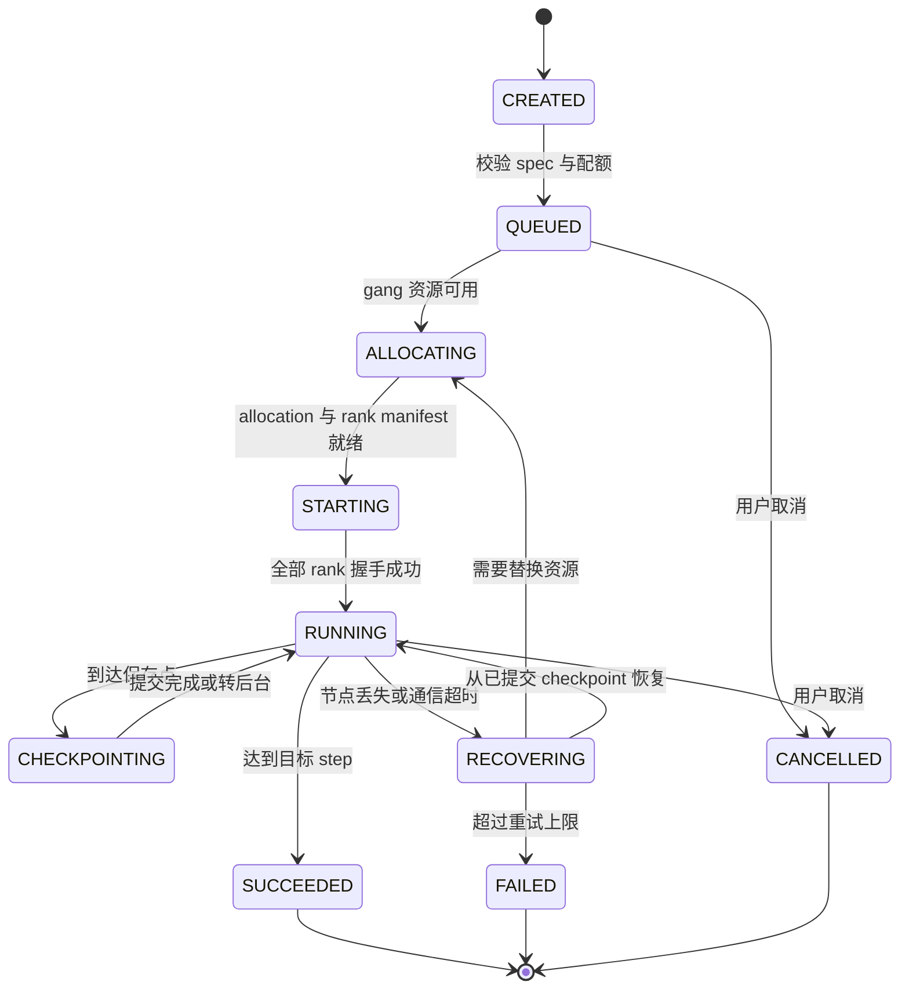
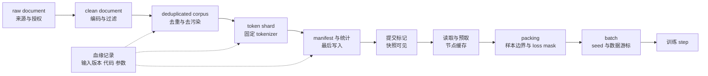
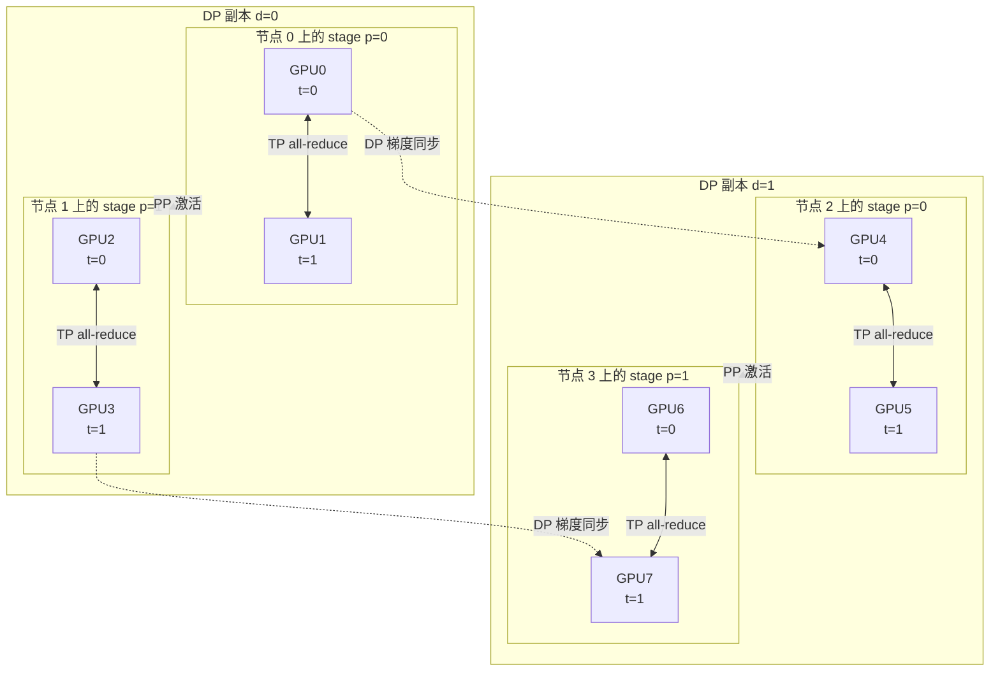
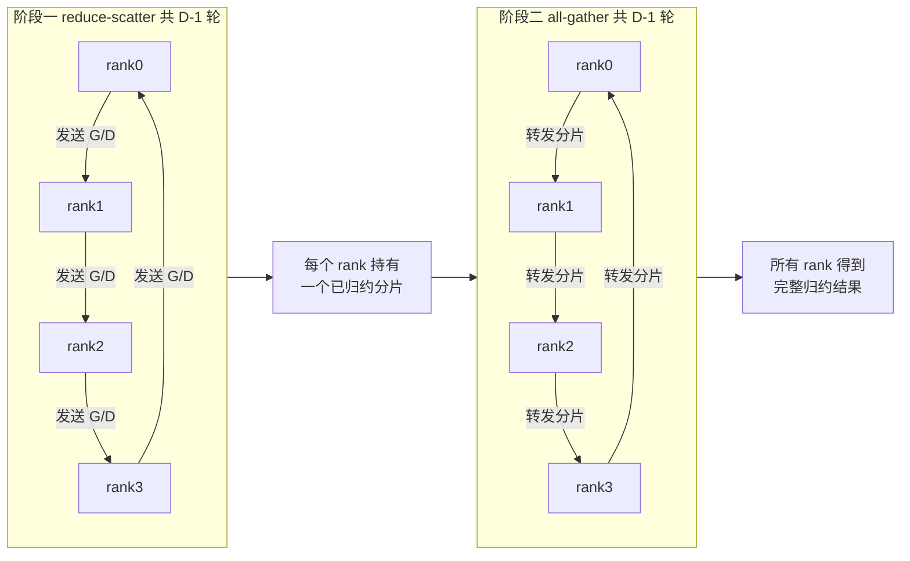
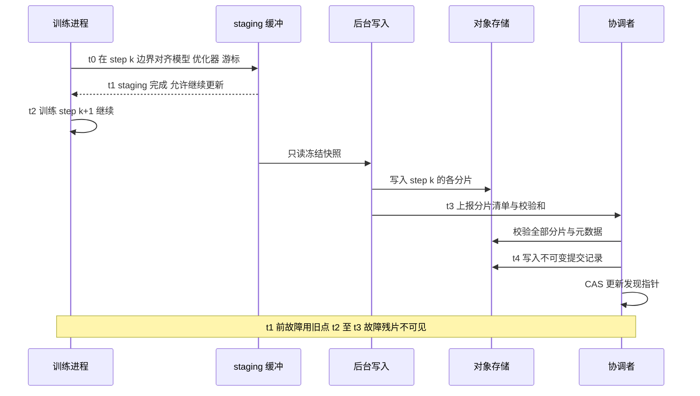
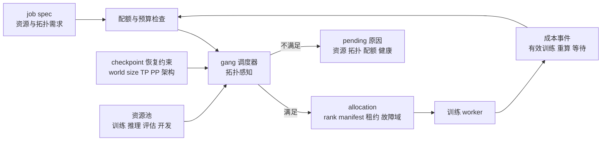
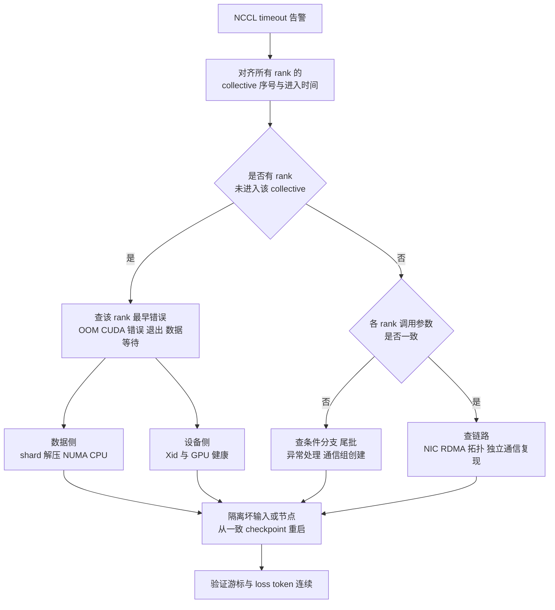
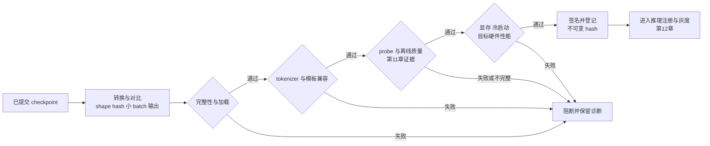
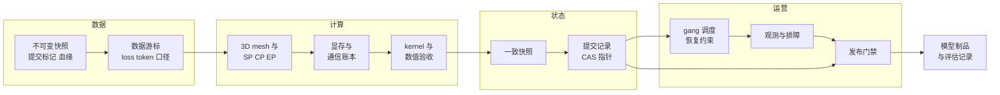

# 第9章 训练平台与数据管线

> **版本与证据说明**：本章的平台对象、数据接口、快照发布协议、故障矩阵、成本式与诊断例均为教学设计，未在目标规模集群上实测，引用文献只支持所列机制。涉及 PyTorch 2.9、NCCL 2.32 等具体版本的行为以对应文档为准，升级后需要复核。

一个训练作业可能连续运行数周，占用成百上千张 GPU。它要回答的问题与在线服务不同：海量数据如何稳定、可复现地送到 GPU；数据并行、张量并行、流水线并行和专家并行如何组合；通信怎样与计算重叠；节点故障、版本变化和硬件变化之后，怎样恢复到一个可解释的训练状态。第8章已建立大模型 Infra 的全局资源模型（显存、FLOPs、带宽账本与核心指标）；本章只讲训练阶段。对后端工程师而言，训练平台可以理解为一个运行很久、状态复杂、对吞吐极其敏感的分布式任务系统。

训练 Infra 的目标不是让脚本在一台机器上跑通，而是让“有效 token 数/时间”可预测、可扩展、可恢复。一个 step 的耗时可以拆成数据读取、host 到 device 拷贝、forward、backward、梯度同步、optimizer update 和 checkpoint；可重叠阶段不能把区间简单相加当作 wall time。任何阶段成为瓶颈，继续增加 GPU 都只会增加成本。Megatron-LM 的模型并行 [[1]](#ref-1)、ZeRO 的状态分片 [[2]](#ref-2) 和 PyTorch FSDP 的工程实现 [[3]](#ref-3) 都说明，大模型训练是模型状态、通信拓扑和故障恢复共同决定的系统问题。

本章按训练作业生命周期组织：先定义作业对象和控制面，再让数据以可复现方式进入 GPU，随后选择并行策略、kernel 与通信优化，接着用 checkpoint 与弹性恢复保护长时间运行，最后用调度、观测和发布门禁把训练结果变成可交付制品。

| 生命周期阶段 | 核心对象 | 主要风险 | 交付证据 |
|:---|:---|:---|:---|
| 提交 | job spec、experiment、run | 配置可变、身份不清 | spec hash、owner、预算 |
| 取数 | dataset manifest、token shard | 数据漂移、重复、坏 shard | manifest、统计、样本 hash |
| 计算 | rank、parallel group、step | 通信瓶颈、NaN、OOM | step trace、loss、资源曲线 |
| 保存 | checkpoint、optimizer state | 半写入、缺元数据、不可恢复 | 提交标记、校验和、恢复 probe |
| 调度 | allocation、quota、priority | 资源碎片、抢占、成本失控 | 调度事件、配额、成本报告 |
| 发布 | model artifact、eval report | 训练态和推理态混淆 | 制品 manifest、评估门禁、注册记录 |

## 9.1 作业对象、控制面与训练生命周期

### 从训练脚本到训练作业

训练脚本只描述计算图，平台还要管理 job、experiment、run、checkpoint、dataset、artifact 和 allocation。experiment 表示一个研究问题，run 是一次具体配置的执行，allocation 是实际申请到的节点与 GPU，checkpoint 是某个逻辑 step 的可恢复状态。若这几个概念都用一个目录名代替，事后就无法回答“这个模型由哪个数据版本训练、失败重试了几次、最终用了哪些 GPU”。

控制面应维护一份不可变的 job spec，至少包括模型代码版本、tokenizer、数据 manifest、采样权重、global batch、sequence length、优化器、精度、随机种子、并行度、容器镜像、依赖锁定文件、checkpoint 策略和预算。提交时生成 job_id 与 spec hash；相同 hash 的重试可以复用实验身份，但不应覆盖已有 run。spec 中任何字段的变更（例如换数据版本或改并行度）都应生成新的 spec 与执行记录；平台若允许同一 run 内分阶段变更，也要写入显式的版本事件，不能静默覆盖。

### 控制面与数据面的边界

Ray 把任务执行、资源声明和分布式运行时分开，为控制面设计提供了有用的抽象 [[4]](#ref-4)。Kubernetes 的 GPU device plugin 可以作为资源分配基础，但训练平台还要补充 gang scheduling、拓扑亲和性、节点健康和优先级 [[5]](#ref-5)。Borg 的实践说明，配额、优先级、抢占和故障域应由集群控制面统一管理，而不是由每个任务自己实现 [[6]](#ref-6)。

控制面负责提交、排队、分配、启动、心跳、停止、重试、恢复和归档，需要幂等与可审计；数据面负责 batch 生成、forward、backward、通信和状态写入，需要低延迟与高吞吐。用户重复提交相同 idempotency key 时，控制面应返回已有 job，而不是再申请一组 GPU。worker 失联时，lease 或 heartbeat 超时只能触发调查；资源重新授予之前，还要确认旧执行已经停止或已被 fence（隔离：通过递增的租约代号让旧执行者的写入被拒绝，或直接终止其进程），不能把租约过期等同于设备已释放。

控制面不能把运行时细节写进长数据库事务。一个 step 可能持续数秒，checkpoint 可能持续数分钟，控制面应通过事件记录阶段和状态，而不是长时间持锁。图 9-1 给出一组推荐状态。每次迁移都要校验前置状态，重复的完成事件必须幂等，旧 worker 迟到的心跳不能把已经回收的作业改回 RUNNING。

*图 9-1 训练作业的控制面状态机*

### 运行时身份与配置

每个 rank 都要知道 global rank、local rank、world size、node rank、数据分片范围和通信组。配置不能只依赖环境变量，因为环境变量在重试或跨集群迁移中容易变化。平台应生成 rank manifest，记录 rank 到节点、GPU、网卡和并行维度的映射，并把它与 checkpoint 和性能报告关联。

运行时配置要区分用户意图和平台推导值。用户声明 global batch、目标 sequence length 和模型并行上限，平台推导 micro-batch、梯度累积步数、通信组和数据 worker 数。推导过程应可解释：为什么某个 batch 被降低，为什么 tensor parallel 只能取 8，为什么某个节点被排除。否则调度器虽然自动化，训练结果却变得不可理解。

### 安全与供应链边界

训练集群通常拥有高权限网络、对象存储和 GPU，容器中的任意代码都可能读取不该读取的数据。镜像要签名，依赖要锁定，网络按任务隔离，checkpoint 和日志加密；开发者调试权限与生产训练权限分离，禁止通过挂载宿主机路径绕过数据控制。worker 的短期凭证与多租户隔离见 9.6 节。访问数据、下载 checkpoint、修改 job spec 和改变发布状态的动作都要有审计。

外部模型、tokenizer、预训练数据、量化工具和 kernel 都可能带来恶意代码或不兼容行为。构建阶段扫描依赖、固定来源并生成 SBOM（software bill of materials，软件物料清单，列出制品包含的全部组件及版本）；运行阶段限制网络和文件系统；发布阶段校验 artifact hash。模型和依赖持续更新，这些检查也要随每次构建执行，而不是只在平台上线时做一次。

> **与贯穿案例的对应**：ALR（本书 Agent 部分贯穿使用的业务诊断 Agent 案例）<!-- 作者待补：ALR 首次定义所在章节号 -->的应用 Run 不能代替训练作业，因为 GPU 拓扑、数据 shard、checkpoint 和弹性恢复是训练平台特有的机制；这种对照只适用于训练平台机制。若要对照，job spec、训练数据与制品、调度动作、checkpoint 状态和发布门禁，分别对应 ALR 的任务契约、Evidence、受控动作、Run 状态和验收证据。

## 9.2 数据供给与有效训练信号

### 数据分层、不可变快照与 schema 兼容

数据不应直接从原始文档流入 GPU。常见分层是 raw document、clean document、deduplicated corpus、token shard、packed sample 和 batch，如图 9-2 所示。raw 层保留来源与授权信息；clean 层完成编码、语言识别、格式过滤和敏感信息处理；deduplicated 层处理精确与近似重复；token shard 适合高吞吐顺序读取；packed sample 把多个短样本拼成固定窗口；batch 绑定某个 run 的 seed 和采样策略。每一层都应有 manifest、schema、统计和 hash，统计至少包含文档数、有效 token、语言比例、长度分布、重复率、过滤率和采样权重。

*图 9-2 从原始文档到训练 step 的数据管线*

数据版本应发布为不可变快照：shard 对象一经写入不再修改，统计与校验完成后最后写入 manifest 和提交标记（commit marker），读取方只解析已提交的 manifest，未提交的残留对象由清理任务回收。“先写数据、后写提交标记”让单个快照在自身目录内原子可见，但快照不会因此获得跨系统 ACID：对象存储、元数据目录和训练作业记录分属不同系统，作业登记了 manifest hash 而快照随后被撤回，或目录更新成功而通知失败，都要靠唯一版本 ID、幂等登记和定期对账收敛。9.5 节的 checkpoint 发布沿用同一思路。

血缘（lineage）记录每个派生版本的输入版本、变换代码与镜像 hash、参数和输出 manifest。它回答两个方向的问题：某个 run 用了哪些上游来源；某个来源被删除或授权撤回时，哪些 shard、run 和 checkpoint 受影响。schema 演进默认要求向后兼容：只新增带默认值的可选字段，不改变已有字段的类型、单位和语义，读取方声明可接受的 schema 版本范围。删除字段、改变分词语义或 loss mask 规则属于不兼容变更，应发布新的主版本；训练作业遇到范围外的 manifest 时拒绝启动，而不是尽力解析。

### 清洗、去重、污染与评估隔离

清洗规则同时影响质量、数据量和成本。过强过滤可能丢失少数语言、代码和长文档；过弱过滤会引入乱码、模板重复、广告和隐私。去重也不只是整文档 hash：同一网页的导航、模板、转录和代码片段可能构成近重复，需要在 token n-gram、文档 embedding 或 MinHash 层面建立策略。各数据源的去重阈值应记录在 manifest，而不是藏在一次性脚本里。质量检查可以在写入 token shard 前做，也可以在训练时抽样做：前者节省训练资源，后者能发现分片损坏和分布漂移。

污染（contamination）指评估集内容或其近重复进入训练数据。去重系统若只在训练集内部工作，评估集内容可能留在训练数据中；若把所有数据一起去重，又可能泄露测试集的存在和分布。可行做法是把已登记评估集作为只读参照，按 n-gram 重叠等规则从训练侧移除命中样本，并在 manifest 中记录所用评估集版本、阈值和 split 生成规则。评估服务读取只读版本，训练 worker 不获得写权限。评估侧如何划定 holdout、判定污染对指标的影响，见第11章。

### 读取路径、packing 与有效 token

GPU 训练的读取路径通常经过对象存储或分布式文件系统、节点缓存、CPU 内存、pinned memory 和 GPU 显存，每一层都要明确缓存大小、并发、超时和失败策略。直接从远端对象存储读取小文件会产生过多请求，把全部 shard 复制到每台节点又会放大存储成本；更合理的方案是大 shard、顺序读取、节点级缓存和有限深度的预取队列。预取太浅，网络抖动直接暴露给 GPU；太深则占用 CPU 内存，并把错误推迟到很久以后。数据 worker 应暴露等待时间、读取吞吐、解压时间、队列长度、坏样本数和重试次数，让训练侧能区分“没有数据”“数据损坏”“数据服务超时”和“GPU 处理慢”。

固定 sequence length 便于 kernel 和 batch，但短样本 padding 会浪费计算。packing 把多个样本拼进一个窗口，代价是必须保存样本边界、attention mask 和 loss mask，并明确是否允许跨样本上下文。本章统一使用三个口径：device token 指送入 GPU 的全部位置（含 padding）；有效 token 指其中的真实样本 token；loss token 指有效 token 中参与损失计算的部分（例如监督微调中不计 prompt 部分）。训练报告应同时记录三者，核心吞吐指标用 loss token 计：

\\[
R_{\text{loss}}=\frac{N_{\text{loss}}}{T_{\text{wall}}}
\\]

一个降低 padding 的优化若引入复杂的数据准备，可能提高有效 token 比例却降低 \\(R_{\text{loss}}\\)。评估时要同时展示 device token/s、loss token/s、GPU busy 和数据等待占比。PaLM 与 Llama 3 的规模化训练经验说明，数据配方、训练时间和系统吞吐必须共同考虑，不能只看参数量 [[7]](#ref-7)[[8]](#ref-8)。

### 数据游标、混合配方与 tokenizer 契约

训练数据不是普通消息队列。消息队列关心至少一次或恰好一次消费，训练还要关心样本顺序、采样权重、样本边界、token 数和 epoch 定义。worker 崩溃后重放一个 batch，结果可能不同，因为 dropout、混合精度和并行归约都可能变化。平台要先定义可接受的语义：预训练可以容忍少量重复，监督微调可能要求不重复，对齐数据可能需要精确记录每次消费。数据游标因此不能只记“第几个 batch”，因为 worker 数、packing 策略和 shard 版本变化会使 batch 编号失去意义；更稳妥的游标包含 manifest hash、shard id、sample offset、token offset、packing 状态和采样器状态。恢复时字段不兼容，要明确走 reshard、重放或拒绝恢复，而不是静默从最近位置开始。

混合比例可以按文档数、字节、token 或 loss token 定义，四种结果不同。若代码样本平均更长，按文档数设 20% 并不等于按 token 得到 20%；大量样本被过滤或截断时，声明配方与实际配方可能相差很大。平台应把权重归一化过程写进 manifest，运行中统计实际消费比例，并为数据桶耗尽（循环采样、重新归一化或结束 epoch）和配方切换定义策略；切换事件写入 trace 和 checkpoint，否则损失曲线的变化无法归因。

tokenizer 是决定样本长度、词表、特殊 token、padding、截断和模型输入的运行时契约。升级 tokenizer 会改变有效 token 数、packing、embedding shape 和成本，因此 job spec 必须保存 tokenizer 的不可变 artifact hash、normalization 规则、special token、chat template 和最大长度；checkpoint 恢复时 tokenizer 不一致，应拒绝或执行经过验证的迁移。数据质量报告还应包含字符到 token 的膨胀比例，按语言、数据源和长度分桶，以发现未知字符、二进制内容和控制字符造成的 token 爆炸。

### 漂移监测与数据 DAG 的重试边界

长周期训练中，上游站点变化、过滤规则更新或某个数据源失效都会让数据漂移。平台按时间窗口统计有效 token、语言、长度、来源、重复率和过滤率，与 job spec 的目标配方比较，超过阈值时暂停消费、重新生成 shard 或标记新阶段。训练指标同样会漂移：全局 loss 下降不代表每种语言、代码和长文档都改善，按数据桶和长度分层的 loss 可以发现某个源异常或 tokenizer 处理错误。

预处理通常是一个包含下载、解析、过滤、去重、分词、分片和统计的 DAG。每个节点记录输入版本、输出版本、执行镜像、参数和结果 manifest。失败时只重试失败分区，不重做已完成且校验通过的分区；上游输出变化时，按血缘确定哪些下游失效。RDD 的分区与血缘容错思想说明，数据处理的可靠性来自可重建的中间结果和明确的血缘，而不是某个常驻进程 [[9]](#ref-9)。重试还要区分瞬时错误和确定性错误：对象存储超时、节点暂时不可用可以退避；未知编码、schema 不匹配或超出内存上限则应隔离样本并记录原因。每个分区设最大重试次数、错误样本上限和 quarantine 路径，坏 shard 进入 quarantine 后由数据负责人修复重跑，不影响其他分区，也不会被无限重试掩盖。

## 9.3 并行策略与资源账本

第8章 8.3 节已给出 DP、TP、PP 与 ZeRO/FSDP 的概览和模型状态显存账本，本节不再复述定义，只写训练平台需要的增量：batch 口径、TP 与 PP 的通信与 bubble 结论、ZeRO 的显存与通信账本、3D mesh 与 SP/CP/EP 的切分轴，以及并行配置如何成为恢复契约。

### 数据并行与 batch 口径

数据并行（DP）让每个 rank 持有完整副本、处理不同 micro-batch，再用 all-reduce 同步梯度。增加 DP rank 并不改变单卡显存。模型变大时，单卡先放不下完整的参数、梯度和优化器状态；DP 规模变大时，梯度同步在 step 中的占比上升，固定 global batch 下每卡 batch 变小，kernel 效率随之下降。

在各 rank micro-batch 相同且没有不齐尾批时，样本口径的 global batch 为 \\(B=b\times D\times A\\)，其中 \\(b\\) 为每 rank micro-batch，\\(D\\) 为 DP 度，\\(A\\) 为梯度累积步数。packing 下还要单独统计每步 loss token，不能把样本公式直接当成 token 批量。改变任何一个因子都可能改变优化轨迹，平台必须记录真实的 global batch 和每步 loss token，而不是只记录 dataloader 的 batch size。梯度 all-reduce 能否与 backward 重叠，取决于 bucket 大小、梯度 ready 顺序和拓扑 [[10]](#ref-10)。

### 张量并行与流水线并行

Megatron 式张量并行（TP）把 MLP 和 attention 的权重矩阵按列、行切分，每个 Transformer 层前向 2 次、反向 2 次 all-reduce [[1]](#ref-1)。这个次数不随 TP 度 \\(t\\) 变化，变化的是比例：每卡矩阵计算降为约 \\(1/t\\)，而每次 all-reduce 每卡发送的字节量趋近激活大小的 \\(2(t-1)/t\\) 倍，基本不随 \\(t\\) 缩小，因此 \\(t\\) 越大通信占比越高，跨节点时尤为明显。这就是 TP 通常限制在 NVLink 域内的原因。

流水线并行（PP）把层切成 \\(p\\) 个 stage，一个 global batch 拆成 \\(m\\) 个 micro-batch 依次流过。GPipe 式调度先做完全部前向再做反向，bubble（空闲时间）占总时间的比例约为 \\((p-1)/(m+p-1)\\)。1F1B（one-forward-one-backward）调度让每个 stage 在稳态交替执行一个 micro-batch 的前向和一个 micro-batch 的反向。非交错 1F1B 的 bubble 比例与 GPipe 相同，它的作用是把每个 stage 同时驻留的激活从 \\(m\\) 个 micro-batch 降到约 \\(p\\) 个；交错调度让每卡持有 \\(v\\) 个不相邻的虚拟 stage，bubble 约降为原来的 \\(1/v\\)，代价是 stage 间点对点通信增加约 \\(v\\) 倍 [[11]](#ref-11)。图 9-3 以 \\(p=3\\)、\\(m=4\\) 为例画出非交错 1F1B 时序（假设反向耗时为前向的两倍），每个 stage 空闲 6 个时间单位，占总长 18 的 1/3，与公式一致。

```mermaid
gantt
    title 非交错 1F1B 时序 p=3 m=4
    dateFormat X
    axisFormat %s
    section Stage1
    F1 : 0, 1
    F2 : 1, 2
    F3 : 2, 3
    B1 : 7, 9
    F4 : 9, 10
    B2 : 10, 12
    B3 : 13, 15
    B4 : 16, 18
    section Stage2
    F1 : 1, 2
    F2 : 2, 3
    B1 : 5, 7
    F3 : 7, 8
    B2 : 8, 10
    F4 : 10, 11
    B3 : 11, 13
    B4 : 14, 16
    section Stage3
    F1 : 2, 3
    B1 : 3, 5
    F2 : 5, 6
    B2 : 6, 8
    F3 : 8, 9
    B3 : 9, 11
    F4 : 11, 12
    B4 : 12, 14
```

*图 9-3 非交错 1F1B 的 micro-batch 时序与 bubble*

公式假设各 stage 耗时相同，真实系统由最慢 stage 决定吞吐。Embedding、输出头、MoE 层、视觉模块和权重共享都会改变 stage 的参数与计算，按层数平均切分往往造成 straggler；第一个 stage 驻留的未反向 micro-batch 最多，激活峰值也最高。固定 global batch 时调小 micro-batch 会增加 \\(m\\)、降低 bubble 比例，却同时改变累积次数和 kernel 效率，不能只看 bubble 比例做选择。应先逐 stage 报告前向、反向、等待与显存峰值，再比较切层、虚拟 stage、激活重算和调度方案。

### ZeRO、FSDP 与显存通信账本

ZeRO 逐级分片优化器状态、梯度和参数 [[2]](#ref-2)，FSDP 在 PyTorch 中以参数分片、all-gather 和 reduce-scatter 实现类似目标 [[3]](#ref-3)。分片让模型能在更少显存中训练，代价是把参数获取和释放放进了关键路径。下表把显存与通信放在同一张账本里。教学假设：共 \\(P\\) 个参数，参数与梯度均为 BF16（各 2 字节），FP32 master weights 与 Adam 两个 moment 共 12 字节；\\(D\\) 为分片所在 DP 组大小；\\(\Psi\\) 为一份完整参数（或梯度）的字节数，通信量按 ring 实现、\\(D\\) 较大时每 rank 发送量计。

| 配置 | 每 rank 模型状态（字节） | 每步每 rank 通信量 | FSDP 按行为对应 | 新增关键路径 |
|:---|:---|:---|:---|:---|
| 普通 DP | \\(16P\\) | \\(\approx 2\Psi\\)：梯度 all-reduce | `NO_SHARD` | 梯度聚合 |
| ZeRO-1 | \\(4P+12P/D\\) | \\(\approx 2\Psi\\) | 无直接对应 | 分片更新后参数 all-gather |
| ZeRO-2 | \\(2P+14P/D\\) | \\(\approx 2\Psi\\)：梯度 reduce-scatter 加参数 all-gather | `SHARD_GRAD_OP` | 梯度归约到分片 |
| ZeRO-3 | \\(16P/D\\) | \\(\approx 3\Psi\\)：前向、反向各一次参数 all-gather 加梯度 reduce-scatter | `FULL_SHARD` | 计算前获取参数 |

若梯度以 FP32 累加（梯度累积时常见），普通 DP 约为 \\(18P\\)，其余各行相应增加；不同优化器和实现须重算字节口径。ZeRO 论文给出的结论正是：阶段 1、2 的通信量与普通 DP 相同（约 \\(2\Psi\\)），阶段 3 约为 1.5 倍（约 \\(3\Psi\\)）[[2]](#ref-2)。FSDP 文档说明其设计受 ZeRO-3 启发：`FULL_SHARD` 在前向和反向前后各 all-gather 并重新分片参数；`SHARD_GRAD_OP` 前向后保留完整参数直到反向结束，行为接近 ZeRO-2；`NO_SHARD` 等价于 DDP；`HYBRID_SHARD` 在节点内做 `FULL_SHARD`、节点间复制，把 all-gather 和 reduce-scatter 限制在节点内 [[12]](#ref-12)。表中的 FSDP 对应是按行为归纳，文档本身并未逐一映射。

表中是模型状态的理想载荷，不是 GPU 峰值。前向获取的完整层、预取的下一层、通信 bucket、为重叠保留的梯度、激活、allocator 保留块和 CPU staging（暂存）缓冲可能同时存活，不能把 ZeRO-3 的式子当作显存申请上限。offload 改变状态的位置，激活重算改变激活的保存方式，二者与 ZeRO 阶段是相互独立的开关。一个在显存充裕机器上有效的重叠配置，迁移到更小的 GPU 后可能触发 OOM。ZeRO-Infinity 进一步把状态卸载到 CPU 和 NVMe [[13]](#ref-13)，解决容量问题的同时可能让 PCIe、NVMe 和网络带宽主导 step 时间；它对低利用率实验可能比加卡更经济，对大规模生产训练则可能成为不可接受的同步瓶颈，应按每百万有效 token 成本、恢复时间和尾部抖动比较，而不是以“能启动”为成功。

### 3D mesh 与 SP、CP、EP 切分轴

本章的 3D 指 DP×TP×PP；在独立 mesh 的布局中，world size 是三者的乘积。逻辑坐标 \\((d,p,t)\\) 先映射到物理 rank：同一 \\(d,p\\) 下沿 \\(t\\) 做 TP 通信，同一 \\(d,t\\) 下沿 \\(p\\) 传递 stage 边界的激活与梯度，同一 \\(p,t\\) 下沿 \\(d\\) 同步梯度。图 9-4 以 DP=2、PP=2、TP=2 共 8 卡为例：通信最密的 TP 组放在同一 NVLink 域，PP 与 DP 跨节点。实际映射顺序由启动器保存，不能从 rank 号推测。DeepSpeed 的 3D 并行说明与 Megatron 的组合研究是这种分工的实例 [[14]](#ref-14)[[11]](#ref-11)，但不能据此推断任一版本的任意组合都可用。

*图 9-4 DP=2、PP=2、TP=2 的 3D mesh 映射示例*

Megatron 式 sequence parallel（SP）沿序列维拆分 LayerNorm、dropout 等层的激活，配合 TP 组内的 all-gather 与 reduce-scatter 降低激活冗余 [[15]](#ref-15)。context parallel（CP）把注意力的长序列分给多个 rank，仍要交换跨片的 KV 或等价信息；Ring Attention 展示了分块环式交换与计算重叠的路线 [[16]](#ref-16)。两者都不是“各算各的局部 attention 再拼接”，那样会漏掉跨片键值并改变 softmax 分母；位置编码、因果 mask、变长尾片和反向梯度都要与未分片参考结果核对。

MoE 用路由器把 token 分发到少数专家，激活参数少于总参数 [[17]](#ref-17)[[18]](#ref-18)。专家并行（EP）带来 token dispatch、all-to-all 通信、专家容量和负载不均衡问题：路由把大部分 token 集中到少数专家时，热门专家成为瓶颈，其他 GPU 空闲。在丢弃溢出 token 的实现中，容量因子太小会丢 token，太大则浪费显存并增加通信。平台要记录每个专家的 token 数、溢出率、路由熵、all-to-all 时间和 rank 方差。EP 若划分已有的 DP 组，不能再在 world size 中独立乘一次；MoE checkpoint 还要保存专家布局和路由配置，否则恢复时并行映射可能不一致。

### 并行度搜索与恢复契约

并行度选择可以视为约束优化：先保证单层参数和激活放得进显存，再在目标拓扑上选 TP；根据层数和 bubble 选 PP；剩余 GPU 用 DP 扩展吞吐；MoE 再选 EP。每个候选组合都要用小规模真实 workload 测量 step time、通信比例、显存峰值和扩展效率。理论 FLOPs 只给出上界，不能替代实测。

并行配置一旦写入 checkpoint，就成为恢复契约的一部分。支持 reshard 的平台保存逻辑参数名、分片范围和布局版本，恢复时由转换器生成新的 shard；不支持时，调度器必须保证相同的 world size 和并行度。静默改变并行配置会让 optimizer state 与参数分片错位，是最危险的恢复错误之一（见 9.5 节）。

## 9.4 Kernel、数值稳定性与通信拓扑

本节分两部分：前三个小节讲单卡上的 kernel 与数值，后两个小节讲多卡之间的通信与拓扑。

### Kernel 与数值：FlashAttention 与 online softmax

第8章已说明 FlashAttention 用 IO-aware tiling 减少 attention 的 HBM 读写并保持精确计算 [[19]](#ref-19)，这里补上分块计算为何仍然精确。对一个查询行，记第 \\(j\\) 个键的分数为 \\(s_j=q\cdot k_j/\sqrt{d}\\)（已含缩放），输出为 \\(o=\sum_j e^{s_j}v_j\big/\sum_j e^{s_j}\\)。分块计算时，对已处理的键块保存行最大值 \\(m\\)、指数和 \\(l\\) 与未归一化加权值和 \\(u\\)；新块到达时：

\\[
m'=\max\big(m,\max_j s_j\big),\quad
l'=e^{m-m'}l+\sum_j e^{s_j-m'},\quad
u'=e^{m-m'}u+\sum_j e^{s_j-m'}v_j
\\]

全部块处理完后返回 \\(u/l\\)。最大值变化时，旧的 \\(l\\) 和 \\(u\\) 都要重缩放，不能直接拼接各块已经归一化的概率。训练的反向传播也不保存 \\(N\times N\\) 的概率矩阵：前向只保存输出和每行的 logsumexp \\(L=m+\log l\\)，反向时按块重算分数，并用 \\(p_j=e^{s_j-L}\\) 恢复概率 [[19]](#ref-19)。初始化要用“尚无有效键”的分支处理，避免负无穷减负无穷；全被 mask 的查询行按契约报错或返回约定值，不能产生伪均匀分布。

FlashAttention 减少的是 HBM 中间读写，标准全注意力的计算量仍是序列长度的二次阶；数学目标一致也不表示浮点逐位相同。FlashAttention-2 进一步改进工作划分和并行 [[20]](#ref-20)，收益依形状、硬件与 mask 支持而变。接受新 kernel 前，应对照高精度参考，覆盖极值、短行与长行、尾块和梯度，并验证端到端 step、显存峰值和不同 GPU 架构。

### Kernel 与数值：融合、编译与 Roofline

优化应遵循“基线、假设、变更、测量、回滚”的链路：先用 profiler 找热点，再决定融合、重排、编译或量化。kernel benchmark 提速不代表训练提速，瓶颈可能转移到通信或数据。融合通常减少 launch 和中间 HBM 读写，却可能增加寄存器压力、spill（寄存器溢出：寄存器不够时变量被放到较慢的 local memory）、共享内存占用和同步，降低 occupancy（占用率：每个 SM 上活跃 warp 数与硬件上限之比），甚至破坏成熟库 kernel 的 tile 或 Tensor Core 路径。回退时先固定形状、dtype、预热、计时同步与数据，再比较寄存器、spill、occupancy、访存合并和 kernel 时间；缩小融合范围也应是候选方案。性能结果必须与模型版本、输入 shape、CUDA、driver、编译器和环境变量绑定。

Nsight Compute 的 Roofline 用算术强度 \\(I\\)（FLOPs/字节）解释 kernel 瓶颈 [[21]](#ref-21)，粗略上界为 \\(\text{Perf}\le\min(P_{\text{peak}},\,B\cdot I)\\)，其中 \\(B\\) 为对应访存层的带宽；计数器须对应所用精度、访存层和真实指令。SM 和 DRAM 利用率都低时，原因也可能是 launch、同步、CPU 供给、小 grid 或依赖链，不能简单二分为“计算受限”或“显存受限”。应先看时间线判断是空闲还是核内低效，再改 batch、分块或融合验证假设，并同时报告 kernel 级和端到端收益。

编译工具处在不同抽象层（见下表）[[22]](#ref-22)[[23]](#ref-23)[[24]](#ref-24)[[25]](#ref-25)[[26]](#ref-26)。图级优化做等价变换、常量折叠、死代码消除、布局协调与融合，算子级安排 tiling、循环、线程与存储层级；局部最优布局可能让相邻算子多出转置。动态图可以捕获局部静态 IR 并做 shape 特化，但图断裂、数据依赖分支和新形状会触发回退或重编译，应记录编译时间、缓存命中和长尾形状成本。浮点重排按明确误差验收，一次导出成功不能证明端到端更快。注意此处的 Triton 是编译器项目，与同名推理服务框架无关；TensorRT 面向推理部署，相关内容见第10章。

| 路线 | 主要控制对象 | 需要验证的代价 |
|:---|:---|:---|
| CUDA | 显式线程、块、同步与内存访问 | 开发调试、同步正确性、架构适配、实际 occupancy 与访存 |
| Triton | 分块张量程序，由编译器生成设备代码 | mask、布局、编译特化与调优；简洁不保证快于成熟库 |
| TVM | 图表示、张量程序变换、目标代码与运行时 | 前端与目标支持、搜索成本、布局转换与外部库边界 |
| XLA | 张量计算图的编译、优化与代码生成 | 可编译区域、动态控制流与 shape、重编译与首次编译时间 |
| TensorRT | NVIDIA 推理网络优化与 engine 构建 | 算子与精度支持、动态 shape、插件维护与部署兼容 |

### Kernel 与数值：混合精度、激活重算与可复现

不同低精度格式需要不同的数值保护。FP16 动态范围窄，小梯度容易下溢，通常需要 loss scaling：先放大 loss 再反向，更新前除回去，遇到溢出就跳过该步并调小缩放因子 [[27]](#ref-27)。BF16 的指数位与 FP32 相同，通常不需要 loss scaling，但尾数更短，累加误差更大。FP8 的范围和精度都更窄，需要为每个张量维护缩放因子（per-tensor scaling），并在 E4M3、E5M2 两种格式之间按用途选择（前者精度较高，后者范围较大，常用于梯度）[[28]](#ref-28)；较新的格式与实现还让一小块元素共享一个缩放因子（block scaling），以容纳张量内部的数值跨度。master weights 与 optimizer moments 通常保持 FP32，这正是 9.3 节显存账本中 12 字节的来源；归一化、softmax 和输出层是否保留高精度要按数值证据决定，不能把 dtype 当作一个全局开关。训练系统需要监控 loss spike、梯度范数、溢出与下溢次数、NaN、Inf 和异常 rank。

出现 NaN 或 loss spike 时，自动重试同一个 batch 通常没有意义。平台应保存触发 step 的输入摘要、参数统计、梯度范数、精度配置和 kernel 版本，然后暂停或回滚到最近的健康 checkpoint。PaLM 在训练最大模型时遇到约 20 次 loss spike，做法是从 spike 开始前约 100 步的 checkpoint 重启，并跳过约 200–500 个数据 batch，之后同一位置不再出现 spike；作者的实验表明 spike 来自特定 batch 与特定参数状态的组合，而非单纯的坏数据 [[7]](#ref-7)。排查还要考虑 SDC（silent data corruption，静默数据损坏：硬件算错但不报错），它表现为单个 rank 的梯度范数或 loss 异常，可以通过对比 rank 统计和在其他节点上重放来区分。异常检测要与 checkpoint 保留策略绑定，至少保留最后一个已验证的健康点，避免坏状态覆盖所有可恢复版本。

激活重算（activation recomputation，PyTorch 中称 activation checkpointing）在前向中不保存全部中间激活，反向时重新计算，用计算换显存。PyTorch 2.9 文档说明了重算时 RNG 状态的保存方式与设备类型限制 [[29]](#ref-29)；重算时必须恢复相同的随机状态，否则 dropout 会改变梯度，参数已被 FSDP 释放时还要再次 all-gather。平台应记录重算粒度、额外 FLOPs、显存峰值和 step time：粒度过粗峰值仍高，过细则增加 kernel 和调度开销，最佳粒度随 sequence length 变化。恢复与性能报告要保存完整的运行时开关，而不是一个布尔值。

分布式低精度训练中，硬件、归约顺序、kernel、通信算法和随机数都会影响结果的最后几位。job spec 应明确复现目标：位级复现可能限制并行与性能；统计复现要求 loss 与主要评估指标在容差内；语义复现要求能力和安全指标不发生不可接受的变化。硬件不同时应多次重复实验并报告均值和方差，既不把微小差异当故障，也不用随机性解释明显的 loss 跳变。

### 通信与拓扑：集合原语与字节账本

| 原语 | 输入到输出 | 训练中的用途与必要条件 |
|:---|:---|:---|
| All-Reduce | 对应元素归约，所有 rank 得到同一结果 | DP 梯度、TP 层内归约；形状与操作匹配 |
| All-Gather | 收集各 rank 分片，按 rank 顺序拼接 | FSDP 参数、SP 激活；布局与顺序一致 |
| Reduce-Scatter | 对应元素归约，每 rank 只留一个结果分片 | 分片梯度；不是简单分发原输入 |
| All-to-All | 每 rank 把面向不同目标的块分别发出 | MoE dispatch 与布局变换；记录 split 大小以便逆向还原 |

NCCL 2.32 文档把上述四种都列为原生集合操作（All-to-All 对应 `ncclAlltoAll`），并要求所有 rank 以相同的 count 和 datatype 调用，否则可能挂起、崩溃或损坏数据 [[10]](#ref-10)；All-to-All 也可以在 group 中组合 `ncclSend` 与 `ncclRecv` 实现，变长 split 常用这种写法 [[30]](#ref-30)。算法与原语并不一一绑定，NCCL 会按 NVLink、PCIe、InfiniBand 和网卡拓扑选择路径。

以 ring all-reduce 为例（图 9-5），设 \\(D\\) 个 rank，每 rank 持有完整张量 \\(G\\) 字节且均匀分块。它由一次 reduce-scatter 和一次 all-gather 组成，单独执行 reduce-scatter 或 all-gather 时每 rank 发送 \\((D-1)G/D\\)（\\(G\\) 为完整张量大小），all-reduce 总计发送 \\(2(D-1)G/D\\)。两阶段各 \\(D-1\\) 轮，粗略时间模型为：

\\[
T_{\text{AR}}\approx 2(D-1)\,\alpha+\frac{2(D-1)}{D}\cdot\frac{G}{\beta}
\\]

其中 \\(\alpha\\) 为每轮启动延迟，\\(\beta\\) 为有效链路带宽；\\(D=1\\) 时通信为零。这是 ring 的教学账本，不是所有 NCCL 算法的预测器。用 nccl-tests 实测时，algbw 定义为数据量除以时间；all-reduce 的 busbw 为 \\(\text{algbw}\times 2(D-1)/D\\)，all-gather 与 reduce-scatter 为 \\(\text{algbw}\times(D-1)/D\\)（数据量取完整张量）；busbw 可以直接与硬件链路带宽 \\(\beta\\) 比较，而不受 rank 数影响 [[31]](#ref-31)。

*图 9-5 ring all-reduce：reduce-scatter 加 all-gather（D=4）*

每种并行策略都可以建立同样的字节账本：DP 数梯度同步，TP 与 FSDP 数每层 collective 次数和大小，PP 数 stage 边界的激活与梯度，EP 按实际 token 去向计算发送矩阵。账本按 sequence length、micro-batch、hidden size、并行度和 dtype 计算，再用实测带宽与延迟估算下界。若一层的计算时间小于一次 collective 的延迟，扩大并行度不会有收益；反之，大矩阵乘法可以把通信隐藏在计算中。重叠能隐藏等待，却不会消除字节和 buffer。理论账本与 profile 不一致时，重点查 padding、bucket、参数预取、梯度累积，以及 collective 是否被意外串行化或重复执行。

### 通信与拓扑：重叠、亲和与拓扑快照

通信与计算重叠需要独立 stream、合理的梯度 bucket、正确的依赖和足够大的计算块。bucket 太小会产生大量 collective 和 launch，太大则要等很久才开始同步；stream 依赖设置错误时，表面上有两个 stream，实际仍串行。性能报告应分别列出 kernel 时间、可重叠通信、不可重叠通信和同步等待。通信时间上升时，要区分带宽不足、延迟主导、消息过小、最慢 rank、网络拥塞和同步顺序错误；单机 microbenchmark 只说明局部能力，必须用真实 batch 验证它能否解释 step 时间。跨节点 TP 比同机 TP 敏感得多，通信无法隐藏时，减小并行度可能比扩大集群更快。

多 GPU 节点常有多个 CPU socket、PCIe root complex 和网卡。数据 worker、pinned memory、GPU 和网卡绑定不当，会让 host 到 device 拷贝经过远端 NUMA 节点，吞吐下降且抖动增加。启动器应根据拓扑生成 CPU、GPU 和 NIC 亲和性并记录映射，不能依赖容器默认的 CPU 集合。拓扑也是版本化环境的一部分：换一批节点、升级 BIOS、改变网卡固件或调整 MIG（Multi-Instance GPU，把一张 GPU 切成若干硬件隔离的实例）都可能改变通信路径。平台应保存拓扑快照、NCCL 环境变量、通信算法和日志摘要，集群变更后重新测量集合通信 [[10]](#ref-10)；扩展曲线突然下降时，拓扑快照往往比训练代码更能解释原因。

## 9.5 Checkpoint 与恢复协议

### Checkpoint 的完整状态与推理制品

可继续训练的 checkpoint 通常包含模型参数、master weights、optimizer moments、学习率调度器、gradient scaler、随机数状态、数据游标、训练配置、并行拓扑、tokenizer、数据 manifest、代码版本和评估结果。若在 optimizer step 边界保存且没有未提交的梯度累积，梯度不必持久化；若在累积中途保存，则要包含梯度与累积进度。对分片训练，文件名不是状态语义，必须用 manifest 描述逻辑参数、shard 范围、dtype、shape 和校验和。

只有权重加模型配置的制品可以用于推理，但不能保证继续训练等价。训练 checkpoint 的目标是继续优化，推理制品的目标是快速加载和稳定服务，后者通常只含参数、tokenizer、模板、量化和运行时配置。两者应使用不同的目录、权限和生命周期，通过发布 manifest 关联；直接把训练目录挂给 serving，既暴露不必要的状态，也可能让线上读到未完成的版本。转换与发布门禁见 9.8 节。

### 一致快照与完整性发布协议

checkpoint 的发布沿用 9.2 节快照的“先写数据、后写提交标记”。各 rank 先写带 job_id、step 和版本号的临时 shard，计算大小与校验和；协调者确认全部 shard 到齐、元数据完整、抽样读取成功后，才写提交标记。提交标记包含 world size、TP、PP、DP、EP、dtype、模型 schema、数据 manifest hash、tokenizer hash 和 global step。恢复程序只读取已提交版本，中途退出留下的临时目录异步清理，不会被误认为最新状态。

异步 checkpoint 让训练在保存期间继续计算，但必须先得到一致快照：若后台线程读取正在变化的 optimizer state，得到的可能是跨 step 的混合状态。PyTorch DCP（Distributed Checkpoint，分布式 checkpoint 模块）的文档把 staging（暂存：把状态复制到不受后续更新影响的缓冲，默认为 CPU 内存）的目标描述为生成 training-safe 的表示，staging 完成后对模块数据的更新不应反映到被保存的状态中；`AsyncSaveResponse` 分别用 `staging_completion` 与 `upload_completion` 两个 Future 表示本地拷贝完成与保存完成，自定义 stager 若不自动同步，需要由调用者在合适时机同步 [[32]](#ref-32)。因此“设备拷贝完成”不等于“持久化完成”，持有一个 Future 也不等于保存已提交。图 9-6 是本书在此基础上设计的完整发布协议，其中提交标记、发现指针和 CAS（compare-and-swap：仅当指针当前值等于预期旧值时才更新）都不是 DCP 默认保证的行为。

*图 9-6 异步 checkpoint 的完整性发布时序*

各阶段的故障处理不同：t1 之前发生故障，继续使用旧的已提交点；t2、t3 期间宕机，残片不能被“扫描最新目录”的逻辑误选；t4 之后协调者丢失回执，要按 checkpoint id 查询已有提交，而不能另写一个快照覆盖。对象存储里的提交记录、数据库中的指针与各 rank 文件不是天然的一个事务：发布端要定义唯一的 checkpoint id 和条件写入，用 CAS 推进发现指针，读取端再次核验。这个完成标记协议也不是数据库意义上的两阶段提交，不能借用术语承诺跨系统原子性。

保存参与者因并行方式而异。普通 DDP 的模型权重可以由 rank0 写，但数据进度、RNG 等恢复状态仍要按协议从各 rank 收集；ZeRO 与 FSDP 的分片需要所有持有分片的参与者配合，不能默认 rank0 拥有完整状态。异步缓冲占用 CPU 或 GPU 内存，存储变慢时应限制在途快照数、延后新的保存或回退为同步保存，不能无限堆积。恢复后执行小 batch forward、loss 合理性检查、参数统计和数据可读性检查；校验和只能证明字节完整，恢复演练还要核对 step、参数、optimizer 和游标的语义对应。

### 保存频率、故障分类与弹性恢复

保存越频繁，故障后丢失的工作越少，但 I/O 和同步开销越高。若故障在两次保存之间均匀发生，平均丢失约半个保存间隔的工作；在故障近似服从泊松过程、保存开销远小于平均故障间隔的条件下，Young 与 Daly 的一阶近似给出最优保存间隔：

\\[
\tau^{*}\approx\sqrt{2\,\delta\,M}
\\]

其中 \\(\delta\\) 是每次保存阻塞训练的时间，\\(M\\) 是整个作业的平均故障间隔 [[33]](#ref-33)[[34]](#ref-34)。集群越大 \\(M\\) 越小，最优间隔随之缩短；异步保存降低的是暴露给训练的 \\(\delta\\)，但也让最后可用快照变旧，应按完整快照时间线计量。还要区分三类 checkpoint：可恢复点追求快速重启，评估点需要质量报告，发布点需要转换、签名和兼容性检查，不能用发布制品替代高频恢复点。

常见故障包括 GPU Xid（NVIDIA 驱动在内核日志中记录 GPU 错误时使用的错误编号）、节点重启、网络分区、NCCL hang、对象存储限流、文件系统不可写、容器驱逐、OOM、NaN 和数据 shard 损坏。单卡故障可能需要替换节点并重建 communicator；存储抖动可以退避重试；NaN 应停止并恢复健康点；rank 卡死需要 watchdog 和全局超时。不同故障要有不同的 runbook，不能把“自动重启”当作统一方案。SRE 的错误预算思想可以帮助决定何时继续重试、何时停止作业转人工处理 [[35]](#ref-35)。

弹性恢复可以等待原节点、替换节点并保持 world size、缩小 world size 继续，或回滚后重新分配。改变 world size 可能改变 global batch、学习率、数据顺序和 optimizer 行为，因此恢复策略要显式化，报告中记录丢失步数、重算 token、恢复耗时和最终质量差异。从 64 卡迁移到 128 卡或更换 GPU 型号时，支持迁移的格式把逻辑参数与物理 shard 分离，由转换器按目标拓扑重新分片，并验证 optimizer state 分片和数据游标仍然一致。不支持任意重分片时，checkpoint 的恢复约束（world size、TP、PP、显存下限、GPU 架构）要传给调度器；找不到兼容资源时宁可保持 pending，也不能分配一个 GPU 数量满足却无法恢复的集群。恢复兼容性是调度约束，而不是作业启动后的异常处理。

### 取消与优雅停止

用户点击停止后，控制面发出取消事件，worker 在安全的 step 边界停止接收新 batch，必要时保存一个可恢复 checkpoint，再关闭数据流和通信组。节点即将被抢占时，平台可以提前发送 preemption notice，让作业尽量完成一次保存。直接 kill 进程虽然快，却可能留下无法判断新旧的状态和大量孤儿资源。

优雅停止要有时间上限。checkpoint 长时间卡住时，平台在等待、切换存储路径和保留最近健康点之间选择，不能因为保存新点而无限占用集群。最终状态应区分 USER_CANCELLED、PREEMPTED、BUDGET_EXCEEDED、FAILED_RECOVERABLE 和 FAILED_PERMANENT，它们决定是否自动重试、是否计入实验失败、是否需要人工审批。

## 9.6 容量、调度与多租户成本

通用的 GPU 资源调度、配额与隔离机制见第8章 8.5 节，本节只讲训练作业特有的约束：gang 与拓扑、恢复兼容性、成本归因，以及后训练的资源配比。

### Gang scheduling、故障域与调度接口

分布式训练需要一组 GPU 同时可用，部分分配往往只会让 job 长期 pending。调度器要识别 gang，按节点、GPU、NVLink、网络和本地数据做拓扑感知；大 job 需要反碎片化，小 job 可以填充空洞；训练、推理、评估和开发应有不同资源池与优先级。抢占时要考虑 checkpoint 是否已经提交，不能在不可恢复的阶段直接杀死作业。

如图 9-7 所示，训练作业向调度器声明的不只是 GPU 数量，还包括 GPU 类型、拓扑与互联、CPU、内存、网络、临时盘、gang 约束、优先级、可抢占性、预计时长和来自 checkpoint 的恢复约束；调度器返回 allocation、rank manifest、租约和故障域。作业启动后若发现拓扑不满足通信要求，应拒绝运行并释放资源，而不是勉强开始。调度器还要给出可解释的 pending 原因：用户看到“排队中”无法决策，看到“等待 16 张同型号 GPU 且需要同一 NVLink 域”才能取舍，平台也能据此发现容量规划问题。

*图 9-7 训练作业、配额、调度器与成本归因的关系*

### 配额、成本与动态预算

配额应同时按 GPU 数、GPU 小时、显存、优先级和项目预算表达；一个团队长时间占用少量高端 GPU，可能比另一个团队使用更多低端 GPU 更昂贵。成本系统要分开记录预约、实际使用、空闲等待、通信等待、恢复重算、评估和 checkpoint，按有效 token 和成功实验归因，才能比较不同团队的真实效率。

启动前应估算 token、step、GPU 小时、checkpoint 次数、评估次数和重试余量。扩展效率沿用第8章 8.3 节的定义，以可运行的最小规模 \\(N_0\\) 作基准，因为大模型往往放不下单卡：

\\[
E(N)=\frac{X(N)/N}{X(N_0)/N_0}
\\]

其中 \\(X(N)\\) 是 \\(N\\) 张 GPU 上的 loss token/s。\\(E(N)\\) 随规模快速下降时，继续扩大集群往往不如优化数据、kernel 或并行策略划算。平台应把扩展曲线作为门禁，同时记录通信比例、数据等待、峰值显存和节点故障恢复；Megatron-LM 与 PaLM 的经验表明，规模越大，系统效率和故障管理越是模型交付的一部分 [[1]](#ref-1)[[11]](#ref-11)[[7]](#ref-7)。

预算也不能只在提交时检查。失败重试、恢复重算、评估、checkpoint 和数据重处理都会在运行中增加成本，控制面应实时累计 GPU 小时、有效 token、存储请求、网络流量和失败次数，接近预算时提醒或暂停；用户可选“质量优先”“时间优先”或“成本上限”，平台据此调整评估频率、checkpoint 频率和资源池。只完成计划 token 20% 的实验不能与完整实验直接比较；超预算被强制停止的作业要保存最后健康 checkpoint、最终 loss 和未完成原因。

### 多租户隔离、数据凭证与资源清理

数据访问控制要同时覆盖控制面和数据面。控制面在创建 job 时校验项目、用途、数据 license、地域和保留期限；数据面在 worker 获取 shard 时发放短期、最小范围的凭证，只能访问具体 manifest 列出的 shard，不能列出整个 bucket，也不能写回原始路径。数据处理 worker 的输出写入独立路径，checkpoint 目录与原始数据隔离；对象存储、节点缓存和本地临时目录的权限保持一致，任务结束后回收凭证并清理缓存。调试抽样需要临时授权。

训练日志常含样本文本、异常 token 和模型输出，必须按数据等级处理：默认只记录 hash、长度、语言和错误类型，完整文本只在授权的诊断任务中短暂保存。把 prompt 或样本直接作为 metric label 更危险，会造成高基数、泄露和成本膨胀。观测字段应有允许列表、脱敏器和保留策略；OpenTelemetry 与 Prometheus 提供统一的指标和追踪基础，但记录什么仍是平台策略 [[36]](#ref-36)[[37]](#ref-37)。

作业失败后，常见残留有 Kubernetes Pod、NCCL 进程、共享内存、pinned memory、对象存储临时目录、租约、GPU reservation 和告警。终止流程依次是发送取消事件、等待 worker 上报 checkpoint 或停止原因、清理通信组、释放分配、关闭数据流、删除临时文件、写最终状态，并设超时和人工兜底。回收必须幂等：重复清理不能删除其他 job 的路径、释放错误的 GPU 或覆盖成功的最终状态。临时目录名包含不可猜测的 run_id，清理器按 manifest 校验归属而不是使用宽泛通配符；监测 reservation 与实际 Pod 的差异可以及时发现泄漏 [[37]](#ref-37)。

### 后训练与 RLVR 的资源配比

预训练以稳定的大 batch 和长时间运行换取吞吐，其扩展曲线来自计算密集、拓扑规整的矩阵运算，即便如此也受 \\(E(N)\\) 衰减约束。监督微调和偏好优化的 batch 更小、序列长度更不稳定，生成、奖励模型和验证器会改变 GPU 与 CPU 的比例，因此不能套用预训练的扩展曲线。以 RLVR（reinforcement learning with verifiable rewards，可验证奖励强化学习：奖励来自答案比对、单元测试等可程序化验证的结果）为例，每个 prompt 要并行生成多个候选再执行 verifier；若只给训练 worker 配 GPU，CPU verifier、队列和网络会成为隐性瓶颈。

设每个 prompt 生成 \\(G\\) 个候选，提示长 \\(T_{in}\\)，每个候选平均输出 \\(T_o\\) 个 token。一组的成本可以拆成三项：

\\[
C_{\text{gen}}=c_p T_{in}+G\,c_d T_o,\qquad
C_{\text{upd}}=G\,(T_{in}+T_o)\,(c_{\pi}+c_{\text{ref}}),\qquad
C_{\text{ver}}=G\,c_v
\\]

\\(C_{\text{gen}}\\) 是生成成本：同一 prompt 的 \\(G\\) 个候选通过 prefix cache 共享一次 prefill，所以提示部分只计一次（不共享时为 \\(G\,c_pT_{in}\\)）；prefill 单价 \\(c_p\\) 与 decode 单价 \\(c_d\\) 不同，decode 通常受显存带宽限制，单 token 更贵。\\(C_{\text{upd}}\\) 是策略模型的前向加反向（单价 \\(c_{\pi}\\)）与参考模型前向（\\(c_{\text{ref}}\\)，仅在使用 KL 约束时存在）。\\(C_{\text{ver}}\\) 是验证成本，\\(c_v\\) 为每个候选验证一次的代价。在组内归一化优势的算法中，全对或全错的组优势为零、不产生梯度，通常被过滤；设保留比例为 \\(a\\)，则每个有效样本的成本约为：

\\[
C_{\text{eff}}=\frac{C_{\text{gen}}+C_{\text{ver}}+a\,C_{\text{upd}}}{a\,G}
\\]

这个式子的用处在于暴露几个比例。第一，生成成本随 \\(G\\) 线性增长，而策略更新的收益通常低于线性，组大小存在收益递减点；\\(G\\) 太小又会提高全对或全错的概率，降低 \\(a\\)。第二，若不区分 prefill 与 decode、也不共享 prefill，每个候选的生成成本退化为 \\((T_{in}+T_o)\,c_g\\)，与 \\(c_v\\) 比较即可判断瓶颈在哪一侧；比较时两者必须用同一计价单位（例如费用）。若 \\(c_v\\) 很小（只做答案比对），瓶颈在生成侧；若验证要跑测试、执行代码或调用另一个模型，\\(c_v\\) 可能接近甚至超过生成成本，此时给训练 worker 加卡不会提高有效样本吞吐。第三，做容量规划时不要把 CPU 时间折算成等价 token：GPU 生成与训练、CPU 或沙箱验证、外部服务调用分属不同资源池，应分列各自的用量、排队时间和失败重试，分别判断哪个池先饱和。平台应把生成服务、验证服务和数据服务纳入同一个 job graph 统一记录版本，并按“每个被接受样本的成本”而不是“主模型 forward 吞吐”报告效率。

## 9.7 观测、排障与故障演练

### 指标、事件与追踪

训练指标要按 rank、节点、数据桶和并行维度聚合，同时保留最大值和方差，避免平均值掩盖一个慢 rank。下表列出最小集合，其中 MFU（model FLOPs utilization，实际达到的模型 FLOPs/s 与硬件峰值之比，定义见第8章）用于跨配置比较计算效率。

| 类别 | 指标 | 必选 | 主要聚合维度 |
|:---|:---|:---|:---|
| 优化 | loss（分数据桶）、学习率、梯度范数、溢出与 NaN 次数 | 必选 | step、数据桶 |
| 吞吐 | loss token/s、device token/s、step time 分位数、MFU | 必选 | step、rank 最大值 |
| 设备 | 显存峰值、GPU busy | 必选 | rank、节点 |
| 设备 | SM 利用率、Tensor Core 利用率、显存带宽、occupancy | 建议 | kernel、rank |
| 通信 | collective 耗时、rank 间方差、不可重叠占比 | 必选 | 并行组 |
| 数据 | 数据等待占比、队列长度、坏样本数 | 必选 | rank、数据源 |
| 可靠性 | checkpoint 耗时与成功率、恢复耗时、节点健康 | 必选 | run、节点 |

GPU busy 只表示设备上有 kernel 在执行，不代表高效：大量小 kernel、低 occupancy、访存瓶颈、同步等待和无效 padding 都可能让 busy 很高而有效吞吐很低；反之，通信或数据等待期间利用率下降，也可能是正常的阶段性行为。指标若缺少 run、step、rank、node、模型和数据版本等关联字段就无法定位，字段过多又会推高监控成本，因此 run、step 这类高基数事实放在 trace 和日志里，metrics 只使用受控的聚合维度。

Dapper 的分布式追踪思想适合把训练控制面和数据面关联起来 [[38]](#ref-38)。训练 trace 默认不记录完整样本，而记录 manifest、shard、batch、step、request id、错误类型和 hash；配合 OpenTelemetry 的上下文传播和 Prometheus 的时间序列告警 [[36]](#ref-36)[[37]](#ref-37)，平台能从“GPU 利用率下降”追到“某类 shard 解压变慢”或“某个 rank 通信抖动”。除时间序列外还需要结构化事件，例如 JOB_ACCEPTED、ALLOCATION_READY、WORKER_STARTED、CHECKPOINT_COMMITTED、NODE_LOST、RECOVERY_STARTED 和 RUN_FINISHED，每个事件携带 run_id、spec hash、global step、world size 和 checkpoint 版本。事件系统要处理重复、乱序和延迟：网络恢复后到达的旧完成事件，要靠单调 step、版本号和状态机拒绝。dashboard 只是从事件和指标派生的视图，不是事实来源。

### Step 时间线与尾部

为了让性能分析落地，可以把每个 step 的时间线固定为：数据游标推进、CPU 预取、pinned memory 与 H2D 拷贝、forward、激活保存或重算、backward、梯度 bucket ready、collective、optimizer update、日志和 checkpoint，每个区间按 global step、rank 和 node 关联。吞吐下降时，就能直接回答是数据迟到、kernel 变慢、通信不重叠，还是保存引起暂停。时间线也能区分不同优化的作用：packing 主要影响有效 token 和数据阶段，FlashAttention 影响 attention kernel 与显存，FSDP 影响 all-gather、reduce-scatter 与显存峰值，checkpoint 影响 I/O 与同步。性能报告应给出端到端收益和每个区间的变化。

平均 step time 不能代表整个训练。checkpoint、数据刷新、节点抖动、编译或对象存储限流都会产生慢 step，长尾决定 wall-clock 完成时间和 GPU 成本，因此要记录 step 时间的分位数、最大值、慢 step 原因及其是否集中在某些节点、数据桶或并行阶段，只用平均值算 ETA 会让容量计划失真。尾部还来自 straggler rank：坏磁盘、远端 NUMA、GPU 降频或网络重传都会让整个 collective 等待一个 rank。运行时应报告每个 rank 的数据准备、forward、backward、通信和 checkpoint 时间，并对慢 rank 告警；自动摘除慢节点会触发恢复和通信重建，应先比较继续运行与重启的预计成本。

### NCCL timeout：先找未到达的 rank

PyTorch 分布式文档提供了通信组与辅助诊断机制，NCCL 也按拓扑、运行时与网络分层提供排障入口 [[39]](#ref-39)[[40]](#ref-40)。诊断从最早的异常开始，而不是只读最后超时的节点：关联所有 rank 的 run、step、collective 序号、通信组、shape、dtype 与进入和退出时间。某个 rank 先发生 OOM、CUDA 错误、进程退出或卡在数据读取时，其他 rank 只是在等它，最后报出的才是 timeout。图 9-8 给出分流路径。

*图 9-8 NCCL timeout 的排障分流*

同一 collective 序号的调用或张量不一致时，检查条件分支、尾批、异常处理和通信组创建；某个 rank 在进入 collective 前长期等待数据时，检查其 shard、解压、NUMA 和 CPU；顺序一致但特定链路反复变慢时，再查 Xid、NIC 与 RDMA、拓扑，并用独立通信测试复现。用于监测的 barrier 也有后端与版本限制，不应插进每个生产 step 制造新的等待。例如 rank3 读到坏 shard 却没有上报异常，其他 rank 都停在梯度同步：正确做法是保留 rank3 的数据等待记录与最早错误，隔离坏输入，从一致的 checkpoint 重启，并确认之后的 loss token 和游标连续。只把 timeout 调大修不好数据源；只有证明合法操作确实需要更长时间时才调整超时，不能用更长的等待掩盖死锁。

### 故障注入、人工接管与升级基线

平台至少要演练五类注入：杀死一个 rank、关闭一台节点、阻断集合通信、让对象存储返回超时、损坏一个 checkpoint shard。每次记录检测时间、作业状态、用户可见影响、自动恢复结果、重算 token、恢复后的 loss 和资源释放。若系统只在单进程退出时能恢复，而一个 rank 卡死会让其他进程永久等待，它就不具备生产级弹性。高峰期的队列、配额和发布动作会改变恢复路径，演练可以按隔离资源池小规模演练、生产影子作业验证告警、可控真实节点维护三步推进，并按 SRE 错误预算设定停止条件 [[35]](#ref-35)。

自动恢复的范围要有边界。短暂的存储超时可以自动退避；连续 NCCL hang、NaN、checkpoint 校验失败和数据权限错误应暂停并通知负责人。超过最大重试次数后，系统保留现场、停止覆盖健康 checkpoint，并生成包含 job spec、拓扑、最后健康 step 和错误 trace 的诊断包。负责人可以选择回滚到某个 checkpoint、跳过坏 shard、更换资源池或终止作业，每个动作都产生审计事件，不能为了“先跑起来”直接修改共享存储或删除现场。复盘时区分代码、数据、平台和容量规划缺陷，把修复加入下一次验收。

驱动、CUDA、NCCL、内核、固件和基础镜像的升级都可能改变性能与数值结果。升级前保存固定 workload 的基线（吞吐、通信、显存、loss 曲线、异常率和恢复），升级后用相同 job spec 在等价节点上比较；只比速度不比 loss 和恢复，可能把数值变化误认为性能提升。升级要分批可回退：先用影子作业验证，再迁移低优先级实验，最后处理生产训练；节点标签标识硬件、driver、NCCL 和固件版本，调度器据此选择兼容节点，并保留旧节点池或旧镜像，给正在运行的长任务留出迁移路径。

## 9.8 训练平台验收与交付

### 阶梯验证与验收矩阵

交付前由控制面生成配置摘要并随 run 保存，包括模型和代码 hash、tokenizer、数据 manifest、配方、global batch、sequence length、dtype、并行度、节点类型、网络拓扑、checkpoint 频率、恢复策略、预算和告警阈值，避免用户填写一份配置、启动器又隐式覆盖成另一份。验证按阶梯推进：第一阶在单 GPU 上验证数据、loss、checkpoint 和恢复；第二阶在单节点上验证并行组、通信和显存；第三阶在多节点上验证扩展曲线、数据供给、故障替换和 reshard；第四阶才运行目标规模。各阶使用相同的模型和数据语义，只改变资源规模，出问题时才能判断是算法、单机 kernel、跨机网络还是调度器导致。

验收矩阵包含五类测试：数据正确性（token 统计、样本边界、loss mask、manifest、重复率）、性能扩展（单机、单节点、多节点扩展曲线）、故障恢复（中断、节点替换、checkpoint 损坏、数据不可读）、数值稳定（loss 连续、梯度无异常、不同精度在容差内）和安全治理（权限、审计、成本、数据删除）。每项测试固定模型 hash、数据 manifest、镜像、硬件、驱动、并行度和 global batch，保存原始指标与失败样本，而不只写“通过”：性能提高但 loss 曲线异常不能接受，恢复成功却重复消费了大量数据也不能只算功能通过。上线后，驱动、CUDA、网络、文件系统、数据格式、模型代码或并行配置的每次变化都触发一轮基线对比。

### 性能报告的最小字段

不同团队常用不同口径，导致“吞吐提升”无法复核。下表列出可比较报告的最小字段。报告还必须说明是否包含编译、warmup、验证、checkpoint 和失败重试；原始 trace、汇总 JSON 和可读表格一起保存，报告 hash 写入 run metadata。只有一个数字而没有 workload 与环境的结果，不应作为平台基线。

| 类别 | 字段 | 必选 |
|:---|:---|:---|
| 模型与数据 | 参数量、层数、hidden size、sequence length、global batch、micro-batch | 必选 |
| token 口径 | device token、有效 token、loss token、padding 比例 | 必选 |
| 资源与并行 | GPU 型号与数量、节点数、TP、PP、DP、EP、dtype | 必选 |
| 软件环境 | CUDA、driver、NCCL、框架与镜像版本 | 必选 |
| 时间分解 | step time、forward、backward、通信、数据等待、checkpoint | 必选 |
| 效率 | MFU 或等价计算效率、显存峰值、扩展效率 \\(E(N)\\) | 必选 |
| 补充 | kernel 级 profile、rank 方差、慢 step 原因 | 建议 |

### 制品转换与发布门禁

转换器要处理参数命名、分片布局、dtype、权重共享、词表、位置编码和模型 schema，转换后比较参数总量、shape、均值方差、hash 和小 batch 输出；量化模型还要比较校准集质量、最大误差、生成稳定性和特殊 token。转换脚本固定版本并产生日志，不能依赖某台开发机上的临时命令。评估是 checkpoint 生命周期的一部分：训练平台提交 checkpoint hash、模型 schema、tokenizer、数据 manifest 和安全标签，评估平台返回任务 id、指标、样本报告和门禁结论；评估失败、超时或结果不完整时，checkpoint 不能被自动标记为发布候选。改变 tokenizer、模板、数据切分、采样温度或最大输出长度后，指标不能与旧版本直接横向比较。评估证据如何产生见第11章。

发布门禁的顺序如图 9-9 所示：制品完整性、模型加载、tokenizer 与模板兼容、固定 probe 输出、离线质量、显存峰值、冷启动时间和目标硬件性能，同时检查功能、质量、性能和安全。一个模型可能 loss 更低，却因 tokenizer 变化导致线上输入边界不同；量化可能节省显存，却让结构化输出失败；新 kernel 可能提高吞吐，却在最大长度下产生 NaN。通过门禁的制品要签名并登记来源，注册表记录训练 run、数据 manifest、checkpoint、转换器版本、量化配置、engine build、评估结果和审批者；回滚时按旧 manifest 恢复完整制品，而不是只把 image tag 改回旧值。训练侧 checkpoint 仓库与推理侧模型仓库接口可以不同，但必须共享不可变 hash。之后的灰度与发布流程见第12章。

*图 9-9 训练制品的发布门禁*

### 数据合同、可审计性与目标规模检查表

训练平台向数据平台要的不是一个路径，而是一份数据合同：数据版本、schema、授权用途、split、采样权重、tokenizer、分片大小、可用区域、删除策略和质量阈值；数据平台返回 manifest、统计、访问凭证和血缘（机制见 9.2 节）。合同变更要版本化，训练平台按 manifest hash 决定能否复用缓存和 checkpoint。合同也要覆盖部分可用：区域对象存储故障时可以切换到镜像副本，但要记录路径和复制版本；某个 shard 损坏时可以隔离跳过，但要报告有效 token 损失。数据平台不能为了吞吐静默返回旧版本，训练平台也不能为了继续运行绕过授权。治理规则同样应机器可读：数据 license 不允许某种用途时，控制面在分配 GPU 前拒绝 job；checkpoint 使用了已撤回的数据版本时，注册表阻止发布。

一次训练结果至少要能回答四个问题：用了什么数据（manifest、授权、统计），执行了什么计算（job spec、代码 hash、并行拓扑、镜像），经历了哪些故障（事件、trace、重试与恢复记录），为什么可以发布（评估报告、门禁与审批）。可审计不等于保存全部原始内容：审计记录可以用带权限控制的 hash（敏感的低熵字段不能依赖裸 hash 匿名化）、版本号、长度、来源和时间，敏感文本单独受控；关键事件写入追加式日志，修正通过新事件表达，而不是覆盖旧记录。trace 关联和上下文传播能连接不同服务，数据最小化仍是平台的责任 [[38]](#ref-38)[[36]](#ref-36)。

进入目标规模训练前，负责人可以按下表逐项确认。最后一列说明缺失时问题最早在哪里暴露，这也是要把检查前置到小规模验证的原因。

| 领域 | 检查项 | 必选 | 缺失时最早暴露的阶段 |
|:---|:---|:---|:---|
| 配置 | job spec 不可变，tokenizer 版本化 | 必选 | 结果无法复现时 |
| 数据 | manifest 可追溯，loss token 统计准确，读取与 packing 有背压 | 必选 | 训练数天后的质量回退 |
| 并行 | 并行拓扑与硬件匹配，通信有真实 trace | 必选 | 扩大集群之后 |
| 数值 | dtype 与异常受监控，保留健康点 | 必选 | loss spike 或 NaN 时 |
| 保存 | 只发布完整快照，恢复验证游标与 optimizer | 必选 | 节点故障时 |
| 资源 | 失败后资源释放，成本按有效 token 归因 | 必选 | 月度成本核算时 |
| 治理 | 权限与审计覆盖 worker，评估与发布有门禁 | 必选 | 审计或发布时 |

## 9.9 本章小结

训练平台把一个长时间运行、状态复杂的分布式任务变成可解释的交付流程，图 9-10 把本章的主要概念串成一条链。数据侧，不可变快照、提交标记、血缘和 schema 兼容规则固定了“训练了什么”；数据游标和 loss token 口径固定了“实际消费了多少”，DAG 只重试失败分区。计算侧，batch 口径、TP 与 PP 的通信和 bubble 结论、ZeRO 与 FSDP 的显存通信账本、3D mesh 与 SP/CP/EP 切分轴，决定了副本与分片的布局；字节账本与 nccl-tests 的 busbw 换算，把通信等待变成可以对账的数字；FlashAttention、混合精度缩放和激活重算的正确性，都要对照高精度参考验收。

状态侧，checkpoint 只有在一致快照完成、全部分片校验、提交记录写入并通过 CAS 推进发现指针之后才算存在，保存间隔可以用 \\(\sqrt{2\delta M}\\) 估计，恢复兼容性作为调度约束提前传给调度器。运营侧，gang 调度、配额与成本归因、多租户凭证、RLVR 的分资源池配比，以及从最早异常开始的 NCCL 排障，共同保证吞吐与可恢复性同时成立。训练平台对外交付的是通过转换、兼容和质量门禁的模型制品，附带绑定数据与配置的评估记录，以及沿第8章资源账本关联的 trace 与成本事实；推理侧如何消费这些制品见第10章，评估证据见第11章，发布运营见第12章。

*图 9-10 本章概念图：从数据快照到可发布制品*

## 9.10 参考资料

1.  Shoeybi, M., et al. [Megatron-LM: Training Multi-Billion Parameter Language Models Using Model Parallelism](https://arxiv.org/abs/1909.08053). arXiv, 2019. 核验日期：2026-10-17。

2.  Rajbhandari, S., et al. [ZeRO: Memory Optimizations Toward Training Trillion Parameter Models](https://arxiv.org/abs/1910.02054). SC, 2020. 核验日期：2026-10-17。

3.  Zhao, Y., et al. [PyTorch FSDP: Experiences on Scaling Fully Sharded Data Parallel](https://arxiv.org/abs/2304.11277). arXiv v2, 2023. 核验日期：2026-10-17。

4.  Moritz, P., et al. [Ray: A Distributed Framework for Emerging AI Applications](https://www.usenix.org/conference/osdi18/presentation/moritz). OSDI, 2018. 核验日期：2026-10-17。

5.  Kubernetes Authors. [Schedule GPUs](https://kubernetes.io/docs/tasks/manage-gpus/scheduling-gpus/). Kubernetes 在线文档. 核验日期：2026-10-17。

6.  Verma, A., et al. [Large-scale Cluster Management at Google with Borg](https://research.google/pubs/large-scale-cluster-management-at-google-with-borg/). EuroSys, 2015. 核验日期：2026-10-17。

7.  Chowdhery, A., et al. [PaLM: Scaling Language Modeling with Pathways](https://arxiv.org/abs/2204.02311). arXiv, 2022. 核验日期：2026-11-05。

8.  Grattafiori, A., et al. [The Llama 3 Herd of Models](https://arxiv.org/abs/2407.21783). arXiv v3, 2024. 核验日期：2026-10-17。

9.  Zaharia, M., et al. [Resilient Distributed Datasets: A Fault-Tolerant Abstraction for In-Memory Cluster Computing](https://www.usenix.org/conference/nsdi12/technical-sessions/presentation/zaharia). NSDI, 2012. 核验日期：2026-10-17。

10.  NVIDIA. [NCCL User Guide: Collective Operations](https://docs.nvidia.com/deeplearning/nccl/user-guide/docs/usage/collectives.html). NCCL 2.32.3 文档. 核验日期：2026-11-05。

11.  Narayanan, D., et al. [Efficient Large-Scale Language Model Training on GPU Clusters Using Megatron-LM](https://arxiv.org/abs/2104.04473). SC, 2021. 核验日期：2026-10-17。

12.  PyTorch Contributors. [FullyShardedDataParallel](https://docs.pytorch.org/docs/2.9/fsdp.html). PyTorch 2.9 文档. 核验日期：2026-11-05。

13.  Rajbhandari, S., et al. [ZeRO-Infinity: Breaking the GPU Memory Wall for Extreme Scale Deep Learning](https://arxiv.org/abs/2104.07857). SC, 2021. 核验日期：2026-10-17。

14.  DeepSpeed Team. [Training a Trillion Parameters with Pipeline Parallelism](https://www.deepspeed.ai/2020/09/08/pipeline-parallelism.html). DeepSpeed Blog, 2020. 核验日期：2026-10-17。

15.  Korthikanti, V., et al. [Reducing Activation Recomputation in Large Transformer Models](https://arxiv.org/abs/2205.05198). arXiv, 2022. 核验日期：2026-10-17。

16.  Liu, H., Zaharia, M., Abbeel, P. [Ring Attention with Blockwise Transformers for Near-Infinite Context](https://arxiv.org/abs/2310.01889). arXiv, 2023. 核验日期：2026-10-17。

17.  Lepikhin, D., et al. [GShard: Scaling Giant Models with Conditional Computation and Automatic Sharding](https://arxiv.org/abs/2006.16668). arXiv, 2020. 核验日期：2026-10-17。

18.  Fedus, W., et al. [Switch Transformers: Scaling to Trillion Parameter Models with Simple and Efficient Sparsity](https://arxiv.org/abs/2101.03961). JMLR, 2022. 核验日期：2026-10-17。

19.  Dao, T., et al. [FlashAttention: Fast and Memory-Efficient Exact Attention with IO-Awareness](https://arxiv.org/abs/2205.14135). NeurIPS, 2022. 核验日期：2026-10-17。

20.  Dao, T. [FlashAttention-2: Faster Attention with Better Parallelism and Work Partitioning](https://arxiv.org/abs/2307.08691). ICLR, 2024. 核验日期：2026-10-17。

21.  NVIDIA. [Nsight Compute Profiling Guide](https://docs.nvidia.com/nsight-compute/ProfilingGuide/index.html). NVIDIA 在线文档. 核验日期：2026-10-17。

22.  NVIDIA. [CUDA Programming Guide: Writing SIMT Kernels](https://docs.nvidia.com/cuda/cuda-programming-guide/02-basics/writing-cuda-kernels.html). NVIDIA 在线文档, 2026. 核验日期：2026-10-17。

23.  Triton Contributors. [Triton Language Introduction](https://triton-lang.org/main/programming-guide/chapter-1/introduction.html). Triton 在线文档. 核验日期：2026-10-18。

24.  Apache TVM Community. [Design and Architecture](https://tvm.apache.org/docs/arch/index.html). Apache TVM 在线文档. 核验日期：2026-10-18。

25.  OpenXLA Authors. [XLA](https://openxla.org/xla). OpenXLA 在线文档. 核验日期：2026-10-18。

26.  NVIDIA. [TensorRT Architecture Overview](https://docs.nvidia.com/deeplearning/tensorrt/latest/architecture/architecture-overview.html). NVIDIA 在线文档. 核验日期：2026-10-18。

27.  Micikevicius, P., et al. [Mixed Precision Training](https://arxiv.org/abs/1710.03740). ICLR, 2018. 核验日期：2026-11-05。

28.  Micikevicius, P., et al. [FP8 Formats for Deep Learning](https://arxiv.org/abs/2209.05433). arXiv, 2022. 核验日期：2026-11-05。

29.  PyTorch Contributors. [torch.utils.checkpoint](https://docs.pytorch.org/docs/2.9/checkpoint.html). PyTorch 2.9 文档. 核验日期：2026-10-17。

30.  NVIDIA. [NCCL User Guide: Point-to-point Communication](https://docs.nvidia.com/deeplearning/nccl/user-guide/docs/usage/p2p.html). NCCL 2.32.3 文档. 核验日期：2026-11-05。

31.  NVIDIA. [NCCL Tests: Performance Reported by NCCL Tests](https://github.com/NVIDIA/nccl-tests/blob/master/doc/PERFORMANCE.md). GitHub, 2026. 核验日期：2026-11-05。

32.  PyTorch Contributors. [Distributed Checkpoint - torch.distributed.checkpoint](https://docs.pytorch.org/docs/2.9/distributed.checkpoint.html). PyTorch 2.9 文档. 核验日期：2026-11-05。

33.  Young, J. W. [A First Order Approximation to the Optimum Checkpoint Interval](https://doi.org/10.1145/361147.361115). Communications of the ACM, 17(9), 1974. 核验日期：2026-11-05。

34.  Daly, J. T. [A Higher Order Estimate of the Optimum Checkpoint Interval for Restart Dumps](https://doi.org/10.1016/j.future.2004.11.016). Future Generation Computer Systems, 22(3), 2006. 核验日期：2026-11-05。

35.  Beyer, B., et al. [The Site Reliability Workbook: Implementing SLOs](https://sre.google/workbook/implementing-slos/). O’Reilly, 2018. 核验日期：2026-10-17。

36.  OpenTelemetry Authors. [Signals](https://opentelemetry.io/docs/concepts/signals/). OpenTelemetry 在线文档. 核验日期：2026-10-17。

37.  Prometheus Authors. [Prometheus Overview](https://prometheus.io/docs/introduction/overview/). Prometheus 在线文档. 核验日期：2026-10-17。

38.  Sigelman, B. H., et al. [Dapper, a Large-Scale Distributed Systems Tracing Infrastructure](https://research.google/pubs/dapper-a-large-scale-distributed-systems-tracing-infrastructure/). Google Technical Report, 2010. 核验日期：2026-10-17。

39.  PyTorch Contributors. [Distributed Communication Package - torch.distributed](https://docs.pytorch.org/docs/2.9/distributed.html). PyTorch 2.9 文档. 核验日期：2026-10-17。

40.  NVIDIA. [NCCL User Guide: Troubleshooting](https://docs.nvidia.com/deeplearning/nccl/user-guide/docs/troubleshooting.html). NCCL 2.32.3 文档. 核验日期：2026-10-17。
