# 第10章 推理服务：架构组成、领域模型与推理执行过程

本章的推理请求、KV cache 与 GPU 调度是 Infra 领域的特殊案例：它们描述承载 ALR 等上层任务的服务机制，而不是业务诊断本身，适用范围仅限本章。请求与制品、运行观测、调度动作、流式状态和 SLO 验收，分别对照 ALR 的任务输入与资源版本、Evidence、受控动作、Run 状态和诊断交付。

训练完成并不意味着模型已经可以被用户使用。训练输出是一个需要转换、装载、调度和观测的制品；在线推理则是一个同时面对突发流量、长尾上下文、流式连接、动态 batch、显存限制和版本发布的分布式服务。本章以开源推理引擎 vLLM 的 V1 架构为主线，按“架构组成 → 核心对象与领域模型 → 启动过程 → 推理执行过程”的顺序，解释一条请求如何从 HTTP 进入、在 GPU 上被逐步计算、再以 token 流的形式返回，并在此基础上讨论平台治理、可靠性与验收。[[1]](#ref-1)[[2]](#ref-2)

**资料范围与限制：**vLLM 源码与仓库文档对应提交 `77d2790`（2026-11-03），调研日期为 2026-11-03；本章是对该提交的静态阅读，没有在 GPU 上运行服务。文中凡标注 `文件:行号` 的位置，均对应该提交下的代码。容量与显存数字均为教学推演，不是实测结果。SGLang、TensorRT-LLM 等对比对象依据其公开论文与文档，未审阅源码。

## 1 调研范围与总体结论

### 1.1 推理服务要解决的问题

#### 1.1.1 从一次 forward 到生产级 serving

把模型放进一个 HTTP 服务、每来一个请求调用一次 `generate`，在单用户下可以工作，在多用户下几乎立刻失效：生成长度不同的请求无法对齐成一个 batch，短请求要等长请求结束；每个请求都要为最大长度预留显存，显存很快被预留但未使用的空间占满；一个超长的输入会让所有正在生成的请求停顿。Orca、PagedAttention、Sarathi-Serve 和 DistServe 等工作说明，LLM serving 的关键突破来自**把模型执行拆成可调度的资源和状态**，而不是简单地把模型包成 RPC [[3]](#ref-3)[[4]](#ref-4)[[5]](#ref-5)[[6]](#ref-6)。vLLM 是这条路线上最有代表性的开源实现：它把 PagedAttention 的分页 KV 管理与 iteration-level 的连续批处理结合在一起，并在 V1 架构中把调度、执行和协议处理拆到不同进程。

#### 1.1.2 三个核心矛盾

推理服务的设计围绕三个矛盾展开。

**显存矛盾**：权重是固定成本，KV cache 随“并发 × 上下文长度”线性增长。显存决定了同时能服务多少请求，而 KV 的需求在请求开始时并不确定——输出会有多长，事先不知道。

**延迟矛盾**：prefill 一次处理全部输入 token，计算密集，决定首 token 延迟 TTFT；decode 每步只生成一个 token，反复读取权重与历史 KV，受内存带宽限制，决定每个输出 token 的延迟 TPOT。两者混在同一个 batch 里会互相干扰：插入一个长 prefill，正在 decode 的请求就会卡顿。

**公平矛盾**：交互请求关心尾延迟，离线任务关心吞吐与单位成本，多步任务关心跨多次调用后的最终成功率。一个系统可能平均吞吐很高，却让短请求被长上下文阻塞；也可能单请求很快，却在并发增加时因为 KV 用尽而频繁抢占。

因此，推理 Infra 的核心指标不应只有 tokens/s，而应是**在 SLO 约束内的 goodput**。

#### 1.1.3 五个交付问题

训练制品不能直接交付，是因为用户面对的是请求生命周期而不是 checkpoint。推理平台必须回答五个问题：制品是否完整，容量是否够，状态是否可回收，调度是否公平，质量与成本是否仍在门限内。

| 交付问题 | Serving 对象 | 主要指标 | 失败时优先检查 | 本章位置 |
|:---|:---|:---|:---|:---|
| 制品能否加载 | manifest、tokenizer、template、engine | 加载成功率、兼容矩阵 | artifact hash、模板、量化配置 | 3.2、4.2 |
| 容量能否满足 SLO | request、queue、prefill、decode | TTFT、TPOT、goodput、p99 | 长度分布、队列、GPU 水位 | 2.4、5.3 |
| 状态能否回收 | KV block、stream、operation | KV 利用率、取消释放、抢占 | block 引用计数、abort 路径 | 3.5、5.7 |
| 调度是否公平 | batch、priority、tenant quota | 饥饿率、配额命中、尾延迟 | 调度策略、长请求、离线任务 | 5.3、6.1 |
| 成本是否可解释 | route、cache、retry、fallback | 单位成功任务成本 | cache 命中、重试、降级模型 | 6.5、7.1 |

### 1.2 材料来源与证据分级

#### 1.2.1 论文：调度与内存管理的原理

本章的原理部分依据四篇系统论文：Orca 提出 iteration-level scheduling，让请求在每次迭代都可以加入或退出 batch [[4]](#ref-4)；PagedAttention 把 KV cache 切成固定大小的 block，用 block table 把逻辑序列映射到物理显存 [[3]](#ref-3)；Sarathi-Serve 用 chunked prefill 在吞吐与延迟之间折中 [[5]](#ref-5)；DistServe 把 prefill 与 decode 放到不同资源池，以 goodput 为优化目标 [[6]](#ref-6)。投机解码、FlashAttention 和 MoE 解耦等专题另有引用。

#### 1.2.2 一手材料：vLLM 源码与仓库文档

实现部分的证据来自 vLLM 仓库本身。我们阅读了 `vllm/entrypoints`（CLI 与 OpenAI 兼容服务）、`vllm/v1/engine`（`AsyncLLM`、`EngineCoreClient`、`EngineCore`、输入输出处理）、`vllm/v1/core`（`Scheduler`、`KVCacheManager`、`BlockPool`）、`vllm/v1/executor`、`vllm/v1/worker`（`Worker`、两代 `GPUModelRunner`）、`vllm/v1/sample`、`vllm/config` 等模块，以及 `docs/design/` 下的架构概览、prefix caching、多进程、CUDA Graph、torch.compile、metrics 和 Model Runner V2 等设计文档 [[1]](#ref-1)[[2]](#ref-2)[[7]](#ref-7)[[8]](#ref-8)。

#### 1.2.3 对比对象的材料

第 8 节对 SGLang、TensorRT-LLM 与 Triton、TGI 的描述，依据各自的论文和官方文档在调研日的内容，只比较文档中写明的机制，不推测未公开的内部实现 [[9]](#ref-9)[[10]](#ref-10)[[11]](#ref-11)[[12]](#ref-12)[[13]](#ref-13)。

#### 1.2.4 证据口径的使用规则

本章遵循三条规则。其一，关于“vLLM 怎么做”的结论，只引用源码和仓库文档，并标注位置。其二，关于“应该怎么做”的工程建议，明确标为本书建议，不当作 vLLM 的行为。其三，容量、显存与性能数字，凡未经实测的一律标为教学推演；真实阈值必须在目标硬件和负载上重新测量。

### 1.3 总体结论

#### 1.3.1 一句话定位

vLLM V1 是一个**以“每步 token 预算”为统一调度抽象、以分页 KV block 为资源账本、用进程边界隔离 CPU 开销与 GPU 执行**的推理引擎。它负责“单个实例内把请求算好”：调度、KV 管理、模型执行、采样和流式输出；鉴权、配额、多实例路由、灰度发布和计费不在它的职责之内，需要平台在外围补齐。

#### 1.3.2 推理服务在平台中的位置

推理服务承载 ALR 等上层任务，但它本身不理解业务语义：它接收的是一条条带有消息、采样参数和优先级的请求，交付的是 token 流、usage 和结束原因。平台通常分层组合：网关负责鉴权、限流和协议；路由负责模型版本、租户和区域；serving engine（本章的 vLLM）负责执行与 cache；模型仓库负责制品；Kubernetes 等调度器负责 GPU；观测系统负责指标、日志与 trace。组合的代价是接口和故障边界增多，因此必须定义 request manifest、model manifest、错误码和状态事件，否则替换其中任意一个组件都会改变行为。

#### 1.3.3 五个核心结论

第一，**三类进程的分工是性能设计，而不只是工程组织**。API server 进程负责 HTTP、tokenize 和 detokenize；EngineCore 进程运行调度循环和 KV 账本；每张 GPU 一个 worker 进程负责前向与采样。进程之间用 ZMQ 和共享内存队列通信，目的是让 Python 的 CPU 开销不阻塞 GPU。异步调度（GPU 执行第 N 步时 CPU 已经在调度第 N+1 步）和新一代 Model Runner V2 都是沿着这条思路继续压缩 CPU 开销。

第二，**调度器里没有“prefill 阶段”和“decode 阶段”**。每个请求只有两个关键数字：已经算过的 token 数 `num_computed_tokens` 和总 token 数 `num_tokens`。每一步，调度器在 token 预算内给每个请求分配若干 token，让前者追赶后者。prefill、chunked prefill、prefix 命中、decode 和投机解码都是这个模型的特例。

第三，**KV 不足时的行为是“抢占并重算”，而不是 OOM**。KV 显存在启动时就被预先划定，运行时只在 `BlockPool` 中分配和回收固定大小的 block。分配失败时，调度器把一个运行中的请求踢回等待队列、释放它的全部 block、把它的进度清零，之后重新计算。这把显存问题变成了调度问题，代价是被抢占请求的重算开销。

第四，**prefix cache 是 block 级的哈希链**。每个满 block 的哈希包含父 block 哈希、本 block 的 token 和额外键（LoRA、多模态、`cache_salt`）。block 被释放后并不立即清除内容，而是进入一个按 LRU 排序的空闲队列，在被重新分配之前仍可被命中。命中只省 prefill，不省 decode。

第五，**启动过程本质上是一次显存测量**。权重加载后，引擎用最大 batch 跑一次 profile 前向，测出非 KV 的峰值占用，再用“允许用量减去其他一切”得出 KV block 数。在调研的提交中，CUDA 上默认进一步把 KV 的物理分配推迟到 CUDA Graph 捕获之后，按实测剩余显存定容。block 总数决定了实例的并发上限，它在不同显卡、不同版本甚至不同启动之间都可能不同。

#### 1.3.4 总览图

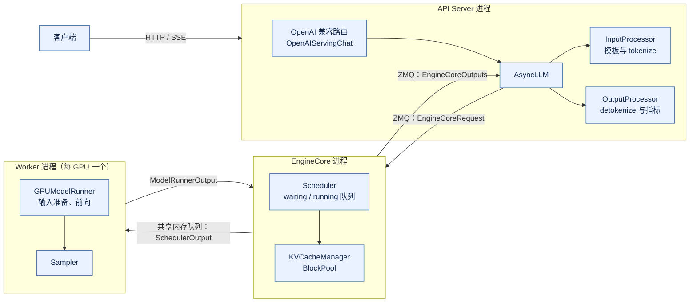

*图 1-1 vLLM V1 的三类进程与它们之间流动的核心对象（单 API server、单引擎）*

### 1.4 术语对照

#### 1.4.1 论文术语与代码术语

论文与代码使用了不同的词。下表给出对照，后文首次出现时写成“论文术语（代码术语）”。

| 论文或通用术语 | vLLM 代码术语 | 说明 |
|:---|:---|:---|
| iteration-level scheduling / continuous batching | `Scheduler.schedule()` 每步调用一次 | 请求可以在任意一步加入或退出 batch |
| PagedAttention 的物理 block | `KVCacheBlock`，由 `BlockPool` 管理 | 固定 token 数的 KV 存储单元，默认 16 个 token |
| block table | `KVCacheBlocks`（调度器侧）、`BlockTable`（worker 侧） | 逻辑位置到物理 block 的映射 |
| prefix cache / APC | `BlockPool.cached_block_hash_to_block` 与块哈希 | 按哈希链命中满 block |
| chunked prefill | token budget 截断 `num_new_tokens` | 没有单独的实现分支 |
| 抢占（preemption） | `Scheduler._preempt_request` | 只支持重算，不支持换出到 CPU |
| PD 分离 | KV connector（`KVConnectorBase_V1`） | 调度器侧与 worker 侧两组接口 |
| 投机解码的 draft / verify | drafter（proposer）与 `RejectionSampler` | draft token 计入 token 预算 |
| 前端 / 后端 | API server 进程 / EngineCore 进程 | 中间是 ZMQ + msgpack |
| 执行器 | `Executor`（进程管理）与 `GPUModelRunner`（单卡执行） | 两者不是一回事 |

#### 1.4.2 几个容易误解的词

**“TPOT”有多种口径。** vLLM 的 Prometheus 指标中，`vllm:request_time_per_output_token_seconds` 是 decode 总时长除以（生成 token 数 − 1），`vllm:inter_token_latency_seconds` 是相邻两次输出之间的间隔；而 TTFT 是前端收到首批输出的时刻减去请求到达时刻，**包含了 chat template 渲染和 tokenize 的时间**（见 5.1.3 节）。客户端观察到的 TPOT 还包括网络发送，三者必须注明边界。

**“KV cache”不是记忆。** KV 是可以从输入重算出来的中间状态。抢占时 vLLM 直接丢弃它，重启实例后也不恢复它。它和业务层面的“对话记忆”或“长期记忆”无关。

**“命中 cache”有四种不同的语义。** 请求内 KV、prefix cache、精确响应缓存和语义响应缓存的命中条件、收益和风险完全不同（见 2.5.4 节），不能共用一套指标和安全规则。

**“executor”在 vLLM 中指进程管理器。** `MultiprocExecutor` 负责启动 worker 进程并向它们广播 RPC；真正在 GPU 上准备输入、跑前向的是 `GPUModelRunner`。

---

## 2 架构组成

### 2.1 设计目标与约束

#### 2.1.1 以 SLO 内的 goodput 为准绳

推理服务的优化目标不是峰值 tokens/s，而是**在 TTFT、TPOT 和尾延迟约束内，单位时间成功完成的请求数**。这个目标决定了 vLLM 的许多设计：调度器每一步都要在“插入新请求的 prefill（改善 TTFT）”和“保持已有请求的 decode 节奏（改善 TPOT）”之间分配 token 预算；KV 必须分页，否则为最大长度预留的显存会让并发上不去；CPU 开销必须与 GPU 执行重叠，否则小 batch 的 decode 会被 Python 调度时间拖慢。

#### 2.1.2 状态必须可调度、可回收

LLM 推理与普通 RPC 服务最大的不同，是每个请求在生成期间持有一份随长度增长的 GPU 状态（KV cache）。vLLM 的架构可以理解为围绕这份状态建立的一套资源管理：KV 被切成固定大小的 block，有明确的引用计数和空闲队列；每个请求持有哪些 block、算到了哪个位置，都记录在调度器的对象中；请求结束、取消或被抢占时，block 按确定的顺序回到空闲队列。没有明确所有权的实现，容易出现 cache 泄漏或 use-after-free。

#### 2.1.3 约束带来的工程取舍

这套设计也带来了代价。抢占只能重算，长请求被抢占一次可能浪费大量计算；prefix cache 只能命中满 block，命中粒度受 block 大小限制；KV 容量在启动时确定，运行时不能按需扩张；CUDA Graph 只覆盖一组离散的 batch 大小，其余要 padding 或走 eager。理解这些取舍，是正确设置 `max_num_seqs`、`max_num_batched_tokens`、`gpu_memory_utilization` 和 block 大小的前提。

### 2.2 三层架构：服务层、引擎层、执行层

#### 2.2.1 为什么要分层与分进程

vLLM V1 的官方架构文档把 `vllm serve` 的进程分为四类：API server、EngineCore、GPU worker，以及数据并行时才有的 DP coordinator（`docs/design/arch_overview.md:67-132`）[[2]](#ref-2)。进程总数为 `API server 数 + DP 大小 + GPU 数（+1，若 DP>1）`；例如 `-tp=4` 时为 6 个进程，`-tp=2 -dp=4` 时为 17 个（`arch_overview.md:103-126`）。

分进程的核心理由是 **Python 的 CPU 开销**。在 V0 架构中，HTTP 处理、tokenize、调度、detokenize 和 GPU 前向挤在同一个进程里，彼此通过 GIL 争用 CPU；GPU 越快，CPU 越成为瓶颈。V1 把它们拆开：

- **服务层**（API server 进程）只做协议、tokenize 和 detokenize，可以多开以横向扩展；
- **引擎层**（EngineCore 进程）只跑调度循环，它是性能关键的内循环，指标统计等簿记工作都被推到前端去做（`docs/design/metrics.md:151-167`）；
- **执行层**（worker 进程）每张 GPU 一个，只执行调度器下发的计划。

#### 2.2.2 服务层：API Server、Renderer 与输出处理

API server 进程中运行 FastAPI 应用和一个 `AsyncLLM` 对象。OpenAI 兼容的路由（`/v1/chat/completions`、`/v1/completions` 等）由 `OpenAIServingChat` 等类处理，它们把请求渲染成 token，构造 `SamplingParams`，调用 `AsyncLLM.generate`，再把返回的增量结果包装成 SSE 事件（`vllm/entrypoints/openai/chat_completion/serving.py:302-507`）。

`AsyncLLM` 持有四个部件（`vllm/v1/engine/async_llm.py:168-207`）：

- **Renderer**：tokenizer 与 chat template，负责把消息列表渲染成 prompt 并 tokenize；
- **InputProcessor**：校验参数、补全默认值，把输入转换为发给引擎的 `EngineCoreRequest`；
- **OutputProcessor**：为每个请求维护一个 `RequestState`，做增量 detokenize、stop string 检查、logprobs 处理，产出用户可见的 `RequestOutput`，并计算 TTFT、TPOT 等指标；
- **EngineCoreClient**：通过 ZMQ 与 EngineCore 通信的客户端。

把 tokenize 和 detokenize 放在前端，意味着 tokenizer 与引擎加载的模型必须严格匹配；也意味着 stop string 的检查发生在前端——匹配到 stop string 时，前端要反过来通知引擎中止该请求（见 5.6.1 节）。

#### 2.2.3 引擎层：EngineCore 的调度循环

EngineCore 进程的主体是一个 busy loop（`vllm/v1/engine/core.py:1743-1755`）：从输入队列取出新请求和中止请求，然后执行一步 `step_fn`，把结果放进输出队列。两个 I/O 线程负责 ZMQ 的收发与 msgpack 编解码，busy loop 本身不碰网络（`core.py:1372-1394`、`2066-2241`）。

一步的内容是：调用 `Scheduler.schedule()` 产生本步的执行计划 `SchedulerOutput`；交给 executor 执行前向；在 GPU 执行期间，计算结构化输出所需的语法 bitmask；然后让 worker 采样；最后调用 `Scheduler.update_from_output` 把新 token 写回请求、检查停止条件、释放结束请求的资源（`core.py:709-739`）。async scheduling 开启时（默认），这个循环变为 `step_with_batch_queue`：允许多个 batch 同时在途，GPU 执行第 N 步时 CPU 已经在调度第 N+1 步（`core.py:750-863`），详见 5.3.1 节。

调度器持有一个 `KVCacheManager`，后者通过 `KVCacheCoordinator` 管理一个 `BlockPool`。**所有 KV block 的分配与回收决策都在 EngineCore 进程中做出**，worker 只是按调度器给出的 block 编号读写显存。这是 vLLM 架构中最重要的一条所有权边界。

#### 2.2.4 执行层：Executor、Worker 与 ModelRunner

执行层有三个层次的对象：

- **Executor** 运行在 EngineCore 进程中，负责管理 worker。多进程后端 `MultiprocExecutor` 启动 worker 进程，用共享内存消息队列把 RPC 广播给所有 worker（`vllm/v1/executor/multiproc_executor.py:132-290`、`447-556`）；单卡时 `UniProcExecutor` 直接在本进程内调用 worker。
- **Worker** 每张 GPU 一个，负责设备初始化、分布式通信组、显存测量，以及把执行请求转交给 model runner（`vllm/v1/worker/gpu_worker.py`）。
- **GPUModelRunner** 负责真正的单卡执行：维护 worker 侧的请求状态和 block table，准备输入张量和 attention 元数据，选择 CUDA Graph，执行前向、计算 logits、采样。

在调研的提交中，GPUModelRunner 有两个实现并存。**Model Runner V2**（`vllm/v1/worker/gpu/model_runner.py`）在特性支持时默认启用，否则回退到 V1 实现（`vllm/v1/worker/gpu_model_runner.py`），判断逻辑在 `VllmConfig.use_v2_model_runner`（`vllm/config/vllm.py:735-760`），也可以用环境变量 `VLLM_USE_V2_MODEL_RUNNER` 强制指定。V2 的设计文档列出了它对 V1 的主要修正 [[8]](#ref-8)：把持久状态张量与每步输入张量解耦，取消冗余的 `CachedRequestState`；以异步执行为前提设计，去掉 CPU 同步点；用 Triton kernel 在 GPU 上准备 `input_ids`、`positions` 等输入元数据；Triton 原生的采样器（Gumbel 采样）；以及显式的 `CUDAGraphManager`。两者对调度器暴露的接口相同，所以调度层的分析对两者都成立；第 5 节按 V2 描述执行路径。

#### 2.2.5 三层之间的信息流

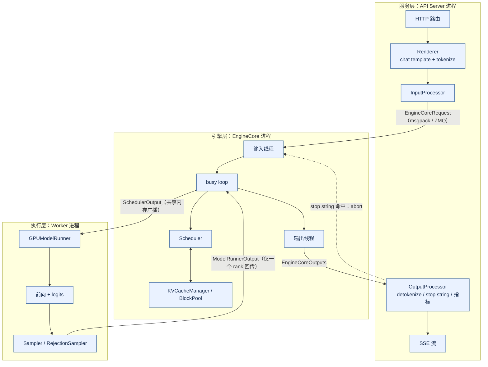

*图 2-1 三层之间的信息流：请求向下流动，token 向上流动；stop string 是唯一由前端发起的反向控制*

图中有两处值得注意。其一，EngineCore 向所有 TP rank 广播同一份 `SchedulerOutput`，每个 rank 执行相同的前向，但只有最后一个 PP stage 的 TP rank 0 回传 `ModelRunnerOutput`（`multiproc_executor.py:649-663`）。其二，前端到引擎有一条虚线：stop string 在前端检测，命中后前端要发 abort 通知引擎停止生成并释放资源。

### 2.3 组件清单与职责

#### 2.3.1 组件清单

| 组件 | 进程 | 模块 | 职责 |
|:---|:---|:---|:---|
| CLI / launcher | API | `vllm/entrypoints/cli/serve.py`、`entrypoints/launchers/` | 解析参数，选择运行形态，绑定端口，构建 FastAPI 应用 |
| OpenAIServingChat 等 | API | `entrypoints/openai/chat_completion/serving.py` | 协议适配，构造 `SamplingParams`，SSE 封装 |
| Renderer | API | `vllm/renderers/` | chat template 渲染与 tokenize |
| AsyncLLM | API | `vllm/v1/engine/async_llm.py` | 前端引擎门面：`generate`、`abort`、健康状态、准入检查 |
| InputProcessor | API | `vllm/v1/engine/input_processor.py` | 参数校验与默认值，生成 `EngineCoreRequest` |
| OutputProcessor | API | `vllm/v1/engine/output_processor.py` | 增量 detokenize，stop string，`RequestOutput`，指标 |
| EngineCoreClient | API | `vllm/v1/engine/core_client.py` | ZMQ 客户端，进程拉起与握手，引擎存活监控 |
| EngineCoreProc | EngineCore | `vllm/v1/engine/core.py` | busy loop，I/O 线程，`step` / `step_with_batch_queue` |
| Scheduler / AsyncScheduler | EngineCore | `vllm/v1/core/sched/` | 每步的 token 分配、抢占、停止判断、资源释放 |
| KVCacheManager | EngineCore | `vllm/v1/core/kv_cache_manager.py` | prefix 命中查询，`allocate_slots`，`free` |
| KVCacheCoordinator | EngineCore | `vllm/v1/core/kv_cache_coordinator.py` | 多个 KV cache group 的协调 |
| BlockPool | EngineCore | `vllm/v1/core/block_pool.py` | block 对象、空闲队列、哈希到 block 的映射 |
| StructuredOutputManager | EngineCore | `vllm/v1/structured_output/` | 异步编译语法，计算 token bitmask |
| Executor | EngineCore | `vllm/v1/executor/` | worker 进程管理，`collective_rpc` |
| Worker | Worker | `vllm/v1/worker/gpu_worker.py` | 设备与通信组，显存测量，编译与预热 |
| GPUModelRunner（V2 / V1） | Worker | `vllm/v1/worker/gpu/model_runner.py`、`gpu_model_runner.py` | 输入准备，CUDA Graph，前向，采样 |
| Sampler / RejectionSampler | Worker | `vllm/v1/worker/gpu/sample/`、`vllm/v1/sample/` | logits 处理与采样；投机解码的验证 |
| KV connector | EngineCore + Worker | `vllm/distributed/kv_transfer/kv_connector/v1/` | PD 分离与 KV offload 的传输 |

#### 2.3.2 Scheduler 与 KVCacheManager 的分工

调度器决定**谁**在这一步运行、**各**算多少 token；KV 管理器回答**能不能**为这些 token 准备好存储。两者的接口很窄：调度器对一个新请求先调用 `get_computed_blocks` 查询 prefix 命中，得到可以复用的 block 和命中的 token 数；然后调用 `allocate_slots` 为要计算的新 token 申请 block，失败时返回 `None`；请求结束时调用 `free`（`vllm/v1/core/kv_cache_manager.py:266-637`）。调度器不知道 block 的物理布局，也不直接操作空闲队列；KV 管理器不知道请求的优先级，也不做抢占决策。抢占是调度器在 `allocate_slots` 失败后做出的决定（见 5.3.4 节）。

KV 管理器内部又分两层：`KVCacheCoordinator` 处理“一个模型有多种层”的情况——例如全注意力层与滑动窗口层并存，或者 Transformer 层与 Mamba 层混合，每种层组成一个 KV cache group，各有一个 `SingleTypeKVCacheManager` 子类负责该类层的 block 规则；所有 group 共享同一个 `BlockPool`（`kv_cache_coordinator.py:89-127`、`990-1052`）。普通的纯全注意力模型只有一个 group。

#### 2.3.3 组件关系图

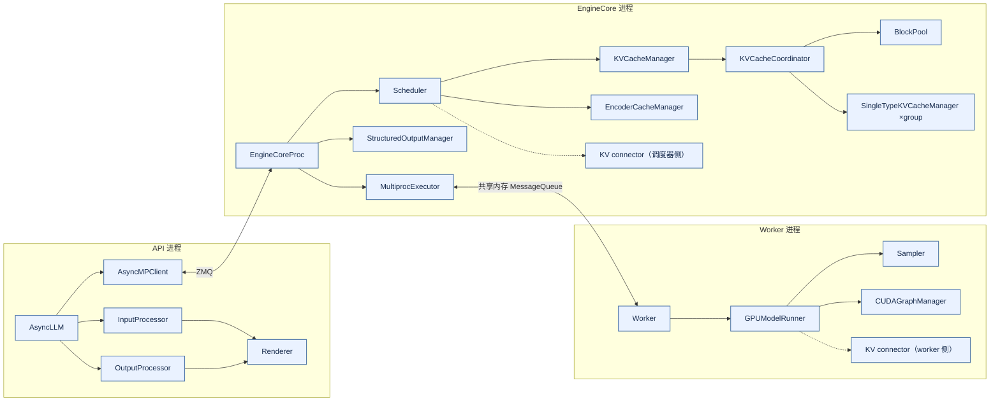

*图 2-2 组件关系：调度与 KV 账本集中在 EngineCore，worker 只执行；KV connector 横跨两侧*

#### 2.3.4 状态所有权：一种状态只有一个写者

vLLM 的正确性很大程度上依赖“一种状态只有一个写者”。下表列出主要状态及其唯一写者。

| 状态 | 唯一写者 | 其他组件的访问方式 |
|:---|:---|:---|
| `Request` 的状态、进度、已生成 token | Scheduler（EngineCore 进程） | worker 通过 `SchedulerOutput` 收到副本或增量 |
| KV block 的分配、引用计数、哈希 | BlockPool（经 KVCacheManager） | worker 只按 block 编号读写显存 |
| KV 张量的内容 | worker 上的 attention kernel | 调度器从不读取 KV 内容 |
| worker 侧请求状态与 block table | GPUModelRunner | 每步按 `SchedulerOutput` 增量更新 |
| `RequestState`、detokenize 进度 | OutputProcessor（API 进程） | 引擎不感知文本 |
| 共享准入计数 | 各 API 进程的 OutputProcessor 写自己的槽位 | 所有 API 进程读取全部槽位求和 |

取消或失败时的释放顺序也由所有权决定：前端先移除 `RequestState` 并向引擎发 abort；调度器把请求标记为结束、释放 block、把请求 ID 放入下一步 `SchedulerOutput.finished_req_ids`；worker 在下一步开始时删除本地状态（见 5.7.2 节）。这个顺序保证了 worker 不会在 block 被重新分配之后仍向其中写入旧请求的 KV。

### 2.4 显存与容量架构

#### 2.4.1 GPU 内存分区

推理节点的显存由五部分组成：权重、KV cache、前向计算的激活与临时张量、kernel 与 CUDA Graph 的工作区、通信 buffer。权重加载后，剩余显存不能全部交给 KV，因为 kernel workspace、CUDA Graph 捕获的内存池、量化 scale 和异常路径仍需要空间。

vLLM 用一个比例参数表达“本实例能用多少显存”：`gpu_memory_utilization`，它是**单实例**的上限，不感知同卡上的其他进程。在调研的提交中，这个参数未设置时有两种默认值：启用 extensible KV cache 时为 1.0，否则为 0.92（`vllm/config/cache.py:216-228`、`487-493`）。KV cache 的大小不是直接配置的，而是“上限 − 权重 − 测得的峰值激活 − 其他非 KV 占用”之后剩下的部分，按 block 大小折算成 block 数（第 4.3 节详述）。也可以用 `kv_cache_memory_bytes` 直接指定 KV 的字节数，此时忽略 `gpu_memory_utilization`。

**Extensible KV cache** 是这个提交里的新机制：在 CUDA 和 ROCm 上，配合 Model Runner V2，默认先用设备虚拟内存保留 KV 的地址范围，等预热和 CUDA Graph 捕获完成之后再提交物理页，这样 KV 的大小来自“捕获之后真正剩下的显存”，而不是 profiling 阶段的估算（`vllm/config/cache.py:386-393`，判定逻辑见 `vllm/config/vllm.py:3184` 起的 `_resolve_extensible_kv_cache`）。它在显式指定 `kv_cache_memory_bytes`、`num_gpu_blocks_override`，或者未使用 V2 model runner 等情况下不启用。实现中还在测得的峰值之外保留一段余量：至少 1 GiB（ROCm 为 2 GiB），并随模型工作集按比例放大，注释记录了在 GB200 上 8B 模型首个 prefill 需要比已分配峰值多 25% 以上空间的观测（`vllm/v1/worker/extensible_kv_cache.py:44-58`）。这说明“profile 出来的峰值”并不是可以直接相减的精确值。

#### 2.4.2 soft limit、hard limit 与准入

显存水位应有 soft limit 和 hard limit。soft limit 触发降低并发、停止接受长请求或淘汰低价值 prefix；hard limit 触发明确的保护和实例摘除。只依靠 CUDA OOM 异常通常太晚，可能导致多个请求同时失败并破坏 engine 状态。

vLLM 的做法是把显存问题转化为 block 数问题：KV 池在启动时就已分配好（或地址已保留），运行时不再向 CUDA 申请 KV 显存，只在 `BlockPool` 里分配和回收 block。block 不够时，调度器不会触发 OOM，而是**不调度新请求**，或者**抢占正在运行的请求**（见 5.3.4 节）。这是一种内建的 admission control：代价是抢占带来的重算，而不是进程崩溃。平台层的准入（租户并发、最大上下文、预算）仍然需要在网关做，因为引擎不知道租户和预算。

请求进入引擎前应先估算输入 token、最大输出 token、潜在 KV block、优先级和预计执行时间。超过租户并发、最大上下文、GPU cache 或预算时，可以拒绝、截断、转异步、降低优先级或路由到其他模型。对每个请求建立保守的上界会降低利用率，可以分层处理：短请求用精确估计，超长请求要求预留，长度未知的请求采用较低优先级并设置硬上限。

#### 2.4.3 从 token 速率估算 GPU 数量

设到达率为 λ，平均输入 token 为 P，平均输出 token 为 D，单 GPU 在给定负载下的 prefill、decode 有效吞吐为 R_p、R_d，利用率预算为 u。若两阶段共享同一串行计算预算，粗估需要把工作相加：

```text
shared_pool_GPU_equivalent ≈ (λ × P / R_p + λ × D / R_d) / u
PD_pool_prefill ≥ λ × P / (R_p × u_p)
PD_pool_decode  ≥ λ × D / (R_d × u_d)
```

对独立瓶颈取 max 只能表示下界，不能视为混部所需的总 GPU。PD 两池还要分别向上取整、满足拓扑与通信约束；实际混部并非线性叠加，需要压测干扰。以上吞吐不是硬件峰值，必须绑定模型、长度与 batch 分布。这只是初始估算，还要加入 KV 容量、权重、临时激活、网络传输、故障余量、灰度余量和长尾请求。若输出长度有明显长尾，使用平均 D 会低估 decode 并发；若输入长度不断增加，prefill 与 KV 同时增长。

SRE 的容量和错误预算思想可以延伸到推理平台：不能把同一份剩余容量同时承诺给节点故障、扩容和滚动发布 [[14]](#ref-14)。至少应保留 failover reserve、deployment reserve 和 burst reserve，并在容量接近阈值时限制长上下文或转入低优先级队列。

#### 2.4.4 案例：Qwen3-8B 的显存账本

这里做可复算的教学估计，不报告实际设备测试。来源是 Qwen 官方 `Qwen3-8B/config.json`，核验日期 2026-10-17，页面所示文件提交 `47719a2`：36 层、32 个 query heads、8 个 KV heads、head_dim 为 128、hidden_size 为 4096，默认 BF16 [[15]](#ref-15)。不能把 32 个 query heads 代入 GQA 的 KV 账本。

按名义 8×10^9 参数和每参数 2 字节，裸权重约 16,000,000,000 字节，即 16 GB 或 14.901 GiB。模型名中的 8B 是近似值，实际权重需逐 tensor 统计。完整注意力的 KV 每序列每 token 为 2×36×8×128×2 = 147,456 字节，第一个 2 代表 K 与 V，最后的 2 是 BF16 的字节数。8192 个已缓存 token 占 1,207,959,552 字节，恰为 1.125 GiB；输入与已生成的输出都计入长度。

把它换算成 vLLM 的 block：若 block 大小为 16 个 token，一个 block 在全部 36 层上合计占 16×147,456 = 2,359,296 字节（2.25 MiB），一条 8192-token 的序列需要 512 个 block。vLLM 在启动时正是按“可用 KV 字节 ÷ 每 block 字节”算出 block 总数的（见 4.3.2 节）。

| 24 GiB 单卡教学预算 | 数值 | 性质与边界 |
|:---|:---|:---|
| `gpu_memory_utilization` = 0.92 时的上限 | 22.08 GiB | 留给同卡其他占用和驱动的 8% 不在本实例账内 |
| 名义 BF16 裸权重 | 14.901 GiB | 用 8B 近似，实际需按检查点核算 |
| 激活、logits、通信、CUDA Graph 与工作区 | 2 GiB | 人为给定的联合上界；vLLM 启动时由 profile 实测（见 4.3.1 节） |
| 可用于 KV 的预算 | 约 5.18 GiB | 22.08 减去前两项 |
| 折算 block 数（16 token/block） | 约 2357 个 | 5.18 GiB ÷ 2.25 MiB，向下取整 |
| 四条 8192-token 序列 | 2048 个 block | 没有 prefix 共享 |
| 第五条加入后 | 2560 个 block | 超过预算，第五条无法同时驻留 |

因此只得到候选上限 4；它不代表四并发满足 TPOT，也不保证真实工作区低于 2 GiB。在 vLLM 中，第五条请求不会导致 OOM：它要么在等待队列中等待，要么在调度时触发对其他请求的抢占。若每条总缓存长度翻倍，上限要重新计算。INT4 的裸权重名义约 4 GB，仍有 scale、zero point、padding 和反量化工作区；权重降精度并不会自动把 BF16 的 KV 缩小。多卡时按各 rank 的权重和 KV 实际分片建账，不把所有项机械地除以 TP 数。

### 2.5 KV Cache 子系统

#### 2.5.1 分页分配与碎片

自回归解码会保存每层每个历史 token 的 key 和 value。KV 字节数与层数、KV head 数、head 维度、序列长度、batch 和 dtype 成正比；GQA、MQA 可以减少 KV head 数，但不能消除长上下文的线性增长。连续分配会产生外部碎片：短请求结束后留下许多小洞，长请求仍拿不到连续空间。PagedAttention 把 KV 切成固定大小的 block，逻辑 token 序列通过 block table 映射到物理显存，让动态请求不再需要连续大块显存 [[3]](#ref-3)。

vLLM 中，KV 张量在启动时一次性分配（或保留地址，见 4.3.3 节），按 block 编号切分。`BlockPool` 为每个编号创建一个 `KVCacheBlock` 对象，记录引用计数、块哈希和在空闲队列中的前后指针（`vllm/v1/core/kv_cache_utils.py:163-226`）。block 默认容纳 16 个 token，平台可能按 attention backend 的偏好调整。block 太小会增加 block table、调度和 kernel 访问开销，太大会增加最后一个 block 的内部碎片并降低 prefix 命中粒度。有一个特殊的 null block（编号 0），用来填充滑动窗口等场景中“已跳过”的位置，它不参与引用计数和缓存（`block_pool.py:188-192`）。

#### 2.5.2 Prefix Cache 与块哈希

系统提示、工具 schema、few-shot 示例和共享文档经常形成重复前缀。vLLM 的 Automatic Prefix Caching（APC）默认开启（`vllm/config/cache.py:260`），其设计文档说明了它的基本规则 [[7]](#ref-7)：

- 只有**满 block** 才会被缓存和命中；
- 每个 block 的哈希 = hash（父 block 哈希，本 block 的 token，额外键），第一个 block 的父哈希是一个固定的种子值，因此哈希天然编码了完整前缀（`kv_cache_utils.py:709-739`）；
- 额外键依次包括：LoRA 身份（名称与路径）、与本 block 重叠的多模态输入的标识与偏移、`cache_salt`（只加在从第 0 个 token 开始的首 block 上）、prompt embedding 的哈希（`kv_cache_utils.py:639-677`）；
- 默认哈希算法为 sha256（`cache.py:262`）；
- 命中长度最多为 `num_tokens − 1`，最后一个 token 总要重新计算，以便得到采样所需的 logits（`vllm/v1/request.py:329-333`）。

由于哈希是链式的，第 i 个 block 未命中意味着之后的 block 都不会命中，查询可以从头顺序进行直到第一次未命中。命中的 block 被“touch”：如果它的引用计数为 0（处于空闲队列中），就从空闲队列中移除并把引用计数加一（`block_pool.py:794-812`）。多个请求共享同一前缀时，它们引用同一组物理 block。

prefix cache 的 key 必须包含完整 token 前缀、模型版本、tokenizer、模板、位置编码和权限范围。vLLM 的块哈希覆盖了 token、LoRA 和多模态内容，但**不包含租户身份**——租户隔离要靠 `cache_salt`。平台应由服务端按认证后的租户域生成或约束 salt，客户端自己填写的 salt 不是访问授权。高敏感租户可以使用独立 salt、更短的保留时间或干脆禁用读取 prefix cache（`SamplingParams.skip_reading_prefix_cache`）。cache 泄漏通常不是显式的数据返回，而是命中率与延迟差异形成的侧信道。

#### 2.5.3 驱逐、取消与释放顺序

vLLM 没有单独的“驱逐线程”。block 的生命周期由引用计数和空闲队列决定（`block_pool.py:708-851`）：

- 请求释放 block 时，引用计数减一；减到 0 的 block 回到空闲队列。**已缓存的 block 追加到队尾**（按 LRU 保留，仍可被命中），**未缓存的 block 放到队首**（优先复用）；
- 请求释放 block 的顺序是**逆序**的：一个请求的尾部 block 先进入队列，于是在 LRU 中更早被淘汰，前缀部分保留得更久（`single_type_kv_cache_manager.py:591-599`）；
- 分配新 block 时从队首取出；如果取出的 block 还带着旧的哈希，此时才把它从哈希表中移除——驱逐是惰性的，发生在分配的那一刻。

这个机制让“被释放但内容仍有效”的 block 继续服务后续请求，直到显存压力迫使它们被复用。驱逐不会影响正在执行的请求：引用计数大于 0 的 block 不在空闲队列中，不可能被分配出去。

释放的时机还要考虑 GPU 异步执行。在 async scheduling 下，调度器做出释放决定时，GPU 上可能仍有一个已经下发的步骤会写这些 block；调度器为此维护了延迟释放队列，在确认没有在途写入之后才真正释放（`scheduler.py:471`、`3078-3094`）。启用 PD 分离时，KV connector 也可以要求推迟释放，直到 KV 发送完成（见 5.8.2 节）。

#### 2.5.4 四种缓存的命中语义不能混用

| 层次 | 保存与复用什么 | 命中需要什么 | 主要收益与风险 |
|:---|:---|:---|:---|
| 请求内 KV | 当前序列每层的 K/V | 该请求的有效历史与位置一致 | 避免历史重复计算；总 token 增长消耗显存 |
| Prefix / Prompt | 已有前缀的 KV block | 完整 token 前缀、模型及执行配置兼容、授权域允许 | 主要省 prefill；失效、侧信道与显存驻留 |
| 精确响应 | 已完成的答案或纯查询结果 | 规范化请求及上下文、权限、策略、知识版本一致 | 可以跳过生成；事实过期或随机语义不符 |
| 语义响应 | 相似请求对应的候选答案 | 相似候选还须通过答案等价、新鲜度与权限检查 | 可能覆盖措辞变化；误命中会直接交付错误答案 |

vLLM 的 APC 只属于第二层，它复用共享前缀的计算，收益集中在 prefill，不能据此承诺 decode 等比例加速 [[7]](#ref-7)。精确响应和语义响应缓存在引擎之外，由平台实现。GPTCache 是基于语义相似性复用响应的公开实现参考 [[16]](#ref-16)，但它不构成业务等价性证明：“我可以报销吗”与“我不可以报销吗”高度相似，却可能需要相反的回答。建议先以租户、授权范围、知识与政策版本做硬过滤，再在该域内检索候选；对否定、条件、实体、时间逐项校验；高风险审批、余额和实时库存可以禁用语义响应复用；有副作用的操作不能因缓存命中而重新执行。撤权、删除、知识发布和模板升级应触发失效事件。

### 2.6 并行与解耦的部署形态

#### 2.6.1 副本扩展与 TP、PP、DP、EP

模型能放进单 GPU 时，副本扩展通常简单且容易隔离故障；放不进时，需要 tensor parallel、pipeline parallel 或 expert parallel。vLLM 在 `initialize_model_parallel` 中按 `ExternalDP × DP × PP × PCP × TP` 的布局为每个 rank 建立通信组，依次创建 TP、DCP、PCP、PP、DP、EP 等组（`vllm/distributed/parallel_state.py:2085-2382`）。

- **TP**：把矩阵乘法切到多张卡上。列切分的层（QKV、gate-up 投影）不需要通信，行切分的层（`RowParallelLinear`）在输出上做 all-reduce（`vllm/model_executor/layers/linear.py:1821-1822`），按 Megatron 式切分，每个 Transformer 层大约两次 all-reduce。all-reduce 的实现按可用性依次选择 NCCL symmetric memory、FlashInfer、vLLM 自定义 all-reduce 等后端（`vllm/distributed/device_communicators/cuda_communicator.py:384-440`）。TP 适合同机高速互联；跨节点 TP 在低并发 decode 中会把通信延迟暴露在每个 token 上 [[17]](#ref-17)。
- **PP**：把层切成多个 stage，stage 之间传递中间张量（`gpu_worker.py:1528-1566`）。为了填满流水线，EngineCore 用 batch queue 让多个 batch 同时在途（见 5.3.1 节）。
- **DP**：每个 DP rank 是一个独立的 EngineCore，有自己的调度器和 KV。非 MoE 模型的 DP rank 完全独立，等同于多个副本（`core.py:1673-1678`）；前端在内部负载均衡模式下按“在途请求数”和“等待+运行请求数”给每个引擎打分来分配请求（`core_client.py:1810-1859`）。
- **EP**（MoE）：attention 部分按 DP 并行，专家分布在 DP×TP 组成的 EP 组上，token 通过 all-to-all 路由到专家。由于每一层都要跨 DP rank 交换，所有 DP rank 必须同步步进，空闲的 rank 要执行 dummy batch（`core.py:2647-2690`），并由 DP coordinator 协调。

并行度越大不一定越快，必须结合拓扑、batch、序列长度和通信占比测量。故障域也不同：同一 TP group 中一张卡故障会使整个 group 不可用。

#### 2.6.2 PD 解耦与 KV 传输

prefill 偏计算，decode 偏内存带宽和长期状态；混合部署时，长 prompt 的突发会挤占 decode。DistServe 将二者放到不同资源池，分别扩容和优化 goodput [[6]](#ref-6)。分离不是免费的：它增加 KV 传输、请求协调、故障重试、路由和网络容量。

vLLM 用 **KV connector** 抽象实现 PD 分离和 KV offload。`KVConnectorBase_V1` 把接口分为调度器侧和 worker 侧（`vllm/distributed/kv_transfer/kv_connector/v1/base.py:3-35`）：调度器侧回答“这个请求有多少 token 可以从外部加载”（`get_num_new_matched_tokens`）、在分配 block 后更新状态（`update_state_after_alloc`）、在请求结束时决定是否推迟释放 block 并返回传输参数（`request_finished`）；worker 侧负责在前向前后启动加载、逐层等待加载或保存 KV。注册的实现包括 NIXL（默认 pull 模式，decode 端从 prefill 端读取；也有 push 模式）、Mooncake、LMCache、CPU offload 等（`kv_connector/factory.py:158-255`）。调度器与 connector 的交互见 5.8.2 节。

#### 2.6.3 AF 解耦（MoE）

本节 AF 指 Attention/FFN disaggregation，即把注意力和前馈（专家）模块放到不同资源上。MegaScale-Infer 是具体的 MoE 参考：decode 中 attention 节点持有注意力权重和 KV，expert 节点持有专家；各节点内部可以用 TP，节点间使用 M2N 通信，并以 ping-pong 微批流水掩盖依赖等待 [[18]](#ref-18)。PD 改变阶段的放置：prefill 完成后迁移已有的历史 KV，再由 decode 池迭代；AF 改变每层模块的放置，在 decode 阶段内部仍需反复交换激活。二者可以组合，也都可以不采用。

粗略的交通量可以帮助判断瓶颈：PD 的一次输入 KV 迁移按 2L×H_kv×d×S×b 字节增长；一个未分片、无专家复制的 AF 边界，batch 中 B 个 token 送出与返回的激活粗估为 2B×hidden_size×b，每层重复。后者只是维度推导，MoE top-k 路由、TP/EP 分片、共享或重复传输会改变真实字节数。低负载、低接受率或慢网络时，继续共置可能更合适。vLLM 中与之相关的是 EP 与 DBO（Dual Batch Overlap，用两个微批重叠 MoE 的通信与计算，见 `docs/design/dbo.md`）。

#### 2.6.4 部署形态对比

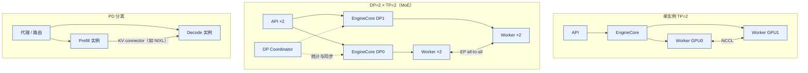

*图 2-3 三种典型部署形态：TP 在实例内切分模型，DP/EP 横向扩展引擎，PD 分离把两个阶段放到不同实例*

### 2.7 平台层：模型仓库、路由与可观测性

#### 2.7.1 模型仓库与实例生命周期

模型实例经历 DOWNLOADING、LOADING、WARMING、READY、DRAINING、UNHEALTHY 和 TERMINATED 等状态，它们与 vLLM 启动步骤的对应关系见 4.5.2 节。Triton 的模型仓库与版本管理提供了服务编排的参考 [[10]](#ref-10)。生产平台应把 instance id、模型 hash、vLLM 版本、GPU、拓扑、启动耗时、最终 KV block 数和预热结果写入注册表。实例被摘除后，应停止接收新请求，等待或迁移正在执行的请求，再回收 GPU。

#### 2.7.2 路由、多租户与降级

vLLM 一个实例只知道自己的队列和 KV，平台路由器需要它暴露的信号才能做出好的分配：运行与等待中的请求数、KV 使用率、prefix 命中情况。DP 内部负载均衡已经在前端用这类信号为请求选择引擎（2.6.1 节）；跨实例的路由则由平台完成，详见 6.2 节。多租户隔离涉及配额、cache salt、adapter 和数据驻留，详见 6.1 节。

#### 2.7.3 Metrics、Logs 与 Traces

vLLM 在 `/metrics` 上暴露 Prometheus 指标（`vllm/v1/metrics/loggers.py`），主要包括：

| 类别 | 指标 | 说明 |
|:---|:---|:---|
| 负载 | `vllm:num_requests_running`、`vllm:num_requests_waiting` | 运行与等待中的请求数 |
| KV | `vllm:kv_cache_usage_perc` | KV block 使用率 |
| 前缀缓存 | `vllm:prefix_cache_queries`、`vllm:prefix_cache_hits` | 命中率需用 PromQL 计算 `rate(hits)/rate(queries)` |
| 抢占 | `vllm:num_preemptions`、`vllm:request_num_preemptions` | 抢占次数与每请求抢占次数分布 |
| 延迟 | `vllm:time_to_first_token_seconds`、`vllm:inter_token_latency_seconds`、`vllm:request_time_per_output_token_seconds`、`vllm:e2e_request_latency_seconds` | 直方图 |
| 阶段耗时 | `vllm:request_queue_time_seconds`、`vllm:request_prefill_time_seconds`、`vllm:request_decode_time_seconds` | 直方图 |
| 吞吐 | `vllm:prompt_tokens`、`vllm:generation_tokens`、`vllm:iteration_tokens_total` | 计数器与每步 token 数分布 |
| 准入 | `vllm:admission_rejections` | 按原因统计的准入拒绝 |

指标的计算有一个设计细节：引擎只记录事件和单调时钟时间戳（QUEUED、SCHEDULED、首 token、末 token），时间差在前端计算，因为不同进程的单调时钟不可比较（`docs/design/metrics.md:169-200`）。这些指标只覆盖引擎内部的一段；网关排队、路由、工具调用和计费需要平台用 trace 串联（见 7.1.2 节）。Prometheus 标签要避免完整 request id、租户自由字符串和 token 内容造成的高基数 [[19]](#ref-19)。

---

## 3 核心对象与领域模型

### 3.1 概念总览与数据流

#### 3.1.1 从 Request 到 Token 的对象链

一条请求在 vLLM 中会依次变成多种对象，每种对象只活在一个进程里、只有一个写者。把它们按时间顺序串起来，就是推理服务的领域模型主线：

```mermaid
flowchart LR
    A["HTTP 请求体<br/>messages + 参数"] -->|Renderer| B["EngineInput<br/>token ids + arrival_time"]
    B -->|InputProcessor| C["EngineCoreRequest<br/>（线上格式）"]
    C -->|EngineCore| D["Request<br/>（调度状态）"]
    D -->|"Scheduler.schedule()"| E["SchedulerOutput<br/>（一步的执行计划）"]
    E -->|GPUModelRunner| F["InputBatch<br/>（本步输入张量）"]
    F -->|"前向 + Sampler"| G["ModelRunnerOutput<br/>（采样结果）"]
    G -->|"Scheduler.update_from_output()"| H["EngineCoreOutputs<br/>（增量 token + 结束原因）"]
    H -->|OutputProcessor| I["RequestOutput<br/>（文本增量）"]
    I -->|OpenAIServingChat| J["SSE chunk"]
    D -.->|持有| K["KVCacheBlock ×N"]
    classDef default fill:#eaf2ff,stroke:#5279aa,stroke-width:1.5px,color:#172b4d;
```

*图 3-1 对象链：左半边是请求向下的变换，右半边是结果向上的变换；`Request` 是唯一跨越整个生命周期的调度对象*

#### 3.1.2 三类对象：契约、状态、资源

可以把这些对象分成三类，分别回答不同的问题：

| 类别 | 回答的问题 | 代表对象 | 特点 |
|:---|:---|:---|:---|
| 契约对象 | 要做什么、按什么规则做 | `VllmConfig`、`SamplingParams`、`EngineCoreRequest`、`SchedulerOutput` | 创建后基本不变，跨进程传递 |
| 状态对象 | 做到哪一步了 | `Request`、`RequestStatus`、worker 侧请求状态、`RequestState`（前端） | 每步变化，只有一个写者 |
| 资源对象 | 占用了什么 | `KVCacheBlock`、`BlockPool`、`KVCacheBlocks`、KV 张量 | 有引用计数，必须回收 |

区分这三类，是排查问题的第一步：契约对象出错表现为“行为与预期不符”（例如模板不一致导致输出不同），状态对象出错表现为“卡住或重复”（例如请求永远不结束），资源对象出错表现为“泄漏或越界”（例如空闲 block 数持续下降）。

### 3.2 制品对象：Manifest 与配置树

#### 3.2.1 模型制品不是一个权重文件

一个可服务模型至少由权重、配置、tokenizer、chat template、特殊 token、量化配置、并行配置、采样默认值、停止条件、结构化输出约束和安全策略组成；视觉或音频模型还要包含预处理器、图像尺寸限制和模态路由。模型注册中心应为这些 artifact 生成不可变版本和 hash，serving engine 只加载经过完整性、兼容性和质量门禁的 manifest。

vLLM 从模型目录中读取其中的大部分：`config.json` 决定模型结构和 KV 规格，`generation_config.json` 提供采样默认值（`vllm/v1/engine/input_processor.py:505-510`），tokenizer 配置中的 chat template 决定 prompt 的渲染方式。这意味着**改动模型目录中的任何一个文件都可能改变线上行为**，而 vLLM 本身不会告诉你哪个文件变了。生产发布应把 manifest 当作运行时契约，并记录构建镜像、GPU 架构、CUDA/driver、vLLM 版本与提交和评估结果。

#### 3.2.2 配置树：VllmConfig

vLLM 的所有运行参数汇集在一棵配置树中，根是 `VllmConfig`（`vllm/config/vllm.py:364`）。与服务行为关系最大的几个子配置如下：

| 子配置 | 位置 | 关键字段与默认值 |
|:---|:---|:---|
| `ModelConfig` | `vllm/config/model.py:153` | `model`、`tokenizer`、`dtype`、`max_model_len`、`enforce_eager`（默认 False） |
| `CacheConfig` | `vllm/config/cache.py:182` | `block_size`（默认 16，可被平台调整）、`gpu_memory_utilization`（默认 0.92）、`enable_prefix_caching`（默认 True）、`prefix_caching_hash_algo`（默认 sha256）、`kv_cache_memory_bytes`、`num_gpu_blocks`（启动后回填） |
| `SchedulerConfig` | `vllm/config/scheduler.py:25` | `max_num_batched_tokens`、`max_num_seqs`（服务场景下按显存推导，见 4.1.2 节）、`enable_chunked_prefill`（默认 True）、`long_prefill_token_threshold`、`policy`（默认 fcfs）、`async_scheduling`（默认自动开启） |
| `ParallelConfig` | `vllm/config/parallel.py:145` | `tensor_parallel_size`、`pipeline_parallel_size`、`data_parallel_size`、`distributed_executor_backend` |
| `CompilationConfig` | `vllm/config/compilation.py:383` | 编译模式、`cudagraph_mode`（默认 FULL_AND_PIECEWISE）、捕获尺寸 |
| `LoRAConfig` | `vllm/config/lora.py:31` | `max_loras` 等 |
| `SpeculativeConfig` | `vllm/config/speculative.py:445` | 投机方法（ngram、draft_model、eagle/eagle3、MTP 系列等）与 draft 长度 |
| `StructuredOutputsConfig` | `vllm/config/structured_outputs.py:20` | 后端（默认 auto：xgrammar、guidance、outlines 等） |
| `KVTransferConfig` | `vllm/config/kv_transfer.py:69` | KV connector 类型与角色 |
| `ObservabilityConfig` | `vllm/config/observability.py:20` | 指标与 tracing |

配置树有两点需要注意。第一，很多字段的默认值是 `None`，在 `__post_init__` 或启动过程中按环境解析，例如 `gpu_memory_utilization` 和 `async_scheduling`；读配置文件不足以知道实际生效值，要看启动日志或 `/metrics` 中的 `vllm:cache_config_info`。第二，`num_gpu_blocks`、`max_model_len`、`block_size` 等字段会在启动过程中被引擎改写并回传前端（4.1.2 节）。

#### 3.2.3 版本兼容矩阵

生产平台应维护模型版本、tokenizer、template、vLLM 版本、量化、adapter、GPU 架构和驱动的兼容矩阵。矩阵不是静态文档，而是发布控制器可以读取的约束：某 adapter 只兼容特定 base hash，某量化格式只支持特定 compute capability，某 KV dtype 只在部分 attention backend 上可用，某模板版本改变了特殊 token。矩阵还要包括 API 和质量能力：一个小模型可能支持 JSON 却不支持图像或工具，一个降级模型可能没有同样的上下文长度。加载前做校验，可以把复杂错误提前到部署阶段。

### 3.3 请求对象：EngineCoreRequest、Request 与 SamplingParams

#### 3.3.1 EngineCoreRequest：跨进程的线上格式

`EngineCoreRequest`（`vllm/v1/engine/__init__.py:156`）是前端发给引擎的消息。它是一个 `msgspec.Struct`，按位置序列化以减小开销。关键字段包括：`request_id`、`prompt_token_ids`、多模态特征 `mm_features`、`sampling_params` 或 `pooling_params`、`arrival_time`、`lora_request`、`cache_salt`、`priority`、`client_index`（用于把输出路由回正确的前端进程）、`data_parallel_rank`，以及前端预先计算好的 prompt 块哈希 `block_hashes`（`__init__.py:162-212`）。它由 `InputProcessor.process_inputs` 创建（`input_processor.py:382-571`），由 EngineCore 转换为 `Request`，生命周期只有一次 IPC。

`request_id` 在 `InputProcessor` 中被改写为“外部 ID + 8 个随机字符”（`input_processor.py:363-380`），以保证同一个外部 ID 重复提交时不会在引擎内冲突。日志与 trace 关联时要注意这一点。

#### 3.3.2 Request：调度器眼中的请求

`Request`（`vllm/v1/request.py:60`）是 EngineCore 中一条请求的可变状态，由调度器持有和修改。理解 vLLM 调度，关键是理解它的几个计数字段：

| 字段 | 含义 |
|:---|:---|
| `prompt_token_ids`、`num_prompt_tokens` | 输入 |
| `_output_token_ids`、`_all_token_ids` | 已生成的输出、输入加输出 |
| `num_tokens` | `len(all_token_ids)`，即输入与已生成输出的总长度（`request.py:309-311`） |
| `num_computed_tokens` | 已经算出（或已被调度、即将算出）KV 的 token 数 |
| `spec_token_ids`、`num_tokens_with_spec` | 下一步要验证的 draft token；`num_tokens + len(spec_token_ids)` |
| `num_output_placeholders` | 异步调度下已调度但结果尚未返回的 token 数 |
| `block_hashes` | 已满 block 的链式哈希，随输出追加增量更新（`request.py:277-288`） |
| `status`、`events` | 状态与 QUEUED/SCHEDULED/PREEMPTED 事件 |
| `priority`、`arrival_time` | 调度顺序依据 |
| `num_preemptions` | 被抢占次数 |
| `cache_salt`、`lora_request`、`mm_features` | 进入块哈希的额外键 |

调度的全部逻辑可以浓缩为一句话：**每一步，让 `num_computed_tokens` 尽量追上 `num_tokens_with_spec`**。新请求的 `num_computed_tokens` 从 prefix 命中长度开始；一次 prefill 可能分多步追完（chunked prefill）；追上之后每步追一个新 token（decode），或者追一个新 token 加若干 draft token（投机解码）。`num_computed_tokens` 在调度完成时就被乐观地推进（`scheduler.py:1844-1860`），投机解码中被拒绝的 draft 在拿到结果后回滚（`scheduler.py:2348-2357`）。

`Request` 的排序依据是（priority, arrival_time, request_id）（`request.py:386-396`），priority 数值越小越优先。

#### 3.3.3 SamplingParams 与结构化输出约束

`SamplingParams`（`vllm/sampling_params.py:271`）描述“怎么采样、什么时候停”：

- 采样：`temperature`（默认 1.0）、`top_p`、`top_k`、`min_p`、`seed`、三种惩罚（presence、frequency、repetition）、`logit_bias`、`allowed_token_ids`、`bad_words`；
- 停止：`max_tokens`（默认 16，服务层会改写，见 5.2.2 节）、`min_tokens`、`stop`（字符串）、`stop_token_ids`、`ignore_eos`；
- 输出：`n`、`logprobs`、`prompt_logprobs`、`output_kind`（CUMULATIVE、DELTA、FINAL_ONLY，流式请求为 DELTA）；
- 约束：`structured_outputs`，可以是 JSON schema、正则、choice、语法或 structural tag（`sampling_params.py:102-115`）；
- 其他：`skip_reading_prefix_cache`、`thinking_token_budget`、`repetition_detection`、`extra_args`。

采样配置会改变 decode 路径：结构化输出需要语法引擎生成 token bitmask，改变可选 token 集；`n > 1` 在前端被展开为 n 个子请求（`vllm/v1/engine/parallel_sampling.py:52-96`）。平台必须把采样配置作为请求版本的一部分，并在 usage 与 trace 中记录实际生效值。JSON、函数参数和工具调用不能仅靠 prompt 要求；即使使用了结构化输出，语法合法也不等于字段取值合法，工具调用要先进入待执行状态，经过 schema 和权限检查后再提交。

#### 3.3.4 Request 类图

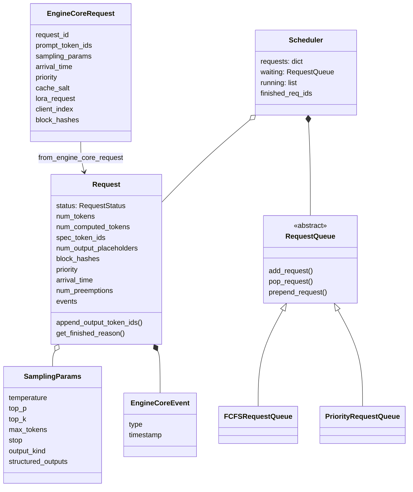

*图 3-2 请求侧对象：`EngineCoreRequest` 是一次性的消息，`Request` 是由调度器持有的长生命周期状态*

### 3.4 调度对象：队列、Token 预算与 SchedulerOutput

#### 3.4.1 waiting 与 running 队列

`Scheduler`（`vllm/v1/core/sched/scheduler.py:85`）维护的核心状态是：所有未结束请求的字典 `requests`；等待队列 `waiting`（以及一个优先处理的 `kv_holding_waiting`，存放已经持有 block 的等待请求）；运行列表 `running`；上一步以来结束的请求 ID 集合 `finished_req_ids`（`scheduler.py:222-248`）。

等待队列有两种实现（`request_queue.py:13-207`）：`FCFSRequestQueue` 是一个双端队列，按到达顺序出队；`PriorityRequestQueue` 是按（priority, arrival_time）排序的堆。策略由 `SchedulerConfig.policy` 选择，默认 FCFS。被抢占的请求用 `prepend_request` 放回等待队列：FCFS 下放到队首，优先下次调度；优先级队列下就是普通入堆。

两条上限约束着队列：`max_num_seqs`（运行中请求数上限 `max_num_running_reqs`）和 `max_num_scheduled_tokens`（每步 token 上限，默认等于 `max_num_batched_tokens`）（`scheduler.py:130-142`）。

#### 3.4.2 Token 预算：prefill 与 decode 的统一表示

vLLM V1 的架构文档明确说明：调度器基于 token 预算，**没有单独的 prefill 和 decode 阶段**，一个循环同时覆盖 chunked prefill、prefix caching 和投机解码（`docs/design/arch_overview.md:134-144`）。

每一步开始时，`token_budget = max_num_scheduled_tokens`。对每个被调度的请求，计算本步要算的 token 数：

```text
num_new_tokens = num_tokens_with_spec + num_output_placeholders − num_computed_tokens
num_new_tokens = min(num_new_tokens, long_prefill_token_threshold, token_budget, ...)
token_budget  −= num_new_tokens
```

一个刚到达、prompt 长 3000 的请求，`num_new_tokens` 起初为 3000（减去 prefix 命中），在预算为 2048 时被截成 2048，剩下的下一步再算——这就是 chunked prefill。一个正在 decode 的请求，`num_new_tokens` 为 1（或 1 加 draft 数）。同一步里可以同时有 decode 请求和 prefill 片段，它们拼成一个“混合 batch”交给 worker。

这种表示的好处是简单：调度器不需要区分阶段，也不需要为不同阶段维护不同队列。代价是“prefill 优先还是 decode 优先”这类策略只能通过调度顺序（先 running 后 waiting）和 `long_prefill_token_threshold` 等参数间接表达。

#### 3.4.3 SchedulerOutput：一步的执行计划

`SchedulerOutput`（`vllm/v1/core/sched/output.py:231`）是调度器每步发给 worker 的执行计划，它被设计成**增量**的，以减小每步的序列化开销：

| 字段 | 内容 |
|:---|:---|
| `scheduled_new_reqs: list[NewRequestData]` | 第一次被调度的请求，带完整数据：token ids、采样参数、block ids、已计算 token 数、LoRA（`output.py:41-83`） |
| `scheduled_cached_reqs: CachedRequestData` | 已被 worker 缓存的请求，只带增量：新分配的 block ids、新的 `num_computed_tokens`；被抢占后恢复的请求单独标记，其 block 列表整体替换（`output.py:138-152`） |
| `num_scheduled_tokens: dict` 与 `total_num_scheduled_tokens` | 每个请求本步的 token 数及总和 |
| `scheduled_spec_decode_tokens` | 每个请求本步要验证的 draft token |
| `scheduled_encoder_inputs` | 本步要运行的多模态 encoder 输入 |
| `finished_req_ids` | 上一步以来结束的请求，worker 据此删除本地状态 |
| `preempted_req_ids` | 被抢占的请求（Model Runner V2 使用） |
| `kv_connector_metadata` | 给 KV connector worker 侧的指令 |
| `kv_cache_block_copies` | 需要 worker 执行的 block 复制 |

worker 侧的 model runner 每步开始时用它更新本地的请求状态和 block table，然后准备输入（见 5.4.1 节）。

#### 3.4.4 抢占记录

抢占在调度器中留下三类痕迹：`Request.status` 变为 `PREEMPTED`、`num_preemptions` 加一、记录一个 PREEMPTED 事件（`scheduler.py:1798-1842`）；这些信息随后进入 `vllm:num_preemptions` 和 `vllm:request_num_preemptions` 指标。抢占在指标中长期非零，说明 KV 容量与负载不匹配：要么降低 `max_num_seqs`，要么增加 KV 容量，要么在平台层收紧长上下文的准入。

### 3.5 资源对象：KVCacheBlock、BlockPool 与 KV 规格

#### 3.5.1 KV 的规格：KVCacheSpec 与 KVCacheConfig

每一层的 KV 长什么样，由 `KVCacheSpec` 描述（`vllm/v1/kv_cache_interface.py:191`）：`block_size`，以及 `AttentionSpec` 的 `num_kv_heads`、`head_size`、`dtype` 等字段（`kv_cache_interface.py:541`）。它有多个子类，对应不同的层：全注意力 `FullAttentionSpec`、MLA `MLAAttentionSpec`、滑动窗口 `SlidingWindowSpec`、分块局部注意力、Mamba `MambaSpec`、交叉注意力等。每个子类有一个 `page_size_bytes`，即一个 block 在该层占多少字节。

启动时，worker 报告每层的 spec，EngineCore 把规格相同的层分到同一个 **KV cache group**（`KVCacheGroupSpec`），为每个 worker 生成一份 `KVCacheConfig`：block 总数 `num_blocks`、KV 张量列表 `kv_cache_tensors`、group 列表 `kv_cache_groups` 等（`kv_cache_interface.py:1474-1571`）。同一 group 中的所有层共享一张 block table——一个 block 编号在每一层都对应一段显存。

用 2.4.4 节的 Qwen3-8B 为例：36 层全是全注意力，只有一个 group；每层每 token 的 KV 是 2×8×128×2 = 4096 字节，16 个 token 的 block 在一层占 64 KiB，在 36 层合计 2.25 MiB。

#### 3.5.2 KVCacheBlock、引用计数与块哈希

`KVCacheBlock`（`kv_cache_utils.py:163-226`）是 block 的元数据对象，字段很少：`block_id`、`ref_cnt`、`_block_hash`（仅在被缓存时设置）、在空闲队列中的前后指针 `prev_free_block` / `next_free_block`、是否为 null block。`BlockPool` 在启动时为每个编号创建一个对象，它们与 BlockPool 同生命周期（`block_pool.py:176-178`）。

围绕它的规则可以总结为：

- **引用计数**：新分配时设为 1；prefix 命中时加 1（多个请求共享）；请求释放时减 1。`ref_cnt == 0` 的 block 在空闲队列中，`ref_cnt > 0` 的 block 不在（`block_pool.py:708-851`）。
- **哈希**：只有满 block 才设置哈希；哈希设置后在被驱逐之前不再改变（`kv_cache_utils.py:198-212`）。`ref_cnt == 0` 但仍有哈希的 block 可以被命中。
- **可写性**：一个 block 只有在不是 null block、`ref_cnt == 1` 且没有哈希时才可写（`block_pool.py:814-816`）。被多个请求共享的前缀 block 只读。

经典 PagedAttention 中，共享前缀的请求追加 token 时需要 copy-on-write。在 vLLM V1 中，因为只有满 block 被共享，而新 token 总是写入请求自己的新 block，普通模型不需要 CoW。这个提交只在一种窄场景下使用 CoW：混合模型开启细粒度 prefix 命中时，命中结束在一个缓存 block 中间，需要把这个 block 复制一份给请求私有（`single_type_kv_cache_manager.py:164-174`、`388-475`），复制指令通过 `SchedulerOutput.kv_cache_block_copies` 下发给 worker 执行。

#### 3.5.3 BlockPool 与空闲队列

`BlockPool`（`block_pool.py:137`）持有三样东西：全部 `KVCacheBlock` 对象；空闲队列 `FreeKVCacheBlockQueue`，一个带哨兵头尾的双向链表，支持 O(1) 的从中间移除（`kv_cache_utils.py:260-414`）；哈希到 block 的映射 `cached_block_hash_to_block`，同一哈希可能对应多个 block，因为为了让 block table 保持只追加，vLLM 不对重复的缓存 block 去重（`block_pool.py:36-56`）。

空闲队列的顺序就是驱逐顺序：队首最先被复用。2.5.3 节描述的“已缓存 block 追加到队尾、未缓存 block 放到队首、请求按逆序释放”这三条规则，共同实现了一种近似 LRU 的策略，并让同一请求的前缀比尾部保留得更久。

#### 3.5.4 Block table 的一致性

调度器侧，一个请求持有的 block 由 `KVCacheBlocks` 表示——按 group 组织的 block 列表，`get_block_ids()` 把它转换成 worker 能理解的编号列表（`kv_cache_manager.py:35-107`）。worker 侧，Model Runner V2 用 `BlockTables`（`vllm/v1/worker/gpu/block_table.py:17`）为每个请求的固定行保存 block 编号，并计算 slot mapping：

```text
slot = block_table[req, pos // block_size] × block_size + pos % block_size
```

attention kernel 按 slot 把新 token 的 K/V 写入对应位置（V1 runner 的实现见 `vllm/v1/worker/block_table.py:153-179`、`320-376`）。

一致性依赖两条规则。第一，**block table 只追加**：调度器为运行中的请求只追加新 block，不替换已有 block（被抢占后恢复的请求除外，它的 block 列表整体替换），worker 因此可以增量更新。第二，**释放与复用之间要隔一个安全点**：请求结束后，它的 ID 在下一步的 `finished_req_ids` 中通知 worker；在异步调度下，调度器还要等在途步骤结束才真正释放 block（2.5.3 节）。Model Runner V2 用 `StagedWriteTensor` 把 CPU 侧的修改先暂存，在每步开始时统一应用到 GPU（`gpu/model_runner.py:1838` 的 `apply_staged_writes`），避免 CPU 修改与 GPU 读取并发冲突 [[8]](#ref-8)。

#### 3.5.5 资源对象类图

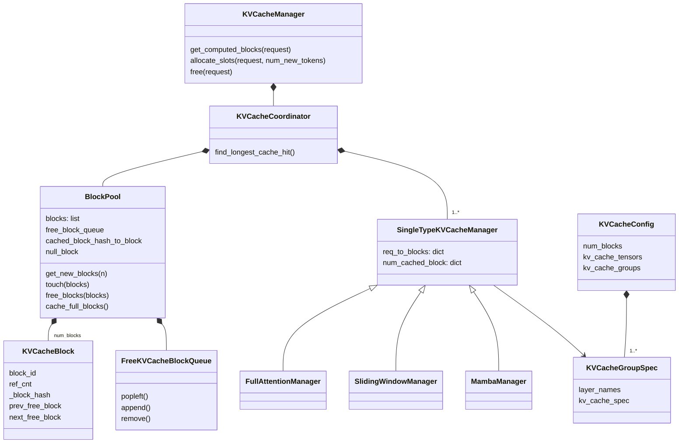

*图 3-3 资源对象：每个 KV cache group 一个单类型管理器，所有 group 共享一个 BlockPool*

### 3.6 输出对象：ModelRunnerOutput、EngineCoreOutput 与 RequestOutput

#### 3.6.1 采样结果与结束原因

worker 每步返回一个 `ModelRunnerOutput`（`vllm/v1/outputs.py:267`）：请求 ID 列表、每个请求本步采样出的 token（投机解码时可能多于一个）、logprobs、prompt logprobs、KV connector 的传输结果等。调度器在 `update_from_output` 中把这些 token 追加到 `Request`，逐个检查停止条件，然后为每个有新输出的请求构造一个 `EngineCoreOutput`（`vllm/v1/engine/__init__.py:250`）：新 token、新 logprobs、`finish_reason`、`stop_reason`、本步发生的引擎事件等。同一前端的输出打包成一个 `EngineCoreOutputs`，附带调度器统计和时间戳（`__init__.py:318-349`）。

`FinishReason` 是一个整数枚举：STOP、LENGTH、ABORT、ERROR、REPETITION（`__init__.py:69`），由 `RequestStatus` 映射而来（`request.py:433-441`）。对外的 OpenAI 协议再把它映射成 `stop`、`length` 等字符串。

#### 3.6.2 流式事件：增量、usage 与错误

前端的 `OutputProcessor` 为每个请求维护一个 `RequestState`（`vllm/v1/engine/output_processor.py:183`），持有增量 detokenizer、logprobs 处理器和统计。它把 `EngineCoreOutput` 转换成用户可见的 `RequestOutput`（`vllm/outputs.py:137`）：DELTA 模式下只包含本次新增的文本和 token，FINAL_ONLY 模式下直到结束才产出。

流式响应的一个常见错误是只返回文本，不返回 usage、finish reason、模型版本和错误状态。客户端可能收到部分 token 后连接断开，却无法知道是正常停止、服务失败还是用户取消。vLLM 的 OpenAI 兼容服务在每个 choice 结束时发送一次 `finish_reason`，在请求开启 `stream_options.include_usage` 时于最后发送一个带 usage 的 chunk，最后以 `data: [DONE]` 结束（`serving.py:803-921`）。平台应要求客户端开启 usage 回传，并以它作为计费依据。

#### 3.6.3 工具调用的独立 operation

工具调用的参数生成和执行需要独立的 operation id，避免重试造成重复副作用。vLLM 负责生成工具调用的文本并用解析器提取参数（`serving.py:312-313`），但它不执行工具，也不知道工具是否已经执行过。工具执行的幂等、权限和审计由上层负责；推理 Infra 提供的是执行前的拦截点和完整的结束原因。

### 3.7 状态机

#### 3.7.1 计算轴：RequestStatus

`RequestStatus`（`vllm/v1/request.py:399-415`）是一个整数枚举，排在 `PREEMPTED` 之后的都算结束状态（`is_finished(status) := status > PREEMPTED`，`request.py:420-422`）：

| 状态 | 含义 |
|:---|:---|
| `WAITING` | 在等待队列中 |
| `WAITING_FOR_STRUCTURED_OUTPUT_GRAMMAR` | 结构化输出的语法正在异步编译 |
| `WAITING_FOR_REMOTE_KVS` | 正在从远端（PD 分离的 prefill 端或外部 cache）加载 KV |
| `WAITING_FOR_STREAMING_REQ` | 可续写会话的一轮结束，等待下一段输入 |
| `RUNNING` | 在运行列表中 |
| `PREEMPTED` | 被抢占，已释放 KV，回到等待队列 |
| `FINISHED_STOPPED` | 遇到 EOS、stop token 或 stop string |
| `FINISHED_LENGTH_CAPPED` | 达到 `max_tokens` 或 `max_model_len` |
| `FINISHED_ABORTED` | 被中止（客户端断开、显式取消、关闭） |
| `FINISHED_ERROR` | 出错（如语法编译失败、语法拒绝了 token） |
| `FINISHED_REPETITION` | 重复检测触发 |

主要的状态迁移及其代码位置如下（均在 `vllm/v1/core/sched/scheduler.py`，除非另注）：

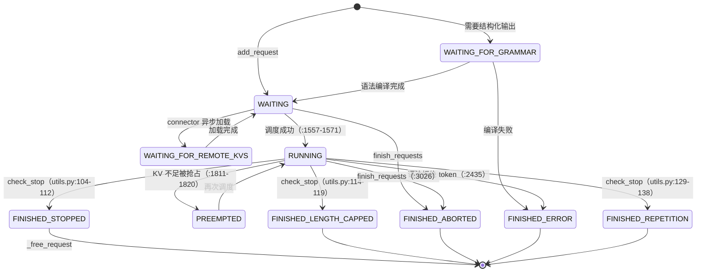

*图 3-4 计算轴状态机（图中 WAITING_FOR_GRAMMAR 即 WAITING_FOR_STRUCTURED_OUTPUT_GRAMMAR；省略了流式续写会话的状态）*

迁移是幂等的：`finish_requests` 只接受结束状态，对已经结束的请求再次中止不会改变它的结束原因；已结束请求在途步骤的输出会被 `update_from_output` 跳过（`scheduler.py:2320-2328`）。

#### 3.7.2 交付轴：连接与流

计算状态之外还有一条交付轴：连接中、STREAMING、已断开、已确认。STREAMING 与 RUNNING 可以同时成立，不能排成互斥的单线状态。交付轴的状态不在 vLLM 引擎中，而在 API server 和客户端之间：前端用 `with_cancellation` 包装请求处理，同时监听客户端断开（`vllm/entrypoints/serve/utils/api_utils.py:68-110`）；流式响应一旦开始返回，断开检测交由 Starlette 处理；断开最终表现为 `generate()` 协程被取消，触发 abort（见 5.7.1 节）。

#### 3.7.3 两轴叠加

| 计算轴 \ 交付轴 | 连接中（未开始流） | STREAMING | 已断开 |
|:---|:---|:---|:---|
| WAITING / PREEMPTED | 正常排队 | 已发出部分 token 后被抢占，客户端感知为停顿 | 应中止，释放排队名额 |
| RUNNING | prefill 中，TTFT 计时 | 正常生成 | 应中止，释放 KV |
| FINISHED_* | 不应出现 | 发送最后的 finish_reason 与 usage | 结果丢失，需按产品契约决定是否补偿 |

右列是资源泄漏的高发区：如果客户端断开没有被及时感知（例如中间代理缓冲了连接），引擎会继续为一个没人接收的请求生成 token。平台应监控“断开时仍在 RUNNING 的请求数”和“断开到 abort 的延迟”。

#### 3.7.4 KV block 的状态

block 没有显式的状态枚举，但可以从 `ref_cnt` 和哈希推出四种状态：

| 状态 | 条件 | 含义 |
|:---|:---|:---|
| 使用中、私有 | `ref_cnt == 1`，无哈希 | 正在被一个请求写入（最后一个未满 block） |
| 使用中、已缓存 | `ref_cnt ≥ 1`，有哈希 | 满 block，可能被多个请求共享 |
| 空闲、可命中 | `ref_cnt == 0`，有哈希 | 在空闲队列中，被复用之前仍可被 prefix 命中 |
| 空闲、干净 | `ref_cnt == 0`，无哈希 | 在空闲队列队首，优先被复用 |

### 3.8 领域模型小结

#### 3.8.1 对象之间的约束清单

1. 非 null block 的 `ref_cnt == 0` 当且仅当它在空闲队列中（`block_pool.py:732`、`806-808`、`836-848`）。
2. 只有满 block 被缓存；未经验证的 draft token 永远不会被缓存（`kv_cache_manager.py:616-624`）。
3. prefix 命中长度最多为 `num_tokens − 1`（`request.py:332`）。
4. 块哈希是链式的，某个 block 未命中意味着之后都不会命中（`single_type_kv_cache_manager.py:791-799`）。
5. 运行中请求数不超过 `max_num_seqs`（`scheduler.py:1632`）；每步 token 总数不超过预算。
6. 只有 RUNNING 的请求能被抢占；抢占释放全部 block 并把 `num_computed_tokens` 清零（`scheduler.py:1811-1821`）。
7. block 按逆序释放，尾部先被驱逐（`single_type_kv_cache_manager.py:598-599`）。
8. 调度器侧 block table 只追加（恢复的请求除外）（`block_pool.py:49-53`、`output.py:140-143`）。
9. `Request`、block 分配只由 EngineCore 中的调度器修改；worker 只按编号读写 KV 内容。

#### 3.8.2 指标口径与对象的绑定

指标必须绑定到对象与时间点上才有意义。vLLM 的口径如下（`vllm/v1/metrics/stats.py:478-638`）：

```text
arrival_time      : 前端渲染 chat template 之前，wall clock（renderers/base.py:1391）
queued_ts         : Scheduler.add_request，引擎单调时钟（scheduler.py:2962-2963）
scheduled_ts      : 首次从等待队列被调度，引擎单调时钟（被抢占后重新调度不计）
first_token_ts    : 首个输出所在 EngineCoreOutputs 的创建时间
last_token_ts     : 最后一个输出所在 EngineCoreOutputs 的创建时间

TTFT       = 前端收到首个输出的时间 − arrival_time
queue_time = scheduled_ts − queued_ts
prefill    = first_token_ts − scheduled_ts
decode     = last_token_ts − first_token_ts
TPOT       = decode / (生成 token 数 − 1)        # 仅当生成 token 数 > 1
ITL        = 相邻两次 EngineCoreOutputs 的时间差
E2E        = 前端收到最后输出的时间 − arrival_time
goodput    = 满足 SLO 的成功请求数 / 墙钟时间
```

几个容易出错的地方：TTFT 包含模板渲染和 tokenize，但不包含网关排队和网络发送；TTFT 与 E2E 混合了 wall clock 和前端接收时间，而 queue、prefill、decode、TPOT 只用引擎单调时钟；生成 token 数 ≤ 1 时 TPOT 不适用，不能除零或记为 0；一次输出可能包含多个 token（投机解码、`stream_interval > 1`），不能把事件数当 token 数。报告时还应按输入长度、输出长度、并发、模型版本、cache 命中和租户分桶，平均值无法表达长尾。

---

## 4 启动过程

### 4.1 启动入口与装配顺序

#### 4.1.1 CLI 入口

`vllm serve` 是一个控制台脚本，`pyproject.toml:43` 把 `vllm` 命令指向 `vllm.entrypoints.cli.main:main`。`main()` 注册各个子命令模块，为每个子命令设置 `dispatch_function`，然后调用 `cmd.validate(args)` 和 `args.dispatch_function(args)`（`vllm/entrypoints/cli/main.py:55-65`、`107-116`）。`serve` 子命令由 `ServeSubcommand` 实现（`vllm/entrypoints/cli/serve.py:48`），它的参数解析器把前端参数 `FrontendArgs` 和引擎参数 `AsyncEngineArgs` 叠加在一起（`vllm/entrypoints/common/cli_args.py:482-483`）。

`ServeSubcommand.cmd` 根据参数选择四种运行形态之一（`serve.py:54-156`）：

| 形态 | 触发条件 | 入口 | 用途 |
|:---|:---|:---|:---|
| 单 API server | 默认 | `uvloop.run(run_server(args))` | 最常见的单机部署 |
| 多 API server | `api_server_count > 1` | `run_multi_api_server` | 前端 CPU 成为瓶颈时横向扩展前端进程 |
| Headless | `--headless` 或 `api_server_count < 1` | `run_headless` | 多节点数据并行中只跑引擎、不跑 HTTP 的节点 |
| DP supervisor | 多端口数据并行 | `run_dp_supervisor` | 每个 DP rank 一个独立端口 |

内部负载均衡的数据并行模式下，`api_server_count` 默认等于 `data_parallel_size`（`serve.py:113-130`）。另外，旧路径 `vllm/entrypoints/openai/api_server.py` 在这个提交里只是一个已弃用的转发壳（`vllm/entrypoints/openai/api_server.py:24-30`），真正的实现在 `vllm/entrypoints/launchers/` 下。下文以单 API server 为主线。

#### 4.1.2 参数解析为统一配置

命令行参数先变成 `AsyncEngineArgs`：`EngineArgs.from_cli_args` 按 dataclass 字段从 argparse 的 Namespace 中逐个取值（`vllm/engine/arg_utils.py:1980-1989`），`AsyncEngineArgs` 只比 `EngineArgs` 多一个 `enable_log_requests` 字段（`arg_utils.py:3254-3258`）。然后 `create_engine_config`（`arg_utils.py:2255`）把扁平的参数组织成一棵配置树 `VllmConfig`：先让平台做预注册并构造 `DeviceConfig`，再构造 `ModelConfig`、设置 chunked prefill 与 prefix caching 的默认值，接着构造 `CacheConfig`、`ParallelConfig`、`SchedulerConfig` 等，最后组装成 `VllmConfig`（`arg_utils.py:2267-2928`）。

这一步并不只是“搬运参数”，很多默认值是在这里按环境推导出来的。例如在 OpenAI 兼容服务场景下，`max_num_seqs` 和 `max_num_batched_tokens` 的默认值随显卡显存变化：显存不小于 160 GB 时为 1024 和 16384，不小于 70 GB 且不是 A100 时为 1024 和 8192，其他情况为 256 和 2048（`arg_utils.py:2984-3017`）。executor 后端也在 `ParallelConfig.__post_init__` 中决定：总 world size 大于 1 时默认用多进程后端 `"mp"`（在 Ray placement group 中用 `"ray"`），等于 1 时用进程内后端 `"uni"`（`vllm/config/parallel.py:1146-1191`）。配置树的结构见 3.2.2 节。

**同一份配置在两个进程里各自演化。** API server 进程和 EngineCore 进程各持有一份 `VllmConfig`。有些值只有在引擎完成显存探测之后才能确定，例如 KV block 总数、自动缩小后的 `max_model_len`、实际的 block 大小。引擎在就绪时把这些值放进 `EngineCoreReadyResponse` 发回前端，前端在 `_apply_ready_response` 中写回自己的配置（`vllm/v1/engine/core_client.py:864-940`）。这也是为什么前端日志里的 KV 容量要等到引擎就绪之后才出现。

#### 4.1.3 进程拓扑的建立

单 API server 的启动在 `run_server` 中进行（`vllm/entrypoints/launchers/api_server/entry.py:164`）。它做的第一件事不是创建引擎，而是**绑定 HTTP 端口**：`setup_server` 在引擎启动之前就创建并 bind 了 socket，注释说明这是为了避免与 Ray 的端口竞争（`vllm/entrypoints/launchers/launcher.py:366-393`）。这一步只绑定、还没有开始监听，HTTP 请求要等引擎就绪、uvicorn 启动后才会被处理。

然后 `build_async_engine_client` 构造 `AsyncLLM`（`entry.py:34-112`）。`AsyncLLM.__init__` 依次创建 Renderer（tokenizer 与模板）、`InputProcessor`、`OutputProcessor`，最后调用 `EngineCoreClient.make_async_mp_client`（`vllm/v1/engine/async_llm.py:168-202`）——**这一步拉起 EngineCore 进程，并阻塞到它就绪**。数据并行时，客户端类型分别是 `DPAsyncMPClient`（外部负载均衡）和 `DPLBAsyncMPClient`（内部负载均衡），否则是 `AsyncMPClient`（`core_client.py:141-173`）。

`MPClient.__init__` 先 bind 两个 ZMQ socket：一个 input ROUTER（发请求给引擎）和一个 output PULL（收引擎的输出），然后进入 `launch_core_engines` 上下文（`core_client.py:686-724`）。`launch_core_engines` 再 bind 一个握手用的 ROUTER，由 `CoreEngineProcManager` 以 `EngineCoreProc.run_engine_core` 为入口启动名为 `EngineCore`（数据并行时为 `EngineCore_DP{i}`）的子进程（`vllm/v1/engine/utils.py:242-327`、`1205-1400`）。

EngineCore 进程中的 executor 再按后端决定是否创建 worker 进程。`MultiprocExecutor` 在 leader 上创建一个共享内存的广播消息队列 `rpc_broadcast_mq`，为每个 rank 启动一个名为 `VllmWorker-{rank}` 的守护进程，并通过 ready pipe 等待每个 worker 报告就绪（`vllm/v1/executor/multiproc_executor.py:132-290`、`813-922`）。`UniProcExecutor` 则直接在 EngineCore 进程内创建 worker，没有额外进程（`vllm/v1/executor/uniproc_executor.py:51-75`）。worker 进程的启动方式默认是 `fork`，但在 CUDA 已初始化、Ray actor 内、开启 NUMA 绑定或 WSL 环境下会被强制改成 `spawn`（`vllm/envs.py:69`、`vllm/utils/system_utils.py:123-165`）。

#### 4.1.4 启动时序图

下图是单 API server、TP=2、多进程后端时的启动顺序。TP=1 时，worker 的所有步骤都在 EngineCore 进程内执行。

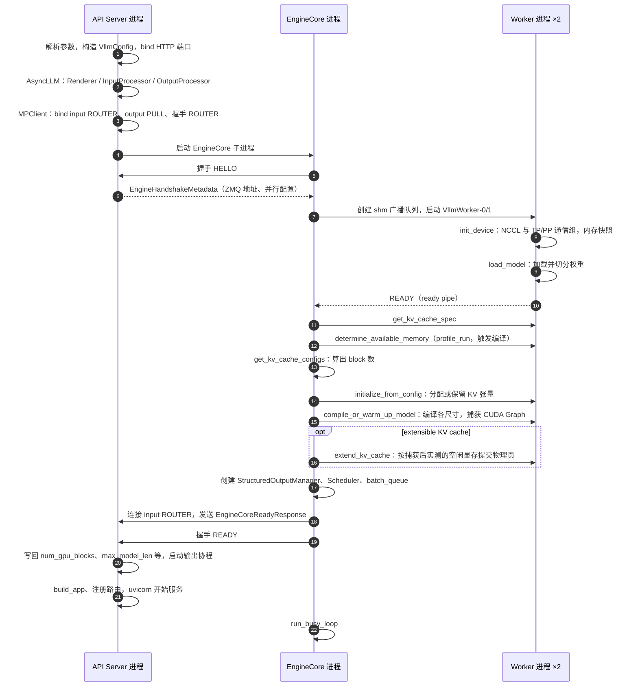

*图 4-1 启动时序：先 bind 端口和 ZMQ socket，再拉起引擎；显存探测与编译在引擎内完成，就绪信息最后回传前端*

### 4.2 制品校验与模型加载

#### 4.2.1 制品完整性由谁负责

一个可服务模型至少由权重、配置、tokenizer、chat template、特殊 token、量化配置、并行配置、采样默认值和停止条件组成（见 3.2.1 节）。vLLM 的模型加载器支持从 Hugging Face Hub 或本地目录加载，并可以用 `revision` 固定版本，但它**不负责制品的完整性门禁**：它不知道这份权重是否通过了评估、tokenizer 是否与训练时一致、chat template 是否被改过。这些检查应在 vLLM 启动之前由发布系统完成——校验 manifest 的 hash，确认 GPU 架构、驱动、CUDA 和 vLLM 版本落在兼容矩阵内，然后把经过校验的本地目录交给 vLLM。

把权重单独发布会产生很多线上差异：tokenizer 版本改变了输入长度，chat template 改变了系统提示，量化配置改变了显存与质量，停止 token 不一致导致输出过长，adapter 没有加载导致能力回退。生产发布应把 artifact manifest 当作运行时契约 [[9]](#ref-9)[[10]](#ref-10)。

#### 4.2.2 Worker 初始化：设备与通信组

每个 worker 进程的入口是 `WorkerProc.worker_main`（`multiproc_executor.py:961-1084`）。它构造 `WorkerProc`，后者依次调用 `init_worker`（按 `parallel_config.worker_cls` 实例化 worker 类，CUDA 平台是 `vllm.v1.worker.gpu_worker.Worker`，见 `vllm/platforms/cuda.py:335`）、`init_device` 和 `load_model`（`multiproc_executor.py:748-810`）。

`Worker.init_device` 的顺序有讲究（`vllm/v1/worker/gpu_worker.py:494-604`）：先绑定 CUDA 设备；**在拍内存快照之前**初始化分布式环境，建立 TP、PP 等通信组（`gpu_worker.py:549-555`、`1898-1940`），这样 NCCL 自己占用的显存会被计入“启动前已占用”而不是被误算成模型占用；然后设置随机种子、预先创建 cuBLAS handle；接着拍一个 `MemorySnapshot`，并按 `ceil(总显存 × gpu_memory_utilization)` 计算本 worker 被允许使用的显存 `requested_memory`（`gpu_worker.py:593-596`、`vllm/v1/worker/utils.py:741-750`）；最后创建 model runner，在 Model Runner V2 和 V1 之间选择（`gpu_worker.py:606-638`）。

#### 4.2.3 权重加载、分片与量化

`Worker.load_model` 在名为 `"weights"` 的内存池上下文中调用 model runner 的 `load_model`（`gpu_worker.py:646-670`）。单独的内存池是为 sleep mode 服务的：之后可以只释放或卸载权重所在的池，而不影响 KV（见 4.6.3 节）。model runner 通过 `get_model_loader(load_config)` 加载权重（V2 的入口在 `vllm/v1/worker/gpu/model_runner.py:389`），TP 时每个 rank 只加载自己那一份切片，量化模型在这一步加载量化权重与 scale。加载完成后，若配置了 LoRA 或投机解码的草稿模型，也在这里一并加载。

权重加载的耗时与制品存放位置强相关。从对象存储冷拉取几十 GB 权重可能需要数分钟，平台应把下载与加载分开计时：下载属于实例生命周期中的 DOWNLOADING，加载属于 LOADING（见 4.5.2 节）。

#### 4.2.4 Tokenizer 与 chat template

tokenizer 和 chat template 不在 worker 里，而在 **API server 进程**里：`AsyncLLM` 构造时通过 `renderer_from_config` 创建 Renderer，`InputProcessor` 和 `OutputProcessor` 都持有它（`async_llm.py:168-187`）。这个分工意味着 tokenization 和 detokenization 消耗的是前端进程的 CPU，不占用 EngineCore 的调度循环；前端 CPU 成为瓶颈时，可以用多 API server 形态横向扩展（4.1.1 节）。

它也意味着一个约束：**tokenizer 必须与 worker 加载的模型严格匹配**，而 vLLM 只按同一个模型路径分别加载两者。平台若把 tokenizer 与权重分开存放或分别升级，必须在 manifest 层面保证二者版本一致。

### 4.3 显存探测与 KV Cache 初始化

#### 4.3.1 profile run：测量峰值激活

模型加载完成后，EngineCore 在 `_initialize_kv_caches` 中决定 KV cache 的大小（`vllm/v1/engine/core.py:272-458`）。第一步是向所有 worker 询问每层需要什么样的 KV（`get_kv_cache_spec`，见 3.5 节），第二步是 `determine_available_memory`。

`Worker.determine_available_memory`（`gpu_worker.py:716-891`）在 `memory_profiling` 上下文中执行一次 `profile_run`：用最大的 batch（`max_num_batched_tokens` 个 token）跑一次前向，测量非 KV 部分的峰值显存。torch.compile 的编译也在这一次前向中触发（`gpu_worker.py:732-733` 的注释说明，即使指定了 KV 大小，仍需要这次 profile run 来编译模型）。启用 CUDA Graph 时，还要估算图捕获将占用的显存（`gpu_worker.py:783-795`）。然后：

```text
available_kv_cache_memory_bytes
    = requested_memory − non_kv_cache_memory − cudagraph_estimate
```

（`gpu_worker.py:824-828`）其中 `non_kv_cache_memory` 包括权重、profile 测得的激活峰值以及启动前已有的非 torch 占用。如果用户直接指定了 `kv_cache_memory_bytes`，就跳过测量直接使用这个值。

#### 4.3.2 计算可用 KV 预算与 block 数

EngineCore 拿到各 worker 报告的可用字节数后，调用 `get_kv_cache_configs`（`vllm/v1/core/kv_cache_planning.py:1476`）把它们换算成 block 数，并为每个 worker 生成 `KVCacheConfig`。多个 worker 的结果必须一致——调度器只有一份 block 账本，所以按最小值对齐。若显存装不下 `max_model_len` 长度的一条序列，这一步可能自动缩小 `max_model_len`，并通过 RPC 通知已经启动的 worker（`core.py:348-359`）。

然后生成调度器视角的 `KVCacheConfig`，把 block 总数写入 `cache_config.num_gpu_blocks`，并确定最终的 block 大小（`core.py:361-375`）。block 大小默认从 16 开始，但若用户没有显式指定，平台会按 attention backend 的偏好调整（`vllm/config/cache.py:185`、`473-484`）；混合了多种层的模型（例如滑动窗口与全注意力并存）会有多个 KV cache group，调度器的 block 大小取参与 prefix caching 的 group 中最小的那个（`core.py:366-376`）。

#### 4.3.3 分配 KV 张量：预先分配与延后提交

`initialize_from_config` 把各自的 `KVCacheConfig` 发给 worker（`core.py:403`；`gpu_worker.py:936-1014`）。worker 先初始化 KV connector（若配置了 PD 分离或 offload），再在名为 `"kv_cache"` 的内存池中调用 model runner 的 `initialize_kv_cache`：初始化 attention backend、确定 CUDA Graph 模式与要捕获的尺寸、分配 KV 张量，并把它们绑定到每一层的 attention 模块上。

在调研的提交中，这一步有两种行为：

- **预先分配**（传统路径）：按 4.3.2 节算出的 block 数一次性分配全部 KV 显存，之后才进入编译和图捕获。KV 的大小依赖 profile 阶段对 CUDA Graph 占用的**估算**。
- **延后提交**（extensible KV cache，CUDA/ROCm 上配合 Model Runner V2 时默认启用）：这一步只用设备虚拟内存**保留地址范围**，`num_blocks` 此时只是容量上限（`core.py:379-383`；`gpu/model_runner.py:648-661`）。等到编译和 CUDA Graph 捕获完成之后，每个 worker 实测剩余的空闲显存并折算成 block 数，EngineCore 用 `finalize_extensible_kv_cache` 取所有 rank 的最小值作为最终 block 数（`kv_cache_planning.py:1777-1804`），再通过 `extend_kv_cache` 让 worker 提交物理页（`core.py:407-413`）。V2 runner 在这种模式下不再估算图占用（`gpu/model_runner.py:1118-1119`）。

延后提交解决的是“估算不准”的问题：图捕获的实际占用和 profile 估算之间的偏差，过去只能靠保守的 `gpu_memory_utilization` 来吸收。它的代价是依赖驱动的虚拟内存管理能力，并且与部分 KV connector 不兼容（`vllm/config/vllm.py:3184` 起列出了不兼容的情况）。

#### 4.3.4 显存初始化流程图

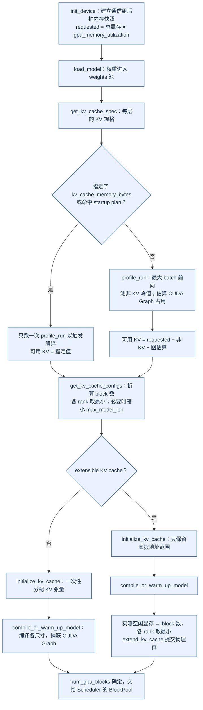

*图 4-2 显存初始化：KV 的大小是“允许用量减去其他一切”之后的余数，extensible 模式把这个减法推迟到图捕获之后*

### 4.4 编译与预热

#### 4.4.1 torch.compile 与 CUDA Graph

vLLM 用两层手段降低每一步的 CPU 开销。第一层是 **torch.compile**：在默认的优化级别（O2）下，编译模式为 `VLLM_COMPILE`，把模型前向编译成融合后的图（`vllm/config/vllm.py:452`、`1878-1882`）。第二层是 **CUDA Graph**：把一次前向中的大量 kernel launch 录制成图，之后整体重放，省掉逐个 launch 的开销。默认的 `cudagraph_mode` 是 `FULL_AND_PIECEWISE`：PIECEWISE 模式把 attention 之外的部分录制成分段的图，attention 以 eager 方式执行，以适应变长的注意力；FULL 模式把包括 attention 在内的整个前向录成一张图，适用于形状规整的纯 decode batch [[20]](#ref-20)[[21]](#ref-21)。`enforce_eager=True` 时两者都关闭（`vllm/config/vllm.py:1817-1819`）。

`Worker.compile_or_warm_up_model`（`gpu_worker.py:1054-1306`）在 KV 分配之后执行：对需要编译的各个尺寸做 dummy run，完成编译和预热；做 kernel warmup；非 eager 模式下调用 model runner 的 `capture_model` 捕获 CUDA Graph。各 worker 的编译耗时取最大值回传给 EngineCore（`vllm/v1/executor/abstract.py:133-149`）。

#### 4.4.2 静态图与动态 batch 的分桶

CUDA Graph 要求固定的形状和内存地址，而在线请求的 batch 大小每一步都在变。vLLM 的办法是**只为一组离散的 batch 大小捕获图，运行时把实际 batch 向上补齐（padding）到最近的已捕获尺寸**。默认的捕获尺寸是 `[1, 2, 4]`，加上 8 到 248 步长 8，再加 256 起步长 16，上限为 `min(max_num_seqs × decode_query_len × 2, 512)`（Blackwell 上为 1024），且不超过 `max_num_batched_tokens`（`vllm/config/vllm.py:2455-2662`）。超过最大捕获尺寸的 batch 直接以 eager 方式执行（`vllm/v1/cudagraph_dispatcher.py:233-322`）。

尺寸选得太少会产生 padding 浪费，太多会增加捕获时间和图占用的显存。捕获时每个尺寸先跑若干次 eager 预热，再录制一次（V1 runner 见 `gpu_model_runner.py:6515-6559`；V2 runner 通过显式的 `CUDAGraphManager` 完成捕获，见 `gpu/model_runner.py:1136` 与设计文档 [[8]](#ref-8)）。图缓存的有效性还依赖 dtype、模型版本、量化、adapter 数量和设备，发布新版本要原子切换。

#### 4.4.3 就绪判定与启动加速

编译和捕获完成后，EngineCore 创建 `StructuredOutputManager` 和调度器：async scheduling 开启时（默认在没有不兼容项时自动开启，`vllm/config/vllm.py:1723-1757`）使用 `AsyncScheduler`，否则使用 `Scheduler`；需要多个 batch 同时在途时（PP 或 async scheduling），创建 `batch_queue` 并把单步函数设为 `step_with_batch_queue`（`core.py:177-255`）。随后 EngineCore 启动 input 和 output 两个 I/O 线程，向前端发送 `EngineCoreReadyResponse`，再在握手 socket 上发送 READY（`core.py:1372-1402`、`1499-1521`、`2006-2113`）。前端收到后写回配置、启动输出协程，然后才构建 FastAPI 应用并开始服务（`entry.py:115-161`）。

**就绪的含义是“引擎已经可以调度”，不是“已经热身到稳态性能”。** 第一批真实请求仍可能触发未覆盖的编译路径、tokenizer 冷启动或 prefix cache 冷启动。平台应在实例对外接流量之前发送一组覆盖典型长度的预热请求，并把冷启动与热启动分别计时。

启动耗时主要来自权重加载、profile 和编译。vLLM 提供两种缓存来缩短重复启动：torch.compile 的编译缓存，以及这个提交中新增的 **startup plan**。后者在显式设置 `VLLM_ENABLE_STARTUP_PLAN=1` 时生效，把上次测得的 KV 字节数持久化到缓存目录，用 vLLM 版本、配置哈希、设备型号、总显存、torch/CUDA 版本和 rank 等计算指纹；下次启动若指纹一致且当前空闲显存不低于记录时的基线，就直接使用记录值，跳过显存 profiling（`vllm/v1/worker/startup_plan.py:41-191`、`vllm/envs.py:290`）。编译缓存与 startup plan 都必须与模型 hash、GPU 架构、驱动和引擎版本一起管理，换任何一项都应视为失效。

### 4.5 健康检查与流量接入

#### 4.5.1 liveness 与 readiness

vLLM 主 API server 提供 `/health`（以及转发到它的 `/ping`）、`/metrics`、`/version`、`/load` 等运维接口（`vllm/entrypoints/serve/instrumentator/__init__.py:7-22`）。`/health` 的语义很窄：它调用 `check_health()`，后者**只检查本地记录的引擎状态，不向引擎发 RPC**——引擎进程已死或输出协程已结束时抛 `EngineDeadError`，`/health` 返回 503，否则返回 200（`serve/instrumentator/health.py:22-33`；`async_llm.py:1143-1148`、`1397-1407`）。主 API server 没有独立的 `/ready` 路由（它只存在于多端口 DP supervisor 中，`vllm/entrypoints/launchers/dp_supervisor.py:232-233`）。

因此平台的探针要这样设计：

| 探针 | 建议做法 | 原因 |
|:---|:---|:---|
| startup | 轮询 `/health`，给足加载与编译时间 | 启动期间 HTTP 尚未开始服务；大模型启动可能需要十几分钟 |
| readiness | `/health` 返回 200 之后，再发一个最小推理请求或检查 `/metrics` | `/health` 只说明引擎没死，不说明能在 SLO 内响应 |
| liveness | `/health` | 引擎死亡后 `/health` 返回 503，前端 watchdog 也会在约 5 秒内让进程退出（见 4.6.2 节） |

#### 4.5.2 实例生命周期与流量接入

把 vLLM 的启动步骤映射到平台的实例生命周期，可以得到下表。只有 READY 才能接收流量；滚动发布时新旧实例同时存在，容量模型要预留双份权重和 KV 的峰值。

| 平台状态 | vLLM 中对应的阶段 | 可观测信号 |
|:---|:---|:---|
| DOWNLOADING | 启动 vLLM 之前，由平台拉取制品 | 下载耗时、hash 校验结果 |
| LOADING | `init_device`、`load_model` | worker 日志中的权重加载耗时 |
| WARMING | profile、KV 分配、编译、CUDA Graph 捕获、平台预热请求 | “init engine ... took” 日志（`core.py:433-457`） |
| READY | `/health` 为 200 且预热通过 | 路由器开始分配流量 |
| DRAINING | 收到 SIGTERM 后的 drain 期（见 4.6.1 节） | 运行中请求数下降 |
| UNHEALTHY | `EngineDeadError`，`/health` 为 503 | 前端进程即将退出 |
| TERMINATED | 进程退出 | 编排系统记录退出码 |

生产平台还应把 instance id、模型 hash、vLLM 版本与提交、GPU 型号与拓扑、启动耗时、最终 KV block 数和预热结果写入注册表。最终 block 数尤其重要：同一个模型在不同显卡、不同 vLLM 版本甚至不同启动之间，KV 容量都可能不同，而它直接决定了并发上限。

#### 4.5.3 启动失败的分类

启动失败可以按发生的位置分类：参数校验失败在 API 进程内立刻报错；引擎进程在初始化中途退出时，`wait_for_engine_startup` 通过监视进程 sentinel 发现，抛出 `RuntimeError("Engine core initialization failed...")`（`vllm/v1/engine/utils.py:1455-1481`）；引擎侧等待前端握手消息有 5 分钟超时（`HANDSHAKE_TIMEOUT_MINS`，`core.py:123`）；前端等待引擎 ready 载荷有 `VLLM_ENGINE_READY_TIMEOUT_S` 超时，默认 600 秒（`core_client.py:769-787`、`vllm/envs.py:845-846`）。常见的根因包括显存不足以容纳权重、KV 预算不足以容纳一条 `max_model_len` 长度的序列、NCCL 初始化失败和编译失败。平台应把这些失败区分记录，而不是统一视为“容器启动失败”后无限重启。

### 4.6 优雅停止、drain 与升级

#### 4.6.1 drain 顺序

API 进程收到 SIGINT 或 SIGTERM 后执行 `handle_shutdown`，在线程池中调用 `engine_client.shutdown(timeout=shutdown_timeout)`，再让 uvicorn 退出（`launcher.py:262-284`）。EngineCore 进程的信号处理器只把关闭状态置为 `REQUESTED`，并向输入队列放一个唤醒消息，让空闲的 busy loop 醒来（`core.py:1638-1663`）。之后 `_handle_shutdown` 根据超时决定行为（`core.py:1826-1872`）：

- `shutdown_timeout == 0`：**abort 模式**，把所有在途请求以 `FINISHED_ABORTED` 结束，并把结果发回前端；
- `shutdown_timeout > 0`：**drain 模式**，拒绝新请求（`core.py:1908`），等在途请求自然完成，直到调度器没有工作或超时。

需要注意，**`shutdown_timeout` 的默认值是 0**（`vllm/config/vllm.py:471`、`arg_utils.py:863`），也就是说默认的停止行为是中止所有在途请求。生产滚动发布若希望优雅退出，必须显式配置 drain 超时，并让它与编排系统的终止宽限期（如 Kubernetes 的 `terminationGracePeriodSeconds`）相匹配；同时路由器应先把实例摘除，再发送终止信号。

#### 4.6.2 引擎死亡与 KV 丢失

引擎死亡有三条传播路径（`core.py:1705-1711`、`1902-1903`、`1993-2004`；`core_client.py:597-600`、`834-862`）：EngineCore 内部异常时，它向前端推送一个 `ENGINE_CORE_DEAD` 标记，前端收到后抛 `EngineDeadError`；EngineCore 进程直接退出时，前端的监控线程发现进程消失并标记引擎死亡；worker 进程死亡时，executor 的监控线程触发失败回调，EngineCore 以 `RuntimeError("Executor failed.")` 结束。三条路径最终都让 `/health` 返回 503；API 进程的 watchdog 每 5 秒检查一次，发现引擎出错且不再运行时让 uvicorn 退出，除非设置了 `VLLM_KEEP_ALIVE_ON_ENGINE_DEATH`（`launcher.py:315-338`）。

也就是说，**vLLM 不在进程内重建引擎**，恢复依赖编排系统重启实例。KV cache 是可重建的状态，实例重启后不必恢复，但正在流式输出的请求会失败；平台可以返回可重试错误，或把请求迁移到其他实例重做 prefill，代价是更高的 TTFT 和额外的 GPU 负载（见 7.2.3 节）。

#### 4.6.3 sleep mode 与运行时升级

sleep mode 允许在不退出进程的情况下释放显存：`AsyncLLM.sleep` 经 EngineCore 和 executor 以 `collective_rpc("sleep")` 下发到 worker，按标签 `weights` 和 `kv_cache` 管理对应的内存池（`async_llm.py:1212-1227`；`core.py:1067`；`vllm/v1/executor/abstract.py:36`、`426-461`），`wake_up` 再把它们恢复。启动时把权重和 KV 放进不同的内存池（4.2.3、4.3.3 节），就是为了支持这种按标签释放。sleep 及 `/reset_prefix_cache` 等接口只在设置 `VLLM_SERVER_DEV_MODE` 时注册（`vllm/entrypoints/launchers/api_server/routers.py:102-109`），生产上应由平台代理并做权限控制。它的典型用途是 RL 训练中推理与训练轮流使用同一组 GPU，以及在同卡上切换模型。

运行时升级（换 vLLM 版本、换模型版本）则不应依赖 sleep mode，而应走第 6.4 节的逐级验证：新版本实例按本节的流程完整启动、预热、通过 readiness，再按灰度比例接入流量；旧实例先从路由摘除，再以 drain 模式停止。

---

## 5 推理执行过程

### 5.1 端到端总览

#### 5.1.1 一次请求的全过程

以一个流式的 `/v1/chat/completions` 请求为例（单 API server、TP=1、默认配置），处理可以分为八步：

1. **进入**：API server 收到请求，检查引擎存活与准入，渲染 chat template、tokenize，构造 `SamplingParams`，调用 `AsyncLLM.generate`。
2. **转换**：`InputProcessor` 校验参数、补全默认值，生成 `EngineCoreRequest`；`OutputProcessor` 为它建立 `RequestState`；客户端通过 ZMQ 把请求发给引擎。
3. **入队**：EngineCore 的输入线程反序列化请求、计算块哈希、构造 `Request`；busy loop 把它交给调度器，进入等待队列，记录 QUEUED 事件。
4. **调度**：下一步 `schedule()` 中，调度器先为运行中的请求分配 token，再从等待队列取出这个请求，查询 prefix 命中，申请 KV block，把它移入运行列表，记录 SCHEDULED 事件，生成 `SchedulerOutput`。
5. **执行**：worker 更新本地状态，准备输入张量和 attention 元数据，选择 CUDA Graph，执行前向，计算 logits，采样。第一步对这个请求而言是 prefill（若 prompt 超过预算则只算一部分）。
6. **回写**：调度器在 `update_from_output` 中追加新 token、检查停止条件，生成 `EngineCoreOutputs`，由输出线程发回前端。
7. **交付**：前端的输出协程增量 detokenize、检查 stop string、构造 `RequestOutput` 放入请求的队列；`generate` 把它交给 SSE 生成器发给客户端。之后每一步重复 4–7，对这个请求而言都是 decode。
8. **结束**：遇到停止条件时，调度器把请求标记为结束、释放 KV block；前端发送最后的 `finish_reason`、usage 和 `[DONE]`。

#### 5.1.2 端到端时序图

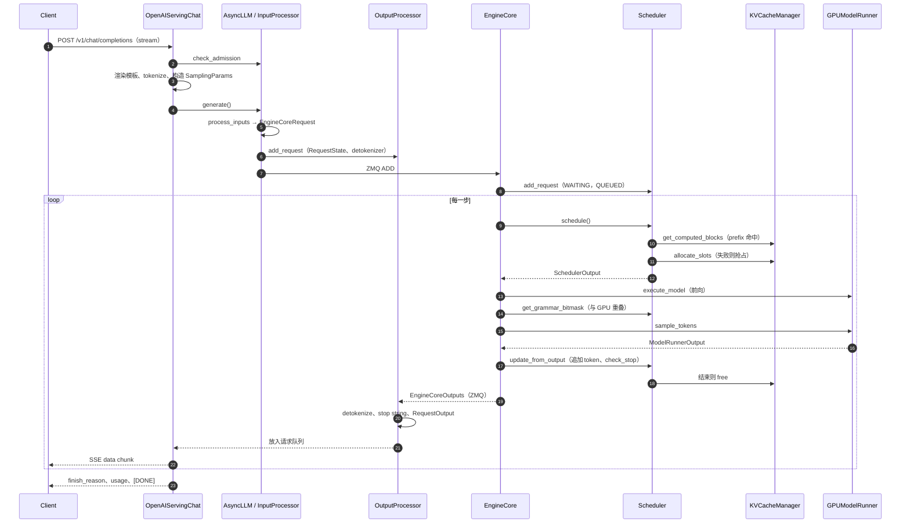

*图 5-1 一次流式请求的端到端时序：循环体是一次 engine step，对这个请求而言第一次是 prefill，之后是 decode*

#### 5.1.3 事件时间点与指标口径

各时间点在代码中的位置如下，计算公式见 3.8.2 节：

| 时间点 | 记录位置 | 时钟 |
|:---|:---|:---|
| `arrival_time` | `render_chat_async` 开头（`vllm/renderers/base.py:1391`） | 前端 wall clock |
| QUEUED | `Scheduler.add_request`（`scheduler.py:2962-2963`） | 引擎单调时钟 |
| SCHEDULED | 首次从等待队列被调度（`scheduler.py:1552-1555`） | 引擎单调时钟 |
| 首 token / 末 token | `EngineCoreOutputs` 创建时（`vllm/v1/engine/__init__.py:346-349`） | 引擎单调时钟 |
| 前端接收 | 输出协程收到一批输出时（`async_llm.py:897-899`） | 前端 wall clock |

由此可以把用户看到的 TTFT 拆开：

```text
客户端 TTFT ≈ 网关与网络（引擎外）
            + 模板渲染与 tokenize（前端）
            + IPC 与排队（queue_time）
            + prefill（可能跨多个 step）
            + IPC 回传与 detokenize（前端）
            + SSE 发送（引擎外）
```

vLLM 的 `vllm:time_to_first_token_seconds` 覆盖了中间四段。只看客户端总延迟无法定位瓶颈；只看引擎指标又会漏掉网关和网络。

### 5.2 请求进入：从网关到引擎

#### 5.2.1 准入与路由

`/v1/chat/completions` 的路由被 `with_cancellation` 和 `load_aware_call` 包装（`vllm/entrypoints/openai/chat_completion/api_router.py:43-59`）：前者监听客户端断开，后者统计负载。处理函数首先执行 `_preflight`：引擎已死则立即报错，否则调用 `AsyncLLM.check_admission`（`vllm/entrypoints/generate/base/serving.py:169-181`）。

`check_admission` 是这个提交新增的前端准入控制（`async_llm.py:326-397`；`vllm/v1/engine/admission_control.py:13-52`）。多个 API server 进程通过一块共享内存交换未完成请求数和待 prefill 的 token 数，每个进程只写自己的缓存行、读取时求和，无锁实现。若配置了 `max_num_queued_reqs` 或 `max_num_queued_tokens` 且超过上限，就抛出 `QueueOverflowError` 等错误，返回 HTTP 503，并计入 `vllm:admission_rejections`。这个检查发生在流式响应开始之前，所以过载时仍能返回正确的状态码。它的 token 计数是保守的：没有扣除已完成的 prefill 片段和 prefix 命中（`async_llm.py:338-342`）。

这只是单个实例的过载保护。租户配额、预算、数据驻留和跨实例路由仍需在网关完成（第 6 节）。

#### 5.2.2 tokenize、模板渲染与参数构造

`OnlineRenderer.render_chat` 校验工具选择和 chat template，然后调用 Renderer 的 `render_chat_async`（`vllm/renderers/online_renderer.py:234-327`）。后者在开头记录 `arrival_time`，渲染消息、tokenize，生成 `EngineInput`（`vllm/renderers/base.py:1382-1422`）。Hugging Face 的 chat template 渲染被放到线程池中执行并设有超时（`vllm/renderers/hf.py:1289-1296`），避免一个复杂模板阻塞事件循环。

随后构造采样参数：`max_tokens` 由 `get_max_tokens` 根据 `max_model_len`、请求中的 `max_completion_tokens` 或 `max_tokens` 和 prompt 长度计算（`serving.py:349-358`）；`to_sampling_params` 把流式请求的 `output_kind` 设为 DELTA，非流式设为 FINAL_ONLY，并附加结构化输出约束（`chat_completion/protocol.py:812-816`）。

tokenize 输出的 token 数必须与计费、准入、KV 估算和 trace 一致。若网关为了计费或准入自己再做一次 tokenize，而模板或 tokenizer 版本与 vLLM 不一致，就会出现“网关认为能放下、引擎拒绝”或账单与 usage 不符的问题。建议以 vLLM 返回的 usage 为准，或者让网关调用 vLLM 的 tokenize 接口。

#### 5.2.3 InputProcessor：校验与转换

`AsyncLLM.add_request` 调用 `InputProcessor.process_inputs`（`input_processor.py:382-571`），它做四件事：

- **校验**：采样参数自检、特性兼容性检查、LoRA 与 DP rank 校验（`input_processor.py:138-261`、`399-409`）；prompt 长度与 `max_model_len` 比较——生成请求的 prompt 恰好等于 `max_model_len` 也会被拒绝，因为没有空间生成任何 token（`input_processor.py:573-618`）。
- **补全默认值**：复制采样参数；`max_tokens` 未设置时取 `max_model_len − prompt_len`；应用模型的 `generation_config` 与 tokenizer 默认值（`input_processor.py:458-510`）。
- **组装多模态特征**（`input_processor.py:519-552`）。
- **生成 `EngineCoreRequest`**，并改写 `request_id`（3.3.1 节）。

然后，对 `n == 1` 的请求：先在 `OutputProcessor` 中注册 `RequestState`（在任何 await 之前，保证输出到来时状态已经存在），再通过 `add_request_async` 发 ZMQ 的 ADD 消息（`async_llm.py:589-598`；`core_client.py:1351-1354`）。`n > 1` 时，前端把请求展开为 n 个子请求，各自 `n=1`，设置了 seed 时每个子请求的 seed 依次加 1，结果由 `ParentRequest` 合并（`parallel_sampling.py:52-128`）。这意味着引擎看到的是 n 个独立请求，它们的 prompt 部分通过 prefix cache 共享 KV。

#### 5.2.4 引擎侧入队

EngineCore 的输入线程反序列化 `EngineCoreRequest`，在 `preprocess_add_request` 中构造 `Request` 并计算 prompt 的块哈希，若需要结构化输出则把语法编译提交到线程池异步进行（`core.py:1224-1264`、`2066-2173`）。这些工作放在输入线程而不是 busy loop 中，同样是为了不占用调度循环的时间。busy loop 取到 ADD 消息后调用 `Scheduler.add_request`：把请求放入等待队列、登记到 `requests` 字典、记录 QUEUED 事件（`scheduler.py:2932-2963`）。

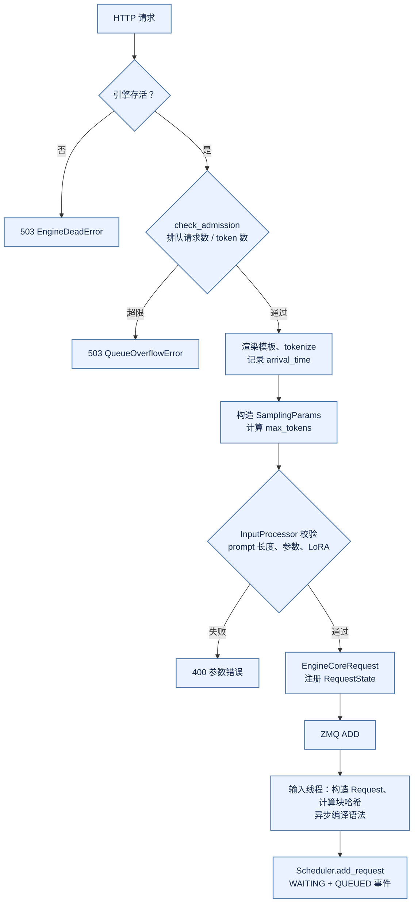

*图 5-2 请求进入：三道检查依次发生在引擎存活、实例准入和参数校验*

### 5.3 调度一步：Scheduler 如何选请求

#### 5.3.1 step 循环与异步调度

EngineCore 的单步函数有两种（`core.py:709-863`）。同步的 `step()` 顺序执行：调度、下发前向、在 GPU 执行期间计算语法 bitmask、等待前向完成并采样、处理中止队列、回写结果。这里已经有一处重叠：bitmask 在 CPU 上计算的同时 GPU 在跑前向，所以执行被拆成 `execute_model` 和 `sample_tokens` 两次调用。

默认开启的 async scheduling 使用 `step_with_batch_queue()` 和 `AsyncScheduler`。它维护一个长度为 `max_concurrent_batches` 的 batch 队列（V2 runner 下为 PP 大小加 1，即单卡时为 2，`vllm/config/vllm.py:605-615`）：队列未满时，调度新的一步并以非阻塞方式下发，立即返回；队列满时，才阻塞等待最早那一步的结果并回写。这样 GPU 执行第 N 步时，CPU 已经在调度第 N+1 步。

问题在于：调度第 N+1 步时，第 N 步还没有采样出 token，调度器怎么知道每个请求的长度？`AsyncScheduler` 的做法是**占位**：调度完一个 decode 请求后，把 `num_output_placeholders` 加上本步将要采样的 token 数，draft token 用 −1 占位（`vllm/v1/core/sched/async_scheduler.py:18-48`）。下一步计算 `num_new_tokens` 时把占位计入，等真实 token 回来后再替换。占位的代价是：一个请求在第 N 步已经停止，调度器在第 N+1 步仍可能为它分配了 token，这部分计算会被丢弃；结构化输出请求需要上一步的 token 来推进语法状态，因此采样可能被推迟（`core.py:786-801`、`844-861`）。

```mermaid
gantt
    title 异步调度的重叠（示意）
    dateFormat X
    axisFormat %s
    section CPU（EngineCore）
    调度 N        :a1, 0, 2
    调度 N+1      :a2, 2, 4
    回写 N        :a3, 6, 7
    调度 N+2      :a4, 7, 9
    section GPU（Worker）
    执行 N        :b1, 2, 6
    执行 N+1      :b2, 6, 10
```

*图 5-3 异步调度：CPU 在 GPU 执行第 N 步时调度第 N+1 步，回写与下一次调度也与 GPU 执行重叠（时间比例仅为示意）*

#### 5.3.2 先 running 后 waiting：一次 schedule() 的算法

`Scheduler.schedule()`（`scheduler.py:698-1783`）的主体可以概括为以下步骤：

1. **初始化预算**：`token_budget = max_num_scheduled_tokens`；记录本步的调度时间戳；计算本步是否推迟 prefill，以及有效的 `long_prefill_token_threshold`（`scheduler.py:711-790`）。
2. **调度运行中的请求**（`scheduler.py:794-1035`）。按 `running` 列表顺序，对每个请求：
   - 计算 `num_new_tokens = num_tokens_with_spec + num_output_placeholders − num_computed_tokens`；
   - 依次用 `long_prefill_token_threshold`、剩余预算、`max_model_len` 截断；
   - 若有多模态输入，尝试调度 encoder，可能进一步缩小 `num_new_tokens`；
   - 结果为 0 则跳过（这会有意打破严格的 FCFS）；
   - 循环调用 `allocate_slots` 申请 block，失败则抢占一个请求后重试（5.3.4 节）；
   - 成功后记录 block 与 token 数，扣减预算；若有 draft token，截取放入 `scheduled_spec_decode_tokens`。
3. **统计已使用的 LoRA**（`scheduler.py:1039-1046`）。
4. **调度等待中的请求**——仅当本步没有发生抢占（`scheduler.py:1049-1615`）。每次取队首请求：
   - 运行请求数达到上限则停止；
   - 语法未编译完、远端 KV 未到、LoRA 数超过 `max_loras` 等情况下跳过；
   - 对首次调度的请求，查询本地 prefix 命中，若配置了 KV connector 再查询外部命中，二者之和作为 `num_computed_tokens` 的起点；
   - 计算 `num_new_tokens = num_tokens − num_computed_tokens`，按阈值和预算截断；**关闭 chunked prefill 且放不下时直接停止**；
   - 调用 `allocate_slots`，失败则停止（**等待队列不会触发抢占**）；
   - 若需要异步加载远端 KV，置为 `WAITING_FOR_REMOTE_KVS` 后跳过；否则移入 `running`，置为 RUNNING，记录 SCHEDULED 事件，扣减预算。
5. **构造 `SchedulerOutput`**：为新请求生成 `NewRequestData`，为其他请求生成 `CachedRequestData`，附加结束请求、block 复制和 connector 元数据（`scheduler.py:1641-1774`）。
6. **乐观推进**：`_update_after_schedule` 把每个请求的 `num_computed_tokens` 加上本步调度的 token 数（`scheduler.py:1844-1876`）。

“先 running 后 waiting”是一个关键的策略选择：**已经在运行的请求优先获得预算**，新请求只能用剩下的。这保护了正在 decode 的请求的 TPOT，代价是在高负载下新请求的 TTFT 变长。“本步有抢占就不接纳新请求”则避免了刚抢占一个请求又接纳另一个、导致抖动。

#### 5.3.3 prefix 命中与 block 分配

对首次调度的请求，`get_computed_blocks` 用请求的块哈希链在 `BlockPool` 中查找最长命中（`kv_cache_manager.py:266-328`）。命中长度最多为 `num_tokens − 1`。命中的 block 不会立即被 touch，而是作为 `new_computed_blocks` 传给 `allocate_slots`。

`allocate_slots`（`kv_cache_manager.py:379-626`）按以下顺序工作：移除滑动窗口等已不需要的 block（换成 null block）；计算需要新分配的 block 数；**检查空闲 block 是否足够**（等待中的请求还要额外满足 watermark，`kv_cache_manager.py:517-524`），不够则返回 `None`；touch 命中的 block（引用计数加一，从空闲队列移除）；从空闲队列分配新 block；最后把截至 `min(已计算 + 新 token, num_tokens)` 的满 block 写入哈希表——注意上限是 `num_tokens` 而不是 `num_tokens_with_spec`，所以 draft token 不会被缓存。

这里有一个值得注意的时序：**block 在被调度的那一步就被登记为已缓存**，而不是在 KV 真正写入之后——登记时，这些 token 的 KV 只是“已被调度、即将写入”。在异步加载远端 KV 的场景下，调度器会显式推迟登记（`delay_cache_blocks`，`scheduler.py:1441`），说明“登记即可命中”的前提是 KV 在本步内一定会被写入。

#### 5.3.4 KV 不足时的抢占

运行中的请求 `allocate_slots` 失败时，调度器选择一个受害者（`scheduler.py:912-993`）：

- **FCFS** 策略：`running` 列表的最后一个，即最近被接纳的请求；
- **priority** 策略：（priority, arrival_time）最大者，即优先级最低、到达最晚的请求；若它本步已经被调度，退还它占用的预算。

然后调用 `_preempt_request`（`scheduler.py:1798-1842`）：释放它的全部 KV block 和 encoder cache；状态置为 PREEMPTED；**`num_computed_tokens` 清零**，清空 draft token；增加抢占计数，记录 PREEMPTED 事件；用 `prepend_request` 放回等待队列。之后重试分配。如果被抢占的恰好是当前请求自己，说明没有更低优先级的请求可抢，停止本步的 running 调度。

抢占只有“重算”一种方式，调度器中没有把 KV 换出到 CPU 的路径（架构文档 `arch_overview.md:156-171` 也这样描述）。但重算未必从零开始：被释放的满 block 带着哈希进入空闲队列尾部，如果在该请求重新被调度之前没有被复用，它重新调度时的 prefix 查询可以把它们找回来；配置了 KV offload connector 时，还可以从 CPU 层找回。所以抢占的实际代价取决于 KV 压力有多大——压力越大，被释放的 block 越可能被别人复用，重算越多。

抢占对用户的影响是：流式输出会出现停顿，TPOT 的尾部变长。抢占计数长期非零是容量不足的信号（3.4.4 节）。

#### 5.3.5 公平、优先级与防饥饿

vLLM 调度器提供的公平机制是有限的：FCFS 或 priority 两种排队顺序；`max_num_seqs` 限制并发；`long_prefill_token_threshold` 限制单个请求一步能占用的 prefill token，防止一个超长 prompt 独占一步；priority 策略下高优先级请求可以通过抢占挤掉低优先级请求。它**没有**租户配额、加权公平、deadline 或老化机制——这些是平台控制面的职责（6.1 节）。

只按 FIFO 会让长 prompt 阻塞短请求；只按短请求优先会让长任务饥饿；只追求最大 batch 会违反 TTFT。Sarathi-Serve 的研究说明，限制每步的 prefill token、让长输入分块与 decode 交替执行，能在吞吐与延迟之间取得更好的折中 [[5]](#ref-5)。在 vLLM 中，对应的调节旋钮是 `max_num_batched_tokens`（越小，每步越短、TPOT 越稳，但 prefill 要更多步才能完成）和 `long_prefill_token_threshold`。chunk 大小需要在模型、硬件和负载上调优：太小增加 kernel launch 和调度开销，太大仍会阻塞 decode。

#### 5.3.6 调度时序图

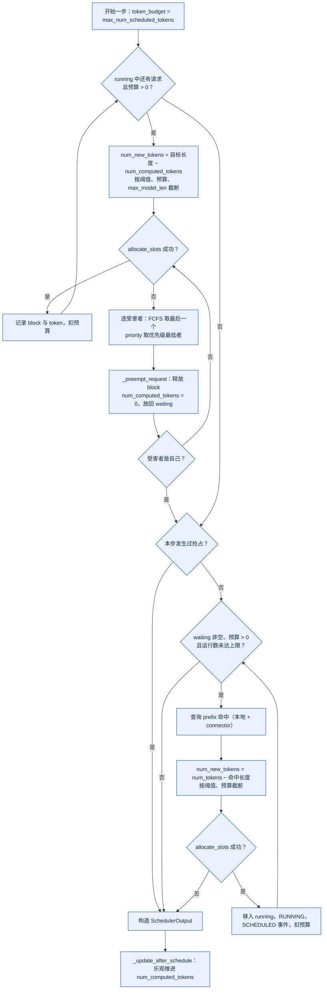

*图 5-4 一次 schedule() 的决策流程：运行中的请求优先，KV 不足时抢占；等待队列从不触发抢占*

### 5.4 Prefill：计算输入并建立 KV

#### 5.4.1 更新状态与准备输入

worker 收到 `SchedulerOutput` 后，Model Runner V2 的 `execute_model` 首先更新本地状态（`vllm/v1/worker/gpu/model_runner.py:1815-1849`）：删除 `finished_req_ids` 中的请求，释放被抢占请求的状态行，为新请求分配固定的状态行并写入 prompt，按 `CachedRequestData` 更新已有请求的 block 与进度，最后把暂存的 block table 修改一次性应用到 GPU（`block_tables.apply_staged_writes()`）。V2 中每个请求在其生命周期内占用 worker 侧 `RequestState`（`vllm/v1/worker/gpu/states.py:9`）的一个固定行，抢占被当作完成处理，恢复时重新加入 [[8]](#ref-8)。若本步没有任何 token 要算，直接返回空输出。

然后准备本步的输入（`model_runner.py:1851-1916`）：

1. **收集 batch 状态**，确定本步的请求数和 token 数；
2. **选择执行方式**：`dispatch_cg_and_sync_dp` 根据 token 数、是否为纯 decode、LoRA 数等选择 CUDA Graph 模式（FULL、PIECEWISE 或 eager）和补齐后的尺寸，数据并行时还要在各 DP rank 之间同步（5.5.4 节）；
3. **`prepare_inputs`**：构造本步的 `InputBatch`——`input_ids`、`positions`（= 已计算 token 数 + 本步内偏移）、`query_start_loc`（每个请求本步 token 的起止位置）、`seq_lens`、`logits_indices`（需要计算 logits 的位置，即每个请求本步的最后一个 token）。V2 用 Triton kernel 在 GPU 上直接从持久状态中 gather 这些张量，并用 UVA 让 kernel 直接读取 CPU 上的大张量（如 prefill token），避免在 Python 中逐个拼接；
4. **`prepare_attn`**：生成 block table 视图和 slot mapping，再构建 attention 元数据。

一个混合 batch 中，prefill 片段和 decode 请求的 token 被拼接成一维序列，`query_start_loc` 标出每个请求的边界，attention kernel 据此对每个请求分别计算。

#### 5.4.2 前向计算与 KV 写入

前向在 `set_forward_context` 中执行，上下文携带 attention 元数据、slot mapping 和 CUDA Graph 模式（`model_runner.py:2107-2154`）：FULL 模式直接重放整图；PIECEWISE 模式调用分段图，attention 以 eager 方式执行；其余情况直接调用模型。每个 attention 层在计算注意力之前，按 slot mapping 把本步新 token 的 K、V 写入 KV 张量对应的 block 位置；然后对每个请求，用它的 block table 读取全部历史 K、V 计算注意力。配置了 KV connector 时，前向前后分别有 `pre_forward` 和 `finish_forward` 钩子，用于加载或保存 KV（5.8.2 节）。

前向结束后，最后一个 PP stage 得到 hidden states；中间 stage 返回中间张量，由 PP 通信发给下一个 stage（`model_runner.py:2158-2202`）。hidden states 被暂存在 `ExecuteModelState` 中，等待随后的 `sample_tokens` 调用。

对一个 prefill 片段而言，只有它最后一个 token 的 logits 有用。如果这个片段不是 prompt 的最后一段（chunked prefill 的中间片段），这个位置的采样结果会被丢弃。

#### 5.4.3 chunked prefill 与长上下文

prompt 长于本步剩余预算时，调度器只为它分配一部分 token，剩下的留到后续步骤——chunked prefill 默认开启（`vllm/config/scheduler.py:134`）。每一步中这个请求的 `num_computed_tokens` 前进一段，KV 逐段写入；直到最后一段算完，才产生第一个输出 token。所以长 prompt 的 TTFT 约等于“片段数 × 每步耗时”加上排队时间，而每一步耗时又取决于同一步中有多少其他请求。

长上下文同时增加 prefill 计算、KV 容量、排队时间和输出阶段的显存占用。平台应在入口限制最大输入、最大输出、总 token、并发和租户预算，并根据请求类型选择同步、异步或低优先级队列；截断策略要保留消息边界、系统指令和工具 schema，不能简单从字符串尾部截断。指标要区分 queue、prefill、decode、cache 等待和网络等待，才能知道用户是在等计算还是在等资源。

#### 5.4.4 多模态输入的编码

图像、音频和视频先由 encoder 转换为 embedding，输入 token 数和显存不一定与文本长度线性对应。vLLM 的调度器为 encoder 单独维护计算预算和 `EncoderCacheManager`，按多模态内容的哈希缓存 encoder 输出（`vllm/v1/core/encoder_cache_manager.py:19`）；调度一个包含多模态输入的 prefill 片段时，要先确保对应的 encoder 输出已经算好或本步能算（`scheduler.py:869-882`）。worker 在前向前把 encoder 输出与文本 embedding 拼成 `inputs_embeds`（`model_runner.py:2037-2066`）。多模态内容的标识也进入块哈希（3.5.2 节），所以相同图片的请求可以共享 prefix cache。调度器应区分纯文本与多模态负载，避免大视频请求阻塞短文本请求。

### 5.5 Decode：逐 token 生成

#### 5.5.1 一次 decode iteration

prefill 完成后，请求的 `num_computed_tokens` 等于 `num_tokens − 1`（最后一个 token 尚未作为输入算过），之后每一步调度器为它分配 1 个 token（不使用投机解码时）。worker 侧的路径与 prefill 相同，只是这个请求本步只有一个 query token：把上一步采样出的 token 作为输入，算出它的 K、V 写入 block，读取全部历史 K、V 计算注意力，得到下一个 token 的 logits。当最后一个 block 写满时，调度器在下一步的 `allocate_slots` 中为它追加一个新 block，并把写满的 block 登记到哈希表。

decode 每步只处理很少的 token，却要读取全部权重和该请求的全部历史 KV，因此受内存带宽限制。提高 decode 效率的主要办法是把尽可能多的 decode 请求放进同一步——这正是连续批处理的意义——同时用 CUDA Graph 消除 kernel launch 开销。

#### 5.5.2 采样与结构化输出 mask

`sample_tokens` 在最后一个 PP stage 上执行（`model_runner.py:2206-2404`）。它先计算 logits：`sample()` 取出 `logits_indices` 位置的 hidden states，经 LM head 得到 logits（`model_runner.py:1692-1716`）。TP 较大时可以按 batch 维度把采样分摊到各 TP rank 上。

若有结构化输出请求，EngineCore 在 GPU 执行前向期间已经算好了语法 bitmask（`core.py:721`；`scheduler.py:2228-2250`），此时把它原地应用到 logits 上，把语法不允许的 token 的 logit 置为负无穷（`model_runner.py:1718-1727`）。语法后端默认自动选择 xgrammar、guidance 等，语法在请求入队时就已异步编译（5.2.4 节）。

然后由采样器处理（V2：`vllm/v1/worker/gpu/sample/sampler.py:128-330`）：按需把 logits 转成 fp32；依次应用 logits processors（如 logit bias、min tokens、惩罚、bad words）、thinking budget、temperature、min_p；最后做 top-k/top-p 与随机采样（V2 使用 Gumbel 采样 kernel），或在 temperature 为 0 时取 argmax。需要 logprobs 时同时计算 top-k logprobs。采样结果以 `SamplerOutput` 返回。

采样完成后，V2 立即启动一个异步的 GPU→CPU 拷贝，把采样结果拷回主机，与后续的 drafter 提议重叠执行（`model_runner.py:2303-2312`）。然后更新 worker 侧的请求状态（`postprocess_sampled`），返回结果。

#### 5.5.3 投机解码：draft 与 verify

投机解码用一个廉价的 drafter 提出若干候选 token，再由目标模型一次前向验证多个位置 [[22]](#ref-22)[[23]](#ref-23)。在 vLLM 中，它对调度器和执行器都有影响：

- **调度**：draft token 存放在 `Request.spec_token_ids`，`num_tokens_with_spec` 把它们计入目标长度，因此计入 token 预算；`allocate_slots` 为它们预留 KV 槽位，但不会把它们缓存（`scheduler.py:838-842`、`1009-1024`）。
- **验证**：worker 用 `RejectionSampler` 替代普通采样器，比较目标模型与 drafter 的分布，决定接受前几个 draft，并额外采样一个“奖励” token（`model_runner.py:1735-1745`；V1 实现见 `vllm/v1/sample/rejection_sampler.py:50-181`）。
- **回写**：调度器计算被拒绝的 draft 数，把 `num_computed_tokens` 回滚相应数量，并记录接受统计（`scheduler.py:2342-2378`）。
- **提议**：验证之后，drafter 为下一步提出新的 draft（`model_runner.py:2351-2398`），方法包括 ngram、draft model、EAGLE/EAGLE3、各类 MTP 等（`vllm/config/speculative.py:48-94`）。

投机解码改变了“每步每请求追加一个 token”的假设：batch 形状更不规则，KV 需要为候选预留空间并在拒绝后回滚。若接受率低，额外的 draft 计算和 KV 管理会抵消收益；低接受率、短输出和高并发场景可能不适合。平台应分别报告目标模型调用、draft 调用、接受率（`vllm:spec_decode_num_accepted_tokens_total` 等指标）和每个成功输出 token 的总 GPU 时间，不能把使用 draft 后的 tokens/s 直接与未使用时比较。

#### 5.5.4 CUDA Graph 的复用

每一步的执行方式由 `dispatch_cg_and_sync_dp` 决定（`model_runner.py:1883-1899`）：纯 decode 的 batch（每个请求 query 长度相同）可以使用 FULL 图，整步只有一次图重放；包含 prefill 片段的混合 batch 使用 PIECEWISE 图，attention 以 eager 方式执行；token 数超过最大捕获尺寸时走 eager。实际 token 数被向上补齐到最近的捕获尺寸，补齐的部分是浪费的计算。

图的复用要求输入张量的地址固定。所以 V2 在 FULL 模式下不把输入作为参数传给图，而是先把输入拷贝到图捕获时使用的固定缓冲区，再重放（`model_runner.py:2108-2116` 的注释）。动态请求在图中执行时，取消和异常需要安全退出点，不能直接释放仍被图引用的 buffer。

### 5.6 输出与交付

#### 5.6.1 回写、停止判断与 detokenize

EngineCore 拿到 `ModelRunnerOutput` 后，先处理中止队列（让在途期间到达的 abort 尽早生效），再调用 `Scheduler.update_from_output`（`core.py:732-735`；`scheduler.py:2252-2680`）。对每个被调度的请求：追加新 token，每追加一个就调用 `check_stop`，按顺序检查 EOS、`stop_token_ids`、长度上限（`max_tokens` 或 `max_model_len`）、`min_tokens`、重复检测（`vllm/v1/core/sched/utils.py:98-140`），命中则截掉之后的 token；生成 `EngineCoreOutput`；结束的请求调用 `_free_request` 释放资源（5.7 节）。输出按前端分组成 `EngineCoreOutputs`，由输出线程发回。

前端的输出协程从 ZMQ 收到输出后，分块交给 `OutputProcessor.process_outputs`（`async_llm.py:870-960`；`output_processor.py:728-894`）。对每个请求：更新统计；增量 detokenize，同时检查 **stop string**——stop string 是文本层面的条件，只有在前端 detokenize 之后才能判断（`vllm/v1/engine/detokenizer.py:96-176`）；命中时截断文本，把结束原因设为 STOP，并把请求 ID 放入“待中止”列表，由输出协程发 abort 给引擎（`async_llm.py:933-936`）。所以 stop string 命中时，引擎可能已经多生成了一两步 token，这部分会被丢弃；当 stop string 不应出现在输出中时，detokenizer 还要暂扣一段字符，以免把 stop string 的前半部分发给客户端。

#### 5.6.2 流式输出、背压与慢客户端

`make_request_output` 按 `output_kind` 构造 `RequestOutput`：DELTA 只包含新增的文本和 token；`stream_interval > 1` 时攒够若干 token 再输出（`output_processor.py:354-525`）。结果放入请求的 `RequestOutputCollector`；如果生产者比消费者快，DELTA 输出会在队列中合并（`output_processor.py:61-83`）。`generate()` 从队列取出结果交给 SSE 生成器，后者把每个结果包装成 `data: {json}\n\n` 发送（`serving.py:472-507`）。

这个设计意味着**慢客户端不会反压引擎**：引擎照常生成，结果在前端队列中合并累积，KV 一直被占用到请求结束。流式服务的网络连接、发送 buffer 和代理超时都会占用资源；平台需要写超时、发送 buffer 上限、心跳和明确的断开语义，并把连接数、活跃流、平均发送速度和断开原因纳入指标。背压可以发生在多个层面：网关限制并发和请求体，vLLM 的准入控制限制排队请求与 token，调度器受 KV block 约束，结果流受发送缓冲约束。资源不足要返回可重试或不可重试的明确错误码。

#### 5.6.3 usage、finish reason 与计费

每个 choice 的 `finish_reason` 只发送一次，由内部结束原因映射而来（`serving.py:803-821`）。usage 有两种发送方式：开启 `include_usage` 时，在最后发送一个 `choices` 为空、带 usage 的 chunk；开启 `include_continuous_usage` 时，每个 chunk 都带累计 usage（`serving.py:845-921`）。流以 `data: [DONE]` 结束。usage 中的 prompt token 数来自 vLLM 自己的 tokenize，`RequestOutput.num_cached_tokens` 还给出了 prefix 命中的 token 数，可以用于区分缓存读取的计费。

### 5.7 请求的结束与资源回收

#### 5.7.1 四种结束：完成、截断、取消、超时

| 结束方式 | 触发位置 | 结束状态 | 说明 |
|:---|:---|:---|:---|
| 正常完成 | 调度器 `check_stop`（EOS、stop token）或前端 stop string | `FINISHED_STOPPED` | stop string 由前端发 abort 让引擎停止 |
| 长度截断 | 调度器 `check_stop` | `FINISHED_LENGTH_CAPPED` | 达到 `max_tokens` 或 `max_model_len` |
| 客户端取消 | 前端感知断开，`generate()` 被取消 | `FINISHED_ABORTED` | 见下文 |
| 超时 / 关闭 | 由上层取消，或引擎以 abort 模式关闭 | `FINISHED_ABORTED` | vLLM 不内置单请求的生成超时 |

客户端取消的路径（`async_llm.py:821-826`、`962-970`；`output_processor.py:599-661`；`core.py:606-611`、`2165-2173`）：客户端断开使 `generate()` 协程被取消；它调用 `AsyncLLM.abort`；`OutputProcessor` 移除请求状态（`n > 1` 时连同子请求），放入一个 ABORT 结束输出；客户端向引擎发 ABORT 消息；引擎输入线程把它同时放入中止队列和输入队列，busy loop 在回写之前优先处理；`Scheduler.finish_requests(ids, FINISHED_ABORTED)` 把请求从运行或等待队列中移除并调用 `_free_request`。取消是幂等的：已结束的请求不会被重新标记；在途步骤中属于该请求的输出被调度器和前端各自忽略。

vLLM 不为单个请求设置生成超时。超时要区分排队超时、prefill 超时、decode 超时和下游发送超时，需要由网关或调用方实现：在 deadline 到达时主动断开或调用取消接口，才能让引擎释放资源。

#### 5.7.2 反向释放顺序

`_free_request`（`scheduler.py:3032-3094`）按以下顺序释放：通知 KV connector 与 encoder connector 请求结束（connector 可能要求推迟释放 block，直到 KV 发送完成）；释放 encoder cache；把请求 ID 加入 `finished_req_ids`（随下一步 `SchedulerOutput` 通知 worker）；释放 KV block——若 GPU 上可能仍有在途步骤写这些 block，则放入延迟释放队列；最后从 `requests` 字典中删除。KV 管理器的 `free` 按逆序把 block 交回 `BlockPool`（`kv_cache_manager.py:628-637`）。worker 在下一步开始时，根据 `finished_req_ids` 删除本地状态、释放状态行（5.4.1 节）。

这个顺序的原则是：**先阻止新的引用，再等在途使用结束，最后回收**。立即释放仍可能被 GPU 写入的 block，会让下一个分配到它的请求读到被污染的 KV；永远不释放则造成泄漏。

#### 5.7.3 前缀保留还是回收

请求结束后，它的满 block 并没有被清除，而是带着哈希进入空闲队列尾部，可以被后续请求命中（2.5.3 节）。这对多轮对话特别有用：下一轮请求的 prompt 包含上一轮的全部历史，命中后只需计算新增部分。但这也意味着请求结束后，它的 KV 内容仍留在显存中，直到被复用覆盖。对于有删除要求的敏感数据，可以使用独立的 `cache_salt` 让其他租户无法命中，或通过 `reset_prefix_cache` 清空全部缓存（默认只在没有运行中请求时才会成功；指定 `reset_running_requests` 时会先抢占所有运行中的请求，`scheduler.py:3184-3215`），但 vLLM 没有“只清除某个请求的 KV”的接口。

#### 5.7.4 结束路径图

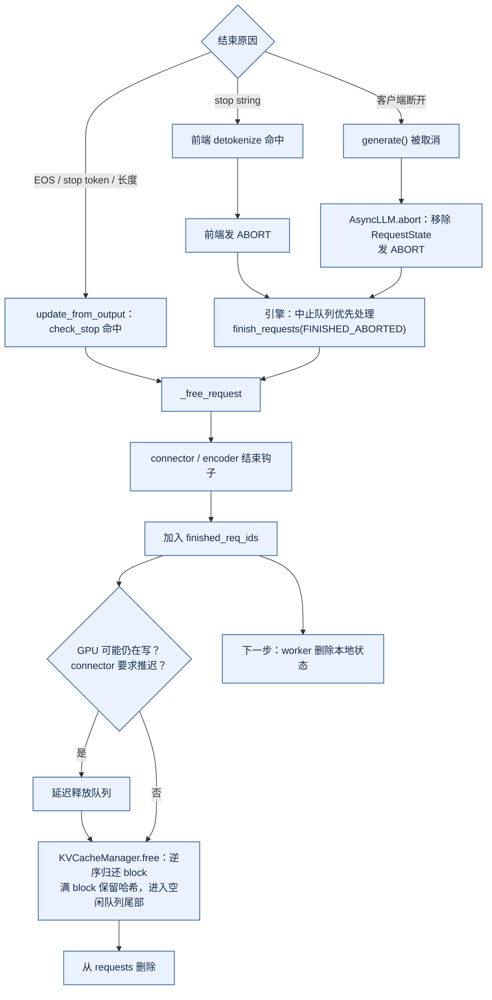

*图 5-5 结束路径：三种来源汇合到 `_free_request`，block 回到空闲队列后仍可被命中*

### 5.8 并行与解耦下的执行

#### 5.8.1 TP 下一个 step 的通信点

TP 时，EngineCore 通过共享内存消息队列把同一份 `SchedulerOutput` 广播给所有 TP rank（`multiproc_executor.py:447-556`），每个 rank 用相同的输入执行前向，各自持有权重和 KV 的一个切片（KV 按 KV head 切分）。一步之中的通信点是：每个 Transformer 层的 attention 输出投影和 MLP 下投影之后各一次 all-reduce；采样前的 logits 可能需要聚合（大词表时可以按 batch 维度分摊采样，`model_runner.py:1698-1716`）。只有最后一个 PP stage 的 TP rank 0 把 `ModelRunnerOutput` 回传给 EngineCore（`multiproc_executor.py:649-663`）。

PP 时，前一个 stage 把中间张量发给下一个 stage；非最后 stage 在 `sample_tokens` 中接收最后 stage 广播的采样结果，更新本地状态（`model_runner.py:2225-2247`）。batch queue 让多个 batch 同时在流水线中，减少 pipeline bubble。

#### 5.8.2 PD 解耦：KV 传输与两段调度

PD 分离时，一个请求先在 prefill 实例上完成 prefill，KV 通过 connector 传到 decode 实例，再在 decode 实例上逐 token 生成。调度器与 connector 的交互如下（`scheduler.py:1129-1213`、`1434-1544`、`3350-3586`）：

1. decode 实例的调度器处理一个等待中的请求时，先查本地 prefix 命中，再调用 connector 的 `get_num_new_matched_tokens`，得知有多少 token 可以从远端加载、是否异步加载；
2. 为全部 token 分配 block（异步加载时推迟登记缓存），调用 `update_state_after_alloc` 告诉 connector 这些 block 的位置；
3. 异步加载时，请求进入 `WAITING_FOR_REMOTE_KVS`，本步不占用 token；
4. 每一步，调度器通过 `build_connector_meta` 生成给 worker 侧 connector 的指令，随 `SchedulerOutput` 下发；worker 在前向前后启动加载、逐层等待或保存 KV；
5. worker 回报传输完成后，请求回到等待队列，此时 `num_computed_tokens` 已包含远端 KV，只需计算剩下的 token；
6. prefill 实例上，请求结束时 connector 的 `request_finished` 可以要求推迟释放 block，直到 KV 发送完成，并返回传输参数，由代理转交给 decode 实例。

以 NIXL connector 为例，默认是 pull 模式：decode 端用 NIXL READ 从 prefill 端读取 KV；push 模式则由 prefill 端写入 decode 端预分配的 block（`docs/design/nixl_kv_push_connector.md:1-24`）。prefill 端以短租约（30 秒）持有待传输的 block，decode 端用心跳续约（`docs/design/nixl_kv_cache_lease.md:1-20`）。

分离后的调度本质上是一个有状态的流量分配问题：前端需要同时选择 prefill 池和 decode 池；prefill 完成但 decode 没有空间时，不能无限堆积已产生的 KV。KV 传输协议应携带模型版本、请求 id、token 长度、KV dtype、布局和校验，支持超时、重试和部分失败。路由决策要写入 trace，便于分析某类请求的 TTFT 变差是因为 prefill、传输、decode 还是排队。

#### 5.8.3 量化对执行路径的影响

INT8、INT4、FP8 等量化减少权重显存和带宽，但会改变 kernel、校准、激活离群值、精度和输出质量。vLLM 支持多种量化方法（AWQ、GPTQ、FP8、compressed-tensors、ModelOpt、MXFP4 等，`vllm/model_executor/layers/quantization/__init__.py:15-49`），每种方法通过 `QuantizationConfig.get_quant_method` 替换线性层的实现。权重量化主要减少权重占用和读取带宽，KV 量化（`cache_dtype`，如 FP8）主要减少长上下文的显存，二者误差来源不同。反量化同样消耗计算与访存：只有节省的权重读取超过反量化和额外 kernel 的代价时才会变快，小 batch 或不支持的形状可能退化。

量化验收至少包括权重大小、显存峰值、冷启动、TTFT、TPOT、吞吐、长上下文、结构化输出、代码任务和安全拒答，不能只看平均困惑度——小概率的 token 错误就可能导致工具 schema 或 JSON 失败。量化制品要和校准数据版本、算法、dtype、硬件架构和引擎版本绑定，回滚时同时回滚这些对象 [[9]](#ref-9)。

---

## 6 调度隔离与平台治理

第 5 节描述的是单个 vLLM 实例内部如何把一条请求算完。生产平台面对的是很多租户、很多模型版本和很多实例，本节把视角从 EngineCore 上移到控制面：资源怎么记账，请求怎么路由，版本怎么发布，压力大时怎么降级。这些能力大多不在 vLLM 进程内，而是在网关、路由器和发布系统里；vLLM 提供的是可以被它们利用的接口和信号。

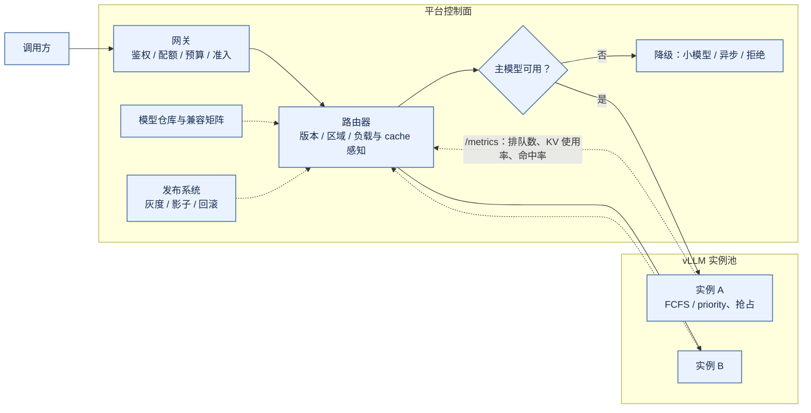

*图 6-1 控制面与引擎的分工：租户、预算、路由、降级与发布在控制面完成，vLLM 只做单实例内的排队与抢占，并通过指标向路由器反馈*

### 6.1 租户资源账本与公平调度

#### 6.1.1 账本要覆盖哪些资源

租户配额应覆盖请求数、输入 token、输出 token、KV block、并发、优先级、工具调用、cache 占用和预算。只限制 QPS 无法防止一个租户发送超长上下文；只限制 token 无法防止大量短请求占用连接和 CPU。计量系统要记录 accepted、rejected、queued、generated、cancelled 和 failed 的资源，并写明哪些计费。

共享权重通常可以只读共享，adapter、KV、prefix cache、日志和工具状态则需要隔离。租户 id 不能只作为日志字段，还要进入 cache key、路由、凭证和访问控制。vLLM 的 prefix cache 在块哈希的首块中支持 `cache_salt`（见 2.5.2 节），平台应由服务端在认证之后按租户域生成或约束这个 salt；客户端自己填写的 salt 不是访问授权。

#### 6.1.2 引擎内优先级与平台级公平

vLLM 的 Scheduler 只提供两种排队策略：FCFS 和 priority（见 3.4.1 节）。priority 策略下，数值越小越优先，KV 不足时先抢占优先级最低的运行请求。这是单实例内的局部机制，不能替代平台级的公平：它不知道租户配额，也不知道一个租户的请求分布在多少个实例上。

交互式问答、批量离线、评估和内部开发对延迟的要求不同。可以按 tenant、product、request class 和 priority 建立队列，但高优先级不等于无限资源。每个队列需要并发上限、token budget、最大等待时间和借用规则；否则一个高优先级租户的突发会耗尽所有 KV block。按请求数公平会偏向长请求，按 token 公平可能让大量短请求被饿死；可以使用虚拟时间、加权 token 份额或 deadline-aware 调度，并把实际资源消费写入成本归因。Borg 的优先级、配额和故障域经验说明，公平调度是控制面的职责，不应由调用方通过反复重试来争抢 [[24]](#ref-24)。

#### 6.1.3 配额借用与防饥饿

固定配额容易产生碎片：某租户空闲时，其他租户却在排队。可以允许短期借用空闲 token budget，但设置最大借用、归还优先级和高峰抢回。借用的资源要可追溯。高优先级请求可以抢占排队中的低优先级请求，但不应粗暴杀死已经输出大量 token 的 decode，除非产品明确允许——vLLM 的抢占是“释放 KV、回到等待队列、之后重算”（见 5.3.4 节），对已经输出很多 token 的请求代价很高。

只有优先级而没有最低服务份额时，高优流量持续到达会让低优队列永久等待。可为各等级保留可验证的份额，并按等待时间老化；超出容量时返回排队超时，不承诺所有等级都准时完成。平台还要避免通过拆分请求绕过配额：按 request id、parent task、tenant 和 operation 统计，同一逻辑任务的多步调用共享预算。

#### 6.1.4 在线与离线共存

离线推理可以使用更大的 batch、更长的队列等待和更高的 GPU 利用率，但不能与在线服务共享一个无界队列。离线任务应有 job id、输入与输出 manifest、断点游标、重试和幂等写入；输出写入对象存储时按 shard 提交完成标记。在线与离线若必须共享实例，可以用 priority 策略把离线请求放在低优先级，并限制它们的 token budget，同时在离线任务启动前确认不会消耗在线错误预算。

### 6.2 路由、降级与数据驻留

#### 6.2.1 路由依据

路由依据可以包括模型能力、版本、区域、租户、数据驻留、价格、当前队列、KV 水位、GPU 类型和 deadline。round-robin 不能处理一个副本正在加载模型、另一个副本 cache 已满的情况。vLLM 通过 Prometheus 指标暴露运行与等待中的请求数、KV cache 使用率和 prefix cache 命中情况（见 2.7.3 节），路由器可以据此做负载感知与 cache 感知的路由。模型并行副本的故障域也不同：同一 TP group 中一张卡故障，整个 group 都不可用。发布和容量控制应以逻辑副本为单位。

#### 6.2.2 降级的顺序

流量突发时可以采用限流、排队、降低最大输出、切换小模型或转异步。降级顺序应由产品定义，安全策略和工具权限不能因为资源不足而被跳过。fallback 模型不能只满足接口兼容，还要经过任务质量、安全和成本评估；路由器根据请求所需的能力（JSON、视觉输入、工具 schema、最大上下文）选择兼容的 fallback。所有路由结果、降级原因和策略版本写入 trace，响应中可以返回 model revision 或 degraded 标记。Kubernetes 的 GPU 调度只解决资源发现和分配，真正的业务降级仍需平台控制面 [[25]](#ref-25)。

#### 6.2.3 数据驻留与跨区域

多区域服务需要在路由前判断数据驻留、租户合规、模型制品可用、网络延迟和容量。请求 manifest 应携带 region、data class 和允许的 fallback 区域，路由决策写入审计。跨区域故障时，纯文本、无敏感数据且没有副作用的请求可以重试到备用区域；包含敏感上下文或外部工具状态的请求可能只能失败或转人工。区域间共享 prefix cache 和 KV 默认不允许，除非具备加密、权限、版本和删除保证。

#### 6.2.4 安全降级

资源压力不应导致安全校验被跳过。限流、降级模型、截断和异步化都必须经过相同的输入安全、输出安全和工具权限策略；安全服务本身不可用时，平台应选择拒绝、有限能力或转人工，而不是默默放行。模型生成的 JSON 只是未可信输入：即便使用了 vLLM 的结构化输出（见 5.5.2 节），语法合法也不代表字段取值合法，仍要做 schema、权限、参数范围和目标资源校验。

### 6.3 LoRA、Adapter 与多模型共存

#### 6.3.1 vLLM 中的 LoRA serving

一个基础模型可以服务多个 LoRA adapter。vLLM 在请求上携带 `LoRARequest`，Scheduler 在一个 step 内限制同时活跃的 adapter 数（`max_loras`），模型执行层把不同 adapter 的请求放进同一个 batch，用专门的 kernel 处理（见 5.3.2 节）。共享 base weight 能降低显存，但 adapter cache 有容量、淘汰、租户隔离和版本兼容问题；adapter 身份也进入了块哈希，不同 adapter 之间不会误用 prefix cache。

adapter manifest 应包含 base model hash、adapter hash、训练数据等级、rank、dtype、目标层和安全标签。base model 升级后旧 adapter 不一定兼容，不能只按 adapter 名称加载。adapter 的下载权限与缓存权限也要分开。

#### 6.3.2 多进程与多模型

同一节点部署多个小模型可以提高利用率，但会引入权重竞争、KV 竞争、编译缓存竞争和尾延迟相互影响。vLLM 一个服务进程组只服务一个基础模型，多个模型通常意味着多组进程，每组都按 `gpu_memory_utilization` 在启动时占住自己的显存份额（见 4.3 节）；份额之和超过显卡容量时，后启动的实例会失败。模型切换包括加载权重、编译、分配 KV pool、预热和释放旧模型，每个模型要有最小驻留时间和最大空闲时间，避免流量抖动导致反复加载。vLLM 的 sleep mode 可以在不退出进程的情况下释放权重或 KV 显存（见 4.6 节），是这类场景的一个工具，但它不改变“同一时刻显存只能分给一个活跃模型”的事实。

### 6.4 灰度、影子与回滚

#### 6.4.1 灰度与影子

模型灰度可以按租户、地区、请求类型、流量比例或实验分组进行。影子流量执行新模型但不触发工具副作用，用于比较延迟、长度、格式和质量；正式灰度才承担真实响应。灰度指标包括 HTTP 错误、TTFT、TPOT、p99、OOM、抢占次数、cache 命中、停止原因、结构化输出成功率、工具调用成功率、拒答率和单位成本，并按模型、硬件、长度桶、租户、输入语言和 adapter 分层；整体平均往往看不出只在特定长度上的退化。

#### 6.4.2 运行时升级的逐级验证

vLLM 迭代很快，同一个大版本内调度器默认值、执行器实现（例如 Model Runner V2 是否启用，见 2.2.4 节）和 CUDA Graph 模式都可能改变。runtime 升级可分为离线兼容、单实例 canary、影子流量、小比例正式流量和全量。离线阶段验证加载、输出、量化、最大长度和错误语义；单实例阶段验证冷启动、显存、cache、batch 和 drain；影子阶段比较真实长度与路由；正式灰度阶段观察 SLO、质量、成本和租户差异。每一步都有停止条件和回滚版本。

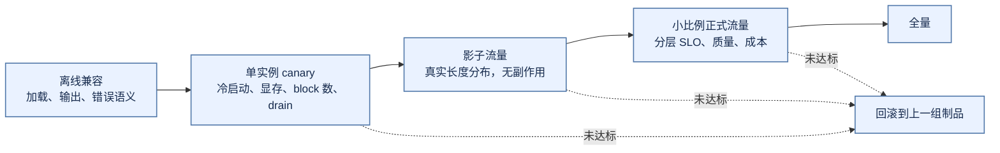

*图 6-2 运行时升级的逐级验证：每一级都有停止条件，回滚对象是整组制品而不是一个版本号*

#### 6.4.3 回滚的对象

回滚需要同时回滚权重、tokenizer、模板、量化配置、adapter、路由、cache 版本、engine 版本和安全策略。新版本产生的 prefix cache 不能默认给旧版本使用；旧版本在当前 driver 和 GPU 上也必须仍能启动。生产平台应维护模型版本、tokenizer、template、engine、量化、adapter、GPU 架构和驱动的兼容矩阵，并让发布控制器读取它作为约束；加载前做校验，可以把复杂错误提前到部署阶段。

### 6.5 网关的尝试、额度与部分输出

#### 6.5.1 逻辑请求与多次尝试

一个逻辑 request 可以有多个 attempt。流式开始前原子检查并预留输入、最大输出和必要下游预算，同账户并发预留必须同时扣除在途金额；每次预留、扣减和最终退款都有稳定 ID 并且幂等。完成后按 usage 结算，断流且用量未知时保留待对账，不能记成零费用。vLLM 在流式响应中可以返回 usage（见 5.6.3 节），网关应以它为结算依据，而不是自己重新 tokenize。

#### 6.5.2 已有部分输出时的切换

主模型尚未输出时，可以在预算、能力及数据策略允许下切换；已经输出一半时，旧结果标记中断，备用结果作为新版本或独立结果交付，不能把两段互相冲突的答案无缝拼接；工具已经执行时沿用原业务 operation 核查事实，不重新制造副作用。超预算时停止新增步骤并交付明确的 partial 状态，不能把截断的 JSON 当成功。

#### 6.5.3 超时的层次

网关和 engine 的超时不能随意叠加。网关 timeout 小于生成时间，会导致客户端断开而 GPU 继续工作——在 vLLM 中，HTTP 连接断开会触发 abort（见 5.7 节），但只有在服务端确实感知到断开时才会发生；中间有代理缓冲时，感知可能延迟。请求应携带 deadline，所有组件根据剩余时间决定是否接纳、继续 prefill、停止 decode 或返回部分结果；deadline 需要在 trace 中传播。

---

## 7 可靠性、诊断与验收

本节把原来分散在“性能诊断与事故”和“交付验收与运行手册”中的内容合并。前三小节处理“已经出问题”的情形：怎么确认瓶颈在哪一层、怎么恢复、怎么把事故变成可复现的证据；最后一小节回答“上线前要证明什么”。两者分开，是为了避免在排障时被门禁条款分散注意力。

### 7.1 推理 SLO 与观测

#### 7.1.1 SLO 按场景分层

服务 SLO 应按产品场景分层。交互式请求关心可用性、TTFT、TPOT、p99 和流式完成率；批量任务关心完成时间、goodput 和单位成本；多步任务关心最终成功、中间状态一致性和总时延。HTTP 200 不代表生成成功：部分流、错误 JSON、工具参数不完整和安全策略失败都应有明确的结果状态。错误预算可以决定是否继续灰度、是否暂停性能实验、是否保留更多容量；SLO 还需要质量门禁，量化或 batching 提高了吞吐却让代码任务、结构化输出或安全指标回退，不能算达标 [[14]](#ref-14)。

#### 7.1.2 三类观测信号

Metrics 记录吞吐、队列、TTFT、TPOT、KV 使用、抢占、cache 命中、GPU 显存、取消、重试和路由；logs 记录具体错误、模型 hash、engine 版本、节点和状态；traces 把网关、tokenizer、调度器、prefill、decode、工具和计费串成一次请求。vLLM 自带的 Prometheus 指标覆盖了引擎内部的一段（见 2.7.3 节），网关、路由和计费的部分需要平台补齐。Dapper 的追踪思想和 OpenTelemetry 的信号模型适合把一次请求跨组件串起来 [[26]](#ref-26)[[27]](#ref-27)。

默认不记录完整 prompt 和输出。使用 prompt hash、token 数、长度分桶、采样摘要和脱敏后的错误上下文，必要时通过受控诊断流程临时提升采样。Prometheus 指标标签要避免完整 request id、租户自由字符串和 token 内容造成的高基数，详细信息放在结构化日志或 trace event 中 [[19]](#ref-19)。

#### 7.1.3 成本归因

一次请求的成本包括权重占用、prefill、decode、draft、KV 保留、cache miss、网络、CPU tokenization、工具调用和重试。可以按输入 token、输出 token、GPU 时间和成功任务组合归因，并区分模型版本、租户、项目和业务场景。prefix cache 命中要记录节省的计算，同时计入 cache 占用的显存和失效成本。成本优化要和质量、SLO 同时看：降低最大输出 token 可以降低成本，却可能降低任务成功率；激进 batching 可以提高平均吞吐，却拉长尾延迟。

### 7.2 典型故障与恢复

#### 7.2.1 故障清单

常见事故包括模型加载失败、权重损坏、tokenizer 不匹配、量化 kernel crash、KV 不足导致的频繁抢占、CUDA OOM、GPU Xid、NCCL hang、节点网络故障、对象存储不可用、流式连接堆积和慢客户端。每种故障应定义检测信号、影响范围、自动动作、人工动作、恢复时间和是否丢失请求。把所有故障都归为 5xx，会让容量、质量和数据泄露问题无法区分。

vLLM 在这里有一个需要特别注意的语义：EngineCore 或 worker 进程异常退出时，前端会把引擎标记为不可用，后续请求得到 `EngineDeadError`，`/health` 也随之失败（见 4.6 节）。这意味着 **vLLM 自身不做进程内的故障恢复**，恢复依赖外部编排系统重启实例；平台的健康检查必须能及时发现这个状态并摘除实例。

#### 7.2.2 降级与恢复的顺序

实例故障时先摘除健康检查失败的副本，停止新请求并 drain；网关将新请求路由到兼容副本或异步队列。正在 decode 的请求可以失败重试、迁移重算或继续等待，决策取决于 deadline 和副作用。恢复后要检查 cache 是否释放、队列是否回落、p99 是否恢复、GPU 是否降频、工具状态是否一致、重复请求是否产生副作用；仅看到 Pod Running 不代表服务恢复。

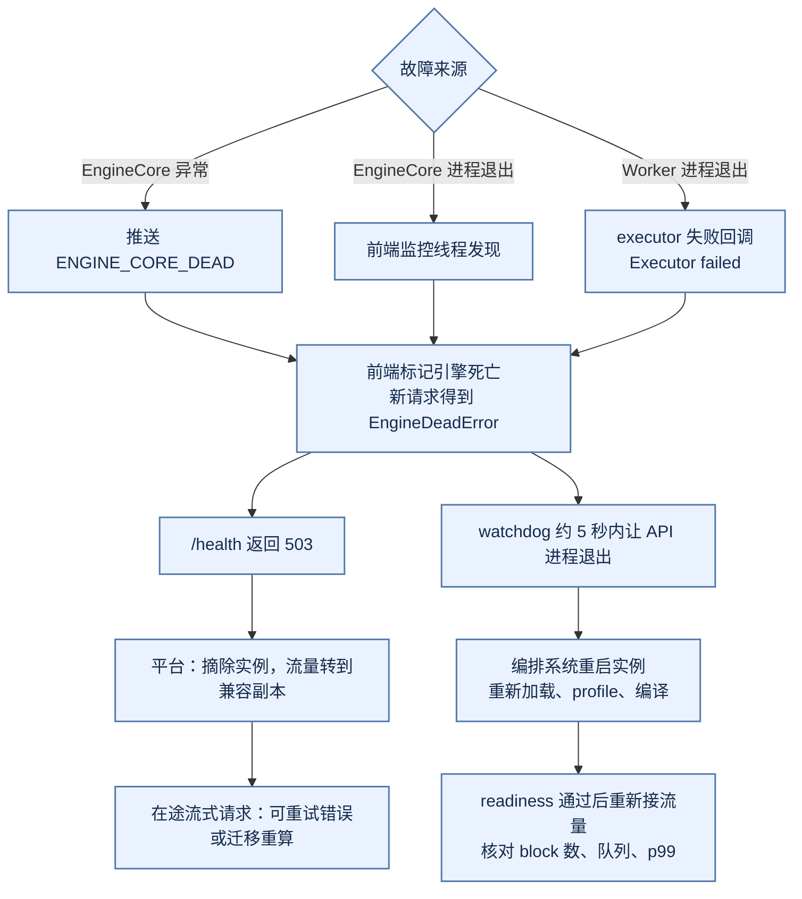

*图 7-1 故障传播与恢复：vLLM 不在进程内重建引擎，恢复由平台的摘除、重启和再接入完成*

#### 7.2.3 请求迁移

请求迁移可以发生在实例 drain、节点故障、负载均衡或 PD 分离时，分为重新发送完整输入、传输已有 KV、只迁移请求状态和放弃当前请求四种。重新 prefill 简单但延迟高；传输 KV 需要网络和版本兼容（vLLM 中由 KV connector 承担，见 5.8.2 节）；只迁移状态而不迁移 cache 会导致状态与资源不一致。流式请求迁移更复杂：旧实例可能已经发送了部分 token，新实例继续生成时要保持上下文、采样随机状态和停止条件。大多数系统应优先让迁移发生在 prefill 完成之前或请求边界，避免把所有状态都做成可迁移。

#### 7.2.4 演练

每月可以执行一次小规模节点故障、一次 KV 压满、一次模型回滚和一次流式断开演练。注入动作应可撤销，先在影子流量或隔离租户上验证，再进入生产候选池。演练结束保存请求样本摘要、指标、trace、资源释放、恢复时间和人工操作。失败的演练要转为发布门禁，而不是只写在复盘文档中。

### 7.3 压测模型与性能剖析

#### 7.3.1 压测负载

推理压测应使用真实长度分布，而不是固定 prompt。至少构造短输入短输出、长输入短输出、短输入长输出、长输入长输出、prefix 高命中、prefix 低命中、结构化输出和突发流量八类负载，每类记录到达过程、并发、deadline、取消比例和租户混合，并分别比较混合部署与 PD 分离。压测工具要区分客户端等待、网关排队、调度等待、prefill、decode 和网络发送：只从客户端测总延迟，无法知道瓶颈；只测 engine，不包含真实连接和 tokenization，又会高估服务能力。压测完成后保留配置、模型制品、原始事件和环境，作为下一次升级的回归基线。

#### 7.3.2 状态机回放

事故排查最有效的方法之一，是回放一个 request 的状态机：何时被接收，排队多久，何时分配 KV，经历几次 prefill chunk，是否被抢占，生成多少 token，是否命中 cache、迁移、重试、取消和回退。vLLM 的 `Request` 上记录了 QUEUED、SCHEDULED、PREEMPTED 等引擎事件和时间戳（见 3.3.2 节），配合网关事件和 trace，可以用同一个 request id 和单调序列复原因果顺序。

状态回放也可以用于测试：给定一组事件，验证重复取消不会泄漏 block，失败迁移不会重复调用工具，实例 drain 会停止新请求，cache 版本不兼容会被拒绝，deadline 到期会释放资源。

#### 7.3.3 可回放的 OOM 教学调查

下面是故意构造的诊断事件，不是 GPU 实测日志。固定模型 revision、单卡进程、BF16 KV、请求长度和并发；让多轮对话逐轮追加历史，记录每轮输入/输出 token、活跃 KV block、cache 条目、allocated、reserved、设备总占用和安全点后的值。PyTorch 2.9 把 `memory_allocated` 定义为张量占用，把 `memory_reserved` 定义为分配器管理的总量；`empty_cache()` 只释放未使用的缓存，不释放仍被引用的活跃张量 [[28]](#ref-28)。vLLM 在启动时一次性分配整块 KV 张量（见 4.3 节），这部分在 PyTorch 统计里表现为一个稳定的大块占用，KV 的“用了多少”要看引擎自己的 block 账本（`BlockPool` 的空闲块数），而不是 allocator 指标。

| 教学事件顺序 | 观察字段 | 假设检验与下一步 |
|:---|:---|:---|
| A：总 token 逐轮增长 | 活跃 KV block 随之增长，结束后回到有界基线 | 正常的历史成本，不能直接判为泄漏；限制总 token 或压缩 |
| B：固定总 token 重复同一批 | 完成后 allocated 仍逐轮增加，cache 条目不增 | 查输出/logits 列表、回调引用、autograd 图及后台任务 |
| C：allocated 稳定而 reserved 阶梯式增加 | snapshot 中的分块、空闲区、分配失败大小 | 可能是合法的池扩张或碎片；比较稳定 shape，不能以差值直接量化碎片 |
| D：取消率提高 | 请求已结束但空闲块数不回升 | 查 abort 是否送达 EngineCore、block 引用计数是否归零 |
| E：首次非法访存后报 OOM | 最早的 CUDA 错误、请求 shape、kernel 版本 | 先定位越界或异步错误，后面的异常可能只是传播 |

可复现步骤是先建立固定长度/并发基线，再一次只增加轮次、取消、prefix 或图捕获中的一个变量，保存显存快照、最早错误、事件序列与版本。清 cache 只能作为受控对照，不能把循环调用 `empty_cache` 当作修复。最终验收核对请求终态、空闲块数回到基线、合法缓存有界、重跑相同负载无新增增长和质量无回归；本章只给出方法，未声称这些条件已在 GPU 上通过 [[29]](#ref-29)。

#### 7.3.4 性能剖析要形成因果假设

先用请求时间线确认瓶颈属于 CPU 预处理、排队、H2D、prefill、decode、collective 还是发送，再选相应工具。vLLM 的 CPU 侧开销（调度、输入准备、detokenize）曾是重要瓶颈，异步调度和 Model Runner V2 都是为它而做的（见 5.3.1 节），因此不能默认瓶颈都在 GPU。Nsight Compute 提供 Roofline 和内核资源分析方法 [[30]](#ref-30)：算术强度低且带宽接近上限时考虑 KV 布局和权重读取量；算力低且带宽也低时，检查 launch、同步、形状与依赖空洞。报告时固定 shape、硬件和版本，将质量、尾延迟和成功任务成本一起对照。

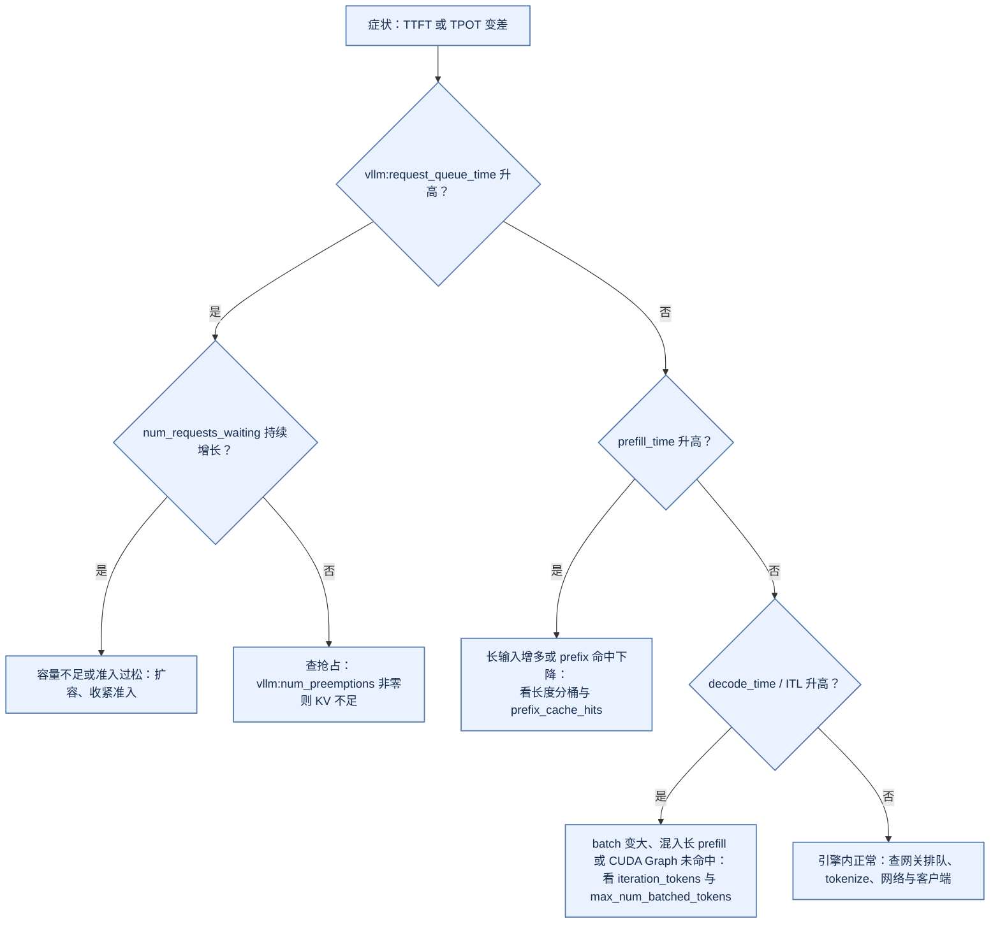

*图 7-2 延迟诊断的分流：先用引擎内的阶段指标定位是排队、prefill、decode 还是引擎外，再选剖析工具*

### 7.4 交付验收与运行手册

#### 7.4.1 性能回归门禁

回归门禁可以设为多目标约束：TTFT p95 不超过基线的某个比例，TPOT p95 不超过阈值，goodput 不下降，显存峰值不超过容量，质量指标不低于容差，错误、抢占和取消率不增加。不同负载可以有不同权重，不能用一个总体平均掩盖长上下文或高价值任务的退化。门禁结果要附带解释和失败样本，发布控制器只依据明确策略自动决策，复杂的回退进入人工评审。

#### 7.4.2 Engine 兼容性测试

升级 runtime 时，功能测试要覆盖单请求、动态 batch、流式、取消、最大长度、结构化输出、工具调用和多模态；性能测试覆盖不同输入输出长度和并发；资源测试覆盖显存、KV block、编译缓存和冷启动；故障测试覆盖 engine crash、GPU reset、模型加载失败和滚动 drain。兼容性还包括错误语义：某个版本把超长输入返回 400，另一个版本可能截断后返回 200；某个版本把客户端断开视为取消，另一个版本继续生成。API contract test 和状态机 test 是 serving 平台的必要组成。

#### 7.4.3 验收证据的最小集合

一份可交付的推理平台至少要留下五组证据，缺任何一组都意味着某个结论无法复核。

| 证据组 | 回答的问题 | 关键字段 |
|:---|:---|:---|
| 制品与兼容 | 这个版本能在目标环境跑起来吗 | manifest hash、tokenizer/模板版本、engine 版本与 commit、GPU 架构、驱动 |
| 容量与性能 | 在目标负载下能达到什么指标 | 长度分布、并发曲线、TTFT/TPOT 分位数、显存与 KV 水位、抢占率 |
| 质量回归 | 系统优化有没有伤害输出 | 原始精度与优化后精度的配对比较、结构化输出合法率、关键任务切片 |
| 可靠性与降级 | 故障时行为是否可预期 | 故障注入记录、摘除与恢复时间、降级路径的能力声明、丢失请求数 |
| 治理与成本 | 谁能用、花了多少、能否回滚 | 租户配额、数据驻留、审计字段、单位成功任务成本、回滚演练记录 |

五组证据之间不能互相替代：一个版本可能容量漂亮但质量回退，可能质量持平却无法回滚，也可能全部达标但成本翻倍。本章给出的所有表格与阈值示例都是本书建议，不是从某个生产平台测得的结论；真实阈值必须在目标硬件和目标负载上重新测量。

#### 7.4.4 运行手册

推理服务需要一份可执行的 runbook：如何判断问题出在队列、prefill、decode、KV、网络还是客户端；如何摘除实例；如何清理 cache（vLLM 提供 `POST /reset_prefix_cache` 接口，但它和 `/sleep`、`/wake_up` 一样属于开发接口，只在设置 `VLLM_SERVER_DEV_MODE` 时注册，生产上需要由平台代理并加权限控制，见 4.6 节）；如何回滚 engine；如何切换 fallback；如何处理流式部分结果；如何核对工具副作用；如何恢复成本与容量。每条命令或操作都应写明权限、预期指标、风险和回滚。runbook 要通过演练更新：如果一个故障需要人工在机器上删除目录才能恢复，说明平台缺少状态清理接口。

---

## 8 主流推理引擎横向比较

### 8.1 比较框架与口径

#### 8.1.1 先说清楚比较的是什么

“vLLM、SGLang、TensorRT-LLM、Triton、TGI 哪个更好”这个问题本身就有层级错位。vLLM、SGLang 和 TensorRT-LLM 是**推理引擎**：它们负责调度、KV 管理和模型执行。Triton Inference Server 是**服务层**：它负责模型仓库、版本、协议和多后端托管，本身不做 LLM 的连续批处理，而是把这件事交给后端（TensorRT-LLM 后端或 vLLM 后端）。TGI 是一个完整的服务实现，在调研日已进入维护模式，历史功能存在不等于持续新增支持 [[11]](#ref-11)。比较时必须先把对象放在同一层级。

本节对 vLLM 的描述来自源码；对其他对象的描述来自其论文和官方文档在调研日的内容，没有审阅源码，也没有做性能对比实验。任何吞吐数字的比较都必须在同一硬件、同一模型、同一负载下重测，本节不给出这类结论。

#### 8.1.2 五个比较维度

本节从五个维度比较：在系统中的层次位置；调度模型；KV 管理与前缀复用；启动与编译方式；部署形态与扩展机制。这五个维度正好对应本章第 2 到第 5 节关注的问题。

#### 8.1.3 层次位置图

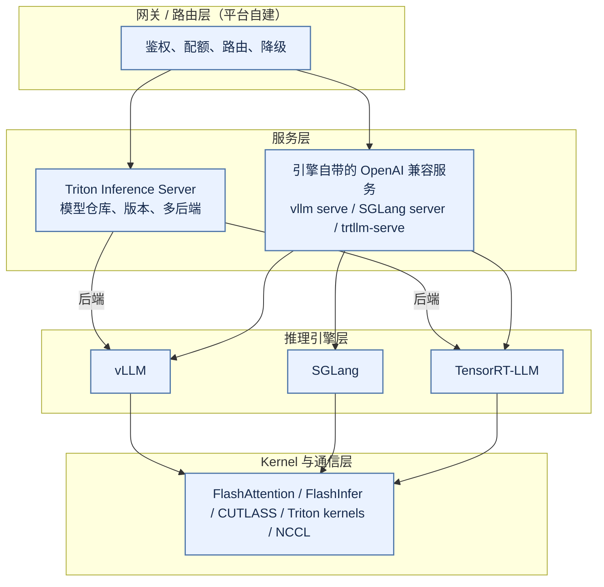

*图 8-1 各对象的层次位置：Triton 在服务层托管引擎，三个引擎共享相近的 kernel 生态*

### 8.2 定位与形态

#### 8.2.1 vLLM：分进程的通用引擎

vLLM 的定位是通用、模型覆盖面广、社区驱动的推理引擎。V1 架构把协议处理、调度和执行拆到三类进程（见 2.2 节），调度器以“每步给每个请求分配 token”为统一抽象，KV 以固定大小 block 和块哈希管理。它通过插件、KV connector、自定义 logits processor 等接口扩展，硬件平台覆盖 CUDA、ROCm 以及多种加速器。

#### 8.2.2 SGLang：以前缀复用为中心

SGLang 的论文把系统分成前端语言与运行时两部分，运行时的核心是 RadixAttention：用基数树（radix tree）组织所有请求的 KV，前缀天然共享，按 LRU 淘汰叶子节点；调度器优先运行与已缓存前缀匹配最长的请求，以提高命中率 [[12]](#ref-12)。论文还提出用压缩有限状态机加速结构化输出的解码。它的设计重心是多轮对话、few-shot、Agent 等前缀高度重复的负载。

#### 8.2.3 TensorRT-LLM 与 Triton：编译优化与服务托管

TensorRT-LLM 是 NVIDIA 的 LLM 推理库，强调针对 NVIDIA GPU 的 kernel 与图优化，提供 in-flight batching 和分页 KV cache [[13]](#ref-13)。早期版本以“先离线构建 TensorRT engine、再加载运行”为主要工作流，engine 与 GPU 架构、精度和最大 shape 绑定；较新版本以基于 PyTorch 的 LLM API 作为主要入口，降低了构建步骤的门槛。服务形态上，它既可以通过 Triton 的 TensorRT-LLM 后端托管，也可以使用自带的 OpenAI 兼容服务。TensorRT 的构建期/运行期分离与 Triton 的模型管理说明了“制品兼容”和“模型生命周期”是两个不同的层次 [[9]](#ref-9)[[10]](#ref-10)。

#### 8.2.4 形态对比

| 维度 | vLLM（V1） | SGLang | TensorRT-LLM | Triton |
|:---|:---|:---|:---|:---|
| 层次 | 推理引擎 + 自带服务 | 推理引擎 + 自带服务 + 前端语言 | 推理库/引擎 + 自带服务 | 服务层，托管后端 |
| 调度单位 | 每步 token budget，prefill/decode 统一 | 迭代级调度，前缀感知 | in-flight batching | 交给后端 |
| KV 管理 | 固定 block + 块哈希 + 空闲队列 LRU | 基数树 + LRU | 分页 KV cache | 交给后端 |
| 前缀复用 | 块级哈希链，仅满块可复用 | 树上任意前缀 | 文档所述支持 KV 复用 | 交给后端 |
| 启动 | 运行时加载 + profile + torch.compile + CUDA Graph 捕获 | 运行时加载 + 图捕获 | 历史上需离线构建 engine；新入口在运行时完成 | 按模型仓库配置加载后端 |

*表中 vLLM 一列来自源码，其余来自公开文档，均为调研日的状态。*

### 8.3 调度与 KV 管理

#### 8.3.1 统一 token 预算与前缀感知

vLLM 的调度器不区分“prefill 阶段”和“decode 阶段”，只看每个请求还差多少 token 没算（见 3.4.2 节），这让 chunked prefill、prefix 命中和投机解码都落在同一个预算模型里。SGLang 论文强调的是前缀感知：在前缀命中率高的负载上，调度顺序本身就是一种 cache 优化。vLLM 默认使用 FCFS 或 priority，不按前缀匹配长度重排队列；它的 prefix cache 是“请求到了再查”，而不是“按命中挑请求”。

#### 8.3.2 块哈希与基数树

vLLM 的前缀复用基于块哈希链：每个满块的哈希包含父块哈希、本块 token 和额外键（LoRA、多模态、cache salt），只有满块能被复用，命中粒度是 block（见 3.5.2 节）。基数树可以在任意 token 位置分叉，命中粒度更细，但需要维护树结构。两者都要处理淘汰、引用计数和隔离；在多租户场景下，cache key 是否包含租户域，比数据结构本身更重要。

### 8.4 启动与部署形态

#### 8.4.1 启动成本落在哪里

vLLM 把成本放在启动时：加载权重、profile 测量显存、分配 KV、torch.compile 编译与 CUDA Graph 捕获（见第 4 节），编译结果可以缓存以缩短热启动。早期 TensorRT-LLM 把更多成本前移到离线构建阶段，engine 制品与 GPU 架构、精度和 shape 范围绑定，部署时加载更快，但制品的兼容矩阵更严格。这是“制品即运行时契约”这一原则在不同层次的体现：无论哪种方式，编译产物都必须和模型 hash、GPU 架构、驱动和引擎版本一起管理。

#### 8.4.2 扩展与解耦

三个引擎都在支持 TP、PP、EP 以及 PD 分离等部署形态。vLLM 通过 KV connector 抽象接入不同的 KV 传输实现（见 5.8.2 节），把“如何传输 KV”与“调度器如何等待远端 KV”分开。选型时要比较的不是“是否支持 PD 分离”这样的勾选项，而是在目标负载下它的调度、传输和故障语义是否满足需求。

### 8.5 选型建议

#### 8.5.1 按负载与约束选

模型覆盖面、硬件多样性和社区插件优先时，vLLM 是稳妥的默认选项；前缀高度重复的 Agent、多轮对话负载，值得在同一负载下对比 SGLang；只用 NVIDIA GPU、模型固定、追求极致单卡性能并且能承担更严格的制品管理时，可以评估 TensorRT-LLM；需要统一托管多种模型（不止 LLM）并复用已有 Triton 运维体系时，可以把 Triton 放在服务层、引擎作为后端。

#### 8.5.2 一个常见误解

“换一个引擎就能解决延迟问题”往往不成立。第 7 节列出的大部分问题——长度分布、准入、配额、路由、超时层次、慢客户端——都在引擎之外。选型要比较的是动态 batch、长上下文、量化、adapter、流式、结构化输出、观测和回滚在目标负载下的表现，而不是启动命令或单一 benchmark。

---

## 9 局限、开放问题与落地建议

### 9.1 本章方法的局限

#### 9.1.1 静态阅读而非实测

本章对 vLLM 的结论来自固定提交的源码与仓库内设计文档的静态阅读，没有在 GPU 上运行服务，也没有做压测。文中的时序、状态迁移和默认值都以该提交的代码为准；vLLM 迭代很快，调度器默认值、执行器实现和 CUDA Graph 策略在后续版本中都可能变化，引用时应核对所用版本。2.4.4 节的显存账本和 7.3.3 节的 OOM 调查都是教学推演，不是测量结果。

#### 9.1.2 覆盖范围

本章以“单模型、文本生成、在线 OpenAI 兼容接口”为主线。pooling（embedding、打分）、encoder-decoder、扩散类语言模型、Mamba 等混合架构、CPU/XPU/TPU 等非 CUDA 平台，以及离线 `LLM` 类接口，都只在必要处提及。多模态只讲到它如何进入调度器的预算，没有展开预处理与 encoder cache 的细节。

#### 9.1.3 两套执行器并存

在调研的提交中，GPU 执行层同时存在 Model Runner V2 与旧的 V1 model runner：V2 在特性支持的情况下默认启用，否则回退 V1。本章第 5 节按 V2 描述执行路径，涉及 V1 特有结构（如 `CachedRequestState`）时单独说明。两者对调度器暴露的接口相同，所以第 3、4 节的大部分结论不受影响，但做性能分析时必须先确认实例实际使用的是哪一个。

### 9.2 开放问题

#### 9.2.1 引擎内调度与平台调度的边界

vLLM 的调度器只看到本实例的队列和 KV，平台路由器只看到聚合指标。两者之间的信息差会导致“路由器认为有空闲、引擎内在频繁抢占”这类现象。prefix cache 感知路由、按 KV 水位路由和 PD 分离下的两段调度都在尝试缩小这个信息差，但目前没有统一的接口标准。

#### 9.2.2 抢占的代价

vLLM 的抢占策略是释放 KV 并在之后重算；被释放的满 block 若尚未被复用，或配置了 KV offload，重算时可以部分找回（见 5.3.4 节）。对长上下文、长输出请求，一次抢占可能浪费大量计算。抢占的触发条件、受害者选择和是否应该用更保守的准入来避免抢占，仍然需要在具体负载上权衡。

#### 9.2.3 KV 的跨实例生命周期

KV 正在从“实例内的临时状态”变成“可以跨实例传输、卸载和共享的资源”（KV connector、offload、外部 cache）。一旦 KV 离开实例，版本兼容、权限隔离、删除保证和损坏检测都成了新问题，第 2.5.4 节的四种缓存命中语义也需要重新审视。

### 9.3 落地建议

#### 9.3.1 从单实例基线起步

先在目标硬件上用单个副本、固定版本建立基线：记录启动耗时、可用 KV block 数、不同长度桶的 TTFT/TPOT、抢占率和 prefix 命中率。再逐项打开 chunked prefill 参数调整、prefix cache、投机解码、TP 等优化，每次只改一个变量。

#### 9.3.2 先补控制面再扩规模

vLLM 只解决“单实例内把请求算好”。在扩大规模之前，先补齐网关的鉴权与配额、路由器的健康与负载感知、发布系统的兼容矩阵与回滚、观测系统的 trace 串联。否则规模越大，单实例内的问题越难定位。

#### 9.3.3 度量

把 TTFT、TPOT、goodput、抢占率、KV 使用率、prefix 命中率和单位成功任务成本作为一组指标长期跟踪，并按模型版本、长度桶和租户分层。任何单一指标的改善都要同时检查其他指标和质量。

#### 9.3.4 落地路线图

```mermaid
flowchart LR
    A["单实例基线<br/>固定版本与负载"] --> B["引擎内优化<br/>chunked prefill / prefix cache / CUDA Graph"]
    B --> C["多副本与路由<br/>健康检查 / 负载与 cache 感知"]
    C --> D["发布与治理<br/>兼容矩阵 / 灰度 / 回滚 / 配额"]
    D --> E["解耦与扩展<br/>TP / PD 分离 / KV offload"]
    E -.->|回归基线| A
    classDef default fill:#eaf2ff,stroke:#5279aa,stroke-width:1.5px,color:#172b4d;
```

*图 9-1 落地路线：先固定基线，再逐层扩展；每一层的改动都回到基线做回归*

### 9.4 结论

#### 9.4.1 三句话总结

第一，vLLM V1 把推理服务拆成**前端进程（协议、tokenize、detokenize）、EngineCore 进程（调度与 KV 账本）和 worker 进程（执行与采样）**三层，进程边界本身就是为了让 CPU 开销不阻塞 GPU。

第二，它的核心抽象是**“每一步给每个请求分配若干 token”**：prefill、chunked prefill、decode、prefix 命中和投机解码都被统一成 `num_computed_tokens` 向 `num_tokens` 的追赶，KV 则以固定大小的 block 和块哈希来记账。

第三，生产级推理服务不只是一个 vLLM 进程：制品版本、准入与配额、路由与降级、灰度与回滚、观测与验收，构成同一条证据链，缺任何一环都无法证明服务成熟。

请求能够稳定在线运行之后，下一个问题是“如何知道模型是否仍然正确”：数据治理、离线评估、回归集、在线反馈和质量门禁，会与本章的 trace、usage、版本和成本数据连接，形成从数据到生产的评估闭环。

## 补充材料

#### 源码索引

以下位置均对应 vLLM 提交 `77d2790`。

| 主题 | 位置 |
| --- | --- |
| CLI 入口与运行形态 | `vllm/entrypoints/cli/main.py`、`vllm/entrypoints/cli/serve.py:48-156` |
| 单 API server 启动与应用构建 | `vllm/entrypoints/launchers/api_server/entry.py`、`launchers/launcher.py`、`launchers/app.py` |
| 参数到配置 | `vllm/engine/arg_utils.py:1980-2928`、`vllm/config/vllm.py:364` |
| 前端引擎门面 | `vllm/v1/engine/async_llm.py` |
| 输入与输出处理 | `vllm/v1/engine/input_processor.py`、`output_processor.py`、`detokenizer.py`、`parallel_sampling.py` |
| 前端准入控制 | `vllm/v1/engine/admission_control.py` |
| 引擎客户端与进程拉起、握手 | `vllm/v1/engine/core_client.py`、`vllm/v1/engine/utils.py:242-1596` |
| EngineCore 与 busy loop | `vllm/v1/engine/core.py`（初始化 `:137-458`，step `:709-863`，进程入口 `:1584-1755`） |
| 调度器 | `vllm/v1/core/sched/scheduler.py`（`schedule` `:698-1783`，`update_from_output` `:2252-2680`，抢占 `:1798-1842`，释放 `:3032-3094`） |
| 异步调度、队列、停止判断 | `vllm/v1/core/sched/async_scheduler.py`、`request_queue.py`、`utils.py:98-140` |
| 调度输出 | `vllm/v1/core/sched/output.py` |
| KV 管理 | `vllm/v1/core/kv_cache_manager.py`、`kv_cache_coordinator.py`、`single_type_kv_cache_manager.py`、`block_pool.py`、`kv_cache_utils.py` |
| KV 规格与规划 | `vllm/v1/kv_cache_interface.py`、`vllm/v1/core/kv_cache_planning.py` |
| 请求对象与状态 | `vllm/v1/request.py`、`vllm/v1/engine/__init__.py` |
| Executor | `vllm/v1/executor/abstract.py`、`multiproc_executor.py`、`uniproc_executor.py` |
| Worker | `vllm/v1/worker/gpu_worker.py`、`worker_base.py`、`startup_plan.py`、`extensible_kv_cache.py` |
| Model Runner V2 | `vllm/v1/worker/gpu/model_runner.py`、`gpu/states.py`、`gpu/block_table.py`、`gpu/input_batch.py`、`gpu/sample/sampler.py` |
| Model Runner V1 | `vllm/v1/worker/gpu_model_runner.py`、`gpu_input_batch.py`、`block_table.py`、`vllm/v1/sample/` |
| CUDA Graph 分派 | `vllm/v1/cudagraph_dispatcher.py` |
| KV connector | `vllm/distributed/kv_transfer/kv_connector/v1/base.py`、`factory.py` |
| 指标 | `vllm/v1/metrics/loggers.py`、`stats.py` |
| 设计文档 | `docs/design/arch_overview.md`、`prefix_caching.md`、`model_runner_v2.md`、`cuda_graphs.md`、`torch_compile.md`、`metrics.md`、`multiprocessing.md` |

```mermaid
flowchart LR
    subgraph EP["vllm/entrypoints"]
        E1["cli/serve.py"] --> E2["launchers/"]
        E2 --> E3["openai/chat_completion/"]
    end
    subgraph EN["vllm/v1/engine"]
        N1["async_llm.py"] --> N2["input_processor.py<br/>output_processor.py"]
        N1 --> N3["core_client.py"]
        N3 --> N4["core.py"]
    end
    subgraph CO["vllm/v1/core"]
        C1["sched/scheduler.py"] --> C2["kv_cache_manager.py"]
        C2 --> C3["kv_cache_coordinator.py<br/>block_pool.py"]
    end
    subgraph WK["vllm/v1/executor 与 worker"]
        W1["executor/multiproc_executor.py"] --> W2["worker/gpu_worker.py"]
        W2 --> W3["worker/gpu/model_runner.py（V2）"]
        W3 --> W4["worker/gpu/sample/"]
    end
    CFG["vllm/config/"] -.-> N4
    E3 --> N1
    N4 --> C1
    N4 --> W1
    classDef default fill:#eaf2ff,stroke:#5279aa,stroke-width:1.5px,color:#172b4d;
```

*图 补-1 源码模块地图：从入口到采样的主要文件，阅读顺序与第 4、5 节一致*

#### 关键默认值

| 项目 | 默认值 | 来源 |
| --- | --- | --- |
| `gpu_memory_utilization` | 0.92；启用 extensible KV cache 时为 1.0 | `vllm/config/cache.py:216-228`、`487-493` |
| `block_size` | 16，未显式指定时可被平台按 attention backend 调整 | `vllm/config/cache.py:185`、`473-484` |
| `enable_prefix_caching` | True | `vllm/config/cache.py:260` |
| prefix cache 哈希算法 | sha256 | `vllm/config/cache.py:262` |
| `enable_extensible_kv_cache` | CUDA/ROCm 且使用 Model Runner V2 时自动开启 | `vllm/config/cache.py:386-393`、`vllm/config/vllm.py:3184` |
| `max_num_seqs` / `max_num_batched_tokens`（OpenAI 服务） | ≥160 GB 显卡 1024 / 16384；≥70 GB 且非 A100 1024 / 8192；其他 256 / 2048 | `vllm/engine/arg_utils.py:2984-3017` |
| `enable_chunked_prefill` | True | `vllm/config/scheduler.py:134` |
| 调度策略 `policy` | fcfs | `vllm/config/scheduler.py:159` |
| `async_scheduling` | 无不兼容项时自动开启 | `vllm/config/vllm.py:1723-1757` |
| Model Runner V2 | 特性支持时默认启用 | `vllm/config/vllm.py:735-760` |
| 优化级别 / `cudagraph_mode` | O2 / FULL_AND_PIECEWISE | `vllm/config/vllm.py:452` |
| CUDA Graph 捕获尺寸 | 1、2、4，8–248 步长 8，256 起步长 16，上限 512（Blackwell 1024） | `vllm/config/vllm.py:2455-2662` |
| `SamplingParams.max_tokens` | 16（服务层会按 `max_model_len` 改写） | `vllm/sampling_params.py:337` |
| `shutdown_timeout` | 0（abort 模式） | `vllm/config/vllm.py:471` |
| 前端等待引擎就绪 | 600 秒（`VLLM_ENGINE_READY_TIMEOUT_S`） | `vllm/envs.py:845-846` |
| 引擎等待握手消息 | 5 分钟 | `vllm/v1/engine/core.py:123` |
| worker 进程启动方式 | fork（特定条件下强制 spawn） | `vllm/envs.py:69` |
| startup plan | 关闭（`VLLM_ENABLE_STARTUP_PLAN=1` 开启） | `vllm/envs.py:290` |

#### 术语

| 术语 | 含义 |
| --- | --- |
| TTFT / TPOT / ITL / E2E | 首 token 延迟 / 每个输出 token 的平均延迟 / 相邻输出间隔 / 端到端延迟 |
| goodput | 满足 SLO 的成功请求数除以墙钟时间 |
| prefill / decode | 处理输入并建立 KV 的计算 / 逐 token 生成的计算 |
| chunked prefill | 把长输入的 prefill 拆到多个 step 中，与 decode 交替执行 |
| continuous batching | iteration-level 调度：请求可以在任意一步加入或退出 batch |
| KV cache / block | 注意力的历史 K、V / 固定 token 数的 KV 存储单元 |
| prefix cache（APC） | 按块哈希复用相同前缀的 KV |
| 抢占（preemption） | KV 不足时释放运行中请求的 KV，之后重算 |
| API server / EngineCore / worker | 协议与 tokenize 进程 / 调度与 KV 账本进程 / 每 GPU 一个的执行进程 |
| `Request` / `SchedulerOutput` / `ModelRunnerOutput` | 调度状态 / 一步的执行计划 / 一步的采样结果 |
| `BlockPool` / `KVCacheBlock` | block 的空闲队列与哈希表 / block 的元数据 |
| KV connector | PD 分离与 KV offload 的传输抽象 |
| PD / AF 解耦 | prefill 与 decode 分离 / attention 与 FFN（专家）分离 |
| Model Runner V2 | GPU 执行层的第二代实现 |

#### 显存账本练习卡（Q275）

输入是 2.4.4 节列出的 Qwen3-8B 配置字段、检查点 tensor 清单、权重与 KV 精度、单卡容量、`gpu_memory_utilization`、block 大小、并发和每条输入/最大输出长度；工作区与安全余量必须显式给定，缺失项列为未知，不猜成零。输出包括 GB/GiB 双单位的权重、每 token 及每 block 的 KV、逐 rank 驻留账本、可用 block 数、候选并发上限、主导项与抢占风险解释，并保存 manifest 和计算假设。

边界检查包括：GQA 的 KV 头与 query 头的区别、空序列、尾块取整、INT4 元数据、权重与 KV 不同精度、共享前缀的引用、TP 不均匀分片及 prefill 峰值。再用固定长度重复、正常多轮增长、取消后释放三个事件轨迹，对照 `vllm:kv_cache_usage_perc` 和空闲 block 数判断是否泄漏。可选进阶：比较同一配置在预先分配与 extensible KV cache 两种模式下启动日志中的 block 数差异，并解释原因。验收标准是账本各项不重计、单位正确、未知项显式，且不把静态上限当作 SLO 承诺。交付状态为练习设计，未编写实验程序、未运行 GPU、未宣称实测通过。

### 本章的已知局限

本章对 vLLM 的结论来自固定提交的源码与仓库文档的静态阅读，没有在 GPU 上运行服务或压测，所有关于行为的描述未经动态验证；Model Runner V2 的内部实现（CUDA Graph 管理、预热流程）只读到了主干，未逐行核对；DP coordinator、Ray 后端、Elastic EP、HiSparse、容错等子系统只做了概述；对 SGLang、TensorRT-LLM、Triton、TGI 的描述基于调研日可读取的论文与官方文档，未审阅其源码；2.4.4 节的显存账本、7.3.3 节的 OOM 调查和所有阈值示例都是教学推演或本书建议，不是测量结果。

## 参考资料

<a id="ref-1"></a>[1] vLLM Team. *vLLM* 源码仓库，提交 `77d2790`（2026-11-03）. https://github.com/vllm-project/vllm/tree/77d2790e788ec323c8bc1fcee72013b363bd9957 核验日期：2026-11-03

<a id="ref-2"></a>[2] vLLM Team. *Architecture Overview*（`docs/design/arch_overview.md`，提交 `77d2790`）. https://github.com/vllm-project/vllm/blob/77d2790e788ec323c8bc1fcee72013b363bd9957/docs/design/arch_overview.md 核验日期：2026-11-03

<a id="ref-3"></a>[3] Kwon, W., et al. *Efficient Memory Management for Large Language Model Serving with PagedAttention*. SOSP, 2023. https://arxiv.org/abs/2309.06180

<a id="ref-4"></a>[4] Yu, G.-I., et al. *Orca: A Distributed Serving System for Transformer-Based Generative Models*. OSDI, 2022. https://www.usenix.org/conference/osdi22/presentation/yu

<a id="ref-5"></a>[5] Agrawal, A., et al. *Taming Throughput-Latency Tradeoff in LLM Inference with Sarathi-Serve*. OSDI, 2024. https://www.usenix.org/conference/osdi24/presentation/agrawal

<a id="ref-6"></a>[6] Zhong, Y., et al. *DistServe: Disaggregating Prefill and Decoding for Goodput-optimized Large Language Model Serving*. OSDI, 2024. https://arxiv.org/abs/2401.09670

<a id="ref-7"></a>[7] vLLM Team. *Automatic Prefix Caching*（`docs/design/prefix_caching.md`，提交 `77d2790`）. https://github.com/vllm-project/vllm/blob/77d2790e788ec323c8bc1fcee72013b363bd9957/docs/design/prefix_caching.md 核验日期：2026-11-03

<a id="ref-8"></a>[8] vLLM Team. *Model Runner V2 Design Document*（`docs/design/model_runner_v2.md`，提交 `77d2790`）. https://github.com/vllm-project/vllm/blob/77d2790e788ec323c8bc1fcee72013b363bd9957/docs/design/model_runner_v2.md 核验日期：2026-11-03

<a id="ref-9"></a>[9] NVIDIA. *TensorRT Architecture Overview*. https://docs.nvidia.com/deeplearning/tensorrt/latest/architecture/architecture-overview.html 核验日期：2026-10-17

<a id="ref-10"></a>[10] NVIDIA. *Triton Inference Server: Model Management*. https://docs.nvidia.com/deeplearning/triton-inference-server/user-guide/docs/user_guide/model_management.html 核验日期：2026-10-17

<a id="ref-11"></a>[11] Hugging Face. *Text Generation Inference*. https://github.com/huggingface/text-generation-inference 访问日期：2026-10-17

<a id="ref-12"></a>[12] Zheng, L., et al. *SGLang: Efficient Execution of Structured Language Model Programs*. NeurIPS, 2024. https://arxiv.org/abs/2312.07104

<a id="ref-13"></a>[13] NVIDIA. *TensorRT-LLM*. https://github.com/NVIDIA/TensorRT-LLM 访问日期：2026-11-03

<a id="ref-14"></a>[14] Beyer, B., et al. *The Site Reliability Workbook: Implementing SLOs*. O’Reilly, 2018. https://sre.google/workbook/implementing-slos/

<a id="ref-15"></a>[15] Qwen Team. *Qwen3-8B config.json*. 2026-10-17 所见文件提交 47719a2. https://huggingface.co/Qwen/Qwen3-8B/blob/main/config.json

<a id="ref-16"></a>[16] Bang, F. *GPTCache: An Open-Source Semantic Cache for LLM Applications Enabling Faster Answers and Cost Savings*. NLP-OSS, 2023. https://aclanthology.org/2023.nlposs-1.24/

<a id="ref-17"></a>[17] NVIDIA. *NCCL: Collective Operations*. https://docs.nvidia.com/deeplearning/nccl/user-guide/docs/usage/collectives.html 核验日期：2026-10-17

<a id="ref-18"></a>[18] Zhu, R., et al. *MegaScale-Infer: Serving Mixture-of-Experts at Scale with Disaggregated Expert Parallelism*. arXiv, 2025. https://arxiv.org/abs/2504.02263

<a id="ref-19"></a>[19] Prometheus Authors. *Prometheus Documentation*. https://prometheus.io/docs/introduction/overview/ 访问日期：2026-10-17

<a id="ref-20"></a>[20] vLLM Team. *CUDA Graphs*（`docs/design/cuda_graphs.md`，提交 `77d2790`）. https://github.com/vllm-project/vllm/blob/77d2790e788ec323c8bc1fcee72013b363bd9957/docs/design/cuda_graphs.md 核验日期：2026-11-03

<a id="ref-21"></a>[21] vLLM Team. *torch.compile integration*（`docs/design/torch_compile.md`，提交 `77d2790`）. https://github.com/vllm-project/vllm/blob/77d2790e788ec323c8bc1fcee72013b363bd9957/docs/design/torch_compile.md 核验日期：2026-11-03

<a id="ref-22"></a>[22] Leviathan, Y., Kalman, M., & Matias, Y. *Fast Inference from Transformers via Speculative Decoding*. ICML, 2023. https://arxiv.org/abs/2211.17192

<a id="ref-23"></a>[23] Chen, C., et al. *Accelerating Large Language Model Decoding with Speculative Sampling*. 2023. https://arxiv.org/abs/2302.01318

<a id="ref-24"></a>[24] Verma, A., et al. *Large-scale Cluster Management at Google with Borg*. EuroSys, 2015. https://research.google/pubs/large-scale-cluster-management-at-google-with-borg/

<a id="ref-25"></a>[25] Kubernetes. *Schedule GPUs*. https://kubernetes.io/docs/tasks/manage-gpus/scheduling-gpus/ 访问日期：2026-10-17

<a id="ref-26"></a>[26] Sigelman, B. H., et al. *Dapper, a Large-Scale Distributed Systems Tracing Infrastructure*. Google Research, 2010. https://research.google/pubs/dapper-a-large-scale-distributed-systems-tracing-infrastructure/

<a id="ref-27"></a>[27] OpenTelemetry Authors. *Signals*. https://opentelemetry.io/docs/concepts/signals/ 核验日期：2026-10-17

<a id="ref-28"></a>[28] PyTorch. *CUDA Semantics*. 2.9. https://docs.pytorch.org/docs/2.9/notes/cuda.html 核验日期：2026-10-17

<a id="ref-29"></a>[29] NVIDIA. *CUDA Programming Guide: Asynchronous Execution*. https://docs.nvidia.com/cuda/cuda-programming-guide/02-basics/asynchronous-execution.html 核验日期：2026-10-17

<a id="ref-30"></a>[30] NVIDIA. *Nsight Compute Profiling Guide*. https://docs.nvidia.com/nsight-compute/ProfilingGuide/index.html 核验日期：2026-10-17
