# 第10章 推理服务：架构组成、领域模型与推理执行过程

> **版本与证据说明**：源码层面的描述以 vLLM 主干提交 `77d2790`（2026-11-03，晚于 v0.33.0rc3）为准，后续版本可能变化，版本差异集中在 10.10 节；容量与显存数字是可复算的教学推演，阈值和验收表是本书建议，不是实测结果。多模态、pooling、非 CUDA 平台只在必要处提及；SGLang、TensorRT-LLM 等对比对象依据其论文、官方文档与配置源码，不比较吞吐。

训练完成并不意味着模型已经可以被用户使用。训练输出是一个需要转换、装载、调度和观测的制品；在线推理则是一个同时面对突发流量、长尾上下文、流式连接、动态 batch、显存上限和版本发布的分布式服务。本章以开源推理引擎 vLLM 的 V1 架构为主线，按“架构组成 → 核心对象 → 启动过程 → 推理执行”的顺序，解释一条请求如何从 HTTP 进入、在 GPU 上被逐步计算、再以 token 流的形式返回，然后讨论 vLLM 留给平台的多租户钩子、可靠性语义与验收方法，最后与其他主流引擎做比较 [[1]](#ref-1)[[2]](#ref-2)。

## 10.1 推理服务要解决的问题

### 从一次 forward 到生产级 serving

把模型放进一个 HTTP 服务、每来一个请求调用一次 `generate`，在单用户下可以工作，在多用户下几乎立刻失效：生成长度不同的请求无法对齐成一个 batch，短请求要等长请求结束；每个请求都为最大长度预留显存，显存很快被“预留但未使用”的空间占满；一个超长输入会让所有正在生成的请求停顿。Orca、PagedAttention、Sarathi-Serve 和 DistServe 等工作说明，LLM serving 的突破来自**把模型执行拆成可调度的资源和状态**，而不是把模型包成一次 RPC [[3]](#ref-3)[[4]](#ref-4)[[5]](#ref-5)[[6]](#ref-6)。vLLM 是这条路线上最有代表性的开源实现：它把分页 KV 管理与 iteration-level 的连续批处理结合起来，并在 V1 架构中把协议处理、调度和执行拆到不同进程。

### 三个矛盾与 vLLM 的回答

第8章 8.4 节已经介绍了 prefill 与 decode、continuous batching、PagedAttention、prefix cache 和 chunked prefill 的原理，以及 TTFT（首 token 延迟）、TPOT（每输出 token 延迟）和 goodput（满足 SLO 即服务等级目标的成功请求数除以墙钟时间）的定义，这里只看 vLLM 如何把这些原理落到代码里。推理服务的设计围绕三个矛盾展开：**显存**上，KV cache 随“并发 × 上下文长度”增长，而输出会有多长事先并不知道；**延迟**上，计算密集的 prefill 与带宽受限的 decode 混在同一 batch 中会互相干扰；**公平**上，交互请求关心尾延迟，离线任务关心吞吐，长请求和短请求争夺同一份 GPU。实现层面还有第四个约束：Python 调度与输入准备的 CPU 开销会拖慢小 batch 的 decode。如图 10-1 所示，vLLM 对每个矛盾和约束都给出了具体机制，同时把它解决不了的部分留给平台控制面。

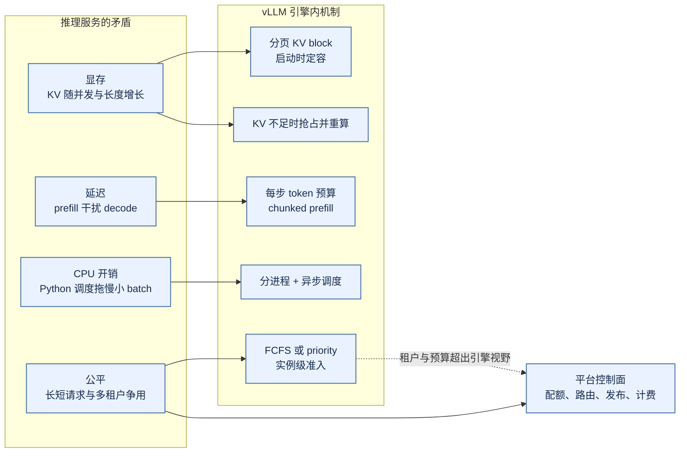

*图 10-1 推理服务的矛盾与 vLLM 的对应机制：引擎负责单实例内的资源与调度，租户和预算问题交给平台*

推理服务在平台中通常与其他组件分层组合：网关负责鉴权、限流和协议，路由器负责模型版本、租户和区域，serving engine（本章的 vLLM）负责执行与 cache，模型仓库负责制品，Kubernetes 等调度器负责 GPU，观测系统负责指标、日志与 trace。组合的代价是接口和故障边界增多，所以请求清单、模型清单、错误码和状态事件必须事先约定，否则替换任意一个组件都会改变行为。推理平台要回答的交付问题也随之分散到各层：制品能否加载、容量能否满足 SLO、状态能否回收、调度是否公平、成本能否解释，本章重点回答其中属于引擎的部分。

### 论文术语与代码术语

论文与代码用的词不同。下表给出本章用到的对照，后文直接使用代码术语。

| 论文或通用术语 | vLLM 代码术语 | 说明 |
|:---|:---|:---|
| iteration-level scheduling | `Scheduler.schedule()` 每步调用一次 | 请求可以在任意一步加入或退出 batch |
| PagedAttention 的物理 block | `KVCacheBlock`，由 `BlockPool` 管理 | 固定 token 数的 KV 存储单元，默认 16 个 token |
| block table | `KVCacheBlocks`（调度器侧）、`BlockTables`（worker 侧） | 逻辑位置到物理 block 的映射 |
| prefix cache | Automatic Prefix Caching（APC）与块哈希 | 按哈希链命中满 block |
| chunked prefill | token 预算截断 `num_new_tokens` | 没有单独的实现分支 |
| 抢占（preemption） | `Scheduler` 的抢占路径 | 只支持重算，不换出到 CPU |
| PD 分离 | KV connector | 调度器侧与 worker 侧两组接口 |
| 执行器 | `Executor`（进程管理）与 `GPUModelRunner`（单卡执行） | 两者不是一回事 |

### 本章要点

vLLM V1 是一个以“每步 token 预算”为统一调度抽象、以分页 KV block 为资源账本、用进程边界隔离 CPU 开销与 GPU 执行的推理引擎。读完本章应能回答五个问题：调度器为什么没有“prefill 阶段”，只让已计算 token 数追赶总 token 数；KV 不足时为什么是抢占重算而不是 OOM；prefix cache 的块哈希链如何决定命中与驱逐；为什么启动过程本质上是一次显存测量，block 总数因卡、因版本而异；以及 vLLM 只负责“单实例内把请求算好”，鉴权、配额、多实例路由、灰度和计费为什么必须由平台补齐。

> **与贯穿案例的对应**：ALR（本书 Agent 部分贯穿使用的业务诊断 Agent 案例）<!-- 作者待补：ALR 首次定义所在章节号 --> 运行在推理服务之上，但推理服务不理解它的业务语义。本章的请求与制品、运行观测、调度动作、流式状态和 SLO 验收，分别对应 ALR 的任务输入与资源版本、Evidence、受控动作、Run 状态和诊断交付；这些对应只用于帮助定位，本章机制的适用范围限于推理 Infra。

## 10.2 分层架构与组件

### 为什么要分进程

vLLM 官方架构文档把 `vllm serve` 的进程分为四类：API server、EngineCore、GPU worker，以及数据并行（DP）时才有的 DP coordinator [[2]](#ref-2)。分进程的核心理由是 **Python 的 CPU 开销**。在 V0 架构中，HTTP 处理、tokenize、调度、detokenize 和 GPU 前向挤在同一个进程里，彼此争用 GIL；GPU 越快，CPU 越成为瓶颈。V1 把它们拆开：API server 只做协议、tokenize 和 detokenize，可以多开以横向扩展；EngineCore 只跑调度循环这个性能关键的内循环，指标统计等簿记工作被推到前端；worker 只执行调度器下发的计划。

worker 是否是独立进程取决于执行器后端。总并行规模大于 1 时默认使用多进程后端 `MultiprocExecutor`，**每张 GPU 一个 worker 进程**；单卡时默认使用 `UniProcExecutor`，**worker 直接在 EngineCore 进程内执行**，没有额外进程。架构文档给出的进程数公式是 API server 数 + DP 大小 + GPU 数（DP 大于 1 时再加 1 个 coordinator），例如 `-tp=4` 时为 6 个进程；它按“每 GPU 一个 worker”计数，描述的是多卡部署。

这套设计围绕一份随长度增长的 GPU 状态（KV cache）建立资源管理，也带来了几项固定的取舍：抢占只能重算，长请求被抢占一次可能浪费大量计算；prefix cache 只能命中满 block，命中粒度受 block 大小限制；KV 容量在启动时确定，运行时不能按需扩张；CUDA Graph 只覆盖一组离散的 batch 大小，其余要补齐或走 eager。理解这些取舍，是正确设置 `max_num_seqs`、`max_num_batched_tokens`、`gpu_memory_utilization` 和 block 大小的前提，后文会逐一展开。

### 服务层、引擎层与执行层

**服务层**运行 FastAPI 应用和一个 `AsyncLLM` 对象。OpenAI 兼容路由由 `OpenAIServingChat` 等类处理，它们构造采样参数、调用 `AsyncLLM.generate`，再把增量结果包装成 SSE 事件。`AsyncLLM` 持有四个部件：Renderer（tokenizer 与 chat template）、`InputProcessor`（校验参数、补默认值，生成发给引擎的 `EngineCoreRequest`）、`OutputProcessor`（为每个请求维护 `RequestState`，做增量 detokenize、stop string 检查并计算延迟指标）和 `EngineCoreClient`（ZMQ 客户端）。tokenize 放在前端，意味着 tokenizer 必须与引擎加载的模型严格匹配；stop string 也在前端检测，命中后前端要反过来通知引擎中止请求。

**引擎层**的主体是 EngineCore 进程中的 busy loop：从输入队列取出新请求和中止请求，执行一步，把结果放进输出队列。两个 I/O 线程负责 ZMQ 收发与 msgpack 编解码，busy loop 本身不碰网络。一步包括：`Scheduler.schedule()` 产生执行计划 `SchedulerOutput`，交给执行器做前向，在 GPU 执行期间计算结构化输出的语法 bitmask，让 worker 采样，最后由 `Scheduler.update_from_output` 写回新 token、检查停止条件、释放结束请求的资源。**所有 KV block 的分配与回收决策都在 EngineCore 中做出**，worker 只按调度器给出的 block 编号读写显存，这是 vLLM 最重要的所有权边界。

**执行层**有三个对象：`Executor` 运行在 EngineCore 进程中，负责启动和管理 worker，多进程时用共享内存消息队列向所有 worker 广播 RPC；`Worker` 负责设备初始化、分布式通信组和显存测量；`GPUModelRunner` 负责单卡执行，维护 worker 侧请求状态与 block table，准备输入张量和 attention 元数据，执行前向与采样。在 `77d2790` 中 GPUModelRunner 有两个实现：**Model Runner V2** 在特性支持时默认启用，否则回退到 V1 实现，也可以用环境变量 `VLLM_USE_V2_MODEL_RUNNER` 强制指定。V2 把持久状态与每步输入解耦，以异步执行为前提去掉 CPU 同步点，用 Triton kernel 在 GPU 上准备输入元数据，并显式管理 CUDA Graph [[7]](#ref-7)。两者对调度器暴露的接口相同，所以调度层的分析对两者都成立，10.5 节按 V2 描述执行路径。

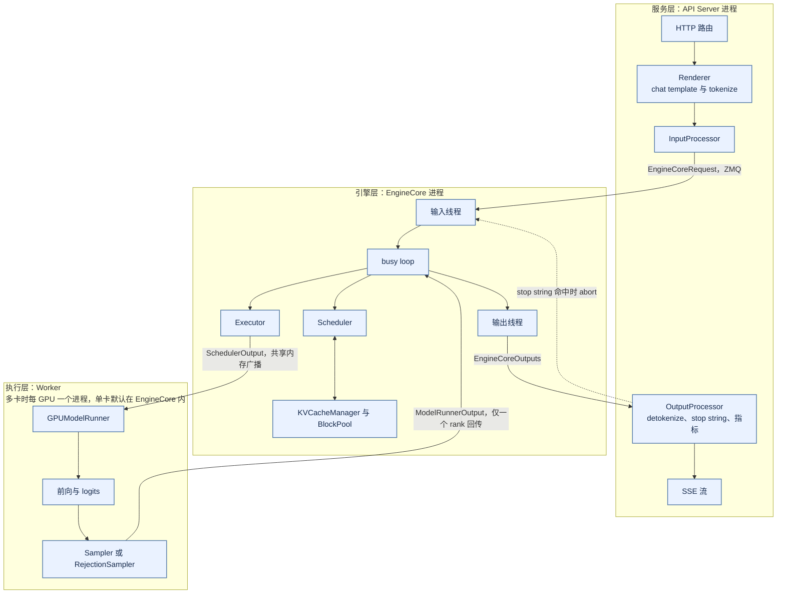

*图 10-2 三层之间的信息流：请求向下流动，token 向上流动；stop string 是唯一由前端发起的反向控制*

如图 10-2 所示，EngineCore 向所有张量并行（TP）rank 广播同一份 `SchedulerOutput`，各 rank 执行相同的前向，但只有最后一个流水线（PP）stage 的 TP rank 0 回传 `ModelRunnerOutput`。

### 组件与分工

| 组件 | 所在进程 | 职责 |
|:---|:---|:---|
| CLI 与 launcher | API | 解析参数、选择运行形态、绑定端口、构建应用 |
| `AsyncLLM` | API | 前端门面：`generate`、`abort`、健康状态、准入检查 |
| Renderer、`InputProcessor`、`OutputProcessor` | API | 模板与 tokenize；校验与转换；增量 detokenize 与指标 |
| `EngineCoreProc` | EngineCore | busy loop、I/O 线程、单步函数 |
| `Scheduler` / `AsyncScheduler` | EngineCore | 每步的 token 分配、抢占、停止判断、资源释放 |
| `KVCacheManager`、`KVCacheCoordinator`、`BlockPool` | EngineCore | prefix 命中、block 分配与回收、多 KV cache group 协调 |
| `StructuredOutputManager` | EngineCore | 异步编译语法，计算 token bitmask |
| `Executor` | EngineCore | worker 管理与 `collective_rpc` |
| `Worker`、`GPUModelRunner`、`Sampler` | Worker | 设备与通信组、显存测量；输入准备、CUDA Graph、前向、采样 |
| KV connector | EngineCore 与 Worker | PD 分离与 KV offload 的传输 |

调度器决定**谁**在这一步运行、**各**算多少 token；KV 管理器回答**能不能**为这些 token 准备好存储。两者的接口很窄：调度器对新请求先调用 `get_computed_blocks` 查询 prefix 命中，再调用 `allocate_slots` 为要计算的新 token 申请 block，失败时返回 `None`，请求结束时调用 `free`。调度器不知道 block 的物理布局，KV 管理器不知道请求优先级，也不做抢占决策。KV 管理器内部的 `KVCacheCoordinator` 处理“一个模型有多种层”的情况：全注意力层与滑动窗口层并存，或 Transformer 层与 Mamba 层混合时，每种层组成一个 KV cache group，各有一个单类型管理器负责 block 规则，所有 group 共享同一个 `BlockPool`。

### 显存与容量

推理节点的显存由权重、KV cache、前向激活与临时张量、kernel 与 CUDA Graph 工作区、通信 buffer 组成。vLLM 用 `gpu_memory_utilization` 表达“本实例能用多少显存”，它是**单实例**上限，不感知同卡的其他进程。这个参数的默认值随版本变化：v0.11.0 为 0.9，v0.32.0 为 0.92；在 `77d2790` 中未设置时，启用 extensible KV cache 取 1.0，否则取 0.92（见 10.10 节）。KV cache 的大小不是直接配置的，而是“上限 − 权重 − 测得的峰值激活 − 其他非 KV 占用”的余数，按 block 大小折算成 block 数（见 10.4 节）；也可以用 `kv_cache_memory_bytes` 直接指定 KV 字节数，此时忽略 `gpu_memory_utilization`。

vLLM 把显存问题转化为 block 数问题：KV 池在启动时就已分配好（或地址已保留），运行时不再向 CUDA 申请 KV 显存，只在 `BlockPool` 里分配和回收 block。block 不够时调度器不会触发 OOM，而是**不接纳新请求**，或**抢占正在运行的请求**（见 10.5 节）。这是一种内建的准入，代价是抢占带来的重算而不是进程崩溃。租户并发、最大上下文和预算的准入仍要在网关做，因为引擎不知道租户和预算。

做容量初估时，设到达率为 \\(\lambda\\)，平均输入、输出 token 为 \\(P\\)、\\(D\\)，单 GPU 在给定负载下的 prefill、decode 有效吞吐为 \\(R_p\\)、\\(R_d\\)，利用率预算为 \\(u\\)。若两阶段共享同一串行计算预算，需要把工作相加；PD 分离时两池分别估算：

\\[
N_{\text{shared}} \approx \frac{1}{u}\left(\frac{\lambda P}{R_p}+\frac{\lambda D}{R_d}\right),\qquad
N_{\text{prefill}} \ge \frac{\lambda P}{R_p\,u_p},\qquad
N_{\text{decode}} \ge \frac{\lambda D}{R_d\,u_d}
\\]

对两个瓶颈取最大值只是下界，不是混部所需的总 GPU 数；混部的干扰必须压测。这里的吞吐不是硬件峰值，必须绑定模型、长度与 batch 分布；输出长度长尾明显时用平均 \\(D\\) 会低估 decode 并发。在此基础上还要叠加 KV 容量、网络传输、故障余量、发布余量和突发余量，同一份剩余容量不能同时承诺给节点故障、扩容和滚动发布 [[8]](#ref-8)。

### 案例：Qwen3-8B 的显存账本

下面做一次可复算的教学估计。前提是：单卡显存按 24 GiB 计；`gpu_memory_utilization` 取 `77d2790` 在未启用 extensible KV cache 时的默认值 0.92；激活、logits、通信与 CUDA Graph 工作区人为给定一个 2 GiB 的联合上界；block 大小 16 个 token；不考虑 prefix 共享。模型参数来自 Qwen 官方模型卡与 `config.json`：约 8.2B 参数（safetensors 元数据为 8,190,735,360 个 BF16 参数，`tie_word_embeddings` 为 false，嵌入层与输出层分别计入），36 层，32 个 query head、8 个 KV head，head_dim 为 128 [[9]](#ref-9)。在 GQA（分组查询注意力，多个 query head 共享一组 KV head）下，KV 账本只用 KV head 数，不能代入 32 个 query head。

权重按每参数 2 字节为 16,381,470,720 字节，约 16.38 GB，即 15.26 GiB。KV 每 token 为 \\(2\times36\times8\times128\times2=147{,}456\\) 字节，第一个 2 代表 K 与 V，最后的 2 是 BF16 字节数；一个 block 在 36 层上合计 \\(16\times147{,}456=2{,}359{,}296\\) 字节（2.25 MiB）。一条 8192 token 的序列（输入与已生成输出都计入）占 1.125 GiB，即 512 个 block。

| 24 GiB 单卡教学预算 | 数值 | 性质与边界 |
|:---|:---|:---|
| 本实例上限（0.92） | 22.08 GiB | 其余 8% 不在本实例账内 |
| BF16 权重 | 15.26 GiB | 8,190,735,360 参数 × 2 字节 |
| 激活、通信、CUDA Graph 与工作区 | 2 GiB | 人为给定；vLLM 启动时实测 |
| 可用于 KV 的预算 | 约 4.82 GiB | 22.08 减去前两项 |
| 折算 block 数 | 2195 个 | 4.82 GiB ÷ 2.25 MiB，向下取整 |
| 四条 8192 token 序列 | 2048 个 block | 可以同时驻留 |
| 第五条加入后 | 2560 个 block | 超过预算 |

因此候选并发上限为 4。它不代表四并发能满足 TPOT，也不保证真实工作区低于 2 GiB。若把利用率换成旧版本默认的 0.9，KV 预算降到约 4.34 GiB、1976 个 block，候选上限变为 3，这正是默认值版本差异会直接改变容量结论的例子。在 vLLM 中第五条请求不会导致 OOM：它要么留在等待队列，要么在调度时触发抢占。INT4 权重名义上约 4.1 GB，但还有 scale、zero point 和反量化工作区，且权重降精度不会自动缩小 BF16 的 KV。多卡时按各 rank 实际持有的权重和 KV 分片建账，不能把所有项机械地除以 TP 数。

### 部署形态：TP、PP、DP、EP 与 PD 分离

模型放得进单卡时，多副本最简单，故障也容易隔离；放不进时需要张量并行（TP）、流水线并行（PP）或专家并行（EP），各策略的原理与通信量见第9章 9.3 节。vLLM 在初始化分布式环境时按 DP × PP × PCP × TP 的布局为每个 rank 建立 TP、DCP、PCP、PP、DP、EP 等通信组，其中 DCP（decode context parallel）和 PCP（prefill context parallel）分别在 decode 和 prefill 阶段沿序列维度切分上下文与 KV。

- **TP**：列切分的层不需要通信，行切分的层在输出上做 all-reduce，每个 Transformer 层大约两次。TP 适合同机高速互联；跨节点 TP 在低并发 decode 中会把通信延迟暴露在每个 token 上 [[10]](#ref-10)。
- **PP**：层被切成多个 stage，stage 之间传递中间张量；EngineCore 用 batch queue 让多个 batch 同时在途以填满流水线。
- **DP**：每个 DP rank 是一个独立的 EngineCore，有自己的调度器和 KV。非 MoE 模型的 DP rank 等同于多个副本，前端在内部负载均衡模式下按在途请求数和等待、运行请求数为引擎打分来分配请求。
- **EP**（MoE）：attention 按 DP 并行，专家分布在 DP × TP 组成的 EP 组上，token 通过 all-to-all 路由到专家。每层都要跨 DP rank 交换，所以所有 DP rank 必须同步步进，空闲 rank 执行 dummy batch，由 DP coordinator 协调。vLLM 还提供 DBO（Dual Batch Overlap），用两个微批重叠 MoE 的通信与计算。

**PD 分离**把 prefill 与 decode 放到不同实例，代价是 KV 传输、请求协调、故障重试和网络容量 [[6]](#ref-6)。vLLM 用 **KV connector** 抽象实现 PD 分离和 KV offload，接口分为调度器侧（有多少 token 可从外部加载、分配 block 后更新状态、请求结束时是否推迟释放）和 worker 侧（前向前后加载或保存 KV），注册的实现包括 NIXL、Mooncake、LMCache 和 CPU offload 等，执行细节见 10.5 节。另一种解耦是 MoE 的 attention 与 FFN 分离（AF 解耦），如 MegaScale-Infer 让 attention 节点与 expert 节点之间做 M2N（M 个发送端对 N 个接收端）通信 [[11]](#ref-11)，它改变的是每层模块的放置，不在本章主线内。图 10-3 对比了三种典型形态。

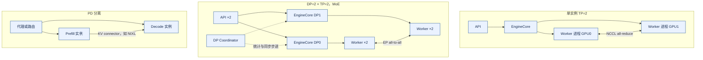

*图 10-3 三种典型部署形态：TP 在实例内切分模型，DP 与 EP 横向扩展引擎，PD 分离把两个阶段放到不同实例*

并行度越大不一定越快，必须结合拓扑、batch、序列长度和通信占比测量。故障域也随之变化：同一 TP group 中一张卡故障，整个 group 都不可用，发布和容量控制应以逻辑副本为单位。

## 10.3 KV cache 与领域对象

### 对象链：契约、状态与资源

一条请求在 vLLM 中会依次变成多种对象，每种对象只活在一个进程里。按时间顺序串起来，就是推理服务领域模型的主线，如图 10-4 所示。

```mermaid
flowchart LR
    A["HTTP 请求体<br/>messages 与参数"] -->|"Renderer"| B["EngineInput<br/>token ids 与 arrival_time"]
    B -->|"InputProcessor"| C["EngineCoreRequest<br/>跨进程消息"]
    C -->|"EngineCore"| D["Request<br/>调度状态"]
    D -->|"Scheduler.schedule"| E["SchedulerOutput<br/>一步的执行计划"]
    E -->|"GPUModelRunner"| F["InputBatch<br/>本步输入张量"]
    F -->|"前向与采样"| G["ModelRunnerOutput<br/>采样结果"]
    G -->|"update_from_output"| H["EngineCoreOutputs<br/>增量 token 与结束原因"]
    H -->|"OutputProcessor"| I["RequestOutput<br/>文本增量"]
    I -->|"OpenAIServingChat"| J["SSE chunk"]
    D -.->|"持有"| K["KVCacheBlock ×N"]
    classDef default fill:#eaf2ff,stroke:#5279aa,stroke-width:1.5px,color:#172b4d;
```

*图 10-4 对象链：请求向下变换、结果向上变换；`Request` 是唯一跨越整个生命周期的调度对象*

这些对象可以分成三类。**契约对象**回答“要做什么、按什么规则做”，如 `VllmConfig`、`SamplingParams`、`EngineCoreRequest`、`SchedulerOutput`，创建后基本不变；**状态对象**回答“做到哪一步了”，如 `Request`、worker 侧请求状态和前端的 `RequestState`，每步变化；**资源对象**回答“占用了什么”，如 `KVCacheBlock`、`BlockPool` 和 KV 张量，有引用计数，必须回收。三类对象出错的表现不同：契约错表现为行为与预期不符（例如模板不一致导致输出变化），状态错表现为卡住或重复（例如请求永远不结束），资源错表现为泄漏或越界（例如空闲 block 数持续下降）。区分它们是排障的第一步。

模型制品同样是契约对象。`config.json` 决定模型结构和 KV 规格，`generation_config.json` 提供采样默认值，tokenizer 配置中的 chat template 决定 prompt 如何渲染，所以**改动模型目录中的任何一个文件都可能改变线上行为**，而 vLLM 不会告诉你哪个文件变了。制品的版本、hash 与兼容矩阵由发布系统管理（见第12章 12.3 节），vLLM 只消费经过校验的目录。

### 请求对象与 token 追赶模型

`EngineCoreRequest` 是前端发给引擎的消息，一个按位置序列化的 `msgspec.Struct`，携带 `request_id`、prompt token、采样参数、到达时间、LoRA、`cache_salt`、`priority`、用于把输出路由回正确前端的 `client_index`，以及前端预先计算的 prompt 块哈希。`request_id` 会被改写为“外部 ID + 8 个随机字符”，以免同一外部 ID 重复提交时在引擎内冲突，日志与 trace 关联时要注意这一点。

`Request` 是 EngineCore 中一条请求的可变状态，由调度器持有和修改。理解 vLLM 调度，关键是它的几个计数字段：

| 字段 | 含义 |
|:---|:---|
| `num_tokens` | 输入与已生成输出的总长度 |
| `num_computed_tokens` | 已经算出（或已被调度、即将算出）KV 的 token 数 |
| `spec_token_ids`、`num_tokens_with_spec` | 下一步要验证的 draft token；总长度加 draft 数 |
| `num_output_placeholders` | 异步调度下已调度但结果尚未返回的 token 数 |
| `block_hashes` | 已满 block 的链式哈希，随输出增量追加 |
| `status`、`events` | 状态，以及 QUEUED、SCHEDULED、PREEMPTED 等带时间戳的事件 |
| `priority`、`arrival_time`、`num_preemptions` | 排序依据与被抢占次数 |

调度的全部逻辑可以浓缩为一句话：**每一步，让 `num_computed_tokens` 尽量追上 `num_tokens_with_spec`**。新请求的 `num_computed_tokens` 从 prefix 命中长度起步；一次 prefill 可能分多步追完，这就是 chunked prefill；追上之后每步追一个新 token（decode），或一个新 token 加若干 draft token（投机解码）。`num_computed_tokens` 在调度完成时就被乐观推进，被拒绝的 draft 在拿到结果后回滚。请求按（priority, arrival_time, request_id）排序，priority 数值越小越优先。

`SamplingParams` 描述“怎么采样、什么时候停”：采样参数（temperature、top-p、top-k、惩罚项等）、停止条件（`max_tokens`、`stop`、`stop_token_ids`）、输出方式（`n`、logprobs、流式用的 DELTA 模式）和结构化输出约束。采样配置会改变 decode 路径：结构化输出需要语法引擎生成 token bitmask；`n > 1` 在前端展开为 n 个子请求。平台应把实际生效的采样配置记入 usage 与 trace。结构化输出只保证语法合法，不保证字段取值合法；vLLM 负责生成工具调用文本并用解析器提取参数，但它不执行工具，也不知道工具是否已经执行过。工具参数应先进入待执行状态，经过 schema、权限和参数范围校验后再提交，执行的幂等与审计由上层用独立的 operation id 保证。

### KV 规格、block 与 BlockPool

KV 是可以从输入重算出来的中间状态，抢占时直接丢弃，重启后也不恢复，与业务层的“对话记忆”无关。每层 KV 的形状由 `KVCacheSpec` 描述：block 大小、KV head 数、head 维度和 dtype，子类对应全注意力、MLA（多头潜在注意力）、滑动窗口、Mamba 等层，每个子类给出一个 block 在该层占多少字节。启动时 EngineCore 把规格相同的层分到同一个 KV cache group，同一 group 的所有层共享一张 block table，一个 block 编号在每一层都对应一段显存。以 Qwen3-8B 为例，36 层全是全注意力，只有一个 group；每层每 token 的 KV 是 4096 字节，一个 16 token 的 block 在一层占 64 KiB，36 层合计 2.25 MiB，与 10.2 节的账本一致。

`KVCacheBlock` 是 block 的元数据对象，只记录编号、引用计数、块哈希（仅在被缓存时设置）以及在空闲队列中的前后指针。`BlockPool` 在启动时为每个编号创建一个对象，并持有空闲队列（支持 O(1) 从中间移除的双向链表）和哈希到 block 的映射。为了让 block table 保持只追加，vLLM 不对重复的缓存 block 去重，同一哈希可能对应多个 block。编号 0 的 null block 用来填充滑动窗口中已跳过的位置，不参与引用计数和缓存。

block 没有显式的状态枚举，但可以从引用计数和哈希推出四种状态：使用中且私有（引用计数为 1、无哈希，正在被写入的最后一个未满 block）；使用中且已缓存（满 block，可能被多个请求共享，只读）；空闲但可命中（引用计数为 0、有哈希，在空闲队列中，被复用前仍可被 prefix 命中）；空闲且干净（引用计数为 0、无哈希，优先被复用）。只有非 null、引用计数为 1 且没有哈希的 block 才可写。经典 PagedAttention 需要 copy-on-write，而 vLLM V1 只共享满 block、新 token 总写入请求自己的新 block，普通模型不需要 CoW；只有混合模型开启细粒度 prefix 命中、命中结束在缓存 block 中间时，才复制一份给请求私有。图 10-5 给出这些资源对象的关系。

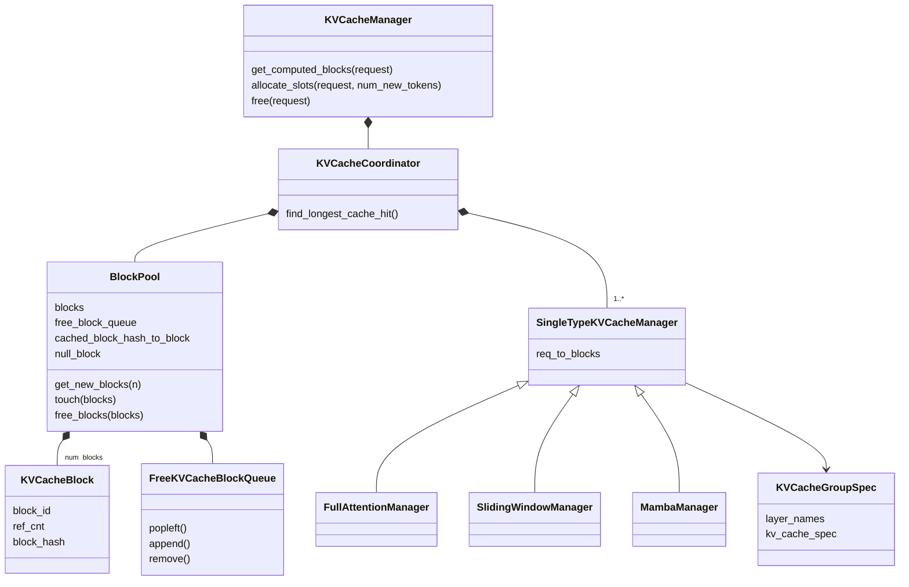

*图 10-5 资源对象：每个 KV cache group 一个单类型管理器，所有 group 共享一个 BlockPool*

### Prefix cache：块哈希、命中与驱逐

vLLM 的 Automatic Prefix Caching 默认开启，规则如下 [[12]](#ref-12)：只有**满 block** 会被缓存和命中；每个 block 的哈希由父 block 哈希、本 block 的 token 和额外键共同计算，因此天然编码了完整前缀；额外键包括 LoRA 身份、与本 block 重叠的多模态输入标识、`cache_salt`（只加在首 block 上）和 prompt embedding 的哈希；默认哈希算法为 sha256；命中长度最多为 `num_tokens − 1`，最后一个 token 总要重算以得到采样所需的 logits。由于哈希是链式的，第 i 个 block 未命中意味着之后都不会命中，查询从头顺序进行到第一次未命中为止。

首 block 的父哈希来自一个种子，它决定了不同实例能否算出相同的哈希。在 `77d2790` 和 v0.32.0 中，未设置 `PYTHONHASHSEED` 时，sha256 等密码学哈希使用固定默认种子，因此不同进程对相同内容算出相同哈希，可以跨实例共享前缀；xxhash 等非密码学哈希仍使用进程级随机种子，以防攻击者离线构造碰撞；设置 `PYTHONHASHSEED` 则两种情况都以它为种子。v0.11.0 的行为不同：未设置 `PYTHONHASHSEED` 时一律使用随机种子，跨实例命中需要显式统一该变量。

vLLM 没有单独的驱逐线程，block 的生命周期由引用计数和空闲队列决定。请求释放 block 时引用计数减一，减到 0 的 block 回到空闲队列：**已缓存的 block 追加到队尾**，按 LRU 保留、仍可被命中；**未缓存的 block 放到队首**，优先复用以获得更好的显存局部性。请求按**逆序**释放自己的 block，尾部 block 先入队，于是比前缀更早被淘汰。分配新 block 时从队首取出，如果取出的 block 还带着旧哈希，此时才把它从哈希表中移除，驱逐是惰性的。命中的 block 若在空闲队列中，会被移出并把引用计数加一，多个共享前缀的请求引用同一组物理 block。引用计数大于 0 的 block 不在空闲队列中，所以驱逐不会影响正在执行的请求。

“命中 cache”在推理平台上至少有四种语义，不能共用一套指标和安全规则：

| 层次 | 复用什么 | 命中条件 | 收益与风险 |
|:---|:---|:---|:---|
| 请求内 KV | 当前序列的 K/V | 该请求的历史与位置一致 | 避免重复计算；占用随长度增长 |
| Prefix cache | 共享前缀的 KV block | 完整 token 前缀、模型与执行配置兼容、授权域允许 | 主要省 prefill；侧信道与驻留风险 |
| 精确响应缓存 | 已完成的答案 | 规范化请求、上下文、权限与知识版本一致 | 跳过生成；事实过期 |
| 语义响应缓存 | 相似请求的候选答案 | 还须通过等价性、新鲜度与权限检查 | 误命中直接交付错误答案 |

vLLM 的 APC 只属于第二层，收益集中在 prefill，不能据此承诺 decode 等比例加速。后两层在引擎之外由平台实现。GPTCache 是语义响应缓存的公开实现 [[13]](#ref-13)，但相似不等于等价：“我可以报销吗”与“我不可以报销吗”高度相似，答案却可能相反，因此应先按租户、授权范围和知识版本硬过滤，再在域内检索并逐项校验否定、条件和实体；撤权、删除、知识发布和模板升级都应触发失效事件，有副作用的操作不能因缓存命中而重新执行。

### 请求状态机

`RequestStatus` 是一个整数枚举，排在 `PREEMPTED` 之后的都算结束状态。等待类状态包括 `WAITING`、`WAITING_FOR_STRUCTURED_OUTPUT_GRAMMAR`（结构化输出的语法正在异步编译）、`WAITING_FOR_REMOTE_KVS`（正在从 PD 分离的 prefill 端或外部 cache 加载 KV）和 `WAITING_FOR_STREAMING_REQ`（可续写会话的一轮结束，等待下一段输入）；结束状态包括 `FINISHED_STOPPED`、`FINISHED_LENGTH_CAPPED`、`FINISHED_ABORTED`、`FINISHED_IGNORED`（prompt 超过长度上限，对外映射为 length）、`FINISHED_ERROR` 和 `FINISHED_REPETITION`。这组状态名依赖版本，v0.11.0 中语法等待状态叫 `WAITING_FOR_FSM`，也没有 ERROR、REPETITION 和流式续写状态（见 10.10 节）。主要迁移如图 10-6 所示。

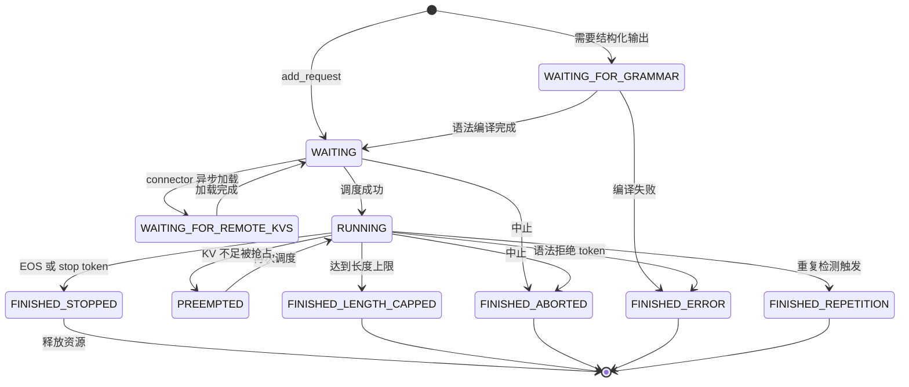

*图 10-6 计算轴状态机（WAITING_FOR_GRAMMAR 即 WAITING_FOR_STRUCTURED_OUTPUT_GRAMMAR；省略了流式续写与 FINISHED_IGNORED）*

迁移是幂等的：对已经结束的请求再次中止不会改变它的结束原因，已结束请求在途步骤的输出会被跳过。计算状态之外还有一条交付轴：连接中、STREAMING、已断开。STREAMING 与 RUNNING 可以同时成立，交付轴不在引擎中，而在 API server 与客户端之间。两轴叠加时，最危险的是“客户端已断开而请求仍在 RUNNING”：如果断开没有被及时感知（例如中间代理缓冲了连接），引擎会继续为没人接收的请求生成 token 并占用 KV。平台应监控断开时仍在运行的请求数和从断开到 abort 的延迟。

### 所有权与不变量

vLLM 的正确性很大程度上依赖“**每种可变状态只有一个写者**”：

| 状态 | 唯一写者 | 其他组件的访问方式 |
|:---|:---|:---|
| `Request` 的状态、进度、已生成 token | Scheduler | worker 通过 `SchedulerOutput` 收到副本或增量 |
| block 的分配、引用计数、哈希 | `BlockPool`（经 KV 管理器） | worker 只按编号读写显存 |
| KV 张量的内容 | worker 上的 attention kernel | 调度器从不读取 KV 内容 |
| worker 侧请求状态与 block table | `GPUModelRunner` | 每步按 `SchedulerOutput` 增量更新 |
| `RequestState` 与 detokenize 进度 | `OutputProcessor` | 引擎不感知文本 |
| 共享准入计数 | 每个 API 进程写自己的槽位 | 所有 API 进程读取全部槽位求和 |

最后一行看似例外：多个 API 进程共享一块准入计数内存。但它的单写者粒度是“槽位”：每个进程只写自己独占的一个缓存行，读者把所有槽位相加，因此既不需要进程间锁，也不会出现两个写者改同一个值；代价是并发更新时读到的总和只是各槽位的近似快照，适合做过载保护，不适合做精确配额。

由此可以列出几条可检验的不变量：非 null block 的引用计数为 0 当且仅当它在空闲队列中；只有满 block 被缓存，未经验证的 draft token 永远不会被缓存；prefix 命中长度最多为 `num_tokens − 1`；运行中请求数不超过 `max_num_seqs`，每步 token 总数不超过预算；只有 RUNNING 的请求能被抢占，抢占释放全部 block 并把 `num_computed_tokens` 清零；**block table 只追加**，被抢占后恢复的请求除外，它的 block 列表整体替换。

worker 侧用 block table 计算每个 token 的写入位置：

\\[
\text{slot}=\text{block\_table}[r,\lfloor p/B\rfloor]\times B + (p \bmod B)
\\]

其中 \\(r\\) 是请求所在行，\\(p\\) 是 token 位置，\\(B\\) 是 block 大小。一致性依赖两条规则：block table 只追加，worker 才能增量更新；释放与复用之间必须隔一个安全点，请求结束后它的 ID 随下一步 `SchedulerOutput.finished_req_ids` 通知 worker，异步调度下调度器还要等在途步骤结束才真正释放 block。Model Runner V2 还把 CPU 侧对 block table 的修改先暂存，在每步开始时统一应用到 GPU，避免 CPU 修改与 GPU 读取并发冲突 [[7]](#ref-7)。

## 10.4 启动过程

### 启动顺序与进程拓扑

`vllm serve` 先把命令行参数解析成引擎参数，再由 `create_engine_config` 组织成一棵配置树 `VllmConfig`，其下有 `ModelConfig`、`CacheConfig`、`SchedulerConfig`、`ParallelConfig`、`CompilationConfig` 等子配置。这一步不只是搬运参数，很多默认值在这里按环境推导：OpenAI 兼容服务的 `max_num_seqs` 和 `max_num_batched_tokens` 随显卡显存变化（显存不小于 160 GiB 时为 1024 和 16384，不小于 70 GiB 且不是 A100 时为 1024 和 8192，其余为 256 和 2048）；执行器后端在总并行规模大于 1 时取多进程，等于 1 时取进程内。很多字段的默认值是 `None`，到启动过程中才解析，所以读配置文件不足以知道实际生效值，要看启动日志或 `/metrics` 中的配置信息指标。

单 API server 形态的启动顺序如图 10-7 所示。API 进程先**绑定 HTTP 端口**（此时只 bind、不处理请求），再构造 `AsyncLLM`：依次创建 Renderer、`InputProcessor`、`OutputProcessor`，最后创建引擎客户端。客户端绑定用于收发请求的 ZMQ socket 和握手 socket，拉起 EngineCore 子进程并**阻塞到它就绪**。EngineCore 中的执行器按后端决定是否创建 worker 进程：`MultiprocExecutor` 建立共享内存广播队列，为每个 rank 启动一个 worker 进程并等待它们报告就绪；`UniProcExecutor` 直接在本进程内创建 worker。worker 加载权重后，EngineCore 依次完成显存探测、KV 定容、编译和图捕获，创建调度器，最后把就绪信息发回前端。前端收到后才构建应用、开始服务 HTTP。

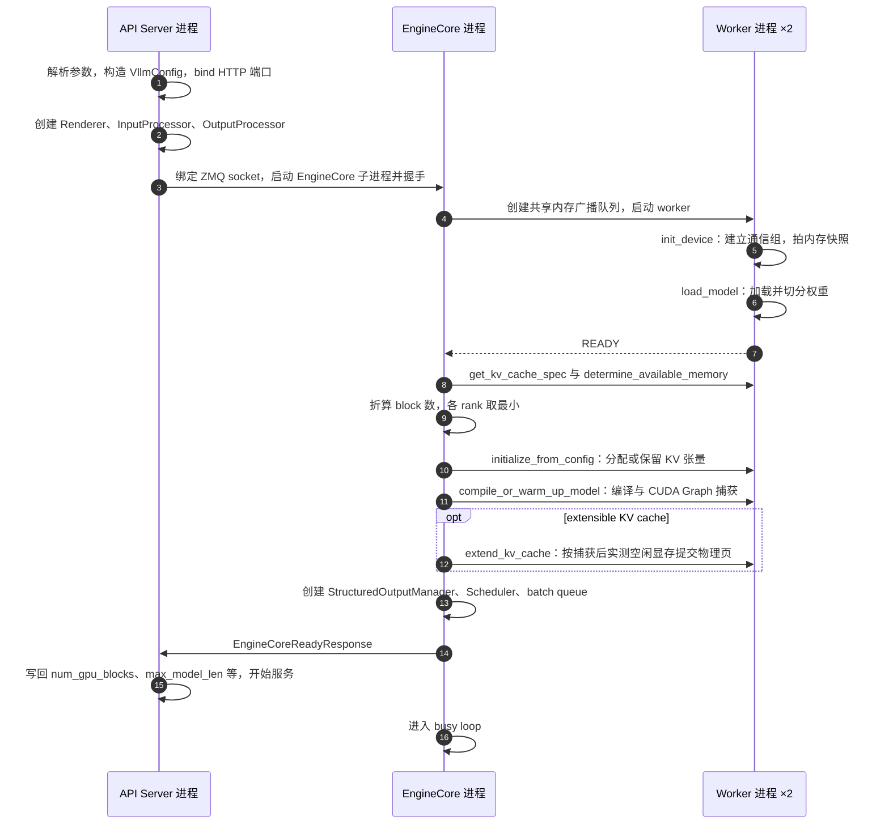

*图 10-7 启动时序（单 API server、TP=2、多进程后端）：先 bind 端口和 socket，再拉起引擎；显存探测与编译在引擎内完成，就绪信息最后回传前端。TP=1 时 worker 的步骤都在 EngineCore 进程内执行*

**同一份配置在两个进程里各自演化。** KV block 总数、自动缩小后的 `max_model_len`、实际 block 大小等值只有在引擎完成显存探测后才能确定，引擎在就绪响应中把它们发回前端写回自己的配置，所以前端日志里的 KV 容量要等引擎就绪后才出现。

### 制品与模型加载

vLLM 可以从 Hugging Face Hub 或本地目录加载模型，并用 `revision` 固定版本，但它**不负责制品的完整性门禁**：它不知道权重是否通过了评估、tokenizer 是否与训练时一致、chat template 是否被改过。这些检查应由发布系统在启动前完成，再把经过校验的本地目录交给 vLLM [[14]](#ref-14)[[15]](#ref-15)。

worker 的 `init_device` 顺序有讲究：先绑定 CUDA 设备，**在拍内存快照之前**初始化分布式环境、建立 TP 和 PP 等通信组，这样 NCCL 自己占用的显存会被计入“启动前已占用”，而不会被误算成模型占用；然后拍快照，按“总显存 × `gpu_memory_utilization`”向上取整得到本 worker 允许使用的显存。`load_model` 在名为 `weights` 的内存池中加载权重，TP 时每个 rank 只加载自己的切片，量化模型在这一步加载量化权重与 scale，LoRA 和草稿模型也在此加载。权重与 KV 分别放进不同的内存池，是为了支持后面的 sleep mode。

tokenizer 和 chat template 不在 worker 里，而在 API 进程里。tokenize 和 detokenize 消耗的是前端 CPU，不占用调度循环，前端成为瓶颈时可以多开 API server；但 vLLM 只按同一个模型路径分别加载 tokenizer 与权重，平台若把两者分开存放或分别升级，必须在制品清单层面保证版本一致。

### 显存探测与 KV 定容

模型加载完成后，EngineCore 先向各 worker 询问每层的 KV 规格，再让它们测量可用显存。worker 在 profiling 上下文中执行一次 `profile_run`：用最大 batch（`max_num_batched_tokens` 个 token）跑一次前向，测出非 KV 部分的峰值显存；torch.compile 的编译也在这次前向中触发。启用 CUDA Graph 时还要估算图捕获将占用的显存。于是：

\\[
M_{\text{KV}} = M_{\text{requested}} - M_{\text{non-KV}} - M_{\text{cudagraph}}
\\]

其中非 KV 部分包括权重、profile 测得的激活峰值和启动前已有的非 torch 占用。EngineCore 收齐各 worker 的结果后按最小值对齐（调度器只有一份 block 账本），折算成 block 数；若显存装不下一条 `max_model_len` 长度的序列，可能自动缩小 `max_model_len`。block 大小默认 16，未显式指定时可被平台按 attention backend 的偏好调整；混合多种层的模型有多个 KV cache group，调度器的 block 大小取参与 prefix caching 的 group 中最小者。

接下来分配 KV 张量，`77d2790` 中有两种行为，如图 10-8 所示。**预先分配**是传统路径：按算出的 block 数一次性分配全部 KV 显存，再进入编译和图捕获，KV 的大小依赖 profile 阶段对 CUDA Graph 占用的**估算**。**延后提交**即 extensible KV cache，在 CUDA 和 ROCm 上配合 Model Runner V2 时默认启用：这一步只用设备虚拟内存保留地址范围，等编译和图捕获完成后，各 worker 实测剩余空闲显存并折算成 block 数，EngineCore 取所有 rank 的最小值，再让 worker 提交物理页。实现中还在实测峰值之外保留至少 1 GiB（ROCm 为 2 GiB）并随模型工作集放大的余量，源码注释记录了 GB200 上 8B 模型首个 prefill 需要比已分配峰值多 25% 以上空间的观测，可见 profile 峰值不是可以直接相减的精确值。延后提交解决的是“估算不准”，过去只能靠保守的 `gpu_memory_utilization` 吸收偏差；它依赖驱动的虚拟内存管理能力，与部分 KV connector 不兼容，在显式指定 KV 字节数或 block 数、未使用 V2 runner 时不启用。截至 v0.33.0rc3，这一机制尚未进入发布版。

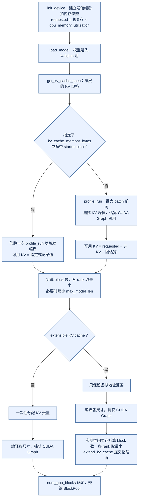

*图 10-8 显存初始化：KV 的大小是“允许用量减去其他一切”之后的余数，extensible 模式把这个减法推迟到图捕获之后*

### 编译、预热与就绪

vLLM 用两层手段降低每步的 CPU 开销。torch.compile 把模型前向编译成融合后的图；CUDA Graph 把一次前向中的大量 kernel launch 录制成图后整体重放。默认的 `cudagraph_mode` 是 `FULL_AND_PIECEWISE`：PIECEWISE 把 attention 之外的部分录成分段图，attention 以 eager 方式执行以适应变长；FULL 把整个前向录成一张图，适用于形状规整的纯 decode batch [[16]](#ref-16)[[17]](#ref-17)。CUDA Graph 要求固定形状和地址，vLLM 只为一组离散的 batch 大小捕获图，运行时把实际 batch 向上补齐到最近的已捕获尺寸，超过最大尺寸的 batch 走 eager。尺寸太少会产生 padding 浪费，太多会增加捕获时间和图占用的显存。

编译和捕获完成后，EngineCore 创建结构化输出管理器和调度器：异步调度开启时（无不兼容项时默认开启）用 `AsyncScheduler`，并创建 batch queue。**就绪的含义是“引擎已经可以调度”，不是“已经热身到稳态性能”**：第一批真实请求仍可能触发未覆盖的编译路径或 prefix cache 冷启动，平台应在接流量前发送一组覆盖典型长度的预热请求。启动耗时主要来自权重加载、profile 和编译，vLLM 提供 torch.compile 编译缓存，以及显式开启的 startup plan：后者把上次测得的 KV 字节数连同 vLLM 版本、配置哈希、设备型号、总显存和 torch/CUDA 版本等指纹一起持久化，指纹一致且空闲显存不低于基线时跳过显存 profiling。两种缓存都必须与模型 hash、GPU 架构、驱动和引擎版本一起管理，换任何一项都应视为失效。

主 API server 提供 `/health`、`/metrics`、`/version` 等运维接口，但 `/health` 的语义很窄：它只检查本地记录的引擎状态、不向引擎发 RPC，引擎已死时返回 503，否则 200；主 API server 没有独立的 `/ready` 路由。因此探针要这样设计：

| 探针 | 建议做法 | 原因 |
|:---|:---|:---|
| startup | 轮询 `/health`，给足加载与编译时间 | 启动期间 HTTP 尚未开始服务，大模型可能要十几分钟 |
| readiness | `/health` 返回 200 后，再发一个最小推理请求 | `/health` 只说明引擎没死，不说明能在 SLO 内响应 |
| liveness | `/health` | 引擎死亡后返回 503，前端 watchdog 也会让进程退出（见 10.7 节） |

平台把实例状态映射为 DOWNLOADING（拉取制品）、LOADING（初始化设备与加载权重）、WARMING（profile、KV 分配、编译与预热请求）、READY、DRAINING、UNHEALTHY 和 TERMINATED，只有 READY 接流量，并把模型 hash、vLLM 版本、GPU 型号、启动耗时和**最终 KV block 数**写入注册表，因为同一模型在不同显卡、不同版本甚至不同启动之间的 block 数都可能不同。

### 停止、drain 与 sleep

API 进程收到 SIGINT 或 SIGTERM 后调用引擎的 shutdown，EngineCore 根据 `shutdown_timeout` 决定行为：为 0 时是 **abort 模式**，所有在途请求以 `FINISHED_ABORTED` 结束；大于 0 时是 **drain 模式**，拒绝新请求、等在途请求完成直到超时。`shutdown_timeout` 的默认值是 0，即默认中止所有在途请求，生产滚动发布若要优雅退出，必须显式配置 drain 超时，使之与编排系统的终止宽限期匹配，并先从路由摘除实例再发终止信号。

启动失败按位置分类：参数校验失败在 API 进程内立即报错；引擎进程在初始化中途退出时，前端监视到进程消失并报告引擎初始化失败；引擎等待握手、前端等待引擎就绪各有超时（后者由 `VLLM_ENGINE_READY_TIMEOUT_S` 控制，默认 600 秒）。常见根因包括显存放不下权重、KV 预算放不下一条最大长度序列、NCCL 初始化失败和编译失败，平台应分别记录，而不是统一视为容器启动失败后无限重启。

sleep mode 允许不退出进程而释放显存：`sleep` 按 `weights` 和 `kv_cache` 两个标签释放或卸载对应内存池，`wake_up` 再恢复。它的典型用途是 RL 训练中推理与训练轮流使用同一组 GPU，以及在同卡上切换模型。sleep 和 `/reset_prefix_cache` 等接口只在设置 `VLLM_SERVER_DEV_MODE` 时注册，生产上应由平台代理并做权限控制。换 vLLM 版本或模型版本不应依赖 sleep mode，而应让新实例完整走完本节的启动和预热流程，再按第12章 12.3 节的灰度流程接入流量。

## 10.5 推理执行与调度

### 一次请求的全过程与时间口径

以一个流式 `/v1/chat/completions` 请求为例（单 API server、默认配置），处理过程如图 10-9 所示。API server 收到请求，检查引擎存活与实例准入，渲染 chat template 并 tokenize，构造采样参数后调用 `AsyncLLM.generate`；`InputProcessor` 生成 `EngineCoreRequest`，`OutputProcessor` 为它建立 `RequestState`，客户端经 ZMQ 发给引擎。EngineCore 的输入线程构造 `Request` 并计算块哈希，调度器把它放入等待队列。此后每一步，调度器决定它算多少 token，worker 执行前向并采样，调度器写回新 token、检查停止条件，前端增量 detokenize 并通过 SSE 发给客户端。对这个请求而言，第一次被调度的步骤是 prefill（prompt 超过预算时只算一部分），之后每一步都是 decode；遇到停止条件时调度器释放 KV block，前端发送最后的 `finish_reason`、usage 和 `[DONE]`。

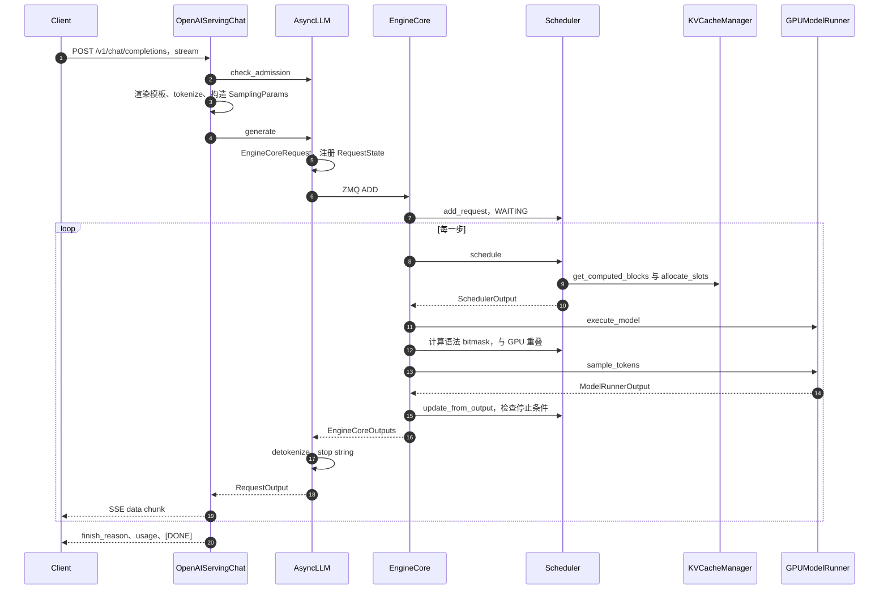

*图 10-9 一次流式请求的端到端时序：循环体是一次 engine step，对这个请求而言第一次是 prefill，之后是 decode*

指标必须绑定到对象与时间点上才有意义。vLLM 引擎只记录事件和单调时钟时间戳，时间差在前端计算，因为不同进程的单调时钟不可比较。各时间点与派生指标如下：

| 时间点或指标 | 记录位置与定义 | 时钟 |
|:---|:---|:---|
| `arrival_time` | 前端渲染 chat template 之前 | 前端墙钟 |
| QUEUED | 调度器接收请求时 | 引擎单调时钟 |
| SCHEDULED | 首次从等待队列被调度（抢占后重新调度不计） | 引擎单调时钟 |
| 首 token、末 token | 对应 `EngineCoreOutputs` 创建时 | 引擎单调时钟 |
| TTFT、E2E | 前端收到首个、最后一个输出的时间减 `arrival_time` | 前端墙钟 |
| 排队、prefill、decode 时间 | SCHEDULED − QUEUED，首 token − SCHEDULED，末 token − 首 token | 引擎单调时钟 |
| TPOT | decode 时间 ÷（生成 token 数 − 1），仅当生成 token 数大于 1 | 引擎单调时钟 |
| ITL | 相邻两次输出的间隔 | 引擎单调时钟 |

几处容易出错。第一，`77d2790` 与 v0.32.0 在渲染模板之前记录到达时间，所以 vLLM 的 TTFT **包含模板渲染和 tokenize**；v0.11.0 在 `InputProcessor` 的前身中记录，不含模板渲染，跨版本比较 TTFT 时要注意这个口径变化。第二，TTFT 不包含网关排队和网络发送，客户端看到的 TTFT 还要加上引擎外的两段：

\\[
\text{TTFT}_{\text{client}} \approx T_{\text{gateway}} + T_{\text{render}} + T_{\text{queue}} + T_{\text{prefill}} + T_{\text{return}} + T_{\text{send}}
\\]

vLLM 的 TTFT 指标覆盖中间四段。第三，生成 token 数不超过 1 时 TPOT 不适用，不能记为 0；一次输出可能包含多个 token（投机解码或 `stream_interval` 大于 1），不能把事件数当 token 数。报告时应按输入长度、输出长度、并发、cache 命中和租户分桶。

请求进入引擎前有三道检查。**引擎存活**：引擎已死则立即返回 503。**实例准入**：`check_admission` 是较新版本的前端准入控制，多个 API 进程通过共享内存交换未完成请求数和待 prefill 的 token 数（单写者槽位，见 10.3 节），配置了 `max_num_queued_reqs` 或 `max_num_queued_tokens` 且超限时返回 503 并计入准入拒绝指标；它发生在流式响应开始之前，所以过载时仍能返回正确的状态码，但 token 计数是保守的，没有扣除已完成的 prefill 片段和 prefix 命中。**参数校验**：`InputProcessor` 检查采样参数、LoRA 和 prompt 长度，prompt 恰好等于 `max_model_len` 的生成请求也会被拒绝，因为没有空间生成任何 token；`max_tokens` 未设置时取 `max_model_len` 减 prompt 长度。`n > 1` 的请求在前端展开为 n 个独立子请求（设置了 seed 时依次加 1），引擎看到的是 n 个请求，它们的 prompt 通过 prefix cache 共享 KV。tokenize 结果必须与计费、准入、KV 估算一致，网关若用不同版本的模板或 tokenizer 自行计数，就会出现“网关认为能放下、引擎拒绝”或账单与 usage 不符，建议以 vLLM 返回的 usage 为准。

### 调度一步：token 预算与先 running 后 waiting

vLLM V1 的架构文档明确说明，调度器基于 token 预算，**没有单独的 prefill 和 decode 阶段** [[2]](#ref-2)。每步开始时预算等于 `max_num_scheduled_tokens`（默认等于 `max_num_batched_tokens`），对每个被调度的请求计算本步要算的 token 数：

\\[
n_{\text{new}}=\min\bigl(T_{\text{spec}}+T_{\text{placeholder}}-T_{\text{computed}},\ \theta_{\text{long}},\ B_{\text{left}}\bigr),\qquad B_{\text{left}}\leftarrow B_{\text{left}}-n_{\text{new}}
\\]

其中 \\(T_{\text{spec}}\\) 是 `num_tokens_with_spec`，\\(T_{\text{placeholder}}\\) 是异步调度的占位数，\\(T_{\text{computed}}\\) 是已计算 token 数，\\(\theta_{\text{long}}\\) 是 `long_prefill_token_threshold`，\\(B_{\text{left}}\\) 是剩余预算，另外还受 `max_model_len` 和多模态 encoder 预算约束。一个 prompt 长 3000 的新请求在预算 2048 时被截成 2048，剩下的下一步再算，这就是 chunked prefill；一个 decode 请求的 \\(n_{\text{new}}\\) 为 1（或 1 加 draft 数）。同一步里 decode 请求和 prefill 片段拼成一个混合 batch。

一次 `schedule()` 的决策流程如图 10-10 所示。先按 `running` 列表顺序调度运行中的请求：计算并截断 \\(n_{\text{new}}\\)，结果为 0 则跳过（这会有意打破严格的 FCFS），调用 `allocate_slots` 申请 block，失败则抢占一个请求后重试。然后**仅当本步没有发生抢占时**调度等待中的请求：运行请求数达到 `max_num_seqs` 则停止；语法未编译完、远端 KV 未到、LoRA 数超过 `max_loras` 的请求跳过；对首次调度的请求查询本地 prefix 命中，配置了 KV connector 再查外部命中，二者之和作为 `num_computed_tokens` 的起点；关闭 chunked prefill 且放不下时直接停止；`allocate_slots` 失败也直接停止，**等待队列从不触发抢占**。最后构造增量的 `SchedulerOutput`（新请求带完整数据，已缓存请求只带新 block 和新进度），并乐观推进每个请求的 `num_computed_tokens`。

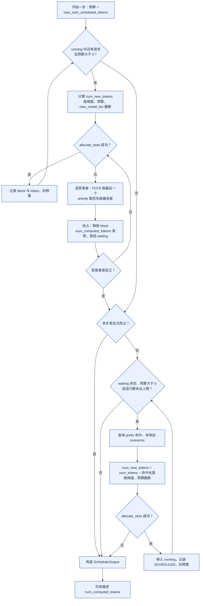

*图 10-10 一次 schedule() 的决策流程：运行中的请求优先，KV 不足时抢占；等待队列从不触发抢占*

“先 running 后 waiting”保护了正在 decode 的请求的 TPOT，代价是高负载下新请求的 TTFT 变长；“本步有抢占就不接纳新请求”避免刚抢占一个又接纳另一个造成抖动。这种统一表示让调度器不必区分阶段，代价是“prefill 优先还是 decode 优先”只能通过调度顺序和 `long_prefill_token_threshold` 等参数间接表达。

`allocate_slots` 的顺序是：移除滑动窗口等已不需要的 block；计算需要新分配的 block 数；检查空闲 block 是否足够，不够则返回 `None`；把命中的 block 引用计数加一并移出空闲队列；从空闲队列分配新 block；最后把截至 `num_tokens` 的满 block 写入哈希表。上限是 `num_tokens` 而不是 `num_tokens_with_spec`，所以 draft token 不会被缓存。还有一个值得注意的时序：**block 在被调度的那一步就被登记为已缓存**，此时这些 token 的 KV 只是“即将写入”；异步加载远端 KV 时调度器会显式推迟登记，说明“登记即可命中”的前提是 KV 在本步内一定会被写入。

默认开启的异步调度把 CPU 调度与 GPU 执行重叠起来。EngineCore 维护一个 batch 队列，V2 runner 下长度为 PP 大小加 1（单卡为 2）：队列未满时调度新的一步并非阻塞下发，队列满时才等待最早那一步的结果并写回，于是 GPU 执行第 N 步时 CPU 已在调度第 N+1 步，如图 10-11 所示。调度第 N+1 步时第 N 步还没有采样出 token，`AsyncScheduler` 的做法是**占位**：把 `num_output_placeholders` 加上本步将要采样的 token 数，真实 token 回来后再替换。代价是一个请求在第 N 步已经停止，第 N+1 步仍可能为它分配了 token，这部分计算被丢弃；结构化输出请求需要上一步的 token 推进语法状态，采样可能被推迟。

*图 10-11 异步调度：CPU 在 GPU 执行第 N 步时调度第 N+1 步，回写与下一次调度也与 GPU 执行重叠（时间比例仅为示意）*

### KV 不足时的抢占与公平

运行中的请求 `allocate_slots` 失败时，调度器选择一个受害者：FCFS 策略取 `running` 列表的最后一个，即最近被接纳的请求；priority 策略取（priority, arrival_time）最大者，即优先级最低、到达最晚的请求，若它本步已被调度则退还它占用的预算。抢占会释放它的全部 KV block 和 encoder cache，状态置为 PREEMPTED，**`num_computed_tokens` 清零**，增加抢占计数并记录事件，再放回等待队列（FCFS 下放到队首，优先下次调度）。如果被抢占的恰好是当前请求自己，说明没有更低优先级的请求可抢，本步停止调度运行队列。

抢占只有重算一种方式，调度器中没有把 KV 换出到 CPU 的路径。但重算未必从零开始：被释放的满 block 带着哈希进入空闲队列尾部，如果在该请求重新被调度前没有被复用，重新调度时的 prefix 查询能把它们找回来；配置了 KV offload connector 时还可以从 CPU 层找回。所以抢占的实际代价取决于 KV 压力：压力越大，被释放的 block 越可能被别人复用，重算越多。抢占对用户的表现是流式输出停顿、TPOT 尾部变长；抢占指标长期非零说明 KV 容量与负载不匹配，应降低 `max_num_seqs`、增加 KV 容量或在平台层收紧长上下文准入。

为减少反复抢占，较新版本在调度配置中提供 `watermark`：接纳等待中或被抢占过的请求时，要求额外保留一定比例的空闲 block；它只在本步已有请求被调度时生效，默认值 0 表示关闭。v0.11.0 的 V1 调度器没有这一参数。

vLLM 调度器提供的公平机制是有限的：FCFS 或 priority 两种排队顺序；`max_num_seqs` 限制并发；`long_prefill_token_threshold` 限制单个请求一步能占用的 prefill token，防止一个超长 prompt 独占一步；priority 策略下高优先级请求可以通过抢占挤掉低优先级请求。它**没有**租户配额、加权公平、deadline 或老化机制，这些属于平台控制面（见 10.6 节）。chunk 大小的取舍遵循 Sarathi-Serve 的结论 [[5]](#ref-5)：`max_num_batched_tokens` 越小，每步越短、TPOT 越稳，但长 prompt 要更多步才能完成；太小又会增加 kernel launch 和调度开销。

### Prefill、decode、采样与投机解码

worker 收到 `SchedulerOutput` 后，Model Runner V2 先更新本地状态：删除已结束的请求，释放被抢占请求的状态行，为新请求分配固定的状态行，按增量更新已有请求的 block 与进度，再把暂存的 block table 修改一次性应用到 GPU。然后准备输入：根据 token 数、是否为纯 decode 和 LoRA 数选择 CUDA Graph 模式与补齐尺寸；构造 `input_ids`、`positions`、每个请求本步 token 的起止位置 `query_start_loc`、序列长度和需要计算 logits 的位置（每个请求本步的最后一个 token）。V2 用 Triton kernel 在 GPU 上从持久状态中直接收集这些张量，并借助 UVA（Unified Virtual Addressing，统一虚拟寻址，让 GPU kernel 直接访问映射到设备地址空间的主机内存）读取 CPU 上的大张量，避免在 Python 中逐个拼接 [[7]](#ref-7)。混合 batch 中 prefill 片段与 decode 请求的 token 被拼成一维序列，attention kernel 按 `query_start_loc` 对每个请求分别计算。

前向时，每个 attention 层先按 slot mapping 把本步新 token 的 K、V 写入对应 block，再用该请求的 block table 读取全部历史 K、V 计算注意力。对 prefill 片段而言只有最后一个 token 的 logits 有用，如果它不是 prompt 的最后一段，这个位置的采样结果会被丢弃；所以长 prompt 的 TTFT 约等于排队时间加“片段数 × 每步耗时”，而每步耗时又取决于同一步里的其他请求。prefill 完成后请求进入 decode，每步只有一个 query token，却要读取全部权重和历史 KV，因此受内存带宽限制。提高 decode 效率的主要办法是把尽可能多的 decode 请求放进同一步，并用 CUDA Graph 消除 launch 开销：纯 decode 的 batch 用 FULL 图，整步只有一次重放；混合 batch 用 PIECEWISE 图；超过最大捕获尺寸走 eager。FULL 模式要求输入地址固定，V2 先把输入拷贝到捕获时使用的固定缓冲区再重放。多模态输入由 encoder 转成 embedding，调度器为 encoder 单独维护预算和按内容哈希的 encoder cache。

长上下文同时增加 prefill 计算、KV 容量、排队时间和 decode 阶段的显存占用，而引擎只能在预算内切块，不会替调用方决定是否接纳。平台应在入口限制最大输入、最大输出、总 token 和租户并发，并按请求类型选择同步、异步或低优先级队列；截断要保留消息边界、系统指令和工具 schema，不能简单从字符串尾部截断。指标上要区分排队、prefill、decode 和网络等待，才知道用户是在等计算还是在等资源。

采样在最后一个 PP stage 上执行。若有结构化输出请求，EngineCore 在 GPU 前向期间已算好语法 bitmask，此时原地应用到 logits 上，把不允许的 token 置为负无穷。采样器依次应用 logits processors（logit bias、min tokens、惩罚、bad words 等）、temperature 和 min-p，最后做 top-k、top-p 与随机采样，temperature 为 0 时取 argmax。V2 的随机采样使用 Gumbel 采样 kernel：给每个 logit 加上独立的 Gumbel 噪声后取 argmax，其结果服从 softmax 分布，无需先把 logits 归一化为概率再按累积分布抽样。采样完成后，V2 立即启动异步的 GPU 到 CPU 拷贝，与后续的 drafter 提议重叠。

投机解码用一个廉价的 drafter 提出若干候选 token，再由目标模型一次前向验证多个位置 [[18]](#ref-18)[[19]](#ref-19)。在 vLLM 中，draft token 存放在 `Request.spec_token_ids`，计入目标长度和 token 预算，`allocate_slots` 为它们预留 KV 槽位但不缓存；worker 用 `RejectionSampler` 比较目标模型与 drafter 的分布，接受前若干个 draft 并额外采样一个 token；调度器按被拒绝的数量回滚 `num_computed_tokens`；drafter 再为下一步提出新的 draft，方法包括 ngram、草稿模型、EAGLE 和 MTP 等。它改变了“每步每请求追加一个 token”的假设：batch 形状更不规则，KV 需要为候选预留空间。接受率低、输出短或并发高时额外计算可能抵消收益，平台应分别报告目标模型调用、draft 调用、接受率和每个成功输出 token 的总 GPU 时间，不能把使用 draft 后的 tokens/s 直接与未使用时比较。

### 并行与 PD 分离下的执行

TP 时，EngineCore 经共享内存消息队列把同一份 `SchedulerOutput` 广播给所有 TP rank，各 rank 用相同输入执行前向，各自持有权重和 KV 的一个切片。KV 按 KV head 切分；当 TP 大于模型的 KV head 数时，每个 rank 至少要有一个 KV head，KV head 会被复制到多个 rank，此时单卡 KV 占用不再随 TP 线性下降。一步中的通信点是每个 Transformer 层 attention 输出投影和 MLP 下投影之后各一次 all-reduce，以及采样前可能的 logits 聚合；只有最后一个 PP stage 的 TP rank 0 回传结果。PP 时前一 stage 把中间张量发给下一 stage，非最后 stage 接收广播的采样结果更新本地状态，batch queue 让多个 batch 同时在流水线中以减少气泡。

PD 分离时，一个请求先在 prefill 实例上完成 prefill，KV 通过 connector 传到 decode 实例，再逐 token 生成。decode 实例的调度器处理等待中的请求时，先查本地 prefix 命中，再询问 connector 有多少 token 可从远端加载、是否异步加载；为全部 token 分配 block（异步时推迟登记缓存）并把位置告诉 connector；异步加载期间请求处于 `WAITING_FOR_REMOTE_KVS`，不占 token 预算；调度器每步生成给 worker 侧 connector 的指令，worker 在前向前后启动加载、逐层等待或保存 KV；传输完成后请求回到等待队列，此时 `num_computed_tokens` 已包含远端 KV。prefill 实例上，请求结束时 connector 可以要求推迟释放 block，直到 KV 发送完成。以 NIXL connector 为例，默认是 pull 模式，decode 端从 prefill 端读取 KV；prefill 端以短租约持有待传输的 block，decode 端用心跳续约。分离后的调度是有状态的流量分配：prefill 完成但 decode 没有空间时，不能无限堆积已产生的 KV；KV 传输应携带模型版本、token 长度、KV dtype、布局和校验，支持超时与部分失败，路由决策写入 trace。

量化也改变执行路径。vLLM 支持 AWQ、GPTQ、FP8、compressed-tensors 等多种方法，每种方法替换线性层的实现。权重量化减少权重占用和读取带宽，KV 量化（如 FP8 的 `cache_dtype`）减少长上下文显存，二者误差来源不同；反量化本身消耗计算与访存，只有节省的权重读取超过额外代价时才会变快。量化验收不能只看平均困惑度，小概率的 token 错误就可能让工具 schema 或 JSON 失败，质量回归的方法见第11章。

### 输出、结束与资源回收

EngineCore 拿到 `ModelRunnerOutput` 后先处理中止队列，让在途期间到达的 abort 尽早生效，再调用 `update_from_output`：对每个请求追加新 token，每追加一个就按顺序检查 EOS、`stop_token_ids`、长度上限、`min_tokens` 和重复检测，命中则截掉之后的 token，结束的请求进入释放流程。前端输出协程收到结果后增量 detokenize 并检查 **stop string**，它是文本层条件，只能在前端判断：命中时截断文本、把结束原因设为 STOP，并向引擎发 abort。所以 stop string 命中时引擎可能已多生成一两步，这部分被丢弃；detokenizer 还要暂扣一段字符，以免把 stop string 的前半部分发给客户端。

结果放入请求的输出队列，生产者比消费者快时 DELTA 输出会在队列中合并。这意味着**慢客户端不会反压引擎**：引擎照常生成，结果在前端累积，KV 一直被占用到请求结束。平台需要写超时、发送缓冲上限、心跳和明确的断开语义。背压因此分散在多个层面：网关限制并发和请求体，实例准入限制排队请求与 token，调度器受 KV block 约束，结果流受发送缓冲约束；任何一层资源不足都应返回可重试或不可重试的明确错误码，而不是让连接无限挂起。每个 choice 的 `finish_reason` 只发送一次；开启 `stream_options.include_usage` 时最后发送一个带 usage 的 chunk，`RequestOutput.num_cached_tokens` 还给出 prefix 命中的 token 数，可用于区分缓存读取的计费，流以 `data: [DONE]` 结束。

结束有四种方式：正常完成（EOS、stop token 或 stop string，状态 `FINISHED_STOPPED`）、长度截断（`FINISHED_LENGTH_CAPPED`）、客户端取消和上层超时（都是 `FINISHED_ABORTED`）。客户端断开使 `generate()` 协程被取消，前端移除 `RequestState` 并向引擎发 ABORT，引擎输入线程把它同时放入中止队列，调度器把请求从队列中移除并释放资源。vLLM **不为单个请求设置生成超时**，排队、prefill、decode 和下游发送的超时要由网关或调用方实现：deadline 到达时主动断开或调用取消接口，引擎才会释放资源。

三种来源最终汇合到同一个释放流程，如图 10-12 所示。释放顺序是：通知 KV connector 与 encoder connector 请求结束（connector 可能要求推迟释放）；释放 encoder cache；把请求 ID 加入 `finished_req_ids`，随下一步通知 worker；释放 KV block，若 GPU 上可能仍有在途步骤写这些 block，则放入延迟释放队列；最后从请求字典中删除。原则是**先阻止新的引用，再等在途使用结束，最后回收**：立即释放仍可能被 GPU 写入的 block，会让下一个分配到它的请求读到被污染的 KV；永远不释放则造成泄漏。

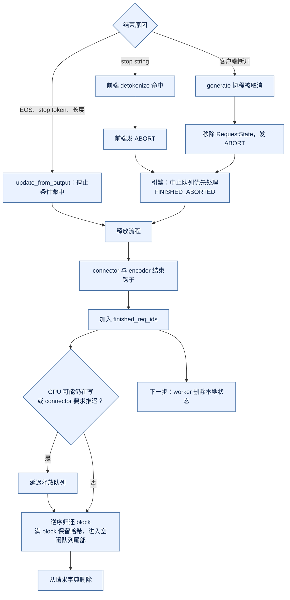

*图 10-12 结束路径：三种来源汇合到同一释放流程，block 回到空闲队列后仍可被命中*

请求结束后它的满 block 并没有被清除，而是带着哈希进入空闲队列尾部。这对多轮对话特别有用：下一轮 prompt 包含上一轮的全部历史，命中后只需计算新增部分。但这也意味着 KV 内容在请求结束后仍留在显存中，直到被复用覆盖；vLLM 能清空全部 prefix cache，却没有“只清除某个请求的 KV”的接口，敏感数据的隔离要依靠 10.6 节的 `cache_salt`。

## 10.6 多租户与平台钩子

10.5 节描述的是单个实例内部如何把一条请求算完。生产平台面对的是多个租户、多个模型版本和多个实例，租户配额、路由、降级、灰度、计费都在网关、路由器和发布系统里完成；多租户 GPU 资源调度、配额与隔离见第8章 8.5 节，灰度、回滚、数据驻留和成本治理见第12章 12.3、12.5、12.6 节。本节只讨论 vLLM 为这些控制面提供了哪些钩子，以及每个钩子的边界。如图 10-13 所示，控制面通过请求字段和管理接口向引擎下发意图，引擎通过指标向控制面反馈状态。

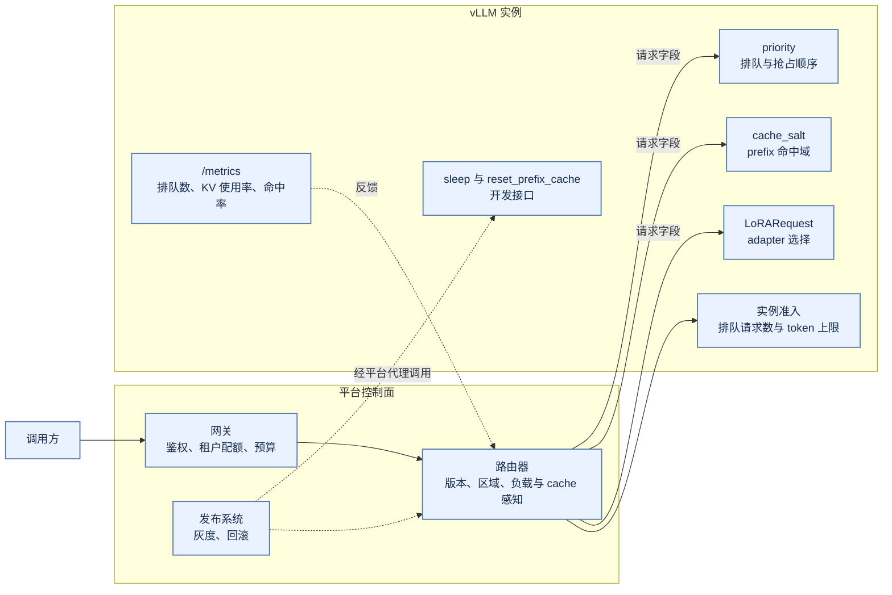

*图 10-13 控制面与引擎的分工：租户、预算、路由与发布在控制面完成，vLLM 通过请求字段与管理接口接受意图，通过指标反馈状态*

### 优先级与在线离线共存

`priority` 是请求字段，只在调度策略设为 priority 时生效：数值越小越优先，KV 不足时先抢占优先级最低的运行请求（见 10.5 节）。这是单实例内的局部机制：它不知道租户配额，也不知道一个租户的请求分布在多少个实例上，平台级的加权公平、最低服务份额和老化必须在控制面实现 [[20]](#ref-20)。高优先级也不等于无限资源：只有优先级而没有最低份额时，高优流量持续到达会让低优队列永久等待；而 vLLM 的抢占是“释放 KV、之后重算”，对已经输出大量 token 的请求代价很高。

在线与离线若必须共享实例，可以把离线请求放在低优先级并限制其 token 预算；但离线任务更适合独立实例，用更大的 batch 和更长的排队时间换取吞吐，并具备断点、重试和幂等写入。

### cache_salt 与租户隔离

vLLM 的块哈希覆盖 token、LoRA 和多模态内容，但**不包含租户身份**。租户隔离要靠 `cache_salt`：它只加在首 block 的哈希里，由于哈希是链式的，不同 salt 的请求整条前缀都不会互相命中。平台应由服务端在认证之后按租户域生成或约束 salt，客户端自己填写的 salt 不是访问授权。高敏感租户可以使用独立 salt，或用 `SamplingParams.skip_reading_prefix_cache` 禁止读取 prefix cache。cache 泄漏通常不是显式返回数据，而是命中率与延迟差异形成的侧信道。

如 10.3 节所述，固定哈希种子让跨实例共享前缀成为可能，也让“同内容同哈希”跨越了实例边界，跨实例、跨区域共享 KV 时 salt 的生成规则必须一致。删除要求方面，vLLM 只能通过 `/reset_prefix_cache` 清空整个实例的 prefix cache：默认只在没有运行中请求时成功，指定重置运行中请求时会先抢占全部运行请求；没有按请求或按租户清除的接口。数据删除的完整义务见第12章 12.8 节。

### LoRA 与多模型共存

一个基础模型可以服务多个 LoRA adapter。请求携带 `LoRARequest`，调度器限制一步内同时活跃的 adapter 数（`max_loras`），超出的请求留在等待队列；执行层把不同 adapter 的请求放进同一个 batch，由专门的批量 LoRA kernel 处理。adapter 身份进入块哈希，不同 adapter 之间不会误用 prefix cache。共享基础权重能降低显存，但 adapter 有容量、淘汰和版本兼容问题：基础模型升级后旧 adapter 不一定兼容，不能只按名称加载。

vLLM 一组进程只服务一个基础模型，同卡部署多个模型意味着多组进程，每组都在启动时按自己的 `gpu_memory_utilization` 占住一份显存（见 10.4 节），份额之和超过显卡容量时后启动的实例会失败。多组进程可以同时常驻，代价是彼此的权重、KV 与尾延迟相互挤压。sleep mode 提供了另一种方式：让暂时不用的实例释放权重或 KV 显存，把空间腾给活跃模型，代价是唤醒时重新加载和预热，适合流量可预测的轮换，不适合频繁抖动的切换。

### 超时、准入、路由信号与开发接口

超时也属于这类边界。网关与引擎的超时不能随意叠加：网关超时短于生成时间，会导致客户端断开而 GPU 继续工作。vLLM 在感知到 HTTP 断开时会中止请求并释放 KV，但中间代理缓冲连接时，感知可能延迟。更稳妥的做法是让请求携带 deadline，各组件按剩余时间决定是否接纳、继续 prefill 或提前结束，并在 trace 中传播。

实例级准入（`max_num_queued_reqs`、`max_num_queued_tokens`）只保护单个实例不过载，它不认识租户，也不跨实例汇总；租户配额、预算和最大上下文仍需网关完成。路由器可以利用 `/metrics` 暴露的运行与等待请求数、KV 使用率和 prefix 命中情况做负载感知与 cache 感知路由；round-robin 处理不了一个副本正在加载、另一个副本 KV 已满的情况。路由器只看到聚合指标，引擎只看到本实例队列，两者之间的信息差会造成“路由器认为有空闲、引擎内在频繁抢占”。

计费与重试的钩子是 usage：vLLM 在流式响应中返回自己 tokenize 的 prompt token 数、生成 token 数和 prefix 命中数，网关应以它为结算依据（见 10.5 节）；同一逻辑请求的多次尝试、预留与退款的幂等性由平台实现，见第12章 12.6 节。sleep、`wake_up` 和 `reset_prefix_cache` 都属于开发接口，只在设置 `VLLM_SERVER_DEV_MODE` 时注册，生产上必须由平台代理并加权限控制。

## 10.7 可靠性、诊断与验收

SLO、错误预算与燃烧率告警见第12章 12.1 节，可观测性运营见 12.2 节，事故响应、运行手册与演练见 12.4 和 12.7 节；本节只讨论推理引擎特有的故障语义、诊断路径和验收证据。

### vLLM 不做进程内恢复

引擎死亡有三条传播路径：EngineCore 内部异常时向前端推送死亡标记；EngineCore 进程直接退出时，前端的监控线程发现进程消失；worker 进程死亡时，执行器的监控线程触发失败回调，EngineCore 以执行器失败结束。三条路径最终都让前端把引擎标记为不可用，后续请求得到 `EngineDeadError`，`/health` 返回 503；API 进程的 watchdog 每 5 秒检查一次，发现引擎出错后让服务退出，除非设置了 `VLLM_KEEP_ALIVE_ON_ENGINE_DEATH`。

也就是说，**vLLM 自身不在进程内重建引擎**，恢复依赖编排系统重启实例，如图 10-14 所示。KV cache 是可重建的状态，重启后不必恢复，但正在流式输出的请求会失败；平台可以返回可重试错误，或把请求迁移到其他实例重做 prefill，代价是更高的 TTFT 和额外的 GPU 负载。请求迁移有四种做法：重发完整输入、传输已有 KV（由 KV connector 承担）、只迁移请求状态、放弃当前请求。只迁移状态而不迁移 cache 会造成状态与资源不一致；流式请求迁移还要保持上下文、采样随机状态和停止条件。多数系统应让迁移发生在 prefill 完成之前或请求边界。

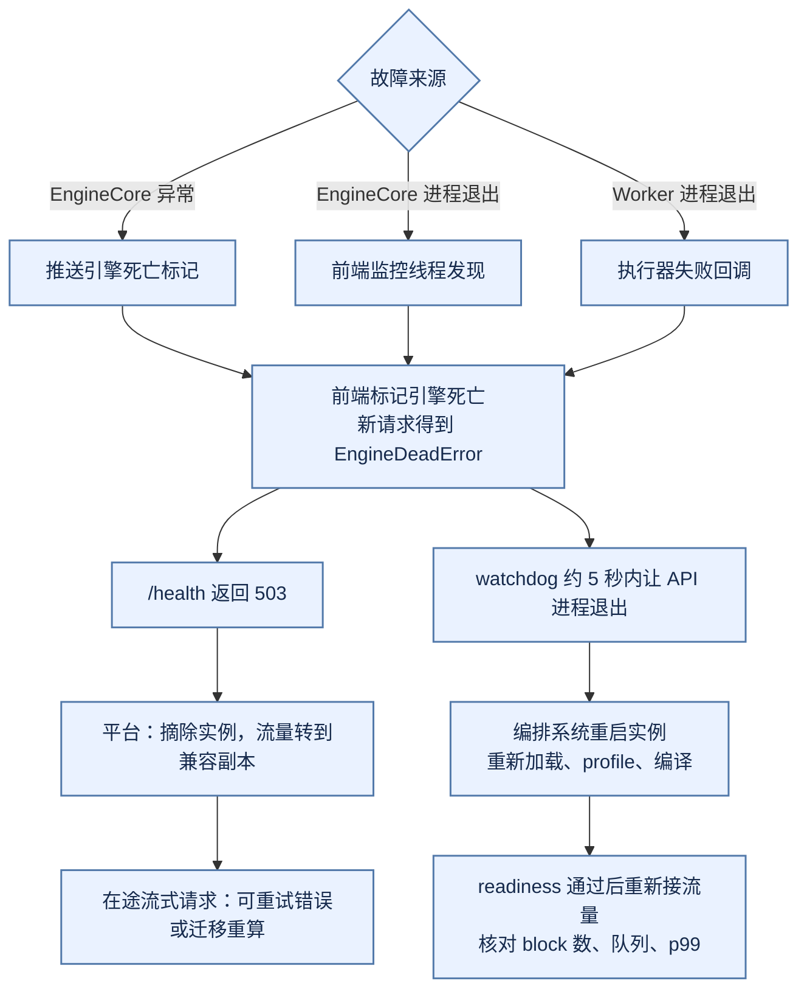

*图 10-14 故障传播与恢复：vLLM 不在进程内重建引擎，恢复由平台的摘除、重启和再接入完成*

常见故障还包括模型加载失败、tokenizer 不匹配、量化 kernel 崩溃、KV 不足导致的频繁抢占、CUDA OOM、GPU Xid 错误（NVIDIA 驱动在内核日志中报告的 GPU 错误事件码）、NCCL 挂起和流式连接堆积。每种故障应定义检测信号、影响范围、自动动作和是否丢失请求；把所有故障都归为 5xx，会让容量、质量和数据问题无法区分。恢复后要核对 KV 是否释放、队列是否回落、p99 是否恢复，仅看到 Pod Running 不代表服务恢复。

### 观测信号与指标名

vLLM 在 `/metrics` 上暴露 Prometheus 指标。Prometheus 客户端会给计数器自动加 `_total` 后缀，所以下表中的计数器在 PromQL 里要写全名，否则查不到数据：

| 类别 | 对外指标名 | 类型 |
|:---|:---|:---|
| 负载 | `vllm:num_requests_running`、`vllm:num_requests_waiting` | gauge |
| KV | `vllm:kv_cache_usage_perc` | gauge |
| 前缀缓存 | `vllm:prefix_cache_queries_total`、`vllm:prefix_cache_hits_total` | counter |
| 抢占 | `vllm:num_preemptions_total`；每请求分布 `vllm:request_num_preemptions` | counter；histogram |
| 延迟 | `vllm:time_to_first_token_seconds`、`vllm:inter_token_latency_seconds`、`vllm:request_time_per_output_token_seconds`、`vllm:e2e_request_latency_seconds` | histogram |
| 阶段耗时 | `vllm:request_queue_time_seconds`、`vllm:request_prefill_time_seconds`、`vllm:request_decode_time_seconds` | histogram |
| 吞吐 | `vllm:prompt_tokens_total`、`vllm:generation_tokens_total`；每步 token 数 `vllm:iteration_tokens_total` | counter；histogram |
| 准入 | `vllm:admission_rejections_total` | counter |

前缀命中率用 `rate(vllm:prefix_cache_hits_total[5m]) / rate(vllm:prefix_cache_queries_total[5m])` 计算。`vllm:iteration_tokens_total` 是名字本身带 `_total` 的直方图，查询时用它的 `_bucket`、`_sum`、`_count` 序列。指标名同样依赖版本，例如 v0.11.0 还保留已弃用的 `vllm:gpu_cache_usage_perc`，且没有准入拒绝和每请求抢占分布（见 10.10 节）。这些指标只覆盖引擎内部的一段；网关排队、路由、工具调用和计费需要平台用 trace 串联，Dapper 与 OpenTelemetry 的信号模型适合跨组件关联一次请求 [[21]](#ref-21)[[22]](#ref-22)。默认不记录完整 prompt 和输出，标签要避免完整 request id、租户自由字符串和 token 内容造成的高基数 [[23]](#ref-23)。

### 延迟诊断与压测方法

先用请求时间线确认瓶颈属于排队、prefill、decode 还是引擎外，再选剖析工具，分流路径如图 10-15 所示。vLLM 的 CPU 侧开销（调度、输入准备、detokenize）曾是重要瓶颈，异步调度和 Model Runner V2 都是为它而做的，因此不能默认瓶颈都在 GPU。进入 kernel 层面后，Nsight Compute 的 Roofline 分析可以区分带宽受限与 launch、同步造成的空洞 [[24]](#ref-24)。

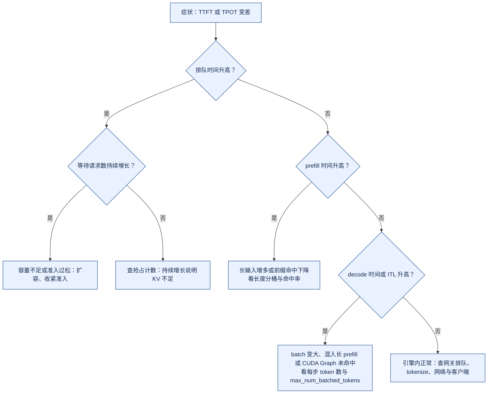

*图 10-15 延迟诊断的分流：先用引擎内的阶段指标定位是排队、prefill、decode 还是引擎外，再选剖析工具*

压测应使用真实长度分布而不是固定 prompt。至少覆盖短入短出、长入短出、短入长出、长入长出、前缀高命中、前缀低命中、结构化输出和突发流量八类负载，记录到达过程、并发、取消比例和租户混合，并分别比较混合部署与 PD 分离。只从客户端测总延迟无法定位瓶颈，只测引擎又会漏掉真实连接和 tokenize，所以要同时采集客户端和引擎两侧的时间点。排障时最有效的方法之一是回放单个请求的状态机：`Request` 上记录了 QUEUED、SCHEDULED、PREEMPTED 等事件和时间戳，配合网关事件可以复原它排队多久、经历几次 prefill chunk、是否被抢占。同样的事件序列也可以用于测试：重复取消不泄漏 block，drain 会停止新请求，deadline 到期会释放资源。

显存问题要区分两本账。PyTorch 的 `memory_allocated` 是张量占用，`memory_reserved` 是分配器管理的总量，`empty_cache()` 只释放未使用的缓存 [[25]](#ref-25)；而 vLLM 启动时一次性分配整块 KV 张量，在 allocator 统计里表现为稳定的大块占用，KV“用了多少”要看引擎自己的空闲 block 数。排查时先建立固定长度与并发的基线，一次只改变轮次、取消、前缀或图捕获中的一个变量：总 token 增长带来的活跃 block 增长是正常的历史成本；固定负载下 allocated 逐轮上升才指向引用泄漏；取消率升高而空闲 block 不回升，要查 abort 是否送达 EngineCore；首次非法访存之后的 OOM 可能只是异步错误的传播，应先定位最早的 CUDA 错误 [[26]](#ref-26)。循环调用 `empty_cache` 不是修复。

### 验收证据

上线前要证明的不是“服务能启动”，而是五组证据，缺任何一组都意味着某个结论无法复核：**制品与兼容**（制品 hash、tokenizer 与模板版本、vLLM 版本与提交、GPU 架构与驱动）；**容量与性能**（长度分布、并发曲线、TTFT 与 TPOT 分位数、KV 水位、抢占率、最终 block 数）；**质量回归**（优化前后的配对比较与结构化输出合法率，方法与门禁见第11章 11.8 节）；**可靠性与降级**（故障注入、摘除与恢复时间、丢失请求数）；**治理与成本**（租户配额、审计字段、单位成功任务成本与回滚记录）。五组证据不能互相替代：一个版本可能容量很好但质量回退，也可能质量持平却无法回滚。

升级 vLLM 版本时，兼容性测试要覆盖四类场景：功能上覆盖单请求、动态 batch、流式、取消、最大长度、结构化输出、工具调用和多模态；性能上覆盖不同输入输出长度与并发；资源上覆盖显存、block 数、编译缓存和冷启动；故障上覆盖引擎崩溃、模型加载失败和滚动 drain。还要覆盖错误语义：同一个超长输入，一个版本可能返回 400，另一个版本可能截断后返回 200；默认值变化（如 10.2 节的 `gpu_memory_utilization`）会直接改变 block 数和并发上限。因此每次升级都要在固定负载上重跑基线，并把启动日志中的 block 数作为回归项。

## 10.8 主流推理引擎比较

### 比较的层次

“vLLM、SGLang、TensorRT-LLM、Triton、TGI 哪个更好”这个问题本身有层级错位。vLLM、SGLang 和 TensorRT-LLM 是**推理引擎**，负责调度、KV 管理和模型执行；Triton Inference Server 是**服务层**，负责模型仓库、版本、协议和多后端托管，本身不做 LLM 的连续批处理，而是交给 TensorRT-LLM 或 vLLM 后端 [[15]](#ref-15)；TGI 是完整的服务实现，官方仓库已声明进入维护模式，只接受小修复，历史功能存在不等于持续新增支持 [[27]](#ref-27)。比较时必须先把对象放在同一层级，如图 10-16 所示。本节只比较各自文档和源码中写明的机制，不给出吞吐数字：任何性能比较都必须在同一硬件、同一模型、同一负载下重测。

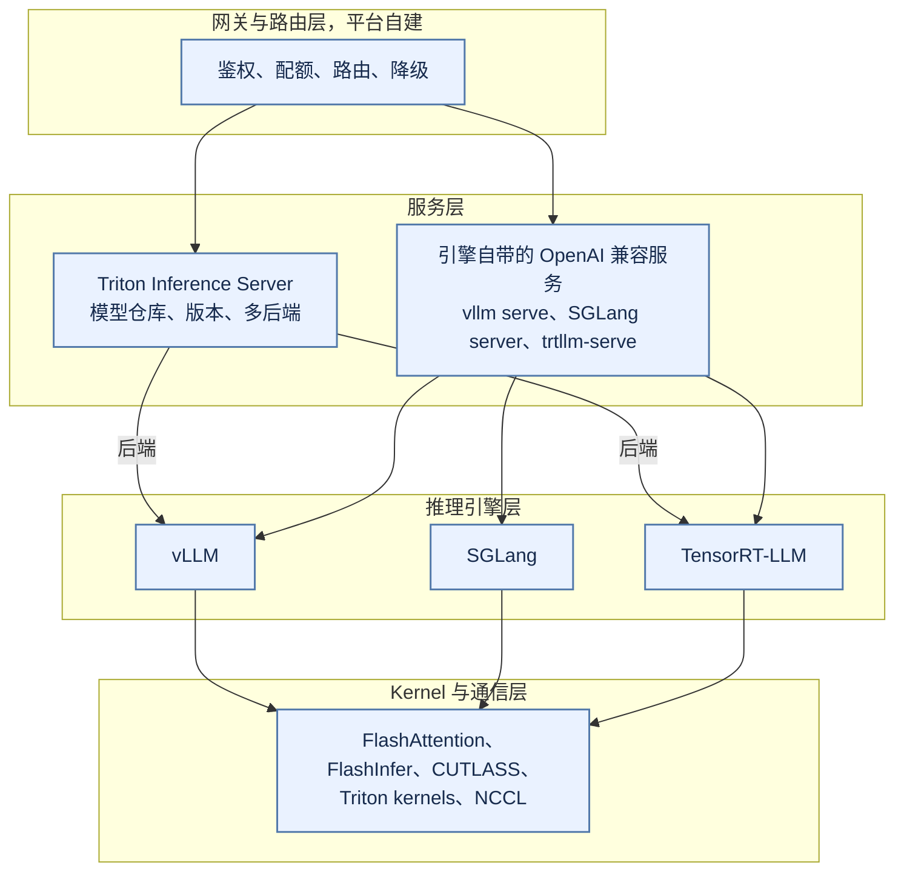

*图 10-16 各对象的层次位置：Triton 在服务层托管引擎，三个引擎共享相近的 kernel 生态*

### 调度与 KV 管理

**vLLM** 的调度器只看每个请求还差多少 token 没算，chunked prefill、prefix 命中和投机解码都落在同一个预算模型里；排队策略只有 FCFS 和 priority，prefix cache 是“请求到了再查”，不按命中长度重排队列。前缀复用基于块哈希链，命中粒度是满 block。

**SGLang** 的论文把系统分为前端语言与运行时，运行时核心是 RadixAttention：用基数树组织所有请求的 KV，前缀天然共享，按 LRU 淘汰叶子节点；论文还提出最长前缀匹配（LPM）调度，优先运行与已缓存前缀匹配最长的请求，并用压缩有限状态机加速结构化输出 [[28]](#ref-28)。需要区分论文主张与运行时默认行为：在 2026-11-05 的 SGLang 主干中，`schedule_policy` 的默认值是 `fcfs`，LPM 是可选策略之一，与 random、priority、最短 prefill 优先等并列 [[29]](#ref-29)。基数树也不再必然是逐 token 粒度：运行时支持配置 `page_size`，大于 1 时前缀匹配长度按页向下取整，命中粒度与分页 block 相当。运行中显存不足时，SGLang 可能撤回（retract）部分请求，`schedule_conservativeness` 参数用来调节接纳的保守程度。

**TensorRT-LLM** 是 NVIDIA 的推理库，提供 in-flight batching 和分页 KV cache [[30]](#ref-30)。它的容量调度器有三种策略：默认的 `GUARANTEED_NO_EVICT` 只接纳能保证运行到结束、不会被暂停的请求；`MAX_UTILIZATION` 在每次迭代尽量多装请求，KV 用尽时可能暂停请求，吞吐更高但会伤害延迟；另有 `STATIC_BATCH` [[31]](#ref-31)。这与 vLLM“先乐观接纳、不足时抢占重算”的做法形成对照：前者用保守准入换取不被抢占，后者用重算风险换取利用率。KV 复用方面，只有满 block 可以在请求间共享，可复用 block 按 LRU 驱逐，还可以把将被驱逐的 block 卸载到主机内存以延长可复用时间；LLM API 中 block 复用默认开启 [[32]](#ref-32)[[33]](#ref-33)。

| 维度 | vLLM（V1） | SGLang | TensorRT-LLM | Triton |
|:---|:---|:---|:---|:---|
| 层次 | 引擎与自带服务 | 引擎、自带服务与前端语言 | 推理库与自带服务 | 服务层，托管后端 |
| 调度 | 每步 token 预算，FCFS 或 priority | 迭代级调度，默认 fcfs，可选 LPM 等 | in-flight batching，容量策略默认不驱逐 | 交给后端 |
| KV 不足时 | 抢占并重算 | 可能撤回（retract）运行中的请求 | 默认策略不暂停已开始的请求 | 交给后端 |
| 前缀复用 | 块哈希链，仅满块 | 基数树，可按页匹配 | 满 block 复用，LRU，可卸载到主机 | 交给后端 |
| 启动 | 运行时加载、profile、编译、图捕获 | 运行时加载、图捕获 | 历史上离线构建 engine，现以 PyTorch 后端为默认入口 | 按模型仓库配置加载 |

### 启动、部署与选型

vLLM 把成本放在启动时：加载权重、测量显存、分配 KV、编译与图捕获（见 10.4 节）。早期 TensorRT-LLM 把更多成本前移到离线构建，engine 与 GPU 架构、精度和最大 shape 绑定，部署时加载更快但兼容矩阵更严格；当前 LLM API 的后端默认是 PyTorch，降低了构建门槛 [[14]](#ref-14)[[33]](#ref-33)。无论哪种方式，编译产物都必须和模型 hash、GPU 架构、驱动和引擎版本一起管理。三个引擎都在支持 TP、PP、EP 和 PD 分离，选型时要比较的不是“是否支持”这样的勾选项，而是目标负载下调度、传输和故障语义是否满足需求。

选型可以按负载与约束判断：模型覆盖面、硬件多样性和社区插件优先时，vLLM 是稳妥的默认选项；前缀高度重复的 Agent 与多轮对话负载，值得在同一负载下对比 SGLang，并实际开启它的前缀感知策略；只用 NVIDIA GPU、模型固定、追求单卡极致性能并能承担更严格的制品管理时，可以评估 TensorRT-LLM；需要统一托管多种模型（不止 LLM）并复用已有 Triton 运维体系时，把 Triton 放在服务层、引擎作为后端。还要警惕“换一个引擎就能解决延迟问题”：长度分布、准入、配额、路由、超时层次和慢客户端，大部分都在引擎之外。

## 10.9 本章小结

本章沿着一条请求的生命周期拆解了 vLLM V1，几条主线可以归结为图 10-17。

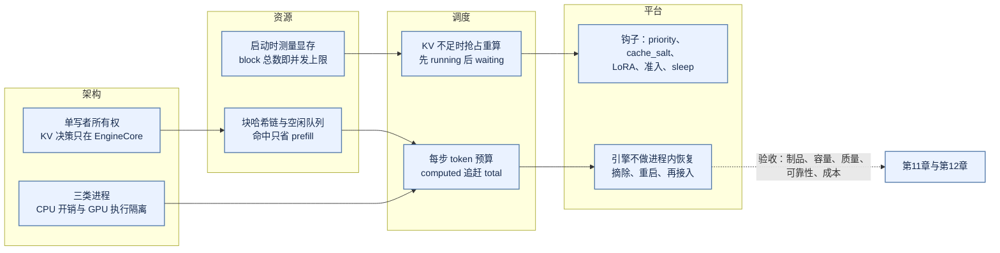

*图 10-17 本章概念地图：架构决定所有权，资源账本约束调度，调度暴露的钩子与故障语义交给平台*

第一，vLLM V1 把推理服务拆成前端进程（协议、tokenize、detokenize）、EngineCore 进程（调度与 KV 账本）和执行层（多卡时每 GPU 一个 worker 进程，单卡默认在引擎进程内），进程边界本身就是为了让 Python 的 CPU 开销不阻塞 GPU；KV block 的分配与回收只在 EngineCore 中决定，这是理解取消、抢占和释放顺序的钥匙。

第二，它的核心抽象是“每一步给每个请求分配若干 token”：prefill、chunked prefill、decode、prefix 命中和投机解码都统一成 `num_computed_tokens` 对 `num_tokens` 的追赶。KV 以固定大小的 block 记账，不足时抢占重算而不是 OOM；被释放的满 block 带着哈希留在空闲队列尾部，所以重算可以部分找回，多轮对话可以复用历史。

第三，容量是测出来的而不是配出来的。block 总数等于“允许用量减去权重、激活和图占用”之后的余数，随显卡、默认值和版本而变：Qwen3-8B 的案例中，利用率从 0.92 换成 0.9 就让候选并发从 4 变成 3。每次升级都要把启动日志中的 block 数当作回归项。

第四，vLLM 只负责“单实例内把请求算好”。它给平台留下了 priority、`cache_salt`、LoRA、实例准入、sleep 和指标等钩子，但租户配额、路由、灰度、计费和故障恢复都在引擎之外；引擎死亡后的恢复依赖编排系统。

把本章的机制与常用参数对照起来，可以得到下表。调参时一次只改一个参数，并同时观察对侧指标。

| 参数 | 调大的效果 | 调大的代价 | 关联小节 |
|:---|:---|:---|:---|
| `max_num_batched_tokens` | 每步装更多 token，prefill 更快完成，吞吐上升 | 每步变长，TPOT 抖动增大 | 10.5 |
| `max_num_seqs` | 并发 decode 更多，带宽利用率上升 | KV 压力增大，抢占增多 | 10.5 |
| `long_prefill_token_threshold` | 长 prompt 单步可占更多预算 | 更容易阻塞同一步的 decode | 10.5 |
| `gpu_memory_utilization` | KV block 更多，候选并发上升 | 同卡余量更少，峰值估算误差更易导致失败 | 10.2、10.4 |
| `block_size` | block table 与调度开销更小 | 尾块内部碎片增大，prefix 命中粒度变粗 | 10.3 |
| `watermark` | 接纳更保守，抢占减少 | KV 利用率下降，排队变长 | 10.5 |

仍然开放的问题集中在三处：引擎内调度与平台路由之间的信息差，prefix 感知路由、按 KV 水位路由和 PD 两段调度都在尝试缩小它，但还没有统一接口；抢占的代价随上下文和输出变长而上升，用更保守的准入（如 watermark 或不驱逐式的容量策略）换取稳定性需要在具体负载上权衡；KV 正在从实例内的临时状态变成可跨实例传输、卸载和共享的资源，一旦离开实例，版本兼容、权限隔离和删除保证都要重新设计。落地时建议先在目标硬件上用单副本、固定版本建立基线（启动耗时、block 数、分长度桶的 TTFT 与 TPOT、抢占率、命中率），再逐项打开优化、每次只改一个变量；扩大规模之前先补齐网关、路由、发布和 trace。

请求能够稳定在线运行之后，下一个问题是“如何知道模型是否仍然正确”。第11章讨论评估集、质量门禁和线上反馈，它们会消费本章产生的 trace、usage、版本与成本数据；第12章再把这些证据接入发布、事故响应和成本治理。

## 10.10 附：版本敏感点与源码索引

### 版本敏感点

vLLM 迭代很快，本章描述的若干行为只在较新版本中成立。下表对比三个时间点：v0.11.0、v0.32.0（2026-10-18 发布）和本章所依据的主干提交 `77d2790` [[1]](#ref-1)[[34]](#ref-34)。表中只列出在这三个版本的源码中核对过的差异，其他版本应自行核对。

| 主题 | v0.11.0 | v0.32.0 | `77d2790` |
|:---|:---|:---|:---|
| `gpu_memory_utilization` 默认值 | 0.9 | 0.92 | 0.92；启用 extensible KV cache 时为 1.0 |
| extensible KV cache | 无 | 无（v0.33.0rc3 也没有） | CUDA、ROCm 配合 Model Runner V2 时默认启用 |
| Model Runner V2 | 无 | 有，特性支持时默认启用 | 同 v0.32.0 |
| Renderer 与 TTFT 口径 | 到达时间在输入处理时记录，TTFT 不含模板渲染 | 到达时间在渲染前记录，TTFT 含模板渲染 | 同 v0.32.0 |
| 前端准入控制 | 无 | 有，含准入拒绝指标 | 同 v0.32.0 |
| startup plan | 无 | 有，需显式开启 | 同 v0.32.0 |
| 调度器 watermark | 无 | 有，默认 0 即关闭 | 同 v0.32.0 |
| 请求状态名 | 语法等待为 `WAITING_FOR_FSM`，无 ERROR、REPETITION 与流式续写状态 | `WAITING_FOR_STRUCTURED_OUTPUT_GRAMMAR`，并有上述三类状态 | 同 v0.32.0 |
| 指标 | 有 `vllm:kv_cache_usage_perc`，保留已弃用的 `vllm:gpu_cache_usage_perc`；无准入拒绝与每请求抢占分布 | 本章 10.7 节所列指标齐备 | 同 v0.32.0 |
| prefix cache 首块种子 | 未设 `PYTHONHASHSEED` 时随机 | sha256 用固定默认种子，可跨实例命中 | 同 v0.32.0 |

### 关键默认值

以下默认值对应 `77d2790`：`block_size` 为 16（未显式指定时可被平台调整）；prefix caching 开启，哈希算法为 sha256；chunked prefill 开启；调度策略为 fcfs；异步调度在没有不兼容项时自动开启；`cudagraph_mode` 为 `FULL_AND_PIECEWISE`；`shutdown_timeout` 为 0，即 abort 模式；前端等待引擎就绪的超时 `VLLM_ENGINE_READY_TIMEOUT_S` 为 600 秒；OpenAI 兼容服务的 `max_num_seqs` 与 `max_num_batched_tokens` 按显存取 1024 与 16384（不小于 160 GiB）、1024 与 8192（不小于 70 GiB 且非 A100）或 256 与 2048。

### 源码索引

| 主题 | 主要模块（相对 vLLM 仓库根目录） |
|:---|:---|
| CLI 与启动 | `vllm/entrypoints/cli/serve.py`、`vllm/entrypoints/launchers/` |
| 参数到配置 | `vllm/engine/arg_utils.py`、`vllm/config/`（`vllm.py`、`cache.py`、`scheduler.py`、`parallel.py`） |
| 前端引擎 | `vllm/v1/engine/async_llm.py`、`input_processor.py`、`output_processor.py`、`admission_control.py` |
| 模板与 tokenize | `vllm/renderers/` |
| 引擎客户端与 EngineCore | `vllm/v1/engine/core_client.py`、`vllm/v1/engine/core.py` |
| 调度器 | `vllm/v1/core/sched/`（`scheduler.py`、`async_scheduler.py`、`request_queue.py`、`output.py`） |
| KV 管理 | `vllm/v1/core/`（`kv_cache_manager.py`、`kv_cache_coordinator.py`、`single_type_kv_cache_manager.py`、`block_pool.py`、`kv_cache_utils.py`） |
| 请求与状态 | `vllm/v1/request.py` |
| 执行器与 worker | `vllm/v1/executor/`、`vllm/v1/worker/gpu_worker.py`、`extensible_kv_cache.py`、`startup_plan.py` |
| Model Runner V2 与 V1 | `vllm/v1/worker/gpu/`、`vllm/v1/worker/gpu_model_runner.py` |
| KV connector | `vllm/distributed/kv_transfer/kv_connector/v1/` |
| 指标 | `vllm/v1/metrics/loggers.py`、`stats.py` |
| 设计文档 | `docs/design/`（架构概览、prefix caching、Model Runner V2、CUDA Graph、torch.compile、metrics） |

图 10-18 把这些模块按请求路径连起来，并标出受版本影响最大的位置。

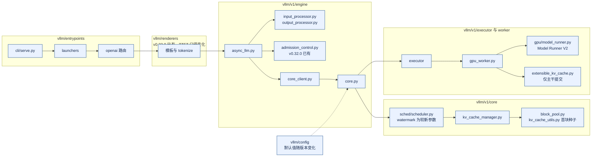

*图 10-18 源码模块与版本敏感点：从入口到执行的主要模块，标注了本章依赖较新版本的位置*

## 参考资料

1.  vLLM Team. [vLLM 源码仓库，提交 77d2790](https://github.com/vllm-project/vllm/tree/77d2790e788ec323c8bc1fcee72013b363bd9957). GitHub, 2026. 核验日期：2026-11-05。
2.  vLLM Team. [Architecture Overview（docs/design/arch_overview.md，提交 77d2790）](https://github.com/vllm-project/vllm/blob/77d2790e788ec323c8bc1fcee72013b363bd9957/docs/design/arch_overview.md). vLLM 设计文档, 2026. 核验日期：2026-11-05。
3.  Kwon, W., et al. [Efficient Memory Management for Large Language Model Serving with PagedAttention](https://arxiv.org/abs/2309.06180). SOSP, 2023. 核验日期：2026-11-05。
4.  Yu, G.-I., et al. [Orca: A Distributed Serving System for Transformer-Based Generative Models](https://www.usenix.org/conference/osdi22/presentation/yu). OSDI, 2022. 核验日期：2026-11-05。
5.  Agrawal, A., et al. [Taming Throughput-Latency Tradeoff in LLM Inference with Sarathi-Serve](https://www.usenix.org/conference/osdi24/presentation/agrawal). OSDI, 2024. 核验日期：2026-11-05。
6.  Zhong, Y., et al. [DistServe: Disaggregating Prefill and Decoding for Goodput-optimized Large Language Model Serving](https://arxiv.org/abs/2401.09670). OSDI, 2024. 核验日期：2026-11-05。
7.  vLLM Team. [Model Runner V2 Design Document（docs/design/model_runner_v2.md，提交 77d2790）](https://github.com/vllm-project/vllm/blob/77d2790e788ec323c8bc1fcee72013b363bd9957/docs/design/model_runner_v2.md). vLLM 设计文档, 2026. 核验日期：2026-11-05。
8.  Beyer, B., et al. [The Site Reliability Workbook: Implementing SLOs](https://sre.google/workbook/implementing-slos/). O’Reilly, 2018. 核验日期：2026-11-05。
9.  Qwen Team. [Qwen3-8B config.json（revision b968826）](https://huggingface.co/Qwen/Qwen3-8B/blob/b968826d9c46dd6066d109eabc6255188de91218/config.json). Hugging Face, 2025. 核验日期：2026-11-05。
10.  NVIDIA. [NCCL User Guide: Collective Operations](https://docs.nvidia.com/deeplearning/nccl/user-guide/docs/usage/collectives.html). NVIDIA 文档, 2026. 核验日期：2026-11-05。
11.  Zhu, R., et al. [MegaScale-Infer: Serving Mixture-of-Experts at Scale with Disaggregated Expert Parallelism](https://arxiv.org/abs/2504.02263). arXiv:2504.02263, 2025. 核验日期：2026-11-05。
12.  vLLM Team. [Automatic Prefix Caching（docs/design/prefix_caching.md，提交 77d2790）](https://github.com/vllm-project/vllm/blob/77d2790e788ec323c8bc1fcee72013b363bd9957/docs/design/prefix_caching.md). vLLM 设计文档, 2026. 核验日期：2026-11-05。
13.  Bang, F. [GPTCache: An Open-Source Semantic Cache for LLM Applications Enabling Faster Answers and Cost Savings](https://aclanthology.org/2023.nlposs-1.24/). NLP-OSS Workshop, 2023. 核验日期：2026-11-05。
14.  NVIDIA. [TensorRT Architecture Overview](https://docs.nvidia.com/deeplearning/tensorrt/latest/architecture/architecture-overview.html). NVIDIA 文档, 2026. 核验日期：2026-11-05。
15.  NVIDIA. [Triton Inference Server: Model Management](https://docs.nvidia.com/deeplearning/triton-inference-server/user-guide/docs/user_guide/model_management.html). NVIDIA 文档, 2026. 核验日期：2026-11-05。
16.  vLLM Team. [CUDA Graphs（docs/design/cuda_graphs.md，提交 77d2790）](https://github.com/vllm-project/vllm/blob/77d2790e788ec323c8bc1fcee72013b363bd9957/docs/design/cuda_graphs.md). vLLM 设计文档, 2026. 核验日期：2026-11-05。
17.  vLLM Team. [torch.compile Integration（docs/design/torch_compile.md，提交 77d2790）](https://github.com/vllm-project/vllm/blob/77d2790e788ec323c8bc1fcee72013b363bd9957/docs/design/torch_compile.md). vLLM 设计文档, 2026. 核验日期：2026-11-05。
18.  Leviathan, Y., et al. [Fast Inference from Transformers via Speculative Decoding](https://arxiv.org/abs/2211.17192). ICML, 2023. 核验日期：2026-11-05。
19.  Chen, C., et al. [Accelerating Large Language Model Decoding with Speculative Sampling](https://arxiv.org/abs/2302.01318). DeepMind, arXiv:2302.01318, 2023. 核验日期：2026-11-05。
20.  Verma, A., et al. [Large-scale Cluster Management at Google with Borg](https://research.google/pubs/large-scale-cluster-management-at-google-with-borg/). EuroSys, 2015. 核验日期：2026-11-05。
21.  Sigelman, B. H., et al. [Dapper, a Large-Scale Distributed Systems Tracing Infrastructure](https://research.google/pubs/dapper-a-large-scale-distributed-systems-tracing-infrastructure/). Google Technical Report dapper-2010-1, 2010. 核验日期：2026-11-05。
22.  OpenTelemetry Authors. [Signals](https://opentelemetry.io/docs/concepts/signals/). OpenTelemetry 文档, 2026. 核验日期：2026-11-05。
23.  Prometheus Authors. [Prometheus Overview](https://prometheus.io/docs/introduction/overview/). Prometheus 文档, 2026. 核验日期：2026-11-05。
24.  NVIDIA. [Nsight Compute Profiling Guide](https://docs.nvidia.com/nsight-compute/ProfilingGuide/index.html). NVIDIA 文档, 2026. 核验日期：2026-11-05。
25.  PyTorch Contributors. [CUDA Semantics（PyTorch 2.9）](https://docs.pytorch.org/docs/2.9/notes/cuda.html). PyTorch 文档, 2025. 核验日期：2026-11-05。
26.  NVIDIA. [CUDA Programming Guide: Asynchronous Execution](https://docs.nvidia.com/cuda/cuda-programming-guide/02-basics/asynchronous-execution.html). NVIDIA 文档, 2026. 核验日期：2026-11-05。
27.  Hugging Face. [Text Generation Inference](https://github.com/huggingface/text-generation-inference). GitHub, 2026. 核验日期：2026-11-05。
28.  Zheng, L., et al. [SGLang: Efficient Execution of Structured Language Model Programs](https://arxiv.org/abs/2312.07104). NeurIPS, 2024. 核验日期：2026-11-05。
29.  SGLang Team. [SGLang 调度参数定义（schedule.py，提交 93e6b42）](https://github.com/sgl-project/sglang/blob/93e6b42d8afa99702547eeeb340986884c9616a3/python/sglang/srt/arg_groups/fields/schedule.py). GitHub, 2026. 核验日期：2026-11-05。
30.  NVIDIA. [TensorRT-LLM](https://github.com/NVIDIA/TensorRT-LLM). GitHub, 2026. 核验日期：2026-11-05。
31.  NVIDIA. [TensorRT-LLM: Useful Runtime Options](https://nvidia.github.io/TensorRT-LLM/performance/performance-tuning-guide/useful-runtime-flags.html). TensorRT-LLM 文档, 2026. 核验日期：2026-11-05。
32.  NVIDIA. [TensorRT-LLM: KV Cache Reuse](https://nvidia.github.io/TensorRT-LLM/advanced/kv-cache-reuse.html). TensorRT-LLM 文档, 2026. 核验日期：2026-11-05。
33.  NVIDIA. [TensorRT-LLM LLM API 参数定义（llm_args.py，提交 38ab02f）](https://github.com/NVIDIA/TensorRT-LLM/blob/38ab02f379d0090c4571f0784f9f83ed704def6e/tensorrt_llm/llmapi/llm_args.py). GitHub, 2026. 核验日期：2026-11-05。
34.  vLLM Team. [vLLM Releases（v0.11.0、v0.32.0、v0.33.0rc3）](https://github.com/vllm-project/vllm/releases). GitHub, 2026. 核验日期：2026-11-05。
