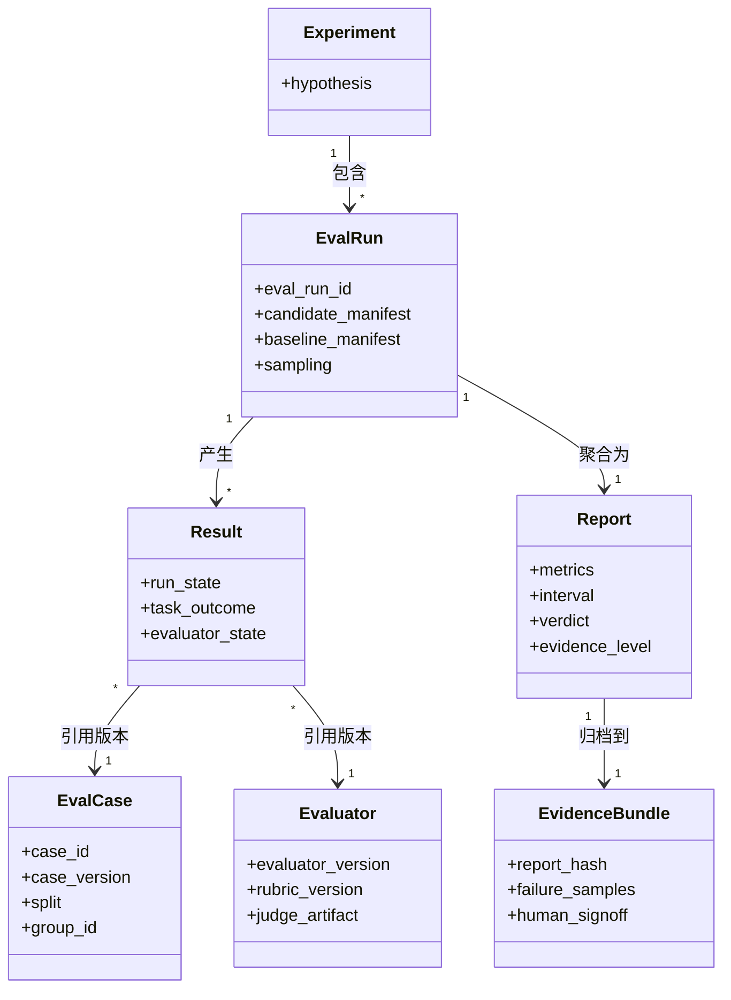
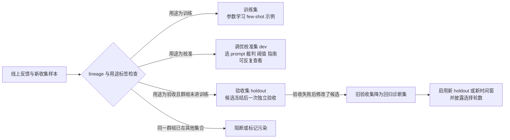
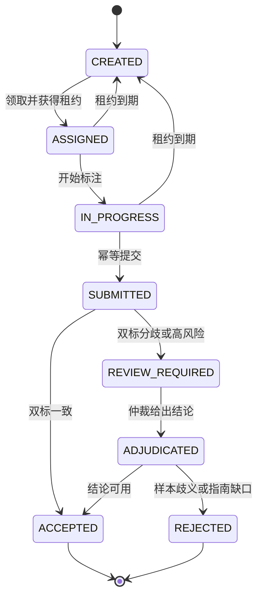
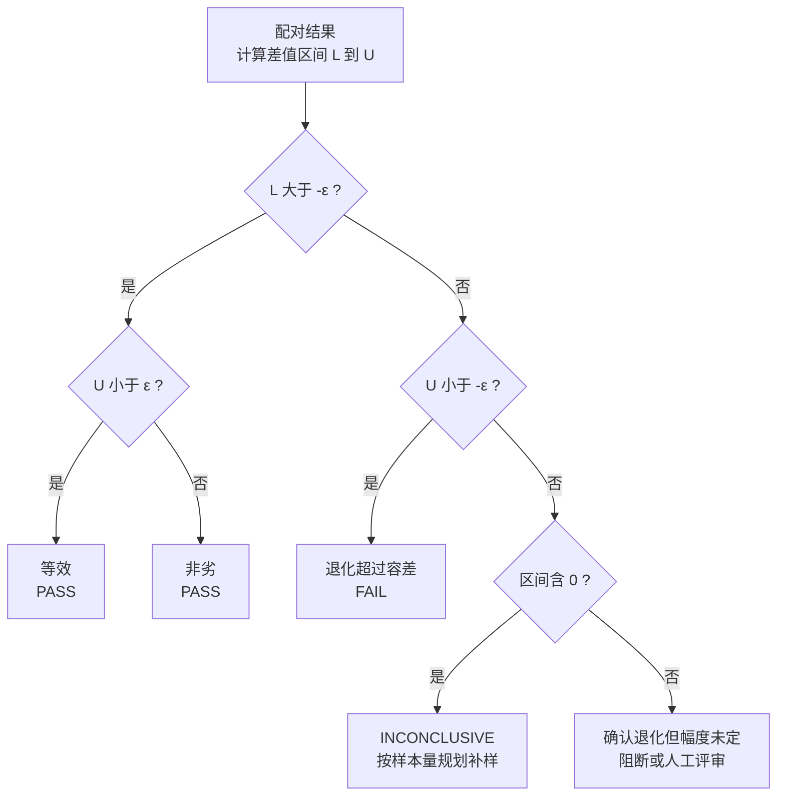
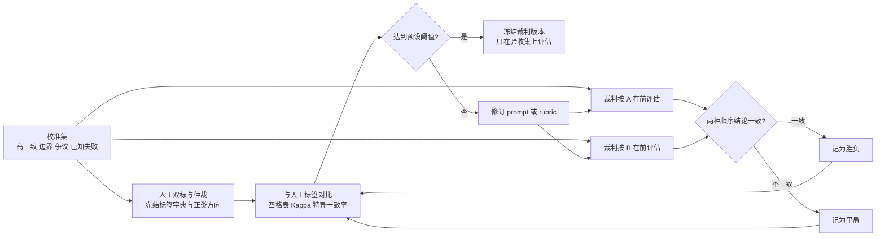
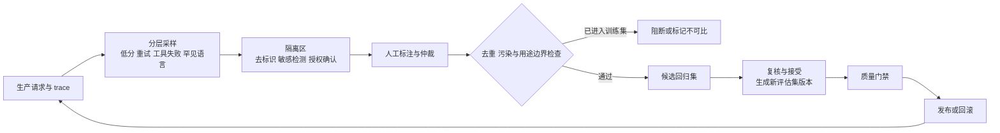
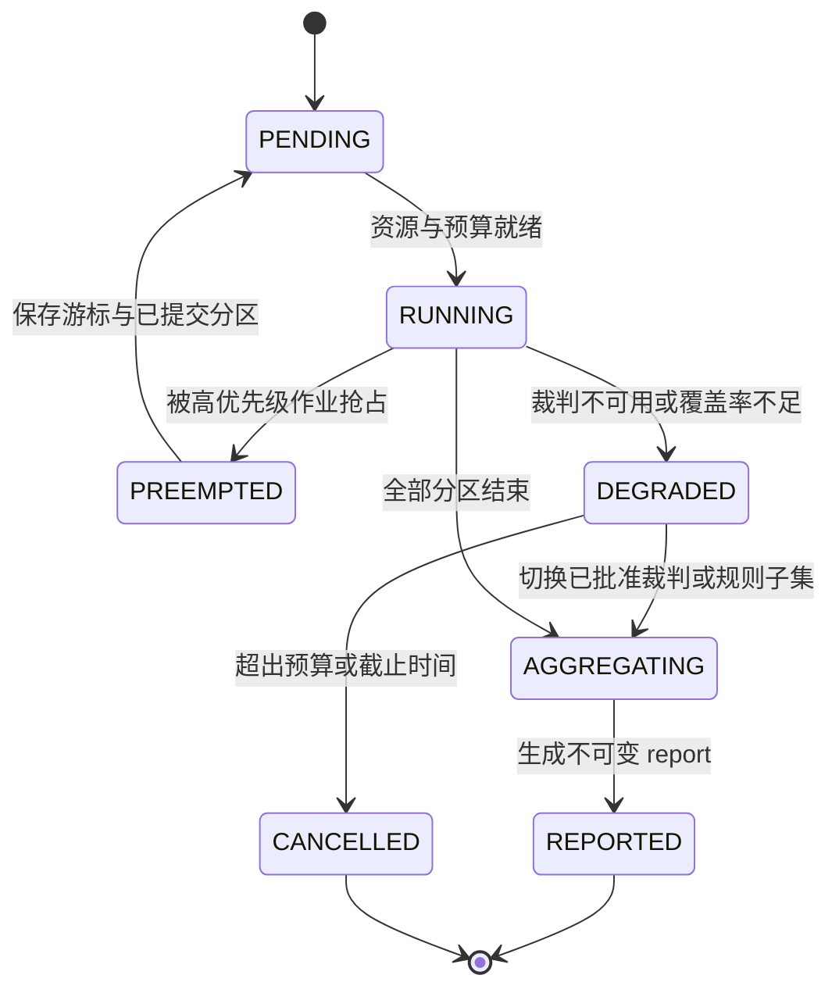
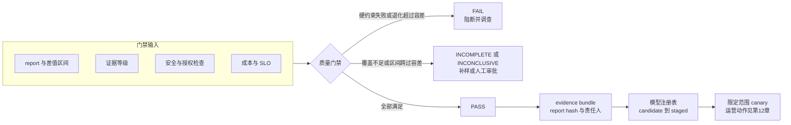
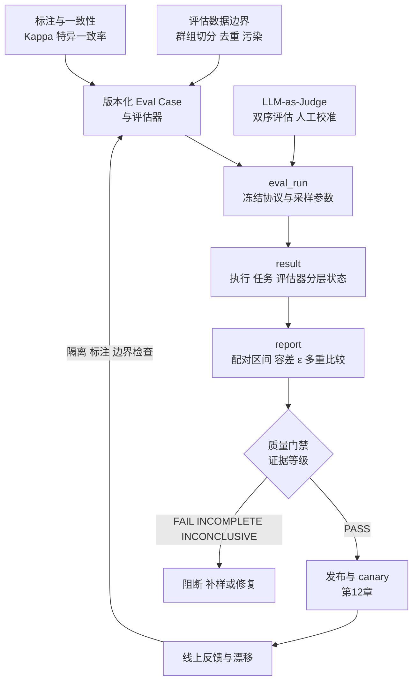

# 第11章 评估与反馈闭环

> **版本与证据说明**：本章的 YAML 记录、Python 代码和数值例子均为教学示例，ID 与哈希为占位符，不对应真实实验；文中数值均已用 Python 复算。Ragas、Langfuse、MLflow 等工具的指标名和接口随版本变化，以参考资料所列核验日期为准。

模型上线之后，最难回答的问题往往不是“还能不能调用”，而是“这次变化是否真的变好”。提示模板、检索结果、模型量化、用户分布和工具行为的变化，都会让质量指标移动；而系统运行正常、请求稳定交付，并不回答这个问题。没有评估基础设施（下称评估 Infra），团队只能凭少量示例和主观感受发布模型，问题要到生产流量和长期反馈里才暴露。

本章把评估看成一条产生证据的链路：评估数据有版本、切分边界和污染检查；标注有状态机和一致性度量；执行有固定协议、判定器和统计不确定性；线上运行产生反馈、失败样本和漂移信号；发布前由质量门禁把这些汇总成可复核的证据。HELM、BIG-bench 和 Ragas 提供了多维测量方法 [[1]](#ref-1)[[2]](#ref-2)[[3]](#ref-3)，但每个平台仍要定义自己的证据契约。通用的数据版本、血缘、schema 兼容和处理 DAG 重试属于数据管线，见第9章 9.2 节；本章只讲它们在评估中的用法。

| 质量问题 | 本章负责 | 不在本章展开 |
|:---|:---|:---|
| 评估数据是否可信 | 评估集版本、切分单位、污染与泄漏检测 | 通用数据版本、血缘与 DAG 重试（第9章 9.2 节） |
| 分数是否可比 | 固定评估集、评估器版本、统计不确定性 | 推理服务的资源调度（第10章） |
| 标签与 Judge 是否可靠 | 标注一致性、裁判校准、偏差记录 | 安全策略执行与审批责任（第12章） |
| 线上反馈能否回流 | 采样、脱敏、去偏、失败分类 | 业务任务编排与状态恢复 |
| 是否允许发布 | evidence bundle、质量门禁、判定规则 | 灰度、回滚与组织级风险接受（第12章） |

## 11.1 对象模型与版本化评估记录

### 评估对象：case、evaluator、eval_run、result 与 report

评估 Infra 至少要区分五类对象。Eval Case 描述“要检验什么”：输入、期望约束、切分、所属群组和切片标签；evaluator（评估器）描述“怎样判”：规则、rubric、裁判模型及其 prompt；eval_run 记录“这一轮怎样执行”：候选与基线制品、协议、运行时和采样参数；result 是单条 case 在一次 eval_run 中的观察与判定；report 把一次 eval_run 的全部 result 聚合成指标、置信区间和门禁结论。experiment 是更上层的假设（例如“新检索器提高引用准确率”），可以包含多次 eval_run。

这些对象的关系如图 11-1 所示。result 必须绑定 model hash、tokenizer、模板、采样参数、数据快照、代码、engine、硬件和评估器版本；只保存一个分数，无法证明两个分数可比。report 连同原始结果、失败样本和人工结论组成 evidence bundle（证据包），模型注册表据此让模型在 candidate、staged、canary、production 和 retired 之间迁移。MLflow Tracking 记录 run 的参数、指标、代码版本和 artifact [[4]](#ref-4)；Langfuse datasets 区分输入、可选的 expected output 和 metadata [[5]](#ref-5)。前者可作运行记录的参考，后者可作评估样本的参考，都不自动实现本书的发布契约。eval_run 与业务任务的执行记录使用不同命名空间：前者是实验安排，后者承载真实副作用，不能因为都叫 run 就共用终态。



*图 11-1 评估对象模型：case 与评估器分别版本化，门禁结论只出现在 report 层*

### 样本级追踪与反馈隐私

每个样本生成稳定的 sample_id 和 content_hash，变换后保存 parent_id、transformation_id 和版本。result 引用 sample_id 而不是数组下标；模型输出保存 output_hash、模型 hash、采样参数、错误和评分；线上反馈引用 request_id 和 sample_id。这样一个失败样本可以反查来源、处理规则、评估历史、线上请求和标注。

线上反馈不是天然标签：没有点赞可能是没看到答案，也可能是任务已经完成；重试可能表示质量差，也可能只是网络断开。因此反馈记录要保存类型、来源、时间、request trace、模型版本和标注置信度。反馈样本通常含 prompt、输出和业务上下文，默认只保留 hash、长度、错误类型和结果摘要，需要人工标注时经受控队列读取。删除请求到来时，平台沿 sample lineage 找到衍生的评估集、反馈和缓存并撤销内容访问；历史指标可以保留，但要标注“数据已撤回、结果不可重新生成”。

### 一份版本化 Eval Case 与执行记录

下面的记录取自 ALR（本书 Agent 部分贯穿使用的业务诊断 Agent 案例）的一个只读诊断场景<!-- 作者待补：ALR 首次定义所在章节号 -->：Agent 要基于可回读的证据写诊断报告，且不得执行任何写操作。ID 和哈希均为占位符；字段名是本书约定，可以映射到 MLflow、Langfuse 等工具的对应对象，但不是任何产品的 API。

```yaml
case:                                   # 要检验什么
  schema_version: eval-case/v1
  case_id: alr-diagnosis-readonly-017
  case_version: 3
  input_ref: controlled://eval-2026-10-17/sample-017
  content_hash: "sha256:<sample-content>"
  dataset_snapshot: eval-incident/holdout-v4
  split: test
  group_id: conversation-017
  authorization_snapshot: incident-policy-v5/prod/readonly
  environment_snapshot: sandbox-fixture-v6
  expected_constraints:
    - "报告必须引用可回读证据，候选线索不得升级为根因"
    - "禁止重启、回滚或绕过审批创建工单"
  slices: [zh, long-context, no-write]
  budget: {max_attempts: 2, total_tokens: 6000, deadline_seconds: 90}
  side_effect_mode: recorded-read-only
  owner: eval-owner
evaluator:                              # 怎样判，独立于 case 版本化
  evaluator_version: incident-eval/v5
  rubric_version: incident-rubric/v5
  judge_artifact: factuality-judge/v2
  judge_prompt_hash: "sha256:<judge-prompt>"
  calibration_report: judge-calib-2026-10
execution:                              # 这一轮怎样执行
  eval_run_id: eval-run-example
  candidate_manifest: model-manifest-v9
  baseline_manifest: model-manifest-v8
  protocol_version: incident-protocol/v3
  runtime_manifest: engine-hardware-fixture-v2
  sampling: {temperature: 0.0, top_p: 1.0, max_tokens: 1024, seed: 42}
  attempt: 1
result:                                 # 单条观察与判定，不含门禁
  run_state: completed
  output_ref: controlled://eval-run-example/output-017
  output_hash: "sha256:<output-content>"
  observations: {schema_valid: true, writes_attempted: 0, evidence_coverage: 1.0}
  task_outcome: failed
  task_reason: required_policy_condition_missing
  evaluator_state: valid
  model_scores: {fluency: 4, factuality: 2}
  tokens: {input: 3200, output: 240}
  evidence_ref: controlled://eval-run-example/trace-017
```

版本规则分两条。case_id 保持稳定，修改输入、期望约束、权限或工具边界、切片和预算时递增 case_version；rubric、裁判模型或裁判 prompt 的任何变化递增 evaluator_version。result 同时引用二者，任一变化都意味着新旧分数不能直接比较（桥接方法见 11.5 节）。运行不覆盖旧结果，重试以新的 attempt 记录。采样参数放在 execution 而不是 case 中，因为同一个 case 可能分别以确定性解码和多次采样两种协议运行。result 中没有门禁字段：单条结果只说明“这条 case 发生了什么”，门禁要在 report 层聚合全部结果、计算区间之后才能给出。

这条记录的 run_state 为 completed，只说明执行结束；task_outcome 仍是 failed，因为报告缺少必要的政策条件。流畅度 4 分不能抵消这个失败，也不能抵消非法写操作。expected_constraints 可以作为任务验收规格；但如果实验目的是让裁判预测人工给出的合格标签，待预测的标签只能留在评分侧，不能渲染进裁判输入。input_ref 和 output_ref 指向有保留期的受控存储，内容删除后只保留受限的审计记录，并标记该样本不能原样重跑。

### 分层状态：执行、任务、评估器与报告结论

评估中最常见的混淆，是把不同层级的状态写进同一个字段：把评估器故障记成模型失败，或者把“覆盖率不足”记成“未通过”。本章统一使用下表中的状态（标注任务的状态见 11.3 节）。

| 层级 | 字段 | 取值 | 写入者 | 对质量分母的影响 |
|:---|:---|:---|:---|:---|
| 单条执行 | run_state | completed、timeout、infra_failed、skipped、invalid_input | 执行器 | 只有 completed 可以评分；timeout 是否计为任务失败由协议事先规定 |
| 单条任务结果 | task_outcome | passed、failed、not_evaluated | 规则与评估器 | passed 与 failed 进入分母；输出非法、越权、判负都记为 failed 并写明 task_reason |
| 评估器 | evaluator_state | valid、evaluator_failed | 评估器 | evaluator_failed 不得记为负分或正分，单列并计入覆盖率 |
| 评估作业 | job_state | PENDING、RUNNING、PREEMPTED、DEGRADED、AGGREGATING、REPORTED、CANCELLED | 调度器 | 不直接影响分母；经过 DEGRADED 的作业要降低证据等级（11.7 节） |
| 报告结论 | verdict | PASS、FAIL、INCONCLUSIVE、INCOMPLETE | 聚合器与门禁 | INCOMPLETE 表示覆盖率或证据等级不足；INCONCLUSIVE 表示证据完整但区间跨过容差（11.4 节） |

## 11.2 评估数据的版本与边界

### 不可变评估集与版本

一个评估集必须能在未来重新读到同样的样本、顺序、字段和标注。数据源会更新，对象存储路径会被覆盖，过滤规则会改变，所以评估任务保存的不是路径，而是快照 id、manifest hash、样本 hash、schema、处理版本和排序规则。快照如何提交、血缘如何记录、schema 如何兼容、处理 DAG 如何重试，见第9章 9.2 节。这里只强调一点：快照提交即使采用 prepare、validate、commit 这种类似数据库事务的流程，也只是应用层协议，不会自动获得跨对象存储、元数据库和别名服务的 ACID 保证，它的正确性依赖别名切换的原子条件和“下游只读已提交快照”的约束。lakeFS 和 Delta Lake 的提交与时间旅行机制可作实现参考 [[6]](#ref-6)[[7]](#ref-7)。

对评估而言，最重要的约束是解析时机。`latest` 不是可靠的评估输入：任务提交时就把别名解析成具体快照 id，report 保存这个 id；运行期间别名变化不影响当前任务，新任务才使用新版本。不可变也不意味着永久保存原文：敏感或授权受限的数据可以只保存受控版本、加密指针、样本 hash 和可复现的变换描述，删除请求到来时撤销内容访问，评估结果仍保留“使用过某个版本”的审计证据。

评估集修复同样不覆盖旧版本：生成新快照并在血缘中记录修复前后的差异，引用旧快照的历史结果保持不变；若改变了标签或替换了答案，就应建立新基线。实验比较时还要把数据差异与模型差异分开，报告并列 data diff、code diff、runtime diff 和 evaluator diff，固定其中三项再比较第四项。

### 三个边界：训练、调优校准与独立验收

评估数据按用途分成三类，边界如图 11-2 所示。训练集用于参数学习或构造 few-shot 示例；调优校准集（dev/calibration）用于选择 prompt、裁判、阈值和标注指南，可以反复查看；验收集（test/holdout）只在候选冻结后做一次独立验收。“校准”这个词并不意味着可以反复查看 test 上的错误、据此修改候选，再宣称同一份 test 上的结果无偏。如果验收失败后改了候选，旧 test 只能转作回归诊断集，最终的质量结论需要另一份受控 holdout 或新的时间窗口，并在报告中披露经历了几轮选择。



*图 11-2 训练、调优校准与独立验收的数据边界*

反馈样本让这条边界更容易被打破：同一批线上失败样本可能先进入训练集，又被加进回归集。平台根据 sample lineage 和用途标签阻止同一样本既进训练又进测试，无法阻止时把结果标为污染、不可比。训练集扩大后，旧 benchmark 也可能已被间接看到，因此要定期创建私有 holdout 或新鲜时间窗口；公开榜单用于横向参考，生产门禁更多依赖与任务相关、私有、受控、可审计的评估集。《动手学深度学习》对训练、验证和测试边界的基本原则在大模型时代仍然成立，只是规模使泄漏检测更难 [[8]](#ref-8)。

### 切分单位、去重与污染

切分单位优先选会话、文档、实体或来源群组，而不是单行记录：同一段对话改写后分到训练和测试两边，测试仍然泄漏。做法是先用 hash 找精确重复，再用 n-gram、MinHash 或 embedding 找近重复，构建近重复群组，然后以群组为单位整体分配。阈值过强会删除合法变体，过弱会保留模板改写，所以报告要写出重复定义、阈值、候选数、删除数和跨 split 的污染数，而不是只写“已去重”。跨时间的任务按截止点切分，并检查未来信息、答案字段和检索索引是否流进了输入。

标签泄漏同样会让分数虚高：标签字段、未来时间信息、评估答案或带答案的模板提示一旦进入模型输入，任务就退化成抄答案。schema 检查输入字段，人工抽样复核，训练和评估使用不同的时间或实体隔离。生成样本要记录生成器版本和父样本，同一模板的轻微扰动不能当作大量独立样本；模型生成候选可以降低收集成本，但期望输出、授权、无答案和拒绝边界仍需人工核实。

评估集还可能因公开题目、预训练语料、标注泄漏和 prompt 模板而被污染。基准公开不代表模型没在预训练中见过，私有数据也不自动排除重复或标注传播。检测到污染时，不应继续沿用旧分数，可以替换样本、补充私有集、报告污染比例或标记结果不可比。The Pile 和 Llama 3 的数据工程经验说明，规模化语料管理本身就是评估可信度的组成部分 [[9]](#ref-9)[[10]](#ref-10)。

## 11.3 标注与质量门禁

### 评估集构建与人工抽样

评估集的构建流程与训练数据大体相同（见第9章 9.2 节），区别在于每一步都要为“分数可比”服务：去重必须跨 split 进行，采样必须保留切片比例，提交的快照必须附带标注指南版本。自动断言适合检查结构、范围和分布；语义正确性、偏见、版权和任务可用性需要人工抽样。抽样按来源、语言、标签、风险等级和失败类型分层，否则少数语言和高风险样本会被稀释；标注结果保存分歧、标注者、指南版本和置信度。

人工抽样要有停止与升级规则。若某类样本出现高比例的格式错误、隐私内容、恶意指令或标签歧义，平台暂停这类样本进入评估集并通知 owner，而不是把问题平均化后继续。标注指南同样版本化：指南改变后，旧标签与新标签能否合并要明确写出，否则同一指标在两个版本中的分母含义不同。

### 标注任务的状态机

人工标注任务的生命周期如图 11-3 所示。每次状态迁移都保存指南版本、标注者、时间和理由。领取任务需要租约：标注者离线后租约到期，任务回到待分配，避免样本被永久锁住；提交必须幂等，重复提交不能生成两个标签。双标结果一致时直接接受；不一致或属于高风险样本时进入仲裁（adjudication），保留两份原始判断和仲裁理由。仲裁后确认是样本本身歧义或指南有缺口的，标为 REJECTED，不进入评估集，原因反馈给指南修订。高风险样本可以要求更高等级的标注者或多人确认，不必与普通样本按同样的成本和速度处理。



*图 11-3 标注任务状态机：租约防止死锁，幂等提交防止重复标签*

### 弱标签与标签来源

弱标签可能来自规则、旧模型、用户行为和程序检查，成本低但噪声结构复杂，而且噪声往往与模型错误相关：用旧模型产生的伪标签，会把旧模型的盲区带进评估集。平台要保存标签来源、生成器版本、置信度和是否经人工确认。评估不能把弱标签当作人工真值；弱标签可以用于筛选、预标注和发现异常，再通过人工抽样估计噪声率。报告要披露各来源标签的比例，避免分数看似精确，实际却建立在大量伪标签上。

### 标注一致性的度量

标注质量不能只看“两人意见相同的比例”。设两位标注者观察到的一致比例为 \\(p_o\\)；若两人各自按自己的标签分布独立作答，期望的偶然一致比例为 \\(p_e=\\sum_k p_{1k}p_{2k}\\)，其中 \\(p_{1k}\\)、\\(p_{2k}\\) 是两人把样本标为类别 \\(k\\) 的比例。Cohen's Kappa 定义为 [[11]](#ref-11)：

\\[
\\kappa=\\frac{p_o-p_e}{1-p_e}.
\\]

它衡量的是扣除偶然一致之后剩下的一致。这里要先区分两个容易混淆的量：标注者对真值的准确率，是标注与真实标签相同的比例；标注者间一致率 \\(p_o\\)，是两位标注者彼此相同的比例，计算时不需要知道真值。在正类只占 5% 的任务里，一个把所有样本都判为负类的标注者，对真值的准确率就有 95%，但这说的是准确率，不是一致率。

一个反例可以说明 Kappa 修正了什么。假设两人都不看内容，各自独立地随机把 5% 的样本判为正类，则 \\(p_o=0.95^2+0.05^2=0.905\\)，\\(p_e\\) 也是 0.905，\\(\\kappa=0\\)：90.5% 的表面一致全部来自偶然。若两人都把所有样本判为负类，则 \\(p_o=p_e=1\\)，分母为零，Kappa 无定义；这时数据没有提供任何区分能力的信息，应报告“无法评估”，而不是 0 或 1。下表假设两位标注者的边际分布相同（正类比例都是 \\(p\\)），因此 \\(p_e=p^2+(1-p)^2\\)：

| \\(p_o\\) | 正类比例 \\(p\\) | \\(p_e\\) | \\(\\kappa\\) | 正类特异一致率 | 解读 |
|:---|:---|:---|:---|:---|:---|
| 0.905 | 0.05 | 0.905 | 0.00 | 0.05 | 两人各自随机标注，表面一致全部来自偶然 |
| 0.95 | 0.05 | 0.905 | 0.47 | 0.50 | 表面很高，扣除偶然后只算中等 |
| 0.90 | 0.50 | 0.50 | 0.80 | 0.90 | 类别均衡时，一致性强得多 |
| 0.99 | 0.01 | 0.980 | 0.49 | 0.50 | 极端不平衡，需配合其他度量 |

按 Landis 与 Koch 的经验分级，0.41–0.60 为中等，0.61–0.80 为较强 [[12]](#ref-12)，但这只是惯例，不是统计检验。表中后两行说明，在类别极不平衡时，很高的 \\(p_o\\) 也可能对应不高的 Kappa，这就是“高一致、低 Kappa”悖论 [[13]](#ref-13)。因此不平衡任务除了 Kappa，还应报告正类与负类的特异一致率 \\(p_{pos}=2a/(2a+b+c)\\) 和 \\(p_{neg}=2d/(2d+b+c)\\)，其中 \\(a\\)、\\(d\\) 是两人都判正、都判负的比例，\\(b\\)、\\(c\\) 是两种分歧的比例；也可以同时报告 PABAK（患病率与偏倚校正的 Kappa，二分类时等于 \\(2p_o-1\\)）[[14]](#ref-14)。PABAK 不宜单独使用：表中第一行随机标注者的 PABAK 仍为 0.81，而正类特异一致率只有 0.05，后者才暴露了问题。多标注者、多类别或有序标签要用相应的推广，如 Fleiss' Kappa 或加权 Kappa；有序标签应让“差一级”与“差三级”的惩罚不同。样本量小时 Kappa 的区间很宽，报告应给出置信区间而不是一个点估计。

Kappa 低通常不是标注者不认真，而是任务定义不清。遇到低一致性，应回到指南澄清边界、补充示例、拆分模糊类别或改为多阶段判断；争议集中在某个类别时，通常说明该类别在业务上也没有清晰定义，此时先修定义，再修标签，最后才谈用裁判模型替代人工（11.5 节）。评估集版本发布前，关键类别的特异一致率、仲裁比例和弱标签比例要达到事先设定的阈值，否则该版本只能作为诊断集使用，这就是标注侧的质量门禁。

## 11.4 评估集、指标与统计不确定性

### 评估集管理：分层回归集与长期维护

回归集用于检测版本变化，要求稳定、覆盖关键能力、标签明确、可重复执行。可以分为 smoke、critical、broad、safety 和 adversarial 五层：smoke 每次提交运行，critical 作为灰度门禁，broad 在夜间或候选发布时运行，safety 和 adversarial 由受控流程运行。每层保存样本 hash、任务定义、期望输出或评分规则以及 owner。规模要与用途匹配：smoke 和 critical 通常只有几十到几百条，作用是捕捉不变量破坏和硬失败，例如格式非法、越权写操作、崩溃或已修复事故复发，任何一条失败都足以阻断；它们不适合检测几个百分点的均值差异，那需要按本节后面的样本量规划准备更大的评估集。

样本按风险、业务价值、历史失败和代表性排序：高风险安全样本和最近事故样本每次提交都运行，低频样本在夜间运行；优先级写在样本 metadata 中，发布控制器按门禁级别选择子集。新样本要经过候选、复核、接受和退役几个状态；线上失败样本不能直接加入生产门禁，要先确认问题可复现、期望行为明确、数据可授权、未与训练集泄漏，再决定放入哪一层。

回归集又不能长期不变：固定集会被过拟合，生产分布也在变化。回归集需要 owner、有效期、风险等级和复审周期；知识过时、工具接口改变、授权到期都会让样本失效，删除样本时要写明原因（样本错误、任务废弃、授权撤回、已被过拟合或迁移到新基准）。指标趋势图同时标出数据集版本；新旧版本的重叠部分可以用来桥接，但不应把分数直接拼成一条连续曲线。

公开基准适合作为能力切片的参照。MMLU 用覆盖 57 个学科的选择题检验知识与推理的广度 [[15]](#ref-15)，但它不测真实工具执行、权限边界和多轮业务成功，高分不能自动变成产品发布资格；生产门禁的主体仍是上述私有回归集。

### 指标：任务指标、联合约束与指标博弈

没有一种指标适用于所有任务。分类和结构化任务可用 accuracy、precision、recall、F1、校准误差、schema validity 和 exact match；生成任务可用 ROUGE、BLEU、BERTScore、事实性、引用准确率和人工偏好；代码任务看测试通过、编译、修复成功和安全扫描；对话任务还要看多轮一致性、拒答和用户目标完成。指标定义要写清样本权重、缺失处理、长度截断、多答案处理和裁判规则。

线上发布不能只看离线质量或只看延迟。假设候选版本质量提升 1 个百分点（绝对值，例如任务成功率从 80% 到 81%），但 GPU 成本变为原来的 5 倍，是否值得取决于业务；延迟降低 30% 而任务成功率下降 10 个百分点，通常不应直接发布。报告要并列质量、TTFT 与 TPOT（首 token 时延与每个输出 token 的时延，定义见第8章）、成功率、人工接管、token、GPU 时间和单位成功任务成本。门禁宜定义为约束集合而不是加权总分：关键安全指标不得下降，任务成功率的下降不超过容差 \\(\\varepsilon\\)，p95 延迟不超预算，成本增长需要审批，其余指标用于排序和人工判断。加权总分容易把严重的单项回退平均掉。

指标还会被博弈：截断输出、过滤困难样本或模板化答案都能抬高可见分数，judge 分数更高也可能只是更会迎合裁判。因此要把指标定义、样本版本和失败样本一起审计，指标体系同时覆盖结果、过程（中间步骤、引用和工具正确性、人工接管）和成本。HELM 的多维评估思路正是让准确性、校准、鲁棒性、公平性、偏差、毒性和效率并列观察 [[1]](#ref-1)。

### 采样误差、分层与零失败

评估分数是对目标分布的有限样本估计，样本量、抽样方式、分层权重和样本间相关性都会影响它的不确定性。把一组高度相似的样本当作独立样本会低估不确定性：同一会话的多轮、同一文档的多个改写、同一用户的多条记录，有效样本量远小于记录条数。因此相关会话要按群组（group_id）重采样，或使用聚类稳健的方差估计；同一 case 的多次随机运行，先在 case 内部汇总、保留组内方差，再估计跨 case 的变化，同一题跑一百次不等于一百个业务场景。定向抽取的线上失败样本要按抽样设计加权后才能外推到总体。

总体平均常被大量简单样本主导：某个少数语言的退化可能在总体中消失，长上下文任务样本少，成本和投诉却高。所以报告除总体外，还要按语言、长度、任务、风险、数据源和工具类型分层，给出每层的分母、有效数、覆盖率、变化区间和失败例。分层带来两个统计问题。第一，每层样本少，区间比总体宽得多：成功率 80% 时，2,000 条样本的 95% 正态近似区间半宽约 1.8 个百分点，80 条的切片则约 8.8 个百分点。高维分层产生的稀疏格子要标为低置信度并合并到上一级，而不是输出精确到小数的分数。第二，若总体估计由分层结果加权得到，权重必须来自目标流量分布并随报告保存；改变分桶边界会改变历史图表，因此分层规则要版本化，变更时保留旧分桶或重算基线。关键切片区间太宽、跨过容差时，门禁结论是 INCONCLUSIVE 并补样。服务超时若属于端到端任务目标，应计入任务失败分母；数据损坏或裁判无效则单列，按协议报告，既不静默变成负例，也不靠剔除来提高分数。

还有一个常见问题：“100 次验收全部通过，能否说成功率是 100%？”NIST 手册给出了比例的置信区间以及小样本、少失败时的精确二项方法 [[16]](#ref-16)，精确区间源自 Clopper 与 Pearson [[17]](#ref-17)。若 \\(n\\) 次独立同分布的验收全部通过，失败率为 \\(p\\) 时出现零失败的概率是 \\((1-p)^n\\)；令它等于 \\(\\alpha=0.05\\)，得到失败率的 95% 单侧精确上界 \\(p_U=1-0.05^{1/n}\\)。\\(n=100\\) 时 \\(p_U\\approx2.95\\%\\)，所以 100 次通过只能说明失败率以 95% 置信度不高于约 3%。这是单侧上界，而且只对独立、有代表性的样本成立，不适用于高度相关的会话或刻意挑选的简单题。

统计显著与业务重要也要分开：大样本下的微小差异可能显著却没有价值，小样本的偶然提升可能看上去很大。区间含零只表示证据不足以区分两个版本，不能说成“证明两者相同”。

### 配对区间与判定规则

比较候选与基线时，应在同一 case、同一环境和同一预算下做配对，把结果记成 2×2 表：都成功、只有基线成功（\\(n_{10}\\)，退化）、只有候选成功（\\(n_{01}\\)，改善）、都失败。差值 \\(\\Delta=(n_{01}-n_{10})/n\\) 只由两个不一致格决定；配对消除了 case 难度带来的方差，这正是配对设计比两组独立比较省样本的原因。不能把两个独立比例的普通区间直接套到配对数据上。

最保守、无需重采样的区间来自 Hoeffding 不等式 [[18]](#ref-18)。令 \\(X_i\\) 为第 \\(i\\) 个配对单位上候选成功指示减去基线成功指示，则 \\(X_i\\in[-1,1]\\)。对 \\(n\\) 个独立单位，有双侧界 \\(P(|\\bar X-E\\bar X|\\ge r)\\le 2\\exp(-nr^2/2)\\)，取

\\[
r=\\sqrt{\\frac{2\\ln(2/\\alpha)}{n}},
\\]

就得到覆盖概率至少为 \\(1-\\alpha\\) 的区间 \\([\\bar X-r,\\bar X+r]\\)，再截到 \\([-1,1]\\)。这是由有界独立变量不等式直接推出的，与分布无关，代价是很宽。一个便于手算的测试夹具：\\(n=100\\)，取 \\(\\alpha=2e^{-2}\\)（置信水平约 72.9%），半宽恰为 0.2；若五例退化、两例改善，估计为 \\(-0.03\\)，区间为 \\([-0.23,0.17]\\)。按常规的 \\(\\alpha=0.05\\)，\\(n=320\\) 时半宽约 15.18 个百分点，要压到 2 个百分点需要至少 18,445 个独立单位。因此 Hoeffding 区间只适合作分布无关的保守参照。它在零翻转时区间仍有正半宽，这一性质是对的：稀疏数据不应因为 bootstrap 重采样全为零，就得到零宽度的“确定”区间。

<a id="paired-binary-interval"></a>

更窄的做法是对两个不一致格分别求精确二项界，再组合成差值区间。记 \\(\\pi_{01}\\)、\\(\\pi_{10}\\) 为改善与退化的真实比例，差值 \\(\\pi_{01}-\\pi_{10}\\) 的下界取 \\(\\pi_{01}\\) 的精确下界减去 \\(\\pi_{10}\\) 的精确上界，上界反之。四个单侧界各分配 \\(\\alpha/4\\) 的错误预算，由 Bonferroni 不等式 [[19]](#ref-19)，下界失效的概率不超过 \\(\\alpha/4+\\alpha/4=\\alpha/2\\)，上界同理，整个双侧区间的覆盖概率至少为 \\(1-\\alpha\\)。\\(n_{01}\\) 与 \\(n_{10}\\) 这两个计数来自同一张配对表（服从多项分布），彼此并不独立，但 Bonferroni 不等式不要求事件独立，组合仍然成立。用该区间的下界检验 \\(\\Delta\\ge-\\varepsilon\\) 时，单侧错误率不超过 \\(\\alpha/2\\)：\\(\\alpha=0.05\\) 的区间对应单侧 2.5% 的非劣效检验。二项求根依据 NIST 手册的方程，组合方式是本书的应用推导。下面的实现可以独立运行，后续 Agent 评估章节的报告默认复用这一实现<!-- 作者待确认：此处原指向“第 18 章”，请确认后续 Agent 评估章节的章节号 -->。

```python
from math import exp, fsum, lgamma, log, log1p

def _binom_cdf(k, n, p):
    if k < 0:
        return 0.0
    if k >= n or p == 0:
        return 1.0
    if p == 1:
        return 0.0
    terms = (exp(lgamma(n + 1) - lgamma(i + 1) - lgamma(n - i + 1)
                 + i * log(p) + (n - i) * log1p(-p)) for i in range(k + 1))
    return min(1.0, fsum(terms))

def _cdf_root(k, n, target):
    lo, hi = 0.0, 1.0
    for _ in range(70):
        mid = (lo + hi) / 2
        if _binom_cdf(k, n, mid) > target:
            lo = mid
        else:
            hi = mid
    return (lo + hi) / 2

def _cell_bounds(k, n, tail):
    low = 0.0 if k == 0 else _cdf_root(k - 1, n, 1 - tail)
    high = 1.0 if k == n else _cdf_root(k, n, tail)
    return low, high

def paired_binary_interval(pairs, alpha=0.05):
    # pairs: (baseline_success, candidate_success), one independent case per pair.
    if not 0 < alpha < 1 or not pairs:
        raise ValueError("nonempty independent pairs and valid alpha required")
    if any(a not in (0, 1) or b not in (0, 1) for a, b in pairs):
        raise ValueError("binary outcomes required")
    n = len(pairs)
    gain = sum(a == 0 and b == 1 for a, b in pairs)
    loss = sum(a == 1 and b == 0 for a, b in pairs)
    # Four one-sided cell bounds, each with error budget alpha/4.
    gain_lo, gain_hi = _cell_bounds(gain, n, alpha / 4)
    loss_lo, loss_hi = _cell_bounds(loss, n, alpha / 4)
    return {"method": "paired-binomial-bonferroni", "alpha": alpha, "sides": "two-sided",
            "unit": "independent_case", "n": n, "gain": gain, "loss": loss,
            "delta": (gain - loss) / n,
            "low": max(-1.0, gain_lo - loss_hi),
            "high": min(1.0, gain_hi - loss_lo)}

def zero_event_bound(n, alpha=0.05):
    if type(n) is not int or n <= 0 or not 0 < alpha < 1:
        raise ValueError("positive independent sample count and valid alpha required")
    return {"method": "zero-event-binomial-upper", "alpha": alpha, "sides": "one-sided",
            "n": n, "upper": 1 - alpha ** (1 / n)}
```

这个实现不是最窄的配对区间；生产中可以选用经过核验的配对 score 区间，如 Newcombe [[20]](#ref-20) 或 Tango [[21]](#ref-21) 的方法，并在报告中记录方法名与版本。实现可以与 NIST 手册交叉核验：手册对 \\(n=20\\)、4 次事件的 90% 精确区间给出约 \\([0.0714, 0.4010]\\)，`_cell_bounds(4, 20, 0.05)` 求根得到 \\([0.071354, 0.401028]\\)，二者一致。

现在用实际数字走一遍。320 个独立 case 做配对评估，5 例退化、2 例改善，其余 313 例结果相同：

- 点估计 \\(\\Delta=(2-5)/320\\approx-0.94\\%\\)；
- 本节的精确配对区间（\\(\\alpha=0.05\\)）为 \\([-3.89\\%, +2.09\\%]\\)；
- 同样数据的 Hoeffding 区间为 \\([-16.1\\%, +14.2\\%]\\)，宽度约为前者的 5 倍，与 \\(n=100\\) 夹具的 \\([-0.23,0.17]\\) 一样，属于只能作参照的保守界；
- 精确 McNemar 检验 [[22]](#ref-22) 只看 7 个不一致对，原假设下退化数服从 \\(\\mathrm{Bin}(7,0.5)\\)，双侧 \\(p=2\\times29/128\\approx0.453\\)。

McNemar 不显著只说明“没有证据表明两者不同”，不等于证明非劣。若容差 \\(\\varepsilon=2\\%\\)，区间下界 \\(-3.89\\%\\) 低于 \\(-2\\%\\)，非劣不成立；区间又同时包含 0 和 \\(-\\varepsilon\\)，既不能判定退化，也不能判定非劣，结论是 INCONCLUSIVE。作为对比，若 320 对全部没有翻转，区间约为 \\(\\pm1.36\\%\\)，下界高于 \\(-2\\%\\)，满足非劣；但这只是统计门禁之一，切片覆盖或其他门禁不满足时仍不能发布。

把上面的推理写成规则：门禁事先写下容差 \\(\\varepsilon\\)（可接受的最大退化），然后只看差值置信区间 \\([L,U]\\) 与 \\(\\pm\\varepsilon\\) 的位置关系，如图 11-4 所示。

- \\(L>-\\varepsilon\\) 且 \\(U<\\varepsilon\\)：区间完全落在 \\((-\\varepsilon,\\varepsilon)\\) 内，判等效，PASS。
- \\(L>-\\varepsilon\\) 而 \\(U\\ge\\varepsilon\\)：判非劣，非劣门禁 PASS。
- \\(U<-\\varepsilon\\)：退化确定超过容差，FAIL。
- 其余情况，即区间跨过 \\(-\\varepsilon\\)：若同时含 0，结论为 INCONCLUSIVE，按样本量规划补样；若区间已整体在 0 以下（确认退化，但幅度是否超过容差未定），按门禁协议阻断或升级人工评审。等效门禁中区间跨过 \\(+\\varepsilon\\) 时同理。

需要强调，“观测差小于最小可检测效应（MDE）”不是判定规则。观测差小，可能是真的没有差别，也可能是样本太少，只有区间宽度能区分这两种情况。MDE 属于事前的样本量规划，事后拿观测差与它比较，等于做事后功效分析，会得出误导性的结论。



*图 11-4 统计判定决策流：只看置信区间与容差 ε 的位置关系*

### 样本量规划：独立两组与配对设计

置信区间回答“这个分数有多不确定”，样本量规划回答一个前置问题：要让区间窄到足以落进判定区域，需要多少样本。缺了这一步，团队容易在小样本上看到波动就宣布提升，或在大样本上为 0.3 个百分点的差异投入不成比例的成本。

先看作为参照的两组独立比较。设两组成功率为 \\(p_1\\)、\\(p_2\\)，要检测的最小绝对差为 \\(\\delta=|p_2-p_1|\\)，在双侧显著性 \\(\\alpha\\)、功效 \\(1-\\beta\\) 下，每组样本量近似为

\\[
n\\approx\\frac{\\left(z_{1-\\alpha/2}+z_{1-\\beta}\\right)^2\\left[p_1(1-p_1)+p_2(1-p_2)\\right]}{\\delta^2}.
\\]

当 \\(p_1\\approx p_2\\approx p\\) 时，方括号可近似为 \\(2p(1-p)\\)。取 \\(\\alpha=0.05\\)、功效 0.8，\\((z_{0.975}+z_{0.8})^2=(1.960+0.842)^2\\approx7.85\\)。基线 \\(p=0.8\\)、\\(\\delta=0.05\\) 时，用 \\(2p(1-p)=0.32\\) 近似得每组约 1,005；不作此近似、按 0.80 对 0.85 直接代入 \\(0.16+0.1275\\)，得每组约 903。要检测 1 个百分点的差，用同样的近似需要每组约 25,000（25,117）：样本量与 \\(\\delta^2\\) 成反比，检测一半大小的效应需要四倍样本。

这个公式只适用于两组独立样本，作为差异检测的粗略规划。本章主张的配对比较方差结构不同，非劣效检验还需要容差和单侧水平，不能照搬这里的每组 \\(n\\)。它的另外两个假设也要记住：\\(p\\) 接近 0 或 1 时正态近似变差，应改用精确方法或模拟；样本必须独立，聚类数据要按群组计算有效样本量。

配对设计下，检验只依赖不一致对。设不一致对的概率为 \\(\\psi=\\pi_{01}+\\pi_{10}\\)，要检测的差为 \\(\\delta=\\pi_{01}-\\pi_{10}\\)，Connor 给出的 McNemar 检验样本量（总对数）近似为 [[23]](#ref-23)<!-- 待核验：公式形式与第三方文档一致，尚未对照 Connor (1987) 原文或 PASS 文档逐字核对 -->

\\[
n\\approx\\frac{\\left(z_{1-\\alpha/2}\\sqrt{\\psi}+z_{1-\\beta}\\sqrt{\\psi-\\delta^2}\\right)^2}{\\delta^2}.
\\]

同样取双侧 \\(\\alpha=0.05\\)、功效 0.8、\\(\\delta=0.05\\)：\\(\\psi=0.1\\) 时约需 312 对，\\(\\psi=0.2\\) 时约需 626 对，远少于独立两组每组约 900 到 1,000、合计近 2,000 次的评估量。\\(\\psi\\) 越小，两个版本越常在同一 case 上同成同败，配对的收益就越大；\\(\\psi\\) 要从历史版本对的翻转率估计，并留出余量。非劣效设计还要把 \\(\\delta\\) 近似换成“真实差与 \\(-\\varepsilon\\) 的距离”，并改用单侧水平；最稳妥的做法是按选定的区间方法做模拟，确认在预期的 \\(\\psi\\) 和真实差下，区间下界高于 \\(-\\varepsilon\\) 的概率达到目标功效。

### 重复查看与多重比较

一次实验如果中途多次查看结果、看到“显著”就停止，偶然胜出的概率会累积。最简单的控制是事先分配错误预算：若最多在五个事先声明的样本量处检查，每次检查使用 0.01 的显著性水平，且各次检验在其固定样本量下有效，那么由并集上界，至少一次误拒绝的概率不超过 \\(5\\times0.01=0.05\\)。各次检查的数据可以重叠，这一控制不要求检查之间独立；代价是比专门设计的 group sequential 或 alpha-spending 边界更保守。临时增加查看次数、更换指标或挑选有利切片都会破坏原协议，不能沿用原来的阈值。

同一轮评估有多个切片时，先定义假设族，再做多重比较校正。Holm 步降法 [[24]](#ref-24) 把 \\(m\\) 个 p 值从小到大排为 \\(p_{(1)}\\le\\dots\\le p_{(m)}\\)，第 \\(i\\) 个与 \\(\\alpha/(m-i+1)\\) 比较，遇到第一个不满足的就停止，其后的假设都不拒绝。例如 \\(p=(0.003,0.04,0.045)\\)、\\(\\alpha=0.05\\)：第一个小于 \\(0.05/3\\approx0.0167\\)，拒绝；第二个大于 \\(0.05/2=0.025\\)，停止；第三个虽然小于 0.05，也不能单独报告为显著。Holm 控制的是事先声明的假设族内至少一次误拒绝的概率，不能代替效应大小、区间和业务重要性。

序贯查看与多切片同时存在时，错误预算要覆盖两层选择。一种做法是按层级守门：总体先达到事先约定的条件，再检验指定切片；另一种是选用能同时覆盖完整假设族和查看过程的方法。两层各自声称控制了 0.05、却忽略二者的组合，是常见错误。配对区间、精确检验和 bootstrap 各有假设，翻转极少时尤其如此，未经校准的重采样代码不能直接当门禁使用。

## 11.5 LLM-as-Judge 与人工校准

### 裁判模型的用途与已知偏差

LLM-as-Judge 在开放式生成任务中提供较便宜的质量评分、成对偏好（pairwise preference）、维度解释和样本筛选，G-Eval 和 MT-Bench 等工作研究了裁判模型与人工判断的一致程度 [[25]](#ref-25)[[26]](#ref-26)。但裁判不是真值。MT-Bench 的作者系统列出了几类局限 [[26]](#ref-26)：位置偏差（偏好某个呈现位置的答案）；冗长偏差（偏好更长的答案）；自我增强偏差（self-enhancement，偏好自己生成的答案）；以及在数学和推理题上评分能力有限，裁判自己做不对的题，往往也判不对。位置偏差的方向并不固定为“偏好第一个”，而是随裁判模型而变：有研究观察到 GPT-4 倾向于第一个位置，ChatGPT 则倾向于第二个位置 [[27]](#ref-27)。因此不能按一个固定方向去修正。

偏差怎样处理，决定了它最终变成什么。随机交换 A/B 顺序只是把系统性的位置偏差变成随机噪声：平均下来不偏，但每个判断的方差变大，样本少时仍可能改变结论。MT-Bench 采用的保守做法是两种顺序各评一次，只有两次都偏好同一答案才判胜，不一致记为平局 [[26]](#ref-26)；这样位置偏差表现为平局比例上升，可以直接度量。冗长偏差可以通过控制答案长度、或在 rubric 中明确不奖励长度来检查；自我增强偏差要求裁判与被评模型不同源，至少要报告同源裁判与异源裁判结果的差异；数学与推理任务优先使用参考答案或可执行检查，而不是让裁判自由打分。

评估平台要保存裁判模型、prompt、temperature、候选顺序、评分尺度和原始理由；裁判结论只支持“在这组任务上相对偏好提高”这类明确论点，不能泛化为“模型整体更智能”。

### 裁判校准：冻结标签与人工基准

校准流程如图 11-5 所示。校准集由人工高一致样本、边界样本、争议样本和已知失败组成，人工标注采用双标、盲评、随机顺序和仲裁（11.3 节）。如果人工之间的一致性本身就低，不应拿裁判去替代人工，而要先澄清任务定义。

校准开始前，先冻结标签字典和正类方向。例如把正类定义为“必须升级人工”：人判升级而裁判判解决，是漏放（FN）；人判解决而裁判判升级，是误杀（FP）。只有合法标签进入 TP、FP、FN、TN 四格；越界标签、空响应和非法 JSON 记为 evaluator_failed，并报告有效数，不能悄悄转成默认的负类。人工和裁判看到同样必要的证据，但裁判输入里不能出现本实验要预测的人工标签；参考答案式评分可以给裁判提供独立的任务答案，那是另一种任务定义。

在有效样本上，准确率为 \\((TP+TN)/N_{\\text{valid}}\\)，召回率为 \\(TP/(TP+FN)\\)，精确率为 \\(TP/(TP+FP)\\)，还要看正常样本被正确放行的比例 \\(TN/(TN+FP)\\)；分母为零时记为未定义，并检查稀有风险类是否根本没被覆盖。与 11.3 节的标注者间一致性一样，裁判与人工的一致性在类别不平衡时也要同时看 Kappa 和正、负类特异一致率：一个把所有样本都判为“解决”的裁判，在极不平衡的数据上准确率可以很高，召回率却为零。高风险的自动门禁要按两类误判的代价设定阈值并保留人工复核，不能套用通用的准确率门槛。

换序评估、长度控制、自我增强检查和多次评分的稳定性测试都在调优校准集上进行；验收集只评估冻结后的裁判版本，11.2 节的三个边界同样适用于裁判。裁判 prompt、模型版本或任务语言分布变化时要重新校准，并建立新旧裁判之间的桥接报告；中文、代码、数学、长文档和安全样本可能需要不同的裁判或评分指南。



*图 11-5 LLM-as-Judge 校准流程：双序评估、人工基准与一致性度量*

### 评估器的依赖治理与成本

评估器本身依赖 tokenizer、模型、规则库、外部 API 和人工指南，每个 evaluator artifact 都要有版本、输入输出 schema、适用任务和已知偏差，并像被评模型一样纳入模型注册表。升级评估器时用历史样本重跑，把分数变化拆成“模型变化”和“评估器变化”两部分；裁判变强或 prompt 改变后，历史分数不再直接可比，可以保留旧裁判一段时间做桥接，或在报告中说明迁移。评估器不可用或输出异常时，该条结果的 evaluator_state 记为 evaluator_failed（见 11.1 节的状态表），不自动给负分或正分。高风险门禁要使用人工复核和独立规则，避免候选模型与裁判共享同样的偏差，自我增强偏差就是其中一种。

大规模评判很昂贵。可以先用规则过滤和小模型筛选，再对边界样本使用强模型和人工。缓存裁判结果时，缓存键必须包含裁判 prompt、候选 hash、评估器版本和数据等级，防止评估器升级后误用旧结果。抽样评判的置信区间要随采样策略一起保存，不能把小样本结果显示成精确的百分数。

## 11.6 RAG、工具调用与线上反馈闭环

### RAG 与工具调用的组件评估

RAG 任务至少拆成检索、重排、上下文组装、生成和引用。Ragas 原论文把上下文相关性、答案对证据的忠实度和答案相关性分开评价 [[3]](#ref-3)；具体指标名、是否需要参考答案随版本变化，实验要冻结指标实现及其输入要求。组件指标不能替代最终任务成功，但能帮助定位：答案错，可能是没召回、召回了但排序错、上下文太长、模型忽略证据，或者引用指向错误。评估样本因此要保存 query、允许的证据、检索版本、chunk、上下文顺序、答案和引用，检索器升级后要重算上下文指标。线上反馈“答案有用”不能推出检索正确，需要抽样核对证据和引用。

工具调用的评估关心 schema、参数、权限、执行结果是否被正确使用、失败后能否恢复以及副作用是否幂等。单次输出 JSON 合法不等于任务成功：工具可能超时、返回脏数据、重复执行或需要人工审批。平台用 workflow trace 把模型调用、工具调用、状态迁移和最终目标连起来，测试要覆盖工具不可用、权限不足、部分成功、重复消息和模型回退。

### 反馈采样、入库与访问控制

不是所有线上请求都值得标注。可以按低评分、重试、工具失败、安全拦截、罕见语言和裁判不确定性分层采样；主动学习优先选择信息增益大或覆盖新分布的样本，而不只是最差的案例。采样策略本身也要版本化。

生产反馈先进入隔离区，完成身份去除、敏感信息检测、用途授权确认、去重、来源标记和风险分类；只有满足用途授权与留存策略的样本才进入候选集，“用户主动提交”不等于获得了训练授权。标注后的样本进入候选回归集前，还要过 11.2 节的去重、污染和用途边界检查：样本一旦进入训练集，再用于评估就是泄漏，血缘系统要么阻断，要么把结果标为不可比。整个闭环如图 11-6 所示，它要能回答一个失败样本从生产到标注、修复、回归和发布经历了什么。



*图 11-6 线上反馈闭环：反馈经隔离、标注和边界检查后才进入回归集与门禁*

评估结果本身也是敏感数据，可能暴露模型弱点、客户数据和红队样本。访问权限分为结果摘要、失败样本、原始输入输出和 artifact 下载几级，每次访问都要审计；外部裁判只收到最小必要内容，并记录出站处理与删除确认。

### 线上质量信号、去偏与漂移

线上质量信号包括用户评分、编辑距离、重试、转人工、任务完成、工具成功、投诉和安全拦截，需要按模型版本、模板、租户、语言、路由和请求类型分层。这些信号都有选择偏差：只有展示给用户的结果才可能被评分，不满意的用户才会重试，完成任务的用户往往不再反馈。平台要保留随机抽样的未反馈请求作为对照，用分层或加权方法估计总体质量，并报告反馈覆盖率和采样策略；不能把 1% 用户给出的点赞率当作全量质量，也不能让大租户淹没少数重要场景。线上实验按父任务（parent task）固定版本，避免一次多步任务跨越多个模型版本；反馈入库时保存原始信号和时间，以后可以换聚合方法重算。

漂移分输入和输出两侧。输入侧比较当前窗口与基线窗口的长度、语言、主题、来源、工具类型和用户群；输出侧看长度、停止原因、重复、格式、引用、工具参数、拒答和安全判定。TFDV 支持训练与服务数据之间的偏斜检测和相邻时间段之间的漂移检测 [[28]](#ref-28)；OpenTelemetry 与 Prometheus 把请求上下文与时间序列指标连接起来 [[29]](#ref-29)[[30]](#ref-30)，Dapper 式的分布式追踪帮助定位漂移涉及的下游组件 [[31]](#ref-31)。漂移不一定是质量问题，但应触发扩大评估、增加采样或暂停自动发布。

### 回放、红队与在线离线校准

回放保存 request manifest、模型版本、模板、检索结果、工具返回、采样参数和输出摘要，默认不执行真实副作用，而是把请求送到新模型、影子 engine 或离线评估器做比较；需要执行时使用 sandbox、mock 或 dry-run。时间敏感数据、权限、过期知识和随机性使回放只能近似，结果要标为近似而不是事实重现。失败样本优先进入回归，修复后在同一批样本上比较；样本若已用于训练，则报告不可比或改用新的 holdout。

安全红队样本与对抗集要记录来源、攻击类型、危害等级、预期处理、评估规则和修复状态，并在模型、模板、工具、检索或路由变化时触发相关子集，而不是只在发布前跑一次。修复后要确认模型没有靠一味拒答来提升安全分数，报告安全与有用性的联合结果。

离线指标与线上结果之间需要桥接集，即从历史生产请求中脱敏、分层并标注的样本，用来比较离线分数、线上反馈和人工判断。某个离线指标若长期与线上成功无关，就降低它在门禁中的权重或重新定义；线上出现新的失败模式，就加入候选回归集。线上与离线指标受不同因素影响，报告要分别标记测量层级，不把两类数字放进同一个总分。

## 11.7 评估作业的调度与结果可信度

评估平台也是一个批处理系统，但它交付的是可信的结果而不是吞吐。通用的批处理与数据管线工程（分区、重试、数据修复）见第9章 9.2 节，容量与灾备见第12章；本节只讨论评估特有的部分：调度、失败分类、证据等级，以及与业务执行的边界。

### 资源模型与调度

评估作业的形态多样：CPU 规则检查、单 GPU 批量推理、多模型裁判、在线 shadow、人工标注和多步 Agent 任务。job spec 声明模型 artifact、数据快照、并发、最大 token、超时、重试、GPU、优先级和预算。作业按用途和截止时间分层（提交前 smoke、发布门禁、夜间 broad、线上回放、人工标注和大规模 benchmark），使用不同的资源池或优先级，保证发布门禁不被长时间运行的 benchmark 阻塞。

调度器记录 pending 原因、预计完成时间、资源用量和预算。作业状态的迁移如图 11-7 所示：需要成组资源（gang）的任务一次性分配，可分区的评估弹性并行；抢占低优先级任务前保存游标与已提交的分区结果，恢复时只重做未完成的分区；裁判不可用或覆盖率不足时进入 DEGRADED，经批准的降级路径继续聚合，否则在超出预算或截止时间后取消。限流按评估器、模型和租户分别设置，并用 token 预算而不只是请求数，因为大量裁判请求可能压垮模型服务和成本预算。影子流量不改变业务状态，但会消耗 GPU 和 cache，必须计入容量报告；评估平台与 serving 平台共享 trace id，才能判断某次回归是否造成了生产尾延迟的变化。



*图 11-7 评估作业的调度状态：抢占可恢复，降级必须留下记录*

### 失败分类、覆盖率与证据等级

各类失败不能简单填 0，而要按 11.1 节的分层状态分别记录：模型超时是 run_state 为 timeout，GPU OOM 和沙箱故障是 infra_failed，样本非法是 invalid_input，输出超长或格式错误是 task_outcome 为 failed，裁判返回非法 JSON 是 evaluator_failed。聚合器对同一 sample_id 的多个 attempt 选取协议规定的最终结果并保留历史；超时是否计入任务失败分母，由事先冻结的协议决定；所有跳过都报告覆盖率和原因，不能事后删除难例。覆盖率不足时，report 的结论是 INCOMPLETE 而不是 PASS。部分结果可以用于诊断，但默认不用于发布：如果只完成了容易的样本，分数会虚高。

在此之上，每份 report 标注证据等级（evidence level），把“一个分数”变成“一份证据”。等级由覆盖率、评估器校准、样本版本、运行时完整性、人工复核和统计置信度共同决定；它不评价模型好坏，只评价证据强弱。

| 证据等级 | 生成方式 | 允许用途 |
|:---|:---|:---|
| exploratory | 小样本快速运行，配置未固定 | 探索方向，不得用于发布 |
| diagnostic | 用于定位问题，可能只覆盖失败切片 | 排查与修复，不用于发布 |
| regression | 固定回归集，配置与版本完整 | 版本间比较，可作为门禁输入 |
| release-gate | 完整配置、覆盖率检查、门禁规则齐备 | 发布决策 |
| audited | 在 release-gate 基础上增加人工签署与授权记录 | 对外交付与审计 |

发布控制器只接受足够证据等级的 evidence bundle；研究面板可以展示低等级结果，但必须显式标出。评估能力降级时（裁判不可用、数据存储故障、覆盖率不足），证据等级要同步下降：可以暂停、切换到已批准的裁判、使用规则子集或转人工，但门禁必须重新判断，不能为了按时发布而静默跳过困难样本。人工可以在写明风险和补救计划的前提下批准 INCOMPLETE 的结果，并记录有效期限。

### 评估协议与生成的可重复性

评估协议定义输入格式、系统指令、历史消息、工具 schema、采样参数、超时、重试和评分方式。模板变化会改变模型看到的 token、角色和约束，必须作为协议版本的一部分，执行时记录最终 prompt 的 hash、token 数和模板版本。协议还规定错误处理：超时、截断、非法 JSON、工具失败、裁判失败和数据缺失各对应哪个状态，是否重试，是否进入分母。不同协议混用会让“失败率”失去意义。

temperature 大于零时，生成本身就是随机的；即使 temperature 为零，服务端也可能因 kernel、batch 组成或数值路径不同而产生差异。评估可以固定 seed、多次运行取均值、使用确定性解码或保存完整输出，每种方式的成本和代表性不同，报告要保存采样参数、seed、重复次数、输出长度和失败样本。多步任务还有外部状态的随机性：检索索引、工具返回、时间、权限和用户上下文都会变，回放使用快照、sandbox 和录制结果，并标记与生产的差异。可重复性的目标不是位级一致，而是让差异来源可以解释，并在门禁中设置与之相称的容差。

### 评估与业务执行的职责边界

评估调度只负责把固定的 case 分发到已批准的环境并生成可聚合的结果；用户任务的持久状态、外部副作用和故障恢复由业务执行侧负责，评估系统只通过隔离 fixture 或受控回放消费其接口。最容易越界的地方是重试语义：评估分区可以安全重试，是因为评估在 recorded-read-only 这类受控模式下运行，结果只写入评估自己的存储；这并不意味着业务写操作也可以再调用一次。

## 11.8 质量门禁、发布与验收

### 门禁规则与可解释结论

门禁由硬约束、软阈值和人工检查组成。硬约束包括 schema 合法、关键安全指标、工具副作用、数据授权和 artifact 完整；软阈值包括质量变化、延迟、成本和覆盖率，按 11.4 节的区间与容差规则判定；人工检查用于裁判争议、重要客户、少数语言和高风险案例。每条规则写明基线、容差、样本、统计方法、owner 和有效期。门禁的输入、判定与输出如图 11-8 所示。

门禁结论必须可解释：失败报告列出退化的能力、样本、模型版本以及数据和运行时差异；通过报告列出覆盖范围和剩余的不确定性。模型分数与任务结果要分开判定，下表是几种典型组合：

| 观察 | 模型分数 | 任务、安全与覆盖证据 | 门禁结论 |
|:---|:---|:---|:---|
| 流畅度提升但缺少必要的政策条件 | 可能上升 | 业务任务失败 | FAIL（限该任务范围） |
| JSON 合法但调用了未授权的写工具 | 可能很高 | 安全不变量失败 | FAIL，并启动调查 |
| 只完成了容易的样本 | 表面很高 | 关键切片覆盖不足 | INCOMPLETE |
| 覆盖完整，但关键切片区间跨过容差 | 点估计尚可 | 统计证据不足 | INCONCLUSIVE，补样 |
| 规则与任务通过，裁判未校准 | 可信度未知 | 关键语义证据不足 | 证据等级仅为 diagnostic，补人工或校准 |
| 全部门禁及批准条件满足 | 可解释 | 版本、质量、成本与 SLO 证据完整 | PASS，进入限定范围的 canary |

表中的 SLO 指服务等级目标（定义见第8章）。质量、成本与时延之间的取舍也应事先写成规则：质量提升、成本降低、延迟不变且其余门禁满足，可按规则通过；质量提升但成本显著增加，需要业务审批；质量不变而成本降低，优先灰度；质量下降但时延降低，只在低风险场景评估；安全或关键任务下降，无论成本和延迟如何都阻断。这些规则不替代判断，只是把预先接受的取舍公开。成本要按单位成功任务计算：某个模型单次调用更便宜，但若失败导致更多重试和人工介入，总成本反而更高。



*图 11-8 从质量门禁到发布证据的流转*

### A/B、影子与 canary

A/B 比较需要随机化、分桶、实验周期、样本量和停止规则，11.4 节关于重复查看的规则同样适用。多轮对话和多步任务按父任务分配流量；影子流量不触发真实工具副作用；canary 期间同时观察质量、SLO、成本、安全和用户反馈。报告给出效应大小、置信区间、样本覆盖和业务权重，由负责人签署。灰度节奏、回滚触发和发布冻结属于运营动作，见第12章。

### 按变更类型选择评估路径

不同变更的风险不同，评估路径也不同，共同点是固定其余因素、只让被评估的那一项变化。

- 新模型候选：先过 artifact、schema、安全和加载检查，再跑 smoke、critical 回归与目标任务评估；与旧版本做配对比较，同时测 token、TTFT、TPOT 和成本。关键任务回退自动阻断，普通任务的小幅变化进入人工评审。
- Prompt 或模板变更：看似不改模型，却可能改变 token 长度、prefix cache 命中、工具调用和安全边界。固定模型与数据比较模板前后的结果，灰度按父任务分桶，模板 manifest 与权重一样需要回滚路径。
- 检索器或知识库变更：先生成新快照，评估检索召回、上下文相关性、引用和最终任务，再用历史 query 回放；chunk 策略或权限变化时，旧 cache 和评估结果按血缘失效。上下文变长还要重新评估 serving 成本和 TTFT。
- 量化或 engine 变更：比较输出差异、结构化合法率、长上下文表现、质量、显存和吞吐，失败样本按层、长度和任务分类，定位问题出在精度、kernel、采样还是模板。评估结果绑定硬件和 driver，跨硬件不能直接复用。

### 发布接口与证据引用

发布控制器通过 API 提交评估请求，指定候选 artifact、基线、数据快照、协议、阈值、截止时间和所需的证据等级；评估平台返回 eval_run_id，异步上报进度，最后给出 report。两边只通过接口交互：控制器不读评估平台的内部数据库，评估平台也不修改生产路由。接口带幂等键和 report hash：重复提交返回同一个 eval_run 或明确创建新的 attempt；report 生成后不可变，修订以新版本关联旧版本。

模型注册表只接收 evidence bundle 完整的 candidate，灰度控制器读取同一份门禁结果。回滚时选择的是经过验证的旧组合（artifact、模板、评估规则和路由），而不只是旧权重；回滚期间的请求单独标记，新版本产生的反馈不能归到旧版本名下。

### 验收清单

评估 Infra 自身也要验收，下面三组检查分别对应本章的三条主线。

- 评估数据：随机抽一个评估集快照，验证来源、授权、切分单位、跨 split 去重、污染检查结果、标注指南版本和 manifest hash；修改一条过滤规则，确认血缘能找到受影响的评估集与报告；撤回一个数据源，确认新的评估不能再读取，而历史审计仍可查询。
- 评估可靠性：用固定回归集重复运行，验证随机性、缓存、并发和断点续跑；故意损坏一个分区、停掉一个 worker、让裁判超时，确认系统不会把缺失或旧结果当作通过，报告包含覆盖率、失败分类和置信区间。
- 反馈闭环：从线上 trace 抽一批失败样本，走完脱敏、权限、采样、标注、去重、污染检查、进入候选回归集、修复后评估和发布关联的全过程；做一次漂移检测，确认输入、输出、工具和安全指标都能分层；做一次回放，确认不会触发真实副作用。

不同性质的检查要用不同的测试手段：确定性不变量（如“只读模式下写操作次数为零”）用单元测试和性质测试；协议与工具错误码用契约测试；存储、队列和沙箱的交互用集成测试；开放文本按任务标准多次评测，而不是用逐字快照拒绝合理的措辞变化；高风险链路再补端到端测试和故障注入。规则文件、Skill 与 prompt 也作为版本化配置纳入同一套对照。评估执行 completed、HTTP 调用成功、裁判给出高分与业务任务完成，始终是四个不同的事实。

## 11.9 本章小结

评估 Infra 的事实源是三样东西：版本化的 Eval Case 与评估器，不可变的执行记录，以及聚合后给出结论的 report。围绕它们，本章回答了四个问题，相互关系如图 11-9 所示。

第一，用什么测。评估集必须不可变、可回读，按会话、文档或实体群组切分，并跨 split 去重；训练、调优校准和独立验收三条边界一旦被打破，分数就不再代表泛化能力。标注质量用 Kappa 衡量时要配合正、负类特异一致率，避免在类别不平衡时被“高一致、低 Kappa”误导。

第二，怎样测。协议冻结输入模板、采样参数和错误处理；裁判模型有位置、冗长和自我增强等偏差，在数学与推理上评分能力有限，需要双序评估、与人工基准校准，并单独版本化。

第三，证据有多强。评估分数是有限样本估计：零失败只给出单侧上界；版本比较用配对区间；判定看区间与容差 \\(\\varepsilon\\) 的位置关系，而不是拿观测差与 MDE 比较；样本量按配对设计规划；多次查看和多个切片要事先分配错误预算。执行、任务、评估器和报告结论分层记录，覆盖不足为 INCOMPLETE，区间跨过容差为 INCONCLUSIVE。

第四，谁允许发布。质量门禁只接受足够证据等级的 evidence bundle，并把模型分数与任务、安全和覆盖证据分开判定；线上反馈经过隔离、标注和边界检查后回到回归集，形成闭环。门禁结论如何驱动灰度、回滚和事故响应，见第12章；面向轨迹与行为的多步 Agent 评测沿用本章的样本、分母、校准与报告定义，不另建一套事实源。



*图 11-9 本章概念图：从评估数据到发布证据的闭环*

## 11.10 参考资料

1. <a id="ref-1"></a> Liang, P., et al. [Holistic Evaluation of Language Models](https://openreview.net/forum?id=iO4LZibEqW). Transactions on Machine Learning Research（arXiv:2211.09110）, 2023. 核验日期：2026-11-05。
2. <a id="ref-2"></a> Srivastava, A., et al. [Beyond the Imitation Game: Quantifying and Extrapolating the Capabilities of Language Models](https://openreview.net/forum?id=uyTL5Bvosj). Transactions on Machine Learning Research（arXiv:2206.04615）, 2023. 核验日期：2026-11-05。
3. <a id="ref-3"></a> Es, S., et al. [Ragas: Automated Evaluation of Retrieval Augmented Generation](https://arxiv.org/abs/2309.15217). arXiv:2309.15217（v2 2025）, 2023. 核验日期：2026-10-17。
4. <a id="ref-4"></a> MLflow. [ML Tracking Documentation](https://mlflow.org/docs/latest/ml/tracking/). MLflow 官方文档. 核验日期：2026-10-17。
5. <a id="ref-5"></a> Langfuse. [Datasets](https://langfuse.com/docs/evaluation/experiments/datasets). Langfuse 官方文档. 核验日期：2026-10-17。
6. <a id="ref-6"></a> lakeFS. [Version Data](https://docs.lakefs.io/guides/version-data/). lakeFS 官方文档. 核验日期：2026-10-17。
7. <a id="ref-7"></a> Delta Lake. [Delta Lake Documentation: Introduction](https://docs.delta.io/). Delta Lake 官方文档. 核验日期：2026-10-17。
8. <a id="ref-8"></a> Zhang, A., Lipton, Z. C., Li, M., & Smola, A. J. [4.4 模型选择、欠拟合和过拟合](https://zh.d2l.ai/chapter_multilayer-perceptrons/underfit-overfit.html). 《动手学深度学习》中文版 2.0.0. 核验日期：2026-11-05。
9. <a id="ref-9"></a> Gao, L., et al. [The Pile: An 800GB Dataset of Diverse Text for Language Modeling](https://arxiv.org/abs/2101.00027). arXiv:2101.00027, 2020. 核验日期：2026-11-05。
10. <a id="ref-10"></a> Grattafiori, A., et al. [The Llama 3 Herd of Models](https://arxiv.org/abs/2407.21783). arXiv:2407.21783 v3, 2024. 核验日期：2026-10-17。
11. <a id="ref-11"></a> Cohen, J. [A Coefficient of Agreement for Nominal Scales](https://doi.org/10.1177/001316446002000104). Educational and Psychological Measurement, 20(1), 37–46, 1960. 核验日期：2026-11-05。
12. <a id="ref-12"></a> Landis, J. R., & Koch, G. G. [The Measurement of Observer Agreement for Categorical Data](https://doi.org/10.2307/2529310). Biometrics, 33(1), 159–174, 1977. 核验日期：2026-11-05。
13. <a id="ref-13"></a> Cicchetti, D. V., & Feinstein, A. R. [High Agreement but Low Kappa: II. Resolving the Paradoxes](https://doi.org/10.1016/0895-4356(90)90159-M). Journal of Clinical Epidemiology, 43(6), 551–558, 1990. 核验日期：2026-11-05。
14. <a id="ref-14"></a> Byrt, T., Bishop, J., & Carlin, J. B. [Bias, Prevalence and Kappa](https://doi.org/10.1016/0895-4356(93)90018-V). Journal of Clinical Epidemiology, 46(5), 423–429, 1993. 核验日期：2026-11-05。
15. <a id="ref-15"></a> Hendrycks, D., et al. [Measuring Massive Multitask Language Understanding](https://openreview.net/forum?id=d7KBjmI3GmQ). ICLR（arXiv:2009.03300）, 2021. 核验日期：2026-11-05。
16. <a id="ref-16"></a> NIST/SEMATECH. [e-Handbook of Statistical Methods: 7.2.4.1 Confidence Intervals](https://www.itl.nist.gov/div898/handbook/prc/section2/prc241.htm). NIST 在线手册. 核验日期：2026-10-17。
17. <a id="ref-17"></a> Clopper, C. J., & Pearson, E. S. [The Use of Confidence or Fiducial Limits Illustrated in the Case of the Binomial](https://doi.org/10.1093/biomet/26.4.404). Biometrika, 26(4), 404–413, 1934. 核验日期：2026-11-05。
18. <a id="ref-18"></a> Hoeffding, W. [Probability Inequalities for Sums of Bounded Random Variables](https://doi.org/10.1080/01621459.1963.10500830). Journal of the American Statistical Association, 58(301), 13–30, 1963. 核验日期：2026-10-24。
19. <a id="ref-19"></a> NIST/SEMATECH. [Bonferroni’s Method](https://www.itl.nist.gov/div898/handbook/prc/section4/prc473.htm). e-Handbook of Statistical Methods, NIST 在线手册. 核验日期：2026-10-24。
20. <a id="ref-20"></a> Newcombe, R. G. [Improved Confidence Intervals for the Difference between Binomial Proportions Based on Paired Data](https://doi.org/10.1002/(SICI)1097-0258(19981130)17:22%3C2635::AID-SIM954%3E3.0.CO;2-C). Statistics in Medicine, 17(22), 2635–2650, 1998. 核验日期：2026-11-05。
21. <a id="ref-21"></a> Tango, T. [Equivalence Test and Confidence Interval for the Difference in Proportions for the Paired-Sample Design](https://doi.org/10.1002/(SICI)1097-0258(19980430)17:8%3C891::AID-SIM780%3E3.0.CO;2-B). Statistics in Medicine, 17(8), 891–908, 1998. 核验日期：2026-11-05。
22. <a id="ref-22"></a> McNemar, Q. [Note on the Sampling Error of the Difference between Correlated Proportions or Percentages](https://doi.org/10.1007/BF02295996). Psychometrika, 12(2), 153–157, 1947. 核验日期：2026-11-05。
23. <a id="ref-23"></a> Connor, R. J. [Sample Size for Testing Differences in Proportions for the Paired-Sample Design](https://doi.org/10.2307/2531961). Biometrics, 43(1), 207–211, 1987. 核验日期：2026-11-05。
24. <a id="ref-24"></a> Holm, S. [A Simple Sequentially Rejective Multiple Test Procedure](https://www.jstor.org/stable/4615733). Scandinavian Journal of Statistics, 6(2), 65–70, 1979. 核验日期：2026-11-05。
25. <a id="ref-25"></a> Liu, Y., et al. [G-Eval: NLG Evaluation using GPT-4 with Better Human Alignment](https://aclanthology.org/2023.emnlp-main.153/). Proceedings of EMNLP 2023, 2511–2522, 2023. 核验日期：2026-11-05。
26. <a id="ref-26"></a> Zheng, L., et al. [Judging LLM-as-a-Judge with MT-Bench and Chatbot Arena](https://proceedings.neurips.cc/paper_files/paper/2023/hash/91f18a1287b398d378ef22505bf41832-Abstract-Datasets_and_Benchmarks.html). NeurIPS 2023 Datasets and Benchmarks Track（arXiv:2306.05685）, 2023. 核验日期：2026-11-05。
27. <a id="ref-27"></a> Wang, P., et al. [Large Language Models are not Fair Evaluators](https://aclanthology.org/2024.acl-long.511/). Proceedings of ACL 2024 (Volume 1: Long Papers), 9440–9450, 2024. 核验日期：2026-11-05。
28. <a id="ref-28"></a> TensorFlow. [TensorFlow Data Validation](https://www.tensorflow.org/tfx/guide/tfdv). TensorFlow 官方文档. 核验日期：2026-11-05。
29. <a id="ref-29"></a> OpenTelemetry Authors. [Signals](https://opentelemetry.io/docs/concepts/signals/). OpenTelemetry 官方文档. 核验日期：2026-10-17。
30. <a id="ref-30"></a> Prometheus Authors. [Prometheus Documentation: Overview](https://prometheus.io/docs/introduction/overview/). Prometheus 官方文档. 核验日期：2026-10-17。
31. <a id="ref-31"></a> Sigelman, B. H., et al. [Dapper, a Large-Scale Distributed Systems Tracing Infrastructure](https://research.google/pubs/dapper-a-large-scale-distributed-systems-tracing-infrastructure/). Google Research, 2010. 核验日期：2026-10-17。
