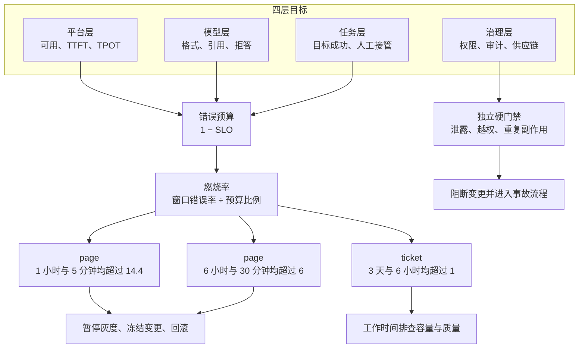
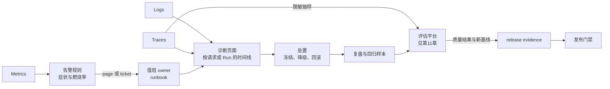
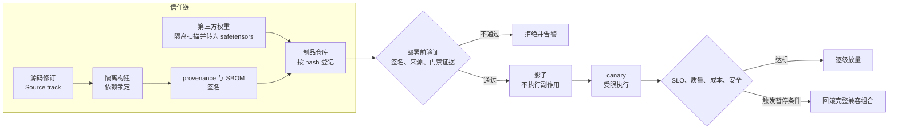
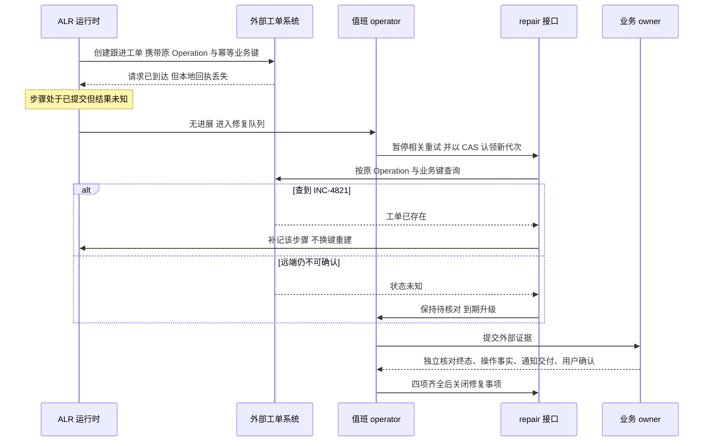
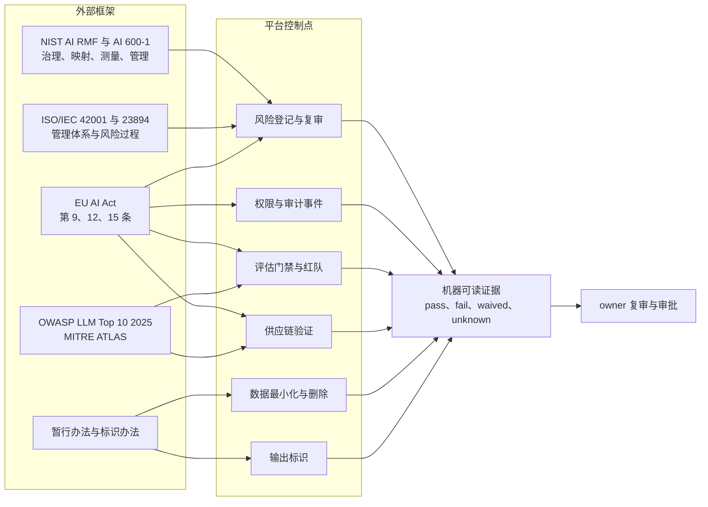
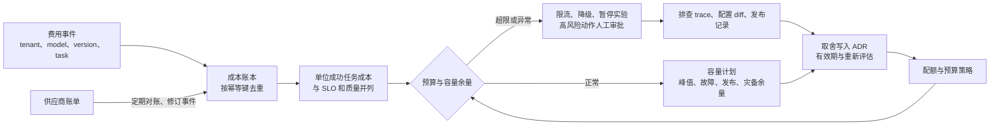
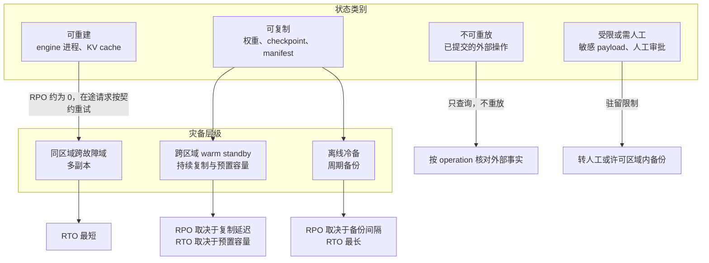
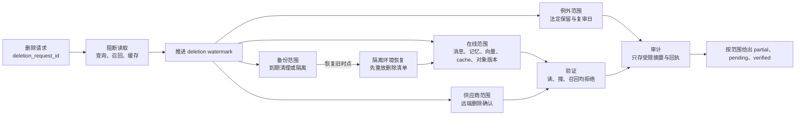
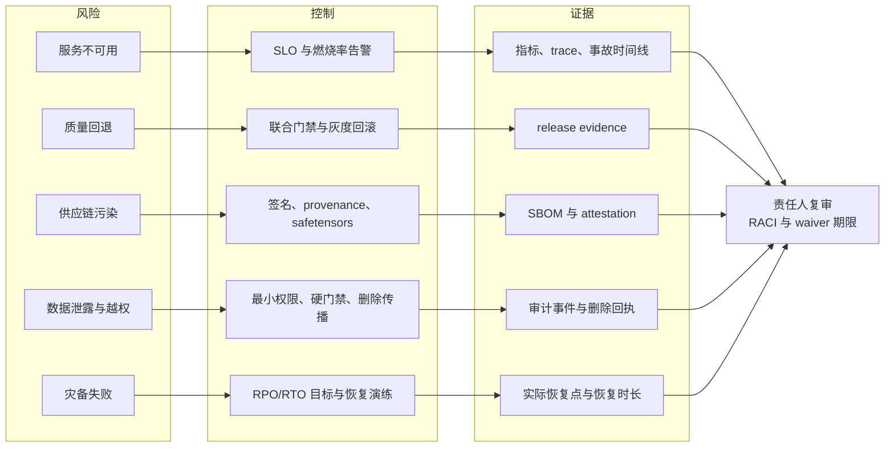

# 第12章 生产运营与治理控制

> **版本与证据说明**：本章的修复流程表、删除记录字段和示例值是教学设计，不代表实际运行记录或已执行的演练。外部规范按核验时的版本引用（SLSA v1.2、OWASP LLM Top 10 2025、EU AI Act 及其 2026 年修订、PyTorch 2.6 起的加载默认值），以文末参考资料的核验日期为准。

大模型系统的可靠性不只是接口可用。模型可能返回格式正确但事实错误的答案，工具可能重复执行副作用，推理服务可能在长上下文下耗尽 KV，训练任务可能在 checkpoint 损坏后无法恢复，数据和 prompt 可能泄露，模型升级可能让成本、偏差和安全风险同时变化。因此，大模型 Infra 的最后一层需要把系统可靠性、模型质量、数据治理、供应链安全、成本、发布和灾备放进同一套可审计的控制闭环。

SRE 的 SLO、错误预算和事故方法提供了服务可靠性基础 [[1]](#ref-1)[[2]](#ref-2)；Dapper、OpenTelemetry 和 Prometheus 提供了跨服务追踪、指标和日志的观测基础 [[3]](#ref-3)[[4]](#ref-4)[[5]](#ref-5)；NIST AI RMF、ISO/IEC 42001、模型卡片、数据集说明书、SLSA 和 Sigstore 则把风险、责任和制品完整性扩展到 AI 生命周期 [[6]](#ref-6)[[7]](#ref-7)[[8]](#ref-8)[[9]](#ref-9)[[10]](#ref-10)[[11]](#ref-11)。本章关注如何把这些原则具体化为 LLM 平台的指标、状态、策略、门禁和操作。SLO、错误预算、发布与回滚、供应链、事故、安全法规、成本、灾备和删除在本章完整解释；推理引擎内部的调度、KV cache 与 drain 机制见第10章，评估集与质量门禁证据如何产生见第11章，本章只讲这些机制和证据如何驱动运营决策。

本章的组织方式是“风险—控制—证据—责任人”。可靠性、发布、安全、成本、灾备和审计不应散落在不同文档里，而应能映射到同一张治理矩阵。

| 风险 | 控制 | 证据 | 责任人 |
|:---|:---|:---|:---|
| 服务不可用或尾延迟失控 | SLO、错误预算、容量预留、降级 | 指标、trace、压测、事故记录 | 平台 owner / SRE |
| 模型质量回退 | 评估门禁、canary、线上反馈、回滚 | evaluation report、canary 指标、失败样本 | 模型 owner / 业务 owner |
| 工具副作用或状态错误 | 幂等、审批、补偿、状态查询 | operation log、approval event、补偿记录 | Runtime owner / 工具 owner |
| 数据泄露或越权 | 权限、脱敏、数据驻留、审计 | access log、policy decision、删除记录 | 安全 / 隐私 owner |
| 供应链或制品污染 | SBOM、签名、provenance、漏洞扫描 | artifact manifest、签名、扫描报告 | 平台 owner / 安全 owner |
| 成本异常 | 预算、配额、成本归因、停止条件 | 成本账本、租户报表、预算告警 | 平台 owner / 财务或业务 owner |
| 灾备失败 | RPO/RTO、备份、恢复演练、供应商退出 | 恢复报告、演练记录、依赖清单 | 平台 owner / 运维 owner |

表中 RPO（Recovery Point Objective，恢复点目标）是可接受的数据丢失量，通常用时间表示，例如“最多丢失故障前若干分钟的写入”；RTO（Recovery Time Objective，恢复时间目标）是从中断到服务恢复可接受的时长。二者由不同机制决定，12.7 节展开。

## 12.1 可靠性目标：从服务可用到任务成功

### 多层 SLO 与 SLI 口径

SLO（服务等级目标）以及 TTFT、TPOT 等推理指标的定义见第8章；本节讨论如何把它们组织成可运营的目标。大模型平台至少有平台层、模型层、任务层和治理层四类目标。平台层关注网关可用、调度成功、实例健康、TTFT、TPOT、队列和恢复；模型层关注格式、引用、拒答、工具参数和能力回归；任务层关注用户目标成功、人工接管、重试和外部状态；治理层关注数据权限、审计、供应链和安全事件。

只看 HTTP 200 会把流式中断、JSON 非法、工具失败和部分输出当作成功。网关返回成功但流式只发送了首 token，是执行面可用而任务未完成；工具返回 200 但业务状态没有变化，是调用可用而副作用失败；评估 job 结束但 coverage 只有一半，是任务完成而证据不可信。因此每个请求和 Run 都要定义 outcome，响应状态与业务状态分离，平台报告同时展示各层结果，避免高层成功掩盖下层失败。

SLI（服务等级指标）是可测量的服务行为，通常写成“好事件/有效事件”：成功完成的请求/有效请求、满足 TTFT 目标的请求/请求、工具状态正确的操作/操作、有效 checkpoint/保存尝试。分母定义决定指标含义：客户端取消、模型拒答、策略阻断、上游错误和平台错误是否进入分母，需要按场景写明。指标带时间窗口、版本、region、tenant、model、workflow、length bucket 和 outcome；高维字段不必全部放进 Prometheus label，可以在 trace 和离线仓库聚合。SLI 定义本身版本化，语义改变时创建新版本，避免趋势图跨定义比较。任务成功率按 workflow、模型、版本、租户和风险分层，不能用所有请求的平均覆盖重要的少数场景。

### 错误预算：口径、分配与恢复

错误预算是某个 SLI 在 SLO 窗口内允许不达标的比例，即 \\(1-\text{SLO}\\)。以 30 天窗口、99.9% 的请求成功率 SLO 为例，预算是窗口内有效请求的 0.1%；若按时间计，约为 43.2 分钟。预算把可靠性要求转换为变化速度：预算充足时团队可以承担发布风险，预算耗尽时暂停灰度、冻结非必要变更、降低实验并发或切换稳定版本 [[1]](#ref-1)。

预算只适用于可以按比例衡量、允许偶发的失败。安全事件、数据泄露、越权访问和重复的不可逆副作用不计入任何错误预算，也不能被平均成功率稀释：它们走独立的硬门禁，一次发生即阻断相关变更并进入事故流程。模型质量可以定义自己的 SLI，例如结构化输出合法率、关键任务成功率，各自拥有预算，但不能被平台 99.99% 的可用性掩盖。服务错误预算用于自动化决策，业务质量预算由 owner 审批。

全局预算按产品、模型、租户、区域和 workflow 分配。核心交易、告警处理和高风险自动化使用更严格的 SLO；实验和低风险摘要可以更宽。子系统预算不能简单相加，因为一次模型错误可能同时造成任务失败、工具重试和成本上涨，平台以 parent task 归因并定义最大总消耗。预算按滚动窗口计算，旧错误移出窗口后预算自然恢复；任何人不得手工改写消耗记录。确需例外时，例如确认是计量 bug，以修订事件记录原因、证据和审批人，原始记录保留。

### 燃烧率告警：多窗口、多燃烧率

只在预算用完时告警太晚，直接对错误率设阈值又无法区分“短暂抖动”和“持续消耗”。SRE Workbook 用燃烧率（burn rate）连接两者 [[12]](#ref-12)：

\\[ \text{burn rate} = \frac{\text{告警窗口内的错误率}}{1-\text{SLO}} \\]

燃烧率为 1 表示恰好在 SLO 窗口结束时用完预算；以燃烧率 \\(b\\) 持续 \\(w\\) 时间，消耗的预算比例为 \\(b\cdot w/T\\)，\\(T\\) 是 SLO 窗口长度。30 天窗口 \\(T=720\\) 小时，燃烧率 14.4 持续 1 小时消耗 \\(14.4\times 1/720=2\%\\) 的预算，若不处理约 50 小时耗尽整个月的预算。

单一窗口有两难：短窗口敏感但误报多，长窗口稳定但检测慢，而且故障停止后很久才复位。多窗口规则要求长窗口和短窗口同时超过阈值：长窗口证明消耗已经显著，短窗口（约为长窗口的 1/12）证明问题仍在持续，故障止住后告警很快解除。以 30 天窗口、99.9% SLO 为例，Workbook 推荐的参数如下，“对应错误率”为燃烧率乘以 0.1%：

| 级别 | 长窗口 | 短窗口 | 燃烧率阈值 | 对应错误率 | 触发时已耗预算 |
|:---|:---|:---|---:|---:|---:|
| page | 1 小时 | 5 分钟 | 14.4 | 1.44% | 2% |
| page | 6 小时 | 30 分钟 | 6 | 0.6% | 5% |
| ticket | 3 天 | 6 小时 | 1 | 0.1% | 10% |

这套规则成立的前提是流量足够。低流量服务一两次失败就会让短窗口错误率越过阈值，可以补充合成探测流量、合并相近服务，或为告警加最小事件数门槛。SLI 分母口径改变会让燃烧率突变，所以告警规则绑定 SLI 版本。LLM 平台的质量 SLI 标签常常滞后数小时到数天，不适合 5 分钟短窗口的 page，宜用 ticket 级规则和每日评估处理。上线前用历史事故回放规则，检查检测时间和误报次数。如图 12-1 所示，四层目标中可按比例衡量的部分进入错误预算和燃烧率告警，治理红线走独立硬门禁。

*图 12-1 多层 SLO、错误预算与燃烧率告警分级*

### 统计陷阱与观察滞后

平均延迟、平均成功率和总错误数会掩盖长尾与少数租户。平台使用分位数、窗口、分层和最小样本；对于流式和长任务，单独定义部分完成、取消、用户中断和人工接管的计量口径。图表同时显示数据质量与覆盖率，SLO 必须可测量、可行动，而不是只写一个目标值 [[1]](#ref-1)[[2]](#ref-2)。

任务成功还有观察滞后：用户可能数小时后才确认，工具外部状态可能最终一致，投诉可能几天后出现。短窗口服务指标与长窗口业务质量并列，长期问题通过反馈和评估闭环处理。当前窗口没有投诉，不能作为高风险模型可靠的证据。

### 可靠性与质量的联合门禁

发布门禁不是两个独立的清单。质量退化可能导致更多重试、人工和 token；延迟变差可能让用户重复提交；安全拦截升高可能表示攻击增加，也可能表示模型过度拒答。报告把质量、SLO、成本、安全和人工放在同一版本和时间窗口，解释它们之间的相互影响。评估集、统计不确定性和质量门禁证据如何产生见第11章 11.8 节，本节只规定这些结果如何与 SLO 一起驱动发布。

门禁采用硬约束加软分析。数据泄露、越权、重复副作用、关键任务失败和制品未签名直接阻断，与错误预算的排除项一致；普通任务的小幅变化进入人工判断；性能和成本变化结合业务价值审批。门禁规则版本化，旧报告不因规则改变而被重写，新规则可以对历史证据做离线重算。

## 12.2 可观测性：信号、质量与告警

### 三类信号与 LLM 字段

Metrics 适合时间序列和聚合，logs 记录具体错误与上下文，traces 连接一次请求或任务的因果链。OpenTelemetry 提供跨组件的语义约定与上下文传播，Prometheus 提供指标采集、查询和告警，Dapper 展示了大规模分布式追踪的价值 [[3]](#ref-3)[[4]](#ref-4)[[5]](#ref-5)。推理侧 TTFT、TPOT 的分解和引擎内部指标见第10章；平台层还要增加 token、模型、模板、cache、工具、质量和成本字段。

Trace root 可以是 request、task 或 training run；span 覆盖 gateway、queue、tokenizer、prefill、decode、retrieval、tool、approval、database 和 evaluator。字段包含 hash、version、输入输出 token、TTFT、TPOT、error、retry、tenant、budget、deadline、quality result 和 policy。默认不记录完整敏感内容，使用摘要、hash、脱敏和受控采样。

### 观测数据的生命周期与成本

不同信号的保留策略不同：metrics 长期保留聚合，logs 按错误和审计需要保留，trace 保留高价值失败与抽样成功，prompt/output 按数据等级短期保留，audit 事件按合规期限保留。每类数据有各自的访问角色、加密、区域和删除流程，观测系统的存储与隐私成本进入平台预算，不能为了排查故障无限期保存 prompt。

改变采样比例或字段会影响趋势。每个 dashboard 标记观测版本、采样率、覆盖率和缺失字段；事故期间临时提升采样要记录开始与结束时间。OpenTelemetry 的统一字段有利于关联，但不能让业务把任意高基数内容塞进 trace [[4]](#ref-4)；Prometheus label 尤其要避免 token、prompt、用户自由字符串和完整 URL，否则时间序列数量会失控 [[5]](#ref-5)。

### 告警分级与诊断

告警信号分为症状和原因。症状是用户能感知的结果：成功率下降、p99 上升、任务失败、成本突增，12.1 节的燃烧率规则属于这一类；原因是可能的机制：KV 水位、队列、模型加载、对象存储、网络、工具、数据漂移、policy 和供应链。page 主要由症状触发，因为它直接对应用户影响；原因类信号进入诊断页面和 ticket，否则一个底层故障会同时引发几十条原因告警。

告警按行动区分三级：page 需要立即处理，ticket 在工作时间处理，dashboard 只看趋势。每条告警必须有 owner、runbook、严重级别、抑制、恢复与升级条件，重复告警合并到同一个 incident。质量漂移和成本异常通常由每日评估或预算系统处理，不应把所有分布变化变成夜间 page。告警内容不包含敏感 prompt 和秘密，而包含模型、版本、区域、tenant group、错误类别、影响比例、SLO 和 trace link；确认、转交和关闭都是审计事件，复盘时检查告警是否及时、准确、可行动。

诊断页面按一个请求或 Run 展示状态时间线、资源、版本、路由、错误、重试、工具和质量。事故中先冻结相关发布、保留 trace，再做降级、隔离和回滚，具体流程见 12.4 节。

### 质量观测与评估回路

线上质量信号包括任务成功、重试、编辑、用户评分、转人工、引用点击、工具成功、结构化合法、拒答、安全拦截和投诉。单独看点赞率或输出长度会受到反馈选择偏差和策略改变的影响，因此质量信号要与延迟、成本、上下文长度、路由、模型版本和数据 snapshot 联合分析。监控按场景分层并设最小样本与置信区间：高风险任务全量或高比例采样，普通任务分层抽样，失败与不确定结果优先保留；基线按版本、任务、语言、长度和用户层级建立，避免全局平均稀释异常。没有标签时使用代理信号并标记不确定。

如图 12-2 所示，线上 trace 经脱敏抽样进入评估平台，评估结果回写模型、workflow、tool 和 release evidence，发布门禁再读取质量与安全趋势。线上反馈如何转为评估证据见第11章 11.6 节。回路中的每次转换都保存 sample hash、版本、权限和采样策略；反馈有偏、缺失和延迟，报告要给出 coverage、标签来源和不确定性。异常确认后冻结受影响版本、扩大回归、回放失败、比较 baseline、检查数据和路由，再决定修复、回滚或接受；接受变化需要 owner、理由、有效期和新基线，模型卡、评估报告和风险登记同步更新。

*图 12-2 观测信号、告警、诊断与评估回路*

### 长期趋势：MTTD、MTTR 与测量变化

季度趋势除了可用率，还看事故数量与严重度、MTTD、MTTR、回滚时间、质量回退、人工接管、单位成功任务成本、安全事件、评估覆盖和灾备演练通过率。MTTD（Mean Time To Detect，平均检测时间）是从用户影响开始到告警或人工确认事故的平均时长。MTTR 的 R 有修复（repair）、恢复（recovery）、响应（respond）等多种口径，本章取平均恢复时间：从用户影响开始到服务重新满足 SLO 的平均时长，包含检测时间和回滚、降级等缓解措施，不等于根因修复完成；根因修复用行动项关闭时间单独跟踪。两项指标都要在报告中写明起止事件，否则不同团队的数字无法比较。

趋势报告列出目标、当前值、变化、解释、行动和 owner。若改善来自减少观测或缩小分母，报告标记 measurement change；若质量提升来自更多人工，计入人工成本；若成本下降来自关闭备份，记录由此增加的 RPO 风险。

## 12.3 发布、变更与供应链治理

### 制品供应链：来源、签名与模型格式

模型权重、tokenizer、template、engine、adapter、工具、workflow、policy、数据 snapshot 和评估报告都是制品。每个制品记录来源、构建、依赖、hash、签名、许可证、owner、数据等级和兼容矩阵；运行时只拉取已登记的 hash。

SLSA 是按“轨道（track）+ 等级”组织的供应链完整性规范。v1.0（2023-04）只定义 Build track 的 L0–L3，约束“这个制品由哪个构建平台、从哪份源码构建”；v1.1（2025-04）是向后兼容的澄清版本；2025-11 发布的 v1.2 新增 Source track，约束源码修订的历史、来源以及源码控制系统上持续执行的技术控制 [[10]](#ref-10)。本章以 v1.2 为参照：Build track 解决“构建是否可信”，Source track 解决“输入构建的源码是否可信”，二者都不涉及模型质量。

签名和来源证明回答不同的问题。Sigstore 用短期证书把签名绑定到 OIDC 身份，并把签名记录到透明日志 [[11]](#ref-11)，它证明“谁签的、内容是否被改过”；构建来源由 provenance attestation 证明，即一份记录构建平台、源码修订、构建参数和依赖的已签名声明。部署前先按已批准的信任根与身份约束校验签名，再检查 provenance 中的构建者和源码是否在允许范围内，拒绝无来源、hash 不匹配或签名无效的制品。两者都不证明模型质量、训练数据已授权或无后门。OpenSSF Scorecard 是一组评估开源项目安全实践的启发式检查，如分支保护、代码评审、依赖固定和签名发布，用于判断上游项目的维护状况 [[13]](#ref-13)；它不扫描你自己依赖树中的漏洞，后者需要基于 SBOM 的漏洞扫描，Scorecard 的分数也只是风险信号，不能当作安全背书。

模型权重格式本身是攻击面。PyTorch 常见的 `.bin`、`.pt` 权重基于 pickle 序列化，反序列化时可以导入并调用任意 Python 对象，加载一个恶意文件就等于执行其中的代码。safetensors 只保存张量和元数据，加载过程不执行代码，应作为首选分发格式 [[14]](#ref-14)。必须读取 pickle 格式时使用 `torch.load(weights_only=True)`，它改用不允许动态导入的受限反序列化器；PyTorch 2.6 起，未传入 `pickle_module` 时默认即为 `weights_only=True`，但显式传 `weights_only=False` 或使用旧版本仍会回到完整 pickle [[15]](#ref-15)。第三方权重先在无凭据、无网络出口的隔离环境中扫描并转换为 safetensors，再登记进模型仓库；公开可下载的模型或 MCP server 不能因此自动进入生产。

构建在隔离环境执行，依赖锁定并生成 SBOM（软件物料清单），常用格式为 SPDX 和 CycloneDX。模型侧可以用 AI/ML-BOM 描述模型、数据集及其依赖：CycloneDX 自 1.5 版起支持 ML-BOM，包含 model card 字段 [[16]](#ref-16)；SPDX 3.0 引入了 AI 和 Dataset 部分 [[17]](#ref-17)。训练数据下载、清洗脚本、量化校准、评估器、tool description 和 prompt template 都可能改变模型行为，因此数据 manifest、模型卡、工具注册和评估报告互相引用。发现依赖漏洞、恶意镜像、模型后门、泄露 token 或签名问题时，平台按 SBOM 与 provenance 计算影响范围：定位运行中的模型、engine、workflow 和租户，停止下载和发布，隔离实例，轮换凭证，保存证据，再生成可信替代品灰度上线。没有来源的旧制品可能需要完全下线；紧急修复同样要过安全、质量、性能和回滚门禁。

### 变更分类、配置与影响分析

变更按风险分为配置、prompt/template、模型、推理 engine、数据、workflow、工具、policy、基础设施和安全。配置变更可能影响容量，prompt 变更可能影响工具和隐私，数据变更可能影响质量与授权，工具变更可能产生副作用。变更单说明背景、收益、代价、风险、指标、门禁、灰度和回滚。

配置分为代码、静态 manifest、动态策略和运行时临时状态：代码通过构建发布，manifest 不可变，动态策略有版本与审批，临时状态通过事件与 TTL 管理。The Twelve-Factor App 提倡配置与代码分离 [[18]](#ref-18)，但受控环境变量不应成为未登记、不可重现的隐式开关。配置变更触发 diff、兼容、容量、质量和安全检查；回滚恢复完整配置集合而非单个值；trace 记录实际生效的配置版本，复盘时才能重建真正发生的行为。

影响分析沿 artifact graph 和 runtime graph 进行。模型 hash 变化影响 tokenizer、engine、cache、路由、评估、成本和工具；数据 snapshot 变化影响训练、评估、模型卡和发布；工具 schema 变化影响 workflow、prompt、权限、补偿和回放；policy 变化影响所有调用与审计。静态层读取 manifest、依赖和血缘，动态层用 shadow/replay、固定回归和容量测试验证，最终生成受影响消费者和需要重跑的门禁列表。无法解析依赖时默认按高风险处理，而不是假设没有影响。

### 发布检查、灰度与回滚

发布前自动生成检查表：制品 hash 与签名、provenance、SBOM、模型卡、数据说明、兼容矩阵、质量门禁结果、SLO 基线、容量、故障演练、权限、审计、成本、回滚、灾备和 owner。缺失项阻断，或者需要显式的风险接受。质量门禁读取第11章 11.8 节产出的证据，检查结果写入 release evidence，不依赖聊天或邮件；审批人看到的是差异与风险，而不是一句“测试通过”。

如图 12-3 所示，通过验证的制品依次进入影子、canary 和逐级放量。灰度按租户、区域、任务、流量、模型版本或 workflow 分组：影子不执行副作用，canary 受限执行，正式放量需满足 SLO、质量、成本和安全。自动暂停条件预先写明，人工 override 需要理由与期限。推理引擎的 drain 见第10章“停止、drain 与 sleep”部分，引擎版本升级的兼容性验证见第10章“可靠性、诊断与验收”部分。

回滚恢复的是兼容组合：模型、tokenizer、template、engine、adapter、workflow、policy、route 和 cache 一起回到上一个兼容版本；新状态无法被旧版本理解时，先 drain 或迁移。回滚路径在发布前用相同版本和权限演练，覆盖正在执行的请求、长 Run、审批、工具 operation、计费、memory 和 trace，防止事故中才发现旧制品已删除或不兼容。没有可执行回滚的变更不能进入生产。

*图 12-3 制品供应链信任链与灰度回滚流程*

### 事故冻结与运营状态接口

高等级事故发生时，发布系统进入 freeze 状态：禁止新的模型、工具、workflow、数据和基础设施变更，保留必要的安全修复和容量扩容，但每项例外都要审批。冻结范围按 blast radius（故障或变更可能波及的范围）划定，可以是单模型、单租户、单区域或全局。冻结期间仍要处理证书轮换、配置过期和节点维护，runbook 列出允许动作及其兼容验证，避免把安全运维完全停死。事故结束后先恢复观测与回归，再小比例解除冻结；错误预算恢复与根因修复是两个不同条件，不能只等流量下降。

Kubernetes 的 Pod 生命周期描述的是执行层状态，不能代表业务任务成功 [[19]](#ref-19)。执行层的状态迁移、未决事实核验、fencing 与恢复算法由本书 Agent 运行时部分定义<!-- 作者待补：Agent 运行时章节号 -->；本章的治理记录只关联权威状态版本、owner、处置期限与证据，不另定义一套状态机。暂停发布、认领修复、验证灾备都通过受控接口完成并留下审计，operator 页面显示绿色不能覆盖业务事实。

## 12.4 事故响应、人工修复与责任升级

### 事故分级、角色与止损

事故按用户影响、数据风险、业务副作用、区域范围、持续时间和恢复难度分级。数据泄露、重复副作用和模型大面积错误通常高于单区域 p99 回退。角色划分采用 Google SRE 的事故管理模型 [[2]](#ref-2)：Incident Commander（事故指挥）掌握全局状态、分派职责，未分派的职责默认由其承担；Operations Lead（运维负责人）带领唯一被允许在事故中修改系统的小组；Communications Lead（沟通负责人）定期发出状态更新并维护事故文档；Planning Lead（规划负责人）处理长周期事务，例如登记缺陷、安排交接、记录偏离常态的临时改动以便事后恢复。LLM 平台还需要业务 owner 和安全 owner 判断影响，他们向 Incident Commander 提供判断，而不是并行指挥，避免多个团队同时执行互相冲突的回滚。

处置顺序是止损、保全证据、恢复有限服务、核对数据与业务状态、复盘。止损包括冻结高风险发布、限流、摘除故障副本、停止工具、关闭跨租户 cache 或切换安全 fallback。保全证据意味着冻结相关 Run、snapshot、制品、trace、配置和事件；禁止绕过受控修复流程直接改业务状态、覆盖制品或清理现场。对未知外部副作用先查询 operation，对可能泄露的数据隔离访问并轮换凭证，对错误模型停止新流量但保留回滚所需的制品。

状态保护依赖所有权编号。lease 是有期限的所有权；generation（代次）在每次所有权转移时递增；fencing token 携带当前代次，下游拒绝代次更旧的写入。这样，一个旧 worker 恢复后不能覆盖新状态，过期的 operator 命令不能执行，故障区域不能与恢复区域同时写同一业务状态。控制面在每个危险动作前检查 generation、lease、policy 和 approval。

内部沟通说明影响范围、当前状态、临时措施、下一次更新时间和用户动作；对外只披露已确认事实和可执行建议。时间线统一使用 UTC 或明确时区，所有操作带 operator、trace 和版本。

### 从死信到关闭：operator 修复流程

“已提交但结果未知”这类状态由 Agent 运行时部分定义，租约、代次与修复接口的执行边界也在那里规定；本节只规定谁在何时凭什么证据操作。一个心跳正常但无进展的任务，或反复失败的毒消息，不应仅靠重启或全量重放处理，因为重放可能重复外部副作用。修复工单引用原任务、步骤与操作标识、manifest、最后进展、错误类型、已确认与未知的业务事实、待处理风险和受控证据链接；页面默认不复制 prompt、客户载荷或凭据。下表“记录字段”列出每个阶段必须写入的字段，CAS（Compare-And-Swap）指只有当记录的当前代次仍等于读取时的值才写入新值，否则失败并重读。

| 修复阶段 | 责任与动作 | 记录字段 | 完成证据或停止条件 |
|:---|:---|:---|:---|
| 发现与分流 | 值班 operator 确认积压、死信或无进展，区分依赖等待和业务未知 | 分类、影响范围、owner、next_action_at | 事件已分类且有负责人 |
| 限制影响 | incident owner 按范围暂停相关工具、重试或放量 | 暂停策略版本、恢复条件 | 不影响无关租户 |
| 认领修复 | 经授权 repair 接口以 CAS 取得新的恢复代次 | repair_id、执行代次 | 自动恢复与人工只有一个有效 owner；冲突则重读 |
| 核对事实 | 工具 owner 按原业务键查询权威系统 | 外部查询时间、返回版本、已确认事实 | 成功则补记；确定失败再按契约恢复；未知保持待核对 |
| 提案与批准 | operator 选择指定步骤续跑、补偿、结案或继续等待 | 参数、目标版本、批准事件 | 权限与预算重验，高风险独立审批 |
| 有界执行 | 沿原 operation 身份或独立补偿身份执行 | 动作事件、repair_id | 同一 repair_id 重复点击幂等，批量限速，超阈值暂停 |
| 复核关闭 | 业务 owner 验证最终事实，operator 核对队列、预算和结果 | 剩余风险、复审时间 | 外部证据、审计、用户可见状态和回归项齐全 |

每种修复等级预先指定认领时限、核验期限与升级对象，这些是组织配置而非通用分钟数。无人认领先转值班备份，超过核验期限转工具或业务 owner，再按影响升级到 Incident Commander 与治理负责人。交接须有接收人确认（handoff_ack），原 owner 不能仅因发出通知就退出。这些要求落实为 repair 记录的 owner、next_action_at、deadline、escalation_level 与 handoff_ack 字段 [[2]](#ref-2)。期限到达只触发升级或限制新增动作，不把未知状态自动改成失败。

### 贯穿案例中的完整事故链

ALR（本书 Agent 部分贯穿使用的业务诊断 Agent 案例）<!-- 作者待补：ALR 首次定义所在章节号 -->在执行诊断时会调用外部工具创建跟进工单。`ALR-20260429-017` 是其中一次诊断案例的编号，`INC-4821` 是这次诊断在外部工单系统中创建的跟进工单。图 12-4 给出这次修复的时序。

*图 12-4 ALR-20260429-017 跟进工单修复时序*

故障的起点是一次网络层面的不确定：创建工单的请求已经到达远端，本地回执却丢失了。此时运行时无法区分“远端已建单”和“远端未收到”，自动重试如果换一个业务键重发，就可能产生第二张工单，因此该步骤停在“已提交但结果未知”，任务无进展，进入修复队列。值班 operator 先判断这是业务未知而非依赖等待，暂停相关工具的重试，再通过 repair 接口以 CAS 认领新代次，保证自动恢复与人工修复不会同时推进同一步骤。

核对事实时，沿原 Operation 和幂等业务键查询工单系统。查到 `INC-4821` 已存在，就补记该步骤，不能换键重新建单；远端状态仍不可确认时保持“待核对”，到期按上节规则升级，而不是改成失败。这里有一条容易被违反的约束：手工在数据库把 status 改成 ready 看似最快，却绕开了原 Operation 与 owner 检查，也绕开了代次校验，所以修复入口必须是受控状态转换接口。若后续的补偿或通知也失败，保留主事实与后续尝试记录，不能把“工单已创建”算作诊断质量或通知交付已经通过。

关闭前独立检查四件事：任务终态、操作事实、通知交付和用户确认。如果只有技术队列清空而原工单效果仍未知，修复事项不得以“平台恢复”关闭。修复结束保存外部查询时间、返回版本、已确认事实、执行代次、批准与动作事件、剩余风险及复审时间。这条链说明了本章几项控制如何衔接：幂等业务键让核对成为可能，CAS 与代次防止并发修复，受控接口保留审计，四项独立检查防止用技术指标替代业务事实。

### 复盘、Runbook 与可操作性评审

无责复盘描述时间线、触发、检测、决策、影响和恢复，并区分触发条件与根本原因：检测为什么晚、告警为什么无动作、runbook 为什么不可执行、自动恢复为什么失败、哪些假设不成立。行动项分为代码、数据、配置、观测、容量、文档、流程和培训，带 owner、期限、验证方式和优先级；事故样本进入回归集，故障演练加入发布门禁。同类事故重复出现，说明修复停留在文档而未进入系统门禁，应触发架构评审。

Runbook 包含症状、查询、指标、权限、判断、动作、风险和回滚，每条都要由演练验证，不可执行的步骤进入 backlog；演练覆盖操作者交班、审批过期、重复点击、自动接管竞争和批量恢复冲击。

新组件上线前做 operability review：健康检查能否区分依赖与自身，指标能否定位，日志是否脱敏，trace 是否关联，备份与恢复是否验证，回滚是否演练，成本是否归因。不能回答的问题进入上线阻断清单；模型仓库、评估器、MCP server 和数据 job 同样适用。

### 职责边界、最小权限与部分失败

模型 owner 对能力、限制和评估负责，数据 owner 对来源、授权和质量负责，平台 owner 对资源、可用性和恢复负责，安全 owner 对威胁、策略和响应负责，业务 owner 对任务成功与残余风险负责，发布 approver 对变更审批负责。这些职责用 RACI 矩阵记录：对每项工作标明 Responsible（执行者）、Accountable（最终负责并拍板者）、Consulted（需征询者）和 Informed（需告知者），避免事故时无人决定。接口契约同时规定哪类错误由哪一层处理，例如格式错误由 Runtime 重试或判失败，工具越权由策略拒绝，业务状态冲突由业务查询；责任不清会导致无限重试和互相推诿。

值班人员需要查看健康、指标和 trace 摘要，执行限流、摘除实例和切换安全 fallback，但不应默认读取敏感 prompt、下载模型或执行业务工具。高风险操作需要双人审批或 break-glass。break-glass 指紧急情况下绕过常规审批临时提权的受控通道，必须记录原因、时间和范围，自动过期并在事后复盘。平台 API 对 operator 与 tenant 使用不同的 audience 和 policy；服务账户使用短期凭证，权限轮换和离职回收自动化，审计系统定期检查批量导出、跨区域、非工作时间和失败授权等异常访问。

AI 任务经常部分完成：检索成功但生成失败，三项工具完成两项，答案生成但引用缺失。API 返回 partial、failed、needs_attention 或 completed_with_warnings，并附带已完成、未完成、可重试和需人工的部分。部分结果是否可用由 workflow 和业务 postcondition 定义，不能让模型自行宣布成功；隐藏部分失败会让用户重复提交、增加副作用。成本按已执行部分结算，重试只补未完成或明确需要重算的部分。

## 12.5 安全、数据最小化与 AI 风险治理

### 风险登记与治理框架

AI 风险登记表包含系统用途、用户、模型、数据、工具、威胁、失败影响、控制、残余风险、owner 和复审时间。风险不能只写“模型可能出错”，而要写明危害场景、触发条件、暴露范围、检测信号、阻断与补偿，例如模型生成错误退款动作、工具越权读取、训练数据泄露、提示注入、输出偏见、成本失控和区域合规违规。每个高风险场景至少有预防、检测、响应和复盘四类控制。

NIST AI RMF 1.0（NIST AI 100-1，2023 年发布）用 govern、map、measure、manage 四个职能组织 AI 风险管理，属于自愿采用的框架；NIST 已说明 1.0 版正在修订，本章按已发布的 1.0 版与 2024 年的生成式 AI Profile（NIST AI 600-1）使用 [[6]](#ref-6)[[20]](#ref-20)。后者进一步关注幻觉、数据隐私、滥用、信息安全和供应链等生成式风险。ISO/IEC 42001:2023 规定 AI 管理体系的要求，ISO/IEC 23894:2023 给出 AI 风险管理指南 [[7]](#ref-7)[[21]](#ref-21)，前者可用于认证，后者是指导性文件。

欧盟《人工智能法》（Regulation (EU) 2024/1689）于 2024-08-01 生效，分阶段适用：禁止性实践与 AI 素养义务自 2025-02-02 起适用，通用目的 AI（GPAI）模型义务与治理规则自 2025-08-02 起适用，第 50 条透明度义务自 2026 年 8 月起适用 [[22]](#ref-22)[[23]](#ref-23)。高风险系统义务原定 2026-08-02 起适用；2026-07-27 生效的 AI Omnibus 修订将附件 III 所列用途的高风险义务推迟到 2027-12-02，附件 I 所列受监管产品中的 AI 推迟到 2028-08-02 [[23]](#ref-23)<!-- 待核验：AI Omnibus 的正式条例编号（官方页面链接指向 OJ L_202601744，疑为 Regulation (EU) 2026/1744，正文未写明） -->。对平台工程而言，几个条款可以直接对应到本章的控制点：第 9 条风险管理体系对应风险登记与定期复审，第 12 条记录保存对应自动生成的审计事件与日志留存，第 15 条准确性、稳健性与网络安全对应评估门禁、红队和供应链控制。一个系统是否属于高风险取决于其用途分类，需要法律判断，平台只负责让证据可生成。

中国《生成式人工智能服务管理暂行办法》自 2023-08-15 起施行，第十一条规定提供者对使用者输入信息和使用记录的保护义务、不得非必要收集个人信息，以及及时受理个人信息相关请求 [[24]](#ref-24)；适用范围按第二条和实际服务场景核对。《人工智能生成合成内容标识办法》自 2025-09-01 起施行，要求对生成合成内容添加显式标识和写入文件元数据的隐式标识 [[25]](#ref-25)，因此输出标识也是需要留证的控制点。如图 12-5 所示，这些框架最终映射到少数几类平台控制，并汇入同一种机器可读证据。

*图 12-5 风险治理框架与平台控制点的映射*

### 权限、审计与数据最小化

权限分为调用模型、读取数据、执行工具、写外部状态、查看 trace、下载制品、审批发布和修改 policy，采用最小权限、短期凭证、租户和区域限制以及目标 allowlist。审计记录主体、资源、动作、理由、策略版本、结果、trace、时间和来源，由平台统一生成，而不是从应用日志临时拼接；审计本身不可被普通租户修改，保留期、访问者和导出都有策略。

数据最小化沿整条链路实施。先枚举任务必需字段，再决定模型输入；业务密钥、完整账户资料和无需公开的核心脚本留在受控服务，模型只接收必要结果。假名化映射与原文分开授权；电话号码遮盖但姓名地址完整仍可能识别主体，hash 也可能被关联或枚举，不能自动视为匿名信息。资源读取、模型上下文、工具返回、日志、记忆、评估和网络出口分别设策略，不用“已脱敏”一个标签覆盖全链路；Skill 与工具声明不存放业务凭据。供应商的训练使用、驻留、保留与删除能力要逐项核对实际配置与合同约定，不因产品名为企业版就假定零留存。

### LLM 应用安全与安全事件

本章采用 OWASP Top 10 for LLM Applications 2025 版，其条目为提示注入、敏感信息泄露、供应链、数据与模型投毒、不当输出处理、过度代理、系统提示泄露、向量与嵌入弱点、错误信息和无限制消耗（Unbounded Consumption）[[26]](#ref-26)。2023 年版中的“拒绝服务”和“模型窃取”在 2025 版中归入无限制消耗：它覆盖资源耗尽、按量计费被滥用以及通过 API 大量查询抽取模型等情形。MITRE ATLAS 提供针对 AI 系统的攻击战术与案例知识库 [[27]](#ref-27)。这些分类告诉团队要测什么，组织仍需把具体资产、攻击面和响应动作写进 runbook。

防御不是只加系统 prompt，而是权限、沙箱、schema、输出过滤、网络、速率、审计、人工和回滚的组合。安全策略不能被模型修改：工具结果、检索文档和用户文件标记为不可信，模型输出先过 schema 和 policy 再执行副作用。策略引擎本身可能误拦截、漏拦截、超时或返回不确定；不可用时对高风险动作 fail closed，对低风险只读动作有限降级并把事件标记为 policy_unavailable。输入安全、输出安全、工具权限和数据访问使用同一个 policy version，避免各层给出不同答案。误拦截需要人工复核和样本回流，修复后验证正常任务没有被过度拒答；安全指标按语言、任务、租户和模型分层，避免平均数掩盖少数场景。

安全事件发生时，保留请求 hash、模型、policy、工具、凭证标识、权限决定、网络、制品、trace、时间线和影响范围，敏感正文只做受控快照并加密；同时隔离受影响租户、撤销 token、停止工具和切断 egress，防止扩散。证据访问本身最小化并记录，避免调查过程二次泄露。每类事件都有检测、遏制、清除、恢复、通知和复盘步骤；攻击样本脱敏审批后进入红队与回归集，修复后检查攻击路径和正常任务。

### 模型卡、数据说明与持续风险监控

Model Cards 记录模型的用途、限制、评估、风险和适用场景 [[8]](#ref-8)；Datasheets for Datasets 记录数据的来源、组成、收集方式、代表性、缺失与偏差、推荐用途和不适用用途 [[9]](#ref-9)。平台把这两类文档与模型制品、dataset snapshot 和 release evidence 关联，模型或数据变化时重新生成或复审，并通知使用者重新过门禁，不能把旧卡片继续附在新模型上。它们的作用是让调用方知道模型和数据不能用来做什么。

卡片中的限制需要持续监控，而不是上线时检查一次。生产监控关注输入分布、事实性、拒答、偏差、敏感内容、工具错误和投诉，新场景、语言和用户群进入风险评估。风险指标分层并设红线：达到红线自动停止流量、关闭工具或转人工；接近阈值时扩大采样和人工复核；正常波动只记录。

数据治理同样落到责任矩阵：数据 owner 负责来源和用途，steward 负责 schema 与质量，安全负责敏感等级与访问，法务与合规负责授权和保留，模型 owner 负责使用影响，平台负责执行控制。矩阵写入数据 catalog 和 snapshot manifest，没有 owner 的数据不能进入生产训练或评估。

### 治理控制的自动化与失效模式

自动化控制包括制品签名校验、数据授权检查、schema、兼容矩阵、漏洞、质量门禁、权限、限流、成本、备份、漂移、删除和回滚。手工审批只处理不能自动判断的部分。控制器自身也要有版本、权限、观测和回滚：错误的 policy 可能阻断所有服务或放行危险动作，更新前用历史回放和 sandbox 验证，策略发布按区域、租户和风险灰度，紧急禁用高风险工具的路径独立于普通发布。

治理控制是一类程序，因此会像其他程序一样失败，而且失败代价往往更大，一个错误的策略可能同时阻断全部服务，或者放行本应拦截的动作。设计治理控制时至少要覆盖四类失效。

**过度阻断。** 签名校验、授权检查或质量门禁在依赖不可用时默认拒绝，会在大规模故障中把“依赖挂了”放大成“业务全停”。可行的做法是区分控制等级：安全、权限和删除类控制 fail closed；容量、成本和性能类门禁在依赖不可用时降级为告警并记录，由值班人决定是否继续。这个划分必须在设计时写定，事故中临时决定会带来不可审计的例外。

**静默放行。** 与控制不可用相反，另一种失效是控制“看起来通过了”。典型形态是校验函数捕获异常后返回默认值、策略引擎超时后按最宽松规则处理、扫描任务因超时被标记为完成。防范方式是让每个控制都输出机器可读的四值结果：pass、fail、waived、unknown。waived 必须带 owner、理由、期限和补偿措施；unknown 按风险等级处理，而不是并入 pass。

**策略漂移。** 同一份策略在不同组件中被各自实现，一段时间后行为不再一致：网关认为某类请求需要审批，执行层认为不需要。避免方式是把策略集中为带版本的制品，各层只引用版本号；策略变更走与模型变更相同的灰度路径，并用历史流量回放验证新旧策略的判定差异。

**控制成本失控。** 全量 trace、逐步 judge、人工复核、跨区备份和红队都会消耗资源。如果这些成本不被归因，团队会在“提升治理水平”的名义下无限增加控制，直到成本超过它保护的价值。可操作的做法是给每项控制记录单位成本，并在季度评审中检查“每项控制拦住了什么”；长期零命中的控制应当降低采样或下线，而不是永久保留。

这四类失效的共同点是：它们都不会立刻表现为事故，而是以“平台看起来很规范，但关键路径越来越慢、例外越来越多”的形式累积。因此治理控制的健康度本身也需要指标：例外数量与期限、unknown 比例、策略版本一致率、控制命中率与控制成本占比。内部复核抽样生产事件、权限和发布记录，检查控制是否真的执行，而不只是文档存在；高风险系统必要时引入外部审查，重大模型、工具、数据或地区变化即重新触发，而不是等年度周期。

## 12.6 成本、容量与资源治理

### 成本账本与单位成功成本

成本包括 GPU、CPU、内存、网络、存储、模型下载、token、KV、cache、外部调用、评估、人工和失败重试。训练按有效 token、GPU 小时和重算归因；推理按输入输出 token、GPU 毫秒、成功任务和 cache 归因；多步任务还要按步骤、外部调用、人工介入和副作用分别归因。每条费用事件带 tenant、project、model、version、task 和幂等键，重复上报不会重复计费。

成本报告区分预约、实际、等待、通信、空闲、失败、重试和有效工作。GPU 利用率高但有效任务少，成本仍可能很高；便宜模型若输出更长或失败更多，单位成功成本不一定低。因此核心指标是单位成功任务成本，它与错误预算、质量门禁并列，超限触发暂停、限流、降级或审批。治理控制本身的成本也进入账本，按 12.5 节“控制成本失控”的方法评估命中与成本：低风险任务使用较低采样和自动化，高风险任务使用更强的证据、人工和保留。成本面板向团队公开，但公开不等于惩罚排名；团队可以自设预算、预警和自动暂停，避免月底才发现资源耗尽。

### 容量计划与多类预算

容量模型按 workload、长度、并发、模型、GPU、区域、故障余量、发布余量和长尾建立。训练关心有效 token/s 和扩展效率；推理关心 goodput（满足 SLO 的有效吞吐，定义见第8章）、TTFT、TPOT 和 KV；多步任务还关心活跃任务数、外部调用 QPS、状态存储和人工容量。容量 dashboard 显示 planned、reserved、active、pending、failed、draining 和 spare。模型、模板、数据、流量、硬件或工具改变时都要重算容量。

容量预算包括正常峰值、节点故障、发布期间新旧两份副本、灾备切换、评估和突发；不能把全部 GPU、状态库连接、对象存储 QPS 和人工容量都分配给常态业务，再假设还能完成滚动发布和故障转移。Borg 的优先级、配额和故障域经验说明，预留和抢占需要控制面统一治理 [[28]](#ref-28)。不同预算可能冲突：错误预算耗尽时暂停高风险变更，容量不足时限制流量和长任务，安全红线被突破时关闭相关工具或区域，质量退化时回滚模型。平台预先指定优先级：安全和数据责任高于成本，关键业务质量高于平均吞吐，可靠性保护优先于实验速度。

### 优化取舍与知情决策

量化、batch、cache、低优先级资源、模型路由、上下文压缩、预计算和异步化都可能降本，但会改变质量、延迟、内存或数据风险。每项优化写明基线、假设、收益、代价、指标、回滚和重新评估条件；一次只改变少数变量，用固定 workload 比较质量、SLO、成本和错误预算。

成本透明让业务能做知情取舍，而这些取舍记录在 ADR（Architecture Decision Record，架构决策记录）中：一份记录决策背景、候选方案、证据、结论、后果与重新评估条件的短文档。若减少评估样本可以省钱但扩大未检测风险，由 owner 接受并设置有效期；若增加 cache 降低 GPU 却延长敏感数据保留，需要安全审核。跨区域方案要分清两件事：备份频率主要决定 RPO，缩短 RTO 则依靠 warm standby（预先部署、持续同步的备用环境）或持续复制；如果驻留策略不允许跨区，二者都要改用许可区域内的备份或重算，并接受相应更差的 RPO 与 RTO。

常见的反模式是为了省 token 让模型少做验证，为了提高 GPU 利用率混入长任务，为了省日志关闭 trace，为了省备份放宽 RPO。治理评审把这些代价写明，由业务 owner 接受风险并设定重新评估日期。

### 成本异常检测

成本监控检测 token 突增、输出长度变化、重试风暴、cache 命中下降、judge 队列积压、工具调用爆发、GPU 空闲、对象存储请求和跨区域流量。异常按 tenant、model、workflow、版本和 region 分层。自动动作包括限流、降低优先级、暂停实验、切换模型、关闭可选分支和通知 owner，高风险动作需要人工。

成本异常可能来自攻击、业务流量、模型行为、模板循环或计量 bug，排查使用 trace、事件、配置 diff、数据分布和发布记录，不要立即把配额调高。费用事件与供应商账单定期对账，发现计量重复或漏记时生成修订事件，不覆盖原始记录。图 12-6 把账本、预算、异常处置和 ADR 串成一个闭环。

*图 12-6 成本与容量治理闭环*

## 12.7 故障演练、业务连续性与灾备

### 故障域与故障分类

故障域包括请求、实例、GPU、节点、网络、区域、存储、调度器、模型仓库、数据仓库、工具和人工队列。每类故障定义检测、隔离、重试、降级、回滚、补偿、恢复时间和数据损失；单节点故障不应让所有副本同时失效，单租户的工具风暴不应拖垮全局。

故障还要按可重试性分类：瞬时、确定性、状态未知和不可逆。只读或契约允许的瞬时网络错误可以有界退避重试；写操作超时先核验；schema 错误需要修复输入；工具提交后连接断开需要查询；支付或删除等动作需要人工。AIP-194 关于自动重试适用条件与错误分类的规定可作为接口参考 [[29]](#ref-29)。

### 混沌演练与一致性测试

混沌实验注入故障来验证恢复路径：杀死 worker、GPU reset、节点断电、网络延迟与丢包、DNS 失败、对象存储不可用、模型下载损坏、KV OOM、事件重复、状态库只读、工具超时和区域切换。Chaos Mesh 的 NetworkChaos 等能力提供了 Kubernetes 上的网络与资源故障注入机制 [[30]](#ref-30)，其他注入类型以所用工具的文档确认支持范围。每次实验写明假设、范围、注入、预期、停止条件、指标和恢复步骤，先在隔离池与影子流量执行，再逐步扩大；实验期间不能让自动回滚掩盖错误，停止条件保护真实业务。若系统只能靠人工 SSH 清理，说明自动恢复的边界不足。

单纯杀 Pod 只能验证重启。分布式状态还需要一致性测试：Jepsen 区分了线性一致、顺序一致、因果一致等一致性模型 [[31]](#ref-31)，Jepsen 风格的测试记录操作历史、故障窗口和最终状态，按选定的一致性模型检查是否出现丢失更新、非法状态或读到未来的值。因此测试前要先明确检查所用的模型，再为网络分区、时钟偏差、消息重复和乱序设计故障。运行时还要加入业务不变量：一次 operation 最多成功一次，预算不为负，已撤销的权限不能执行，终态不可逆。测试使用模型、工具、消息和状态的可控 fake，真实外部副作用在 sandbox 中验证；发现不变量被破坏时保留最小重现历史、事件、版本和资源并加入回归。重复演练直到恢复时间、资源释放和审计都符合目标，再把场景变为长期回归。

### 状态分类、RPO/RTO 与灾备层级

灾备清单先给状态分类，因为不同状态的恢复机制完全不同。可重建状态包括 engine 进程和 KV cache：推理实例丢失后从权重重新加载，KV 从 prompt 重新计算（机制见第10章）。可复制状态包括模型权重、训练 checkpoint、manifest 和评估报告。不可重放的状态是已提交的外部操作，只能查询而不能重放。受限或需人工的状态包括人工审批和被驻留策略禁止跨区复制的敏感 payload。

RPO/RTO 与状态类别绑定。训练的 RPO 是可丢失的训练进度，即最近一次有效 checkpoint 之后的 step 与 token，RTO 是恢复到可继续训练的时间。推理服务没有持久状态，RPO 约为 0，在途请求按 API 契约由客户端或网关重试，RTO 是恢复健康副本、重新加载权重并通过健康检查的时间。涉及外部动作的任务，其 RPO 针对事件、审批、操作事实与状态记录，通常要求接近 0，依靠同步持久化实现；RTO 是新 owner 重新接管的时间。评估的 RPO 针对结果与报告，RTO 是重新运行或读取证据的时间。

如图 12-7 所示，灾备层级分为同区域跨故障域、跨区域和离线冷备。决定 RPO 的是数据多久被复制或备份一次：同步复制的 RPO 接近 0，异步复制的 RPO 取决于复制延迟，周期备份的 RPO 取决于备份间隔。决定 RTO 的是备用环境的就绪程度：同区域多副本几乎立即接管，跨区域 warm standby 已预置容量和数据，冷备需要先恢复数据、再拉起服务，RTO 最长。权重和模型制品可以多区域复制，敏感数据可能只能保存加密指针和受控副本，trace 采样保留，审计事件按高等级保留。

*图 12-7 状态类别、灾备层级与 RPO/RTO 的关系*

### 跨区域切换、安全降级与恢复演练

跨区域恢复需要模型制品、配置、注册表、状态、事件、数据 snapshot、评估报告和密钥引用，但不是所有内容都能跨区域，数据驻留和删除策略优先；敏感 payload 不复制时，相关 Run 在恢复区域转人工。若跨区复制不被允许，不能仅以“已加密”作为越界理由，应改用批准区域内的备份、分区存储或在许可环境重算。

灾备区域或冷备环境可能没有同样的模型、工具、数据权限和安全服务。切换前生成 capability matrix，验证制品签名、版本、区域、密钥、数据授权、工具 endpoint、路由、容量和观测，按任务选择可用功能：缺少高风险策略时关闭自动副作用，缺少私有数据时返回明确不可用而不是访问公共替代，缺少 judge 时不执行质量门禁或转人工。降级按能力层级设计：稳定模型、小模型、异步、缓存回答、只读工具、人工队列和安全拒绝，用户看到的状态明确是 degraded、partial、queued 或 needs_attention。切换后验证流量、SLO、成本、审计、任务状态和副作用；区域恢复不能只是修改 DNS。故障区域恢复后，用 fencing、单主或明确的合并规则防止双活写入造成冲突，新任务按容量逐步放量。

恢复演练按季度覆盖区域不可用、对象存储延迟、模型仓库损坏、状态库恢复、凭证轮换、网络分区和工具供应商故障。演练测量实际恢复点（恢复后的数据停在故障前哪个时刻）和实际恢复时长，与 RPO/RTO 目标比较，同时检查数据完整、权限、trace、成本、用户影响和人工工作量。只验证“备份任务成功”而不做恢复，无法证明 RPO/RTO 可达；演练结束保留证据并更新 runbook。

### 灾备取舍与可靠性测试分层

更低的 RPO/RTO 通常意味着更多复制、备用 GPU、跨区网络、演练和存储成本。ADR 写明哪些状态值得复制、哪些可以重建、哪些转人工，由业务 owner 接受低概率高影响的风险。典型取舍是：选择全量 trace 换来诊断与合规能力，代价是成本和隐私暴露；选择跨区 warm standby 缩短 RTO，代价是驻留约束与成本；选择自动重试恢复短暂故障，代价是副作用风险。所有降级与例外都有有效期和重新评估条件，避免临时降级变成永久事实。

可靠性测试按层分工：单元测试验证状态迁移、schema、策略、预算、幂等和错误；集成测试验证模型、工具、存储、队列和观测；合同测试验证 API 与事件；回放测试验证历史 Run；压力测试验证容量；混沌测试验证故障；恢复测试验证 RPO/RTO；红队测试验证安全。每层失败产生不同的门禁，不能用集成测试替代恢复和安全测试。测试结果保存 commit、制品、配置、环境、原始输出和报告；flaky 测试不应被简单重试隐藏，随机测试保存 seed 与最小重现。

## 12.8 删除、备份、供应商与交付证据

### 删除传播：从阻断读取到派生副本

平台先为 prompt、output、trace、memory、tool result、评估样本、模型制品和审计事件定义保留期、删除方式、备份影响和法律保留。删除请求的执行顺序是：先让授权查询、召回与缓存命中停止，再沿 lineage 把删除可靠传播到缓存、派生 embedding、回放、标注、训练候选和报告，摘要仍含个人信息或可关联标识时也纳入清理。每个范围分别记录“逻辑不可见”“在线物理清理”“历史副本待到期”“依法保留”的状态，保留例外写明依据、用途限制、owner 和复审期限。

对象存储的语义决定了“删除”到底删了什么。S3 开启版本控制时，简单 DELETE 通常只增加一个 delete marker，旧内容作为历史版本保留，GET 返回 404 并不能证明物理擦除；永久删除需要针对相应的 versionId 执行 [[32]](#ref-32)。因此删除范围要列出当前对象、历史版本、复制目的地、索引、向量、摘要、缓存、回放、标注导出和供应商副本，而不是只删会话表。下表是一份删除与备份范围记录的字段设计。

| 字段 | 示例值及验收含义 |
|:---|:---|
| deletion_request_id / scope_version | del-example-042 / v3；重复执行沿同一请求更新版本 |
| subject_ref / lineage_roots | 受控主体引用与会话、文件根，不复制原始 PII |
| access_blocked_at / deletion_watermark | 先阻止读取；删除事件序号作为重建发布的最低水位 |
| online_scope | 消息、记忆摘要、向量、prefix 与响应 cache、制品当前及历史版本逐项回执 |
| backup_scope | 备份集 ID、区域、快照时间、到期日、恢复 owner 及能否逐项擦除 |
| provider_scope | 出站处理方、远端请求 ID、删除确认或待确认、核对期限 |
| exception_scope | 法定保留或不可逐项清理的副本，批准主体、用途限制与复审日 |
| verification | 在线读、搜、召回均拒绝，缓存不命中，旧快照重建不会复活，恢复演练检查 |
| audit / status | 只存请求、策略、对象受限摘要与回执；partial、pending、verified 按范围表达 |

表中 deletion watermark（删除水位）是删除事件序列中的位置：任何索引回滚、离线重建或从备份恢复的数据集，在发布前都必须追平到这个位置，并叠加之后的增量撤权，验证旧记录被墓碑拒绝。如图 12-8 所示，执行结果按范围表达，不能用单一的 done 掩盖仍在备份保留窗口中的载荷。删除清单本身也需要最小权限与保留策略，尽量使用不可逆的受限标识，并防止墓碑到期早于所有旧副本。

*图 12-8 删除传播与证据链*

### 备份、PITR 与删除冲突

备份提高恢复能力，也延长了数据保留，增加删除的复杂度。备份记录数据等级、密钥、区域、保留期、恢复 owner 和删除实现；敏感备份做到最小化、加密和到期清理。crypto-shredding（销毁专用密钥使密文不可读）只有在专用密钥及其全部副本都受控、可验证失效时，才能评估是否满足不可恢复目标，不能把“已加密”本身当作已删除。对不能逐项删除的不可变备份，记录隔离访问、到期清理计划和例外；恢复时先在隔离环境完成删除清单与当前撤权的叠加，再允许业务读取。

PITR（Point-in-Time Recovery，时间点恢复）是数据库的常见恢复机制。PostgreSQL 18 的 PITR 从 base backup 和 WAL 重建任意历史时点 [[33]](#ref-33)；它不理解应用层的删除请求，恢复到旧时点可能让已删除的内容重新出现，所以需要应用层的恢复门禁。恢复日志、重放队列和人工导出都属于删除范围，不能只看数据库当前行。

审计需要证明删除请求被处理，但不能再次保存被删除的内容：只存主体引用、时间、对象 hash、策略和结果。对象 hash 或主体标识仍有识别风险时，审计记录也需要访问限制与期限。已经进入训练权重的内容，不能通过删除原始样本来证明被遗忘；风险登记记录受影响模型、是否需要停止使用、替换或重训等可验证补救及责任人，未经验证不宣称完成模型遗忘。

### 供应商与退出

外部模型、judge、搜索、支付、短信、邮件和云服务各有 SLA、数据处理条款、区域、限流、错误语义和版本。供应商清单保存用途、数据流、DPA、fallback、成本、联系人和退出方案。DPA（Data Processing Agreement，数据处理协议）约定处理方代表数据控制方处理个人数据的范围、安全措施、子处理方、删除与审计义务。敏感数据默认不发送，发送前最小化、脱敏并记录授权；供应商版本变化进入兼容测试与评估。外部服务不可用时，Runtime 依据工具 policy 选择重试、缓存、替代、异步或人工；不可逆副作用的确认结果未知时，查询 operation 而非重试。

平台不能假设供应商一直可用。模型供应商、GPU 云、对象存储、检索、支付和标注服务都需要退出或切换计划：保存可迁移的制品、协议、数据格式、评估、权限、成本和替代服务，定期运行导出与恢复；依赖专有格式时生成可读 manifest 和转换器。退出演练不等于立刻迁移全部流量：先在离线数据和影子 Run 上比较质量、成本、延迟、安全与合规，再迁移低风险租户，最后处理关键任务。旧服务 drain 后保留查询和审计能力，确保历史 Run 仍能解释。fallback 仍受能力与数据策略约束，缺少批准区域或删除能力的端点不能临时接收敏感数据。

### 合规证据与长期保留

合规报告从机器可读的 manifest、policy decision、audit event、模型卡、datasheet、评估报告和发布记录生成，手工复制截图容易遗漏版本和时间；每个结论都有制品、trace 或事件引用。报告生成器版本化，规则变化时生成新报告，旧报告只读并保留历史语义；外部审计访问受控视图，可以从报告反查输入、策略、版本和结果，但不暴露无关租户。

长期保留的 evidence bundle 包括 model、data、workflow、tool、policy、runtime、评估、灰度、事故、成本和审批版本，按敏感等级和合规期限保存。季度或重大变更时做 evidence review：链接是否有效、签名是否可验证、snapshot 是否可读、指标定义是否改变、回滚是否仍能启动、owner 是否仍在职，目标是几年后仍能解释一个旧模型为何被发布、如何被撤回。

### 发布、恢复与保留的联合验收

端到端演练选取一个训练 run、一个推理请求、一个多步任务和一个评估任务，注入节点故障、存储失败、工具超时、状态重复、模型回滚、数据撤回和区域切换，检查状态不被覆盖、副作用不重复、敏感数据不泄露、预算可对账。发布验收随机抽取各类变更，验证来源、兼容矩阵、质量门禁、灰度、自动暂停和回滚。

联合验收要区分服务成功、任务成功和证据完整三种事实，涉及外部动作时按操作账本查询实际状态。回滚模型或索引只能恢复兼容的执行组合，当前的撤权与删除不能随之回退，旧审批也不能因恢复旧版本而自动扩权；不兼容的在途 Run 暂停并保留 checkpoint，迁移时重验语义、权限与既有副作用。验收抽样至少覆盖一条未决事实的修复、一条补偿失败升级、一条跨班次交接、一条旧备份恢复后的删除检查和一次供应商中断，每条保存输入引用、范围、owner、期限、实际动作、外部事实和剩余限制。治理通过表示这些范围有证据，不表示所有风险已消失；任何 waiver 都绑定能力、理由、有效期和补救，不能通过反复延期让未知状态永久无人处理。

## 12.9 本章小结

本章按“风险—控制—证据—责任人”组织生产运营。可靠性部分的关键口径是：错误预算等于某个 SLI 在窗口内的 \\(1-\text{SLO}\\)，按滚动窗口自然恢复；安全事件和数据泄露不进入预算，走独立硬门禁；多窗口多燃烧率告警同时用长窗口确认消耗、短窗口确认持续，以 page 和 ticket 分级。观测数据的价值在于形成回路：症状告警触发诊断，诊断与线上抽样进入评估，评估结果回写 release evidence 和发布门禁。

发布与供应链部分区分了三种证明：签名证明签名者身份与内容完整性，provenance attestation 证明构建来源，二者都不证明模型质量；pickle 格式的权重加载即可执行代码，应优先 safetensors 并隔离转换。事故部分用 Google SRE 的四个角色组织指挥，用 CAS、代次和受控 repair 接口防止并发修复和绕过审计，`ALR-20260429-017` 的跟进工单修复展示了“核对外部事实、不换键重建、四项独立检查后关闭”的完整链路。安全治理把外部框架映射到少数平台控制点，治理控制本身会过度阻断、静默放行、策略漂移和成本失控，需要四值结果与健康度指标。灾备部分强调备份频率决定 RPO、备用环境就绪程度决定 RTO，演练比较实际恢复点和恢复时长与目标；删除部分用 deletion watermark 防止备份恢复和索引重建让已删除数据复活。图 12-9 汇总了本章的风险、控制、证据与责任关系。

*图 12-9 本章概念图：风险、控制、证据与责任人*

## 12.10 参考资料

1.  Beyer, B., et al. [Implementing SLOs](https://sre.google/workbook/implementing-slos/). In: *The Site Reliability Workbook*. O’Reilly Media, 2018. 核验日期：2026-10-17。

2.  Beyer, B., et al. [Managing Incidents](https://sre.google/sre-book/managing-incidents/). In: *Site Reliability Engineering: How Google Runs Production Systems*. O’Reilly Media, 2016. 核验日期：2026-11-05。

3.  Sigelman, B. H., et al. [Dapper, a Large-Scale Distributed Systems Tracing Infrastructure](https://research.google/pubs/dapper-a-large-scale-distributed-systems-tracing-infrastructure/). Google Technical Report, 2010. 核验日期：2026-10-17。

4.  OpenTelemetry Authors. [Signals](https://opentelemetry.io/docs/concepts/signals/). OpenTelemetry 官方文档, 在线文档. 核验日期：2026-10-17。

5.  Prometheus Authors. [Overview](https://prometheus.io/docs/introduction/overview/). Prometheus 官方文档, 在线文档. 核验日期：2026-10-17。

6.  NIST. [Artificial Intelligence Risk Management Framework (AI RMF 1.0)](https://doi.org/10.6028/NIST.AI.100-1). NIST AI 100-1, National Institute of Standards and Technology, 2023（项目页：https://www.nist.gov/itl/ai-risk-management-framework ，注明 1.0 版正在修订）. 核验日期：2026-11-05。

7.  ISO/IEC. [ISO/IEC 42001:2023 Information technology — Artificial intelligence — Management system](https://www.iso.org/standard/42001). ISO 官方公开摘要, 2023. 核验日期：2026-10-17。

8.  Mitchell, M., et al. [Model Cards for Model Reporting](https://arxiv.org/abs/1810.03993). Proceedings of the Conference on Fairness, Accountability, and Transparency (FAT*), 2019. 核验日期：2026-10-17。

9.  Gebru, T., et al. [Datasheets for Datasets](https://arxiv.org/abs/1803.09010). Communications of the ACM, 64(12), 2021. 核验日期：2026-10-17。

10.  OpenSSF SLSA Project. [SLSA Specification v1.2](https://slsa.dev/spec/v1.2/). OpenSSF, 2025-11-24（v1.0 发布于 2023-04-19，v1.1 发布于 2025-04-21）. 核验日期：2026-11-05。

11.  Sigstore Authors. [Sigstore Overview](https://docs.sigstore.dev/about/overview/). Sigstore 官方文档, 在线文档. 核验日期：2026-10-17。

12.  Thurgood, S., et al. [Alerting on SLOs](https://sre.google/workbook/alerting-on-slos/). In: *The Site Reliability Workbook*. O’Reilly Media, 2018. 核验日期：2026-11-05。

13.  OpenSSF. [Scorecard](https://github.com/ossf/scorecard). GitHub 项目说明, 在线文档. 核验日期：2026-11-05。

14.  Hugging Face. [Safetensors](https://huggingface.co/docs/safetensors/index). Hugging Face 官方文档, 在线文档. 核验日期：2026-11-05。

15.  PyTorch Contributors. [Serialization Semantics](https://docs.pytorch.org/docs/stable/notes/serialization.html). PyTorch 官方文档（2.15）, 在线文档. 核验日期：2026-11-05。

16.  OWASP CycloneDX. [Machine Learning Bill of Materials (ML-BOM)](https://cyclonedx.org/capabilities/mlbom/). OWASP, 规范 1.5 版起支持（2023-06）. 核验日期：2026-11-05。

17.  The Linux Foundation SPDX Project. [SPDX Specification 3.0.1](https://spdx.github.io/spdx-spec/v3.0.1/). The Linux Foundation, 2024. 核验日期：2026-11-05。

18.  Wiggins, A. [The Twelve-Factor App](https://12factor.net/). 2011. 核验日期：2026-10-17。

19.  Kubernetes Authors. [Pod Lifecycle](https://kubernetes.io/docs/concepts/workloads/pods/pod-lifecycle/). Kubernetes 官方文档, 在线文档. 核验日期：2026-10-17。

20.  NIST. [Artificial Intelligence Risk Management Framework: Generative Artificial Intelligence Profile](https://doi.org/10.6028/NIST.AI.600-1). NIST AI 600-1, National Institute of Standards and Technology, 2024. 核验日期：2026-10-17。

21.  ISO/IEC. [ISO/IEC 23894:2023 Information technology — Artificial intelligence — Guidance on risk management](https://www.iso.org/standard/77304.html). ISO 官方公开摘要, 2023. 核验日期：2026-10-17。

22.  European Parliament and Council of the European Union. [Regulation (EU) 2024/1689 laying down harmonised rules on artificial intelligence (Artificial Intelligence Act)](https://eur-lex.europa.eu/eli/reg/2024/1689/oj). Official Journal of the European Union, 2024. 核验日期：2026-11-05。

23.  European Commission. [AI Act: Regulatory framework on AI](https://digital-strategy.ec.europa.eu/en/policies/regulatory-framework-ai). Shaping Europe’s digital future, 2026. 核验日期：2026-11-05。

24.  国家互联网信息办公室, 等. [生成式人工智能服务管理暂行办法](https://www.cac.gov.cn/2023-07/13/c_1690898327029107.htm). 2023-07-13 公布, 2023-08-15 施行. 核验日期：2026-10-17。

25.  国家互联网信息办公室, 等. [人工智能生成合成内容标识办法](https://www.cac.gov.cn/2025-03/14/c_1743654684782215.htm). 国信办通字〔2025〕2号, 2025-03-14 发布, 2025-09-01 施行. 核验日期：2026-11-05。

26.  OWASP GenAI Security Project. [OWASP Top 10 for LLM Applications 2025](https://genai.owasp.org/llm-top-10/). OWASP Foundation, 2025. 核验日期：2026-11-05。

27.  MITRE. [ATLAS Data: Tactics, Techniques, and Case Studies](https://github.com/mitre-atlas/atlas-data). MITRE ATLAS 官方仓库, 在线文档. 核验日期：2026-10-17。

28.  Verma, A., et al. [Large-scale Cluster Management at Google with Borg](https://research.google/pubs/large-scale-cluster-management-at-google-with-borg/). EuroSys, 2015. 核验日期：2026-10-17。

29.  Google. [AIP-194: Automatic Retry Configuration](https://google.aip.dev/194). API Improvement Proposals, 在线文档. 核验日期：2026-10-17。

30.  Chaos Mesh Authors. [Simulate Network Faults](https://chaos-mesh.org/docs/simulate-network-chaos-on-kubernetes/). Chaos Mesh 官方文档, 在线文档. 核验日期：2026-10-17。

31.  Jepsen. [Consistency Models](https://jepsen.io/consistency). Jepsen, 在线文档. 核验日期：2026-10-17。

32.  Amazon Web Services. [Deleting Object Versions from a Versioning-enabled Bucket](https://docs.aws.amazon.com/AmazonS3/latest/userguide/DeletingObjectVersions.html). Amazon S3 User Guide, 在线文档. 核验日期：2026-10-17。

33.  PostgreSQL Global Development Group. [25.3 Continuous Archiving and Point-in-Time Recovery (PITR)](https://www.postgresql.org/docs/18/continuous-archiving.html). PostgreSQL 18 Documentation, 2025. 核验日期：2026-10-17。
