# 第 14 章 知识检索与 RAG：从文档到可引用证据

本章解释怎样建设与运行检索系统：把授权来源解析、表示和索引，再从查询产生可回读、可引用的证据。证据包契约与冲突解释参考[上下文工程](02-context-engineering.md#knowledge)，任务执行与恢复参考[Agent Runtime](03-agent-runtime.md)。文中的容量、参数候选、时间线和实验均为教学设计，未运行生产基准；来源核验于 2026-10-24。

<a id="rag-boundaries"></a>

配图可点击查看原图；窄屏阅读时可单独打开并放大。

## 14.1 职责边界、技术脉络与问题定义

[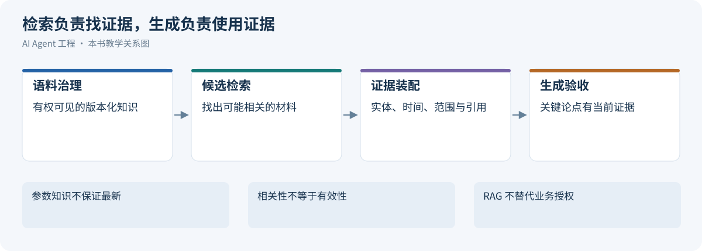](../images/review-knowledge-retrieval-01.svg)


RAG 将参数化生成与外部非参数知识结合，但不能单独保证事实正确、来源适用或行动获授权。Lewis 等人的原工作研究检索与生成的组合，本文所述权限水位、证据契约和恢复责任属于本书在应用场景中的推导。[[1]](#ref-1)

从词项匹配到稠密检索，变化的是候选生成机制，不是把检索彻底替换为模型记忆。BM25 保留词项频率和长度线索；DPR 用双编码器学习问题与段落的匹配；late interaction 保留更细的 token 交互；Agentic 方法再按证据缺口安排下一次检索。[[2]](#ref-2)[[3]](#ref-3)[[4]](#ref-4) 这些方法可以组合，不能仅按发表先后当作升级阶梯。

本章用同一次虚构告警作检验：order-service 在 09:37Z 出现延迟升高，查询 Runbook 时 v2 排在 v3 前面，旧规则诱发“连接池耗尽”的错误假设。真实诊断还需要部署与日志，不由文档相似度决定。服务、时间、版本和权限均是查询约束；仅仅找出含“延迟”二字的片段不能完成任务。

| 信息需要 | 首选机制 | RAG 的边界 |
| --- | --- | --- |
| 当前订单/部署/指标 | 授权业务 API 或专用工具 | 向量索引不是实时业务事实源 |
| 已知文档的完整条款 | 按稳定标识读取 Resource/原文 | 先检索可定位来源，再回读具体版本 |
| 大量文档的候选证据 | 稀疏、稠密或混合检索 | 候选相关不代表支持结论 |
| 小范围完整材料综合 | 长上下文与明确定位 | 窗口容纳不等于模型稳定利用 |
| 跨实体多跳问题 | 有界多轮检索 | 每个桥接实体都要来自证据 |

长上下文研究显示相关信息位置影响回答表现，不能因窗口足够大就取消检索、排序和验证。[[5]](#ref-5) 本场景选择检索的理由是需要版本过滤、定位和按权限回读，而不是断言所有任务都必须建向量库。请求范围很小、数据变化快或能直接精确查询时，先保留简单可靠路径。

<a id="rag-ingestion"></a>

## 14.2 摄取、解析、切分与证据单位

[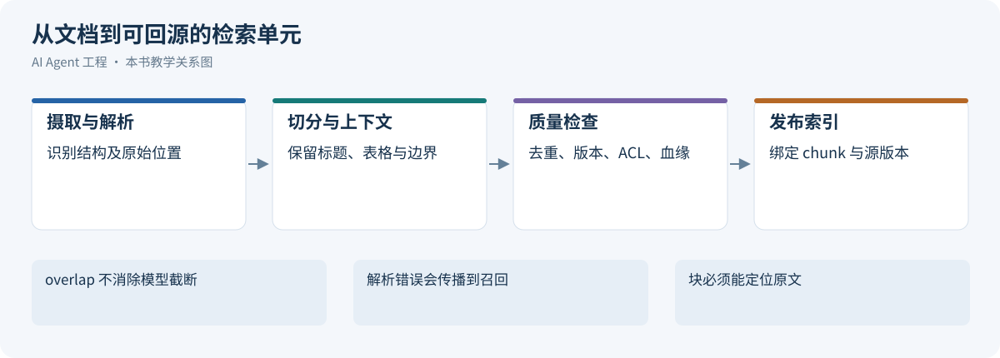](../images/review-knowledge-retrieval-02.svg)


### 14.2.1 生产级 RAG 的离线与在线链路

生产级 RAG 通常分成离线链路和在线链路。

```mermaid
flowchart TB
    subgraph Offline["离线链路：知识进入索引"]
        A["Raw Sources<br/>Markdown / Wiki / PDF / Code"] --> B["Parser<br/>解析"]
        B --> C["Cleaner<br/>清洗"]
        C --> D["Chunker<br/>切分"]
        D --> E["Metadata Enrichment<br/>补充元数据"]
        E --> F["Embedding<br/>向量化"]
        F --> G["Index<br/>向量 + 关键词索引"]
    end

    subgraph Online["在线链路：问题变成证据"]
        H["User Query"] --> I["Query Understanding"]
        I --> J["Source Routing"]
        J --> K["Candidate Retrieval"]
        K --> L["Rerank"]
        L --> M["Context Package"]
        M --> N["LLM Answer"]
    end
```

离线链路决定知识质量上限。在线链路决定用户问题能否命中正确证据。只优化 embedding 模型而忽略文档解析、chunk、metadata 和 rerank，通常不会得到稳定效果。

### 14.2.2 文档摄取：解析、清洗、版本与生命周期

文档摄取不是简单读文件。不同来源有不同风险。

| 知识源 | 典型内容 | 摄取难点 |
|:---|:---|:---|
| Markdown / HTML | 技术文档、博客、README | 标题层级、代码块、链接 |
| Wiki | 产品文档、会议纪要 | 权限、页面层级、过期内容 |
| PDF / Word | 研报、合同、手册 | 表格、页眉页脚、段落顺序 |
| 工单 / 事故复盘 | 历史案例 | 噪声、状态变化、结论过期 |
| 代码仓库 | API、注释、配置 | 版本、分支、生成文件 |

解析时要保留结构：

- 标题层级；
- 文档路径；
- section id；
- 表格；
- 代码块语言；
- 图片说明；
- 更新时间；
- 作者和来源；
- 权限标签。

清洗时要删除导航、广告、重复页脚、无意义模板和过期提示，但不能把引用、表格标题和代码上下文误删。

生命周期也很重要。每个文档和 chunk 都应该有稳定 ID、版本、更新时间、失效状态和来源链接。否则引用会漂移，debug 时无法复现。

### 14.2.3 Chunk 策略：检索单位、上下文单位、引用单位

Chunk 不是越小越好，也不是越大越好。它至少有三种角色：

```text
检索单位：用于召回
上下文单位：放入 prompt
引用单位：展示给用户追溯
```

常见切分策略：

| 策略 | 优点 | 缺点 | 适合场景 |
|:---|:---|:---|:---|
| 固定长度切分 | 简单稳定 | 容易切断语义 | 低结构文本 |
| 结构化切分 | 保留标题和段落 | 依赖文档结构 | Markdown、HTML、Wiki |
| 语义切分 | 语义完整 | 成本高、结果不稳定 | 长段落、论文 |
| Parent-child Chunk | 召回细粒度，展示大上下文 | 实现复杂 | 技术文档、代码文档 |

工程上常用 parent-child 模式：

```text
child chunk：用于 embedding 和召回
parent section：用于上下文展示和引用
```

这样可以兼顾召回精度和回答完整性。

### 14.2.4 Metadata：让检索从“相似”走向“可控”

没有 metadata 的 RAG 只能做“相似文本搜索”。生产系统需要可控检索。

推荐 metadata 包含：

```json
{
  "doc_id": "order-system-design",
  "chunk_id": "order-system-design#payment-timeout#003",
  "source_type": "markdown",
  "title": "订单支付超时补偿机制",
  "section": "支付超时处理",
  "path": "docs/order/payment-timeout.md",
  "owner": "order-platform",
  "updated_at": "2026-05-10",
  "version": "git:abc123",
  "visibility": "internal",
  "tags": ["order", "payment", "compensation"]
}
```

metadata 的作用包括：

- 权限过滤；
- 时间过滤；
- source routing；
- 排序加权；
- 引用展示；
- debug 和复现；
- 过期内容治理。

如果 metadata 缺失，系统很难回答“为什么召回了这个 chunk”“这个文档是否过期”“用户是否有权限看”。

### 14.2.5 无标题、表格和 OCR 的兜底链

解析器先产生带位置的元素，而不是先把所有格式压成纯文本；Unstructured 展示按格式和策略做 partitioning 的接口。[[6]](#ref-6) 无标题 Markdown 仍可按段落、列表、代码围栏与表格节点分组，超长节点再沿句界/Token 边界拆；派生主题标签不能冒充原作者标题。

扫描页需 OCR 并保留原页图、bbox、页码、阅读顺序和低置信标记；多栏顺序错误、单位/脚注丢失会直接改变答案。表格召回行片段后补表头、单位、脚注与邻行，不把“12”脱离列含义引用。

父子检索保存 doc_id/version、parent_id/child_id 和原文偏移。小块用于召回，父块补适用条件，引用仍定位实际支持范围。父版本更新后旧子块全部失效或重建；无权限父段不能因子块命中而回读。


### 14.2.6 解析结果如何成为可审计的索引输入

摄取先保存原始来源身份、版本、采集时间和访问策略，再产生解析元素。正文、表格、代码和页脚要有可追溯位置，不能只有一个合并后的字符串。Unstructured 的 partitioning 按文件格式产生元素，这支持元素级处理，但不证明任意 PDF 的阅读顺序都正确。[[6]](#ref-6)

本书建议将解析器版本、原文哈希、清洗规则和切分参数写入摄取 manifest。相同原文换解析器后，块边界和定位器可能变化，应创建新派生版本；旧引用仍指向旧原文快照或明确失效。解析失败进入隔离队列，有责任人与重试入口，不把空文档算作成功收录。权限缺失时默认不索引或不可见，不能等待查询阶段由模型补推断。

切分必须按 embedding tokenizer 计算长度，标题、前缀和新增上下文也占预算。overlap 只缓解跨边界证据缺失，不能恢复被编码器截断的尾部。若模型上限为 L，块正文加标题、前缀和上下文超过 L，先结构化拆分或明确截断；否则索引里保存了全文引用，却只有前段参与向量表示，读者会误以为尾部内容已经可检索。

每个块保留检索单位、上下文扩展单位与引用单位的对应。召回一行表格后回读表头、单位和脚注；扩展父段时重新鉴权，并计算加入模型的成本。不能因为一个子块有权访问就展开整个无权父文档，也不能把多个版本拼接成一条貌似完整的规定。

### 14.2.7 摄取验收：原文存在不等于知识已可用

摄取验收应围绕问题所需的事实设计探针。本书为 Runbook 准备三类检查：能否定位适用版本和服务，能否完整读取一条包含前提与例外的处置规则，能否回到规则所在原文。即使文档数、块数和向量数全部符合预期，只要“仅适用于旧客户端”的限定被清洗掉，该文档仍不能作为当前诊断依据。元素解析提供处理单位，语义是否保真需要另外验收，不能从解析器返回成功推断。[[6]](#ref-6)

验收集按真实格式分层，既保留正常页面，也纳入跨页表格、折叠段落、无标题说明和同名服务。标注原文事实及其最小支持范围，检查解析文本是否保留否定、单位、版本和脚注。对数字错位这类足以改变结论的问题，隔离受影响材料并保留原图供人工核验；不能用全库平均解析成功率抵消一条关键错误。

摄取失败还应有读者可见的结果语义。尚未同步表示检索覆盖存在缺口，授权失败表示本次不能读取，正文为空可能是页面迁移或解析故障，这些都不是“资料证明没有相关规则”。查询侧收到覆盖缺口后，可以回读允许访问的原文或报告证据不足。修复解析器时先重放该类探针，再重建受影响文档的派生产物，避免为了修复一份表格无条件重算全库。

<a id="rag-indexes"></a>

## 14.3 表示、近似索引与容量取舍

[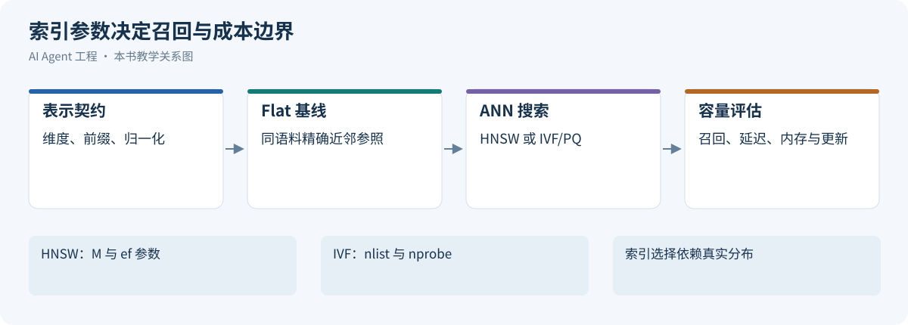](../images/review-knowledge-retrieval-03.svg)


### 14.3.1 Embedding 与向量索引

Embedding model 把文本映射到向量空间，使语义相近的文本距离更近。例如：

```text
"订单退款规则" -> [0.12, -0.03, ...]
"如何退订酒店订单" -> [0.10, -0.01, ...]
```

向量检索会把用户 query 和文档 chunk 分别编码成向量，再找距离最近的候选。常见相似度包括 cosine similarity、dot product 和 L2 distance。

这里的 embedding 要和预训练里的 **LLM token embedding** 区分开：

```text
LLM token embedding：模型内部把 token ID 映射成初始向量
RAG text embedding：检索系统把 query / document 映射成语义索引
```

两者都叫 embedding，但工程位置不同。RAG embedding 是外部知识系统的一部分，目标是“找相关证据”；LLM token embedding 是模型权重的一部分，目标是“让 token 进入 Transformer 计算”。

选型 embedding model 时要关注：

- 中文、英文、多语言效果；
- 代码和表格支持；
- 向量维度；
- 成本和延迟；
- 是否允许数据出域；
- 是否需要本地部署。

向量索引用于近似最近邻搜索。常见实现包括 HNSW、IVF、PQ 等。工程选型通常由数据规模、召回质量、延迟、更新频率和部署约束决定。

单向量相似度不能保证实体、错误码、订单号、版本和否定条件的精确匹配；其细节保留程度取决于模型与训练任务。对本场景先保留词法与结构过滤基线，再测稠密召回增益，避免以相似度替代字段校验和权限控制。

### 14.3.2 非对称编码与空间契约

DPR 使用 query 与 passage 双编码器，而不是把两段字符串任意送入不同模型后比较。[[3]](#ref-3) 例如 e5-base-v2 模型卡要求 query:/passage:前缀并展示归一化，这只适用于该模型约定，不能机械推广。[[7]](#ref-7) 记录模型 revision、tokenizer、前缀、pooling、截断、维度、归一化与 metric；短 query 和长 chunk 可得到同维表示，长度不同不妨碍计算，却可能因截断/信息稀释降低相关性。

相似度 cos(q,d)=q·d/(||q||||d||)，仅单位归一化时内积等于余弦；对单位向量有平方 L2=2−2q·d。换模型即使维度相同也不能混用空间；不要通用除以文本长度“修正”分数。Token embedding 属于生成模型内部权重，检索 embedding 属于外部编码契约。

### 14.3.3 Flat、HNSW、IVF 与 PQ 的取舍

HNSW 通过分层近邻图搜索，查询宽度、图连接和构建投入分别影响召回、内存与构建成本。[[8]](#ref-8) Faiss 索引文档区分全扫描 Flat、聚类分桶 IVF、图索引与 PQ 压缩。[[9]](#ref-9) IVF 选择探测桶再算候选，nprobe 影响速度/召回；PQ 将子向量编码为码本索引，减少载荷但引入近似误差，可对候选用原向量重评分。

Flat 精确近邻可作为 ANN Recall@K 基线，但近邻正确不等于业务相关证据正确。强权限过滤后候选可能不足，比较过滤前/中/后策略及小集合精确搜索；禁止为补足 K 返回越权对象。删除、更新、持久化和租户隔离是数据库能力，不能从“使用 Faiss”自动推出。

教学容量账本：100 万条 1536 维 float32 向量，原始载荷为 N×d×4=6.144GB（十进制）。另计图/倒排、payload、原文、复制、临时构建和新旧双索引；该数既非实测内存，也不表示必须全部常驻 RAM。冷热缓存、分片扇出、过滤选择性、写入积压与 P95/P99 共同决定选型。


### 14.3.4 稀疏、稠密与多向量表示分别保留什么

BM25 的一种常见写法为：

$$s(q,d)=\sum_{t\in q}\mathrm{IDF}(t)\frac{f(t,d)(k_1+1)}{f(t,d)+k_1(1-b+b|d|/\mathrm{avgdl})}.$$

其中 f 为词频，k1 控制重复词收益的饱和，b 控制文档长度归一化强度；IDF 的平滑形式随实现不同。[[2]](#ref-2) 对服务名、错误码和版本号，精确词项保留了单向量可能压缩掉的信息；中文分词、代码符号切分与字段权重影响很大，不能把英文默认分析器当中文业务基线。

DPR 的双编码器分别编码问题和段落，在同一训练目标约束的空间中匹配。[[3]](#ref-3) e5-base-v2 的 query/passsage 前缀、平均池化与归一化属于其模型契约，该模型卡还限制英文与最多 512 token，不适合作为中文长文的无条件默认。[[7]](#ref-7) 本场景若选择多语言表示，M3-Embedding 与智源 bge-m3 模型卡提供了多语言、稀疏/稠密/多向量能力的一手依据；是否适合本业务仍需同一留出集比较。[[10]](#ref-10)[[11]](#ref-11)

ColBERT 预先编码文档 token，查询时进行 late interaction，它比单向量保留更多局部匹配信息，代价是表示和索引更大；不能把它直接称为普通 cross-encoder。[[4]](#ref-4) 数字、否定、版本适用性与权限仍需单独校验，表示精细不代表事实正确。

### 14.3.5 HNSW：构建预算与查询预算分开

HNSW 在多层图中先粗定位再细搜索。M 控制邻接连接规模，efConstruction 控制插入时探索宽度，efSearch 控制查询候选探索宽度；增加 M 主要牵动图内存与连接质量，增加 efConstruction 主要影响构建时间和图质量，增加 efSearch 主要交换查询延迟与召回。[[8]](#ref-8)[[9]](#ref-9) Milvus 中文文档将相应查询宽度称为 ef，具体字段按引擎版本映射。[[12]](#ref-12)

不能把论文中的对数尺度表现写成任意数据、过滤和参数下最坏 O(log N)保证。图退化、聚簇、维数、删除比例和严格过滤都会改变访问节点数；距离计算还与维度及硬件有关。实际构建成本取决于每次插入搜索和邻居选择，查询成本取决于层间导航及底层探索，不能只用 N 解释。采用图索引前保留 Flat 结果与样本查询，用访问量和延迟分布检验收益。

调参分两阶段。先固定 M、efConstruction 和数据快照建多个图，比较构建耗时、峰值内存、持久化大小及目标召回下的查询曲线；再在选定图上扫描 efSearch。只调查询宽度不能修复差的构图或错误 embedding，重复重建也不能修复错误权限过滤。工程候选值必须标教学范围，最终参数从项目测量产生。

### 14.3.6 IVF 与 PQ：把候选裁剪误差和压缩误差拆开

IVF 训练粗聚类中心，把向量分到 nlist 个倒排桶；查询探测 nprobe 个桶。nlist 太少时桶大，扫描成本高；太多则训练和分桶负担上升，数据稀疏或分布漂移时可能出现不均衡。增大 nprobe 通常扩大候选覆盖，但也增加扫描，不能只固定一个值比较不同数据库。Faiss 文档提供索引结构与选择指南。[[9]](#ref-9)[[13]](#ref-13)

PQ 将向量划分为子空间，每段用码本编号表示；若分为 m 段、每段 b bit，编码主体约 m×b/8 字节，另计 ID、码本、桶或图结构。这个容量公式是编码账本，不是完整数据库内存。查询可以用查表近似距离，对初筛候选回读原向量精排；若不存原向量，不能承诺精排消除全部量化误差。Faiss 论文讨论了索引、压缩与计算的取舍空间。[[14]](#ref-14)

实验上先以 IVF_FLAT 对比 Flat 估计分桶裁剪误差，再用相同分桶和探测配置比较 IVF_PQ，单独观察压缩带来的额外损失。训练集须代表未来分布，不能只用很小的历史样本训练码本却据此承诺新租户效果。词表、版本和模型变化可能要求重训重建，在线更新能力与一致性由具体存储实现定义，不从算法名称自动获得。

### 14.3.7 过滤、内存和索引选型的决策记录

| 方案 | 获得能力 | 主动牺牲 | 重新评估信号 |
| --- | --- | --- | --- |
| Flat | 精确向量近邻与稳定基线 | 大集合距离计算成本 | 目标延迟或吞吐无法满足 |
| HNSW | 常见分布下较好的召回/延迟折中 | 图内存、构建与更新维护 | 过滤后召回下降、内存或重建超预算 |
| IVF_FLAT | 控制探测范围，适合批量训练分桶 | 粗分桶可能漏邻居 | 桶分布偏斜或分布漂移 |
| IVF_PQ | 压缩载荷，降低扫描带宽 | 量化误差与调参/训练复杂度 | 原文证据召回受损或精排成本抵消收益 |

本场景的教学 ADR 先选 Flat 建立小规模基线，再按目标 Recall 比较 HNSW 与 IVF，而不先指定厂商品牌。决策驱动为权限过滤、当前版本证据覆盖、P95、峰值内存、更新与恢复成本。获得可解释误差边界，牺牲首版极限吞吐；若真实数据规模、ACL 选择性或写入频率超出验证范围，重新评估。不存在“高 Recall 即可放宽权限”的交换。

### 14.3.8 带过滤条件的近邻对照怎样才公平

比较 ANN 之前，先定义当前查询的合法候选集合。本书将其限定为同一租户、环境、适用版本和当前授权下可参与排名的向量；Flat 与 ANN 必须在这个集合上使用相同距离计算。否则一个系统先全库召回再过滤，另一个系统先缩小集合再搜索，最后比较的“召回率”混入了不同任务。Faiss 将精确索引作为近似方案的参照，具体数据库的过滤执行计划仍需独立说明。[[13]](#ref-13)

若合法集合不足 K，参照分母使用实际可用近邻数量并单列空集合查询；距离并列时约定稳定排序或等价集合，避免把任意次序当成算法错误。向量正确但原文已失效的对象不应因为位于 Flat 前列就被标成业务正例。业务相关性标签与向量近邻标签分别保存，才能解释“近邻重合很高，答案仍然错误”的情况。

压测也要区分单查询代价与并发下的等待。固定索引快照、查询分布、过滤选择性和并发，分别观察距离计算、候选过滤、原文回读与排队。某组参数在空载下延迟很低，增加候选宽度后却可能使队列积压；因此参数决策应基于目标负载下的曲线，而不是选择某次最快请求。更新或删除改变了合法集合时重建对照，不继续沿用旧标签宣布性能提升。

<a id="rag-retrieval"></a>

## 14.4 查询理解、混合召回、融合与重排

[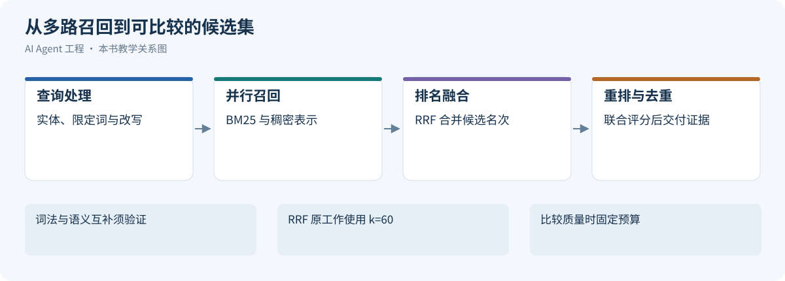](../images/review-knowledge-retrieval-04.svg)


### 14.4.1 Hybrid Search：关键词检索为什么仍然重要

检索方法可以粗略分成三类：

| 方法 | 机制 | 优点 | 短板 |
|:---|:---|:---|:---|
| Sparse Retrieval | BM25、关键词、倒排索引 | 可解释，适合错误码、接口名、版本号 | 同义改写能力弱 |
| Dense Retrieval | embedding 向量语义匹配 | 能处理语义相似和自然语言改写 | 容易忽略精确符号和结构细节 |
| Hybrid Retrieval | sparse + dense + filter | 兼顾语义召回和精确匹配 | 需要合并、去重和排序策略 |

生产级 RAG 通常需要 hybrid search：

```text
Dense Retrieval：语义召回
Sparse Retrieval：关键词 / BM25 召回
Metadata Filter：权限、时间、来源过滤
Rerank：统一排序
```

关键词检索在这些场景里很关键：

- 错误码；
- API 名称；
- 表名、字段名；
- 类名、函数名；
- 精确产品名称；
- 版本号和配置项。

推荐模式是先多路召回，再 rerank：

```text
vector top-k
+ bm25 top-k
+ metadata filtered candidates
→ merge
→ deduplicate
→ rerank
```

这背后的原则是：召回阶段尽量不要漏掉候选，排序阶段再精细判断哪些证据真正有用。

### 14.4.2 Query Understanding：理解用户到底要查什么

用户问题往往不等于检索 query。在线 pipeline 的第一步是理解用户到底需要什么。

需要识别：

- 问题类型：事实查询、解释、比较、排障、设计；
- 实体：服务名、服务标识、订单号、接口名；
- 时间窗口：最近 7 天、当前版本、某次发布之后；
- 权限范围：用户能看哪些文档和数据；
- 输出要求：摘要、步骤、表格、引用、操作建议；
- 风险级别：是否涉及金融、医疗、生产操作。

例如：

```text
用户问题：order-service 延迟升高是否与发布有关？
知识需求：服务实体、环境、时间窗、部署版本、指标与日志；输出带证据假设，不自动执行修复。
```

### 14.4.3 Query Rewrite 与 Query Expansion

Query Rewrite 把用户问题改写成更适合检索的表达。Query Expansion 补充同义词、实体别名和相关字段。

```text
原问题：支付失败兜底怎么做？

rewrite:
- 支付失败补偿机制
- 交易异常补偿
- payment failure fallback
- payment timeout compensation
```

改写不能失控。过度 expansion 会引入噪声。工程上可以限制 expansion 的数量，并把扩展词记录到 trace 中，方便排查召回为什么偏了。


### 14.4.4 Candidate Retrieval：召回候选证据

Candidate Retrieval 的目标是高召回，不是最终排序。常见做法是：

- 向量召回；
- BM25 召回；
- metadata filter；
- 图谱邻接扩展；
- resource 目录读取；
- 工具查询。

召回阶段应该保留来源信息和命中原因。例如：

```json
{
  "candidate_id": "chunk-123",
  "source": "runbook_rag",
  "retrieval_method": "hybrid",
  "matched_terms": ["payment timeout", "compensation"],
  "vector_score": 0.82,
  "bm25_score": 12.4
}
```

这些信息对后续 debug 很有价值。

### 14.4.5 Rerank：让结果从“相似”变成“有用”

Rerank 解决的是候选结果排序问题。Embedding 检索通常负责从大量文档中快速召回候选，例如 top 50 或 top 100；reranker 负责对候选进行更精细排序，例如选出 top 5。可以把它压缩成一句话：

```text
召回要快，排序要准。
```

相似不等于有用。一个 chunk 可能和问题很像，但内容过期、权限不匹配、只讲背景、不包含答案。

Rerank 可以考虑：

- 与问题的相关性；
- 是否包含可回答证据；
- 来源权威性；
- 更新时间；
- 文档层级；
- 是否与其他证据重复；
- 用户权限；
- 是否是一手来源。

常见 reranker 是 cross-encoder：它同时读取 query 和 document，判断两者是否真的相关。相比 embedding，它更准但更慢，所以通常不用于全库检索，而用于候选集重排。

应在相同任务与候选集上分别测量重排、表示和切分的贡献，不能预先宣布哪个总是收益最大。

### 14.4.6 去重、多样性与权限过滤

检索结果容易出现重复：同一文档的相邻 chunk、复制到多个 Wiki 页面、旧版和新版文档同时存在。去重需要在 chunk、section、doc 三个层级做。

多样性也重要。复杂问题需要来自不同来源的证据：

```text
设计文档 + API schema + 最近变更 + 历史事故
```

权限过滤必须发生在进入模型上下文之前。模型不应该看到用户无权访问的证据，再靠 prompt 要求它“不泄露”。权限应该由检索层或资源层强制执行。

### 14.4.7 融合与重排不共享一个“万能分数”

BM25/稠密分数尺度不同，不能未经校准直接相加。RRF 按排名融合：score(d)=Σ_r 1/(k+rank_r(d))，缺席某路不贡献；k 和候选数需任务集调优。[[15]](#ref-15) 加权融合先做可靠校准，硬权限/时间适用条件不以低权重代替。

BERT 重排联合读 query 与 passage，可在有限候选集上精细判断。[[16]](#ref-16) ColBERT 则保留 token 级表示并做 late interaction，不能与单向量或普通 CrossEncoder 混称。[[4]](#ref-4) 候选 N、重排截断长度和最终证据 K 各有预算；增加 N 可能修召回，也可能增加延迟和噪声。未经核验的模型分数不代表事实可信度，版本新也不代表当前实体适用。


### 14.4.8 重写、融合和重排的可检验预算

查询改写保留服务、环境、时间、版本和否定条件，给原查询一条独立召回通道；模型生成的别名只有映射到受信实体表或来源证据后才进入硬过滤。HyDE 生成假设文档作为检索表示，原论文明确假设内容可能为假，所以不得将该文档作为答案证据。[[17]](#ref-17)

RRF 原论文试验固定 k=60；本书允许在开发集调整 k 是工程建议，不是原论文证明每个任务都应调参。[[15]](#ref-15) 某来源完全没召回不能靠融合凭空恢复，多个相邻块挤占排名也可能只是同一证据的重复。按原文跨度和版本去重，再观察不同事实的覆盖，而不是盲目追求来源数量。

cross-encoder 重排对 query 与候选联合编码，Nogueira 与 Cho 给出 BERT 重排的一手例子；这不证明换 reranker 一定胜过换 embedding。[[16]](#ref-16) 必须分别限定初始候选 N、每对输入长度、最终证据 K 及父块展开后的 token。N 增加可能提高覆盖，也会增加模型调用与排队；截断若删除适用条件，排序看似更高但答案更错。不同方案在相同召回集合上比较才能隔离重排效果。

Anthropic 的 Contextual Retrieval 在块前添加由文档产生的上下文描述；其测试收益只适用于文中设置。[[18]](#ref-18) 本场景若采用，保留原片段与新增描述的血缘，生成的上下文不能升级为原文事实；版本变化重建派生描述，同时把额外文本算入编码长度。权限硬过滤先于内容暴露，来源权威性、适用时间不能只作为可被相似分数抵消的软特征。

### 14.4.9 从排序结果到读取决策

在线检索可以先放置一个已知文档探针：若任务已给出准确 Runbook 标识，先按标识和适用条件读取，而不是让查询改写再次猜测。标识精确命中但权限不符时停止该读取，不通过语义近邻寻找同一私密内容的镜像。只有文档身份尚不明确，才让稀疏与稠密通道共同产生候选。这个分流是本书对诊断场景的设计，并非要求所有问答都多走一次查询。

候选预算与证据预算需要分开。前者控制多少材料进入重排，后者控制多少原文及其条件真正交给生成器。某个候选得分很高，只能说明值得进一步检查；回源后发现过期、截断或与问题范围不符，仍须排除并记录原因。若排除后证据不足，应按剩余预算补取下一批，不能把被排除候选的摘要留下充数，也不能把不足的数量解释为没有风险。

对复杂问题，最终选择应说明每条材料覆盖哪个子问题。相邻三个块可能都解释现象，却没有一个说明发布变更；此时降低重复材料占用、补取部署证据，比继续增加同类块更有价值。重排模型负责相关性次序，完整性、权限和证据支持由相应检查负责。保留召回名次、重排名次、排除原因与最终读取范围，才能判断质量变化来自搜索、排序，还是后续选择策略。

<a id="agentic-rag"></a>

## 14.5 Agentic RAG 与多跳证据链

[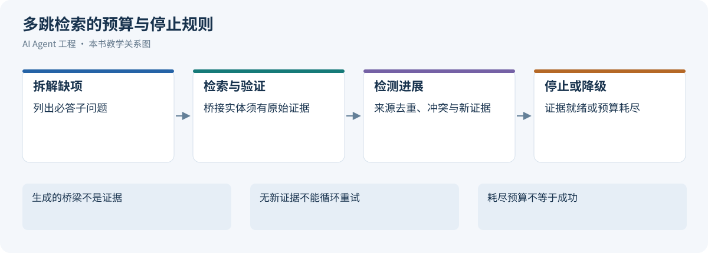](../images/review-knowledge-retrieval-05.svg)


### 14.5.1 为什么普通 RAG 不够

普通 RAG 假设一次检索就能找到足够证据。但很多任务不满足这个假设：

- 问题太宽，需要先拆解；
- 答案需要多跳证据；
- 不同来源互相冲突；
- 需要验证当前事实；
- 需要比较多个方案；
- 需要结合文档、代码、日志、指标和数据库。

例如：

```text
我们最近几次订单超时事故的共同根因是什么？现在这个告警是不是同类问题？
```

这不是一次 top-k 检索能解决的问题。Agent 需要先查历史事故，再抽取共同模式，再查当前日志和指标，最后判断是否相似。

### 14.5.2 什么时候需要 Agentic RAG

满足以下条件时，应该考虑 Agentic RAG：

- 需要拆解成多个子问题；
- 需要跨知识源检索；
- 需要多跳实体追踪；
- 需要验证或反证；
- 需要动态决定下一步；
- 需要维护证据状态；
- 需要过程 trace 和可恢复性。

不应该把所有问题都升级成 Agentic RAG。简单 FAQ、明确文档问答、单资源读取不需要多轮搜索，否则只会增加延迟、成本和不稳定性。

### 14.5.3 Plan：把问题拆成可检索任务

Agentic RAG 的第一步是生成检索计划。

```json
{
  "goal": "分析当前订单超时告警是否与历史支付补偿问题相关",
  "subtasks": [
    {
      "id": "Q1",
      "question": "历史订单超时事故有哪些共同根因？",
      "source": "incident_rag"
    },
    {
      "id": "Q2",
      "question": "当前 order-service 在告警窗口内有哪些错误日志？",
      "source": "log_tool"
    },
    {
      "id": "Q3",
      "question": "当前是否有相关发布或配置变更？",
      "source": "deployment_tool"
    }
  ],
  "budget": {
    "max_rounds": 4,
    "max_sources": 5
  }
}
```

计划必须包含预算。没有预算的 Agentic RAG 容易无限检索。

### 14.5.4 Retrieve：按子问题检索

Retrieve 阶段按子问题选择不同工具和知识源。它不是简单循环调用同一个 search。

```text
Q1 → incident RAG
Q2 → log tool
Q3 → deployment tool
Q4 → runbook Resource
```

每次检索都要记录：

- 子问题；
- 使用的知识源；
- 查询参数；
- 返回候选；
- 是否命中；
- 失败原因；
- 进入 evidence state 的内容。

### 14.5.5 Read：抽取结构化证据

Agentic RAG 不应该把检索结果原样堆进上下文。Read 阶段要把结果抽取成结构化证据。

```json
{
  "evidence_id": "E7",
  "supports": ["Q2"],
  "claim": "当前告警窗口内 payment callback timeout 错误显著增加",
  "source": {
    "type": "log_tool",
    "query": "service=order-service keyword='payment callback timeout'",
    "time_range": "last_30m"
  },
  "verification_status": "unverified",
  "limitations": "只覆盖 prod 环境 order-service 日志"
}
```

这是 Read 阶段的候选摘录，不是完整 Evidence Packet。成为可用证据前还要绑定 source_id/source_version、原文 locator、采集时间与权限范围，并核验主张支持关系；verification_status 不能由模型自报 confidence 代替。完整契约参考[来源与证据](02-context-engineering.md#knowledge)。

### 14.5.6 Evidence State：维护证据状态

Evidence State 是 Agentic RAG 的工作记忆，不等于长期 Memory。

它应该记录：

- 已回答的子问题；
- 未回答的问题；
- 支持某个结论的证据；
- 反驳某个结论的证据；
- 冲突点；
- 已经访问过的来源；
- 预算消耗；
- 下一步候选动作。

```text
Evidence State
├─ answered_questions
├─ open_questions
├─ supporting_evidence
├─ contradicting_evidence
├─ conflicts
├─ visited_sources
└─ budget_used
```

### 14.5.7 Decide Next Step：继续检索、换源、验证或停止

每轮检索后，Agent 需要决定下一步：

- 证据足够，进入综合；
- 证据不足，继续检索；
- 来源不可信，换源；
- 存在冲突，做反证检索；
- 超出预算，降级回答；
- 用户问题不清晰，要求澄清。

停止条件应区分“证据就绪”与“无法继续”。以下是本书任务契约的示意；后面三项仅触发停止检索，不能把缺证据的结果升级为成功：

```text
stop if:
- all required subquestions answered
- each required claim has current authorized supporting evidence
- required counterchecks complete; no unresolved critical conflict
- no new useful evidence in last round
- max_rounds reached
- cost or latency budget exhausted
```

### 14.5.8 Synthesize + Verify：综合与验证

综合阶段不是简单总结所有证据，而是把证据映射到 claim。

输出前应检查：

- 每个关键 claim 是否有 evidence；
- 是否存在未解决冲突；
- 是否有过期证据；
- 是否把历史案例误当当前事实；
- 是否超出证据做了预测；
- 是否需要声明不确定性。

一个可靠回答应该区分：

```text
已证实事实
合理推断
证据不足
建议下一步验证
```

### 14.5.9 Query Decomposition 的风险

Query Decomposition 可以提升复杂问题处理能力，但也会引入风险：

- 拆出的子问题偏离用户目标；
- 子问题过多导致成本失控；
- 子问题之间重复；
- 模型创造不存在的实体；
- 子问题缺少可检索来源。

因此拆解结果应满足：

```text
每个子问题都可检索
每个子问题都服务总目标
每个子问题都有预期来源
子问题数量受预算约束
```

### 14.5.10 Multi-hop Retrieval：跨证据链路检索

Multi-hop Retrieval 用于答案需要跨多个证据节点时。

例如：

```text
哪个配置变更导致了最近的支付超时？
```

可能需要：

```text
告警时间 → 相关服务 → 最近部署 → 配置 diff → 代码路径 → 历史事故
```

每一跳都要产生新的实体或约束，而不是盲目继续搜索。

### 14.5.11 Bridge Entity：通过中间实体继续追踪

Bridge Entity 是多跳检索中的桥梁实体。它可能是服务名、接口名、错误码、配置 key、人员、公司、论文术语或数据库表。

例如：

```text
用户问题：为什么 checkout 最近变慢？

第一跳：checkout latency increase
桥接实体：pricing-service
第二跳：pricing-service timeout
桥接实体：promotion_rule_cache
第三跳：promotion_rule_cache miss spike
```

Bridge Entity 必须来自证据，而不是模型凭空生成。

### 14.5.12 GraphRAG：当关系比文本相似更重要

GraphRAG 研究从实体关系和社区摘要支持全局问题，图是检索组织方式，抽取出的边仍需原文证据。[[19]](#ref-19)

本书建议在以下关系密集场景中评估图检索；实际收益仍须与文本基线对照：

- 服务依赖；
- 调用链；
- 人和项目；
- 公司和供应链；
- 论文概念网络；
- 事故传播路径。

图谱查询通常分为两类：

| 查询类型 | 目标 | 示例 |
|:---|:---|:---|
| Local Query | 从一个实体出发查邻域 | order-service 依赖哪些服务 |
| Global Query | 汇总全图模式 | 哪些服务是稳定性瓶颈 |

GraphRAG 的风险是图谱过期、边关系错误、实体消歧困难。它应该和文本证据、工具结果结合，而不是替代所有检索。

### 14.5.13 Long-context 与 RAG 的组合

长上下文研究显示位置影响某些任务的利用率，不能只以窗口大小判定无需检索。[[5]](#ref-5)

小范围材料可以直接用长上下文完成任务；在本场景中，扩大窗口并不自动替代检索侧的版本、权限与回源控制。

长上下文解决的是：

- 可以放入更多文档；
- 保留更完整上下文；
- 减少过度切分。

仅扩大窗口不能自动保证：

- 该读哪些文档；
- 文档是否过期；
- 用户是否有权限；
- 哪些证据最相关；
- 如何引用；
- 如何评估召回质量。

推荐模式是：

```text
RAG 负责选择
Long-context 负责容纳
Rerank 负责排序
Context Builder 负责组织
```

### 14.5.14 反证检索与 Self-Verification

高风险回答需要反证检索。不要只检索支持当前结论的证据，也要检索可能推翻结论的证据。

例如：

```text
初步结论：超时由支付网关变慢导致。

反证检索：
- 是否有 order-service 自身 CPU 异常？
- 是否有数据库慢查询？
- 是否有最近部署？
- 是否只有部分机房受影响？
```

Self-Verification 的目标不是让模型“自信”，而是让系统检查回答是否被证据支持。


### 14.5.15 交错检索的来源与停止规则

IRCoT 在知识密集多步问题中交错检索与推理；Self-RAG 训练按需检索与自我评价 token。[[20]](#ref-20)[[21]](#ref-21) 两者提供方法思路，不意味着给任意模型加一句“反思”就复制论文机制。本书不保存完整思维链，只保存可审计的子问题、候选行动、证据、裁决和停止理由。

桥接实体必须包含 source_id、version、locator 与原文命中，模型提出但未在原文出现的服务名只能是候选假设，不能直接用于跨租户查询。每轮记录规范化查询指纹、来源/过滤版本和新增独立证据集合；同一查询换写法却只返回相同原文，不算进展。相邻重叠块也不能被记为多个独立支持。

充分性不是模型自报 confidence 达到阈值。本场景以契约列出的必要主张为单位，逐项核对支持证据、反证、当前版本和关键未知：延迟发生时间、部署变化和依赖错误缺任一项，就不能写确定根因。可以交付“尚缺日志”的受限报告；授权拒绝、无新证据、查询预算耗尽或所有候选来源失败分别保存停止原因。不能为消除 unknown 不断扩大查询。

GraphRAG 的原工作以实体图和社区摘要处理全局总结，不证明所有实时故障定位都适合图检索。[[19]](#ref-19) 全局摘要回到原文后才能支撑具体配置判断，抽取错误和社区摘要过期会沿关系传播。若需求只是查当前 payment-client 配置，直接读受控配置比构图更清楚。

检索过程还需要一张可检查的缺项表，而不是只有“再搜一次”的指令。本书为每个必要主张记录当前支持、相反证据、尚缺观察和可用来源。下一轮查询须指向一个缺项，并说明成功取得观察后会改变哪个判断。例如已知延迟与部署时间相近，继续搜索更多同义告警不能验证配置因果；读取配置差异或查明依赖错误的起始时间，才可能排除候选原因。

独立证据数量也不能直接当作下一轮价值。两个日志平台可能复制同一采集源，五篇事故摘要可能来自同一复盘。缺项表保留原始来源关系，优先选择能区分相互竞争假设的观察；如果所有可访问来源都复述同一事实，允许结束检索并明确剩余未知。这里衡量的是能否缩小具体争议，不要求模型给每次搜索编造一个无法验证的信息增益分数。

查询失败时保留它没有回答的问题。日志超时意味着当前无法核对某段时间，不能将其当成“没有错误日志”；外部来源拒绝授权，也不能靠不断改写关键词绕过。预算耗尽前按缺项的重要性确定交付范围：可以确认症状与时间线，保留原因假设，指出哪项获授权观察有助于继续判断。这样，停止检索产生的是有边界的诊断结果，而不是强行凑齐的确定答案。

<a id="retrieval-evidence"></a>

## 14.6 从候选片段到可引用证据

[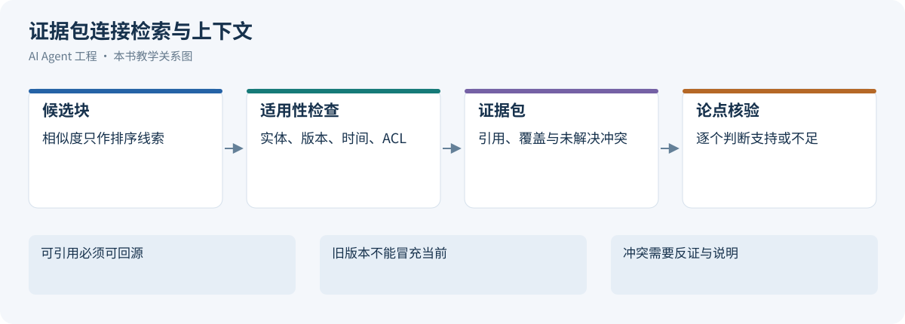](../images/review-knowledge-retrieval-06.svg)


检索系统输出的是证据候选，完整 Evidence Packet 契约与冲突裁决参考[上下文工程的来源与证据](02-context-engineering.md#knowledge)。生产方需要提交固定版本、定位器、时间与实体范围、当前访问结果、原始载荷引用以及派生血缘；不得在检索侧把“相关”直接改成“已证明”。

引用单位尽量是直接支持主张的最小原文范围。段落的限定词、表格单位、配置环境和生效日期属于证据的一部分；删掉它们会改变语义。检索片段提示存在答案时，先用 Resource 或文档读取接口回源，核对版本与定位；原文已改、已删或权限已撤销，标为无法核验，不沿用旧摘要假装当前有效。

一个主张关联多个证据时，说明它们是共同支持、互为反证还是分别覆盖条件。部署时间靠近延迟时间只能证明相关；把日志中的 timeout 与配置变更连成原因属于推导，应写前提和仍缺验证。多个由同一原始事故复述的 Wiki 页面不是独立证据，多数投票会放大共同错误。

对于 Runbook v2/v3，证据生产方先检查服务与适用版本，再保存替代关系；v2 可作为历史排查线索，不能覆盖当前 v3 规则。若版本 metadata 缺失，返回缺口而不是给“最新文档”标签。冲突由上下文侧结合当前任务解释，必要时回源确认 owner；检索层负责提供可比较事实，不自行删掉不合期待的反证。

### 14.6.1 用主张边界检查证据链

沿用告警案例，可以把报告拆成三个不同强度的主张：延迟在指定窗口升高、同一窗口发生客户端配置变化、配置变化导致延迟。前两个分别需要指标与变更记录，第三个还需要机制上的关联证据及对替代解释的检查。检索侧应交付这些事实的原文范围和限制，不因三条记录时间相近就把它们合并成一条已证实因果。证据怎样参与最终任务验收，仍由上下文与治理契约决定。

反证也应针对具体主张。旧 Runbook 指向数据库连接池，只能生成一个待查方向；当前数据库指标正常可能削弱该方向，但若采样未覆盖故障窗口，就不能证明连接池没有问题。相反，一段明确来自旧环境的异常日志，即使文字高度相关，也不能推翻当前环境的完整观测。有效的证据比较需要共同实体、时间范围和适用版本，否则应先补齐可比条件。

交付时保存事实与推导之间的连接，使后续修复能精确失效。若部署时间被纠正，依赖该时间先后关系的结论需要重验，但独立的延迟观测不必被抹掉。引用读取失败、授权撤销或原文版本不可用时，标明哪项支持关系已无法复核，不能悄悄替换成搜索到的新页面。检索层提供候选与血缘，不在这里重新定义一套可信度枚举或发布通过规则。

<a id="index-evolution"></a>

## 14.7 索引演化、删除撤权与一致性

[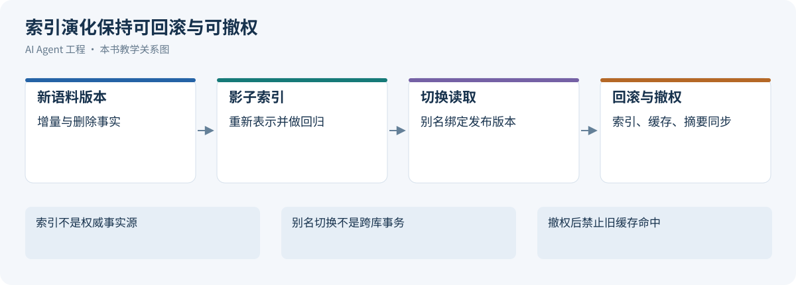](../images/review-knowledge-retrieval-07.svg)


### 14.7.1 双索引迁移时序

教学迁移把 encoder/预处理/metric/index 作为一个 manifest 切换：冻结源快照水位 v100→构建新索引 I2→旧 I1 继续服务→按源版本回填并追增量→重放删除/撤权水位→影子查询与证据/延迟评估→小范围切路由→保留回滚窗→回收 I1。索引别名可实现路由切换，Elastic 提供 alias 机制；它不替代回填一致性或权限核验。[[22]](#ref-22)

若 v103 更新先于 v102 到达，按源版本拒绝旧写；v104 删除形成墓碑，后到回填不能复活。ACL 从 v105 撤回后，I1/I2、结果缓存、证据摘要和原文回读全部遵守当前授权。只核对向量数量无法发现缺失删除；切换条件包括水位、校验抽样、源版本/ACL 覆盖、未决失败和影子差异。回滚也持续接受删除与撤权，不能恢复旧权限。


### 14.7.2 更新事件与派生数据不能各自决定版本

摄取事件携带 source_version 与稳定文档 ID。重复事件幂等接受，乱序旧版本拒绝；删除形成墓碑，并沿块、向量、倒排、摘要、结果缓存和原文入口传播。ACL 变化用独立授权水位检查，旧索引回滚也读取当前撤权事实，不能把“恢复旧索引”变成恢复旧权限。

别名原子切换只解决请求路由指向哪个索引，不保证不同索引、权限服务、原文和缓存同一时刻切换。Elastic 的 aliases 提供切换机制，完整迁移正确性仍由应用定义。[[22]](#ref-22) 新索引追平更新水位后，还要检查删除、ACL、失败队列和抽样定位；数量相同可能掩盖漏删或重复块，不能只比较向量总数。

回滚方案保存旧 manifest 和路由，却不回滚已接受的删除/撤权。新旧模型空间不能混查原始分数；双索引影子比较以各自空间检索，再比较同一原文证据范围。旧原文无法保留时如实声明历史回放受限，不能用当前页面给过去答案补证。

运行责任表需要明确源系统 owner、摄取 owner、索引 owner 和授权 owner。重建失败有阻塞原因与下次处理时间；灰度观测最新来源覆盖、旧版命中、撤权泄漏、P95 和队列年龄，出现安全违例立即收窄影响范围。流量回退不等于删除新索引的审计记录。

### 14.7.3 查询跨越切换边界时保留什么

索引切换不能只考虑切换动作本身，还要考虑已在运行的查询。一次请求可能从旧索引取到候选，随后经新路由读取原文，再命中另一个版本的摘要缓存。每个组件单独返回成功，拼在一起却不一定是同一份知识视图。本书建议请求记录索引 manifest、源版本与授权核验时点；原文读取发现版本不匹配时重取或显式失效，不能仅按文档 ID 拼接结果。

Elastic 的别名动作可以在一个原子操作中更新，但保证范围是该别名操作，并不包含外部权限服务和应用缓存。[[22]](#ref-22) 因此在本场景中，切换后先阻止新请求使用旧 manifest，在途查询可按声明的兼容规则结束；涉及当前撤权的读取则立即重新校验，不能因任务开始较早获得继续访问的豁免。删除与撤权的安全要求优先于固定历史快照的便利。

迁移演练至少覆盖三种交错：删除发生在回填之后，撤权发生在候选产生之后，回滚发生在新摘要写入之后。分别检查被删块不会重新入库、无权内容不会进入输出、缓存不会绕过当前来源版本。发生不一致时保存关联版本与请求范围，收窄受影响读取，而不是把所有查询都重试到成功。只有水位、失败队列、撤权传播和回源探针共同满足条件，才回收旧索引及其兼容路径。

<a id="rag-evaluation"></a>

## 14.8 评估、故障诊断与选型实验

[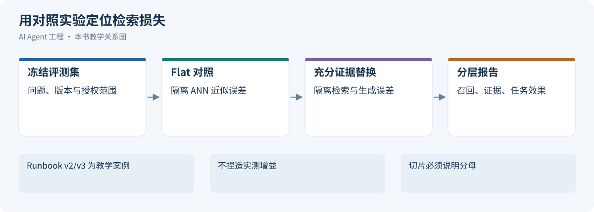](../images/review-knowledge-retrieval-08.svg)


### 14.8.1 检索、证据与生成的分层指标

RAG 质量不能只看最终回答。一个回答错了，可能是没有召回正确证据，也可能是排错序、上下文污染、证据冲突、生成总结错误、权限过滤错误或索引过期。

因此生产级 RAG eval 应该拆成一条质量链路：

| 阶段 | 关注指标 | 典型问题 |
|:---|:---|:---|
| Retrieval | retrieval recall、Recall@k、source routing accuracy | 正确文档是否进入候选集 |
| Rerank | rerank precision、nDCG、MRR | 正确证据是否排在前面 |
| Evidence | evidence sufficiency、citation coverage、freshness | 进入上下文的证据是否足够、可信、可引用 |
| Generation | answer faithfulness、citation accuracy、unsupported claim rate | 模型是否忠实使用证据 |
| Governance | latency、token cost、permission correctness | 是否满足成本、延迟和权限约束 |

这张表的价值在于把“RAG 效果不好”拆成可定位的问题，而不是笼统地换 embedding 模型或增加 top-k。

检索层指标

检索层关注“是否找到了该找的证据”。

常见指标：

- Recall@k；
- Precision@k；
- MRR；
- nDCG；
- source routing accuracy；
- permission filter accuracy；
- stale document rate；
- duplicate rate。

评估集应该包含真实用户问题、期望证据、不可回答问题和权限受限问题。

证据层指标

证据层关注“进入上下文的证据是否可用”。

指标包括：

- evidence sufficiency；
- citation coverage；
- evidence freshness；
- evidence diversity；
- conflict detection rate；
- unsupported claim rate。

证据层指标能帮助区分“检索没找到”和“找到了但模型没用好”。

生成层指标

生成层关注最终回答。

常见指标：

- factual correctness；
- answer completeness；
- citation correctness；
- refusal correctness；
- instruction following；
- clarity；
- actionability。

对于企业知识助手，不能只看答案是否流畅，而要看是否有证据、有权限、有引用、有边界。

Agentic RAG 过程指标

Agentic RAG 还需要过程指标：

- plan quality；
- subquestion relevance；
- tool selection accuracy；
- evidence state correctness；
- stop condition correctness；
- unnecessary retrieval rate；
- budget overrun rate；
- recovery success rate。

这些指标必须依赖 trace。只看最终答案，很难知道 Agent 是靠正确过程得到答案，还是误打误撞。

Trace 与可观测性

知识系统 trace 应记录：

```text
user query
→ parsed intent
→ source routing decision
→ rewritten queries
→ retrieval candidates
→ rerank scores
→ selected evidence
→ context package
→ model output
→ citations
→ verification result
```

Agentic RAG 还要记录每一轮计划、工具调用、证据状态和停止原因。

没有 trace 的 RAG 系统很难生产化。用户说“答错了”，你需要知道错在召回、排序、上下文压缩、证据冲突、模型生成，还是数据源本身过期。

预算、缓存与可恢复性

知识系统的成本来自：

- embedding；
- 向量检索；
- rerank；
- Web Search；
- 网页抓取；
- 工具调用；
- 长上下文生成；
- 多轮 Agentic RAG。

预算控制包括：

- 最大检索轮数；
- 最大工具调用数；
- 最大来源数量；
- 最大 token；
- 最大延迟；
- 最大成本。

缓存可以放在多个层次：

- query rewrite 缓存；
- retrieval 结果缓存；
- rerank 结果缓存；
- resource 读取缓存；
- 网页正文缓存；
- evidence summary 缓存。

可恢复性要求 Agentic RAG 的状态能 checkpoint。任务中断后，应能从 evidence state 恢复，而不是重新搜索一遍。

常见失败模式与修复路径

| 失败模式 | 可能原因 | 修复方向 |
|:---|:---|:---|
| 答非所问 | query understanding 错 | 增加意图识别和 query rewrite 评估 |
| 找不到正确文档 | chunk 或 metadata 差 | 改文档解析、chunk、metadata |
| 找到旧文档 | 生命周期缺失 | 加更新时间、版本、过期过滤 |
| 引用不支持结论 | context package 混乱 | 做 claim-level citation |
| 实时事实错误 | 用 RAG 查实时状态 | 改用 Tool / API |
| 成本过高 | Agentic RAG 无预算 | 加 stop condition 和预算 |
| 权限泄露 | 过滤太晚 | 在检索层和 resource 层做权限 |
| 回答过度自信 | 无证据充分性检查 | 加拒答和不确定性表达 |

Debug 顺序建议：

```text
1. 用户问题是否被正确理解？
2. Source Routing 是否选对？
3. 候选召回是否包含正确证据？
4. Rerank 是否把正确证据排前？
5. Context Package 是否保留了关键内容？
6. 模型是否正确使用证据？
7. 引用是否支持 claim？
8. 数据源本身是否过期或错误？
```

### 14.8.2 控制变量实验与故障回源

所有行均为实验设计，结果待测。按[数据与评估的 Eval Case](../part2/04-data-eval.md)固定源快照、问题/证据标注、租户/ACL、生成模型与温度；开发调参集与留出集分开，来源范围标注避免重叠 chunk 虚增召回。

| 实验 | 只改变 | 对照与观察 | 失败定位 |
| --- | --- | --- | --- |
| 切块 | 256/512/1024token 及 overlap（教学候选） | 固定编码/检索；看源证据覆盖、去重 Recall、父块扩展噪声、答案支持率/成本 | 无标题/跨表/代码围栏与答案跨度 |
| ANN | HNSW 宽度或 IVF 探测/PQ 参数，按实际索引分别测 | 同向量 Flat 基准；ANN Recall、P95/内存/更新与过滤后候选 | 邻近误差和业务标注分开 |
| 融合/重排 | 候选 N、融合参数、reranker 开关/截断 | 固定候选或固定前段分层比较，按类别/实体/否定/版本切片 | 精确符号丢失、证据被截或排序压低 |
| 生成上限 | 实际证据与人工充分证据 | 固定生成配置，比较引用支持、拒答、幻觉 | 证据充分仍错归生成/装配；证据缺失回召回/解析 |
| 索引迁移 | 更新乱序、删除撤权、版本切换与回滚 | 按故障独立断言，报告未知和失败而非只平均分 | 回源版本与 ACL 水位 |

数据库选型使用相同向量、维度、负载、过滤、硬件和目标 Recall，测冷热缓存/读写混合/构建/恢复；不搬用厂商 QPS 当项目实测。先找限制任务成功和风险的阶段，再做端到端回归，不能断言所有 RAG 的最大瓶颈都是 embedding。


### 14.8.3 指标的分母、标注与独立单位

BEIR 展示跨领域评估和稳健基线的重要性，不能用单一同质数据集宣布检索方案普遍领先。[[23]](#ref-23) Ragas 将检索、上下文利用与生成质量分开评估，自动评分仍需结合本任务人工标签校准，不能把无参考评分当作真实事实证明。[[24]](#ref-24)

| 指标 | 本章实验口径 | 标注与缺失处理 |
| --- | --- | --- |
| 业务 Recall@K | 命中的相关原文证据单位数/已标注相关单位数 | 按文档版本和跨度去重；无穷尽标签时说明仅已知相关集 |
| ANN Recall@K | 与相同过滤条件下 Flat 近邻重合数/K | 不是业务相关性；不足 K 时明确可用邻居数量 |
| MRR | 各可回答查询首个相关结果排名倒数的平均 | 未命中记 0；不可回答查询单列 |
| nDCG@K | 折扣相关收益/同一标注集理想排序收益 | 分级标签与折扣固定；理想收益 0 时单列 |
| 引用支持率 | 有可核验支持的关键主张数/全部待核验关键主张数 | 无引用与缺证据不能从分母消失，unknown 另报 |
| 充分性通过率 | 必要证据全部满足的查询数/需要作答的查询数 | 部分证据与拒答按事先规则判定 |
| 撤权违例率 | 向无权主体暴露内容的任务数/权限回归任务数 | 安全硬约束，不能被平均质量抵消 |

采样按真实问题类别、实体、语言、时间和权限分层，难例可富集用于诊断，但线上率估计另用代表样本或已知权重。一个问题的多个改写和同一事故派生题属于相关组，开发/留出划分及置信区间按组处理，不能当作独立样本放大证据。标注人员看到固定源快照和问题范围，不看候选系统胜负；分歧先记录再仲裁。

### 14.8.4 用同一 Runbook 失败定位误差

冻结`run_0429_017`的问题、授权、源快照与生成配置，比较四个教学实验：第一，原查询精确检索已知 v3 文档，若未收录先修摄取；第二，固定向量用 Flat 与 ANN 比较，分离近邻误差；第三，固定候选关闭/打开重排，查看 v3 是否被降序；第四，直接给生成器人工充分证据，观察错误连接池结论是否仍出现。所有结果需实测，本章不填造通过率。

若 v3 已在候选但被 v2 挤出，检查版本过滤和排序；若 v3 已进入上下文但被摘要裁掉适用条件，检查装配；若人工充分证据仍产生不支持结论，检查生成与验证。只增加 top-k 可能引入更多旧规则，不一定修复任何一个阶段。灰度修复后将`failure-0099`绑定`eval-incident-0099`，发布门禁参考[治理与调优](05-agent-governance-optimization.md#release-control)，不在本章复制发布协议。

### 14.8.5 标注集的完整性与时间边界

检索评估的标签也可能漏掉正确材料。只让现有系统的前几条结果进入人工标注，会偏向当前方案；新系统找到此前未见的有效证据，反而可能被当成错误。本书建议汇集不同机制的候选、加入按标识回读的已知原文，并抽样检查未召回材料。标签记录“已确认相关、已确认不相关、尚未判断”，不能将未判断自动视为负例。BEIR 支持跨任务评估的必要性，本书的标签扩充流程属于业务实验设计。[[23]](#ref-23)

时间切片要同时冻结提问时点和当时可访问的来源。用事后复盘回答事发当时的诊断问题，会让系统看起来具有并不存在的预知能力。对于 Runbook，标签说明哪个版本在该时间和服务配置下适用；事后才发布的修复说明可以服务当前总结，却不能进入历史回放输入。更新后的文档也不能拿来给旧答案补造正确引用。

人工复核应盲于系统版本，先按统一准则判断原文是否支持必要主张，再处理分歧。重复块归并到同一支持范围，保留一个问题可能有多组合法证据的事实，不把唯一参考段落变成唯一允许答案。报告中单列标签未覆盖比例和无法判定的来源；当标签覆盖不足以比较两个方案时，先补标注，再决定是否扩大部署范围。

### 14.8.6 把离线收益带入真实查询负载

离线选出较好参数后，先用同一查询分布进行只读影子比较，保持租户、过滤条件和源版本可追踪。检查高频问题与长尾实体是否同时受益，区分旧缓存命中和新查询计算。若改进只来自把更多请求留在缓存中，应分别报告缓存收益和检索质量，不能把它归为索引算法更准确。影子查询本身也消耗资源，需要独立预算，避免评估流量影响真实读请求。

故障实验应逐项注入原文回读超时、索引分片不可用、权限查询失败与重排超时。每次观察系统返回完整、部分还是无法核验的结果，并核对缺口是否传到最终报告。容错策略可以省略昂贵重排，也可以缩小来源范围，但不能隐藏未覆盖的服务或以默认允许绕过授权。恢复后再验证缓存和临时降级状态已收敛，防止一次短暂故障形成长期旧答案。

最终选型报告保留固定数据、查询与标签版本，列出质量、延迟、内存、更新和恢复成本的取舍。未测量项明确写未知，下一次数据分布或权限策略改变时重新评估；不要将一次留出集的领先当成永久结论。

一次实验还要保留原始逐查询结果，而不只有汇总曲线。某参数降低平均延迟，却可能持续漏掉低频服务的唯一有效条款；另一参数召回更多块，却未增加必要主张覆盖。评审时将这些差异对应到具体问题和原文，再判断是否接受取舍。无法解释的差异先保留为待核验，不以重新随机抽样直到胜出代替问题定位。

<a id="rag-summary"></a>

## 14.9 方法总结与适用边界

[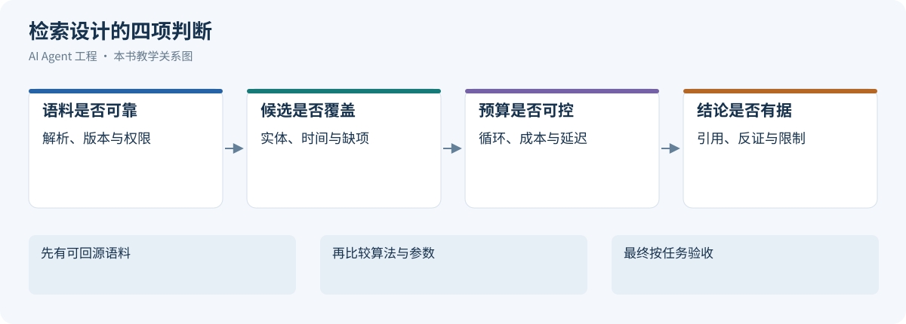](../images/review-knowledge-retrieval-09.svg)


检索系统的交付物是可被检查的证据，而不是相似度最高的几段文本。先用来源、版本、权限和定位决定候选能否使用，再用表示、索引、融合与重排改善命中；只在下一步证据需求不确定时采用有界多轮检索。选择的收益必须连同内存、时延、更新、删除和恢复成本一起验收。

设计评审沿四条链检查：原文到块与向量的派生血缘；查询到候选及证据选择的记录；主张到具体原文的支持关系；更新撤权到所有派生缓存的传播。任一链条缺失，都不能靠更大模型或更多 token 代替。算法论文的结果限定在其任务和实验配置，本书的业务断言、停止规则和迁移协议需要本项目证据。

## 14.10 参考资料

[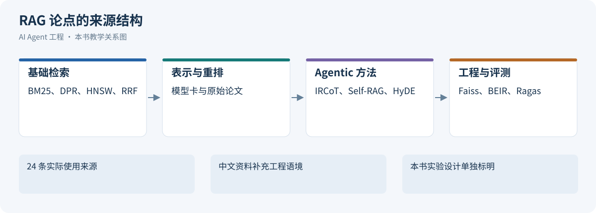](../images/review-knowledge-retrieval-10.svg)


下列来源支撑相邻机制；案例、参数候选、容量与故障实验为本书推导。官方滚动文档核验于 2026-10-24，未重跑论文实验。

1. <a id="ref-1"></a> Lewis et al.，[RAG](https://arxiv.org/abs/2005.11401)，2020；核验于 2026-10-24。
2. <a id="ref-2"></a> Robertson/Zaragoza，[The Probabilistic Relevance Framework: BM25 and Beyond](https://www.staff.city.ac.uk/~sbrp622/papers/foundations_bm25_review.pdf)，2009；核验于 2026-10-24。
3. <a id="ref-3"></a> Karpukhin et al.，[DPR](https://arxiv.org/abs/2004.04906)，2020；核验于 2026-10-24。
4. <a id="ref-4"></a> Khattab/Zaharia，[ColBERT](https://arxiv.org/abs/2004.12832)，2020；核验于 2026-10-24。
5. <a id="ref-5"></a> Liu et al.，[Lost in the Middle](https://arxiv.org/abs/2307.03172)，2023；核验于 2026-10-24。
6. <a id="ref-6"></a> Unstructured，[Partitioning](https://docs.unstructured.io/open-source/core-functionality/partitioning)，持续更新；核验于 2026-10-24。
7. <a id="ref-7"></a> intfloat，[e5-base-v2 model card](https://huggingface.co/intfloat/e5-base-v2)，持续更新；核验于 2026-10-24。
8. <a id="ref-8"></a> Malkov/Yashunin，[HNSW](https://arxiv.org/abs/1603.09320)，2016/2018；核验于 2026-10-24。
9. <a id="ref-9"></a> Faiss maintainers，[Faiss indexes](https://github.com/facebookresearch/faiss/wiki/Faiss-indexes)，持续更新；核验于 2026-10-24。
10. <a id="ref-10"></a> Chen et al.，[M3-Embedding](https://arxiv.org/abs/2402.03216)，2024；核验于 2026-10-24。
11. <a id="ref-11"></a> 北京智源人工智能研究院，[bge-m3 模型卡](https://huggingface.co/BAAI/bge-m3)，持续更新；核验于 2026-10-24。
12. <a id="ref-12"></a> Milvus，[HNSW 中文文档](https://milvus.io/docs/zh/hnsw.md)，v3.0.x；核验于 2026-10-24。
13. <a id="ref-13"></a> Faiss maintainers，[Guidelines to choose an index](https://github.com/facebookresearch/faiss/wiki/Guidelines-to-choose-an-index)，持续更新；核验于 2026-10-24。
14. <a id="ref-14"></a> Douze et al.，[The Faiss library](https://arxiv.org/abs/2401.08281)，2024；核验于 2026-10-24。
15. <a id="ref-15"></a> Cormack/Clarke/Buettcher，[Reciprocal Rank Fusion](https://plg.uwaterloo.ca/~gvcormac/cormacksigir09-rrf.pdf)，2009；核验于 2026-10-24。
16. <a id="ref-16"></a> Nogueira/Cho，[Passage Re-ranking with BERT](https://arxiv.org/abs/1901.04085)，2019；核验于 2026-10-24。
17. <a id="ref-17"></a> Gao et al.，[HyDE](https://arxiv.org/abs/2212.10496)，2022；核验于 2026-10-24。
18. <a id="ref-18"></a> Anthropic，[Contextual Retrieval](https://www.anthropic.com/research/contextual-retrieval)，2024-09-19；核验于 2026-10-24。
19. <a id="ref-19"></a> Edge et al.，[GraphRAG](https://arxiv.org/abs/2404.16130)，2024；核验于 2026-10-24。
20. <a id="ref-20"></a> Trivedi et al.，[IRCoT](https://arxiv.org/abs/2212.10509)，2022/ACL2023；核验于 2026-10-24。
21. <a id="ref-21"></a> Asai et al.，[Self-RAG](https://arxiv.org/abs/2310.11511)，2023；核验于 2026-10-24。
22. <a id="ref-22"></a> Elastic，[Aliases](https://www.elastic.co/docs/manage-data/data-store/aliases)，持续更新；核验于 2026-10-24。
23. <a id="ref-23"></a> Thakur et al.，[BEIR](https://arxiv.org/abs/2104.08663)，2021；核验于 2026-10-24。
24. <a id="ref-24"></a> Es et al.，[Ragas](https://arxiv.org/abs/2309.15217)，2023；核验于 2026-10-24。
