# 第 14 章 知识检索与 RAG：从文档到可引用证据

本章解释怎样建设与运行检索系统：把授权来源解析、表示和索引，再从查询产生可回读、可引用的证据。证据包契约与冲突解释参考[上下文工程](02-context-engineering.md#knowledge)，任务执行与恢复参考[Agent Runtime](03-agent-runtime.md)。文中的容量、参数候选、时间线和实验均为教学设计，未运行生产基准；来源核验于 2026-10-24。

<a id="rag-boundaries"></a>

配图可点击查看原图；窄屏阅读时可单独打开并放大。

## 14.1 职责边界、技术脉络与问题定义

[](../images/review-knowledge-retrieval-01.svg)


RAG 将参数化生成与外部非参数知识结合，但不能单独保证事实正确、来源适用或行动获授权。Lewis 等人的原工作研究检索与生成的组合，本文所述权限水位、证据契约和恢复责任属于本书在应用场景中的推导。[[1]](#ref-1)

从词项匹配到稠密检索，变化的是候选生成机制，不是把检索彻底替换为模型记忆。BM25 保留词项频率和长度线索；DPR 用双编码器学习问题与段落的匹配；late interaction 保留更细的 token 交互；Agentic 方法再按证据缺口安排下一次检索。[[2]](#ref-2)[[3]](#ref-3)[[4]](#ref-4) 这些方法可以组合，不能仅按发表先后当作升级阶梯。

本章用同一次虚构告警作检验：order-service 在 09:37Z 出现延迟升高，查询 Runbook 时 v2 排在 v3 前面，旧规则诱发“连接池耗尽”的错误假设。真实诊断还需要部署与日志，不由文档相似度决定。服务、时间、版本和权限均是查询约束；仅仅找出含“延迟”二字的片段不能完成任务。

| 信息需要 | 首选机制 | RAG 的边界 |
| --- | --- | --- |
| 当前订单/部署/指标 | 授权业务 API 或专用工具 | 向量索引不是实时业务事实源 |
| 已知文档的完整条款 | 按稳定标识读取 Resource/原文 | 先检索可定位来源，再回读具体版本 |
| 大量文档的候选证据 | 稀疏、稠密或混合检索 | 候选相关不代表支持结论 |
| 小范围完整材料综合 | 长上下文与明确定位 | 窗口容纳不等于模型稳定利用 |
| 跨实体多跳问题 | 有界多轮检索 | 每个桥接实体都要来自证据 |

长上下文研究显示相关信息位置影响回答表现，不能因窗口足够大就取消检索、排序和验证。[[5]](#ref-5) 本场景选择检索的理由是需要版本过滤、定位和按权限回读，而不是断言所有任务都必须建向量库。请求范围很小、数据变化快或能直接精确查询时，先保留简单可靠路径。

<a id="rag-ingestion"></a>

## 14.2 摄取、解析、切分与证据单位

[](../images/review-knowledge-retrieval-02.svg)


### 14.2.1 生产级 RAG 的离线与在线链路

生产级 RAG 通常分成离线链路和在线链路。

```mermaid
flowchart TB
    subgraph Offline["离线链路：知识进入索引"]
        A["Raw Sources<br/>Markdown / Wiki / PDF / Code"] --> B["Parser<br/>解析"]
        B --> C["Cleaner<br/>清洗"]
        C --> D["Chunker<br/>切分"]
        D --> E["Metadata Enrichment<br/>补充元数据"]
        E --> F["Embedding<br/>向量化"]
        F --> G["Index<br/>向量 + 关键词索引"]
    end

    subgraph Online["在线链路：问题变成证据"]
        H["User Query"] --> I["Query Understanding"]
        I --> J["Source Routing"]
        J --> K["Candidate Retrieval"]
        K --> L["Rerank"]
        L --> M["Context Package"]
        M --> N["LLM Answer"]
    end
```



离线阶段保存可定位版本，在线阶段按当前任务和身份选择证据。任一阶段漏掉字段或限定条件，后续高相似度都无法恢复已丢失的信息。解析的元素化入口参考 Unstructured，下面再定义本书的版本与验收契约。[[6]](#ref-6)

### 14.2.2 文档摄取：解析、清洗、版本与生命周期

文档摄取不是简单读文件。不同来源有不同风险。

| 知识源 | 典型内容 | 摄取难点 |
|:---|:---|:---|
| Markdown / HTML | 技术文档、博客、README | 标题层级、代码块、链接 |
| Wiki | 产品文档、会议纪要 | 权限、页面层级、过期内容 |
| PDF / Word | 研报、合同、手册 | 表格、页眉页脚、段落顺序 |
| 工单 / 事故复盘 | 历史案例 | 噪声、状态变化、结论过期 |
| 代码仓库 | API、注释、配置 | 版本、分支、生成文件 |

解析时要保留结构：

- 标题层级；
- 文档路径；
- section id；
- 表格；
- 代码块语言；
- 图片说明；
- 更新时间；
- 作者和来源；
- 权限标签。

清洗时要删除导航、广告、重复页脚、无意义模板和过期提示，但不能把引用、表格标题和代码上下文误删。

生命周期也很重要。每个文档和 chunk 都应该有稳定 ID、版本、更新时间、失效状态和来源链接。否则引用会漂移，debug 时无法复现。

### 14.2.3 Chunk：分别设计召回、读取和引用单位

召回单位追求能够被准确匹配，读取单位追求限定条件完整，引用单位追求主张可以定位；三者不必相同。父子模式让 child 存入检索索引，命中后按 parent_id 扩展上下文，最终引用回到支持结论的实际跨度。父子关系必须绑定同一文档版本；当前子块不能拼接上一个版本的父块。扩展前重新检查父段可见性，子块命中不授予读取父文档全部内容的权限。

| 切分方法 | 适用输入 | 主要误差 | 验收重点 |
| --- | --- | --- | --- |
| 固定 token 窗口 | 结构弱、段落很长 | 切断条件与结论 | 答案跨度是否被覆盖，overlap 是否造成重复计分 |
| 文档结构切分 | 有标题、列表、代码和表格节点 | 错误解析造成结构漂移 | 标题继承、代码围栏和表头/脚注保留 |
| 语义切分 | 主题切换明显的长材料 | 编码/阈值改变边界 | 固定解析与切分版本，测稳定性和增量成本 |
| 父子检索 | 小块匹配、大段才能解释 | 扩展引入噪声或过期父块 | 同版本父子映射、扩展预算和精确引用 |

这些选择由任务证据跨度决定。假设 Runbook 的“仅适用于 staging”在前段，而操作命令在后段，只召回命令会改变原意。解决方式可以是父段扩展，也可以是把适用条件显式继承到子块；不能仅靠缩小 chunk 来追求更高表面相似度。无标题与 OCR 的具体解析责任在 14.2.5，本文不再重复另一套父子规则。

### 14.2.4 Metadata：让检索从“相似”走向“可控”

没有 metadata 的 RAG 只能做“相似文本搜索”。生产系统需要可控检索。

推荐 metadata 包含：

```json
{
  "doc_id": "order-system-design",
  "chunk_id": "order-system-design#payment-timeout#003",
  "source_type": "markdown",
  "title": "订单支付超时补偿机制",
  "section": "支付超时处理",
  "path": "docs/order/payment-timeout.md",
  "owner": "order-platform",
  "updated_at": "2026-05-10",
  "version": "git:abc123",
  "visibility": "internal",
  "tags": ["order", "payment", "compensation"]
}
```

metadata 的作用包括：

- 权限过滤；
- 时间过滤；
- source routing；
- 排序加权；
- 引用展示；
- debug 和复现；
- 过期内容治理。

如果 metadata 缺失，系统很难回答“为什么召回了这个 chunk”“这个文档是否过期”“用户是否有权限看”。

### 14.2.5 无标题、表格和 OCR 的兜底链

解析器先产生带位置的元素，而不是先把所有格式压成纯文本；Unstructured 展示按格式和策略做 partitioning 的接口。[[6]](#ref-6) 无标题 Markdown 仍可按段落、列表、代码围栏与表格节点分组，超长节点再沿句界/Token 边界拆；派生主题标签不能冒充原作者标题。

扫描页需 OCR 并保留原页图、bbox、页码、阅读顺序和低置信标记；多栏顺序错误、单位/脚注丢失会直接改变答案。表格召回行片段后补表头、单位、脚注与邻行，不把“12”脱离列含义引用。

父子检索保存 doc_id/version、parent_id/child_id 和原文偏移。小块用于召回，父块补适用条件，引用仍定位实际支持范围。父版本更新后旧子块全部失效或重建；无权限父段不能因子块命中而回读。


### 14.2.6 解析结果如何成为可审计的索引输入

摄取先保存原始来源身份、版本、采集时间和访问策略，再产生解析元素。正文、表格、代码和页脚要有可追溯位置，不能只有一个合并后的字符串。Unstructured 的 partitioning 按文件格式产生元素，这支持元素级处理，但不证明任意 PDF 的阅读顺序都正确。[[6]](#ref-6)

本书建议将解析器版本、原文哈希、清洗规则和切分参数写入摄取 manifest。相同原文换解析器后，块边界和定位器可能变化，应创建新派生版本；旧引用仍指向旧原文快照或明确失效。解析失败进入隔离队列，有责任人与重试入口，不把空文档算作成功收录。权限缺失时默认不索引或不可见，不能等待查询阶段由模型补推断。

切分必须按 embedding tokenizer 计算长度，标题、前缀和新增上下文也占预算。overlap 只缓解跨边界证据缺失，不能恢复被编码器截断的尾部。若模型上限为 L，块正文加标题、前缀和上下文超过 L，先结构化拆分或明确截断；否则索引里保存了全文引用，却只有前段参与向量表示，读者会误以为尾部内容已经可检索。

每个块保留检索单位、上下文扩展单位与引用单位的对应。召回一行表格后回读表头、单位和脚注；扩展父段时重新鉴权，并计算加入模型的成本。不能因为一个子块有权访问就展开整个无权父文档，也不能把多个版本拼接成一条貌似完整的规定。

### 14.2.7 摄取验收：原文存在不等于知识已可用

摄取验收应围绕问题所需的事实设计探针。本书为 Runbook 准备三类检查：能否定位适用版本和服务，能否完整读取一条包含前提与例外的处置规则，能否回到规则所在原文。即使文档数、块数和向量数全部符合预期，只要“仅适用于旧客户端”的限定被清洗掉，该文档仍不能作为当前诊断依据。元素解析提供处理单位，语义是否保真需要另外验收，不能从解析器返回成功推断。[[6]](#ref-6)

验收集按真实格式分层，既保留正常页面，也纳入跨页表格、折叠段落、无标题说明和同名服务。标注原文事实及其最小支持范围，检查解析文本是否保留否定、单位、版本和脚注。对数字错位这类足以改变结论的问题，隔离受影响材料并保留原图供人工核验；不能用全库平均解析成功率抵消一条关键错误。

摄取失败还应有读者可见的结果语义。尚未同步表示检索覆盖存在缺口，授权失败表示本次不能读取，正文为空可能是页面迁移或解析故障，这些都不是“资料证明没有相关规则”。查询侧收到覆盖缺口后，可以回读允许访问的原文或报告证据不足。修复解析器时先重放该类探针，再重建受影响文档的派生产物，避免为了修复一份表格无条件重算全库。

<a id="rag-indexes"></a>

## 14.3 表示、近似索引与容量取舍

[](../images/review-knowledge-retrieval-03.svg)


### 14.3.1 Embedding 与向量索引

Embedding model 把文本映射到向量空间，使语义相近的文本距离更近。例如：

```text
"订单退款规则" -> [0.12, -0.03, ...]
"如何退订酒店订单" -> [0.10, -0.01, ...]
```

向量检索会把用户 query 和文档 chunk 分别编码成向量，再找距离最近的候选。常见相似度包括 cosine similarity、dot product 和 L2 distance。

这里的 embedding 要和预训练里的 **LLM token embedding** 区分开：

```text
LLM token embedding：模型内部把 token ID 映射成初始向量
RAG text embedding：检索系统把 query / document 映射成语义索引
```

两者都叫 embedding，但工程位置不同。RAG embedding 是外部知识系统的一部分，目标是“找相关证据”；LLM token embedding 是模型权重的一部分，目标是“让 token 进入 Transformer 计算”。

选型 embedding model 时要关注：

- 中文、英文、多语言效果；
- 代码和表格支持；
- 向量维度；
- 成本和延迟；
- 是否允许数据出域；
- 是否需要本地部署。

向量索引用于近似最近邻搜索。常见实现包括 HNSW、IVF、PQ 等。工程选型通常由数据规模、召回质量、延迟、更新频率和部署约束决定。

单向量相似度不能保证实体、错误码、订单号、版本和否定条件的精确匹配；其细节保留程度取决于模型与训练任务。对本场景先保留词法与结构过滤基线，再测稠密召回增益，避免以相似度替代字段校验和权限控制。

### 14.3.2 非对称编码与空间契约

DPR 使用 query 与 passage 双编码器，而不是把两段字符串任意送入不同模型后比较。[[3]](#ref-3) 例如 e5-base-v2 模型卡要求 query:/passage:前缀并展示归一化，这只适用于该模型约定，不能机械推广。[[7]](#ref-7) 记录模型 revision、tokenizer、前缀、pooling、截断、维度、归一化与 metric；短 query 和长 chunk 可得到同维表示，长度不同不妨碍计算，却可能因截断/信息稀释降低相关性。

相似度 cos(q,d)=q·d/(||q||||d||)，仅单位归一化时内积等于余弦；对单位向量有平方 L2=2−2q·d。换模型即使维度相同也不能混用空间；不要通用除以文本长度“修正”分数。

### 14.3.3 先固定精确参照，再比较索引误差

Flat 对给定集合逐一计算距离，提供精确近邻参照；HNSW、IVF 和 PQ 分别引入图导航、粗分桶裁剪和距离压缩方面的取舍，机制集中在 14.3.5–6，选型汇总在 14.3.7。[[9]](#ref-9) 一个配置的 ANN Recall 很高，只说明它接近同一表示下的精确近邻，不说明这些邻居能支持业务答案。

参照集合必须应用与候选相同的权限、时间和版本条件。若允许集合只有七项而请求 K=10，先明确有效 K 为七，再比较近邻重合；不能把其他租户的三项填进结果，也不能将天然不足十项误判成算法漏召回。标注相关证据和精确向量邻居是两套真值，14.8 分别统计。

容量使用一个统一账本：原向量、索引结构、元数据/原文、副本、构建峰值和双索引迁移。14.3.5 给出具体算例；算法名本身不承诺持久化、实时删除和租户隔离，这些能力由数据库实现另行验收。

### 14.3.4 稀疏、稠密与多向量表示分别保留什么

BM25 的一种常见写法为：

$$s(q,d)=\sum_{t\in q}\mathrm{IDF}(t)\frac{f(t,d)(k_1+1)}{f(t,d)+k_1(1-b+b|d|/\mathrm{avgdl})}.$$

其中 f 为词频，k1 控制重复词收益的饱和，b 控制文档长度归一化强度；IDF 的平滑形式随实现不同。[[2]](#ref-2) 对服务名、错误码和版本号，精确词项保留了单向量可能压缩掉的信息；中文分词、代码符号切分与字段权重影响很大，不能把英文默认分析器当中文业务基线。

表示空间与前缀契约见14.3.2；e5-base-v2模型卡还限制英文与最多512 token，不适合作为中文长文的无条件默认。[[7]](#ref-7) 本场景若选择多语言表示，M3-Embedding 与智源 bge-m3 模型卡提供了多语言、稀疏/稠密/多向量能力的一手依据；是否适合本业务仍需同一留出集比较。[[10]](#ref-10)[[11]](#ref-11)

ColBERT 预先编码文档 token，查询时进行 late interaction，它比单向量保留更多局部匹配信息，代价是表示和索引更大；不能把它直接称为普通 cross-encoder。[[4]](#ref-4) 数字、否定、版本适用性与权限仍需单独校验，表示精细不代表事实正确。

### 14.3.5 HNSW：构图决定可走的路，查询预算决定探索多少

图索引先在稀疏上层接近目标，再在底层细找。M 控制连接规模，efConstruction 控制插入点时寻找连接的候选投入，efSearch 控制查询探索宽度。增大前两项会改变图的结构或构建质量，增大最后一项只在既有图上探索更多；图没有建好的连接，不能保证靠更大的查询预算完全补回。[[8]](#ref-8)

实验分两阶段：先固定数据快照、编码和距离函数，比较不同 M/efConstruction 建出的图；再在每张图上扫描查询宽度。对每个目标 Recall 报告构建时间、峰值内存、持久大小、访问节点和尾延迟，而不是分别拿“最高 Recall”和“最低时延”拼成同一个配置。Milvus 将查询宽度字段命名为 ef；此处 efSearch 是算法责任的统称，调用时映射到目标版本字段。[[12]](#ref-12)

以 hnswlib v0.8.0 为具体实现，底层允许的邻居数设为 `maxM0_=2*M_`，上层使用 `maxM_=M_`，层级采样系数使用 `1/log(M_)`；这些是该实现的选择。查询时的有效候选宽度还要覆盖请求的 K，调用方应显式保证 `efSearch≥K`，并核对封装是否自动提升。不能把参数名相似理解成所有数据库都采用相同的层级分布、删除实现或持久化方式。[[27]](#ref-27)

层级搜索的直观收益是先在稀疏上层接近目标，再到密集底层细找。对分布适当的数据，查询通常表现为随规模缓慢增加的工作量，但图近邻搜索不存在对任意数据、任意过滤谓词都成立的固定对数时延保证。重复向量、狭窄簇、异常高维和与几何结构相关的过滤条件，都可能让一次搜索扩展许多节点。容量计划应给距离计算次数、访问节点数和实测尾延迟，而不是只写一个理想复杂度。原论文的算法分析与具体系统的服务延迟属于不同层次。[[8]](#ref-8)

下面是本书的容量推导。假设 N 个向量、维度 d、每维 b 字节，原向量载荷为 `N*d*b`。若仅估计底层邻接表，边槽位约为 `N*2M`，再乘节点标识字节数；这仍没有包括上层边、每点头信息、对齐、标签映射、删除位图和分配器开销。假设一百万条、768 维 float32，单纯向量约 3.07GB 十进制字节；M=32、每个邻居 ID 为 4 字节时，底层边槽位又约 256MB。这里是数量级估算，不是某数据库实测内存，副本、元数据和写入缓冲必须另算。

删除同样分两层。在 hnswlib 的标记删除模式中，结果会排除被标记对象，图中仍可能保留可用于遍历的结构；业务上的不可见不等于磁盘和内存立即回收。大量删除后应比较召回、节点访问、容量和重建费用，并核验系统是否支持槽位复用。涉及隐私删除时，还要追踪原向量、备份、缓存和源文本，而不能以近邻结果不再出现作为全部删除证明。[[27]](#ref-27)

### 14.3.6 IVF 与 PQ：把候选裁剪误差和压缩误差拆开

IVF 训练粗聚类中心，把向量分到 nlist 个倒排桶；查询探测 nprobe 个桶。nlist 太少时桶大，扫描成本高；太多则训练和分桶负担上升，数据稀疏或分布漂移时可能出现不均衡。增大 nprobe 通常扩大候选覆盖，但也增加扫描，不能只固定一个值比较不同数据库。Faiss 文档提供索引结构与选择指南。[[9]](#ref-9)[[13]](#ref-13)

PQ 将向量划分为子空间，每段用码本编号表示；若分为 m 段、每段 b bit，编码主体约 m×b/8 字节，另计 ID、码本、桶或图结构。这个容量公式是编码账本，不是完整数据库内存。查询可以用查表近似距离，对初筛候选回读原向量精排；若不存原向量，不能承诺精排消除全部量化误差。Faiss 论文讨论了索引、压缩与计算的取舍空间。[[14]](#ref-14)

实验上先以 IVF_FLAT 对比 Flat 估计分桶裁剪误差，再用相同分桶和探测配置比较 IVF_PQ，单独观察压缩带来的额外损失。训练集须代表未来分布，不能只用很小的历史样本训练码本却据此承诺新租户效果。词表、版本和模型变化可能要求重训重建，在线更新能力与一致性由具体存储实现定义，不从算法名称自动获得。

### 14.3.7 过滤、内存和索引选型的决策记录

| 方案 | 获得能力 | 主动牺牲 | 重新评估信号 |
| --- | --- | --- | --- |
| Flat | 精确向量近邻与稳定基线 | 大集合距离计算成本 | 目标延迟或吞吐无法满足 |
| HNSW | 常见分布下较好的召回/延迟折中 | 图内存、构建与更新维护 | 过滤后召回下降、内存或重建超预算 |
| IVF_FLAT | 控制探测范围，适合批量训练分桶 | 粗分桶可能漏邻居 | 桶分布偏斜或分布漂移 |
| IVF_PQ | 压缩载荷，降低扫描带宽 | 量化误差与调参/训练复杂度 | 原文证据召回受损或精排成本抵消收益 |

本场景的教学 ADR 先选 Flat 建立小规模基线，再按目标 Recall 比较 HNSW 与 IVF，而不先指定厂商品牌。决策驱动为权限过滤、当前版本证据覆盖、P95、峰值内存、更新与恢复成本。获得可解释误差边界，牺牲首版极限吞吐；若真实数据规模、ACL 选择性或写入频率超出验证范围，重新评估。不存在“高 Recall 即可放宽权限”的交换。

### 14.3.8 带过滤条件的近邻对照怎样才公平

比较 ANN 之前，先定义当前查询的合法候选集合。本书将其限定为同一租户、环境、适用版本和当前授权下可参与排名的向量；Flat 与 ANN 必须在这个集合上使用相同距离计算。否则一个系统先全库召回再过滤，另一个系统先缩小集合再搜索，最后比较的“召回率”混入了不同任务。Faiss 将精确索引作为近似方案的参照，具体数据库的过滤执行计划仍需独立说明。[[13]](#ref-13)

若合法集合不足 K，参照分母使用实际可用近邻数量并单列空集合查询；距离并列时约定稳定排序或等价集合，避免把任意次序当成算法错误。向量正确但原文已失效的对象不应因为位于 Flat 前列就被标成业务正例。业务相关性标签与向量近邻标签分别保存，才能解释“近邻重合很高，答案仍然错误”的情况。

压测也要区分单查询代价与并发下的等待。固定索引快照、查询分布、过滤选择性和并发，分别观察距离计算、候选过滤、原文回读与排队。某组参数在空载下延迟很低，增加候选宽度后却可能使队列积压；因此参数决策应基于目标负载下的曲线，而不是选择某次最快请求。更新或删除改变了合法集合时重建对照，不继续沿用旧标签宣布性能提升。

一个对照记录可以写成：合法集合有七项、有效 K=7，ANN 返回五项且都在精确集合内，近邻重合率为 5/7；若标注的业务充分证据只有两项，而返回结果只包含其中一项，则证据召回为 1/2。两个分母分别回答索引近似与业务证据覆盖，不能把 5/7 当成回答正确率。出现不足七项时，再按集合规模、过滤阶段和预算原因拆解，后续才能决定调索引还是补文档。

### 14.3.9 过滤为什么会改变近邻搜索

过滤近邻搜索的目标，是在满足谓词的集合中找到距离最近的 K 项。假设全库最近的前十个结果都属于其他租户，那么全库 top-10 后过滤会返回空集，即使当前租户有大量相关文档。这不是 embedding 没学会业务词，而是求解的问题从“全库最近”变成了“约束集合内最近”。评估真值也应随谓词变化：以允许集合上的精确搜索为参照，不能拿全库 top-K 作 Recall 分母。

| 策略 | 候选怎样产生 | 主要收益 | 典型代价 |
| --- | --- | --- | --- |
| 前过滤后精确/近似检索 | 先确定允许集合，在集合上检索 | 很小的集合可直接精确计算，结果天然满足谓词 | 通用全局图难直接裁剪；频繁变化的组合不适合为每种条件重建索引 |
| 后过滤与扩大候选 | 全库 ANN，随后去掉不合格项，必要时继续取候选 | 可复用已有索引，工程接入简单 | 选择率低或过滤与距离强相关时，候选和延迟可能急剧增长 |
| 搜索中过滤 | 在遍历时结合谓词调整扩展和结果接纳 | 可减少无效结果与部分计算 | 必须处理不合格节点作为路径桥梁的作用，正确性依实现 |

一个容易误用的推导是“允许比例为 s，取 K/s 个候选就够”。它只是在过滤与距离独立时的粗略期望，不能作为召回保证。若相似向量恰好集中在被排除的团队，最相关的允许项可能排得远比这个估计更后；若同团队文档聚成一簇，则前面的全局入口又可能偏离允许子图。应在不同选择率和相关性下分层报告曲线，不能用一个平均选择率预测所有租户的尾延迟。

图上的过滤还有连通性问题。一个不满足 ACL 的点可以在内部导航中连接两个满足条件的区域；若遇到它就停止扩展，允许子图可能变成不连通。若允许穿越但禁止输出，就必须确保内部计算、日志和侧信道也符合安全模型，尤其不能把未授权文本送入重排器或模型。ACORN 研究的谓词子图遍历正是在处理图结构与过滤结合的问题；它提供算法设计思路，并不说明任何标有 HNSW 的产品自动具备同样的过滤能力。[[25]](#ref-25)

Filtered-DiskANN 则把向量几何与标签一起用于构图，区分可流式构建与批量构建的方案。原论文主要研究单标签过滤，相关真值在该标签允许集合中计算；不能从其结果推断任意复杂租户ACL都已解决。[[29]](#ref-29) 与ACORN对读时，重点比较过滤怎样改变图的连接与遍历，而非把论文里的特定数据集性能当作数据库默认能力。

本书建议把选择率看作路由变量。极小允许集合可尝试精确扫描；较大集合再比较过滤感知索引和扩大候选。路由阈值由数据规模、权限计算成本与延迟预算测出。不能为了提高 Recall 临时关闭 ACL，也不能在超时后无提示返回全库结果。若允许集合本身为空，系统应返回没有可授权证据；若允许集合非空而预算耗尽，应说明检索未充分完成。这两种情况需要不同的诊断标签。

撤权后评估要同时检查结果和中间载荷：向量候选只带最小 ID，授权后才取文本，重排输入不得夹带被拒内容，Trace 不保存无权正文。过滤谓词的版本与授权水位进入查询记录，定位一次错误时才能区分索引遗漏、ACL 陈旧与搜索预算不足。

过滤扩候选还应报告“拿到足够结果”的概率，而不只看平均数量。以下为本书的简化推导：若每个候选独立以概率 s 合格，取 n 个时合格数 X 服从二项分布，期望为 ns。但设置 n=K/s 只让期望达到 K，并不保证 X≥K。最简单的 K=1、s=0.1、n=10，至少一个合格结果的概率为 1−0.9^10，约 65.1%；要让该概率达到 95%，独立模型下至少需 29 个候选。此时计算的是“数量够不够”，仍没有证明取到了允许集合中真正最近的点。

真实数据里合格事件与距离通常相关，二项模型失效，因此上述算例只用来反驳把期望当保证的做法。实验要保存每个查询的允许集合大小、搜索访问数、候选数、过滤后数量、有效 K 和未完成原因。一个系统为找满十项花了三轮扩候选，另一个只返回三项，不能以平均请求时延直接宣布后者更快；应在相同结果契约下比较。若产品允许少于 K，结果里显式区分集合不足、预算不足和算法没有找到。

还要比较授权计算成本与向量计算成本。允许集合很小且谓词可由倒排或位图迅速算出时，先筛再精确扫描可能优于在大图里兜圈；允许集合很大、谓词昂贵时，预计算或搜索中谓词缓存可能划算。缓存的可见性依赖当前授权水位，不能跨撤权继续复用。路由阈值应按过滤选择率、相关性和负载分层求出，并保留超预算返回路径，不以对另一租户开放候选来换性能。

<a id="rag-retrieval"></a>

## 14.4 查询理解、混合召回、融合与重排

[](../images/review-knowledge-retrieval-04.svg)


### 14.4.1 Hybrid Search：关键词检索为什么仍然重要

检索方法可以粗略分成三类：

| 方法 | 机制 | 优点 | 短板 |
|:---|:---|:---|:---|
| Sparse Retrieval | BM25、关键词、倒排索引 | 可解释，适合错误码、接口名、版本号 | 同义改写能力弱 |
| Dense Retrieval | embedding 向量语义匹配 | 能处理语义相似和自然语言改写 | 容易忽略精确符号和结构细节 |
| Hybrid Retrieval | sparse + dense + filter | 兼顾语义召回和精确匹配 | 需要合并、去重和排序策略 |

生产级 RAG 通常需要 hybrid search：

```text
Dense Retrieval：语义召回
Sparse Retrieval：关键词 / BM25 召回
Metadata Filter：权限、时间、来源过滤
Rerank：统一排序
```

关键词检索在这些场景里很关键：

- 错误码；
- API 名称；
- 表名、字段名；
- 类名、函数名；
- 精确产品名称；
- 版本号和配置项。

推荐模式是先多路召回，再 rerank：

```text
vector top-k
+ bm25 top-k
+ metadata filtered candidates
→ merge
→ deduplicate
→ rerank
```

这背后的原则是：召回阶段尽量不要漏掉候选，排序阶段再精细判断哪些证据真正有用。

### 14.4.2 Query Understanding：理解用户到底要查什么

用户问题往往不等于检索 query。在线 pipeline 的第一步是理解用户到底需要什么。

需要识别：

- 问题类型：事实查询、解释、比较、排障、设计；
- 实体：服务名、服务标识、订单号、接口名；
- 时间窗口：最近 7 天、当前版本、某次发布之后；
- 权限范围：用户能看哪些文档和数据；
- 输出要求：摘要、步骤、表格、引用、操作建议；
- 风险级别：是否涉及金融、医疗、生产操作。

例如：

```text
用户问题：order-service 延迟升高是否与发布有关？
知识需求：服务实体、环境、时间窗、部署版本、指标与日志；输出带证据假设，不自动执行修复。
```

### 14.4.3 Query Rewrite 与 Query Expansion

Query Rewrite 把用户问题改写成更适合检索的表达。Query Expansion 补充同义词、实体别名和相关字段。

```text
原问题：支付失败兜底怎么做？

rewrite:
- 支付失败补偿机制
- 交易异常补偿
- payment failure fallback
- payment timeout compensation
```

改写不能失控。过度 expansion 会引入噪声。工程上可以限制 expansion 的数量，并把扩展词记录到 trace 中，方便排查召回为什么偏了。


### 14.4.4 Candidate Retrieval：召回候选证据

Candidate Retrieval 的目标是高召回，不是最终排序。常见做法是：

- 向量召回；
- BM25 召回；
- metadata filter；
- 图谱邻接扩展；
- resource 目录读取；
- 工具查询。

召回阶段应该保留来源信息和命中原因。例如：

```json
{
  "candidate_id": "chunk-123",
  "source": "runbook_rag",
  "retrieval_method": "hybrid",
  "matched_terms": ["payment timeout", "compensation"],
  "vector_score": 0.82,
  "bm25_score": 12.4
}
```

这些信息对后续 debug 很有价值。

### 14.4.5 Rerank：让结果从“相似”变成“有用”

Rerank 解决的是候选结果排序问题。Embedding 检索通常负责从大量文档中快速召回候选，例如 top 50 或 top 100；reranker 负责对候选进行更精细排序，例如选出 top 5。可以把它压缩成一句话：

```text
召回与排序分别承担候选覆盖和相关性辨别。
```

相似不等于有用。一个 chunk 可能和问题很像，但内容过期、权限不匹配、只讲背景、不包含答案。

Rerank 可以考虑：

- 与问题的相关性；
- 是否包含可回答证据；
- 来源权威性；
- 更新时间；
- 文档层级；
- 是否与其他证据重复；
- 用户权限；
- 是否是一手来源。

常见 reranker 是 cross-encoder：它同时读取 query 和 document，判断两者是否真的相关。相比 embedding，它更准但更慢，所以通常不用于全库检索，而用于候选集重排。

应在相同任务与候选集上分别测量重排、表示和切分的贡献，不能预先宣布哪个总是收益最大。

### 14.4.6 去重、多样性与权限过滤

检索结果容易出现重复：同一文档的相邻 chunk、复制到多个 Wiki 页面、旧版和新版文档同时存在。去重需要在 chunk、section、doc 三个层级做。

多样性也重要。复杂问题需要来自不同来源的证据：

```text
设计文档 + API schema + 最近变更 + 历史事故
```

权限过滤必须发生在进入模型上下文之前。模型不应该看到用户无权访问的证据，再靠 prompt 要求它“不泄露”。权限应该由检索层或资源层强制执行。

融合的单位也要固定。两个路由命中同一文档的相邻重叠块，若把它们作为两份独立证据，既可能占满top-K，也会在后续支持率中虚增分母。先按稳定文档版本和证据跨度归并候选，保存各路原始rank；融合仍可在块级计算，但向模型交付和评估必须知道哪些块来自同一份材料。去重不能只按纯文本哈希，因为相同文字可能来自不同租户、版本或适用条件。

### 14.4.7 融合与重排不共享一个“万能分数”

BM25/稠密分数尺度不同，不能未经校准直接相加。RRF 按排名融合：score(d)=Σ_r 1/(k+rank_r(d))，缺席某路不贡献；k 和候选数需任务集调优。[[15]](#ref-15) 加权融合先做可靠校准，硬权限/时间适用条件不以低权重代替。

BERT 重排联合读 query 与 passage，可在有限候选集上精细判断。[[16]](#ref-16) ColBERT 则保留 token 级表示并做 late interaction，不能与单向量或普通 CrossEncoder 混称。[[4]](#ref-4) 候选 N、重排截断长度和最终证据 K 各有预算；增加 N 可能修召回，也可能增加延迟和噪声。未经核验的模型分数不代表事实可信度，版本新也不代表当前实体适用。


### 14.4.8 重写、融合和重排的可检验预算

查询改写保留服务、环境、时间、版本和否定条件，给原查询一条独立召回通道；模型生成的别名只有映射到受信实体表或来源证据后才进入硬过滤。HyDE 生成假设文档作为检索表示，原论文明确假设内容可能为假，所以不得将该文档作为答案证据。[[17]](#ref-17)

RRF 原论文试验固定 k=60；本书允许在开发集调整 k 是工程建议，不是原论文证明每个任务都应调参。[[15]](#ref-15) 某来源完全没召回不能靠融合凭空恢复，多个相邻块挤占排名也可能只是同一证据的重复。按原文跨度和版本去重，再观察不同事实的覆盖，而不是盲目追求来源数量。

cross-encoder 重排对 query 与候选联合编码，Nogueira 与 Cho 给出 BERT 重排的一手例子；这不证明换 reranker 一定胜过换 embedding。[[16]](#ref-16) 必须分别限定初始候选 N、每对输入长度、最终证据 K 及父块展开后的 token。N 增加可能提高覆盖，也会增加模型调用与排队；截断若删除适用条件，排序看似更高但答案更错。不同方案在相同召回集合上比较才能隔离重排效果。

Anthropic 的 Contextual Retrieval 在块前添加由文档产生的上下文描述；其测试收益只适用于文中设置。[[18]](#ref-18) 本场景若采用，保留原片段与新增描述的血缘，生成的上下文不能升级为原文事实；版本变化重建派生描述，同时把额外文本算入编码长度。权限硬过滤先于内容暴露，来源权威性、适用时间不能只作为可被相似分数抵消的软特征。

### 14.4.9 从排序结果到读取决策

在线检索可以先放置一个已知文档探针：若任务已给出准确 Runbook 标识，先按标识和适用条件读取，而不是让查询改写再次猜测。标识精确命中但权限不符时停止该读取，不通过语义近邻寻找同一私密内容的镜像。只有文档身份尚不明确，才让稀疏与稠密通道共同产生候选。这个分流是本书对诊断场景的设计，并非要求所有问答都多走一次查询。

候选预算与证据预算需要分开。前者控制多少材料进入重排，后者控制多少原文及其条件真正交给生成器。某个候选得分很高，只能说明值得进一步检查；回源后发现过期、截断或与问题范围不符，仍须排除并记录原因。若排除后证据不足，应按剩余预算补取下一批，不能把被排除候选的摘要留下充数，也不能把不足的数量解释为没有风险。

对复杂问题，最终选择应说明每条材料覆盖哪个子问题。相邻三个块可能都解释现象，却没有一个说明发布变更；此时降低重复材料占用、补取部署证据，比继续增加同类块更有价值。重排模型负责相关性次序，完整性、权限和证据支持由相应检查负责。保留召回名次、重排名次、排除原因与最终读取范围，才能判断质量变化来自搜索、排序，还是后续选择策略。

### 14.4.10 分数归一化、融合权重与候选缺失

BM25 的分数、向量相似度和 cross-encoder 输出描述不同对象。即使数值都落在零到一，也不意味着它们是同一事件的概率。直接相加会让量纲较大的通道支配结果；每批做 min-max 虽然统一范围，却可能因为一个异常候选改变其他所有文档的相对权重。归一化应该与查询分布、候选截断和权重共同验证，而不是只检查最终数值漂亮。

若采用加权分数融合，可写成 `score=α*lexical_norm+(1-α)*dense_norm`，并记录归一化参数在何处拟合。训练和验证不能共享同一份调权样本，线上也不能用最终人工标签反向影响待评查询。若通道只返回 top-L，未出现的候选到底记零、记缺失，还是使用该通道的下界分数，都会改变排序；这属于融合契约的一部分。候选 ID 去重、父文档聚合和权限过滤应发生在约定阶段，否则权重实验没有可比性。

RRF 使用名次而不是原始分值，降低了跨通道分数标定的接入成本，但它仍受候选深度、常数和通道数量影响。某文档在两个通道都出现会获得累加贡献，复制一个高度相关的检索通道也可能等效于给它增加权重。因此把相同 embedding 的两个近似配置当成独立证据通道，可能只是重复计票。Bruch 等人的融合分析比较了 RRF 与凸组合，并指出参数和数据分布会改变结果；不能据此宣布一种融合在所有语料上最好。[[26]](#ref-26)

建议先锁定候选并比较融合，随后锁定融合再比较召回深度，最后比较是否值得增加重排。以告警案例为教学对象，可分出服务名精确匹配、错误码、自然语言描述和跨版本追溯四类查询。如果融合仅改善宽泛描述，却降低了错误码精确查询的正确版本命中，就应考虑条件路由或分层门禁。一个总体平均值不能代替关键切片的保护。

融合也不能补回从未进入并集的证据。先检查 gold evidence 是否在任一通道候选中，再检查融合后是否保留，最后检查重排和读取。按这三个位置计算损失，可以判断该调候选深度、改权重还是改善读取预算。候选已经正确而答案无依据时，应回到引用与生成验收，不继续盲目扩大向量搜索。

<a id="agentic-rag"></a>

## 14.5 Agentic RAG 与多跳证据链

[](../images/review-knowledge-retrieval-05.svg)

### 14.5.1 使用条件：下一次查询是否依赖上一次证据

一次性检索适合已知文档、明确问答和小范围完整材料；如果下一次需要查询的实体或来源，要在读过上一份材料后才能确定，才值得增加调查循环。IRCoT 研究交错检索与推理，Self-RAG 研究按需检索与自我评价，这些是特定训练/推理方法；不能把给普通模型增加一句“继续反思”视为同一算法。[[20]](#ref-20)[[21]](#ref-21)

本章继续使用 `ALR-20260429-017`。问题是“这次订单超时是否与上次事故同类”，第一轮可以查历史复盘；若复盘指出某个支付组件，再读当前部署与指标验证。是否查这个组件来自证据，当前故障是否属于同类则来自当前观测，两者不能互换。把三个已经确定的查询并行执行只是固定检索工作流，不必为了形式引入动态 Agent。

| 信息缺口 | 应选择的路径 | 增加循环的理由 |
| --- | --- | --- |
| 明确一份 Runbook 的条款 | 直接按版本回读 | 无需循环，关键是完整适用条件 |
| 缺少服务别名 | 查询注册/命名资料，再按稳定标识检索 | 后续查询依赖前一份证据 |
| 历史资料与当前观测冲突 | 回读原文、查当前指标或部署 | 需要区分版本差异与真实反例 |
| 只有宽泛用户猜测 | 先澄清对象与窗口 | 不用不断搜索代替任务定义 |
| 当前允许来源已全部用尽 | 输出有范围的不足报告 | 扩大权限不是检索策略 |

循环新增的成本包括查询、原文读取、重排、摘要、生成和恢复；收益应是在同一任务预算内缩小具体争议。用户只要一份条款时，多次搜索可能把旧版本或相似但不适用的内容混进来。应先比较受控固定链路与动态循环，再决定是否承担更多不确定性。

### 14.5.2 有界循环：计划、检索、读取、状态与停止

一个可审计循环保存必要子问题、候选证据、来源血缘、冲突、预算和下一步动作，不保存完整隐含思维链。计划负责把任务约束转成可核验缺项；Retrieve 按缺项路由到文档、指标、日志或部署；Read 回到实际版本原文；State 保存新增证据与未决项；Decide 在继续、换源、澄清和停止之间选择。各步骤形成的不是“更长聊天记录”，而是同一证据状态的版本推进。

| 阶段 | 输入与持久记录 | 此阶段必须拒绝的捷径 |
| --- | --- | --- |
| Plan | 必要主张、对象、时间、预算与允许来源 | 创造来源中不存在的服务或查询其他租户 |
| Retrieve | 子问题 ID、规范化查询、过滤与来源版本、候选 ID | 将调用失败解释为没有相关事实 |
| Read | 原文定位、实体/版本/权限和支持关系 | 把搜索摘要直接当成完整权威证据 |
| State | 支持/反对/不足、来源依赖、消耗和下一缺项 | 用模型 confidence 把 unverified 晋级 |
| Decide | 尚缺观察、可用动作、停止原因 | 为消除 unknown 无限制扩大查询 |

下面是本书的教学状态片段，约束不对应某个产品的原生 API。它只记录能决定下一步的事实，完整 Evidence Packet 复用[第 13 章契约](02-context-engineering.md#knowledge)。

```yaml
investigation:
  case_id: ALR-20260429-017
  revision: 3
  required_claims:
    - id: symptom_window
      state: supported
      evidence_refs: [metric-p95-v1]
    - id: deployment_change
      state: insufficient
      missing_observation: release_diff_in_window
    - id: causal_attribution
      state: conflicted
      evidence_refs: [runbook-v2, runbook-v3]
  next_action:
    kind: read_deployment_diff
    changes_claim: deployment_change
  budget_remaining:
    retrieval_rounds: 2
  stop_reason: null
```

每轮必须说明新查询将改变哪项判断。已经知道延迟与发布时间相近，继续搜索更多同义告警不会增强因果证据；读取差异或核对依赖错误起点才可能区分假设。来源之间也可能相关：两个日志平台共享同一采集源，五份摘要来自同一篇复盘，不能记成七份独立证据。查询指纹相同、返回原文集合相同而没有新增限定条件，判为无新进展。

停止分成两类。证据就绪要求必要主张有当前可授权支持、关键反证已检查、重要冲突已解释；预算耗尽、授权拒绝、来源故障和无新进展只说明无法继续。后一类可以交付症状与时间线，但不能把根因标为已确认。部署差异仍缺失时，哪怕模型已经写完一段流畅报告，也不满足当前任务完成条件。

恢复时先回读权威调查状态和当前权限，再判断缓存证据是否仍有效；旧状态里的“可访问”不是永久授权。已完成的只读查询可复用对应版本观察，结果未知的外部动作按 Runtime 的原 Operation 核验。这里限定检索接续所需状态，通用 Checkpoint、调度和幂等机制见[第 15 章](03-agent-runtime.md#failure-recovery)，不另造第二套恢复规则。

### 14.5.3 多跳、桥接实体与图索引的建设成本

多跳是证据之间的有向连接。第一份材料给出组件 ID，第二份给出该组件使用的配置键，第三份才解释配置在指定版本的语义。中间的组件或配置键称为桥接实体；每一跳都保存其原文出现位置、来源版本与允许范围，模型猜出的名称只算候选。路径长度本身没有价值，关键是相邻两条证据是否确实在说同一对象。

例如 `order-service → payment-client → retry_timeout` 只有在部署资料确认使用该组件、配置说明绑定当前版本时，才能用于当前任务。另一个环境也出现 retry_timeout，不能因同名合并；同一服务改名时则需要显式别名证据。把字符串相等当成实体同一，会让检索链跨环境、跨版本甚至跨租户跳转。

GraphRAG 将实体关系和社区摘要作为检索组织方式。其原工作面向全局主题总结，不能证明文本构出的图适合所有实时根因分析。[[19]](#ref-19) Microsoft 库的 Local/Global 是具体方法入口：前者结合相关实体邻域与文本，后者通过社区报告回答较宽的全局问题；这些命名不等于图数据库任意邻居查询。软件入口按本章固定发行版与工作流核对。[[28]](#ref-28)

| 阶段 | 新增工作 | 正确性与成本责任 |
| --- | --- | --- |
| 初始建图 | 抽实体/关系、消歧、聚类、社区报告 | 记录抽取模型、提示、源片段和失败重试，不能只算向量化费用 |
| 文档变更 | 找受影响实体/边和报告，局部或全量重算 | 一句修改可能经共享实体传播到多份报告 |
| 删除/撤权 | 移除可见来源并使其派生内容失效 | 更新命令支持追加不代表支持完整撤权闭环 |
| 查询 | 找入口、扩展关系、回读文本和生成 | 图摘要提供路径，具体结论仍需可授权原文 |

本书的增量设计先维护 `source → edge → community/report` 血缘。若一个关系有三个独立来源，删除其中一份不必抹掉关系，但需重新核对剩余支持及报告措辞；若它是唯一来源，依赖它的结论必须失效。社区重新划分会使更多报告变化，不能把“只重算变更文档”当作所有派生产物更新充分的证明。实际库是否完成这些传播，以固定代码为准，表中描述的是应用需要验收的责任。

因此选型要先证明关系组织带来的收益：任务是否真的跨多份来源，实体是否容易稳定消歧，更新扇出和来源回读是否可接受。若只是查当前 payment-client 配置，直接读取权威配置更简单。若问题是“哪些复盘共同描述相同故障传播模式”，可以将图路线与相同证据预算的文本基线配对，比较覆盖、错误关联、更新时延和总成本。

### 14.5.4 综合与反证：把证据链变成有限定的回答

综合先建立主张到证据的映射，再组织语言。对告警案例可以分别回答症状窗口、部署变化、相关依赖、因果支持和建议；每项声明证实、推断或不足。详细的引用定位与充分性在 14.6 统一解释。本节只负责调查结束时怎样收敛，避免在每一轮重写一份不同的答案标准。

反证不是要求模型再想一遍，而是寻找能区分竞争解释的观察。假设“支付网关变慢”解释了超时，那么订单服务自身 CPU、数据库等待、发布差异和机房切片可以提供区分信息；但这些检查须在获准工具和任务范围内。观察没有支持原假设时保留负结果，来源拒绝或查询超时则保留缺项，两者不能都归为“没有异常”。

| 观察结果 | 可以得出的结论 | 不能跨越的推断 |
| --- | --- | --- |
| 延迟升高与发布相邻 | 两个事件有时间关系 | 发布造成故障 |
| 旧 Runbook 建议扩大连接池 | 历史方法存在该处置 | 当前版本适用且已经获准变更 |
| 当前依赖指标正常 | 在所查窗口未观察到该异常 | 任何时间、任何集群都不存在问题 |
| 多份摘要重复一个原因 | 该原因被反复转述 | 存在多个独立来源支持 |

长上下文和检索也在这里配合：检索按版本/权限选择材料，重排确定读取优先级，Context Builder 保留必要限定，模型在可容纳范围内综合。窗口扩大有助于保留更完整条款，但不会自动决定该读哪份资料。位置影响利用率的研究说明还需控制装配与位置实验，不能从某个窗口规格直接推导回答正确。[[5]](#ref-5)

最终交付应保存主张、支持/反对证据、未解决冲突、适用范围与停止理由。后续再取得部署差异时，只重新核对受影响主张和依赖，不用悄悄覆盖此前“证据不足”的历史。用户要求扩大到根因处置时，先形成新的授权目标；本轮检索的成功不等于可执行回滚。这样结束一次调查，获得的是可接续的证据结论，而不是更长的提示词。


<a id="retrieval-evidence"></a>
## 14.6 从候选片段到可引用证据

[](../images/review-knowledge-retrieval-06.svg)


检索系统输出的是证据候选，完整 Evidence Packet 契约与冲突裁决参考[上下文工程的来源与证据](02-context-engineering.md#knowledge)。生产方需要提交固定版本、定位器、时间与实体范围、当前访问结果、原始载荷引用以及派生血缘；不得在检索侧把“相关”直接改成“已证明”。

引用单位尽量是直接支持主张的最小原文范围。段落的限定词、表格单位、配置环境和生效日期属于证据的一部分；删掉它们会改变语义。检索片段提示存在答案时，先用 Resource 或文档读取接口回源，核对版本与定位；原文已改、已删或权限已撤销，标为无法核验，不沿用旧摘要假装当前有效。

一个主张关联多个证据时，说明它们是共同支持、互为反证还是分别覆盖条件。部署时间靠近延迟时间只能证明相关；把日志中的 timeout 与配置变更连成原因属于推导，应写前提和仍缺验证。多个由同一原始事故复述的 Wiki 页面不是独立证据，多数投票会放大共同错误。

对于 Runbook v2/v3，证据生产方先检查服务与适用版本，再保存替代关系；v2 可作为历史排查线索，不能覆盖当前 v3 规则。若版本 metadata 缺失，返回缺口而不是给“最新文档”标签。冲突由上下文侧结合当前任务解释，必要时回源确认 owner；检索层负责提供可比较事实，不自行删掉不合期待的反证。

### 14.6.1 用主张边界检查证据链

沿用告警案例，可以把报告拆成三个不同强度的主张：延迟在指定窗口升高、同一窗口发生客户端配置变化、配置变化导致延迟。前两个分别需要指标与变更记录，第三个还需要机制上的关联证据及对替代解释的检查。检索侧应交付这些事实的原文范围和限制，不因三条记录时间相近就把它们合并成一条已证实因果。证据怎样参与最终任务验收，仍由上下文与治理契约决定。

反证也应针对具体主张。旧 Runbook 指向数据库连接池，只能生成一个待查方向；当前数据库指标正常可能削弱该方向，但若采样未覆盖故障窗口，就不能证明连接池没有问题。相反，一段明确来自旧环境的异常日志，即使文字高度相关，也不能推翻当前环境的完整观测。有效的证据比较需要共同实体、时间范围和适用版本，否则应先补齐可比条件。

交付时保存事实与推导之间的连接，使后续修复能精确失效。若部署时间被纠正，依赖该时间先后关系的结论需要重验，但独立的延迟观测不必被抹掉。引用读取失败、授权撤销或原文版本不可用时，标明哪项支持关系已无法复核，不能悄悄替换成搜索到的新页面。检索层提供候选与血缘，不在这里重新定义一套可信度枚举或发布通过规则。

### 14.6.2 引用生成是证据到主张的映射

检索结果中存在一个文档，只能说明文档进入了工作集。最终回答每个需要支撑的主张，还必须绑定到确实支持它的片段。引用契约至少区分 claim_id、evidence_id、source_version、locator 和支持关系。一个来源可能支持“发生了延迟升高”，却不足以支持“数据库就是根因”；不能因为同一段里出现数据库一词，就把整段答案挂在它下面。

本书的教学流程分三步。先把候选答案拆成可核验主张；再对每条主张找直接支持、反对或仅作背景的证据；最后检查缺失的限定条件。告警案例里，P95 的测量窗口、服务名、聚合方式都是主张的一部分。若证据来自另一集群、另一发布版本，词面相似也只能形成待验证线索。引用的准确性检查和事实的当前有效性检查需要同时通过。

| 主张 | 所需证据 | 不充分的替代物 |
| --- | --- | --- |
| 当前窗口 P95 为 2.1s | 可回读的指标窗口及查询口径 | 上月截图或用户转述 |
| 某次部署早于告警 | 对应环境的发布事件时间 | Runbook 中的示例版本号 |
| 回滚可以消除故障 | 复现实验、因果证据或适用的已验证处置条件 | 时间上相邻的部署记录 |
| 可以执行回滚 | 当前授权、批准与资源版本 | 文档写着“必要时回滚” |

生成阶段可以把多个片段归纳为一句话，但必须保留父证据集合与转换版本。摘要中使用“所有”“唯一”“总会”等量词时，证据范围也要覆盖相应集合。抽样看到几个服务都依赖同一数据库，不能推出整个系统只有一个依赖点。对于无法完整覆盖的集合，应写成在已检查范围内观察到的关系，并说明尚未检查的边界。

引用充分性可以通过人工标注的最小支持集合来评估。一个答案引用很多条内容，并不比精确引用两条更可靠；重复 chunk 会虚增证据数量。对相互矛盾的来源，保留冲突并按第 13 章的五态契约处理。最终交付前重验可见性，不能以“模型已经看过”作为继续披露撤权信息的理由。

<a id="index-evolution"></a>

## 14.7 索引演化、删除撤权与一致性

[](../images/review-knowledge-retrieval-07.svg)


### 14.7.1 双索引迁移时序

教学迁移把 encoder/预处理/metric/index 作为一个 manifest 切换：冻结源快照水位 v100→构建新索引 I2→旧 I1 继续服务→按源版本回填并追增量→重放删除/撤权水位→影子查询与证据/延迟评估→小范围切路由→保留回滚窗→回收 I1。索引别名可实现路由切换，Elastic 提供 alias 机制；它不替代回填一致性或权限核验。[[22]](#ref-22)

若 v103 更新先于 v102 到达，按源版本拒绝旧写；v104 删除形成墓碑，后到回填不能复活。ACL 从 v105 撤回后，I1/I2、结果缓存、证据摘要和原文回读全部遵守当前授权。只核对向量数量无法发现缺失删除；切换条件包括水位、校验抽样、源版本/ACL 覆盖、未决失败和影子差异。回滚也持续接受删除与撤权，不能恢复旧权限。


### 14.7.2 更新事件与派生数据不能各自决定版本

摄取事件携带 source_version 与稳定文档 ID。重复事件幂等接受，乱序旧版本拒绝；删除形成墓碑，并沿块、向量、倒排、摘要、结果缓存和原文入口传播。ACL 变化用独立授权水位检查，旧索引回滚也读取当前撤权事实，不能把“恢复旧索引”变成恢复旧权限。

别名原子切换只解决请求路由指向哪个索引，不保证不同索引、权限服务、原文和缓存同一时刻切换。Elastic 的 aliases 提供切换机制，完整迁移正确性仍由应用定义。[[22]](#ref-22) 新索引追平更新水位后，还要检查删除、ACL、失败队列和抽样定位；数量相同可能掩盖漏删或重复块，不能只比较向量总数。

回滚方案保存旧 manifest 和路由，却不回滚已接受的删除/撤权。新旧模型空间不能混查原始分数；双索引影子比较以各自空间检索，再比较同一原文证据范围。旧原文无法保留时如实声明历史回放受限，不能用当前页面给过去答案补证。

运行责任表需要明确源系统 owner、摄取 owner、索引 owner 和授权 owner。重建失败有阻塞原因与下次处理时间；灰度观测最新来源覆盖、旧版命中、撤权泄漏、P95 和队列年龄，出现安全违例立即收窄影响范围。流量回退不等于删除新索引的审计记录。

### 14.7.3 查询跨越切换边界时保留什么

索引切换不能只考虑切换动作本身，还要考虑已在运行的查询。一次请求可能从旧索引取到候选，随后经新路由读取原文，再命中另一个版本的摘要缓存。每个组件单独返回成功，拼在一起却不一定是同一份知识视图。本书建议请求记录索引 manifest、源版本与授权核验时点；原文读取发现版本不匹配时重取或显式失效，不能仅按文档 ID 拼接结果。

Elastic 的别名动作可以在一个原子操作中更新，但保证范围是该别名操作，并不包含外部权限服务和应用缓存。[[22]](#ref-22) 因此在本场景中，切换后先阻止新请求使用旧 manifest，在途查询可按声明的兼容规则结束；涉及当前撤权的读取则立即重新校验，不能因任务开始较早获得继续访问的豁免。删除与撤权的安全要求优先于固定历史快照的便利。

迁移演练至少覆盖三种交错：删除发生在回填之后，撤权发生在候选产生之后，回滚发生在新摘要写入之后。分别检查被删块不会重新入库、无权内容不会进入输出、缓存不会绕过当前来源版本。发生不一致时保存关联版本与请求范围，收窄受影响读取，而不是把所有查询都重试到成功。只有水位、失败队列、撤权传播和回源探针共同满足条件，才回收旧索引及其兼容路径。

### 14.7.4 缓存身份、授权水位与撤权竞态

缓存应复用计算，同时服从当前事实与权限。下面是本书参考设计，不是向量数据库的通用原生字段。检索缓存身份至少覆盖 `tenant_id`、可见范围哈希、规范化 query、过滤谓词与检索配置、索引 manifest、源版本集合或相应水位、授权水位。重排缓存再绑定模型/提示版本和有序候选内容哈希；答案缓存再绑定任务约束、证据集合及输出协议。

源版本集合可能很大，实际实现可以使用不可变 manifest 加内容寻址，不能仅把版本字段写在日志里却不参与命中判断。授权水位由哪个服务产生、是租户级还是资源级、查询怎样证明追平，都要有明确契约。随便取一个本地时间戳当水位无法证明最新撤权已可见；两个服务时钟一致也不能代替事件消费进度。

| 故障顺序 | 应有行为 | 恢复责任 |
| --- | --- | --- |
| 缓存已热，随后撤权 | 失效相关候选/摘要/答案，并拒绝原文回读 | 授权事件消费者和缓存维护者 |
| 新索引故障，回滚旧 manifest | 使用当前权限，旧授权快照不随索引恢复 | 查询网关与权限服务 |
| 源文档已更新，缓存仍有旧段落 | 不将旧版本当当前事实；可作为明确历史材料 | 版本解析和证据装配层 |
| 同一问题切换租户 | 身份作用域不匹配，不复用载荷 | 缓存键和隔离边界 |
| 检索后、交付前发生撤权 | 交付阶段再次鉴权；失败则移除相关主张或拒绝交付 | 交付控制面 |

缓存键只能阻止已知版本之间的错误复用，不能消除撤权传播过程中的时间窗口。如果权限检查与数据读取不在同一权威快照里，就要说明一致性策略：在敏感场景中向权限服务同步确认，或把撤权期间的相关请求阻塞到水位追平。选择异步传播时，应给出最大暴露窗口、可观测指标和事件丢失后的补偿扫描；不能宣称最终一致即可保证立即撤权。

主动失效与命中校验应互补。主动失效减少旧对象继续占用和被请求的概率，命中校验防止失效消息丢失或在途响应继续泄露。权限服务不可用时，对敏感证据采取明确的拒绝/待确认策略，而不是退回最近一次允许结果。对于低敏公开内容可以采用不同可用性取舍，但这是按数据等级批准的策略，不能由模型临时决定。

索引别名切换也不能视为跨系统事务。可以记录一次查询使用的 manifest、授权水位、源版本和生成配置，按这个证据信封定位结果。在迁移期间，删除与撤权事件同时应用到新旧读路径；关闭旧索引前确认增量追平、失败队列清空或有明确责任、抽样回读可见性一致。Elastic alias 的路由切换仅提供其中一个机制，其余条件由应用补齐。[[22]](#ref-22)

<a id="rag-evaluation"></a>

## 14.8 评估、故障诊断与选型实验

[](../images/review-knowledge-retrieval-08.svg)


### 14.8.1 分层归因：先定位在哪个边界丢掉证据

本章只解释检索特有质量指标；通用任务成功、审批、重试和发布门禁由第 15、17 章负责。所有指标的分母统一在 14.8.3 定义，不在这里再次列一套名称相同但含义不同的清单。

| 观测边界 | 要核对的对象 | 失败后优先检查 |
| --- | --- | --- |
| 原文→可索引元素 | 源版本、解析位置、字段和授权 | 表格/OCR/清洗及摄取覆盖 |
| 合法集合→ANN 候选 | 同一过滤集合上的精确邻居 | 图/桶/压缩、过滤与预算 |
| 候选→读取材料 | 排名、截断位置、父块扩展 | 融合、重排、去重与读取上限 |
| 材料→证据主张 | 原文支持范围和限定条件 | 冲突、版本、引用定位与充分性 |
| 已确认材料→最终回答 | 当前授权和主张支持关系 | 装配、生成和交付前验证 |

每次失败沿这个顺序找首次偏离，不要因为答案错误就先换 embedding。查询记录保留规范化输入、过滤/索引/源版本、候选与读取 ID、排除原因、证据和停止理由；通用 Trace 结构回指[治理可观测性](05-agent-governance-optimization.md#trace-observability)。缓存与撤权统一见 14.7.4，调查预算与接续统一见 14.5.2。

### 14.8.2 控制变量实验与故障回源

所有行均为实验设计，结果待测。按[数据与评估的 Eval Case](../part2/04-data-eval.md)固定源快照、问题/证据标注、租户/ACL、生成模型与温度；开发调参集与留出集分开，来源范围标注避免重叠 chunk 虚增召回。

| 实验 | 只改变 | 对照与观察 | 失败定位 |
| --- | --- | --- | --- |
| 切块 | 256/512/1024token 及 overlap（教学候选） | 固定编码/检索；看源证据覆盖、去重 Recall、父块扩展噪声、答案支持率/成本 | 无标题/跨表/代码围栏与答案跨度 |
| ANN | HNSW 宽度或 IVF 探测/PQ 参数，按实际索引分别测 | 同向量 Flat 基准；ANN Recall、P95/内存/更新与过滤后候选 | 邻近误差和业务标注分开 |
| 融合/重排 | 候选 N、融合参数、reranker 开关/截断 | 固定候选或固定前段分层比较，按类别/实体/否定/版本切片 | 精确符号丢失、证据被截或排序压低 |
| 生成上限 | 实际证据与人工充分证据 | 固定生成配置，比较引用支持、拒答、幻觉 | 证据充分仍错归生成/装配；证据缺失回召回/解析 |
| 索引迁移 | 更新乱序、删除撤权、版本切换与回滚 | 按故障独立断言，报告未知和失败而非只平均分 | 回源版本与 ACL 水位 |

数据库选型使用相同向量、维度、负载、过滤、硬件和目标 Recall，测冷热缓存/读写混合/构建/恢复；不搬用厂商 QPS 当项目实测。先找限制任务成功和风险的阶段，再做端到端回归，不能断言所有 RAG 的最大瓶颈都是 embedding。


### 14.8.3 指标的分母、标注与独立单位

BEIR 展示跨领域评估和稳健基线的重要性，不能用单一同质数据集宣布检索方案普遍领先。[[23]](#ref-23) Ragas 将检索、上下文利用与生成质量分开评估，自动评分仍需结合本任务人工标签校准，不能把无参考评分当作真实事实证明。[[24]](#ref-24)

| 指标 | 本章实验口径 | 标注与缺失处理 |
| --- | --- | --- |
| 业务 Recall@K | 命中的相关原文证据单位数/已标注相关单位数 | 按文档版本和跨度去重；无穷尽标签时说明仅已知相关集 |
| ANN Recall@K | 与相同过滤条件下 Flat 近邻重合数/K | 不是业务相关性；不足 K 时明确可用邻居数量 |
| MRR | 各可回答查询首个相关结果排名倒数的平均 | 未命中记 0；不可回答查询单列 |
| nDCG@K | 折扣相关收益/同一标注集理想排序收益 | 分级标签与折扣固定；理想收益 0 时单列 |
| 引用支持率 | 有可核验支持的关键主张数/全部待核验关键主张数 | 无引用与缺证据不能从分母消失，unknown 另报 |
| 充分性通过率 | 必要证据全部满足的查询数/需要作答的查询数 | 部分证据与拒答按事先规则判定 |
| 撤权违例率 | 向无权主体暴露内容的任务数/权限回归任务数 | 安全硬约束，不能被平均质量抵消 |

采样按真实问题类别、实体、语言、时间和权限分层，难例可富集用于诊断，但线上率估计另用代表样本或已知权重。一个问题的多个改写和同一事故派生题属于相关组，开发/留出划分及置信区间按组处理，不能当作独立样本放大证据。标注人员看到固定源快照和问题范围，不看候选系统胜负；分歧先记录再仲裁。

### 14.8.4 用同一 Runbook 失败定位误差

冻结`run_0429_017`的问题、授权、源快照与生成配置，比较四个教学实验：第一，原查询精确检索已知 v3 文档，若未收录先修摄取；第二，固定向量用 Flat 与 ANN 比较，分离近邻误差；第三，固定候选关闭/打开重排，查看 v3 是否被降序；第四，直接给生成器人工充分证据，观察错误连接池结论是否仍出现。所有结果需实测，本章不填造通过率。

若 v3 已在候选但被 v2 挤出，检查版本过滤和排序；若 v3 已进入上下文但被摘要裁掉适用条件，检查装配；若人工充分证据仍产生不支持结论，检查生成与验证。只增加 top-k 可能引入更多旧规则，不一定修复任何一个阶段。灰度修复后将`failure-0099`绑定`eval-incident-0099`，发布门禁参考[治理与调优](05-agent-governance-optimization.md#release-control)，不在本章复制发布协议。

### 14.8.5 标注集的完整性与时间边界

检索评估的标签也可能漏掉正确材料。只让现有系统的前几条结果进入人工标注，会偏向当前方案；新系统找到此前未见的有效证据，反而可能被当成错误。本书建议汇集不同机制的候选、加入按标识回读的已知原文，并抽样检查未召回材料。标签记录“已确认相关、已确认不相关、尚未判断”，不能将未判断自动视为负例。BEIR 支持跨任务评估的必要性，本书的标签扩充流程属于业务实验设计。[[23]](#ref-23)

时间切片要同时冻结提问时点和当时可访问的来源。用事后复盘回答事发当时的诊断问题，会让系统看起来具有并不存在的预知能力。对于 Runbook，标签说明哪个版本在该时间和服务配置下适用；事后才发布的修复说明可以服务当前总结，却不能进入历史回放输入。更新后的文档也不能拿来给旧答案补造正确引用。

人工复核应盲于系统版本，先按统一准则判断原文是否支持必要主张，再处理分歧。重复块归并到同一支持范围，保留一个问题可能有多组合法证据的事实，不把唯一参考段落变成唯一允许答案。报告中单列标签未覆盖比例和无法判定的来源；当标签覆盖不足以比较两个方案时，先补标注，再决定是否扩大部署范围。

### 14.8.6 把离线收益带入真实查询负载

离线选出较好参数后，先用同一查询分布进行只读影子比较，保持租户、过滤条件和源版本可追踪。检查高频问题与长尾实体是否同时受益，区分旧缓存命中和新查询计算。若改进只来自把更多请求留在缓存中，应分别报告缓存收益和检索质量，不能把它归为索引算法更准确。影子查询本身也消耗资源，需要独立预算，避免评估流量影响真实读请求。

故障实验应逐项注入原文回读超时、索引分片不可用、权限查询失败与重排超时。每次观察系统返回完整、部分还是无法核验的结果，并核对缺口是否传到最终报告。容错策略可以省略昂贵重排，也可以缩小来源范围，但不能隐藏未覆盖的服务或以默认允许绕过授权。恢复后再验证缓存和临时降级状态已收敛，防止一次短暂故障形成长期旧答案。

最终选型报告保留固定数据、查询与标签版本，列出质量、延迟、内存、更新和恢复成本的取舍。未测量项明确写未知，下一次数据分布或权限策略改变时重新评估；不要将一次留出集的领先当成永久结论。

一次实验还要保留原始逐查询结果，而不只有汇总曲线。某参数降低平均延迟，却可能持续漏掉低频服务的唯一有效条款；另一参数召回更多块，却未增加必要主张覆盖。评审时将这些差异对应到具体问题和原文，再判断是否接受取舍。无法解释的差异先保留为待核验，不以重新随机抽样直到胜出代替问题定位。

### 14.8.7 摄取失败的最小定位实验

当相同问题偶尔找不到同一份 Runbook，先固定源文档版本、解析器和索引 manifest，再沿证据身份检查。原文存在而块不存在，定位摄取/解析；块存在但 embedding 缺失，定位任务失败或模型空间变更；向量存在而过滤后不见，检查元数据和 ACL；候选中存在而最终引用缺失，再检查重排、读取与生成。每一步保存具体 ID 和查询，不用同一条“检索失败”标签概括。

教学故障集可以各注入一个错误：表格跨页导致列名丢失，OCR 将服务名识错，去重把两个版本合成一条，乱序更新复活旧块，源删除没有传播到摘要。它们可能在向量数量和平均 Recall 上表现相似，修复却完全不同。测试结果应同时核对源定位、实体/版本、授权和生成主张，不能仅确认某个向量 ID 能被查到。

对于没有完整 gold evidence 的业务问题，可以让审阅者给出一组能支撑结论的最小来源和可替代来源，再验证检索是否获得其中一种充分组合。不要把审阅者最初选的一条 chunk 当成唯一答案；新的有效证据应经复核加入标注。保留标注版本和分歧，避免为了让新配置得分更高而静默改变真值。

摄取修复后重新跑受影响的来源切片，再检查全局索引与缓存版本。单条查询成功只能验证局部链路；上线还要检查失败队列、更新延迟和删除/授权水位。若无法从源版本追到最终引用，说明可审计链尚未闭合，应先补身份与来源记录，再扩大语料。

### 14.8.8 把改写收益和过滤成本分开验收

一次检索实验应先写清要改变的误差。假设告警用户使用了内部简称，而索引只含标准服务名，查询改写可能扩大正确命名的覆盖；若问题是索引漏摄取，改写不会创造原始证据。HyDE 等方法研究如何用生成内容改善检索表示，生成的假设文本仍是查询辅助，不能升级为本次事件的证据。[[17]](#ref-17)

本书建议构造配对实验：原查询、规则归一化、模型改写三个分支使用同一语料/ACL/索引快照、相同最终读取预算和同一评估集。记录每次改写新增/删去的实体、版本和时间限定；检查召回提升是否来自扩大了语义范围。若把“华东集群当前版本”改写成无区域无版本的泛问，即使检索命中更多，也可能增加错误证据。改写模型、提示和温度作为配置版本保存。

评估集合应包含可回答、不可回答、冲突和无权访问的查询。无权访问的正确行为不是尽量找别的租户资料补答案；不可回答也不能因为模型生成了流畅文本而计为成功。将 gold evidence 标注为集合或允许的支持组合，避免只认一个固定 chunk；长文档的分块变化不应让同一来源被重复奖励。没有完整证据标注时，把指标称为已标注集合上的覆盖，不声称是真实总体 Recall。

过滤实验另外固定查询和模型，扫描允许集合比例、谓词与向量的相关性、租户规模和更新频率。前过滤精确扫描作为小集合真值，比较后过滤、搜索中过滤和不同候选预算。报告结果不足 K 的比例、Recall、节点访问、P50/P95/P99、CPU/内存、权限服务开销，而不是只报平均 ANN 时延。高选择性小租户与宽权限管理员应分别切片。

重排收益也要与其成本配对。一种配置可能只提升前十项顺序，却使读取原文的尾延迟增加到超预算。把检索、权限、重排、读取、生成及重试分别计时，再报告端到端任务成功和单位成功成本。对于同一问题的多个改写，按原问题聚类，避免把相关样本当成独立试验。统计方法统一参考[评估与反馈闭环](../part2/04-data-eval.md)，本节只定义检索实验的变量。

上线验收先影子运行只比较结果，随后有限流量使用新配置；每一步保留确定的回滚配置。撤权、源删除和故障恢复属于独立硬条件，不能用较好的总体相关性分数抵消。回滚后继续检查授权水位和在途请求，不把切回旧模型当作所有风险已消失。这样才能区分算法收益、成本转移和一致性退化。

<a id="rag-summary"></a>

## 本章小结

[](../images/review-knowledge-retrieval-09.svg)


检索系统的交付物是可被检查的证据，而不是相似度最高的几段文本。先用来源、版本、权限和定位决定候选能否使用，再用表示、索引、融合与重排改善命中；只在下一步证据需求不确定时采用有界多轮检索。选择的收益必须连同内存、时延、更新、删除和恢复成本一起验收。

设计评审沿四条链检查：原文到块与向量的派生血缘；查询到候选及证据选择的记录；主张到具体原文的支持关系；更新撤权到所有派生缓存的传播。任一链条缺失，都不能靠更大模型或更多 token 代替。算法论文的结果限定在其任务和实验配置，本书的业务断言、停止规则和迁移协议需要本项目证据。

## 参考资料


下列来源支撑相邻机制；案例、参数候选、容量与故障实验为本书推导。官方滚动文档核验于 2026-10-24，未重跑论文实验。

1. <a id="ref-1"></a> Lewis et al.，[RAG](https://arxiv.org/abs/2005.11401)，2020；核验于 2026-10-24。
2. <a id="ref-2"></a> Robertson/Zaragoza，[The Probabilistic Relevance Framework: BM25 and Beyond](https://www.staff.city.ac.uk/~sbrp622/papers/foundations_bm25_review.pdf)，2009；核验于 2026-10-24。
3. <a id="ref-3"></a> Karpukhin et al.，[DPR](https://arxiv.org/abs/2004.04906)，2020；核验于 2026-10-24。
4. <a id="ref-4"></a> Khattab/Zaharia，[ColBERT](https://arxiv.org/abs/2004.12832)，2020；核验于 2026-10-24。
5. <a id="ref-5"></a> Liu et al.，[Lost in the Middle](https://arxiv.org/abs/2307.03172)，2023；核验于 2026-10-24。
6. <a id="ref-6"></a> Unstructured，[Partitioning](https://docs.unstructured.io/open-source/core-functionality/partitioning)，持续更新；核验于 2026-10-24。
7. <a id="ref-7"></a> intfloat，[e5-base-v2 model card](https://huggingface.co/intfloat/e5-base-v2)，持续更新；核验于 2026-10-24。
8. <a id="ref-8"></a> Malkov/Yashunin，[HNSW](https://arxiv.org/abs/1603.09320)，2016/2018；核验于 2026-10-24。
9. <a id="ref-9"></a> Faiss maintainers，[Faiss indexes](https://github.com/facebookresearch/faiss/wiki/Faiss-indexes)，持续更新；核验于 2026-10-24。
10. <a id="ref-10"></a> Chen et al.，[M3-Embedding](https://arxiv.org/abs/2402.03216)，2024；核验于 2026-10-24。
11. <a id="ref-11"></a> 北京智源人工智能研究院，[bge-m3 模型卡](https://huggingface.co/BAAI/bge-m3)，持续更新；核验于 2026-10-24。
12. <a id="ref-12"></a> Milvus，[HNSW 中文文档](https://milvus.io/docs/zh/hnsw.md)，版本以所选部署的文档选择器为准；核验于 2026-10-24。
13. <a id="ref-13"></a> Faiss maintainers，[Guidelines to choose an index](https://github.com/facebookresearch/faiss/wiki/Guidelines-to-choose-an-index)，持续更新；核验于 2026-10-24。
14. <a id="ref-14"></a> Douze et al.，[The Faiss library](https://arxiv.org/abs/2401.08281)，2024；核验于 2026-10-24。
15. <a id="ref-15"></a> Cormack/Clarke/Buettcher，[Reciprocal Rank Fusion](https://plg.uwaterloo.ca/~gvcormac/cormacksigir09-rrf.pdf)，2009；核验于 2026-10-24。
16. <a id="ref-16"></a> Nogueira/Cho，[Passage Re-ranking with BERT](https://arxiv.org/abs/1901.04085)，2019；核验于 2026-10-24。
17. <a id="ref-17"></a> Gao et al.，[HyDE](https://arxiv.org/abs/2212.10496)，2022；核验于 2026-10-24。
18. <a id="ref-18"></a> Anthropic，[Contextual Retrieval](https://www.anthropic.com/research/contextual-retrieval)，2024-09-19；核验于 2026-10-24。
19. <a id="ref-19"></a> Edge et al.，[GraphRAG](https://arxiv.org/abs/2404.16130)，2024；核验于 2026-10-24。
20. <a id="ref-20"></a> Trivedi et al.，[IRCoT](https://arxiv.org/abs/2212.10509)，2022/ACL2023；核验于 2026-10-24。
21. <a id="ref-21"></a> Asai et al.，[Self-RAG](https://arxiv.org/abs/2310.11511)，2023；核验于 2026-10-24。
22. <a id="ref-22"></a> Elastic，[Aliases](https://www.elastic.co/docs/manage-data/data-store/aliases)，持续更新；核验于 2026-10-24。
23. <a id="ref-23"></a> Thakur et al.，[BEIR](https://arxiv.org/abs/2104.08663)，2021；核验于 2026-10-24。
24. <a id="ref-24"></a> Es et al.，[Ragas](https://arxiv.org/abs/2309.15217)，2023；核验于 2026-10-24。

25. <a id="ref-25"></a> Patel, Kraft, Guestrin, Zaharia，[ACORN: Performant and Predicate-Agnostic Search Over Vector Embeddings and Structured Data](https://arxiv.org/abs/2403.04871v1)，2024；核验于 2026-10-24。
26. <a id="ref-26"></a> Bruch, Gai, Ingber，[An Analysis of Fusion Functions for Hybrid Retrieval](https://arxiv.org/abs/2210.11934v2)，2023；核验于 2026-10-24。
27. <a id="ref-27"></a> hnswlib maintainers，[v0.8.0 algorithm parameters](https://github.com/nmslib/hnswlib/blob/v0.8.0/ALGO_PARAMS.md) 与 [hnswalg.h](https://github.com/nmslib/hnswlib/blob/v0.8.0/hnswlib/hnswalg.h)，2023；核验于 2026-10-24。
28. <a id="ref-28"></a> Microsoft，[GraphRAG default indexing workflow](https://github.com/microsoft/graphrag/blob/v3.3.0/docs/index/default_dataflow.md) 与 [CLI reference](https://github.com/microsoft/graphrag/blob/v3.3.0/docs/cli.md)，固定发行版 v3.3.0（2026-10-08）；核验于 2026-10-24。

29. <a id="ref-29"></a> Gollapudi et al.，[Filtered-DiskANN: Graph Algorithms for Approximate Nearest Neighbor Search with Filters](https://harsha-simhadri.org/pubs/Filtered-DiskANN23.pdf)，WWW，2023，DOI 10.1145/3543507.3583552；核验于 2026-10-24。
