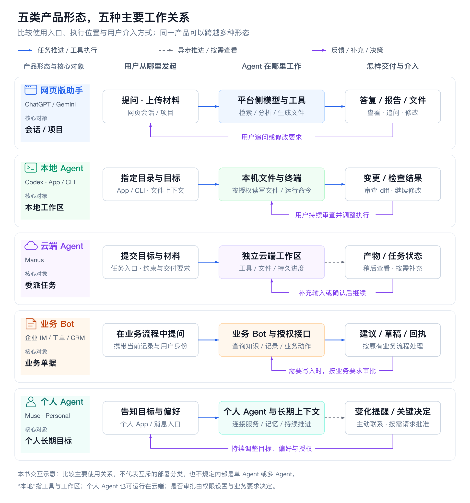
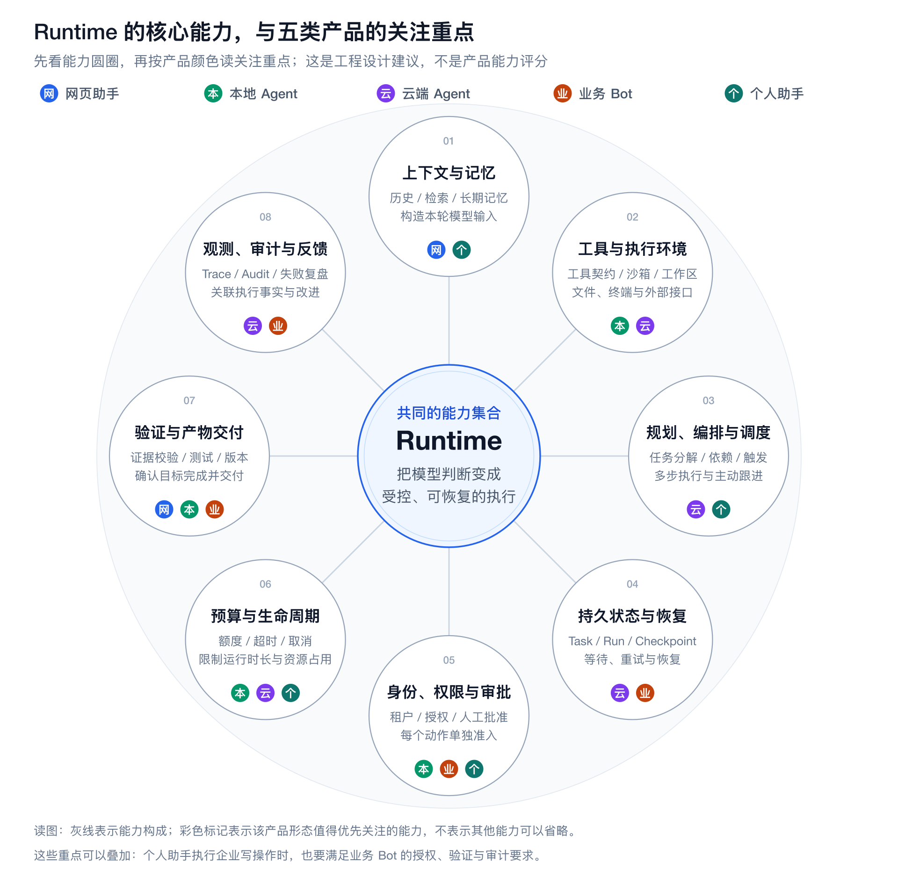
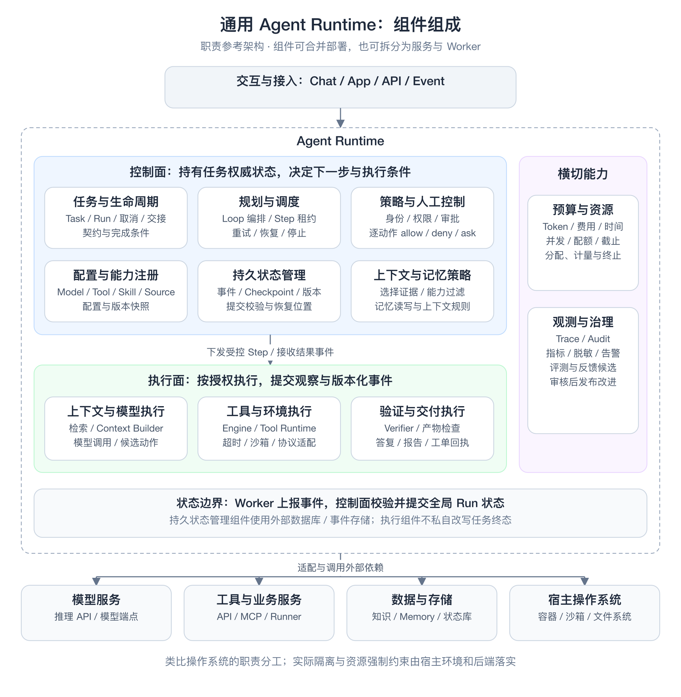
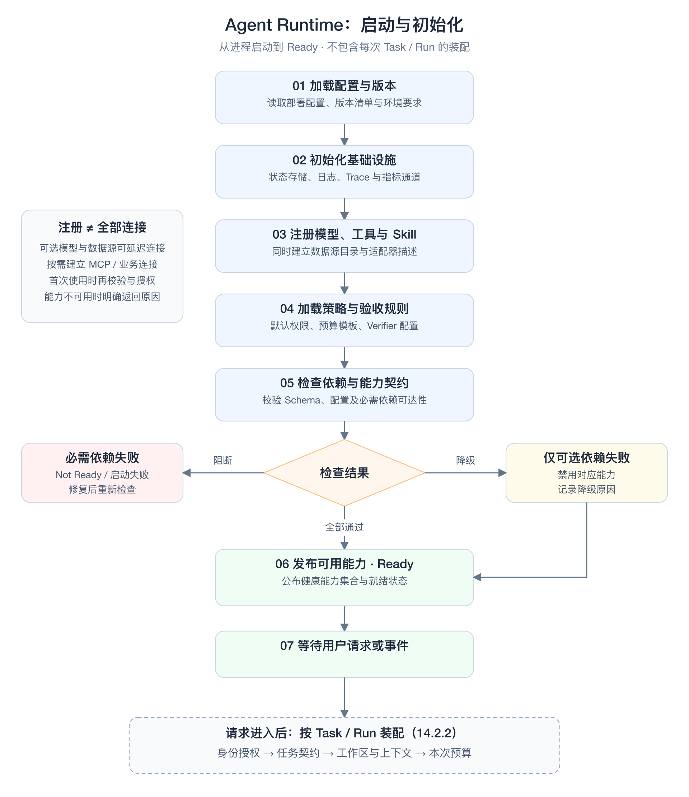
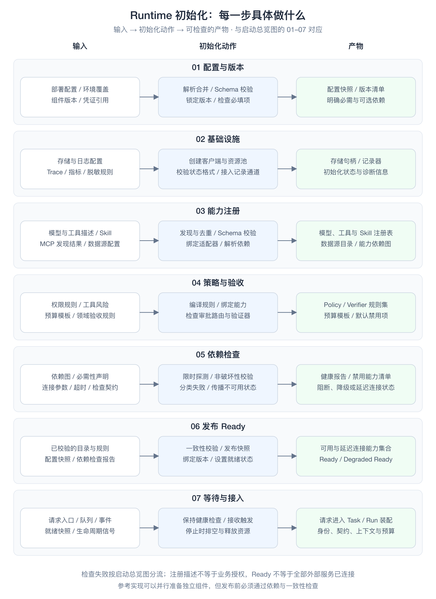
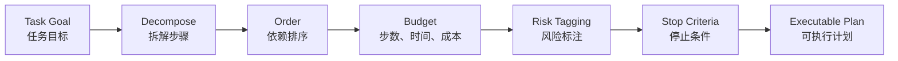
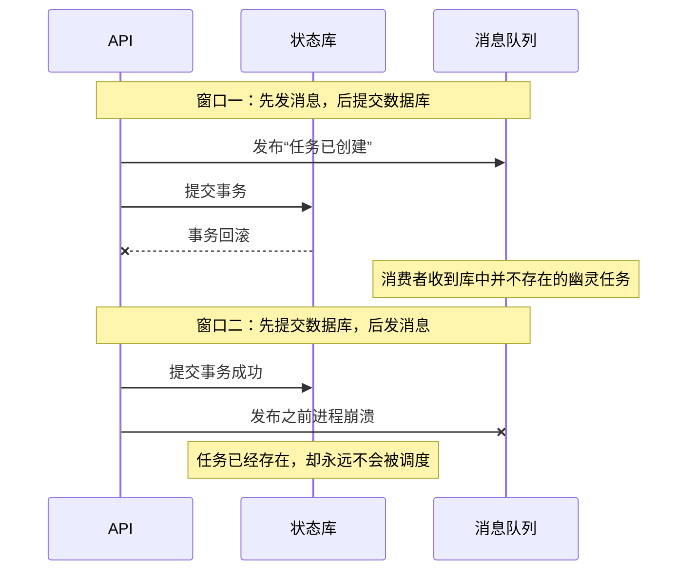
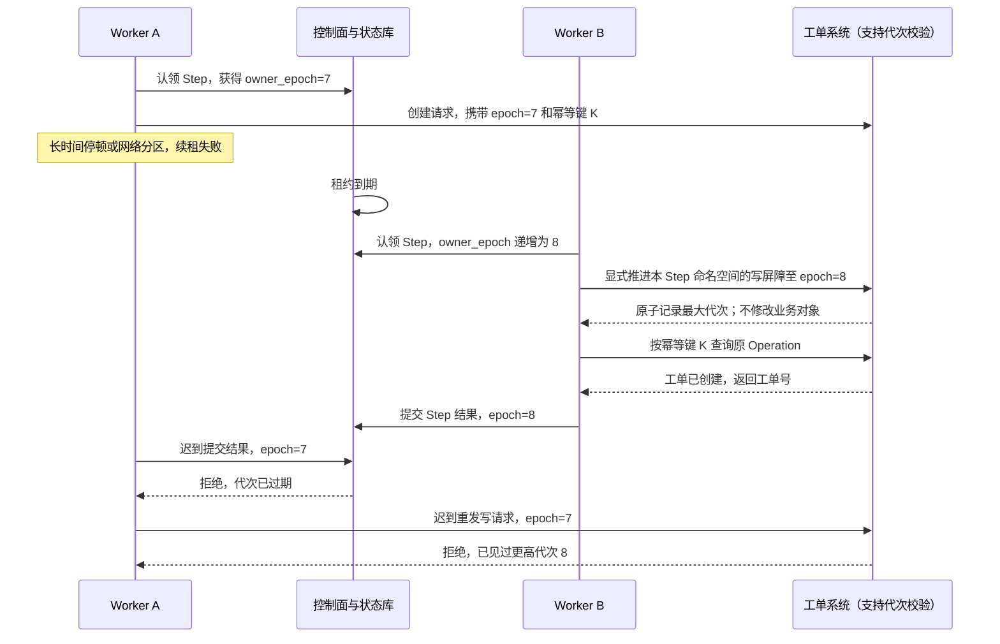
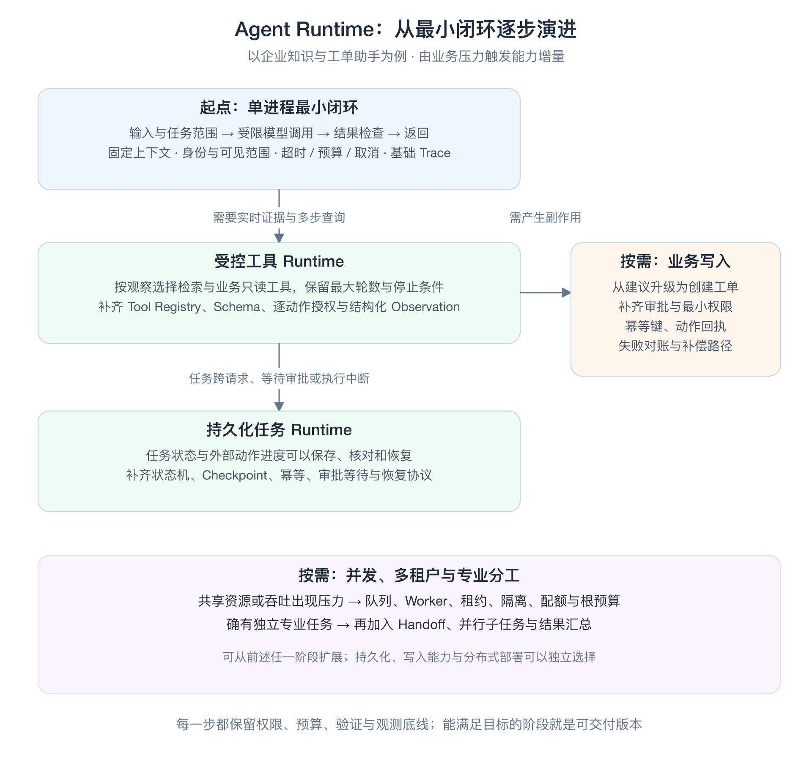

# 第14章 Agent Runtime：架构、执行编排与可靠性工程

模型可以提出下一步，但这一步能否执行、由谁执行、怎样验证、中断之后如何继续，都由 Runtime 决定。一个任务只有同时保留目标、证据、执行权和业务事实，才能从一次演示变成可交付的系统。

本章讨论**一次 Agent 任务如何被可靠地执行**。先说明定位、整体架构与 Runtime 的组成，再沿启动、任务执行和异常处理展开，最后讨论按需求渐进建设的方法。核心对象是任务（Task）、运行（Run）、步骤（Step）、尝试（Attempt）和操作（Operation），定义见 [14.2.5 核心对象与身份](#object-model)。启动、执行与异常分别见 [14.3](#runtime-startup)、[14.4](#runtime-task-execution) 和 [14.5](#runtime-failures)。

**本章与相邻章节的分工**

| 章节 | 主讲内容 | 本章如何衔接 |
|:---|:---|:---|
| [第12章](01-llm-api-protocol.md) | 模型接口与线协议 | 本章只把模型调用视为 Agent Loop 中的一次推理请求 |
| [第13章](02-context-engineering.md) | 上下文工程与 Memory | 本章只说明上下文包如何进入受控工作区、如何随 Checkpoint 保存 |
| [第15章](04-skills-tools-mcp-connectors.md) | 工具契约、Skill、MCP 协议与 Connector 开发、沙箱（Sandbox） | 本章只保留 Runtime 如何接入、准入、绑定身份和恢复这些能力 |
| [第16章](05-agent-governance-optimization.md) | Guardrails、Eval、Trace 与指标、失败复盘、灰度与发布门禁 | 本章只说明 Runtime 在哪里执行这些检查，以及运行账本与 Trace 的边界 |

**版本与范围**

本章 MCP 相关内容统一以 2025-11-25 版规范为准，A2A 以 v0.3.0 为准，已有资料核验日期见章末参考资料（部分官方文档于 2026-10-22 补核）。文中的对象字段、JSON、数值、阈值、图示和故障时序均为教学示例，不代表统一标准；文中描述的故障场景未经过真实系统的故障注入验证。所有未标注实测来源的数值仅用于示例。

<a id="architecture"></a>

## 14.1 引言

用户把一项工作交给 Agent 后，需要知道它理解了什么目标、依据哪些证据、能使用哪些资源、何时需要人工，以及怎样确认工作已经完成。这些交互承诺需要 Runtime 管理：模型提出候选判断，系统保存事实、限制行动，并让任务在等待或中断后仍有明确去向。

全章以企业工单与知识助手为主线：检索制度、解释延迟、生成建议，必要时经审批创建工单。下面先从用户怎样交付和验收任务理解 Runtime 的作用，再在后文分别展开组成、启动、执行、异常与渐进建设。

<a id="1411-演化脉络技术形态与工程能力"></a>

**产品形态与用户交互**

理解 Agent Runtime，既要看技术能力怎样演进，也要看用户怎样把任务交给产品。MRKL 用模块组合语言、知识与离散推理；Toolformer 研究模型如何学习调用 API。这些工作指出了能力组合的技术方向，但并没有给模型授予任何系统权限。[[1]](#ref-1)[[2]](#ref-2)

**从用户使用方式看五类产品形态**

产品形态首先回答三个问题：**用户在哪里使用，把什么工作交出去，怎样接收和确认结果**。以下按截至 **2026-10-22** 核验的官方资料，选取代表产品归纳五类使用方式；这不是市场份额排名，也不是严格互斥的部署分类。网页版助手也可以发起云端长任务，个人 Agent 也可以运行在云端，分类重点是用户与产品的主要工作关系。

[](../images/agent-product-interaction-comparison.svg)

*五类产品的典型交互对照（本书示意，依据下表所引官方资料归纳；点击图片可查看 SVG）。从左到右看发起、工作环境与交付，下方回路标出用户继续参与的位置；异步推进、审批与内部编排仍取决于具体产品和配置。*

| 产品形态 | 代表产品与使用入口 | 典型用户交互流程 | 交付与持续性 |
| --- | --- | --- | --- |
| 网页版通用助手 | ChatGPT 网页版、Gemini；浏览器中的会话或项目 | 新建会话或进入项目 → 提出问题、上传材料或连接资料 → 查看答复或生成文件 → 追问、修改、导出 | 围绕当前问题或项目持续交互，交付答复、分析与文件；网页入口也可承载多步任务。[[3]](#ref-3)[[4]](#ref-4) |
| 本地工作区 Agent | Codex 本地版本；桌面 App、CLI 中的项目目录 | 打开或选择本地目录 → 描述目标并提供文件上下文 → Agent 读取、修改文件并运行命令 → 按权限设置处理授权 → 审查变更与检查结果 → 继续修改或提交 | 交付当前工作区中的实际变更，用户可以在执行中调整方向；工作围绕本机文件与工具展开。[[5]](#ref-5)[[6]](#ref-6) |
| 云端任务 Agent | Manus；网页或 App 中的任务工作区 | 提交目标、材料与约束 → Agent 在独立计算环境中规划和执行 → 用户查看进度，必要时补充输入或确认动作 → 验收并继续修改产物 | 以委派任务及其产物为中心，执行异步推进；用户按进度和待处理事项介入。[[7]](#ref-7)[[8]](#ref-8) |
| 业务系统内部 Bot | 企业 IM、工单或 CRM 内的助手；如 Agentforce Service Assistant | 从业务会话或记录页面进入 → 结合当前记录提出诉求 → 查看摘要、知识与处理建议 → 按原有业务流程继续处理 | 围绕工单、会话等业务对象提供帮助，结果回到业务流程；Agentforce 的具体例子是记录页中的摘要与服务计划。[[9]](#ref-9) |
| 个人助手型 Agent（Personal Agent） | Muse 等；个人 App、WhatsApp 等消息入口 | 告知个人目标与偏好，选择可连接的服务 → 形成计划并持续推进 → 在变化或需要批准时回来联系用户 → 用户调整目标、记忆或访问范围 | 围绕一个人的长期目标与日常事务工作，包含个人上下文、主动跟进与跨应用行动。[[10]](#ref-10) |

这里的“本地”指工作区与工具执行位置，并不意味着模型也部署在本机。分析 Codex 本地版本时，应关注它怎样访问目录、调用终端和交付变更，而不是仅看是否安装了桌面 App。网页上的文件上传、云端任务中的独立文件系统和本地目录访问，也应分别建模。

个人 Agent 则体现了另一种使用关系：用户可以把一个持续目标交给它，并在后续变化或关键决定处参与。Meta 的官方产品名是 **Muse**；**Muse Spark 是模型名**。官方资料描述了 Muse 对个人目标的规划、记忆、关闭 App 后的继续工作，以及发送邮件或购买前的批准交互。这里据此讨论个人助手形态，不把模型名当成产品形态。[[10]](#ref-10)[[11]](#ref-11)

**任务模式、能力与搭建工具另作区分。** 深度研究可以是网页版助手中的一种任务模式，例如 Gemini 允许用户修改研究计划后启动研究。[[12]](#ref-12) 浏览器代操作是一种执行通道，Manus Browser Operator 通过会话授权、专用标签页与人工接管提供控制。[[13]](#ref-13) 事件或定时触发是一种任务启动方式，Copilot Studio 可以在发布后由事件触发 Agent。[[14]](#ref-14) Dify、扣子编程则主要提供应用搭建与发布能力；搭建者的配置流程与终端用户的使用流程需要分开分析。[[15]](#ref-15)[[16]](#ref-16) 这些维度可以与上述产品形态组合，不必各自列成一类终端产品。

**从用户交互反推 Runtime 契约**

上述产品交互可以归纳为一条参考流程：**提交目标与材料 → 补齐范围和访问条件 → 必要时审阅计划 → 执行与补充输入 → 按需审批或接管 → 验收交付物 → 继续修订或结束**。这是本书的综合设计，不表示所有产品都要求每一步人工确认。短问答可以直接交付；较长任务需要可见进度；已有授权范围内的动作可以自动执行；越过权限或业务批准边界时才等待人工。

以“查一下这张单为什么延迟，需要处理时先给我看工单草稿”为例，交互与后端应形成如下对应：

| 交互阶段 | 用户看到或决定什么 | Runtime 必须处理什么 |
| --- | --- | --- |
| 目标受理与澄清 | 确认是哪张单、调查范围和预期交付；缺少关键信息时补充 | 固化任务目标、对象与完成条件，绑定请求者身份；不把历史聊天中的猜测当作已确认输入 |
| 连接资源与确定计划 | 连接可访问的数据源，知道准备查哪些事实；复杂调查可先调整范围 | 区分数据访问授权、执行方案与业务动作批准，保存可用能力和任务约束 |
| 执行与方向调整 | 看到当前阶段、已有证据与阻塞原因，必要时补充“只看本周” | 保存持久进度与证据引用；明确新消息是在调整当前任务、排队新任务，还是要求重新运行 |
| 动作审批与人工接管 | 查看工单目标、内容和影响，批准、拒绝或接手 | 审批绑定具体对象与参数；等待期间保存状态，继续前重新核对权限和业务事实 |
| 交付与验收 | 查看延迟解释、引用、工单草稿；批准创建后收到工单编号和链接 | 分开记录调查完成、草稿完成与实际创建成功；以业务系统回执确认写入结果 |
| 修订、取消与后续跟进 | 修改草稿、停止任务，或另外授权持续跟进 | 保留任务与版本关联；取消后核对在途动作；持续跟进另行明确触发条件、期限和通知规则 |

这个案例把知识问答、长任务与业务动作接在同一条用户旅程中。对 Runtime 而言，连接器可用、用户认可调查计划、批准创建工单，是三个不同的事实；“已生成草稿”与“工单已创建”也必须是两个不同的交付状态。后文的状态机、Checkpoint、审批与幂等机制，正是为了让这些交互承诺在中断和恢复之后仍然成立。

这些交互要求可以由同一组 Runtime 能力支撑。组成与职责见 [14.2](#runtime-components)，实例从配置到 Ready 的准备见 [14.3](#runtime-startup)，一次任务怎样推进与处理异常见 [14.4](#runtime-task-execution) 和 [14.5](#runtime-failures)，怎样分阶段建设见 [14.6](#runtime-incremental-evolution)。Context 与 Memory 见第13章，工具与隔离见第15章，治理见第16章。

<a id="runtime-components"></a>

## 14.2 Runtime 的组成：能力、组件与状态归属

Runtime 的组成可以从三个层次理解：**能力域**说明系统必须解决哪些问题，**组件**说明由谁承担职责，**核心对象与状态**说明各组件围绕哪些事实协作。本节将前文分散的组成相关内容归并为一张责任地图，采用本书的参考设计，不代表某一产品的内部实现，也不要求每个逻辑组件独立部署。

### 14.2.1 Runtime 要管理的事实与八个能力域

对于企业知识与工单助手，目标、证据、授权、执行进度和业务回执是不同的事实。用户同意调查计划，不代表批准创建工单；草稿已生成，不代表业务系统已创建工单。Runtime 的八个能力域共同维护这些区别。

| 能力域 | 回答的问题 | 管理的主要事实 | 主要承担组件 |
| --- | --- | --- | --- |
| 上下文与记忆 | 本轮可以依据什么，哪些信息可以跨任务保留？ | 证据来源、访问范围、上下文版本与记忆记录 | Context Builder、Memory 接口、Source Catalog |
| 工具与执行环境 | 有哪些能力，在哪里实际执行？ | 工具契约、适配器绑定、工作区与隔离范围 | Tool Registry、Tool Runtime、Connector、Backend |
| 规划编排与调度 | 工作怎样拆分，由谁推进？ | 计划、依赖、就绪节点与执行权 | Planner、Orchestrator、Agent Loop、Scheduler |
| 持久状态与恢复 | 哪些工作已被确认，继续工作依据什么？ | Task / Run / Step、事件、Checkpoint 与未决 Operation | State / Checkpoint 管理、持久存储 |
| 身份权限与审批 | 谁能对哪个对象做什么？ | 主体、租户、策略、审批范围与有效期 | Identity、Policy、Approval、凭证管理 |
| 预算与生命周期 | 可以投入多少资源，任务处于什么阶段？ | 根预算、消耗、截止时间与取消状态 | Budget / Lifecycle、Scheduler |
| 验证与产物交付 | 怎样证明目标达成，交付的是哪个结果？ | 验收规则、检查证据、产物版本与交付回执 | Verifier、Artifact / Delivery |
| 观测审计与反馈 | 为什么作出这个决定，怎样定位和改进问题？ | 调用关联、裁决证据、用量与诊断记录 | Trace、Audit、指标与评测接口 |

能力域与组件不是一一对应的：审批同时依赖身份、策略和持久等待；交付同时依赖验证、产物存储与访问控制。划分能力域的目的是检查职责覆盖，不能据此推导必须拆成八个服务。

#### 产品形态对能力的关注重点

上述八个能力域共同支撑受控执行，具体实现可以由 Runtime、工具后端与存储系统协作完成。不同产品形态对这些能力有不同的关注重点，可用下图和对照表检查需要管理的事实。

[](../images/agent-product-runtime-requirements.svg)

*Runtime 核心能力与产品关注重点（本书参考设计）。灰线表示能力构成，没有执行先后；能力圆圈内的彩色标记表示产品的关注重点，不是能力评分，未标记也不表示可以省略。点击图片可查看 SVG。*

这些重点是工程设计建议，不是对厂商实现的声明，并且可以叠加：个人助手若创建工单，也要同时满足业务 Bot 的授权、恢复、验证与审计要求。落到具体设计时，可以继续用下表检查每类产品需要管理的状态和边界。

| 产品形态 | Runtime 需要重点管理的事实 | 典型设计问题 |
| --- | --- | --- |
| 网页版通用助手 | 会话与项目上下文、上传材料、来源引用和产物版本 | 多次追问在修改哪份结果？进入长任务后，怎样查询进度并继续原任务？ |
| 本地工作区 Agent | 工作目录、可读写范围、文件变更、命令进程与检查结果 | 多个任务能否修改同一目录？中断后怎样确认哪些变更和命令已生效？ |
| 云端任务 Agent | 任务身份、计算环境、持久状态、待补充输入与产物 | 用户离开后由谁继续调度？等待、恢复与重试怎样沿用同一任务？ |
| 业务系统内部 Bot | 业务用户与租户、当前业务对象、动作审批与业务回执 | 谁可以对哪张单做什么？怎样证明建议已被采纳，或写操作实际成功？ |
| 个人助手型 Agent | 长期目标、个人记忆、服务授权、触发条件与通知偏好 | 什么时候可以主动行动？用户改目标、要求忘记或撤销授权后，后续任务怎样停止或调整？ |

因此，会话、任务、工作区、业务对象与个人记忆应各有清楚的身份和生命周期。记住用户偏好、获准读取某项服务、获准执行一次动作，是不同的事实；一个已完成任务也不能自动成为无限期行动的授权。后文的状态、权限、预算与恢复设计，都需要落到这些具体对象上。

<a id="runtime-model-boundaries"></a>

### 14.2.2 运行时边界：模型提出，Runtime 裁决

模型负责基于当前输入提出候选解释、计划、工具动作或结束建议；Runtime 负责检查这些提议是否满足任务契约、权限、预算和验收要求。模型可以帮助理解意图，但不能自行补造用户授权；可以建议任务完成，但不能仅凭自己的判断改写权威终态。

因此必须区分三种权力：**提出下一步、批准执行、确认事实**。Agent Loop 与 Planner 承担提议职责，Policy 与人工控制承担授权职责，状态管理与 Verifier 接受有证据的结果，业务后端提供外部动作的事实依据。任何替代工具或子 Agent 都沿用这些边界。

Runtime 与 Harness 是不同的责任视角：Runtime 强调任务生命周期与受控执行，Harness 强调围绕模型组织的上下文、工具、约束、验收与反馈；编排则表达步骤依赖与分支。它们可以由同一进程实现，不必对应三套系统。宿主操作系统、沙箱与资源端落实实际文件、进程、网络及业务访问边界，SDK 或 Prompt 中的限制不能替代这些机制。

**LLM 的工程特性与控制边界**

| 特性 | 工程后果 | Runtime 的控制手段 |
| --- | --- | --- |
| 概率生成，而非规则执行 | 相同输入可能得到不同输出；模型可能补全缺失信息或违反约束 | 结构化输出、确定性校验、有界修复与不确定时的停止条件 |
| 模型不持有提示词之外的权威任务状态 | 可能重复已完成步骤、淡化早期约束或把临时假设当作事实 | 在系统中保存任务状态、已接受的决策与 Operation，不依赖聊天记忆维持执行正确性 |
| 对上下文敏感 | 错误文档、过期 Memory、工具错误与恶意指令都可能改变输出 | 检索与权限过滤、来源和时效标注、冲突处理、注入隔离及输入边界检查 |
| 可以辅助判断，但不能承担系统责任 | 适合意图识别、摘要、候选方案、风险解释与证据归纳 | 权限、生产变更、金额计算、审计与最终事实确认由确定性组件和有权主体负责 |

这些特性解释了为何需要独立的状态、授权与验收组件；“让模型参与判断，由系统承担责任”是本书的设计原则，不能理解为模型天然具备可靠风险判断能力。

#### LLM 的工程特性与控制边界

控制边界画在哪里，取决于 LLM 在工程系统中的几项基本特性。下表概括了这些特性带来的后果，以及 Runtime 相应的控制手段：

| 特性 | 工程后果 | Runtime 的应对 |
|:---|:---|:---|
| 概率生成，而非规则执行 | 同一输入可能产生不同表达；输出看似合理却违反系统约束；倾向于补全缺失信息而不主动停下 | 输出 Schema、确定性校验、重试与降级策略、不确定时的停止条件 |
| 没有内在的系统状态 | 只看到当前提示词中的内容，可能重复执行已完成的步骤、再次尝试已失败的方案、稀释早期约束、把临时假设当作事实 | 状态保存在系统中，而非依赖对话历史 |
| 对上下文高度敏感 | 错误文档、过期记忆、恶意指令、工具失败消息都可能改变模型行为 | 上下文过滤、来源标注、权限检查、过期降权、提示词注入（prompt injection）检测、上下文防火墙 |
| 擅长判断，但无法承担责任 | 适合意图识别、摘要、候选方案生成、风险解释、证据归纳、模糊信息整合 | 权限判断、生产变更、金额计算、最终审计、高风险审批和事实真实性保证不交给模型单独负责 |

关于状态，三类来源的可信顺序应当明确：

```text
Task Store / 工作流状态  >  对话历史  >  模型推测
```

由此得到 Harness 的设计原则：**让模型参与判断，由系统承担责任**。

<a id="1413-运行时边界模型提出runtime-裁决"></a>

<a id="1413-运行时边界组件架构与-harness-责任"></a>

#### 操作系统类比与运行时边界

Agent Runtime 与操作系统相似的地方，在于它把上层提出的意图转换为受控的执行：模型提出候选动作，Runtime 管理任务、裁决权限、分配预算并记录执行事实。模型输出的行动请求必须经过 Runtime，可以类比用户程序通过系统调用访问资源。

| 操作系统职责 | Agent Runtime 中的对应职责 |
| --- | --- |
| 进程与线程管理 | Task / Run 生命周期、Step 调度、取消与恢复 |
| 权限与系统调用边界 | Policy 逐动作裁决、审批、工具调用入口与凭证作用域 |
| 内存与资源管理 | 上下文装配、记忆访问、Token / 时间 / 费用与并发预算 |
| 文件系统与持久化接口 | 任务状态、事件、Checkpoint 与产物的存储和恢复 |
| 设备驱动与 I/O 接口 | Tool Runtime、Connector 与执行后端的协议适配 |
| 监控与系统日志 | Trace、Audit、执行指标与诊断证据 |

这些是职责类比：上下文管理不等于内存保护，Checkpoint 也不会自动撤销已经发生的业务副作用。实际的进程、文件和网络隔离仍由宿主操作系统、容器、沙箱以及后端权限落实，SDK 本身不提供操作系统级隔离。

<a id="control-execution-plane"></a>

<a id="runtime-component-planes"></a>

### 14.2.3 组件全景：控制面、执行面与横切能力

<a id="1414-总体架构与-harness-责任对照"></a>

下图给出通用 Agent Runtime 的组件组成。14.2.1 的能力圆圈图回答“需要哪些能力”，这里进一步回答“由哪些组件承担”。组件表示逻辑职责，可以合并部署，也可以拆分为服务与 Worker；它不是某一厂商的内部实现图。控制面、执行面与横切职责在本节统一说明；集成与治理不另设任务状态权威。

[](../images/agent-runtime-component-architecture.svg)

*通用组件参考设计。控制面持有任务权威状态，执行面运行受控步骤；预算与观测贯穿各组件，宿主环境落实实际隔离。点击图片查看 SVG。*

**控制面：管理任务事实与执行条件**

控制面持有 Task / Run 的权威状态，决定任务契约、依赖关系、执行资格与完成条件。入口路由与意图归一负责把请求变成明确的任务；能力目录提供可选的模型、工具、Skill 与数据源；规划与循环控制提出候选步骤；Policy 与人工控制决定哪些动作获准执行；调度与状态管理负责执行权及状态提交。模型可以参与意图理解和规划，但候选计划、候选动作与已提交事实必须分开保存。

**执行面：完成受控计算并返回证据**

执行面包括上下文装配、模型调用、工具适配、实际执行、结果检查与交付适配。它根据控制面提供的任务、版本和权限工作，返回结构化观察、验证结果、产物与回执。执行 Worker 可以保留当前调用句柄、进程信息和局部缓存，但这些局部状态不能替代持久任务事实，也不能成为它自行推进全局 Run 状态的依据。

**横切能力：约束并记录各组件的工作**

预算与生命周期控制贯穿模型调用、工具执行和委派；身份与凭证管理限定资源访问范围；Trace、Audit 与指标记录因果、用量和裁决证据。它们通过统一接口作用于各组件，各自的预算、授权和审计记录仍须有明确归属，不能形成另一套相互冲突的任务状态。数据库、消息系统、对象存储和沙箱提供底层支撑，Runtime 负责在它们之上建立一致的任务语义。

链路是 Loop → Policy → Execution Engine → Tool Runtime → Backend → Observation。Prompt 不能强制权限；授权、沙箱和后端接口共同落实边界。这是本书教学抽象。OpenAI Agents SDK 提供循环、工具、交接、审批与观测入口，部署、存储和业务动作保证仍由应用负责。[[17]](#ref-17)

组件之间的关键约束是：Agent Loop 产生的**每一个**动作请求都要单独经过 Policy 裁决；仅在进入循环前统一检查一次是不够的。裁决结果为 `allow` 时交给 Execution Engine；为 `ask` 或 `escalate` 时进入审批或人工接管，批准后才执行；为 `deny(action)` 时禁止该动作并允许在原权限内重规划；为 `deny(goal)` 时目标本身不被允许，提交阻塞终态。替代路线不得绕过被拒目标。`sandbox` 与 `audit` 是附加在 `allow` 上的执行约束，本身不构成独立的裁决结果。执行结果作为观察回到循环，直到 Verifier 确认任务满足契约。

上述链路描述组件间的责任关系，不要求所有任务都调用工具；纯问答也需要上下文、预算、验证和状态边界。

#### 控制面与执行面

<a id="migrated-control-execution-plane"></a>

控制面负责创建 Run、选择模型和工具、持久化状态、发放租约、调度 Step、处理审批，以及重试和恢复。执行面负责具体的模型请求、工具调用、沙箱（Sandbox）、检索和流式输出。执行 worker 可以无状态地重启，控制面依靠持久状态，让新的 worker 从租约和 Step 的尝试记录处继续。worker 不应私自修改 Run 的全局状态，只能提交带版本的事件，由控制面按上一小节的条件更新决定是否接受。

这条边界同时也是安全边界。控制面校验用户权限、工具白名单、预算和模型能力；执行面使用短期凭证访问具体资源。即使模型生成了一个看起来合理的工具调用，它也必须先通过控制面的 schema、租户、目标资源和审批检查，worker 不能绕过控制面直接执行。

控制面不可用时，执行者只能使用未过期且已验证的配置快照；缺少当前 owner、审批或敏感策略证据时停止写动作，不能靠缓存推定授权。已在途的请求继续按原 Operation 核验。

### 14.2.4 组件职责与边界

下表区分组件的逻辑责任与它管理的信息。“管理状态”不代表组件拥有一套独立数据库；权威状态应通过统一的提交边界维护，执行组件可以只保存局部句柄与受控引用。

| 组件 | 核心职责 | 管理的状态或配置 | 职责边界 |
| --- | --- | --- | --- |
| 入口路由（Event & Intake Router） | 识别请求、回调与触发事件，关联任务入口 | 入口类型、请求标识、可信身份信封与关联信息 | 接收消息不代表业务动作已完成；不自行决定任务目标 |
| 意图归一（Intent Normalizer） | 明确目标、范围、约束与交付条件 | 任务契约、输入版本、待澄清字段 | 不把模型推测当作用户已确认的事实或授权 |
| 能力目录（Registries / Catalog） | 描述可选模型、工具、Skill、数据源及验证器 | 能力标识、版本、Schema、依赖与适配器绑定 | 注册不等于授权；Skill 是方法说明，不能授予工具权限 |
| 规划器与编排器（Planner / Orchestrator） | 表达步骤、依赖、分支与子任务关系 | 候选计划、已接受的任务图、节点契约与依赖 | 计划不等于执行事实，不拥有绕过 Policy 的权力 |
| 循环控制器（Agent Loop） | 根据当前观察提出继续、澄清、修订或结束 | 已记录的模型决策、当前观察引用与循环位置 | 模型提议不能直接提交状态、授予权限或宣告任务成功 |
| 策略与人工控制（Policy / Approval） | 判断动作资格，管理审批与人工决策 | 策略版本、裁决记录、审批对象与有效范围 | 批准只覆盖绑定的动作；裁决本身不执行工具 |
| 调度器（Scheduler） | 管理依赖就绪、任务分配、并发与执行权 | 待执行项、队列关联、租约与执行代次 | 获得执行权不代表外部副作用已经发生 |
| 状态与恢复管理（State / Checkpoint） | 接受合法迁移，保存可恢复的任务事实 | Task / Run / Step / Attempt、Operation、事件与 Checkpoint | 持久记录不能代替业务后端的真实回执；快照不等于撤销能力 |
| 上下文构建与记忆接口（Context / Memory） | 选择本轮可见证据，受控读写跨任务信息 | 上下文包、来源与版本引用、记忆访问及写入记录 | 记忆不是执行账本；历史可见不代表当前仍有访问权 |
| 模型调用适配器（Model Adapter） | 封装模型请求、响应与用量 | 请求参数、模型标识、调用结果与用量记录 | 模型服务提供候选输出，不掌握任务状态与授权的最终决定权 |
| 执行引擎（Execution Engine） | 在获准范围内驱动调用，管理局部超时与进程 | 当前 Attempt、调用句柄、截止时间与执行结果 | 不自行创建新的业务意图，不越过调度器决定全局执行权 |
| 工具运行时与连接器（Tool Runtime / Connector） | 映射能力、校验参数、适配协议并规范化观察 | 工具绑定、连接会话、请求与回执关联 | 连接成功不代表获准访问；协议适配不保证业务写入幂等 |
| 执行后端（Execution Backend） | 执行 Shell、沙箱任务或业务 API 请求 | 进程、工作区、资源端状态及业务回执 | 实际隔离与副作用由后端落实，Runtime 中的声明不能替代它们 |
| 验证器（Verifier） | 按规则检查格式、证据、产物与业务结果 | 验证规则版本、检查结果及证据引用 | 验证器报告是否达标，任务终态仍由控制面接受并提交 |
| 产物与交付（Artifact / Delivery） | 保存产物版本，向用户或渠道提供结果 | 产物引用、内容哈希、交付记录与渠道回执 | 任务完成、产物保存与通知送达是不同事实 |
| 预算与生命周期控制（Budget / Lifecycle） | 限制轮数、时间、费用、并发及子任务用量 | 根预算、分配与消耗记录、截止时间、取消信号 | 重试或委派不能重置预算；取消信号不证明在途动作已撤销 |
| 身份与凭证管理（Identity / Credentials） | 绑定租户与主体，提供受限资源访问凭证 | 主体映射、凭证引用、作用域与有效期 | 凭证可用不代表业务批准，密钥值不进入模型上下文 |
| 观测与审计（Observability / Audit） | 关联执行过程、裁决、成本与诊断证据 | Trace、审计事件、指标与关联标识 | 诊断日志不替代领域状态、Operation 账本或业务事实 |

这里的 Runtime 是上述职责的整体，而不是与 Agent Loop、Execution Engine 并列的另一个执行节点。同样，“控制面 / 执行面”划分的是决策与执行责任，不是按组件名称机械划分进程：例如 Verifier 的规则归控制面管理，检查可以在 Worker 中运行，检查结果由控制面接受；上下文访问规则与实际检索也可以分别部署。

#### 执行链路中的层级职责

图中的执行链路可进一步区分为以下组件：

| 组件 | 独立责任 |
| --- | --- |
| Runtime | 身份、任务生命周期、持久状态、预算、恢复与审计 |
| Agent Loop | 根据观察提出下一步、澄清、修复或结束 |
| Execution Engine | 调度、超时、取消、重试与结果回写 |
| Tool Runtime | 能力映射、参数校验、协议适配与结构化观察 |
| Execution Backend | 在 Shell、沙箱、API、MCP Server 或 Runner 中执行 |

Runtime 是整体职责范围，Loop、Engine、Tool Runtime 与 Backend 是其中的执行链路角色；此表用于区分层级，不将它们视为五个平级服务。

#### Harness 责任对照

Runtime 管任务生命周期，Harness 指围绕模型的上下文、工具、约束、验收与反馈组合，编排规定依赖和分支。它们是责任视角，可以在一个进程部署。下表仅作 Harness 对照，不另建一套架构：

| Harness 责任 | 组件与边界 |
| --- | --- |
| Context | Context Builder 构造受控输入，数据源提供证据 |
| Tool | Registry 描述能力；Tool Runtime 适配；Backend 执行 |
| Workflow | 控制面保存状态、调度与恢复；Loop 提出下一步 |
| Guardrail | Policy 与人工控制裁决每个动作 |
| Eval | Verifier 验收当前结果，Eval Harness 评估版本 |
| Observability | Trace、Audit、成本与监控提供诊断证据 |

集成接口与沙箱见[第15章](04-skills-tools-mcp-connectors.md)，治理机制见[第16章](05-agent-governance-optimization.md)。

<a id="durable-state"></a>

<a id="object-model"></a>

<a id="runtime-object-identities"></a>

### 14.2.5 核心对象与身份

组件名称说明“谁负责”，对象身份说明“负责哪件事”。以下对象沿用 [14.2 的规范对象模型](#migrated-object-model)，不会因为组件拆分或 Worker 更换而重新定义。

| 对象 | 表达的事实 | 与其他对象的边界 |
| --- | --- | --- |
| Session | 一段交互历史的连续性 | 可以承载多个 Task，不等于一次执行或一条 Trace |
| Task | 用户期望达成的目标及其契约 | 同一目标可以有多次 Run；不按消息条数机械划分 |
| Run | 对目标的一次执行及所用配置、权限与预算 | 可以跨进程和连接存续，不能用进程或连接身份替代 |
| Step | 可单独提交和验收的逻辑节点 | 描述逻辑工作，不随每次尝试变化 |
| Attempt | 某个 Step 的一次具体尝试 | 记录执行尝试，不代表新的业务动作 |
| Operation | 一次对外业务动作的稳定意图与结果 | 可被多个 Attempt 推进或查询，身份不随重试变化 |
| Event | 已接受的领域状态变化及其因果 | 不是任意调试日志，须能关联对应对象与版本 |
| Checkpoint | 继续执行所需的事实索引与版本引用 | 引用已确认结果和未决动作，不只保存聊天文本 |
| Artifact | 文件、报告、上下文包等版本化载荷 | 通过受控引用与任务关联，内容哈希不代替访问权限 |

对象身份还要绑定租户与作用域。`state_version` 表示状态版本，`owner_epoch` 表示特定对象的执行权代次，两者解决不同问题，不能混用；Trace / Span、模型请求标识和工具调用标识用于关联具体调用，不能替代 Task、Run 或 Operation 的业务身份。

**Connector、Connection 与 Run Binding**

| 对象 | 定义与归属 | 不能混同的事实 |
| --- | --- | --- |
| Connector 定义 | 可复用的实现、端点类型、协议与能力契约 | 已安装适配器不代表任何用户已授权连接 |
| Connection | 用户或组织对某个外部账户和资源的授权关系，有明确责任人 | 连接存在不代表所有任务都能使用其中全部权限 |
| Run Binding | 将选定 Connection 收窄到本次 Run 的动作、资源与策略版本 | 子 Agent 不自动继承完整连接权限 |

例如，同一个工单 Connector 可服务多个组织；Connection A 属于租户 A，Run R 仅绑定项目 P 的读取与待审批创建权限。后续每次调用都使用这个受限绑定，而不是由模型输入的 URL 或项目名自由选择连接。绑定如何参与派发见 [14.4.4](#execution-run-binding)。

#### 持久状态与对象模型

<a id="migrated-durable-state"></a>

恢复依据在进程外持久保存：目标、身份、业务事实与执行权不能随 Worker 重启丢失。理解这些对象，可以先从一次普通的 Agent 使用过程开始。

假设用户在同一个聊天中分析一个开源仓库。第一次要求“解释缓存模块的实现”，Agent 搜索文件、读取代码并给出说明；随后用户追问“再检查这个模块的测试覆盖了哪些边界”，Agent 接续前面的历史，读取测试并回答。这是同一段会话中的两次执行，每次执行内部又可能包含多次模型请求和工具调用。

```text
会话 S：分析一个开源仓库
├─ 任务 A：解释缓存模块
│  └─ 执行 A1
│     ├─ 模型请求 M1：提出文件搜索调用 C1
│     ├─ 执行工具 C1：搜索文件，返回结果
│     ├─ 模型请求 M2：提出代码读取调用 C2
│     ├─ 执行工具 C2：读取代码，返回结果
│     └─ 模型请求 M3：综合证据，返回说明
└─ 任务 B：检查测试覆盖的边界
   └─ 执行 B1：利用前面的上下文，读取测试并返回分析
```

*本书示意：字母与编号仅用于区分对象，不是某个产品的真实字段。*

这里有三个直接可见的层次：**会话**回答“接续哪段历史”，**执行**回答“这一趟工作完成了吗、运行多久、取消哪一趟”，**调用**回答“具体哪一步请求了什么、返回了什么”。会话可以跨多次执行，不要求持续很久；一次执行也不等于一次模型回复，而是从受理到完成、失败或停止的工作过程。取消执行 B1，不应删除会话 S 中已经保存的历史。

为了支持重新运行，本章再把“用户要完成的目标”与“完成目标的某一次执行”分成 Task 与 Run。示例中，两次请求具有不同的验收目标，因此分别建立任务 A、B；如果用户要求用另一模型重新解释同一个模块，可以在任务 A 下新增执行 A2。追问若只是在补充当前目标的约束，也可以关联原 Task，或进入正在进行的 Run，由入口契约明确决定，不能只按消息条数划分。

以下对象关系是本书参考设计中调度和恢复的基础，不要求每个产品都暴露全部对象：


图中最需要注意的是 Operation 与 Attempt 的关系：一个业务动作可以被多次尝试推进或查询，但它的身份不随尝试变化。Event 记录 Run 上已经被接受的状态变化，Checkpoint 是从这些事实中整理出的恢复索引，Artifact 则承载不适合放进状态表的大载荷。

#### 规范对象与身份

#### 本章的规范对象

会话（Session）组织人与 Agent 之间的交互连续性，可以承载多个任务。任务（Task）表达用户期望完成的逻辑目标。运行（Run）是对任务的一次实际执行，它绑定了模型、工具和工作流的版本，以及权限、预算和截止时间（deadline）。步骤（Step）是 Run 内可以单独提交和恢复的逻辑节点，例如一次模型调用、工具调用、检索、审批或子任务。尝试（Attempt）是执行某个 Step 的一次具体尝试。操作（Operation）是一次有外部影响的业务动作，例如创建工单或发送通知。

这些身份必须分开的原因在于，它们在不同的时机变化。一个 Run 可以跨多个 worker、经历多次重连才完成，所以线程、进程、连接与 Run 不能共用一个身份字段。如果把 Task 和 Run 混为一个 id，系统就无法区分“重试”和“重新运行”，计费会出错，不同版本的执行历史也会互相覆盖。

本章使用以下术语：

- **执行权代次（owner_epoch）**：某个 Step 的执行权每成功转移一次就递增的单调整数。持有最新代次的执行者才有权提交该 Step 的结果，旧代次的写入一律拒绝。
- **规范化载荷（canonical payload）**：把请求参数按固定规则整理后的形式，例如字段排序、去除无语义的空白、统一默认值。对它计算的哈希（payload hash）用来判断两次请求的参数是否真正相同。
- **幂等键（idempotency key）**：调用方为同一意图提供的稳定标识，重复提交时据此返回同一结果。本章区分两种范围：接入层的任务幂等键（字段 `request_key`），用于避免重复创建 Task；Operation 传给下游的操作幂等键（字段 `idempotency_key`），用于避免同一业务动作重复生效。

| 标识 | 身份覆盖范围 | 什么时候变化 | 提交约束 |
| --- | --- | --- | --- |
| `session_id` | 一段交互或入口的连续性 | 新会话，或新的交互隔离域 | 不作为执行或去重的身份 |
| `task_id` | 用户的逻辑目标，以及租户、可见结果引用 | 出现新目标或独立的请求意图 | 同一租户下相同 `request_key` 只对应同一个 Task；同一个键携带不同的规范化载荷时，请求被拒绝 |
| `run_id` | 一次版本化执行，绑定工作流修订版、权限、预算、截止时间和状态版本 | 用户明确重新运行、对照实验或发起新执行 | 系统恢复不改变 Run 身份；重新尝试与归属转移分别记录 Attempt 与执行权代次；新的业务执行另建 Run |
| `step_id` | Run 内的一个逻辑节点，包括输入和结果的引用 | 计划新增节点，或切换到另一个节点 | 重复调度同一节点，并不产生第二个逻辑 Step |
| `attempt_id` | 节点的一次尝试及其错误记录 | 重试、迁移或接管后的新尝试 | 新尝试追加记录，不覆盖历史尝试 |
| `owner_epoch` | 节点执行权的代次 | 成功转移执行权时递增 | 状态更新必须携带当前代次 |
| `operation_id` | 一次业务动作，关联操作幂等键、载荷哈希、外部 ID、事实状态以及查询和补偿入口 | 业务意图改变时才变化，普通重投与重试不改变 | 独立于模型重新采样和传输重试，最终去重由拥有业务状态的资源端落实 |
| `event_id` 与 `run_seq` | 一条追加式事件，包括因果关联、来源和状态版本 | 每次被接受的状态变化 | 只追加不修改；同库的状态变更与事件原子提交 |
| Artifact 引用 | 内容哈希、版本、可见范围和保留期 | 内容变化即产生新版本 | 先保证载荷完整，再提交引用它的进度 |

自动恢复保留 Run；需要重新尝试某个 Step 时新增 Attempt，需要转移执行权时推进 owner_epoch，不能把每次重试都当作一次归属转移。用户要求另一模型独立对照时新建 Run；独立授权的新工单是新业务意图，参数相似也不合并。

除身份外，每个对象还要保存足以恢复和审计的字段。Run 保存入口请求、模型与工具版本、租户、预算、截止时间、权限、状态、父任务和 trace id。Step 保存输入引用、输出引用、尝试次数、开始与结束时间、资源消耗、错误、幂等键和补偿动作。大段文本不直接嵌入状态表，而是存入 Artifact 仓库或消息存储，通过哈希和版本引用，以免状态表无限膨胀。

<a id="migrated-object-model"></a>

<a id="trace-ledger"></a>

<a id="runtime-fact-authority"></a>

### 14.2.6 状态机、单写者与事实来源

状态机定义对象允许处于哪些状态，以及哪些变化具有业务意义。Run 的执行状态、Step 的推进状态、Operation 的外部结果和用户界面的展示状态是不同维度：例如 Run 已取消，仍可能存在需要核验的在途 Operation；界面中的“处理中”也不应成为后端状态的权威来源。具体状态与迁移规则沿用 [14.2](#migrated-durable-state)，本节只界定其归属。

| 信息 | 权威来源及管理责任 | 不能替代它的信息 |
| --- | --- | --- |
| 目标与约束 | Task 契约及明确接受的修订 | 模型猜测、未确认的历史摘要 |
| 执行状态与执行权 | 控制面接受的持久状态、领域事件与版本记录 | Worker 内存、连接存活或队列可见性 |
| 业务副作用 | Operation 账本中关联的资源端回执与核验事实 | 模型宣称成功、工具调用已发出 |
| 可供继续使用的执行依据 | Checkpoint 引用的已提交事实、配置和产物 | SDK session ID 或一份对话摘要 |
| 对话与跨任务信息 | 消息存储与受治理的 Memory | 任务事件账本；两者不互相替代 |
| 诊断与审计证据 | Trace、Audit、指标及其关联记录 | 不能仅凭普通 Trace 重建全部任务事实 |

单写者指同一状态对象在某一时刻只有一个被授权的提交者，不要求全系统只有一个进程。Worker、回调与人工入口提交请求或带版本的事件，由控制面按对象归属接受；调度器管理执行权，状态管理维护合法迁移，执行组件不能私自改写全局 Run。

持久事件可以作为状态重建来源，也可以与当前状态快照一并保存；必须明确哪份记录具有权威性，并保持提交一致。Trace 中的一条“工具成功”诊断记录，与已接受的 `TOOL_SUCCEEDED` 领域事件具有不同语义。消息、Memory、状态表、事件和产物即使共用存储，也要分别定义写入权、访问范围与保留规则。

从任务执行事实的可信度看，应保持以下顺序：

```text
Task Store / 已接受的工作流状态  >  对话历史  >  模型推测
```

这不表示忽略外部业务系统的真实状态：Operation 仍需用资源端回执核验。Memory 保存经治理的跨任务信息，不能充当 Run 状态或 Operation 账本；消息摘要和模型推测也不能覆盖已经接受的事件。

Trace 用于诊断与评测，Audit 记录触发、批准和行动责任。Langfuse 的模型、检索与工具观察关联可用于定位问题[[18]](#ref-18)，但采样、截断或导出失败都可能使 Trace 不完整。敏感载荷仅保留受控引用；动作事实与恢复依据仍来自持久状态、领域事件及 Operation。

#### Trace、Audit 与动作事实

<a id="migrated-trace-ledger"></a>

Trace 用于诊断与评测，Audit 记录触发、批准与行动责任。Langfuse 等关联模型、检索与工具观察，帮助定位故障[[18]](#ref-18)；但采样或导出失败会使 Trace 不完整，动作事实与恢复依据必须来自持久事件和 Operation。敏感载荷只存受控引用，指标见[第16章](05-agent-governance-optimization.md#trace-observability)。

#### 单写者与条件更新

除 Task 与 Run 外，Step、Operation、Artifact、事件与幂等索引均绑定 tenant_id；查询和唯一约束包含租户，不能仅靠全局随机 ID 代替隔离。

同一个 Run 可能同时被多方更新：恢复 worker、用户的取消请求、工具回调和定时器都可能在同一时刻写入。如果不加约束，后到的旧写入会覆盖新状态。本章采用“单写者”原则来约束这种并发。**单写者（single writer）**指在任一时刻，某个状态对象只有一个被授权的写入方，其他参与者只能提交事件或请求，由这个写入方决定是否接受。单写者可以由 actor 模型实现，也可以由数据库条件更新实现；无论哪种方式，都需要持久化当前执行权，并处理执行者失效的情况。

本章以数据库条件更新作为参考实现。一次状态迁移在同一个事务中完成以下检查：当前状态是否符合迁移前提，状态版本（`state_version`）是否与调用方读取时一致，执行权代次是否仍是最新。检查全部通过后，事务更新状态并追加事件；任何一项不符，写入都会失败。这种做法也称为比较并设置（compare-and-set，CAS）。每次更新都返回新的版本号，冲突时调用方重新读取，再决定合并还是失败。事件表按 `run_seq` 建立唯一约束，因果顺序由服务端分配的序号决定，客户端的墙钟时间不参与判断。

条件更新之外，还要检查业务前提。获得授权并不代表前提会一直有效：人工批准之后，目标资源可能已被修改，任务可能已被取消，租户权限也可能已被收回。因此，在真正执行之前仍要重新校验资源版本和当前授权，不能把一次旧的批准当作无限期的通行证。

分布式锁无法单独解决这些问题。锁会超时，worker 会崩溃，外部副作用也可能在锁释放后才完成。只有把状态机、租约、幂等键和外部查询接口组合起来，系统才能安全恢复。此外，事件处理器本身必须幂等，由事件派生的投影（projection）必须可以重建。多个 Agent 共享任务状态时，要明确哪些字段只能由协调者写入，哪些内容是只追加的消息。

#### 事件与状态机

Runtime 的事实由追加式事件组成，例如 `RUN_CREATED`、`STEP_STARTED`、`MODEL_COMPLETED`、`TOOL_REQUESTED`、`TOOL_SUCCEEDED`、`APPROVAL_REQUIRED`、`RETRY_SCHEDULED`、`RUN_PAUSED` 和 `RUN_COMPLETED`。当前状态可以由事件派生，也可以保存为带版本的状态快照。重复事件、乱序事件和迟到 worker 的回报，都要通过序号、Attempt 和状态版本加以校验。

状态机定义哪些迁移是合法的。例如，RUNNING 可以进入 WAITING_TOOL、WAITING_APPROVAL、PAUSED、FAILED 或 COMPLETED；COMPLETED 不能被迟到的失败事件覆盖；进入 CANCELLED 之后，新的工具动作必须被拒绝。Temporal 依靠有序的事件历史（event history）恢复执行 [[19]](#ref-19)。AWS Step Functions 区分了 Standard 工作流对状态执行的 exactly-once 模型（不覆盖外部工具副作用）、异步 Express 工作流的至少一次语义和同步 Express 工作流的至多一次语义；因此，不能把某个产品层面的 exactly-once 术语当作对所有外部工具副作用的保证 [[20]](#ref-20)。平台不一定采用这些产品，但必须具备同样明确的状态语义。

运行终态与业务事实要分开保存。CANCELLED 表示不再继续这次执行，而外部工具晚到的成功仍然是真实发生的事实。系统可以追加核验事件或补偿事件来解释它，但不能为了让界面看起来整齐而删除它。反过来，远端成功也不能让已取消的 Run 自动回到 RUNNING 并继续后续动作。终态保护的是执行承诺，账本保留的是业务世界中已经发生的变化。

需要强调的是，普通 Trace 可能被采样、脱敏或截断，因此不能替代权威的事件账本；投影可以随时重建，权威事实只能来自持久事件。

#### 对话历史、记忆、事件与账本的分工

四类存储保存的内容各不相同。对话历史保存“说过什么”，记忆（Memory）保存经过治理的跨任务信息，执行事件保存已经被接受的状态变化，Operation 账本保存外部动作的意图与事实。摘要里可以写着“已经创建工单”，但恢复 worker 必须通过对应的 Operation 和外部对象来确认这一点。模型记忆中的一句“已成功”，没有足够的身份、版本和证据，不能作为再次执行或宣布完成的依据。

状态表也不必承载所有内容。任务目标、当前版本、依赖关系、执行权和未决操作需要可查询，因此放在状态表中；长文本、文件、工具原始载荷和报告进入受控的 Artifact 仓库；事件则保留状态变化的因果。读取 Artifact 时要再次检查当前权限，曾经进入过某个 Run 的内容，并不意味着永远可见。内容哈希可以证明载荷是否发生变化，但它不能代替鉴权，也不能证明业务含义正确。

LangGraph 的 checkpointer 与 store 分别面向单个 thread 的状态和跨 thread 的数据；使用内存实现可以验证接口，却不能证明进程重启后的耐久性 [[21]](#ref-21)。在本章的参考设计中，状态、事件、Artifact 与记忆可以共用底层存储，但各自的提交、删除、权限和保留规则必须分别定义。

Runtime 也不应把全部历史消息直接拼进每一次提示词。消息存储（message store）保存原始消息及其来源、时间、权限、哈希和父消息；上下文构建器（context builder）则根据当前 Step 的预算、任务、工具、记忆和安全策略，选择模型可见的内容，并记录最终提示词的版本和组成摘要，以便回放与审计。超出窗口时，安全约束和用户目标不能被静默删除。上下文的优先级与压缩策略见[上下文组装](#migrated-context-builder)。

ReAct 的结构化候选动作和观察必须由状态机接受；不保存或展示完整思维链，也不把自由文本当作迁移。循环判据见[Agent Loop](#migrated-execution-loop)，模式定义见[14.4.5](#migrated-workflow)。

### 14.2.7 渐进建设与框架选型

上述组成是责任地图，不是首版部署清单。目标和路径稳定、结果可精确判定时，普通后端加模型调用即可承担所需职责；需要模型动态选择步骤时，再引入有界 Loop。短任务可以用请求内状态，跨请求或重启后还要继续的任务才需要相应的持久对象与存储实现。渐进建设的完整讨论见 [14.6](#runtime-incremental-evolution)。

选择 SDK 或框架时，应逐项对照 14.2.4：哪些组件由框架实现，哪些状态由应用保存，哪些权限与副作用保证依赖后端。重点核对内外层循环、调度、预算、取消与验收的责任归属，避免两层都认为另一层负责。不按产品名称推定其能力完整。

最小实现可以合并组件，但不能合并事实：提议不等于批准，尝试不等于业务操作，验证通过不等于通知送达。只要这些责任与状态归属清楚，单进程实现与分布式部署就可以使用同一套组成模型。

<a id="runtime-startup"></a>

## 14.3 启动：从部署配置到 Ready，再到退出

[14.2](#runtime-components) 定义了组成，启动要把这些逻辑组件变成可受理任务的执行实例。本节沿部署配置、存储与观测、能力目录、规则编译、依赖检查和快照发布展开，最后说明运行中更新与退出。这里形成的是实例级能力与规则；具体用户、租户、工作区与预算在 [14.4](#runtime-task-execution) 中按 Run 装配。

以下是本书参考启动协议，覆盖从实例准备到退出的完整生命周期。实例可以是本地应用、API 服务或 Worker；不同角色的 Ready 条件不同，不要求每个实例都直接连接全部依赖。

<a id="startup-ready"></a>

### 14.3.1 启动总览与 Ready 语义

启动链路是：**加载配置与版本 → 初始化存储和观测 → 注册能力 → 编译规则 → 检查依赖 → 发布能力快照 → Ready**。独立准备工作可以并行，发布前必须检查快照中的引用与依赖一致。下图给出整体依赖与就绪分支，本节按每一步的输入、产物和准入条件展开。

Ready 表示“当前实例可以履行已声明的服务契约”，需要同时说明角色、可用能力和版本。进程存活只能证明服务还在运行，不能证明任务可以受理；入口成功返回 accepted，也不能证明任务已经执行。

| 实例角色 | Ready 需要证明什么 | 仍不能证明什么 |
| --- | --- | --- |
| API 实例 | 可以校验请求、持久提交 Task / Run 及待调度记录，并提供状态查询 | 下游 Worker 已完成任务、所有可选工具均健康 |
| 执行 Worker | 可以认领其声明支持的任务，取得相应规则、存储及执行依赖 | 任意版本或任意租户的 Run 都可执行 |
| 本地应用 | 当前工作区可访问，必需模型、工具与本地状态能力可用 | 已获得任意目录、网络或业务写入授权 |

API 可以先于 Worker Ready，但系统必须明确是否允许“持久接收、稍后执行”，并暴露积压和服务期限；没有这一契约时，不能把执行层整体不可用包装成完整就绪。就绪检查应有超时、最近检查时间与失败原因，依赖变化时可以撤销相关能力或退出 Ready。

[](../images/agent-runtime-startup-initialization.svg)

*启动总览。必需依赖失败时保持未就绪；可选依赖失败时禁用相关能力并声明降级。实例就绪后再进入按任务装配；点击图片查看 SVG。*

[](../images/agent-runtime-initialization-step-details.svg)

*初始化步骤。配置、目录、策略和健康报告形成实例级快照；第七步接入事件后转入 [14.4](#runtime-task-execution) 的任务链路，不表示启动时已经取得用户授权或分配本次预算。点击图片查看 SVG。*

#### 初始化图与准备过程

Agent 的链路并非从用户请求开始。Runtime 在接收任务之前，需要加载配置与版本、初始化存储和观测、注册能力、加载策略，并检查就绪条件。下面展示服务或执行实例从启动到 Ready 的参考过程；本地应用可以在打开工作区时完成这些步骤，云端服务也可以在实例启动时完成。

*启动过程参考设计。必需依赖失败时保持未就绪或启动失败；仅可选依赖失败时禁用对应能力，以降级能力集合进入 Ready。每次 Task / Run 的身份、工作区、上下文与预算装配见 14.4.4。点击图片查看 SVG。*

总览图回答“按什么顺序启动、失败后去哪里”；下面进一步展开每一步的输入、初始化动作与产物。这里的顺序表示依赖关系，独立组件可以并行准备，但必须在发布 Ready 前完成一致性检查。具体实现可以按部署规模合并组件。

*初始化步骤参考设计。配置和描述经过解析、注册、策略绑定与依赖检查，形成可发布的能力快照；请求进入后，再按用户和任务装配实际执行环境。点击图片查看 SVG。*

### 14.3.2 加载配置与版本清单

输入包括部署配置、环境覆盖项与版本清单。先按确定的优先级合并配置，再做 Schema 和语义检查：模型标识存在，工具绑定齐全，环境与数据源匹配，必需依赖与可选依赖有明确声明。凭证只保存引用，由凭证提供方解析，不能把密钥值放进快照、日志或模型输入。

版本清单至少关联工作流、模型与 Prompt、工具 Schema、适配器、Skill、Policy、Verifier、预算模板及存储格式。配置快照说明“本实例实际采用什么”，manifest 说明“这些配置与制品属于哪个经过验收的版本组合”。不能只记录代码 commit，却让策略和工具在后台无记录地变化。

产物是经过校验的配置快照、manifest 标识及制品绑定。模型别名或远程工具无法固定实现时，记录实际返回的标识、契约快照和限制，不据此承诺可复现。无效配置应阻断相应能力；涉及必需承诺时阻断启动。

#### 加载配置与版本：确定“本实例按什么规则运行”

先读取部署配置、环境覆盖项与版本清单，明确当前环境、模型端点、存储位置、能力来源、默认限额和依赖等级。配置中的凭证引用交给凭证提供方解析，不把密钥值写入快照或日志。Runtime 对配置执行 Schema 和语义校验，例如生产环境不能指向测试数据源，必需工具不能缺少适配器，默认模型必须存在于模型配置中。

这一阶段产出**配置快照与版本清单**：记录生效配置、来源及模型、工具、Skill、Policy 的配置版本。模型服务未提供固定模型版本时，记录实际使用的标识与服务返回的版本信息，不把别名当作可复现保证。缺少必填项、版本不兼容或配置冲突应阻断启动；不能靠模型在运行时猜测正确配置。配置更新通过重新校验并发布新快照生效，在途 Run 如何继续使用旧版本由恢复与发布策略明确规定。

### 14.3.3 初始化存储与观测通道

根据角色建立状态库、事件与 Outbox / Inbox、产物存储的客户端，以及日志、Trace、指标和审计通道。长任务要求进程外持久状态；内存实现只适用于明确接受进程退出后无法恢复的场景。初始化阶段确认连接与格式兼容，数据库迁移由受控发布流程执行，普通 Worker 不应在启动时竞争修改 Schema。

同时加载关联字段与脱敏规则，使启动失败也能留下诊断信息。普通遥测可以按部署契约缓冲或降级；要求强审计的业务写入若无法可靠保存审计事实，应禁用该能力，或使依赖它的部署保持未就绪。日志服务不可达不应使进程失去所有本地诊断路径。

产物是可用的存储句柄、记录接口和兼容性报告。这里不预先创建用户任务，也不读取全量消息、Memory 或知识库；后续按 Run 的身份与访问范围读取。

连接与记录接口初始化后，还要把存储位置、状态格式、事件版本和初始化结果纳入健康报告。启动日志应能直接定位配置、存储或连接错误；只有“客户端对象已创建”不算依赖检查通过。初始化阶段准备资源，必需依赖的最终准入统一由 14.3.6 的检查与发布过程决定。

#### 初始化基础设施：准备“状态保存在哪里、过程如何记录”

根据配置创建状态存储客户端、连接池、日志记录器、Trace 与指标上报组件，并加载敏感字段脱敏规则。需要持久任务时，检查状态格式、事件版本和存储 Schema 是否兼容；部署所需的数据迁移应由受控流程执行，普通 Worker 启动不应竞相修改数据库。最小单进程 Runtime 可以使用内存状态，长任务则需要满足恢复要求的持久存储。

产出是**可供组件使用的存储句柄与记录通道**，以及初始化状态。启动日志应能定位配置、存储和连接错误；即使远端 Trace 服务不可达，也要有明确的诊断路径。是否允许观测通道降级由部署契约决定：普通遥测可缓冲或降级，要求强审计的写入能力若无法可靠记录动作，则应禁用或阻断。初始化只准备资源，必需依赖的最终可用性由第 05 步统一确认。

<a id="capability-discovery-loading"></a>

<a id="startup-capability-catalog"></a>

### 14.3.4 注册能力目录

从静态配置、插件清单或发现协议读取能力描述，依次完成解析、名称与版本校验、Schema 校验、适配器绑定及依赖登记。模型、工具、Skill、数据源和验证器分别保留其类型，不能因为都叫“能力”就使用相同的授权语义。

| 目录 | 注册时保存什么 | 需要检查的关联 |
| --- | --- | --- |
| Model Registry | 端点、能力声明、上下文限制、超时与候选模型 | 调用适配器及部署策略 |
| Tool Registry | 输入输出 Schema、读写性质、风险、版本及处理函数 | Connector、凭证作用域、Policy 与验证规则 |
| Skill Registry | 方法说明、触发条件、版本、所需工具与约束 | 所引用的工具和数据源是否存在 |
| Source Catalog | 索引、检索适配器、更新信息与访问边界 | 数据源连接及权限过滤接口 |
| Verifier Registry | 检查类型、规则版本与实现入口 | 产物格式、证据或业务查询接口 |

发现 MCP 工具时，先完成协议初始化、枚举与契约检查，再绑定策略；延迟连接只登记待发现状态，不能把未知工具发布为已可执行。注册描述来自外部时视为不可信输入，Skill 内容也不能直接变成启动命令或额外权限。产物是版本化目录与依赖图；注册成功仅说明能力可被后续校验，不表示任意用户可以调用。

能力生命周期还需区分五个事实：

| 事实 | 表示什么 | 不表示什么 |
| --- | --- | --- |
| 已安装 | 本地存在能力包或适配器 | 远端工具已被发现或当前健康 |
| 已发现 | 已取得并校验能力描述 | 已向某个 Run 暴露 |
| 已可见 | 描述进入某轮模型可见集合 | 对应代码或连接一定已加载 |
| 已加载 | 执行所需实现及连接已按契约准备 | 当前主体已获准执行该动作 |
| 已获准执行 | 当前动作通过 Policy 与前提检查 | 后续动作也获得长期授权 |

它们是分别记录的状态，不能仅按一个“enabled”字段推断全部成立。目录还需保存模型用量计价配置，建立 Skill → Tool → Connector / Source 的依赖，支撑禁用传播。Policy Store 保存 RBAC、ABAC 与环境规则，Observability Config 保存 Trace Schema、采样和脱敏配置；二者与 Verifier 规则都要绑定当前目录版本，避免“有工具描述却没有执行约束”。

#### 注册模型、工具、Skill 与数据源：建立“有哪些能力、如何调用”的目录

注册包含发现、解析、校验和绑定四类动作。Runtime 从静态配置、插件清单或协议发现接口取得能力描述，校验名称唯一性、输入输出 Schema 和协议版本，再绑定实际的适配器或处理函数。以 MCP 为例，需要启动发现时先建立连接、完成协议初始化并枚举能力；若选择延迟连接，就保留配置描述和待发现状态，首次连接后必须先校验、绑定策略，再向任务暴露，不能把尚未发现的工具当成已可执行工具。

模型注册记录调用端点、能力声明、上下文限制、超时与降级候选；声明还要在依赖检查或实际调用中验证。工具注册区分只读与写入、标注风险和所需权限，并绑定参数校验器与执行适配器。Skill 注册解析方法说明、触发条件和所需工具，检查依赖是否存在；加载 Skill 不会获得超出 Policy 的权限，也不应执行其中任意的启动指令。数据源注册保存检索方式、索引标识、访问边界与更新信息，通常不在启动时把全量文档或用户历史读入上下文。

这一阶段形成以下目录与配置对象，同时建立 **Skill → Tool → Connector / Source** 等依赖关系，供后续检查和禁用传播使用：

| 注册对象 | 回答的问题 | 初始化时记录或绑定的内容 |
|:---|:---|:---|
| Model Registry | 可用哪些模型 | 端点、能力、上下文限制、用量计价配置、降级顺序 |
| Tool Registry | 有哪些可执行能力 | 描述、输入输出 Schema、读写类型、风险、权限要求与适配器 |
| Skill Registry | 有哪些可复用方法 | 触发条件、版本、步骤、约束、所需工具与验证要求 |
| Source Catalog | 从哪里获取上下文 | 数据源与索引标识、检索适配器、访问边界与更新信息 |
| Policy Store | 哪些动作允许执行 | RBAC、ABAC、环境限制、审批策略与沙箱规则 |
| Verifier Registry | 如何判断完成 | 格式、引用、业务状态等规则及其验证实现 |
| Observability Config | 如何记录过程 | Trace Schema、采样率、脱敏与指标上报配置 |

表中前四类是本步骤建立的能力目录；Policy 与 Verifier 在下一步编译并绑定，观测配置已在第 02 步用于初始化记录通道。发现某个组件存在，只说明它可以进入校验流程，并不代表任意用户都能调用。

### 14.3.5 编译策略、预算模板与验收规则

将能力标识、读写性质、环境和风险映射到 Policy 规则，检查审批角色、路由、沙箱约束与凭证作用域能否落实。未覆盖的风险能力保持关闭或要求人工判断，不能默认放行。此时只完成静态编译；具体目标资源、用户权限和审批事实仍要在动作发生时求值。

预算加载的是模板与上限，包括轮数、Token、费用、总时长、重试和并发；验收加载的是规则及实现，包括输出格式、证据要求、业务结果查询与产物检查。只有请求到来后，才生成本次 Run 的根预算与具体完成条件。

产物是与目录版本一致的 Policy、预算模板和 Verifier 规则集。工单助手可以注册 `create_ticket` 并绑定审批、幂等与回执规则，但这既不是一次业务批准，也没有创建工单。

例如 `search_policy` 绑定只读策略，`create_ticket` 绑定目标租户、项目范围、审批角色、稳定 Operation 与回执验证。规则编译同时检查审批服务缺失时的能力关闭行为，并把预算模板中的租户配额、重试上限与全局约束纳入一致配置。此时形成的是可执行的规则，不是一次具体审批结果。

#### 加载策略、预算与验收规则：把“能调用”变成“满足条件才允许调用”

Runtime 加载权限与环境规则，将工具标识、读写类型、风险级别映射到 `allow / deny / ask / escalate` 的裁决规则，检查审批路由是否存在，绑定沙箱配置、凭证作用域和执行限制。用户身份与目标对象尚未确定时，只能完成规则编译和静态绑定；具体授权仍在请求和每个动作到达时求值。

预算在这里加载的是**模板与上限**，例如默认最大轮数、总时长、Token、费用和并发额度；本次 Run 的预算要在接入后结合任务、租户和剩余额度分配。Verifier 同样先加载规则与实现，具体引用、产物和业务状态在执行后验证。产出包括版本化 Policy、预算模板与 Verifier 规则集。未被规则覆盖的风险工具默认关闭或进入审批，审批服务缺失时不能自动放行。

在工单助手中，`search_policy` 可以映射为只读查询；`create_ticket` 则要求指定租户、目标项目与审批条件，并绑定幂等和回执检查。此时只是准备好规则，还没有取得用户批准，更没有创建工单。

### 14.3.6 依赖检查、降级与能力快照发布

按依赖图进行有超时的健康探测和契约检查，检查状态存储、模型端点、工具适配器、索引、审批与审计通道。使用健康接口、测试资源或无副作用查询；不能用创建真实工单或发送通知来检查启动。端点可达只说明连接条件，结果质量与任务权限仍由后续评测和执行检查负责。

| 检查结果 | 发布行为 | 对外声明 |
| --- | --- | --- |
| 必需依赖失败 | 不发布满足完整契约的快照，保持未就绪或启动失败 | 明确阻塞依赖与诊断原因 |
| 可选依赖失败 | 禁用对应能力及依赖它的 Skill / 流程 | Ready，同时公开降级范围 |
| 延迟连接 | 保留待连接状态，首次使用前补齐发现、校验和授权 | 不宣称远端已验证健康 |
| 必需条件满足 | 一致地发布目录、规则、版本与健康结果 | Ready，给出快照标识和可用范围 |

发布前检查悬空引用，例如日志源被禁用后，依赖它的延迟调查流程不能仍标为完整可用。通过原子切换或等价的一致性机制发布快照，使新任务不会同时读到新版目录与旧版策略。快照不存放密钥值，也不成为长期授权。

每项检查保存结果、耗时、原因、检查时间和关联能力，最终产出依赖健康报告、禁用清单与待连接清单。快照同时记录标识、可用范围、降级原因与就绪时间。例如知识查询可用而审批通道不可用，可以只开放问答；若创建工单是该部署的必需承诺，则整个实例保持未就绪。

#### 检查必需依赖与能力契约：确认“当前实例实际能承诺什么”

按依赖图执行有超时的健康探测与契约检查：状态存储能否读写初始化检查记录、模型端点是否可达、工具适配器与 Schema 是否匹配、必需索引是否存在、审批与审计通道是否可用。采用健康接口、测试租户、只读查询或明确无副作用的测试方式，不用真实创建工单、发送通知等业务动作来探测启动状态。端点可达只证明连接条件，不能替代结果质量评测或任务级权限检查。

每项依赖应产生检查结果、耗时、原因和关联能力。处理结果分三类：

- **必需依赖失败**：实例保持 Not Ready 或启动失败，不接收依赖该能力的新任务；有限次数退避重试后仍失败，应给出诊断信息。
- **可选依赖失败**：禁用该能力及依赖它的 Skill 或流程，发布降级原因；例如日志源不可用时，制度查询可以继续，依赖日志证据的延迟调查不能假装完整可用。
- **延迟连接**：校验已有的配置与依赖声明，标记为待连接，不宣称远端健康；第一次使用时限时连接，完成发现、Schema 校验与授权后才执行。

产出是**依赖健康报告、禁用清单与待连接清单**。注册能力不等于连接所有外部服务，Ready 也不代表所有可选能力都已验证可用。

#### 发布可用能力并进入 Ready：提供一致的启动结果

将配置版本、目录、策略、验证器和健康报告组合为一份一致的能力快照，检查不存在“工具已禁用但依赖它的 Skill 仍标为可用”等悬空引用，再通过原子切换或等价的一致性机制发布。能力至少区分可用、禁用与延迟连接状态；延迟连接项不能混入已验证健康的集合。

全部必需条件满足后设置就绪状态；存在可选能力缺失时，可同时报告 Ready 与降级信息。产出包括快照标识、可用范围、降级原因和就绪时间。新建 Run 记录所采用的配置与规则版本，便于诊断和恢复。对工单助手而言，“知识查询可用、审批通道不可用”意味着可以开放问答，却不能开放创建工单；若写入是该部署的必需承诺，则整个实例不能进入 Ready。

<a id="startup-version-updates"></a>

### 14.3.7 运行中变更：配置更新、发布与回滚

配置更新重走校验、依赖检查和快照发布，形成新版本；新 Run 绑定选定的 manifest 与能力快照，在途 Run 沿已记录版本继续，或在显式迁移边界切换。不能让一次默认值变更隐式改变旧任务的工作流、工具参数或补偿语义。发布治理见[第16章发布生命周期](05-agent-governance-optimization.md#release-lifecycle)，本节只说明 Runtime 如何采用版本。

多实例必须处理“Run 在快照 X 上创建，由只持有 Y 的 Worker 领取”的情况：Worker 声明可执行版本，调度只匹配兼容实例；否则加载并验证所需版本，或让该 Run 等待合适执行者。不可取得原制品或未证明兼容时暂停，不直接用 Y 解释 X 的事实。这是本书参考部署协议，不是 SDK 自动提供的保证。

回滚新任务路由与回滚在途状态是两件事。前者让新 Run 使用已验收的旧版本；后者必须保留既有 Operation、事件、预算和产物，经过兼容验证或明确迁移。紧急撤权、凭证失效、数据删除等当前安全事实不受旧快照豁免，执行前仍须校验。

Run 保存能力目录快照与制品摘要。Skill 可以绑定不可变包，远程 MCP Server 未必支持固定实现，只能记录实际观察到的契约；不兼容变化应暂停受影响动作。停用能力时先阻断新调用，再处理在途请求、外部作业和子进程，不能通过删除目录项假装它们已消失。持续健康检查据此更新可用能力或撤销就绪，安全撤权优先于旧版本固定。

#### 运行中的健康维护

Ready 后，入口开始接收用户请求、队列消息或其他授权事件；Worker 也可以开始领取任务。Runtime 继续维护健康检查、连接池与生命周期信号，依赖状态变化时更新能力状态，必要时撤销就绪或停止接收相关新任务。

#### 能力快照、远程实现与停用顺序

Run 保存能力目录快照和制品摘要。Skill 可固定不可变包；远程 MCP Server 未必支持固定实现，Runtime 只能记录观察到的契约，不兼容变化时暂停相关动作。停用先阻断新调用，再处理在途请求与子进程；安全撤权优先于版本固定。MCP 生命周期、Skill 加载与 OAuth 细节统一见[第15章](04-skills-tools-mcp-connectors.md)。

### 14.3.8 排空与退出

正常退出先关闭新接入和新认领，再处理在途工作。入口已接受的任务必须在持久状态中可查；Worker 在约定的排空窗口内完成当前可提交步骤，或记录稳定边界、未决 Operation 与后续处理责任。不能先清空内存再试图找回哪些任务已被承诺。

持久审批、外部作业和定时器不要求 Worker 一直占用进程，但其关联与恢复条件必须先保存。已发出的外部写请求不能因为进程将退出而被记作“未执行”；不确定结果交给 [14.5](#runtime-failures) 的对账路径。执行权按持久协议交还或到期，不能靠本地释放句柄证明资源端旧写已被隔离。

最后刷新可持久保存的事件、审计与用量，关闭连接。排空超时进入明确的强制退出策略，说明可能中断的计算和仍待核验的外部动作。实例退出不等于 Task 结束，系统通过持久事实决定后续接续。启动至此建立实例级承诺，下一节再把它装配为一次具体任务的执行契约。

#### 退出与资源释放

正常退出时停止接入、按既定策略排空或记录在途任务，并释放连接与租约。

<a id="runtime-task-execution"></a>

## 14.4 执行：一次任务从请求到交付

Runtime Ready 后，执行链路才从实例级配置转向任务级事实。本节只讲正常路径及持久提交点，以“调查工单延迟并生成建议”为只读场景，以“审批后创建跟进工单”为写入场景，最后扩展到依赖图与多 Agent。组件定义沿用 [14.2](#runtime-components)，故障窗口统一在 [14.5](#runtime-failures) 展开。

<a id="execution-commit-map"></a>

### 14.4.1 全链路、提交点与观测骨架

一次任务可归并为接入、装配、规划、决策、执行、验收交付六个阶段。上下文与决策可以循环，任务图也可以并行，但已经接受的事实都要经过明确的持久边界。以下 C1–C7 是本书对提交边界的编号，不是七个跨系统原子事务；一个编号可以包含本地提交与外部回执两个协议阶段。

| 提交点 | 保存或确认的事实 | 正常路径 | 故障窗口 |
| --- | --- | --- | --- |
| C1 任务受理 | Task / Run、请求去重结果与调度 Outbox 同一事务提交 | 14.4.2 | [投递异常](#failure-delivery) |
| C2 消息投递与可恢复接收 | Relay 的投递记录、消费者持久去重与接续责任 | 14.4.8 | [投递异常](#failure-delivery) |
| C3 步骤认领 | 当前执行者、租约与对象范围内的 `owner_epoch` | 14.4.8 | [执行权异常](#failure-ownership) |
| C4 副作用意图 | Operation、稳定幂等键、规范化参数及授权关联 | 14.4.8 | [副作用异常](#failure-side-effects) |
| C5 外部回执确认 | 已核验的业务结果、外部对象和回执证据 | 14.4.8 | [副作用异常](#failure-side-effects) |
| C6 结果与 Checkpoint | Step 结果、版本、事件及可用产物引用；完成时提交 Run 终态 | 14.4.9–14.4.10 | [中断恢复](#failure-recovery) |
| C7 交付与通知 | 待交付记录及渠道接受、送达或可查询结果的事实 | 14.4.10 | [交付异常](#failure-result-delivery) |

观测沿这些边界关联 `tenant_id/request_id/task_id/run_id/step_id/attempt_id`，有外部写入时关联 `operation_id`，并记录 manifest、状态版本和执行代次。模型、工具、审批与交付可各有 Span；异步边界通过关联字段连接，不要求一个 Run 只能有一条 Trace。

Trace 记录“经过了哪里”，状态与领域事件记录“接受了什么事实”。普通 Trace 被采样或截断不应改变业务结果；C1–C7 的关键事实应能从持久记录核对，不能用诊断日志代替提交依据。

#### 执行循环与控制边界

<a id="migrated-execution-loop"></a>

上一节给出了 Runtime 的整体分层，本节从一次请求进入系统开始，沿接入、装配、决策、执行、验收五个环节展开控制链路。贯穿其中的原则是区分五类信息：意图由任务契约固定，证据由上下文包承载，候选动作由模型提出，策略决定由 Policy 作出，结果以 Runtime 记录的事实为准。

本节沿接入、任务契约、执行策略、上下文、能力绑定、Policy 裁决、循环推进与验收交付展开。实例初始化见 [14.3](#runtime-startup)，对象与状态归属见 [14.2](#runtime-components)，故障后的处理见 [14.5](#runtime-failures)。

#### 从就绪转入任务装配

真正的请求到达后，才解析用户和租户身份、建立任务契约、分配工作区、筛选可见能力、读取授权范围内的上下文并分配本次预算，随后进入 14.4.1 的 Task / Run 链路。启动时得到的是 Runtime 级目录与规则；模型接收到的是按本次任务筛选的能力和证据。

<a id="execution-intake-contract"></a>

### 14.4.2 接入：请求信封、去重与任务契约

入口接收用户请求、授权事件或队列消息，先识别它是新目标、当前任务的补充、继续执行，还是查询状态。可信信封绑定租户、主体、会话、环境、请求标识及关联标识；这些字段来自鉴权与路由，不能由模型或正文中的自述覆盖。

意图归一把“查一下为什么延迟，需要处理时先给我看草稿”变成契约：调查哪张工单、可访问哪些数据、时间范围、是否只读、预期证据与草稿格式，以及哪些信息必须澄清。缺少关键对象时先保存待澄清状态，不凭猜测启动写动作。一次消息不必对应新 Task，关联规则由入口契约明确规定。

请求去重键在租户与入口约定的作用域内唯一，并绑定规范化请求摘要。同键同内容返回原受理结果，同键异参报告冲突；不能仅凭自然语言相似度合并独立请求。

**C1：**在一个本地事务中建立 Task / Run，绑定契约与配置版本，保存请求去重结果及调度 Outbox，再返回 accepted 和查询身份。accepted 只承诺任务已被可靠受理。事务与投递之间的故障见 [14.5.3](#failure-delivery)。

**请求信封与任务契约示例**

Web、企业 IM、IDE、工单、告警、Webhook、定时任务和委派都可以作为入口。路由把原始事件归一为信封，负责来源、可信身份、环境、请求去重与因果关联；Intent Normalizer 负责目标理解，Planner 负责执行顺序。以下工单事件为教学示例，信封中的身份与角色由入口鉴权绑定，不直接相信外部载荷中的同名字段。

```json
{
  "request_id": "req_demo_001",
  "channel": "ticket_webhook",
  "tenant_id": "tenant_demo",
  "actor": {
    "type": "system",
    "id": "ticket_event_source"
  },
  "user_context": {
    "viewer": "u_123",
    "roles": [
      "support_lead"
    ]
  },
  "payload_type": "ticket_delay_review",
  "payload": {
    "ticket_id": "TCK-1024",
    "severity": "high",
    "time_window": "2026-10-20T00:00:00+08:00/2026-10-22T10:00:00+08:00"
  },
  "correlation_id": "ticket_delay_review_001",
  "request_key": "ticket-TCK-1024-delay-review-001",
  "environment": "production"
}
```

“这个投诉为什么一直没解决”可能表示查询、诊断、催办或升级。Runtime 结合可信入口、模型语义解析、工具读取的确定性实体及 Policy 裁决，生成以下契约；客户身份、工单状态与时间范围不能由模型猜测。

```json
{
  "task_id": "task_demo_001",
  "intent": "diagnose_ticket_delay",
  "task_type": "diagnosis",
  "user_goal": "解释客户投诉工单延迟的原因，给出证据与建议，需要跟进时先生成工单草稿",
  "domain": "customer_support",
  "actor": {
    "user_id": "u_123",
    "role": "support_lead"
  },
  "entities": {
    "ticket_id": "TCK-1024",
    "customer_id": "C-8801",
    "ticket_status": "pending_engineering"
  },
  "risk_level": "medium",
  "allowed_actions": [
    "read_ticket",
    "search_policy",
    "query_logs",
    "summarize",
    "recommend"
  ],
  "blocked_actions": [
    "read_customer_private_note"
  ],
  "requires_approval": [
    "create_ticket",
    "notify_customer",
    "close_ticket"
  ],
  "success_criteria": [
    "解释工单当前状态",
    "列出延迟原因与证据来源",
    "形成下一步建议及跟进工单草稿",
    "标注需要单独批准的动作"
  ]
}
```

实体或目标不明确时返回 `ask_clarification` 和缺失字段。契约中的 allowed / blocked / requires_approval 是本次目标的约束，派发时仍需 Policy 检查当前对象和授权。校验后的同一份契约供 Planner、Context Builder、Registry、Policy、Verifier 与交付界面使用，避免各组件自行解释目标。

#### 入口路由（Event & Intake Router）：统一各类入口事件

生产入口还包括告警、Webhook、工单、定时任务、IDE、企业 IM 和委派事件。

入口路由负责把这些入口统一为请求信封，而不是让模型直接读取原始事件：

```json
{
  "request_id": "req_20260512_001",
  "channel": "alert_webhook",
  "tenant_id": "tenant_demo",
  "actor": {"type": "system", "id": "prometheus"},
  "user_context": {"viewer": "u_123", "roles": ["sre_oncall"]},
  "payload_type": "incident_alert",
  "payload": {
    "service": "payment",
    "severity": "critical",
    "time_window": "2026-05-12T10:00:00+08:00/2026-05-12T10:15:00+08:00"
  },
  "correlation_id": "trace_or_incident_id",
  "request_key": "alert-payment-20260512-1000",
  "environment": "production"
}
```

入口路由归一事件、绑定可信身份与环境、以 `request_key` 去重并保留因果关联，再分流到问答、诊断或人工。它负责来源与授权信封；任务理解交给 Intent Normalizer，执行顺序交给 Planner。

#### 意图归一（Intent Normalizer）：从用户输入到任务契约

“这个客户投诉为什么这么久没解决”可能是查询、诊断、催办或升级。Runtime 收集可信入口元数据，模型解析语义，工具补齐工单、状态与时间等确定性事实，Policy 裁决读取、通知和关闭权限，再生成任务契约。实体不明先澄清；工具观察仍需检查来源、时效和目标一致性，不能把模型猜测当作客户身份。

最后，Runtime 把入口元数据、模型解析结果、工具事实和 Policy 裁决合并为任务契约：

```json
{
  "task_id": "task_20260512_001",
  "intent": "diagnose_ticket_delay",
  "task_type": "diagnosis",
  "user_goal": "解释客户投诉工单长时间未解决的原因，并给出下一步建议",
  "domain": "customer_support",
  "actor": {"user_id": "u_123", "role": "support_lead"},
  "entities": {"ticket_id": "TCK-1024", "customer_id": "C-8801", "ticket_status": "pending_engineering"},
  "risk_level": "medium",
  "allowed_actions": ["read_ticket", "summarize", "recommend"],
  "blocked_actions": ["read_customer_private_note"],
  "requires_approval": ["notify_customer", "close_ticket"],
  "success_criteria": ["解释工单当前状态", "找出延迟原因", "列出证据来源",
                       "给出下一步建议", "标注需要人工确认的动作"]
}
```

关键实体缺失时返回 `ask_clarification` 和缺失字段。Runtime 校验后的契约统一提供给 Planner、Context Builder、Registry、Policy、Verifier 与交付界面：目标、允许行动与完成标准属于同一份约束。

<a id="control-modes"></a>

<a id="execution-risk-modes"></a>

### 14.4.3 执行策略：风险等级与控制模式

根据任务契约、动作副作用、数据敏感度和环境选择控制方式。稳定的输入处理、权限判断和状态提交由确定性代码负责；模型承担解释、证据综合和允许范围内的动态选择。风险策略还要明确成功标准、自动执行边界与人工职责，不能只给任务贴一个“高风险”标签。

| 任务特征 | 执行方式 | 需要明确的边界 |
| --- | --- | --- |
| 路径固定、结果可检查 | 固定 Workflow 加模型调用 | 节点输入输出与完成条件 |
| 只读但需要动态补证 | 有界 Agent Loop | 证据范围、调用上限与停止条件 |
| 需要预览或审批的写入 | 生成草稿、验证、审批后执行 | 批准绑定的对象、参数和资源版本 |
| 自动化能力或判断权不足 | 受控人工处理 | 接管范围、交接证据和后续责任 |

控制模式不取代逐动作授权。只读调查阶段结束后，创建工单仍是新的受控动作；对计划的认可不能推导出对业务写入的批准。拒绝与升级后的异常收敛见 [14.5.8](#failure-human-control)。

**把确定性处理与模型判断分开**

| 环节 | 模型适合承担的工作 | 确定性组件负责什么 |
| --- | --- | --- |
| 理解自然语言 | 识别候选意图与缺失信息 | 校验目标、实体和澄清结果 |
| 查询工单与日志 | 选择允许的查询并解释结果 | 按 Schema 执行、过滤权限并关联来源 |
| 总结现象 | 压缩材料、归纳证据 | 保留时间范围、引用与版本 |
| 判断原因 | 综合多源材料提出假设 | 检查证据充分性与矛盾 |
| 风险分级 | 解释潜在影响，辅助判断 | 以版本化规则裁决风险和执行资格 |
| 创建工单或关闭原单 | 生成草稿与建议 | 核验授权、审批、Operation 与业务回执 |
| 审计与计量 | 不承担权威写入 | 确定性记录身份、裁决、用量和事实 |

控制模式回答“能否执行、谁来批准”；编排模式回答“步骤怎样组织”。只读动作在已有授权范围内执行；写入或外发按风险和策略审批并落实幂等；本场景中的高影响状态变更先生成计划再由有权主体确认；绕过权限等禁止动作不暴露并明确拒绝。外发消息即使获批，也不保证可撤回。

```text
Router → State Machine → DAG（并行收集证据）→ LLM 综合步骤 → 风险门禁 → 必要时人工审批
```

Router、Chain、State Machine、DAG、Plan-and-Execute 的选择见 [14.4.5 模式选择](#migrated-pattern-selection)。控制模式与编排可以组合，不能让选定一种编排方式隐式授予动作权限。

#### 基于任务风险的执行策略

设计 Harness 不应从选框架开始，而应从任务的风险和不确定性入手。下面以生产告警诊断 Agent 为例，分四步说明。

#### 拆分确定性与不确定性

| 环节 | 是否适合 LLM | 原因 |
|:---|:---|:---|
| 解析用户自然语言 | 适合 | 意图可能模糊 |
| 查询指标 | 不适合由 LLM 执行细节 | 应由工具按 Schema 执行 |
| 总结日志现象 | 适合 | 需要信息压缩 |
| 判断可能原因 | 适合，但要受证据约束 | 需要综合多源信息 |
| 风险分级 | 适合辅助判断 | 分级规则应由系统定义 |
| 重启生产服务 | 不适合自动执行 | 风险高，需要人工确认 |
| 记录审计日志 | 不适合交给 LLM | 必须确定性执行 |

这张表直接决定了 Harness 的边界。

#### 风险等级与执行策略

不同风险的动作需要不同的执行策略：

| 风险等级 | 示例 | 执行策略 |
|:---|:---|:---|
| 只读 | 查指标、查日志、查文档 | 在已有授权与数据范围内执行，记录脱敏后的关联信息 |
| 写入或外发 | 创建工单、发送通知 | 按授权和风险审批，记录审计并保证幂等；外发的消息不保证可撤回 |
| 高风险变更 | 重启服务、回滚发布 | 先生成计划，经人工确认后执行 |
| 禁止动作 | 删除生产数据、绕过权限 | 不暴露相应工具，直接拒绝 |

动作能否执行不应由模型临时判断。风险等级应当是工具和工作流的属性，由 Policy 在运行时裁决。

#### 控制模式与编排模式

上表按风险把动作分成四种控制模式：自动执行（只读）、按策略审批后执行（写入或外发）、人工确认后执行（高风险变更）和禁止执行。控制模式回答“这一步能否执行、由谁批准”；编排模式回答“步骤之间如何组织”，例如告警诊断通常组合为：

```text
Router → State Machine → DAG（并行收集证据）→ LLM 诊断步骤 → 风险门禁 → 必要时人工审批
```

Router、Chain、State Machine、DAG、Plan-and-Execute 等编排模式的适用条件见 [14.4.5 模式选择](#migrated-pattern-selection)。

<a id="migrated-control-modes"></a>

<a id="connector-runtime"></a>

<a id="execution-run-binding"></a>

### 14.4.4 Run 装配：身份、预算、工作区与可见能力

装配读取 C1 绑定的 manifest 与契约，并结合当前身份与资源权限，生成本次 Run 的执行包：模型配置、允许请求的工具与 Skill、数据源范围、工作区、上下文规则、根预算及验收器。实例级目录可以很大，模型只看到本次任务需要且允许请求的子集；可见能力也不等于本次动作已获批准。

工作区绑定租户、任务、路径和可写范围。只读调查可以共享不可变材料，涉及修改时需要明确排他或隔离策略；Worktree 隔离文件版本，不隔离共享进程、凭证和网络。子任务只获得完成其契约所需的最小范围。

根预算包含轮数、时间、Token、费用、工具与并发额度。并发派发前预留额度，实际用量返回后结算并释放未用预留；在途费用未知时不能过早释放成可重复使用余额。重试、重新采样、查询核验、委派及孙任务共享同一根账本，子预算之和不能把总上限放大。计费口径详见第16章，预算耗尽的处理见 [14.5.7](#failure-cancellation)。

产物是带版本的 Run Binding 与执行包，保存身份、权限与凭证引用，不保存明文密钥。该包说明当前任务的装配结果，后续执行仍需检查当前授权与剩余预算。

**把模型提议映射回可信能力与连接**

模型返回的工具名必须映射回本 Run 绑定的可信注册对象，核对 Schema、版本、资源范围和已加载实现；不能把输出中的任意路径、命令入口或端点当作新工具直接执行。安装、发现、可见、加载与获准执行的区别见 [能力目录](#startup-capability-catalog)。

Connector / Connection / Run Binding 的定义见 [14.2.5](#runtime-object-identities)。派发时从可信上下文取得 `tenant_id/user_id/connection_id` 与凭证引用，模型给出的项目、URL 或资源范围必须与绑定求交集。以项目 P 的读取绑定提出项目 Q 的写入时，不能自动切到另一组织的连接；子 Agent 只取得被收窄的委托绑定。

连接服务在派发前检查当前所有权与授权，明文凭据仅留在服务端或受控凭证提供方。连接授权、刷新及 MCP 下游凭据边界见[第15章 Connector 开发](04-skills-tools-mcp-connectors.md#connector-development)，授权失效后的收敛见 [14.5.8](#failure-human-control)。

#### 能力注册、发现与加载

<a id="migrated-capability-discovery-loading"></a>

Runtime 先建立目录，再按任务筛选模型可见能力，最后在派发前裁决。**已安装、已发现、已可见、已加载、已获准执行**是五个不同事实：模型能看到描述，不表示代码已加载，更不表示已授权。模型返回的名字必须映射回可信注册对象，校验 Schema、版本与资源范围，不能执行文本指定的任意路径或端点。

#### Connector 运行时与 Run Binding

<a id="migrated-connector-runtime"></a>

Connector 定义描述实现、端点和契约；Connection 保存用户或组织的授权关系；Run Binding 把连接收窄到本次 Run 的动作、资源和策略版本。定义可以复用，连接有明确责任人，子 Agent 只获得收窄的委托绑定。`tenant_id/user_id/connection_id` 与凭据来自可信上下文；模型参数中的项目或 URL 必须与绑定求交集，不能切换租户或借用其他连接。

#### Workflow 的运行边界：验收标准、超时与预算

工作流不能只定义步骤，还要定义运行边界：

```yaml
workflow_policy:
  max_steps: 12
  max_tool_calls: 20
  timeout_seconds: 900
  max_cost_usd: 3.0
  approval_required_for:
    - write_database
    - deploy
    - send_external_message
  stop_conditions:
    - completed
    - evidence_insufficient
    - user_cancelled
    - budget_exceeded
```

上例中的数值均为示例值。这些边界应当由 Runtime 执行，而不是靠提示词约束。最大步数、调用次数、并发数、Token、成本和墙钟截止时间都来自父预算，子任务只能分得其中的一部分，不能各自重新拥有全额预算。`stop_conditions` 中的 `budget_exceeded` 是一种停止状态，不能被汇报为完成。

#### 多 Session 并发隔离

一个告警诊断 Agent 可以同时服务多个 Session：A 排查支付接口新版本的超时，B 排查同一接口旧版本的超时。它们复用同一套 Agent 程序、Skill 和工具，也可能运行在同一个服务进程中，但每次调查的历史、代码版本、身份和运行状态必须独立。

实现时，应为每个 Session 建立独立的会话状态，为每次运行（Run）建立独立的运行上下文。不能在一个共享对象上反复覆盖 `messages`、`current_session`、`cwd` 或工具凭证，再让多个请求并发使用它。上下文应显式传入工具调用，或通过能正确传播到异步任务的请求作用域传递；连接池和无会话状态的客户端可以复用。

最直观的风险是共享 checkout：A 先读取新版本的支付入口，B 为核对历史逻辑把共享目录切到旧版本，A 随后读到的是旧版适配层。每次文件读取都成功，拼出的调用链却不属于任何一个提交。只给 checkout 命令加锁，保护不了 A 之后读取的文件；把锁扩大到整个分析阶段，又会让调查串行化。


*本书示意：对话历史彼此独立，不代表代码文件也已隔离。图中的 v1、v2 为示意提交版本。*

共享不可变输入，隔离 Session 与运行状态，协调共享业务资源写入；逻辑 Session 不提供进程级内存或权限隔离。

#### 按资源确定隔离方式

先区分三个作用域：Agent 定义决定可用能力；Session 保存一条业务对话及其状态；Run 是该 Session 的一次执行，长会话可以有多次 Run。同一个 Session 默认串行提交状态变更；若允许多个 Run 并行，应给它们独立的状态分支和写入目录，再通过版本号或比较并交换（CAS）合并，防止后完成的结果覆盖较新的历史。

| 资源 | 归属与共享方式 | 保护机制 |
|---|---|---|
| 对话历史、Checkpoint、工作记忆 | 按租户、用户与 Session 归属；相似任务不能共用一份可变历史 | 查询带身份与 Session；并发写入检查版本；跨 Session 共享结论须经发布与授权 |
| 代码、Skill、指令与依赖 | 同版本且有权访问的 Session 可共享不可变快照；每个 Run 绑定具体版本 | 只读挂载、内容校验；由仓库管理服务负责 fetch、快照创建与回收 |
| Workspace、临时文件、构建产物 | 按 Session 或 Run 分配目录 | 独立 worktree 或写入层；权限或沙箱阻止跨目录访问 |
| shell、进程、浏览器、代码执行环境 | cwd、环境变量、端口、Cookie、内核与后台作业按作用域归属 | 独立进程组或执行环境；端口分配与资源限额；取消只回收本次执行的资源 |
| 工具连接与凭证 | 连接池可复用；授权上下文按调用绑定 | 工具入口按可信身份鉴权；按需注入最小权限凭证，不放入公共环境变量或共享 home |
| 检索结果、缓存与知识库 | 只共享调用者有权读取的内容 | 缓存键包含租户、权限范围、输入与版本；命中后仍校验访问权限 |
| 模型额度、CPU、内存与工具并发 | 按服务、租户与 Session、Run 分层分配 | 队列、公平调度、并发上限、超时和取消；原子扣减总预算 |
| 工单、数据库、部署等外部写入 | 多个 Session 可能操作同一业务对象，目录隔离无法消除冲突 | 按目标对象鉴权，使用幂等、事务、条件更新或互斥；幂等键按业务动作定义 |

**会话隔离**分开历史与恢复位置，**工作区隔离**分开文件与产物，**执行隔离**限制进程能访问的文件、网络、凭证和系统资源。


*本书参考设计：虚线框表示逻辑归属，文件与执行访问边界需由权限或沙箱落实。图中的目录、提交与 Skill 版本均为示意；不同 Session 可以绑定同一只读代码快照。*

一次 Run 可以按以下顺序装配和回收：

1. **准入与绑定**：服务端确认用户、租户、Session 和 Run，分配预算，解析本阶段的版本清单，准备独立写入目录。客户端传入的 Session ID 不能替代授权检查。
2. **统一工具上下文**：文件读取、检索、shell、MCP、浏览器和代码执行都绑定同一份身份、目录与版本。为子进程单独设置 cwd 和环境变量，不用进程级 `chdir` 或修改全局环境变量来切换请求。
3. **执行与审计**：逐次校验工具和目标资源的权限，记录 Run、输入范围、实际快照、结果与副作用。
4. **停止与恢复**：超时或取消时终止对应进程组，撤销本次临时授权并释放端口。快照仍有活跃引用时不得回收；恢复时核对原清单与 Checkpoint，不能续接另一个 Session 的 shell 或最新代码。

#### 工作区隔离：Worktree、进程与沙箱

Coding Agent 并行执行时，常用 Git worktree 隔离文件系统状态，每个 Session 或 Agent 在自己的工作树中修改：

```bash
git worktree add ../feature-auth feature/auth
git worktree add ../feature-payment feature/payment
```

worktree 只隔离 checkout。同一数据库、远程服务、端口、凭据和共享缓存不在它的保护范围内；worktree 之间还共享 Git 对象和部分元数据，也不限制网络和主机权限。独立目录本质上只是命名空间：如果两个执行环境仍有权读写彼此的目录，它只能减少误操作。需要强保护时，应使用操作系统权限、受限 worker、容器或沙箱限制可达范围；不同容器若挂载同一个可写路径，仍会互相污染。

这些机制可以按成本与保护要求组合：多个只读 Session 共享同一提交快照；需要修改代码时分配独立工作树；需要限制命令、依赖安装或不可信代码的影响时，再为每个角色配备独立的工作目录、进程和必要的沙箱，并固定输入版本与哈希。

公开产品的会话、委派、沙箱和工作区实现分别见[成熟 Coding Agent 案例](../part4/01-coding-agent-systems.md)与[Hermes 案例](../part4/04-hermes-agent-architecture.md)。应用仍要验证可达目录、共享状态写入归属与取消后的迟到写入；“支持多 Agent”本身不证明资源隔离。

<a id="workflow"></a>

<a id="execution-planning"></a>

### 14.4.5 规划与编排

规划器根据契约和证据缺口提出步骤，例如读取工单时间线、检索制度、查询相关日志、解释延迟、生成跟进建议。Runtime 校验步骤是否可执行、依赖是否闭合、预算是否可承受，以及结果怎样验收，再接受计划版本。计划表达未来工作的假设，不表示这些工作已经完成。

在本书的任务图设计中，节点描述逻辑输入、输出、依赖与验收条件，激活后映射到一个或多个可追踪的 Step；一个包含内部 Loop 的复合节点还需关联其内部 Step。Attempt 是节点实际执行的尝试，不应在每次重试时变成新的逻辑节点。动态扩图保存修订版与新增依赖，后继只能消费当前计划中已接受的结果。

固定 Workflow 可以把有界 Agent Loop 作为一个节点，模型也可以在允许范围内细化未来计划。两者组合时明确外层与内层的重试、预算、取消、验收及状态归属。编排模式的定义与取舍见 [14.4.5](#migrated-workflow)。

#### 工作流与任务图

<a id="migrated-workflow"></a>

前几节建立了持久状态、投递幂等和恢复机制，回答的是“单个步骤怎样可靠地执行一次”。本节在此基础上回答下一个问题：多个步骤怎样组织成计划和任务图，谁决定下一步走向哪里，什么条件下一个节点才算完成。

本节的基本立场是：模型生成的计划只是候选结构；图中的边表示完成条件与依赖条件；节点是否成功，取决于它交付的产物和外部验收，而不取决于模型的自我声明。下文先区分 ReAct、Plan-and-Execute 与 Plan mode，再介绍任务规划器与任务图（TaskGraph），然后给出模式选择表及各模式的失败出口，最后讨论运行边界、依赖提交和嵌套循环。

#### ReAct、Plan-and-Execute 与 Plan mode

<a id="react-plan-execute"></a>

<a id="migrated-react-plan-execute"></a>

ReAct 让模型交替生成推理与行动，并通过外部观察补充信息；纯思维链（CoT）没有这种与环境交互的闭环。[[22]](#ref-22) 例如，“解释一个已有的排序证明”只需推理；“修复测试失败”则必须读取代码、修改代码并运行独立检查。需要注意的是，观察本身也可能失败，使用了工具并不能保证结果正确。

这三个词经常被放在一起讨论，但它们位于不同层级：

| 概念 | 所在层级 | 核心含义 | 适合场景 |
|:---|:---|:---|:---|
| ReAct | Agent Loop 模式 | `Reason -> Act -> Observe -> Replan` 的推理与行动循环 | 探索、诊断、信息逐步补全 |
| Plan-and-Execute | 任务架构模式 | 先生成任务级计划，再由执行器逐步执行和验证 | 多步骤分析、复杂检索、代码修改、迁移任务 |
| Plan mode | 产品与 Runtime 的协作模式 | 当前阶段只允许探索和规划，不执行修改动作 | 需求不清、风险较高、需要先评审方案 |

ReAct 关注每一步如何边推理边使用工具；Plan-and-Execute 关注整个任务如何先拆解、再执行；Plan mode 关注当前会话是否允许执行写操作。三者可以组合：在 Plan mode 下用 ReAct 做只读探索并产出计划；进入执行阶段后按 Plan-and-Execute 落地计划，而每个执行步骤内部仍可能用 ReAct 调用工具、观察结果并做局部修正。

Plan-and-Execute 先保存结构化计划，再执行和验证；计划包含节点、依赖、风险、预算与停止条件，计划外观察触发有界重规划。它不自动提供审批或只读保证；Plan mode 才规定本阶段禁止哪些写入。按风险审查计划，固定其版本和输入引用后进入执行，避免长对话里的草稿被误当作已批准步骤。

#### 任务规划器：计划是可验证的假设

<a id="task-planner"></a>

<a id="migrated-task-planner"></a>

Planner 把任务契约、当前状态、Skill、工具元数据、Policy 与预算转成可执行计划。先计算事实缺口：例如已知 `ticket_id`，仍缺状态历史、SLA 与关联阻塞；再用工具覆盖关系形成候选，过滤禁止动作，把 `ask` 转为审批步骤。Runtime 校验 Schema、参数前提、额度与停止条件，Verifier 为每步绑定外部判据，如状态查询必须有 `updated_at`，原因必须引用证据。工单不存在、无读取权或关键事实无法补齐时停止并澄清。



计划被 Runtime 接受后，保存为任务图（TaskGraph）：一组带依赖关系的节点，每个节点是一个可独立执行、独立验收的工作单元。本书的 TaskGraph 节点包含以下字段：

| 字段 | 含义 |
|:---|:---|
| `node_id` | 节点的稳定标识，重规划后仍可用于复用产物 |
| `depends_on` | 前置节点；只有前置节点通过验收，本节点才可运行 |
| `input_refs`、`artifact_refs` | 输入与产物的引用，而不是内联的大段内容 |
| `owner` | 节点的责任人或执行者 |
| `acceptance` | 外部验收条件，决定节点能否提交为完成 |
| `risk` | 风险等级，决定是否需要审批 |
| `budget`、`deadline` | 从父预算分得的额度与截止时间（deadline） |
| `failure_route` | 失败、阻塞或结果未知时的去向 |

Todo 列表只是 TaskGraph 的视图。清单型计划适合稳定低风险路径，调查型计划随证据调整，工作流计划显式包含审批与状态。`Plan → Act → Observe → Replan → Verify` 中每次重规划都要由新观察支撑；工单不存在时应转澄清，不能继续推断延迟。

可修订不等于可随意修订，计划节点必须有外部验收，重规划也要遵守以下约束：

- **留下记录**：每次修订都写入 Trace，说明修改原因、所依据的观察，以及风险等级是否变化。
- **版本化**：重规划生成新的 `plan_version`，复用仍然有效的产物和已有 Operation，只重算受影响的节点。目标或授权改变时需要重新确认；旧版本的结果不能提交到新计划。
- **有界反思**：反思只在出现新的失败证据或进展停滞时触发，并限制轮数。没有新证据时，模型不能反复自我认可。
- **完成判定**：节点完成必须同时满足验收条件和安全约束；预算耗尽或结果未知（unknown）都不是成功。

Checkpoint、取消、等待审批、未知副作用和恢复，沿用 [14.5.6 Checkpoint、恢复与人工介入](#migrated-recovery) 的契约；Replay 只重放观察，不重复执行副作用。

#### 编排模式选择

<a id="pattern-selection"></a>

<a id="migrated-pattern-selection"></a>

控制模式决定能否执行及谁批准（[14.4](#migrated-control-modes)），编排模式决定步骤依赖。按任务特征选择，并为每个分支声明失败出口：

| 模式 | 适用条件与示例 | Runtime 的责任与失败出口 |
| --- | --- | --- |
| Single-shot | 一次摘要、分类或草稿 | 校验格式与证据，不合格有限修复 |
| Prompt chaining | 固定路径中的多个 LLM 节点，如分类→检索→草拟→审查 | 代码控制顺序与门禁，失败走预设分支；这是 Workflow 的一种实现 |
| State Machine | 有审批、取消和恢复的生命周期 | 状态持久化，合法迁移与终态保护由系统校验 |
| Sequential | 前后步骤依赖，如先测试再总结 | 前序验收后释放后继，从失败步骤恢复 |
| Parallel | 独立数据源、文件或候选可同时处理 | 分支独立预算，join 验收、去重与冲突处理 |
| Router + Specialist | 意图可分类到问答、编码或人工路径 | 输出结构化 route 与依据，低置信度先澄清，不能误入默认执行 |
| Plan-and-Execute | 开放长任务，需要根据观察修订步骤 | 保存版本化任务图，保留既有事实，只重算受影响节点 |
| Evaluator-Optimizer | 有外部判据且需要反复改进 | 生成与评估分离，有界循环，失败转人工 |
| Orchestrator-Workers | 子任务由编排者在运行时动态决定 | 委派结构化目标、边界与验收，逐个验收后合并 |
| Fan-out / sectioning | 预先固定切分的批量迁移、抽取或审查 | 确定性分片、限速、稳定 item_id 与逐项恢复；属于 Parallelization，不等同动态编排 |

Anthropic 的区分依据是路径和子任务是否在运行时动态决定，而不是工作者数量。[[23]](#ref-23) 外层可以用 Router 与状态机管理生命周期，内部并行收证，局部节点交给 Agent；增加组合之前先与固定路径比较成本、成功率和风险。

<a id="context-builder"></a>

<a id="memory-interface"></a>

<a id="execution-context-package"></a>

### 14.4.6 上下文装配

Context Builder 读取当前契约、已提交进度和本轮证据缺口，从授权数据源与 Memory 中检索材料，执行访问过滤、版本核对、去重和预算选择，再组织模型输入。材料包含来源、权限、时间和引用标识；外部文档、网页与工具文本作为证据，不能提升为系统指令。

本轮上下文包包含任务目标、安全约束、当前状态摘要、选中的证据、方法说明、本轮工具 Schema 与剩余预算。长载荷进入受控 Artifact 存储，Run 与 Checkpoint 保存不可变引用、哈希和包版本，而不是只保存一句无法追溯的摘要。

发送模型请求前确认目标与约束未在压缩中丢失，权限过滤先于暴露，模型适配器负责协议转换与用量记录。记忆可帮助延续背景，但“记得已创建工单”不能替代 Operation 与业务回执。本节下表给出 Runtime 层的上下文契约，选择与压缩方法见第13章。

**上下文包的最小契约**

| 内容 | 必须保留的约束 |
| --- | --- |
| 用户目标与系统规则 | 优先保留，不因压缩静默删除安全边界 |
| 当前任务状态 | 从权威状态读取，区分已确认事实、候选与未决动作 |
| 证据与工具观察 | 来源、时间、版本、可信级别和当前可见性 |
| Memory | 按作用域读取，过期或冲突内容不得覆盖任务事实 |
| 能力 Schema | 仅暴露本轮允许请求的能力，暴露不等于授权执行 |
| 上下文包 | 保存 `package_id/version/hash`、输入引用、裁剪与过滤记录 |

上下文包作为不可变、版本化引用随 Checkpoint 保存；恢复先检查载荷完整性与当前权限，再复用记录。哈希用于核对输入，不能证明证据正确。大载荷留在受控存储，模型只接收本步所需片段。文档、检索结果和工具文本均作为不可信数据隔离，不能借内容中的指令扩张权限。缺少关键证据时补检索、澄清或停止，不能靠摘要把缺口变成事实。

**Memory 的读取与受控写入**

读取 Memory 按租户、用户、项目与用途过滤，记录来源、版本和期限；过期或冲突内容不能覆盖任务事实。写入先形成候选，再按敏感度、冲突与证据审核，不能把一次工具失败或模型猜测直接沉淀为规则。任务可以引用某版记忆，但当前撤权、纠正和删除优先于历史可见性；子 Agent 只取得委托范围内的投影。存储、遗忘和冲突策略见[第13章 Memory](02-context-engineering.md#memory)。

#### 上下文构建（Context Builder）：受控工作区

<a id="migrated-context-builder"></a>

Context Builder 按任务、当前 Step、权限和预算组装模型可见输入；原始消息、知识与记忆的选择和压缩方法见[第13章](02-context-engineering.md)。Runtime 保留以下契约：

#### 记忆接口（Memory Layer）：读取与受控写入

<a id="migrated-memory-interface"></a>

Memory 保存经治理的跨任务信息，不能替代 Run 状态或 Operation 账本。读取按租户、用户、项目和用途过滤，记录来源、版本与期限；写入先形成候选，再按敏感度、冲突和证据审核，不能把一次工具失败或模型猜测直接沉淀为规则。任务可以引用某版记忆以便恢复，但当前撤权、纠正和删除优先于历史可见性；共享子 Agent 只获得委托范围内的投影。存储、遗忘和冲突策略见[第13章 Memory](02-context-engineering.md#memory)。

#### 执行依据与证据时间线

调查开始前，先根据目标实例的部署记录确定完整 commit SHA，分支名和 tag 都要先解析成提交，再把该 Session 的调查阶段绑定到只读快照或独立的 detached worktree。同一 Run 的代码检索、文件读取、shell 和派生任务都使用这一个绑定路径。读取前后检查 HEAD 只能辅助发现变化，无法排除中途切换后又切回的情况；一旦发现污染，应把受影响的证据和结论标记为待复核，在正确快照中重读关键路径。

一个执行阶段内应固定代码、系统指令、Skill 内容、工具 schema、模型与参数、Runtime 和 SDK 版本，并记录授权所用的策略版本；当前权限仍在每次调用时重新校验，权限撤销和紧急封锁必须即时生效。日志、监控、实例状态和线上参数则是带时间的观察值，应按需查询；例如配置从 300ms 调到 3s，应保留各实例的实际生效时间，不能用当前值推断历史状态。普通更新进入新任务或新阶段；必须中途切换时，先保存 Checkpoint 和旧阶段清单，记录原因与新旧版本，再按依赖关系复核结论。

据此，每个执行阶段维护两份相互关联的记录：**运行清单**记录上述固定版本与授权策略版本；**证据时间线**记录查询对象与条件、观察窗口、采集时间、配置生效时间，以及证据内容或稳定引用。可追溯并不等于完全可复现，模型和远程服务的变化仍会限制回放能力。

<a id="policy-engine"></a>

<a id="human-control"></a>

<a id="execution-policy-approval"></a>

### 14.4.7 决策与裁决：提议校验、Policy 与审批等待

模型输出先解析为候选答案、工具调用或计划修订，再检查 Schema、工具标识、参数、目标对象及与任务的关联。结构有效只证明可以进入裁决，Policy 仍按当前主体、资源、环境、审批和预算决定是否执行。每个动作分别裁决，不能只在 Loop 开始前统一检查一次。

正常的 `allow` 路径携带沙箱、审计和凭证范围等约束交给执行引擎；`ask` 路径先保存待审批动作，绑定对象、规范化参数摘要、资源版本、审批角色与有效期，提交等待事件及交互通知，然后释放 Worker。批准事件经鉴权、去重并核验与待审批记录匹配后，记录决定，恢复可运行状态，执行前再次核对当前事实。

审批批准的是绑定的动作，不是整个会话的无限授权；目标或参数变化需重新裁决。`deny`、`escalate`、批准失效及审批超时的处理见 [14.5.8](#failure-human-control)。此处的等待是合法正常状态，不应伪装成一个持续占用进程的函数调用。

**Policy 的结构化输入与输出**

Policy 检查的是主体、契约、具体参数、环境与当前状态，而不是一句自然语言请求。以下输入由 Runtime 从可信对象装配；展示字段为教学简化，执行时还须关联草稿内容哈希、资源版本和持久审批记录。

```json
{
  "tenant_id": "tenant_demo",
  "user": {
    "id": "u_123",
    "role": "support_lead"
  },
  "task": {
    "intent": "create_followup_ticket",
    "risk_level": "medium"
  },
  "tool_call": {
    "name": "create_ticket",
    "args": {
      "project_id": "P",
      "source_ticket_id": "TCK-1024",
      "draft_version": "v1"
    },
    "side_effect": true
  },
  "context": {
    "environment": "production",
    "evidence_count": 2
  }
}
```

对应输出可以是：

```json
{
  "decision": "ask",
  "reason": "创建跟进工单需要有权人员批准当前草稿",
  "required_approver_role": "support_lead",
  "constraints": [
    "audit"
  ],
  "audit_tags": [
    "ticket_creation",
    "side_effect"
  ]
}
```

| 决策或约束 | 语义 | 责任边界 |
| --- | --- | --- |
| `allow` | 当前动作允许执行 | 带上具体执行限制，不构成未来动作的批准 |
| `deny` | 拒绝动作；`scope=goal` 时拒绝目标 | 按 [14.5.8](#failure-human-control) 收敛，替代路线不得绕过 |
| `ask` | 请当前用户或指定角色批准绑定的动作 | 先保存持久等待，批准后重新核对当前事实 |
| `escalate` | 当前主体或自动化路径无权作出判断 | 转交有权角色或人工接管，不降格成普通点击确认 |
| `sandbox` | 附加在 allow 上的沙箱或 dry-run 约束 | 不构成独立批准，由实际后端落实隔离 |
| `audit` | 附加在 allow 上的加强记录要求 | 不替代持久动作事实与业务回执 |

相同工具在测试环境与生产环境、公开文档与客户私密数据上可能得到不同裁决。批准之后草稿、目标、资源版本或连接授权变化，都要重新检查。输入、上下文、提议、工具、结果与输出的检查必须挂到对应执行边界，异常处理见 [14.5](#runtime-failures)。

#### Policy Engine：独立于模型的执行裁决

<a id="migrated-policy-engine"></a>

在提示词中写“请不要执行危险操作”，只是一种期望，无法强制执行。生产 Agent 需要独立于模型的 Policy Engine，在每次派发前对结构化对象做出裁决。租户与用户身份均从可信入口绑定。它的输入不是一句自然语言，而是用户与角色、任务契约、工具调用及其参数、副作用标记、环境和任务状态：

```json
{
  "tenant_id": "tenant_demo",
  "user": {"id": "u_123", "role": "support_lead"},
  "task": {"intent": "notify_customer", "risk_level": "medium"},
  "tool_call": {
    "name": "send_customer_email",
    "args": {"customer_id": "C-8801", "template": "delay_explanation"},
    "side_effect": true
  },
  "context": {"environment": "production", "evidence_count": 2}
}
```

输出同样是结构化决策：

```json
{
  "decision": "ask",
  "reason": "向客户发送通知属于有副作用动作，需要人工确认",
  "required_approver_role": "support_lead",
  "constraints": ["audit"],
  "audit_tags": ["customer_communication", "side_effect"]
}
```

本章统一使用四种决策，另有两种执行方式作为 `allow` 的附加约束：

| 决策 | 含义 | 示例 |
|:---|:---|:---|
| `allow` | 允许执行 | 读取公开文档、查询自己有权限的工单 |
| `deny` | 拒绝动作，或以 `scope=goal` 拒绝目标并终止任务 | 读取无权限的客户数据、绕过审批关闭工单 |
| `ask` | 由当前用户或指定审批人确认这一具体动作后执行 | 发送外部通知、变更责任人、执行恢复动作 |
| `escalate` | 当前主体无权判断，或风险、证据、预算超出自动处理范围，转交更高权限角色或人工接管 | 生产环境的高风险变更、证据不足却需要对外答复 |
| 附加约束 `sandbox` | 只允许在沙箱（Sandbox）或 dry-run 模式下执行 | 模拟一条规则变更的影响 |
| 附加约束 `audit` | 允许执行，但加强审计记录 | 读取敏感但已授权的数据 |

Policy Engine 不只看工具名，还要看上下文。“发送通知”在内部测试环境可能是低风险，在生产客户环境则是中高风险；“读取文档”对公开制度是低风险，对客户隐私文档则是高风险。裁决还必须基于**当前**状态：审批之后若草案、目标或连接发生变化，原批准即告失效，需要重新裁决。

`ask` 与 `escalate` 之后，任务如何持久等待、谁可以审批、人工如何接管和降级，统一见 [14.5.6 审批与人工接管](#migrated-human-control)。

#### 审批与人工接管协议

<a id="migrated-human-control"></a>

在 Runtime 中，人工介入属于正常状态，它有明确的入口、绑定对象、等待方式、责任人和出口。Policy 决定一个动作能不能做，人工控制协议则规定人如何介入。本小节从 Runtime 执行的角度描述这套协议；审批记录作为审计证据如何留存、如何转化为回归用例，见[第16章](05-agent-governance-optimization.md#approval-cancellation)。

#### 进入人工控制的时机

生产 Agent 不能只有自动化路径，还需要以下几类人工控制点：

| 控制点 | 触发条件与作用 |
|:---|:---|
| 确认（Confirmation） | 执行有副作用的动作之前，请发起任务的用户确认 |
| 审批（Approval） | 高风险动作需要指定角色批准，对应 Policy 决策 `ask` |
| 中断（Interrupt） | 人可以打断正在运行的 Agent 循环 |
| 接管（Takeover） | 人接手任务，继续执行或关闭 |
| 升级（Escalation） | 风险过高、证据不足或预算耗尽时转交给人，对应 Policy 决策 `escalate` |
| 回滚（Rollback） | 对可回滚动作生成回滚计划，或触发补偿流程 |
| 降级（Degrade） | 工具、模型或权限异常时，降级为只读建议模式 |

需要审批的典型动作包括高风险写入、对外发送消息、支付、权限变更、删除、公开发布，以及安全性无法确定的动作。人工控制并不意味着所有动作都要弹窗确认，合理的做法是按风险分层：低风险的只读任务自动完成，中风险动作请用户确认，高风险的生产动作进入审批，极高风险的任务直接拒绝或转人工。这样既不牺牲效率，也不会把生产责任交给模型。

#### 审批绑定的对象

审批请求要向审批人展示目标、参数、影响、证据、风险、有效期以及可修改的选项。批准与拒绝都作为事件写入账本。一条审批记录至少绑定以下内容：

- 具体动作及其规范化载荷的哈希；
- 目标资源的版本；
- 授权主体，即谁批准、以什么角色批准；
- 有效期。

绑定参数哈希和资源版本，是为了让批准只对“这一个具体操作”有效。人工可以修改模型生成的参数，但修改后的结果要标记为 human-edited，并生成一个新的提案重新校验，不能沿用原来的批准。同理，原批准过期、参数改变或目标资源版本变化后，旧的决定一律作废，必须重新形成提案。需要澄清和需要审批也要分别表达：模型输出“用户已批准”，并不构成一个批准事件。

<a id="delivery-idempotency"></a>

<a id="runtime-dispatch-protocol"></a>

### 14.4.8 调度与执行：认领、工具调用、副作用与持久等待

调度器从已接受的计划中选择依赖满足、预算及并发额度可用的 Step。通过 Outbox 把工作交给执行者，消费者建立持久接收记录，使执行责任可以在进程退出后被重新发现。

**C2：**Relay 在取得中间件确认后记录投递进度；消费者持久去重并保存可接续处理的责任后才 ACK。两者分别确认，ACK 不是业务完成。**C3：**认领事务检查 Step 可运行性与旧租约，原子保存执行者、租约和新的 `owner_epoch`，执行者据此开始本次 Attempt。重复投递与旧执行者竞争分别见 [14.5.3](#failure-delivery)、[14.5.4](#failure-ownership)。

执行引擎按已裁决的动作调用 Tool Runtime，后者再次校验参数、取得受限凭证并适配到 API、MCP、Shell 或沙箱。只读结果形成带来源和调用关联的 Observation；业务写入先进入稳定 Operation，不能直接把模型调用标识当作业务幂等键。

**C4：**真正发出创建工单请求前，持久记录 Operation、原始业务意图、稳定幂等键、规范化参数哈希及审批关联。**C5：**后端确认创建后，保存工单编号、版本与回执证据，并核验其对应原 Operation。C4 与 C5 分属本地和外部边界，不构成跨系统原子提交；不确定窗口见 [14.5.5](#failure-side-effects)。

外部异步作业、Webhook 和定时器走持久等待：保存原操作或作业身份、订阅条件、截止时间和预期事件，再释放 Worker。事件到达后先鉴权、去重并匹配当前等待，再安排后续推进；查询状态和重连沿同一 Run 进行，不新建任务。

#### 调度、可靠投递与幂等

<a id="migrated-delivery-idempotency"></a>

任务接收、消息送达、步骤认领与业务生效各有独立回执，稳定身份和可查询事实让重复请求收敛。

#### Transactional Outbox：状态与待发消息同事务提交

Transactional Outbox 模式的做法是：把待发送的消息写入同一数据库中的 outbox 表，并与更新业务实体放在同一个事务里提交，再由独立的 Relay 进程把 outbox 中的记录发布到消息队列 [[24]](#ref-24)。这样，“任务存在”与“待发消息存在”要么同时成立，要么同时不成立，两个窗口都被关闭了。不过，Relay 本身仍可能重复发送，所以下游依然需要去重。

本章采用的参考契约是：在同一个数据库事务中写入 Task、Run、初始 Step、`RUN_CREATED` 事件和 outbox 记录，事务提交成功后，才向客户端返回 `task_id`、`run_id` 和查询入口。需要注意，PostgreSQL 事务的原子可见性只覆盖该数据库内的操作 [[25]](#ref-25)；消息队列和第三方工具都不在这个事务之内。

接入层还要防止同一请求重复创建任务。系统在“租户加动作”的范围内为任务幂等键 `request_key` 建立唯一约束，并把它与规范化载荷的哈希绑定。重复请求到达时，接入层读取已有的身份并原样返回，不会创建第二个任务；如果同一个键携带了不同的参数，请求会被拒绝。若接入层在提交后丢失了回执，客户端可以用原来的键重试或直接查询。

Task 创建成功并不代表 worker 已经开工，响应中应当区分 accepted（已接收）、queued（已排队）和 running（运行中）。如果大段输入放在对象存储中，系统要先完成载荷写入和哈希校验，再写入受控引用；从未被引用的临时对象通过 TTL 清理。系统不能提交一个此刻还无法读取的 Artifact 地址。

#### Relay、CDC 与消费确认

Relay 有两种实现方式。一种是轮询已提交的 outbox 记录；另一种是变更数据捕获（Change Data Capture，CDC），即直接读取数据库的事务日志，把新提交的 outbox 行转成消息。Debezium 的 Outbox Event Router 示例用事件 id 供下游去重，用 aggregateid 作为消息 key，从而让同一聚合的消息保持分区内顺序 [[26]](#ref-26)。这种顺序并非全局总序，connector 的重启、重放和 offset 管理仍需要运维投入。

采用轮询时，同一 aggregate 的消息需要按序串行认领与发布；跨 aggregate 可并行。仅对 outbox 行使用 `SKIP LOCKED` 分批认领不保证同一聚合的顺序；若选择不保序，消费者必须用 `state_version` 检测缺口、缓冲或重查权威状态，不能按到达顺序覆盖。[[24]](#ref-24)

采用轮询时，可以用 PostgreSQL 的 `FOR UPDATE SKIP LOCKED` 分批认领 outbox 记录。PostgreSQL 官方文档说明，`SKIP LOCKED` 返回的是不一致的视图，适合在队列表上避免锁等待，不适合一般的一致性查询 [[27]](#ref-27)。Relay 也不应持有数据库事务去等待整个缓慢的消息发送过程。本章建议的做法是：用短事务认领一批带期限的记录，在事务外发送，发送后再用条件更新标记为已发送；如果认领到期仍未标记，这批记录可以被重新投递。

#### 从一次请求逐层追踪去重身份

请求去重、传输去重、步骤认领和业务幂等分别位于不同的边界。接入层的 `request_key` 避免重复创建逻辑任务；`event_id` 或 `message_id` 避免同一条消息被重复接收；Step 状态与版本条件避免同一逻辑节点被重复推进；`operation_id` 和操作幂等键避免同一业务意图在多次执行尝试中重复生效。这些标识可以相互关联，但不应合并成一个没有范围定义的“唯一 ID”。

以创建工单为例。任务创建请求因 HTTP 回执丢失被客户端重发，接入层读取原有的 Task 和 Run 并返回；Relay 重发同一条 outbox 事件，消费者查到 inbox 记录后不再建立调度事实；worker 失联后由新的执行者接管，新的 Attempt 继续查询原 Operation；外部系统按原幂等键返回已经创建的工单。整个过程中有多个网络请求、多次投递和多个 worker，却只有一个已授权的业务动作。

反过来，用户确实要求再创建一张工单时，即使标题和参数完全相同，也应当产生独立的业务意图和新的 Operation。稳定键在哪里生成、作用于什么范围、保留多久、冲突时如何返回，都应当写进可审查的工具契约 [[28]](#ref-28)。

#### 事件驱动、定时器与持久等待

Agent 经常需要等待 webhook、审批、定时器、文件上传或外部作业。事件驱动系统用关联标识、订阅、截止时间和签名来匹配回调。重复的 webhook 通过幂等键去重，伪造的回调通过认证和资源校验拒绝。定时器在控制面持久化，worker 重启不会让它丢失。等待期间，Runtime 释放 worker，只保存持久的订阅和恢复条件。

<a id="execution-loop"></a>

<a id="execution-loop-commit"></a>

### 14.4.9 循环推进与停止

执行结果经过输出 Schema、来源与权限检查后形成结构化观察。Runtime 接受观察和模型决策记录，更新当前事实，再决定下一轮是补证、生成答案还是等待已登记的外部事件。已提交的模型结果与候选动作必须可追踪，不能只存在进程中的消息数组里。

**C6：**在一个稳定 Step 边界，将验收过的结果引用、状态版本、领域事件及 Checkpoint 一致提交；需要派发后继时，同事务记录其 Outbox。大型载荷先完整写入并校验，再提交引用。中断后怎样识别最后一个有效边界见 [14.5.6](#failure-recovery)。

每一轮读取当前执行权、取消状态、预算和截止时间。停止条件来自任务契约和状态机：证据与结果满足验收条件则进入交付，合法等待则释放执行资源；无进展、超时或预算耗尽的路径见 [14.5.7](#failure-cancellation)。心跳只证明活性，新增证据、已提交 Step、产物变化和 `progress_seq` 才证明任务推进。

本节描述正常推进，格式修复、拒绝、审批失效与结果未知等异常处理见 [14.5](#runtime-failures)。轮数、时间、Token、工具额度与取消状态始终来自当前持久 Run，候选模型输出必须经过校验和裁决才能成为执行请求。

<a id="verifier"></a>

<a id="result-delivery"></a>

<a id="execution-verification-delivery"></a>

### 14.4.10 验收与交付

模型提出最终答案后，Verifier 按契约检查格式、引用、事实与业务状态。只读调查要解释结论依赖哪些可访问证据，草稿要满足约定字段；批准创建工单的任务，还要关联已确认的工单编号与回执。模型的一句“完成”不能代替这些检查。

先完整保存产物、核对哈希及访问范围，再按当前状态版本与执行权提交完成。**C6 的任务完成边界：**Run 终态、最终产物引用、验收证据、关键事件与待交付 Outbox 一致提交。它证明任务结果可查询，不证明通知已送达。

**C7：**交付 Worker 按交付身份读取已提交结果，核验当前接收人、权限与版本资格，发送后保存渠道回执。渠道仅确认受理时记录“已受理”，只有契约能够证明送达时才记录“已送达”。同步查询、最终通知与 SSE 均引用同一持久 Run 和产物版本；SSE 按事件游标续读，连接断开不改变任务结果。交付竞争和未知发送见 [14.5.9](#failure-result-delivery)。

Verifier 以 `pass/needs_repair/reject` 表达验收结果：知识问答核对引用与权限，诊断核对时间窗口及原因证据，业务处理核对真实状态与审批，分析任务核对统计口径和可复现查询。`needs_repair` 只能在剩余总预算内反馈 Loop；无法修复则拒绝或转人工，具体处理见 [14.5.2](#failure-model-tool)。

Verifier 验收当前产物；Eval Harness 使用数据集、失败样本和线上抽样判断版本变化，二者职责不同，见[第16章评估契约](05-agent-governance-optimization.md#eval-contract)。交付界面（Review Surface）展示结论、证据、不确定性、风险动作、产物版本或 diff、验证结果及反馈入口，不要求展示模型完整思维链。Observation 是执行事实的受控视图，界面读取已提交结果后才显示任务完成。

#### Verifier 的验收与修复结果

<a id="migrated-verifier"></a>

**Verifier：运行时验收**

Verifier 对照任务契约输出 `pass/needs_repair/reject`：知识问答核引用与权限，诊断核时间窗口与根因证据，业务处理核真实状态与审批，分析核口径和可复现查询。可修复错误在总预算内反馈 Loop，否则拒绝或人工处理。

Verifier 验收当前产物；Eval Harness 用数据集、失败样本和线上抽样判断版本变化，见[第16章](05-agent-governance-optimization.md#eval-contract)。

#### Review Surface 的交付内容

**Review Surface、Trace 与账本**

Review Surface 交付结论、证据、不确定性、风险动作、产物版本/diff 与验证结果，并提供反馈入口，不要求展示模型完整思维链。

#### 完成结果的提交边界

**完成边界。** Verifier 通过后，Runtime 仍需完整保存产物、确认访问范围、按当前 `state_version/owner_epoch` 提交 Step 和交付事实，界面才显示完成。Observation 只是账本的受控视图。长任务重连查询同一 Run；权限拒绝不能换工具或委派绕过，预算不能借子任务重置，未知结果不能按普通失败重做。

#### 结果交付：外部接口、流式事件与游标

<a id="migrated-result-delivery"></a>

Runtime 的外部 API 至少分成八类：任务提交、运行查询、事件流、审批、取消、恢复、Artifact 和回放。

- 提交接口接受目标、上下文、能力范围、预算、截止时间、优先级和幂等键；
- 查询接口返回当前状态、进度、成本摘要、需要用户执行的动作和可见结果；
- 事件流推送状态变化，但不暴露未经授权的内容；
- 审批接口把人工决定写成事件；
- 取消和恢复接口必须穿透模型、工具和等待队列；
- Artifact 接口保存大段文本、文件和证据；
- 回放接口用于调试和审计，不能重新触发真实的副作用。

输出也要区分最终答复、部分答复、工具结果、人工决定、失败和补偿，客户端不能靠判断文本是否为空来猜测状态。结构化错误包含 `code`、`retryable`、`retry_after`、`run_id`、`step_id` 和修复建议；敏感的内部错误只出现在受控的 Trace 中。Google AIP-194 对错误分类和重试语义的强调，同样适用于 Agent API [[29]](#ref-29)。

状态机、工作流和流式交付是三个不同的维度，可以同时存在。状态机限制合法的迁移，工作流组织步骤、依赖和错误处理，流式交付则把进度和输出增量发送给用户。流式还可能指节点之间的逐块计算，这时需要单独定义块边界、背压和重复处理。工具参数只收到部分 JSON 时，必须先缓冲，校验完整的提案后才能执行，不能把 token 流当作业务提交。

任务、结果和事件日志独立于连接保存。客户端断线只影响订阅，重连后按原 `task_id` 查询，不能自动创建新任务。WHATWG 规范规定，EventSource 重连时可以发送 Last-Event-ID [[30]](#ref-30)，但规范并不提供服务端的历史留存、持久任务或业务幂等。其他 SDK 或 HTTP 客户端是否记录游标需要自行实现，不能因为支持 SSE 就推断具备恢复能力。

本章采用每个 Run 单调递增的 `run_seq` 和全局唯一的 `event_id`，事件持久提交之后才发送到流上。客户端按身份和序号去重，断线后从最后确认的游标开始重放。状态写入与完成事件在同一数据库事务中关联提交；流投递失败并不撤销业务完成，查询接口返回权威的版本、终态和结果哈希。如果客户端先收到“完成”事件，查询结果却还落后，就按事件的提交水位重新查询权威数据源，或等待投影追上，不能凭文字或旧副本判断成功。

游标仍在保留期内时，服务端鉴权后补发事件；游标已经过期时，明确返回 `cursor_expired` 和可用范围，同时提供一份快照，包含 `snapshot_version`、`last_included_seq` 和完整结果的引用。客户端先用快照替换旧视图，再从水位之后继续订阅，避免把后半段文本拼接到错误的前缀上。载荷已删除、无法重建时，要说明恢复受限，不能静默发送残缺的尾段。重连时仍要重新校验当前权限：以前能看到的内容，在权限被撤销后不一定还能下载。

完成通知同样先提交事实，再由 outbox 投递，并携带稳定的 `notification_id` 和任务版本；接收端负责验签、防重放和幂等处理。回调目标要有白名单、超时设置、总重试预算和失败修复入口，通知中只携带最小摘要和受控的查询链接。通知失败不会把已完成的任务改为失败，通知到达也不能替代用户对最终结果的查询。流缓冲和事件读取都需要背压控制，慢客户端不能无限期地占用 worker 或原始敏感载荷。

### 14.4.11 多步依赖、并行与嵌套

任务图中，依赖边表达后继可以消费什么结果；前驱只开始或只返回文本都不够，必须提交满足边契约的产物。并行分支保存各自 Step、执行权、预算与结果，join 明确采用全部完成、达到指定数量或首个合格结果，并说明未采用分支的处理责任。

并发从根预算预留，子图和内部 Loop 沿用同一任务约束。独立节点可以并行，需要修改同一资源的节点则明确串行顺序、版本校验或合并规则，不能依靠并发结束时间推断正确顺序。

嵌套 Workflow 返回结构化结果与证据引用，由外层验收后提交父节点。内部节点完成不自动代表父任务完成；父节点完成也不能抹掉尚在途的子 Operation。任务图的具体条件与模型见 [14.4.5](#migrated-workflow)，分支故障与父任务收敛见 [14.5.10](#failure-collaboration)。

#### 并行、依赖与并发配额

没有依赖关系的检索、文件读取或多个模型候选可以并行执行，依赖同一状态的写操作则必须串行。并行降低了总延迟，却增加了 token、连接和资源的消耗，以及失败组合的数量。Runtime 为每个分支分配子 Step、预算和 trace，只有所有必需分支都满足汇合（join）条件后才继续。可选分支失败时可以降级，但降级本身必须记录。汇合点要声明哪些分支必需、哪些可选，以及等待超时；父子任务共享预算，更换工具或转派他人不能重置全局的调用次数、费用和截止时间。

并发与消耗配额覆盖 request、Run、project、租户、工具、目标资源和全局；单一 QPS 不能公平约束长上下文、大扇出与长期任务，需同时核算 Token、成本、并发和占用时长。一个用户让 Agent 发起大量并发工具调用，可能压垮数据库或第三方 API，而工具自身也可能有限流。调度器用信号量、租约和截止时间控制并发，超过容量时进入队列或明确失败。Ray 的 actor 与任务模型可供分布式调度参考 [[31]](#ref-31)；本书据此划定应用责任：业务状态与副作用契约仍由 Runtime 及下游落实。

优先级与抢占按任务类型设截止时间：交互问答、后台调查、定时批处理分别排序。只能在安全边界抢占，不打断不可逆工具后假装动作未发生；被抢占的长任务保存 Checkpoint，在途 Operation 继续核验。动态预算按实际消耗扣减，恢复与重排不返还已消费额度。

#### 并行汇合的判据

**Parallel join。** 聚合不能只拼接文本，必须声明必需/可选分支、截止时间、冲突裁决、引用充分性与部分结果的可交付性。必需分支失败时按工作流版本取消、保留证据或转人工；可选分支失败可以降级但要标注缺失。具体提交条件见[依赖边](#migrated-commit-conditions)。

#### 批量任务的单项身份与验收

批量标签任务应先定义枚举、层级、歧义与拒判规则，规则处理确定项，LLM 处理难例；按 Token 预算切批，检查输入输出一一对应、无缺项重复，并保存 `item_id`、输入 hash、模型、提示词与分类体系版本。只重跑未完成或失效项，不为每个词创建自主 Agent。

#### 依赖边与提交条件

<a id="commit-conditions"></a>

<a id="migrated-commit-conditions"></a>

依赖关系不能以“上一个 Agent 发来一句完成”为准。父节点应读取子 Step 的权威状态，核对计划版本、输入 hash、必需产物和验收结论，再原子地提交“后继节点可运行”这一事实。如果状态已经提交而通知丢失，扫描器或重投可以重新发现后继节点；如果通知早到、重复或乱序，状态条件应阻止错误推进。通知用于提高响应速度，正确性由持久状态保证。

并行 join 需要明确必需分支、可选分支和超时策略。例如，日志与指标都是诊断的必需证据时，两者都通过才能形成结论；历史相似案例可以作为可选来源，查询失败时降级并标注缺失。一个必需分支失败后，是取消其他分支、保留已产出的证据还是等待人工，由工作流版本定义。任何一个先返回的分支都不能把整个任务提前宣告完成。

批处理还要保留单项身份。分片只是调度单位，一项业务动作不能因为分片重新切分就获得新的幂等键（`idempotency_key`）：已成功的项可以复用，结果未知的项先对账，尚未开始的项才能直接重排。父任务分别汇总成功、失败、未开始和待核验的项，最终产物能够追溯到输入项及其版本。这样即使只恢复一个失败的分片，也不会重复执行其他分片已经完成的副作用。幂等键与对账的细节见 [14.4.8](#migrated-delivery-idempotency)。

#### 受控的自由循环：Agent 节点嵌入固定工作流

固定工作流和动态 Agent 可以嵌套。例如在“接收告警、收集证据、形成建议、审批、执行、验证”这一固定流程中，证据收集节点允许 Agent 根据观察选择查询路径；但该节点仍然有输入契约、预算、可调用工具、输出 Schema 和外部验收。外层控制生命周期，内层负责局部探索；两层都不能各自无限重试，内层也不能独立宣布父任务完成。

内层节点交付给外层的是受控的结果引用和状态，而不是未经核验的完整聊天历史。内层返回 `blocked`、`needs_input` 或 `unknown` 时，外层应当区别处理：信息不足时可以补充查询；授权不足时必须停在授权边界；业务结果未知时必须核对原 Operation。如果把所有非成功状态都映射成一个 `failure` 再重启整张图，前面建立的恢复语义就会被破坏。

<a id="multi-agent"></a>

<a id="execution-agent-collaboration"></a>

### 14.4.12 多 Agent 协作

只有任务存在可独立验收的分工，才将节点委派给不同 Agent。例如制度调查和日志调查并行，各自提交证据，协调者综合原因并生成工单草稿。子任务契约绑定目标、输入版本、输出格式、最小权限、预算和截止时间；委派不会扩大原用户授权。

交接采用受控引用与消息信封，包含父子任务身份、契约版本、输入哈希、产物引用和关联标识。只共享所需材料，不把完整会话与全部凭证默认转交；不同 Agent 修改同一工作区时，事先约定独立范围或隔离方式。

协调者持有父任务状态的提交责任，子 Agent 只提交其范围内的事件和产物。收到“已完成”的消息后，协调者仍要校验证据、版本及验收条件，再推进父任务。可靠交接机制见 [14.4.12](#migrated-handoff)；超时、失联、迟到和接管见 [14.5.10](#failure-collaboration) 与 [14.5.11](#failure-scenarios)。至此，正常路径以可核验事实连接受理、执行和交付，下一节按这些边界分析异常。

#### 多 Session 与多 Agent 协作

<a id="migrated-multi-agent"></a>

前几节讨论的是单个任务如何持久执行、可靠投递和中断恢复。本节把视角扩展到并发：一个 Agent 服务同时承载多个会话（Session），或者一个任务被委派给多个 Agent 角色。两种关系都要回答同一组问题：资源归谁、谁有执行权、结果如何交接、出错时由谁收敛。

独立上下文能减少信息混杂，但访问限制仍要由 Runtime、沙箱（Sandbox）和工具服务落实。本节先讲多 Session 的隔离，再讲多 Agent 的委派、交接、并行合并与生命周期收敛；协作模式本身的选择见 [14.4.5](#migrated-pattern-selection)。

#### 多 Agent 的适用条件

多 Session 隔离保护的是不同的调查，多 Agent 协作还要保护同一次调查内部的分工边界。多 Agent 的价值在于满足单 Agent 难以兼顾的工程诉求：职责分离、并行执行、独立上下文、互相审查、专家能力隔离和大任务分块。简单问答、单次工具查询、没有明确角色边界的小任务，以及成本高于收益的低风险任务，都不适合拆成多 Agent。判断标准不是任务有多复杂，而是是否存在清晰的角色边界和可合并的输出。

与多 Agent 相邻的另一种分流是模型路由（Model Router）：按任务复杂度、上下文长度、工具调用能力、风险等级、成本与延迟以及数据边界，为同一步骤选择合适的模型，例如简单分类用低成本模型、复杂诊断用强推理模型、敏感任务限定供应商或私有部署模型。模型路由属于路由策略（见 [14.4.5](#migrated-pattern-selection)），只改变“由哪个模型生成下一步”，不产生新的责任人，也不需要交接契约。

#### 委派权限与调用身份

协调 Agent 可以把支付超时调查分给日志分析、代码分析和变更核对三个 Agent。它们共享调查范围和已确认事实，但分别使用日志权限、代码快照和配置查询接口；任何一方都不会因为加入同一团队，就自动取得其他角色的凭证、写目录或生产变更权限。

协作可以是父子委派，也可以是多个独立 Agent 通过任务板和消息交换结果。两种方式都要记录 `root task → agent → subtask → attempt` 的归属链，并关联到各自的 Session 和 Run。角色名称只用于组织工作，访问范围由 Runtime 和工具服务依据可信身份、授权和实际资源确定。把某个 Agent 称为“只读审查者”，并不能阻止它通过 Bash、代码执行或可写 MCP 工具修改文件。

协调 Agent 提出分工，可信控制层签发执行授权。每份委派记录至少包含目标、输入引用与版本、可调用工具与可读写资源、结果目标、预算和截止时间（deadline），以及是否允许继续委派。有效权限取以下范围的交集：用户与租户的当前授权、该委派链允许转授的范围、角色所需范围、工具及目标资源的实时策略。新授权必须经过受控流程，不能由模型在任务描述中自行声明。

子 Agent 使用自己的调用身份或受限能力凭据，同时保留与原始用户和委派链的审计关联；服务凭证由工具层保管，不复制整套父级环境变量。被拒绝的子 Agent 不能借助协调者或同伴更高的权限执行同一动作。接收方必须核对请求来源、原始授权和具体操作，“另一个 Agent 说用户已同意”不能当作审批事实。跨服务、跨组织或运行第三方 Agent 时，还要独立认证对方，只交换允许披露的数据，以及受众、资源范围和有效期都明确的授权。


*本书参考设计：协调者、工作 Agent 和集成者表示职责；Runtime、沙箱和工具服务落实保护。虚线框仅表示逻辑归属，图中的角色与路径为示意。*

#### 共享输入与受控交接

多 Agent 的输入按“原始任务 → 权威状态 → 每个角色的上下文视图”装配。公共目标和硬约束由根责任层维护，各角色看到的一致；专用证据按角色权限加载。各自的消息列表、证据引用和摘要应不可变或采用写时复制（copy-on-write），不共享一份可任意改写的全量上下文。

| 资源或动作 | 协作设计 | 保护边界 |
|---|---|---|
| 公共调查背景与只读代码 | 发布带版本的调查范围、规则包、代码快照和证据引用 | 不复制全部历史与凭证；只读挂载与工具服务授权共同保护 |
| 工作记忆与中间状态 | 每个 Agent 和尝试（Attempt）私有；向团队发布经过标注的事实与假设 | 团队记忆写入做版本检查和访问控制；模型建议不能直接改写已确认事实 |
| 文件、构建目录和测试环境 | 写任务使用独立的 worktree、临时目录、端口、测试数据和进程组 | 同一宿主、同一数据库或宽权限挂载仍可能串扰 |
| 同一文件或业务对象的变更 | 优先指定唯一写入者；并行编辑时分别产出补丁，由集成者合并 | 按文件划分责任人只能减少冲突，越界要靠运行时权限限制 |
| 团队消息与任务认领 | 信箱和任务板绑定团队、发送者、接收者和委派链；认领使用原子状态迁移 | 消息是待核验的输入，不是用户授权；任务锁不等于数据锁 |
| 产物与审查结果 | 产物写入后固定内容哈希和基准版本；审查者只读候选产物与验收依据 | 审查者不能改写被审结果和验收条件；合并由有授权的集成者执行 |

共享状态不是全员可写的公共字典。工作者可以追加证据候选、提议修订或提交结果，只有通过权限与版本检查的提交才能成为公共事实。共享字段要设定写入者和合并规则，避免日志分析 Agent 把假设覆盖成定论，也避免审查者修改正在审查的补丁。跨角色读取同样要检查信息范围：代码分析者可以读取指定提交的源码，但不因此获得客户日志原文；日志分析者提交脱敏的证据引用，不把凭证或全部原始数据广播给团队。团队成员身份不能扩大原始用户的可见范围。

#### 交接契约与可靠提交

<a id="handoff"></a>

<a id="migrated-handoff"></a>

交接（Handoff）把一个步骤（Step）的执行责任从一个 Agent 转给另一个 Agent，例如 `triage agent → billing specialist → refund specialist → security reviewer → human approver`。它不能只是一句自然语言的“你来处理一下”。一份交接契约至少包含：

- 交接原因、父子任务身份和任务摘要；
- 输入版本、已收集的证据引用和当前状态；
- 验收标准与返回结果的结构化格式；
- 工具与数据授权范围、风险等级，以及不应重复执行的动作；
- 预算、截止时间、责任人和拒收或升级路径。

每次交接都应经过输入过滤、证据压缩和权限重算，避免上下文无限膨胀，也避免借交接绕过权限和审计。

**五个不同的事实。** 发出交接消息、对方收到消息、对方认领步骤、对方完成工作、父任务验收，是五个不同的事实；发出消息并不等于责任已经交接。接收方先校验权限、版本、能力和预算，再原子认领目标 Step，回复 accept 或附原因的 reject。在持久化的认领结果出现之前，原责任人仍负责处理拒收和超时；拒收后由原责任人重新分流，超过限定次数升级到人工，避免互相推诿。接收方只取得指定子 Step 的执行权，不自动拥有父任务或发布权限。认领与回执分别保存，回执丢失时查询同一次交接，不因重发而创建第二个子任务。

**三种组件各司其职。** 共享状态持久保存任务图、Step 的责任人与版本、审批和不可变产物引用；信箱（mailbox）承载定向命令及其接收与处理状态；事件总线只传播“状态已变”的通知，不能取代权威状态。典型链路是：编排器写入状态，向定向信箱投递命令，Worker 处理后写入产物与状态，通过 Outbox 发出事件，编排器核验后推进后继节点。

**消息信封。** Correlation Identifier 模式用于关联请求与响应 [[32]](#ref-32)。RabbitMQ 把发布者确认与消费者确认分开，收到 broker 确认并不证明下游业务动作已经完成 [[33]](#ref-33)。下面是本书的示例信封：

```json
{"schema_version":"1","tenant_id":"tenant_demo","message_id":"m17","kind":"review.request","task_id":"t1","run_id":"r1","step_id":"review","parent_task_id":"parent1","correlation_id":"h1","causation_id":"m16","sender":"A","recipient":"B","plan_version":3,"state_version":7,"owner_epoch":4,"deadline":"2026-10-18T10:10:00Z","budget_ref":"budget-r1","input_ref":"patch-v2","input_hash":"sha256-demo","evidence_refs":["test-v2"],"authorization_ref":"scope-review-v1","reply_to":"mailbox-A"}
```

身份与授权由可信通道和服务端验证，不能信任载荷中自称的 `sender` 或 `authorization_ref`。大内容只传不可变引用，接收时重新校验读取权限；敏感原文不广播给所有订阅者。`message_id` 用于传输去重，`correlation_id` 贯穿整个交接，`causation_id` 表达因果关系；业务操作（Operation）的稳定幂等键见 [14.4.8](#migrated-delivery-idempotency)，不能用 `message_id` 替代。

#### 协作模式与角色分工

常见的多 Agent 角色组合可以归纳为下表。

| 角色组合 | 适用场景 | 主要风险 | Runtime 要求 |
|---|---|---|---|
| Planner / Executor | 长任务、高风险任务 | Executor 擅自改变目标 | Planner 不执行副作用动作；计划变更回到 Planner 或用户确认 |
| Writer / Reviewer | 代码、文档、方案设计的质量控制 | 评审泛泛而谈；双方反复争论不收敛 | Reviewer 有明确标准，输出具体问题、影响、证据位置、修复建议和是否阻塞发布；设最大迭代次数 |
| Researcher / Synthesizer | 复杂研究任务 | Researcher 越权下结论，Synthesizer 编造证据 | 两者之间传递证据包（Evidence Packet），而不是自由文本摘要 |
| Coordinator / Specialist | 安全、性能、API、文档等多领域任务 | 拆分失当、重复探索、权限扩散 | Coordinator 负责拆分、分配、合并和停止条件；Specialist 只在授权领域内判断 |

Coordinator / Specialist 即 [14.4.5](#migrated-pattern-selection) 中的 Orchestrator-Workers 模式，本节只补充权限与交接要点：Coordinator 只能提出分工，授权由控制层按上文的交集规则签发；每个 Specialist 的结果按交接契约提交，由 Coordinator 独立验收后才写入公共状态。

子 Agent（Subagent）的主要价值是独立上下文，适合安全审查、性能分析、测试补齐、文档改写和代码库局部探索等边界清晰的任务。关键路径上下一步必须依赖的结果，主流程通常应自己处理，或明确等待，不宜随意委派。Agent Team 把多个角色组织成固定拓扑（如 Writer → Reviewer → Writer、Planner → Executor → Verifier），重点在于每个角色职责明确、消息有结构、有终止条件和合并规则，并留有审计与成本记录。

#### 并行合并与审查

批量迁移、批量修复和批量评审通常采用 Fan-out 模式，模式本身见 [14.4.5](#migrated-pattern-selection)。并行执行的难点不在启动 worker，而在合并。分片时要提前划定每个分片的写入范围，明确失败分片的重试策略，最后统一做全局一致性检查、格式化和测试，并安排合并后的人工审查。

如果共享一份可写 Workspace，适合把只读调查并行化，文件修改交给单一写入者。若多个 Agent 必须同时修改，应让它们基于相同基线分别工作，提交补丁或提交对象，由集成者处理冲突并重新验证组合结果。合并前要检查：

- 是否有文件冲突；
- 是否有接口不一致或重复实现；
- 是否破坏共享测试；
- 是否有未声明的副作用。

两个补丁分别通过检查，不代表合并后仍满足约束。worktree 中“改的是不同文件”也不保证业务上没有冲突，接口定义、依赖锁文件和数据库迁移都可能互相影响。产物交接应携带任务与 Attempt 标识、基准提交、输入版本、实际改动、证据引用、执行状态、验证结果和未解决事项；下游读取固定产物，不直接依赖上游仍在变动的临时目录。摘要、代码注释和产物中出现的“继续部署”“已获批准”等文字都只作为内容处理，下一步执行仍由控制层核对授权和真实状态。并行可以提升吞吐，但不能降低审查标准。

<a id="runtime-failures"></a>

## 14.5 异常：失败如何被发现、隔离、恢复与收敛

异常处理从 [14.4](#execution-commit-map) 的提交点出发：先确定最后一个可信事实，再决定允许继续做什么。本节不重述正常调用链路，而是分析提交前后中断、重复、乱序、撤权和结果未知怎样影响任务。参考协议中的故障场景仍是设计与验收要求，不表示已经连接真实系统完成故障注入。

<a id="failure-classification"></a>

### 14.5.1 异常分类与处理原则

错误不能只按 HTTP 状态码分组。Runtime 至少要知道错误发生在哪个边界、是否可能产生副作用、哪个对象仍有执行权，以及剩余授权与预算是否允许继续。相同的网络超时，发生在只读检索和创建工单之后，会要求不同的处理。

| 异常类别 | 首先确认的事实 | 隔离与收敛方向 |
| --- | --- | --- |
| 模型与工具 | 输出是否有效，调用是否只读，是否存在已提交操作 | 有界修复、重试或停止 |
| 投递 | C1 是否提交，接收方是否持久接管处理责任 | 重扫 Outbox、持久去重和接续 |
| 执行权 | 当前状态版本、租约、代次与执行者 | 拒绝旧提交，按新权继续 |
| 副作用 | C4 意图与 C5 业务事实是否匹配 | 查询原操作、对账、补偿或人工 |
| 中断 | C6 与产物是否形成一致恢复边界 | 验证版本、复用已确认结果 |
| 取消与超时 | 禁止新动作的状态及已在途操作 | 停止推进，保留事实核验 |
| 人工控制 | 审批或接管是否仍有效且有责任人 | 重裁决、继续等待或转交 |
| 交付 | C7 的发送资格与渠道结果 | 去重发送、查询或保留未知 |
| 协作 | 子任务责任、输入版本与未决操作 | 局部隔离，按父任务契约收敛 |

处理顺序是：**读取权威事实 → 限制继续扩大影响 → 判断是否可安全重复 → 校验当前权限与预算 → 记录下一步及责任**。暂时故障不等于可重试；未知结果不等于失败；补偿也不等于删除历史。无法自动判定时，保存可查询的阻塞状态、原因、责任人和下次处理时间，不能无限循环或静默丢弃。

**先明确失败条件，再扩大自动化范围**

设计时至少回答：工具超时、材料缺失或冲突怎样处理；模型输出不合法或证据不足怎样处理；越权与高风险动作被拒后怎样处理；连续失败、无进展或预算耗尽时由谁停止。每类答案要落到可查询的状态、处理动作和验收依据，不能只写“模型自行解决”。

发生错误还需定位具体系统层：提示词边界、上下文装配、检索命中、工具 Schema、工作流停止条件、Guardrail 拦截或评估覆盖。笼统归因于“模型幻觉”或“模型不稳定”会掩盖可修复的系统缺陷。失败分类与复盘方法见[第16章](05-agent-governance-optimization.md)。

#### 从系统层归因模型相关失败

同样，Agent 出错时不能笼统归因于“模型幻觉”或“模型不稳定”，而应定位到具体的系统层：提示词边界不清、上下文缺失、检索命中错误、工具 Schema 含糊、工作流缺少停止条件、Guardrail 未能拦截，还是评估用例未覆盖。只有归因到系统层，失败才能转化为下一轮改进。失败分类与复盘流程见[第16章](05-agent-governance-optimization.md)。

#### 先定义失败，再定义成功

设计 Harness 时，除了成功路径，还要事先回答以下几类问题：

- 外部失败：工具超时、检索不到文档、文档相互冲突时怎么办？
- 模型失败：输出不合法或置信度低时怎么办？
- 权限失败：用户要求越权、高风险动作被拒绝后怎么办？
- 停止条件：连续失败几次后停止？

这些问题的答案，决定了系统能否从演示原型进入生产。

<a id="retry-classification"></a>

<a id="failure-model-tool"></a>

### 14.5.2 模型与工具异常

模型输出不可解析、Schema 不匹配、引用不足或验收失败时，先保存输入版本、输出引用和检查错误，再在根预算内进行有限修复或重新采样。新的采样形成新 Attempt，并记录真实用量；不能执行一段未通过校验的工具调用片段。已提交并驱动后继的决策在恢复时应复用，不能重新采样后用另一个结果覆盖它。

| 观察 | 允许的处理 | 不允许的处理 |
| --- | --- | --- |
| 只读请求遇到可恢复限流或暂时不可用 | 在截止时间内退避、抖动并遵守服务端等待建议 | 各层独立无限重试 |
| 模型格式或证据不合格 | 保存错误反馈，有界修复或补证 | 省略验证直接宣布完成 |
| 确定性参数、业务校验错误 | 修正输入或明确返回业务原因 | 原参数重复发送直到成功 |
| 当前权限拒绝 | 停止对应动作，走受控授权或人工路径 | 换工具、凭证或子 Agent 绕过 |
| 写调用超时或连接断开 | 转入原 Operation 的查询与对账 | 按普通网络错误直接重发 |

更底层的 HTTP 客户端、SDK 和工具适配器需要暴露重试次数与消耗，上层统一限制总预算。只读重试也要考虑数据版本变化；备用来源必须有当前访问权，返回结果仍须满足原契约。完整准入条件见 [重试分类](#migrated-retry-classification)。

工具错误需可机读地指明错误码、可否安全重试、是否可能产生副作用及关联 Operation：暂时性故障在预算内重试；参数错误或证据不足进入修正、补证或重规划；缺少权限或连接进入受控求助；业务拒绝、风险越界与结果未知分别进入阻塞、等待或核验。只返回 `{"status":"failed"}` 会迫使模型猜测下一步。

接入 MCP 不会消除不可信文档或工具文本中的提示词注入风险；相关材料仍需隔离，不能凭内容中的指令扩大工具权限。OWASP 对提示词注入风险的分类为这一边界提供了依据[[34]](#ref-34)。工具定义、粒度和返回契约见[第15章](04-skills-tools-mcp-connectors.md)，Runtime 根据错误分类推进状态。

#### 工具错误与 Runtime 的下一步

工具的定义、粒度和返回格式由[第15章](04-skills-tools-mcp-connectors.md)的 15.2 主讲。对 Runtime 而言，关键在于工具返回的错误必须带有可机读的分类，因为分类直接决定执行层的下一步：暂时性故障（超时、限流）在预算内**重试**；参数错误或证据不足交回模型**重规划**；权限不足或缺少连接需要**求助**用户或进入审批；业务拒绝、风险越界或结果未知则**停止**自动推进，分别进入阻塞、等待或核对状态。只返回 `{"status": "failed"}` 的工具，会迫使模型猜测结果。哪些错误可以重试、由谁准入重试，见本章[重试分类](#migrated-retry-classification)。MCP 接入同样不能替代这些服务端控制：外部文档可能携带注入，高风险动作需要最小权限和独立控制。[[34]](#ref-34)

#### 重试分类与自动重试准入

<a id="migrated-retry-classification"></a>

是否重试，必须根据错误类型决定。网络超时、限流和暂时不可用通常可以退避后重试；schema 错误、权限拒绝、用户取消、预算超限和确定性的业务错误不应自动重试；模型输出不合格时，可以有限次地重新采样，但每次都要新增 Attempt 并计入成本。Google AIP-194 默认只自动重试 `UNAVAILABLE`；本表把部分超时、限流纳入重试是本书在只读或明确幂等契约下的策略，不能仅凭“网络错误”就重试有副作用的请求 [[29]](#ref-29)。下表给出 Runtime 面对常见观察时的处理方式。

| 当前观察 | 是否自动重试 | Runtime 应做什么 | 需要保留的依据 |
| --- | --- | --- | --- |
| 只读查询遇到暂时限流或超时 | 是 | 在剩余截止时间与预算内指数退避，加随机抖动 | 错误类型、`retry_after`、已消耗额度 |
| 模型输出无法解析 | 有限次 | 有界修复或重新采样，不直接执行输出片段 | 输入版本、校验错误、新的 Attempt |
| schema 错误或确定性业务错误 | 否 | 返回结构化错误，交给重新规划或人工 | 错误码、输入引用 |
| 权限拒绝 | 否 | 停止对应动作，必要时发起受控授权，不换工具绕过 | 策略决定与目标资源 |
| 用户取消或预算超限 | 否 | 停止新动作，进入取消或预算耗尽流程 | 取消事件或预算账本 |
| 写请求发出后连接断开 | 否，先查询 | 把 Operation 标记为结果未知，按原幂等键查询 | Operation、载荷哈希、最后一次观察 |
| 下游确认请求未生效，且契约允许重试 | 是 | 沿用原幂等键继续尝试 | 查询证据、幂等有效窗口、当前批准 |
| 补偿失败 | 单独处理 | 对补偿 Operation 按其自身契约处理 | 主动作事实、补偿幂等键、责任人与截止时间 |

重试预算按 Run、Step、工具、租户和全局分别设置。指数退避加随机抖动可以避免大量客户端同时重试造成的“惊群”。截止时间要传递到每一层，剩余时间不足时直接失败或转人工。重试沿用原来的逻辑 Task，但每次模型或供应商尝试都可能产生实际费用；同一计量事件重复投递时不能重复结算，业务副作用则按 Operation 契约去重。每次 Attempt 都要保存输入哈希、模型版本、错误、等待时长、输出和资源消耗。

重试预算还必须覆盖整个调用树。HTTP 客户端、Agent SDK、工作流引擎和消息消费者如果各自执行最大重试，实际调用次数会成倍放大，远超业务预期。因此需要一个统一的根预算，把重新采样、工具重试、查询对账、委派和孙任务都计入同一账本。最接近具体错误的一层可以决定是否退避，上层仍负责总次数、总费用和最终停止。

<a id="failure-delivery"></a>

### 14.5.3 投递异常

**C1 前中断：**没有已提交的受理记录，就不能对外承诺 accepted；调用方以原请求键查询或重试，由持久去重记录决定是否建立任务。**C1 后、发送前中断：**Outbox 仍在，Relay 扫描并重发，不依赖创建任务的进程内存。

**C2 中间件已接收、Relay 未记账：**Relay 可能重复发送，消费者按稳定消息身份持久去重。**消费者已处理、ACK 丢失：**重投时读取原接收和处理记录，不重复制造业务动作。Inbox 不能只保存“见过消息”就丢弃后续重投，必须保存足以接续的处理状态或关联到已持久安排的工作。

去重与处理安排尽量在本地事务中绑定；跨存储时必须明确接续协议。消息身份、Task / Run 和 Operation 的幂等边界不同，去重一次队列消息并不能保证一次外部副作用。聚合消息还需核对计划版本、依赖和顺序，不能按到达顺序盲目推进。

死信与积压进入有责任人的修复队列，保留原消息身份、目标 Run、失败原因与下一次处理时间。重放先检查当前终态、代次、权限与业务事实，不能换一个新 ID 当作新任务重跑。机制细节见 [14.4.8](#migrated-delivery-idempotency)。

#### 裸双写的两个故障窗口

创建任务时，系统通常要做两件事：在数据库中写入 Task 和 Run，再向消息队列发送一条“任务已创建”的消息，唤醒调度器。如果这两次写入彼此独立、不加协调，就称为**裸双写**。数据库和消息队列不在同一个事务中，无论先写哪一个，都会留下一个故障窗口。



第一个窗口里，消息先发出，而数据库事务随后回滚，消费者会收到一个“幽灵任务”。第二个窗口里，数据库先提交，进程在发布消息之前崩溃，任务虽然存在，却永远不会被执行。调整写入顺序只能在两个窗口之间二选一，无法同时消除它们。

#### 重复发布、Inbox 与修复责任

无论采用轮询还是 CDC，只要“发送成功”之后、“发送标记或 offset 提交”之前发生崩溃，同一条消息就会被重复发送。因此，不能宣称 outbox 消除了重复，它消除的是丢失。重复要靠接收端处理：每条消息携带固定的 `event_id`，接收端用 inbox 表的唯一约束、逻辑 Step 和当前版本去重，这就是幂等接收者（Idempotent Receiver）模式 [[35]](#ref-35)。

消费确认（ACK）的时机同样重要。消费者应在同一个事务中保存 inbox 记录和可恢复的调度事实，提交之后再向消息队列确认。如果在确认前崩溃，消息会被重投，消费者发现记录已经持久化，就幂等地返回。ACK 不能早于必要状态的持久化；但也没有必要让消息队列的连接一直挂到数小时的执行结束。消费者只需把“待执行的 Step 及其归属”可靠地接走，后续执行由基于持久状态的调度器管理。消费者抢占失败、任务已经终结或消息已经过期时，分别记录处置结果，不能把重复消息当作新的 Run。

Outbox 需要监控以下指标：最早一条未发送记录的等待时间、重试次数、毒消息数量、CDC 延迟，以及 Task、outbox 与队列三者之间的差异。系统还要定期核对“已接收但没有可调度 Step”的任务。无法解析的消息进入隔离队列，并附上 schema 版本、失败原因和载荷的受控引用；修复后沿用原来的 `event_id` 重放，不能换一个 ID 来掩盖重复。队列只是唤醒和传递机制，权威的执行状态保存在持久库中。消息队列短时不可用时，任务仍然可以查询；容量已满时，应当拒绝新的提交。

#### 队列恢复与死信处理

消息系统恢复之后，不能立即释放全部积压。大量旧任务会同时申请模型、数据库连接和外部接口；如果每次失败又引发新的重试，就可能造成第二次过载。调度器应按租户、任务优先级、工具和目标资源控制并发，先过滤掉已经取消、过期或完成的工作，再在剩余预算内安排重试。队列年龄与未决 Operation 的年龄需要分别监控：前者反映工作没有被接走，后者反映外部业务事实还没有收敛。

死信队列保存不能自动处理的消息，但消息进入死信队列并不等于问题已经修复。每一项被隔离的工作都要能追溯到原任务、schema 版本、错误原因、载荷的受控引用、修复责任人和截止时间。重新投递时沿用原有的消息身份和业务身份；换一个 ID 让消费者“重新处理”，会绕过原有的去重机制。如果参数需要修改，应当形成明确的新提案并重新授权，不能改写旧消息后继续沿用旧的批准。

<a id="failure-ownership"></a>

### 14.5.4 执行权异常

**C3 已提交、认领响应丢失：**执行者需按原认领身份查询，不能把“没收到成功响应”理解成从未认领。租约到期后可由新执行者按持久协议取得新代次；旧执行者恢复时，其状态提交必须同时通过状态版本、合法迁移与当前代次检查。

`owner_epoch` 只在明确的命名空间内可比，例如同一租户、Run、Step。跨 Step 争用同一业务资源，需要资源级代次或串行网关；两个 Step 各自的本地计数不能互相比较。

本地拒绝旧 Worker 的提交，只保护任务库。要阻止迟到外部写，资源端或可信执行网关也必须原子校验相应写屏障；只读查询不会自动推进屏障。下游不支持时，稳定 Operation 幂等键、串行通道与核验只能提供其契约实际支持的保证，不能声称租约足以隔离所有旧请求。能力不足则禁止自动重发或接管写入。

心跳正常但 `progress_seq`、证据或产物长期不变时，诊断依赖阻塞与无进展循环；停止旧执行并不抹掉其在途请求。新执行者先取得执行权，再核对 Operation 和 Checkpoint，不能直接沿旧进程的内存位置继续。

#### Lease、Fencing 与迟到 worker

worker 领取 Step 时获得一份带期限的租约（Lease），执行期间持续心跳续租；worker 失联后，控制面等租约过期再重新调度。数据库认领需要同时满足几个条件：Step 仍处于可运行状态，重试时间已到，旧租约已经过期，配额可用。满足条件后，认领事务原子地递增执行权代次，并写入新的执行者和租约到期时间。租约时间以服务端受控的时钟为准，执行权代次必须是持久保存的单调整数；随机生成的锁值不能充当 fencing token。

租约不能替代幂等。在网络分区下，旧 worker 可能在租约过期后恢复，并提交一份迟到的结果；外部工具也可能在 worker 失联后继续执行。为此需要 fencing。**fencing token** 是每次授予执行权时发放的单调递增编号，本章以 `(tenant_id, run_id, step_id)` 为节点执行权命名空间，`owner_epoch` 只在此范围可比；资源端按该命名空间记录最大代次。跨 Step 争用同一资源时，另发资源级单调 token 或由串行网关裁决，不能比较两个 Step 的本地计数。执行者的每一次写入都携带这个编号，由被写入的资源检查：凡是小于该命名空间已接受最大编号的写入，一律拒绝。Kleppmann 的 fencing 方案正是要求每次写入携带单调 token，并由资源端负责拒绝旧 token [[36]](#ref-36)。

资源端在接受受保护写入或显式推进写屏障时，原子检查并更新最大代次；普通只读查询不推进屏障。下图假设工具支持独立屏障接口；若不支持，不能因 B 查询过就声称 A 的写已被隔离。这一显式屏障是本书参考协议的附加设计。



这个例子也说明了 fencing 的局限：只在任务库中拒绝旧执行者，并不能撤销它已经发给第三方的请求。因此，执行网关以及支持该能力的目标资源都应检查代次。如果目标资源不支持，就依靠稳定的操作幂等键、串行的操作通道和事后对账来限制风险；能力仍然不足时，禁止自动重发或转人工处理。恢复 worker 必须先取得新的代次，再核查 Operation，不能读到旧 Checkpoint 中记录的执行者就认为自己拥有执行权。

心跳只能证明执行者还活着，不能证明任务在推进。心跳中应包含进度序号（`progress_seq`）、资源占用、当前 Attempt、Checkpoint 和预计完成时间，但不上传敏感内容。只有进度序号的增长、已提交的产物和 Step 的变化才证明有进展；心跳正常而进度长期不变时，必须诊断依赖阻塞、空转和锁等待。控制面据此识别卡死、慢任务和预算超支，必要时暂停或迁移。迁移策略写在工作流中：尚未驱动已提交后继的模型 Step 可按新 Attempt 重算，否则复用记录结果；有副作用的 Step 先查询，人工 Step 继续等待或转入其他队列。

<a id="failure-side-effects"></a>

### 14.5.5 副作用异常

**C4 意图已记录、发送情况不明：**沿原 Operation 查询下游，保留同一幂等键与参数绑定。**外部已成功、C5 未保存：**以资源端回执补记成功事实，再按当前 Run 状态决定后续；不得为了得到本地成功记录而再次创建工单。

| Operation 事实 | 下一步 | 必须保留的边界 |
| --- | --- | --- |
| `INTENT_RECORDED` | 核对是否已发出、当前授权与下游契约 | 记录意图不等于动作未发生 |
| `SUBMITTED / UNKNOWN` | 查询原键、对账或等待 | 不换键重发，不猜测失败 |
| `CONFIRMED_SUCCESS` | 保存业务对象及证据，受控补记 Step | 不复活已取消或被替代的 Run |
| `CONFIRMED_FAILURE` | 按原因和契约修复，必要时同意图有界重试 | 失败码不能替代副作用判定 |
| `NEEDS_RECONCILIATION` | 指定核验责任人与处理期限 | 未决事实不因预算到期而消失 |
| `COMPENSATING` | 执行独立授权的补偿 Operation 并验收 | 不删除主动作历史 |

查询“未找到”还要检查下游一致性、请求在途状态和幂等记录保留期。只有契约足以证明未生效，且仍可安全重试时，才沿原操作继续。参数改变属于意图变更，需重新校验、必要时重新审批；不能用同键异参覆盖原事实。

补偿是追加反向或缓解动作，有自己的前置条件、幂等键、授权和成功证据。已发通知无法保证收件人没看过，已创建工单也可能已被人工处理，因此补偿不是回到“从未发生”。无法自动补偿或补偿失败时，公开部分成功与剩余风险，交给明确责任人。详见 [14.5.5](#migrated-recovery)。

#### Operation 独立于 Attempt

幂等的责任必须落实到具体边界。Runtime 为每个逻辑业务调用保存 `operation_id`；消息仍可能重复，所以接收方要以稳定身份幂等接收；工具适配器负责把操作幂等键传给下游；真正拥有业务状态的订单、邮件、文件或支付系统，则必须决定对同一个键的重复提交如何返回同一个事实。如果下游只提供“尽力而为”的 HTTP 接口，Runtime 仅凭本地的去重表无法承诺业务幂等，因为请求提交后网络断开，会留下一个本地无法判定的未知状态。Enterprise Integration Patterns 的 Idempotent Receiver 模式把去重与消息接收边界绑定在一起 [[35]](#ref-35)；在 Agent 系统中，这一边界还要覆盖模型重试、队列的至少一次投递和人工重放。

AWS 关于幂等 API 的文章指出，客户端提供的稳定请求标识可以表达意图；同一个标识携带不同参数时，服务端应当报告不匹配；去重记录和业务变更需要由服务端原子地处理 [[28]](#ref-28)。因此，本章把 `operation_id` 和操作幂等键绑定到稳定的业务动作上，而不是在每次模型采样或传输重试时生成新键。`operation_id` 可以是不透明的标识，但它不能在重试时重新生成。操作幂等键的构造取决于业务：发送同一封通知，可以组合收件人与“租户、业务对象、动作、版本”；修改文件，可以使用文件版本和补丁哈希；创建工单，可以使用外部系统支持的客户端令牌（client token）。

如果模型每次重试都重新生成操作参数，系统必须先比较规范化载荷：意图相同，就查询或去重；意图不同，就是一个新操作，可能还需要新的审批。规范化载荷的哈希只适合发现“同键异参”，不能单凭参数相同推断用户只想做一次。两次独立授权、参数恰好相同的购买，仍然代表两个业务意图。反过来，把“看起来相似”的自然语言当作幂等键会造成错误合并，为同一操作随机生成 UUID 又会造成重复副作用。

Operation 的事实状态决定了下一步可以做什么：

| 操作事实状态 | 可采取的下一步 | 禁止的推断 |
|:---|:---|:---|
| INTENT_RECORDED（已记录意图） | 重新验证审批和版本后发起，或先查询 | 意图存在就当作业务已完成 |
| SUBMITTED 或 UNKNOWN（已提交或结果未知） | 用原幂等键查询、对账并等待 | 把超时当作未执行，换一个键重发 |
| CONFIRMED_SUCCESS（确认成功） | 保存外部对象版本和证据，补记 Step | 用迟到的旧 worker 回执直接覆盖 Run 终态 |
| CONFIRMED_FAILURE（确认失败） | 按错误类型和业务契约修复，或有界重试 | 对所有 4xx 和 5xx 一律同样处理 |
| COMPENSATING（补偿中） | 使用独立的补偿 Operation 和独立的幂等键 | 删除主动作的历史，伪造“从未发生” |
| NEEDS_RECONCILIATION（待对账） | 指定责任人和截止时间，收集查询或人工证据 | 没有查询能力就猜测成功或失败 |

外部查询返回“没查到”时，也要考虑下游的一致性和保留窗口：结果可能尚未可见，键可能已经过期，请求也可能仍在途中。只有下游契约足以确认“不存在”，并且重试是安全的，系统才继续用同一个键尝试；否则保留 UNKNOWN 状态。预算或审批到期时，未决事实不能被删除；系统停止新增动作之后，仍要核对已经发出的请求。

幂等记录也需要生命周期管理。短期通知可能只需在业务 SLA 窗口内保留键，财务、权限和数据删除类操作则需要更长的审计与重放窗口。记录至少保存 `operation_id`、载荷哈希、请求者、状态、外部引用、首次与最后一次观察时间、响应摘要、过期策略和责任人。删除过早，延迟到达的消息会再次造成副作用；永久保留，又会带来隐私和存储问题。保留期应结合下游重复投递的时间上界、合规要求和补偿窗口一起确定，并写进文档，不能依赖代码中的隐式约定。窗口过期后的恢复要先查询或转人工，不能把一个旧的幂等键当作新请求处理。

#### 补偿：为已提交事实追加反向动作

不可逆的副作用无法靠回滚数据库来撤销。补偿是为已经提交的业务事实追加一个反向或缓解动作，它有自己的前置条件、权限、截止时间、幂等键、可观测性和失败路径。已发送的邮件只能追加更正或撤回请求，无法抹去收件人已经看到的内容；已创建的外部工单可以关闭，但不能保证对方没有开始处理；已写入的文件可以恢复到某个已知版本，但如果之后有人工编辑，自动覆盖反而可能扩大损失；支付类动作通常需要人工或业务事务处理。Saga 把一组局部事务及其补偿组织成一个长事务 [[37]](#ref-37)，它提供的是协调思路，并不承诺所有动作都可逆。

因此，补偿计划应在执行主动作之前就确定下来。工具注册表声明正常操作、成功证据、补偿操作、无法补偿的后果、人工责任人和最长等待时间，工作流在跨越不可逆边界之前检查这些字段和审批。对于没有安全补偿手段的高影响动作，设计上应改为预览、双人审批、延迟提交，或由业务系统提供事务性 API，不能把风险留给模型临场判断。

补偿本身也可能失败。Runtime 把主动作、补偿动作和人工任务放进同一张状态图，记录部分成功和当前风险。返回给用户的状态应明确区分 completed、partially_completed、compensating、needs_attention 和 failed，不能把未完成的补偿隐藏成成功，也不能让前端把“原动作成功”误显示为最终成功。

补偿完成也要按业务事实验收。HTTP 200、队列已接收或模型声称“已恢复”都不足以证明完成；Runtime 需要保存查询到的版本、外部对象状态或人工确认。如果主动作只完成了一部分，可以选择继续完成剩余部分、撤销已完成的部分，或交给人工处理，这三种选择对成本、可用性和用户预期的影响各不相同。工作流定义应把这一选择写成版本化的决策，不能让新 worker 在事故现场临时猜测。人工处理完成后，以事件关闭这项工作，不能直接修改历史状态。

<a id="recovery"></a>

<a id="failure-recovery"></a>

### 14.5.6 中断恢复

**C6 前中断：**已确认的外部事实仍通过原 Operation 核对，不能只因为 Step 未完成就重做外部动作。**C6 后中断：**读取已提交结果与 Checkpoint，复用其事实，避免重放已经确认的调用。恢复不是重新提交一份自然语言目标，而是恢复原 Task / Run 的状态与责任。

恢复依次读取最近一致边界，校验工作流、模型或工具绑定、状态 Schema、产物存在性及当前权限，取得新执行权，再按 Step 类型安排继续。尚未提交且未驱动后继的模型计算可以作为新 Attempt 重算；已提交决策和结果优先复用；外部写先查询；审批与定时器沿持久记录继续等待。

大型 Artifact 已写但引用未提交时，先作为未关联载荷按保留策略处理，不能推导任务已完成；引用已提交但载荷不可用时，明确阻塞并修复，不能越过缺失证据。恢复所需预算包含已消耗和在途预留，不从零重新计数。

旧版本制品不可用时，选择兼容适配、留在旧环境执行或显式迁移，未证明语义兼容就暂停。恢复只还原权威进度，重规划只改变未来路线；两者都不能遗忘未决 Operation、撤权、取消和已发生的业务事实。细节见 [14.5.6](#migrated-recovery)。

#### Checkpoint、恢复与人工介入

<a id="migrated-recovery"></a>

恢复继续原执行，先区分可重算、可幂等重试、先查询、可补偿与人工确认，再选择存储与调度机制。

#### 持久执行（Durable Execution）与恢复分类

长任务可能运行几分钟、几小时，甚至要等待人工或外部事件。进程内的状态和内存队列在重启后会丢失，所以 Runtime 需要持久化的事件、Checkpoint、定时器、信号和活动（activity）结果。Temporal 的工作流模型把持久状态、activity、重试和定时器组合在一起 [[19]](#ref-19)；用数据库事件表也可以实现类似的语义，但需要自行处理重放、版本和并发。

**确定性重放与记录结果。** 工作流重放必须用记录的模型、工具与外部观察结果重建决策；模型输出不确定，已经驱动下游提交的输出不能重新采样替换。Temporal 要求 Workflow 决策确定，将非确定行为放入 Activity 并记录结果；LangGraph 从检查点分支回放时跳过此前节点，后续节点重新执行（包括 LLM、API 与 interrupt）；从中断恢复的节点会从开头重入，副作用需用 task 包装、持久化与幂等。`sync` 在下一步前持久化，`async` 与下一步重叠并存在崩溃丢失窗口，`exit` 仅在图退出（成功、错误或人工中断）保存，无法恢复执行中进程崩溃。[[38]](#ref-38)[[39]](#ref-39)

持久化并不意味着每个 token 都写一次数据库。模型的流式输出可以写入 Artifact、摘要或可恢复的偏移量；关键的状态迁移、工具请求、审批和结果则必须持久化。

恢复设计要先回答“恢复什么”，再选择存储技术。不同节点的恢复方式差别很大，如果把它们统统叫作 retry，不同的业务后果就会被压缩成同一个按钮。Runtime 应在 Step 的定义中声明恢复类别，并把分类与工具版本一起保存：

| 恢复类别 | 典型节点 | 恢复方式 | 恢复前需要验收的条件 |
| --- | --- | --- | --- |
| `replayable`（可重算） | 无副作用计算；未被已提交后继消费的模型调用 | 纯计算重算；模型优先复用记录，重新采样另记 Attempt | 已驱动提交的模型结果不可替换；当前权限与预算有效 |
| `idempotent`（可幂等重试） | 尚未提交的工具操作、检索 | 用同一个 Operation 身份继续 | 检索的数据版本与权限仍然成立；工具的幂等窗口未过期 |
| `query-before-retry`（先查询） | 已提交但结果未知的写操作 | 先查询外部系统的事实 | Operation 状态、幂等窗口、最后一次观察 |
| `compensable`（可补偿） | 已生效、但存在反向动作的写操作 | 追加补偿 Operation | 补偿的前置条件、权限和截止时间 |
| `human-only`（只能由人确认） | 等待审批或人工确认的节点 | 只能恢复到等待状态，worker 不能推断批准 | 决定是否仍然有效，操作者是否有权限 |

等待外部事件的节点，恢复时还要检查关联标识（correlation id）、签名、截止时间和取消状态。把所有 Step 交给一个通用的重试中间件，会遗漏上表中的业务条件。通用框架应提供状态、租约、超时和事件等基础设施，具体的恢复分类则属于工作流与工具契约。

恢复边界应当在设计工作流时就画出来。边界之前的内容可以安全地重新计算，边界之后的内容必须从已确认的事实继续，两者之间是“请求已发出、事实未知”的灰区。灰区在与外部系统交互时是常态：支付网关、邮件服务、工单系统、数据库写入和设备控制，都可能在客户端看到结果之前就已经完成。Runtime 在灰区内保存 `operation_id`、请求摘要、下游引用和最后一次观察时间，并优先查询；查询之后仍无法消除不确定性时，转入显式的人工队列，同时禁止自动复制请求。这样做可能降低自动完成率，但保住了正确性和可审计性。

#### Checkpoint 的内容与提交边界

Checkpoint 是已验证进度和未决 Operation 的恢复索引，它与文件回退是两回事，也区别于训练 checkpoint 的权重和优化器快照（见[训练与分布式训练](../part2/02-training.md)）。一个可用于恢复的 Checkpoint 至少包含：

- Run 与工作流修订版，当前状态机节点；
- 已完成和待完成的依赖，每个 Attempt 的记录；
- 预算消耗与截止时间；
- 上下文与记忆的不可变引用；
- 已发出的 Operation，租约与 fencing token；
- 审批状态和定时器。

Checkpoint 还要标明哪些字段是观察结果、哪些是模型给出的候选、哪些已经成为外部业务事实。没有这条界线，恢复 worker 可能把上一次模型的自然语言结论当作已提交的结果，或者在重放时漏掉已经开始的补偿。

Checkpoint 的写入点由恢复点目标决定，固定的“每隔 N 分钟存一次”并不够用。对只读链路，在每个完整 Step 之后写入通常就足够；对会触发外部副作用的链路，必须在以下边界分别记录：提交意图、获得 `operation_id`、收到外部确认、开始补偿、完成补偿。写得过密会拖慢执行，并放大状态库的成本；写得过疏，重启后的不确定窗口又会过大。团队应为每种工作流测量恢复点目标和可接受的工作丢失量。长时间的模型流可以用偏移量和 Artifact 哈希降低存储压力，但最终的业务状态仍只能由持久事件确认。

提交 Checkpoint 时要遵守联合提交边界。同一数据库内的 Step 结果、状态版本、关键事件和完成通知的 outbox 记录，应尽量放在一个事务中提交。大型 Artifact 要先完整写入并校验哈希，再提交指向它的引用；不能先推进进度、事后再补载荷。恢复时，系统要校验 Checkpoint 引用的载荷是否存在、版本是否兼容、权限是否仍然有效；载荷缺失时，不能跳过该 Step 假装它已经完成。

不同框架的“checkpoint”含义并不相同。Temporal 通过重放事件历史来重建工作流的决策，并复用已经记录的 activity 结果，它不会把进程内存快照直接搬回来 [[19]](#ref-19)。LangGraph 的文档区分了当前 thread 的 checkpointer 与跨 thread 的 store，并指出内存实现的 Saver 在重启后会丢失数据 [[21]](#ref-21)。这两种模型都不能直接等同于本章的数据库 Checkpoint 字段；也不能因为某个框架提供了 checkpointer，就推断外部业务已经实现了 exactly-once。

长 Run 会积累大量事件，因此还需要快照、事件归档、Artifact 引用和 TTL。快照包含状态版本、当前节点、预算、上下文引用、记忆引用、未完成的 Operation 和工作流版本，并保留事件版本和哈希，以便回放；事件归档保留审计和重放所需的最小字段。压缩不能丢掉不可逆动作、审批、补偿和安全事件。归档后的 Run 仍可查询摘要、最终结果、成本和失败原因，但要恢复执行，就必须明确地重新激活、重新校验权限并授予新预算。用户删除数据或租户归档时，按保留策略删除内容，同时保留合规所需的摘要。

#### 恢复顺序与版本化工作流

恢复要从最近的持久 Checkpoint 或 Step 边界开始，不必重新执行所有步骤。恢复的顺序如下：控制面读取最近一个一致的 Checkpoint；验证工作流、工具、权限和 schema 是否仍然兼容；冻结旧 worker 的提交权，即递增执行权代次；再根据各个未完成节点的恢复类别，安排新的 worker。旧 worker 如果在网络分区后恢复，它携带的 fencing token 已经过期，控制面会拒绝它的迟到写入。如果外部工具不支持查询 Operation 状态，Runtime 就不能声称实现了 exactly-once，而应把这项能力缺失作为风险暴露出来，并为该工具要求人工核对或业务侧幂等。本书据此推导：持久编排保留失败后的事实、执行权和下一步动作，不消除失败。

工作流定义、上下文快照、记忆版本和工具协议都必须与 Run 绑定，恢复时不能改用最新的默认值。工作流定义变化后，正在运行的 Run 也不能突然采用新的节点、重试和补偿语义。每个 Run 绑定一个工作流版本，新版本只用于新的 Run，或者通过明确的迁移事件在安全边界切换。Temporal 的版本兼容思路可以用来处理长时间运行的代码变化 [[19]](#ref-19)。状态图的节点 id、输入输出 schema 和副作用定义要保持稳定，或者提供迁移函数。

旧 Run 的 Checkpoint 可能引用已经下线的模型、工具 schema 或记忆格式。此时新版本有三种选择：提供兼容适配器；把旧 Run 留在旧的执行环境中跑完；或在明确的停机点，由人工批准迁移。迁移事件要记录旧值、新值、转换函数、验证结果和回退路径。在证明旧事件在新定义下语义不变之前，系统宁可暂停该 Run，也不能用新代码解释旧事实后重发真实的写操作，让一次“升级”变成未经批准的业务重放。

#### 恢复动作与重规划的边界

恢复依据的是原始目标、版本化的工作流和已确认的事实；重规划改变的是未来步骤的组织方式。两者可以相邻发生，但不能互相替代。例如，某个检索来源不可用时，可以改用已经授权的备用来源；但已经提交的外部写操作，不能因为模型生成了新计划就被遗忘。计划版本变化后，未决的 Operation、取消意图、审批和预算仍然属于原来的 Run。

重规划要保留已验证的产物、已发生的副作用和处于 UNKNOWN 状态的操作，只重算受影响的节点及其下游。新计划要带版本号和变更原因；如果目标或授权范围发生变化，需要重新确认。重规划还要列出仍可复用的证据、必须重新验证的节点、已经失效的审批和需要重新计算的后继节点。输入哈希或目标资源版本变了，原来的审查结果就不一定适用。Runtime 先保存变更原因和新旧依赖，再在受控条件下激活新计划，并防止迟到的旧计划结果推进新计划的汇合点。恢复权威进度与修改未来路线，受同一个状态机约束。

#### 恢复外部事件等待

事件到达时，Run 可能已经取消、超时或完成了版本迁移。处理器根据当前状态和事件版本，决定忽略、记录还是触发补偿，不能盲目地继续调用工具。外部事件的载荷是不可信的观察结果，进入模型之前必须经过 schema 和权限检查。在消息中间件只提供至少一次投递的前提下，状态机和幂等是正确性的基础。

<a id="failure-cancellation"></a>

### 14.5.7 取消、超时与晚到成功

取消、截止时间到达或预算耗尽后，先持久记录停止推进的决定，阻止新的认领、模型调用、工具动作与委派，并向可中断的执行后端传播信号。进程收到信号不等于外部请求已撤销；任务终态与业务动作事实分开保存。

对于已经在途的 Operation，迟到成功仍需写入原账本并核验证据，但不能把已取消 Run 改回运行中。随后按当前权限决定是否补记、补偿或转人工。核验与安全收尾需有单独声明的责任和受控资源额度，不能以“预算已用完”为由丢弃事实，也不能借收尾无限执行新业务。

超时还要区分单次调用与整个 Run：前者可能只终止一个 Attempt，后者限制任务继续推进，两者都不能证明下游未执行。心跳存在但长期无事实增量时，按证据与参数指纹识别无进展候选，限制重规划，必要时暂停或转人工；不能只按同一工具出现次数判断循环。

面向用户明确展示“已停止继续执行”及“仍在核验的动作”，不要让一个 cancelled 标签掩盖已发生的副作用。

进展检查保留 Step 指纹、规范化参数、输入输出哈希和事实增量。重复观察且没有新增证据时标记无进展候选；同一检索工具改参数可能是在补证，换工具也可能仍在空转。结合事实缺口判断，并限制重规划次数、总成本和截止时间，无法增加证据时降级或转人工。

#### 活性、事实增量与无进展判断

**活性、进展与循环。** 心跳证明进程活着，已提交 Step、产物与 `progress_seq` 才证明推进。行动账本记录 Step 指纹、规范化参数、输入/输出哈希和事实增量；重复观察且没有新证据的路径列为“无进展候选”。不能只按工具名阻断：同一检索工具用不同参数可能在补证，换工具也可能仍在空转。结合事实缺口、参数与结果判断，并限制重规划次数、总成本与截止时间；无法增加证据时降级或转人工。

#### 取消与晚到成功

取消首先要持久化一条 `cancel_requested` 记录，然后停止新的 Step、重试和续跑，并按归属关系把取消传播到模型调用、工具调用和子任务；独立调度的任务有自己的生命周期，不随之取消。到达安全点后，Runtime 保存部分结果，并把状态转为 CANCELLING。如果协作式退出超时，可以终止本地进程，但已经发往远端的请求仍可能成功。

取消控制的是执行，补偿处理的是已经生效的业务事实，两者是不同的动作。远端的晚到成功（late success）要通过 Operation 核验后追加事件，执行终态不会因此倒退回 RUNNING；必要时再建立补偿任务或人工修复任务。此时用户看到的状态应当是“执行已取消，外部动作待核对”。

#### Evaluator 的退出边界

**Evaluator 退出条件。** Runtime 同时执行最大轮数、外部验收标准、无质量增益停止、总预算和截止时间。评估置信度低或达到上限仍未通过时交人工，不让生成者修改自己的判据。仅换模型阅读同一份自述不能证明独立验收。

<a id="failure-human-control"></a>

### 14.5.8 人工介入

Policy 的 `deny(action)` 禁止当前动作，可以在原目标与权限内有界重规划；`deny(goal)` 表示目标本身不允许，应记录阻塞终态。`escalate` 指当前主体或自动化路径无权继续，由指定角色判断或接管，不能被解释为普通的用户确认。

审批超时、批准过期或对象、参数、资源版本发生变化时，原批准不能直接复用。保存失效原因与原绑定关系，重新裁决并根据当前事实请求批准；拒绝不能通过改用另一个工具或子 Agent 绕开。重复审批事件按原身份返回既有决定，冲突决定进入明确的裁定流程。

人工接管需要接管人、范围、输入证据、未决 Operation、操作约束与回交条件。转交时持久切换执行责任，限制旧自动执行者继续提交；人工完成后通过带证据事件交还，不能直接改数据库或在聊天中说“已修复”就让任务自动继续。

无人接管、证据不足或无法安全自动处理时，任务保持可查询阻塞并公开责任与下次处理时间。人工可以批准一个有边界的风险选择，但不能把未知外部结果变成凭空确认。协议细节见 [14.4.7](#migrated-human-control)。

Connection 授权失效时保存授权等待与原绑定，不能自动换成更宽权限连接。重新授权也不能证明先前写请求未发生：写入回执丢失仍沿原 Operation 与业务键查询；撤销连接不等于取消在途写入，无查询或幂等能力时转人工核验。

#### 授权失效与未决连接操作

派发前连接服务检查当前所有权与授权；凭据只留服务端。授权失效时持久等待，不能自动换成宽权限连接。远端写入回执丢失时记录 `outcome_unknown`，恢复按原 Operation 与业务键查询；无查询或幂等能力时转人工。连接撤销不证明已发写请求被取消。授权、刷新和 MCP 下游凭据边界见[第15章 Connector 开发](04-skills-tools-mcp-connectors.md#connector-development)。

#### 等待状态的持久化与超时

进入审批后，Step 转为 WAITING_APPROVAL，Runtime 释放 worker，只保存持久的订阅、恢复条件和截止时间。审批超时进入一个明确的状态，不会被自动视为批准。重复的决定、伪造的回调和过期的批准，都不能让任务重新开工。用户取消 Run 后，所有待审批的动作必须随之失效。

#### 接管的责任人

需要人工接管时，系统应当交付一份可以立即处理的工作项，包括：目标、当前状态、已确认与未知的事实、证据位置、建议的查询或补偿、允许执行的范围、责任人和截止时间。仅仅返回“请联系管理员”，并没有形成接管协议。人工队列需要支持认领、转派、到期升级和关闭证据；人员离线、交接班和重复点击，也都属于恢复设计要覆盖的情形。人工操作同样受租户、角色、双人复核和审计的约束。

人工修复不能直接把状态改为 ready。修复记录要包含原 Run、Operation、已确认和未知的事实、错误与版本、预算、建议的恢复点、风险、责任人和截止时间。操作者先通过权限检查和条件更新取得新的执行权代次，使旧执行的提交失效，再查询已经发生的副作用；然后按工具契约选择补记成功、恢复某个特定 Step、授权补偿，或继续保持待核验。重复点击按同一个 `repair_id` 幂等处理；批量恢复要限速并观察容量；修复结果附上外部证据，并按风险由另一位授权者复核。MANUAL_REPAIR 表示仍有未决的事实，它不是业务成功的终态；到期仍未响应的工作项，按[第11章](../part2/06-reliability-governance.md)的责任人升级流程处理，不能悄悄丢进死信队列。

#### 降级

当工具、模型或权限出现异常时，Runtime 可以把任务降级为只读建议模式：继续收集证据、给出建议，但不再发起有副作用的动作。降级本身是一次状态迁移，需要记录原因、生效范围和恢复条件；未决的 Operation 不会因为降级而消失，仍要按原契约查询或交给人工。

#### 恢复后如何继续

人工操作仍然通过同一个控制面提交。批准、拒绝、修订参数、确认外部事实和授权补偿是不同类型的事件，各自驱动不同的状态迁移。收到人工决定后，Runtime 在恢复执行之前重新检查取消状态、预算、权限和资源状态；如果权限已被撤回，就拒绝继续，也不能换一个工具绕过。操作者不能直接把状态改成成功来掩盖未知的结果。所有需要人工修复的状态都要保留查询路径和升级责任人，直到业务事实得到核验，不能以页面上的某个按钮被点击作为结束的标志。

<a id="failure-result-delivery"></a>

### 14.5.9 交付异常

**C6 完成、C7 未发送：**从已提交的交付 Outbox 继续发送，不重新执行任务或重算答案。**渠道已受理、本地未保存回执：**交付状态为未知，按原交付幂等键或渠道查询核对；渠道无去重和查询能力时，必须明确接受漏发或重复风险，不能承诺严格一次通知。

交付前检查当前代次、接收人、权限与产物版本；读取旧 Run 的查询仍关联其原结果，不应错误指向当前执行者。SSE 断线按持久游标续订，游标过期提供快照与重新同步入口，不能为了续流新建 Task。

接管还会与旧消息发送竞争。发送前在同一资源归属边界取得持久发送占用，接管检查该占用；旧代未发送消息失去资格，已经在途的发送则先核验收敛。Worker 租约过期不能自动清除“是否已发送仍未知”的占用。

若要求未知发送仍在途时立即接管，就必须接受旧消息晚到，或使用支持版本检查的交付渠道。界面应分别展示任务完成与通知状态，渠道失败不改写已验收的任务事实。

<a id="failure-collaboration"></a>

### 14.5.10 协作异常

子 Agent 失联、超时或提交不合格结果时，协调者先读取子任务持久状态与已提交产物，区分没有开始、只读计算中断、已提交结果和存在未决副作用。可以局部重算的分支沿原子任务建立新 Attempt；有写入的分支先核对 Operation，不能重新委派就重置业务身份。

输入、契约或计划版本改变后，迟到结果可以进入历史审计，但只有满足当前节点验收条件的结果才能参与 join。重复交接消息持久去重；共享可写资源通过隔离、串行或版本合并处理，不能靠“Agent 已完成”推断冲突解决。

父任务取消时停止新委派，传播取消并保存各子任务状态；仍在途的写入、交付和补偿继续有明确责任。部分分支成功后，父任务按契约决定是否接受部分结果、等待、替代或人工处理，不能在缺少必要证据时宣布完整成功。

互相委派、重复审阅或嵌套 Loop 可能形成协作空转，根预算、委派深度与进展检查需要覆盖整棵调用树。只增加 Agent 数量不能增加总授权或预算。协作对象与交接契约见 [14.4.12](#migrated-multi-agent)。

#### 重复、乱序与协作容量

**重复与乱序。** 消费者把 inbox 去重记录与创建或推进 Step 放在同一个受控事务中，成功后才确认消息。重复投递时返回既有处理结果；同一 `message_id` 携带不同载荷时直接拒绝；同一业务动作跨消息出现时仍按 Operation 去重。状态更新要条件检查 `plan_version`、`state_version` 和执行权代次（owner_epoch）：早到的依赖结果等待或对账，旧终态不得覆盖新终态。产物与外部动作使用不同身份：审查报告可以按输入版本生成新的产物，发送通知或修改共享对象则要沿稳定 Operation 去重。消息去重阻止重复接单，业务幂等阻止重复生效，执行权代次阻止旧执行者提交过期状态，三者保护不同的窗口，只设置一个“任务已锁定”标志覆盖不了全部问题。

**容量与拓扑。** 信箱要限制队列长度、并发、消息大小、委派深度和重投次数，超过总截止时间即停止新工作；永久失败进入带责任人和修复入口的死信队列，通知不能代替认领。中心协调便于全局预算和审计，但可能成为瓶颈；分布式执行提升隔离与吞吐，代价是一致性、去重和跨分区恢复。逻辑上的中心协调可以与分布式 Worker 组合使用。

#### 角色协作失败与控制手段

多 Agent 的常见失败可以逐一对应到控制手段：重复探索导致成本失控，用预算、去重和共享证据约束；交接后忘记约束，用结构化交接契约避免；Reviewer 与 Writer 反复争论，用最大迭代次数和验收标准终止；子 Agent 越权调用工具，靠每个 Agent 独立的权限校验拦截；输出格式不一致导致合并失败，靠明确的输出 schema 预防。多 Agent 并不能替代工作流，反而更依赖工作流提供的状态、预算和停止条件。

#### 超时、重试、取消与父任务收敛

分布式协作中，控制器判定超时后，旧 worker 可能仍在运行。如果立即重试并把同一资源交给新 worker，旧 worker 的迟到结果可能覆盖新结果。因此每次执行都要分配独立的 Attempt；任务 Lease 续期失败后暂停新的副作用；提交结果时验证当前 Attempt、输入基线与任务状态。

对共享写入，可以用单调递增的执行权代次作为 Fencing token：接收写入的服务记录当前代次，拒绝旧代次的请求（Lease 与执行权代次见 [14.5.6](#migrated-recovery)）。这一保护必须在接收方执行，仅在协调 Agent 中标记“已超时”没有效果。Lease 过期也不能证明旧进程已经停止：文件写入通常还要终止旧进程或撤销挂载；外部系统不支持代次检查时，需要依靠操作网关、条件更新和对账补偿。

取消要持久写入权威状态，并以控制消息传播到子任务；子任务停止新动作，在安全点确认。撤销授权不能自动取消已被外部系统接受的请求，取消后的结果可能是“副作用待核实”，不能直接宣布已回滚。先到取消、后到成功时，应保留外部事实，不能为了维持“已取消”的展示而抹掉副作用。

父任务完成、失败、取消或预算耗尽时，Runtime 要停止新的派生，向受管子任务传播控制状态，回收执行资源，并核对已发出的外部操作。根任务维护统一预算账本，向各分支预留额度，限制并发、深度和总派生数；孙任务与重试都计入根预算，避免取消父会话后后台仍无限运行。已经独立授权、明确脱离父生命周期的计划任务可以继续，但这种关系必须记录在案，不能由子 Agent 自行宣布独立。

迟到产物进入验收队列，不直接恢复父任务。输入版本仍有效时，可以作为补充证据保存；计划已变、权限已撤或任务已终结时，只能按当前策略拒收或归档。迟到的业务成功要沿 Operation 记录事实，再决定补偿或人工处理，不能当作普通聊天消息忽略。

整个协作流程的验收要覆盖越权读写、同一文件竞争、旧 Attempt 迟到、重复外部请求、伪造授权消息、嵌套派生耗尽预算，以及取消后仍在运行的子进程。

<a id="failure-repair-matrix"></a>

<a id="failure-scenarios"></a>

### 14.5.11 故障矩阵与综合案例

下表把故障放在提交点附近，验证重点是最终事实和责任收敛，不只是进程能否重启。

| 故障注入位置 | 期望结果 | 核对证据 |
| --- | --- | --- |
| C1 已提交、进程退出 | 原请求返回同一 Task / Run，Outbox 可继续派发 | 去重键、受理记录与 Outbox |
| C2 接收或 ACK 丢失 | 原处理责任可接续，不新建逻辑业务动作 | Inbox、消息身份与处理关联 |
| C3 旧 Worker 迟到 | 旧提交被拒，新执行者按当前代次工作 | 状态版本、代次及资源端屏障 |
| C4 后发送或响应中断 | 保留原 Operation，先核验再决定是否继续 | 参数哈希、幂等键与查询记录 |
| C5 外部成功、本地未提交 | 查询到原对象并补记，不重复创建 | 外部回执与原 Operation |
| C6 前后进程退出 | 复用一致结果，缺失产物明确阻塞 | Checkpoint、事件与产物哈希 |
| 审批后参数改变或撤权 | 旧批准不再放行动作 | 审批绑定、当前权限与版本 |
| 取消后写入晚到成功 | 保留业务事实，不复活任务 | 取消事件、成功回执与处置责任 |
| C7 已发送、渠道回执丢失 | 查询或保留未知，不凭 TTL 放行 | 交付身份、渠道收据与发送占用 |
| 子任务结果重复或迟到 | 幂等接收，仅当前合格结果参与汇合 | 契约、计划版本与验收证据 |

**场景 A：只读延迟调查中断。** 日志查询结果已在 C6 保存，生成报告时进程退出。新 Worker 取得执行权，校验原版本、当前 ACL 与证据引用，复用已确认查询，只重算未提交的报告步骤。证据已过期或权限变化时，明确重新获取或阻塞，不能把旧缓存当作永久可用。

**场景 B：审批创建工单后响应丢失。** C4 已记录 Operation O，后端已创建工单，但本地尚无 C5。系统按 O 的原幂等键查询，取得工单号后补记成功并验收；若查询不能证明结果，则保持未知并指定核验人。此时用户取消，只阻止后续动作；已创建工单仍是真实事实，是否关闭由当前权限与独立补偿契约决定。

**场景 C：Agent A 的长任务交给 B。** 先核验 B 的能力、版本、恢复输入及未决 Operation，再按持久归属协议授予新代次。A 的迟到回调不能提交当前结果，B 沿原操作查询；旧通知尚未发送时失去资格，发送在途或未知时按交付协议等待收敛。B 恢复失败不能退回 A 的旧代次。

用屏障控制竞争顺序，在数据库提交与网络请求边界注入故障，再从 Task / Run、状态事件、Operation、产物与渠道事实逐层核对。Mock 返回成功或 sleep 后进程存活都不足以证明这些性质。恢复失败、未知结果和无人接管必须留下原因、责任人、处理期限及原身份；只有事实已核验或明确交由人工负责，系统才形成可解释的收敛结果。

#### 工单创建任务在故障之后如何继续

沿用前文的工单分析任务，假设用户已经批准“创建一张关联的故障工单”。Runtime 把被批准的参数与资源版本绑定，记录 Operation，然后向外部工单系统发送创建请求。外部系统完成了创建，但随后网络连接中断，本地 Step 还没有得到成功结果。此时最重要的事实是“请求已发出，结果未知”；即使异常堆栈里出现了 timeout，也不能据此宣布创建失败。

接管 worker 首先取得新的执行权代次，读取原 Operation 和批准记录，确认任务没有被取消、权限仍然有效，再按原幂等键查询工单系统。如果查到了工单，就保存外部编号、对象版本和查询证据，补记 Step 成功及后续事件。如果暂时没有查到，就检查下游的一致性与保留契约；只有足够确定原请求没有生效、并且重复提交是安全的，才沿用原键继续尝试。对于既不支持查询、也没有幂等保证的工具，Operation 进入待核验状态，由指定的责任人处理。

如果用户在这个窗口内取消了任务，控制面停止新的步骤，但仍要核对已经发出的请求。查询确认工单已经创建后，界面可以显示“执行已取消，工单已创建，待确认是否关闭”。关闭工单是一个补偿动作，需要独立的权限、业务前提和 Operation；它不能自动沿用创建时的批准，更不能通过删除账本记录，让创建看起来从未发生。

这个案例把恢复、取消与补偿连在了同一条事实链上。它依次经过了下表中的“意图已记录、远端结果未知”“远端成功、本地 Step 未提交”“租约到期、旧 worker 迟到”和“取消与远端成功竞态”四个窗口。

#### 故障窗口与人工修复矩阵

<a id="migrated-failure-repair-matrix"></a>

下表沿着[任务执行的提交点](#execution-commit-map)，列出每个可能中断的窗口、此时保留的权威事实、自动恢复能走多远，以及何时必须停止或转人工。它可以作为恢复设计评审和故障演练时的判断表。

| 中断窗口 | 保留的权威事实 | 自动恢复的边界 | 停止或转人工的条件 |
|:---|:---|:---|:---|
| Task 事务未提交 | 任务幂等键可能还没有记录 | 用同一个键重试创建任务；不能发送尚未提交的消息 | 数据库持续不可用时，拒绝新请求或等待 |
| 事务已提交，消息发布前崩溃 | Task 与 outbox 记录都已提交 | Relay 扫描或 CDC 恢复发布 | 最早积压超过阈值时，指派投递责任人 |
| 消息已发布，发送标记前崩溃 | 同一 `event_id` 可能多次到达 | 借助 inbox 和 Step 条件更新幂等接收 | schema 毒消息先隔离，再受控修复 |
| 消费已落库，ACK 前崩溃 | 持久调度记录已经存在 | 重投时读取已有状态，不创建新 Run | 同键异参的去重冲突需要调查 |
| 意图已记录，远端结果未知 | Operation 的幂等键、载荷哈希和最后一次观察 | 先查询后重试，保留 UNKNOWN | 下游无查询能力或无幂等保证时，转为 NEEDS_RECONCILIATION |
| 远端成功，本地 Step 未提交 | 业务系统中的成功事实 | 用同一个键查证后补写进度 | 无法取证时进入对账，不能换键重做 |
| Artifact 未写完整，Checkpoint 待提交 | 旧 Checkpoint 仍然有效 | 校验载荷，重新持久化后再提交 | 旧版本载荷永久缺失时，暂停该 Run |
| 租约到期，旧 worker 迟到 | 新的执行权代次与原 Operation | 状态库和支持代次校验的网关拒绝旧代次，核对在途的外部动作 | 下游不支持 fencing 且事实不明时，转人工 |
| 取消与远端成功竞态 | 取消意图与晚到的业务事实 | 禁止新动作，追加核验或补偿事件 | 不可逆后果进入有责任人的修复流程 |
| 审批过期或参数变化 | 原批准的范围与版本 | 拒绝旧决定，生成新提案 | 不得自动批准，也不得复用旧的批准范围 |
| 游标已过期 | 权威状态、结果和快照水位 | 返回 `cursor_expired`，用快照替换旧视图 | 载荷已删除时，声明无法恢复 |
| 补偿失败或反复进入死信 | 主动作与补偿的 Attempt 记录都在 | 有限退避并隔离，暂停同类的新增动作 | 进入 MANUAL_REPAIR 待核验，指定责任人和截止时间 |

表中“停止或转人工”一列的处理方式，统一遵循上文的[审批与人工接管协议](#migrated-human-control)：先取得新的执行权代次，再查询事实，最后按工具契约选择补记、恢复、补偿或保持待核验。未自动收敛的问题由[生产运营与治理控制](../part2/06-reliability-governance.md)的责任与升级流程接手，继续跟进责任人、期限和关闭证据。

<a id="1412-选型判断何时引入-agent-runtime"></a>

<a id="1412-渐进演进从最小-runtime-到业务所需能力"></a>

<a id="runtime-incremental-evolution"></a>

## 14.6 渐进建设：从最小 Runtime 到业务所需能力

Agent Runtime 的组件很多，起步时可以先在一个进程里建立可交付的最小闭环，再由业务需求推动能力增长。Anthropic 区分预定义代码路径的 Workflow 与模型动态决定路径的 Agent，并指出复杂度会增加成本和延迟。[[23]](#ref-23) 对 Runtime 建设而言，这意味着固定流程与动态决策可以组合，增加能力时要明确它解决了什么业务问题。

前面的组成、启动、执行与异常章节给出了完整的责任模型；建设时要决定的是，当前任务需要把哪些责任实现到什么程度。本节以企业知识与工单助手为例，说明从单次回答到工具调查、持久任务、受控写入和共享执行的演进条件。以下路线是本书的参考设计，每个阶段的收益仍需在实际任务中验证。

[](../images/agent-runtime-incremental-evolution.svg)

*以企业知识与工单助手为例的演进参考。箭头表示业务需求触发的常见增量；写入、持久化与并发能力可以分别建设、组合使用，各阶段都可以成为稳定交付形态。点击图片查看 SVG。*

### 14.6.1 从需求与失败出发确定演进方向

起步时先固定任务范围与交付契约：服务谁、读取什么、回答什么、哪些动作需要批准、怎样证明完成，以及失败由谁处理。“支持 Agent”不足以构成需求；“在当前员工权限内解释制度并给出来源”才有可检查的输入、输出和边界。

为当前方案保留一条简单基线，例如固定检索路径加一次模型综合，记录正确性、证据充分性、完成时间与单位成功任务成本。只有当新机制能解决具体缺口，才扩大自动化范围。检索缺证据时，先检查来源与访问范围；格式经常失败时，先检查任务契约与验证；不能把所有问题都归结为需要更多 Agent。

原有四类扩展需求可以归纳如下：

| 业务压力 | 在现有 Runtime 上增加的能力 | 工单助手中的例子 |
| --- | --- | --- |
| 从提供建议升级为修改业务状态 | 最小权限、审批、幂等键、动作回执，以及失败对账或补偿 | 经批准创建工单；重复请求不会重复创建 |
| 同时处理大量任务，或需要租户与环境隔离 | 队列、Worker、租约、并发控制、配额、隔离与根预算 | 多团队任务共享服务，同时限制每个租户的资源占用 |
| 子任务可独立处理，且需要不同专业能力 | 明确子任务契约、Handoff、共享状态归属、预算分配与结果汇总 | 并行调查制度依据和系统日志，再汇总为一份有证据的建议 |
| 线上失败需要持续改进 | 失败分类、评测样本、版本对照、审核、灰度与回滚 | 把错误引用转成回归样本，经验证后更新检索或提示版本 |

这些分支没有固定先后顺序。只读研究任务也可能需要持久恢复，短时写入可以在同步请求内完成审批与执行；并发增多可以先扩展单 Agent 的 Worker 数量。Multi-Agent 适合存在真实分工收益的任务，不是 Runtime 的必经终点。生产反馈只形成改进候选，须经审核与发布，不能由模型直接改写行为。

阶段切换还应区分两类信号：一类是能力缺失，如任务必须跨请求等待；另一类是效果不佳，如查询路径遗漏关键证据。前者要求补齐相应机制，后者需要先定位原因并比较候选方案。两者都要写清预期改善和新增维护责任，不能只按功能清单决定建设顺序。

### 14.6.2 最小闭环：先完成一次有边界的任务

企业知识助手的第一版可以只回答“这条制度如何解释”：由代码固定输入处理、上下文装配、模型调用、结果检查与返回，不需要动态规划、分布式 Worker 或长期记忆。这个版本至少具备：

- **任务与上下文边界**：明确输入、交付格式、当前用户可见的资料范围和完成条件。
- **有界执行**：限制调用次数、Token 或费用、总时长，支持取消；失败时返回可识别的原因。
- **结果检查与记录**：检查输出格式和所需引用，记录请求标识、配置与模型版本、耗时、用量和结果。

这些职责可以由普通函数和请求内状态实现。首版没有工具时，工具执行链路可以为空；需要工具时，从少量固定的只读调用开始。权限、预算、验证与观测从最小版本就存在，后续演进的是它们的覆盖范围和实现强度。

这个阶段的交付物应包含输入契约、固定执行路径、输出检查和可查询的执行记录。模型只负责解释与综合，当前用户可见资料由应用筛选；如果已有材料足够，不必为了形式完整再增加检索、长期 Memory 或自主规划。

验收先覆盖能直接影响交付的情况：正常问题是否附有正确来源，缺少材料时是否明确说出缺口，无权限内容是否不可见，模型请求超时或输出不合法时能否停止并返回明确状态。检查实际输出与用量，不用一次演示成功推断任务总体可靠。

请求内状态在这里可以成立，但应明确其承诺边界：应用重启后可能无法继续本次计算，调用方也不应把“正在处理”理解成持久受理。需要保证重启后仍可查询与接续时，就进入持久任务阶段；这项需求与服务是否拆成微服务无关。

### 14.6.3 受控工具：让任务按证据缺口补充信息

当用户开始问“为什么这张工单延迟”，固定上下文不再足够，就加入检索、工单查询和日志等只读工具。Runtime 需要工具目录、输入输出 Schema、逐动作权限与风险校验、超时和结构化 Observation。模型可以在有上限的循环内根据观察选择下一步；稳定的步骤继续由代码编排。此时状态仍可保留在一次请求中，工具失败要转为明确的观察或失败结果，不能无限重试。

新增工具首先补齐契约：输入输出 Schema、身份与资源范围、只读或写入性质、超时、可机读错误，以及结果的来源和时效。模型只看到本轮允许请求的能力，返回的名字映射回可信注册对象，每一次派发都重新裁决。固定的制度查询路径与动态调查可以共存，稳定步骤继续由代码执行。

在工单延迟调查中，可以先限定为读取工单时间线、制度和授权日志，要求结论引用具体证据；当信息不足时允许补查，但不允许顺带修改工单或通知客户。查询失败形成结构化观察，由 Runtime 根据原因决定补证、澄清或停止，不能让模型把失败文本解释成查询已成功。

这一阶段验证的是补证能力是否带来实际改善：是否覆盖更多有效来源，是否减少无依据结论，是否仍满足时间与成本限制。要同时检查无关查询、重复查询和错误来源；如果固定路径已经达到目标，保持固定 Workflow 就是合理结果。工具接口细节见[第15章](04-skills-tools-mcp-connectors.md)，任务装配与裁决见 [14.4](#runtime-task-execution)。

### 14.6.4 持久任务：跨请求等待，并从已确认事实继续

当任务跨越请求、需要等待人工，或者进程重启后还要继续，就把请求内状态升级为持久任务状态。增加 Task / Run / Step 状态机、事件、Checkpoint 和恢复入口，让系统知道已完成什么、正在等待什么、下一步可以做什么。恢复前还要核对外部动作是否已经发生；Checkpoint 保存执行位置，幂等键、动作回执与对账机制共同避免重复副作用。长任务并不要求立刻拆成分布式系统，单进程配合持久存储也能先解决恢复问题。

变化的核心是把执行责任从当前进程移到持久记录：任务受理后可以按原 Task / Run 查询，稳定 Step 边界保存结果与版本，等待审批、定时器或外部作业时释放 Worker。恢复读取原契约、配置与事实，已接受的结果不因重启而被新的模型输出替换。

存储接口可用与重启后可恢复是不同的验收。LangGraph 的 checkpointer 可以采用不同存储实现，内存实现无法证明进程退出后的耐久性[[21]](#ref-21)。本场景应通过中断实际执行者、重新打开任务和读取产物来检查承诺：受理记录仍在、已提交结果仍可用、未决动作仍可核对，并且预算不从零重新开始。

只读长任务也需要考虑证据权限和时效。恢复时若材料已删除、授权已撤销或原工具版本不可用，应明确暂停或进入受控迁移；持久快照不赋予永久访问权。具体恢复边界见 [14.5.6](#failure-recovery)。

### 14.6.5 业务写入：从建议升级为可核验的动作

当业务要求“批准后创建跟进工单”，新增的是一项受控业务承诺。Runtime 需要保存草稿、目标项目、规范化参数、目标资源版本和批准主体，执行前核对当前授权；“认可调查计划”“草稿已生成”“批准创建”和“工单已创建”分别记账。

写入前建立稳定 Operation，绑定幂等键、参数哈希与审批关联；后端返回或可查询的工单编号和状态才构成成功证据。AWS 的幂等 API 讨论强调用稳定请求标识表达意图，并检测同键异参[[28]](#ref-28)。在本场景中，Runtime 还需沿同一意图核验未知结果，不能因重新采样、换 Worker 或用户重连就生成新业务动作。

验收要覆盖写入后的关键不确定窗口：后端已经成功但本地未记账时，能否查到原工单；重复请求是否仍关联原动作；批准过期或参数改变是否阻止旧批准继续生效；取消之后的晚到成功是否保留为事实。自动补偿同样需要独立权限和完成证据，不能假定关闭工单就抹去了外部影响。

若下游既不支持稳定幂等，也无法查询结果，先保留草稿与人工创建路径。可以减少自动执行范围，但不能用本地去重表替代资源端保证。相关意图、回执与补偿边界见 [14.4.8](#runtime-dispatch-protocol) 和 [14.5.5](#failure-side-effects)。

### 14.6.6 并发与专业分工：分别解决容量和任务拆分

并发增多时，先确定瓶颈位于排队、模型额度、工具限流、状态写入还是产物处理。为现有 Step 增加 Worker、隔离工作区和公平配额，通常不需要改变 Agent 的角色结构。队列、租约和执行权让工作可以分配，但 Task / Run、Operation 和根预算的归属保持不变。

| 当前压力 | 优先增加什么 | 需要验证的结果 |
| --- | --- | --- |
| 同类任务排队，执行路径已经稳定 | Worker、分层并发配额与背压 | 积压可控，交互与后台任务不会互相挤占全部额度 |
| 多任务读写同一工作区或资源 | 独立写入范围、版本校验、串行或合并规则 | 不混读版本，不越权访问，不覆盖其他任务的结果 |
| 证据可按专业范围独立收集 | 子任务契约、最小委派与结构化交接 | 每个结果可独立验收，汇总仍满足父任务契约 |
| 多分支或多轮审阅消耗失控 | 根预算预留、进展检查与明确退出条件 | 孙任务、重试及审阅都计入总账，父任务停止后不再无限派生 |

例如制度调查与日志调查可以并行，但是否值得由两个 Agent 完成，要比较它们能否独立交付、是否需要不同上下文或权限，以及汇总是否增加错误和成本。两个普通并行工具调用已经足够时，无须再引入角色身份、信箱和交接协议。

确需多 Agent 时，接收方认领、提交结果与父任务验收分别保留事实。子 Agent 的“已完成”不能直接推进父任务，独立补丁分别通过检查也不能证明组合结果正确。沿 [14.4.11](#commit-conditions) 与 [14.4.12](#multi-agent) 验证依赖和交接，再按 [14.5.10](#failure-collaboration) 检查失联、迟到和取消后的收敛。

### 14.6.7 共享能力与平台化：只抽取已重复出现的责任

当多个应用都在重复实现能力注册、任务状态、审批或产物交付，可以逐项评估共享价值。先明确共享组件接收什么契约、持有什么状态、如何绑定版本，以及失败由谁处理，再决定是否独立部署。相同的模型调用代码并不意味着业务目标、权限与补偿语义也可以统一。

适合共享的通常是稳定机制，例如目录与版本管理、持久调度、观测接口和审批记录；业务完成条件、资源端幂等与补偿前提仍需由各应用及后端定义。共享后还要说明租户隔离、配额、公平性、依赖故障范围和旧版本保留策略，否则抽取组件可能把局部故障扩展到所有应用。

SDK 或框架选择同样按责任核对。可以使用现有循环、图和存储接口，但必须明确应用仍负责哪些契约。嵌套框架时尤其要避免双重重试、两套不一致状态和重复预算；迁移现有 Run 时保留原身份、Operation、审批与结果，不能为了切换实现而把在途任务当新任务提交。

平台化的收益应来自减少重复维护、缩短接入时间或改善已测得的任务结果。若只有一个应用，或者各应用的契约仍在频繁变化，继续保持应用内的清晰组件边界也可以；是否独立成服务应由部署与运维需求决定。

### 14.6.8 用阶段验收决定继续、停留或缩小范围

每次演进都应回答三个问题：**当前失败或业务需求是什么、新增机制如何解决、用什么验收**。例如，以证据完整性验证工具接入，以中断恢复和重复提交验证持久化与幂等，以审批拦截验证写入边界，以排队时延、租户隔离和成本上限验证并发扩展。达到当前场景目标后即可稳定交付，再根据新证据决定下一步。

| 当前形态 | 触发后续扩展的需求 | 验收重点 | 应保留的受限路径 |
| --- | --- | --- | --- |
| 单次有界回答 | 真实问题需要动态获取额外证据 | 当前权限、引用、缺证据时的行为与调用成本 | 固定材料与固定路径的回答 |
| 受控只读调查 | 任务必须跨请求等待或重启后继续 | 工具契约、错误分类、证据完整性与停止条件 | 明确不承诺重启接续的短任务 |
| 持久任务 | 业务要求修改外部状态 | 受理与恢复一致，已确认结果复用，未决动作可查 | 只读结果或工单草稿 |
| 审批后写入 | 实际容量或隔离需求超出当前部署 | 当前批准、稳定 Operation、回执核验与取消收尾 | 人工执行与人工核验 |
| 并发或多角色执行 | 多个应用重复需要同一机制 | 根预算、隔离、join、交接与迟到结果处置 | 单 Worker 或单一责任人路径 |
| 共享 Runtime 能力 | 共享机制有可验证的维护与接入收益 | 版本兼容、租户隔离、故障范围与责任归属 | 原应用或保留版本的受控执行路径 |

阶段不是单向升级链。任务完成率、证据质量、尾部时延、单位成功任务成本、未知结果持续时间和人工处理量，可以共同说明新增机制是否值得保留；不设置脱离任务风险与业务目标的通用数值门槛。比较时固定任务范围、输入与配置版本，并把人工核验和失败修复的成本计入，不能只比较模型调用耗时。

当新增机制没有改善当前目标，就保持现有形态或关闭相关自动执行能力。回退先停止新增动作，保留在途 Operation、查询、交付与核验责任；已经发生的业务事实不能随功能开关被删除。持续改进依靠可复核结果与受控发布，不能让一次失败直接变成模型自动改写权限和策略的依据。

## 本章小结

Runtime 的责任是把候选判断变成受权限、预算和验收约束的持久执行。Task/Run/Step/Attempt 分开目标与尝试，Operation 保存跨恢复的业务意图；Outbox、Inbox、条件更新和资源端幂等各守一个边界。恢复复用已确认事实，取消与接管不抹去在途副作用。先让有限任务经受故障，再以版本清单、最小委派和可复核证据扩大自动化。

## 参考资料

1. <a id="ref-1"></a> Karpas et al.，[MRKL Systems](https://arxiv.org/abs/2205.00445)，2022。
2. <a id="ref-2"></a> Schick et al.，[Toolformer: Language Models Can Teach Themselves to Use Tools](https://arxiv.org/abs/2302.04761)，2023。
3. <a id="ref-3"></a> OpenAI，[ChatGPT on the web](https://learn.chatgpt.com/docs/web)，持续更新；核验于 2026-10-22。
4. <a id="ref-4"></a> Google，[Use Gemini Apps](https://support.google.com/gemini/answer/13275745?co=GENIE.Platform%3DDesktop&hl=en)，持续更新；核验于 2026-10-22。
5. <a id="ref-5"></a> OpenAI，[Codex CLI](https://learn.chatgpt.com/docs/codex/cli)，持续更新；核验于 2026-10-22。
6. <a id="ref-6"></a> OpenAI，[ChatGPT desktop app](https://learn.chatgpt.com/docs/app)，持续更新；核验于 2026-10-22。
7. <a id="ref-7"></a> Manus，[Welcome](https://manus.im/docs/introduction/welcome)，持续更新；核验于 2026-10-22。
8. <a id="ref-8"></a> Manus，[Task Lifecycle](https://open.manus.im/docs/v2/task-lifecycle)，持续更新；核验于 2026-10-22。
9. <a id="ref-9"></a> Salesforce，[Agentforce Service Assistant](https://help.salesforce.com/s/articleView?id=service.sp_intro.htm&language=en_US&type=5)，持续更新；核验于 2026-10-22。
10. <a id="ref-10"></a> Meta，[Introducing Muse: The World’s First Personal AI Agent Built for Everyone](https://about.fb.com/news/2026/09/introducing-muse-personal-ai-agent/)，2026-09-08；核验于 2026-10-22。
11. <a id="ref-11"></a> Meta，[Introducing Muse Spark: MSL’s First Model, Purpose-Built to Prioritize People](https://about.fb.com/news/2026/04/introducing-muse-spark-meta-superintelligence-labs/)，2026-04-08（2026-05-12 更新）；核验于 2026-10-22。
12. <a id="ref-12"></a> Google，[Use Deep Research in Gemini Apps](https://support.google.com/gemini/answer/15719111?hl=en)，持续更新；核验于 2026-10-22。
13. <a id="ref-13"></a> Manus，[Introducing Manus Browser Operator](https://manus.im/en/blog/manus-browser-operator)，核验于 2026-10-22。
14. <a id="ref-14"></a> Microsoft，[Event trigger overview](https://learn.microsoft.com/en-us/microsoft-copilot-studio/authoring-triggers-about)，持续更新；核验于 2026-10-22。
15. <a id="ref-15"></a> Dify，[30-Minute Quick Start](https://docs.dify.ai/en/quick-start)，持续更新；核验于 2026-10-22。
16. <a id="ref-16"></a> 扣子，[了解项目发布](https://docs.coze.cn/guides_publish_overview)，持续更新；核验于 2026-10-22。
17. <a id="ref-17"></a> OpenAI，[Agents SDK](https://developers.openai.com/api/docs/guides/agents/sdk)，持续更新；核验于 2026-10-17。
18. <a id="ref-18"></a> Langfuse，[Observability & Application Tracing](https://langfuse.com/docs/observability/overview)，持续更新；核验于 2026-10-18。
19. <a id="ref-19"></a> Temporal，[Temporal Workflow](https://docs.temporal.io/workflows)，持续更新；核验于 2026-10-17。
20. <a id="ref-20"></a> AWS，[Choosing workflow type in Step Functions](https://docs.aws.amazon.com/step-functions/latest/dg/choosing-workflow-type.html)，持续更新；核验于 2026-10-17。
21. <a id="ref-21"></a> LangChain，[Persistence](https://docs.langchain.com/oss/python/langgraph/persistence)，持续更新；核验于 2026-10-17。
22. <a id="ref-22"></a> Yao et al.，[ReAct: Synergizing Reasoning and Acting in Language Models](https://arxiv.org/abs/2210.03629)，ICLR 2023；核验于 2026-10-17。
23. <a id="ref-23"></a> Anthropic，[Building effective agents](https://www.anthropic.com/engineering/building-effective-agents)，2024-12-19；核验于 2026-10-17。
24. <a id="ref-24"></a> Chris Richardson，[Pattern: Transactional Outbox](https://microservices.io/patterns/data/transactional-outbox.html)，持续更新；核验于 2026-10-17。
25. <a id="ref-25"></a> PostgreSQL，[3.4 Transactions](https://www.postgresql.org/docs/18/tutorial-transactions.html)，PostgreSQL 18；核验于 2026-10-17。
26. <a id="ref-26"></a> Debezium，[Outbox Event Router](https://debezium.io/documentation/reference/stable/transformations/outbox-event-router.html)，stable；核验于 2026-10-17。
27. <a id="ref-27"></a> PostgreSQL，[SELECT: Locking Clause](https://www.postgresql.org/docs/18/sql-select.html)，PostgreSQL 18；核验于 2026-10-17。
28. <a id="ref-28"></a> AWS Builders’ Library，[Making Retries Safe with Idempotent APIs](https://aws.amazon.com/builders-library/making-retries-safe-with-idempotent-APIs/)，持续更新；核验于 2026-10-17。
29. <a id="ref-29"></a> Google，[AIP-194: Automatic Retry Configuration](https://google.aip.dev/194)，持续更新；核验于 2026-10-17。
30. <a id="ref-30"></a> WHATWG，[HTML Standard: Server-sent Events](https://html.spec.whatwg.org/multipage/server-sent-events.html)，Living Standard；核验于 2026-10-17。
31. <a id="ref-31"></a> Moritz et al.，[Ray](https://www.usenix.org/conference/osdi18/presentation/moritz)，OSDI 2018；核验于 2026-10-17。
32. <a id="ref-32"></a> Gregor Hohpe、Bobby Woolf，[Correlation Identifier](https://www.enterpriseintegrationpatterns.com/patterns/messaging/CorrelationIdentifier.html)，Enterprise Integration Patterns。
33. <a id="ref-33"></a> RabbitMQ，[Consumer Acknowledgements and Publisher Confirms](https://www.rabbitmq.com/docs/confirms)，持续更新；核验于 2026-10-18。
34. <a id="ref-34"></a> OWASP，[LLM01:2025 Prompt Injection](https://genai.owasp.org/llmrisk/llm01-prompt-injection/)，2025。
35. <a id="ref-35"></a> Gregor Hohpe、Bobby Woolf，[Idempotent Receiver](https://www.enterpriseintegrationpatterns.com/patterns/messaging/IdempotentReceiver.html)，Enterprise Integration Patterns；核验于 2026-10-17。
36. <a id="ref-36"></a> Martin Kleppmann，[How to Do Distributed Locking](https://martin.kleppmann.com/2016/02/08/how-to-do-distributed-locking.html)，2016-02-08；核验于 2026-10-17。
37. <a id="ref-37"></a> Hector Garcia-Molina、Kenneth Salem，[Sagas](https://www.cs.cornell.edu/andru/cs711/2002fa/reading/sagas.pdf)，ACM SIGMOD 1987；核验于 2026-10-17。
38. <a id="ref-38"></a> Temporal，[Workflow Definition](https://docs.temporal.io/workflow-definition)，持续更新；核验于 2026-10-22。
39. <a id="ref-39"></a> LangChain，[Persistence：Durability modes 与 Replay](https://docs.langchain.com/oss/python/langgraph/checkpointers#durability-modes)与[Interrupts：Key points about resuming](https://docs.langchain.com/oss/python/langgraph/interrupts)，持续更新；核验于 2026-10-22。
