# 第14章 Agent Runtime：架构、执行编排与可靠性工程

模型可以提出下一步，但这一步能否执行、由谁执行、怎样验证、中断之后如何继续，都由 Runtime 决定。一个任务只有同时保留目标、证据、执行权和业务事实，才能从一次演示变成可交付的系统。

本章讨论**一次 Agent 任务如何被可靠地执行**。内容沿着任务从接入到交付的过程展开：先建立整体架构与执行循环，说明模型之外有哪些控制边界；再把执行事实落到持久对象、事务与协议上，回答“怎样不重复执行”和“中断后怎样继续”；最后把这些机制组合成工作流、任务图与多 Agent 协作，并给出落地验收方法。本章使用的核心对象是任务（Task）、运行（Run）、步骤（Step）、尝试（Attempt）和操作（Operation），它们的定义见 [14.3 持久状态与对象模型](#durable-state)。

**本章与相邻章节的分工**

| 章节 | 主讲内容 | 本章如何衔接 |
|:---|:---|:---|
| [第12章](01-llm-api-protocol.md) | 模型接口与线协议 | 本章只把模型调用视为 Agent Loop 中的一次推理请求 |
| [第13章](02-context-engineering.md) | 上下文工程与 Memory | 本章只说明上下文包如何进入受控工作区、如何随 Checkpoint 保存 |
| [第15章](04-skills-tools-mcp-connectors.md) | 工具契约、Skill、MCP 协议与 Connector 开发、沙箱（Sandbox） | 本章只保留 Runtime 如何接入、准入、绑定身份和恢复这些能力 |
| [第16章](05-agent-governance-optimization.md) | Guardrails、Eval、Trace 与指标、失败复盘、灰度与发布门禁 | 本章只说明 Runtime 在哪里执行这些检查，以及运行账本与 Trace 的边界 |

**版本与范围**

本章 MCP 相关内容统一以 2025-11-25 版规范为准，A2A 以 v0.3.0 为准，已有资料核验日期见章末参考资料（部分官方文档于 2026-10-22 补核）。文中的对象字段、JSON、数值、阈值、图示和故障时序均为教学示例，不代表统一标准；文中描述的故障场景未经过真实系统的故障注入验证。所有未标注实测来源的数值仅用于示例。

<a id="architecture"></a>

## 14.1 定位与整体架构

全章以企业工单与知识助手为主线：检索制度、解释延迟、生成建议，必要时经审批创建工单。先确定模型与后端分工，再设计执行、恢复与交付。

### 14.1.1 演化脉络：技术形态与工程能力

| 形态 | 新增能力 | 必须补齐的机制 |
| --- | --- | --- |
| Chatbot / Prompt Application | 对话、单步分类与生成 | 任务契约、输出约束与回归 |
| Tool-using Agent | 按观察选择工具 | Schema、权限、副作用与超时 |
| Workflow Agent | 多步依赖与人工等待 | 状态机、Checkpoint、幂等和恢复 |
| Runtime Agent | 动态调整计划 | Context、Policy、预算、Verifier |
| Multi-Agent | 专业分工与并行 | Handoff、共享状态归属与根预算 |
| 持续改进系统 | 从失败中提出改进 | 评测、审核、灰度、回滚与审计 |

MRKL 用模块组合语言、知识与离散推理；Toolformer 研究模型如何学习调用 API。这些工作指出了能力组合的技术方向，但并没有给模型授予任何系统权限。[[1]](#ref-1)[[2]](#ref-2)

这些形态可以组合：稳定步骤交给代码，动态取证与判断交给模型。Context 与 Memory 见第13章，工具与隔离见第15章，治理见第16章；生产经验只形成改进候选，须经审核与发布，不能让模型直接改写行为。

### 14.1.2 选型判断：何时引入 Agent Runtime

Anthropic 把按预定义代码路径运行的 Workflow 与由模型动态决定路径的 Agent 区分开，并指出复杂度会带来额外的成本和延迟。本书沿用这一选型维度，两者也可以组合使用。[[3]](#ref-3)

设计之前要问的问题，不是“能不能接一个大模型”，而是“传统后端、规则引擎、工作流或搜索系统为什么不够用”。下图是本章唯一的选型判断流程：

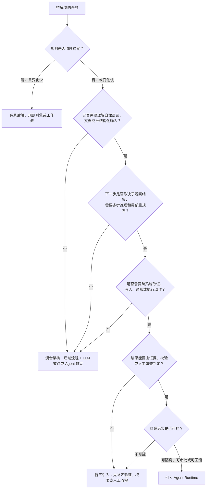

选型还受延迟、价值与可验收性约束：规则稳定、输入和结果可精确判定时优先普通后端；动态跨源取证且结果可验证时才引入 Runtime。多轮推理增加费用和时延，须以目标任务的引用准确率、字段正确率、权限违规率和人工采纳率评估，不能套用跨场景“Agent 准确率”。

混合分工是：后端管工单、审批与任务状态，模型理解意图、规划和整合证据，Policy 决定动作是否允许，Verifier 检查完成，人工承担关键批准责任。

### 14.1.3 运行时边界：模型提出，Runtime 裁决

模型输出的行动请求必须经过 Runtime。可将它类比为用户程序经过系统调用访问资源，但这只是责任类比，不代表 SDK 有操作系统级隔离。

| 组件 | 独立责任 |
| --- | --- |
| Runtime | 身份、任务生命周期、持久状态、预算、恢复与审计 |
| Agent Loop | 根据观察提出下一步、澄清、修复或结束 |
| Execution Engine | 调度、超时、取消、重试与结果回写 |
| Tool Runtime | 能力映射、参数校验、协议适配与结构化观察 |
| Execution Backend | 在 Shell、沙箱、API、MCP Server 或 Runner 中执行 |

链路是 Loop → Policy → Execution Engine → Tool Runtime → Backend → Observation。Prompt 不能强制权限；授权、沙箱和后端接口共同落实边界。这是本书教学抽象。OpenAI Agents SDK 提供循环、工具、交接、审批与观测入口，部署、存储和业务动作保证仍由应用负责。[[4]](#ref-4)

### 14.1.4 总体架构与 Harness 责任对照

下图是本章的总体架构图。除入口与交付界面外，控制面与执行面的唯一定义见 [14.3.4](#control-execution-plane)；集成与治理是横切职责，不另设状态权威。

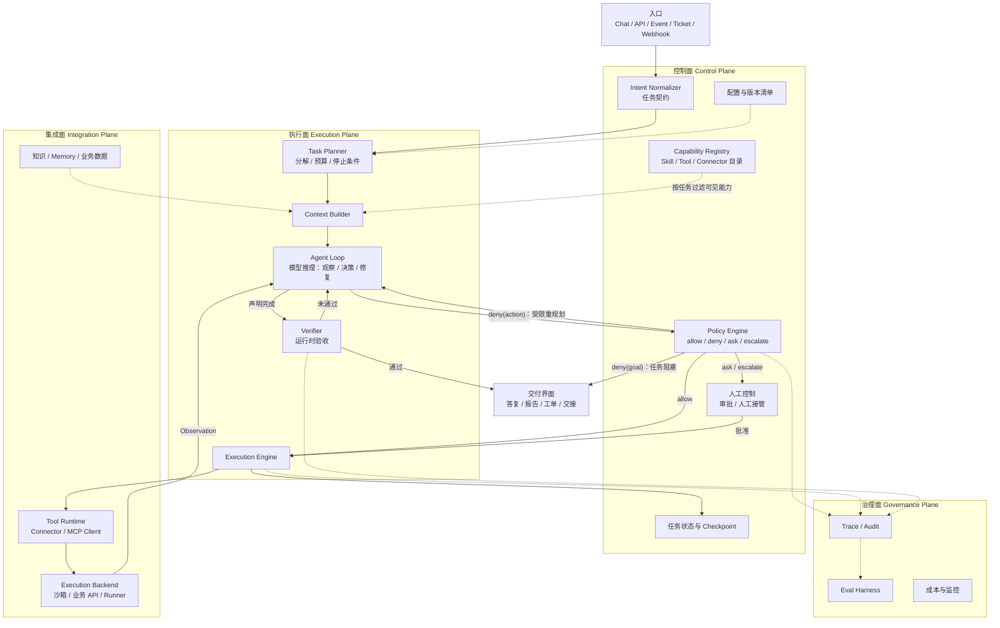

图中最重要的是中间那条回路：Agent Loop 产生的**每一个**动作请求都要单独经过 Policy 裁决；仅在进入循环前统一检查一次是不够的。裁决结果为 `allow` 时交给 Execution Engine；为 `ask` 或 `escalate` 时进入审批或人工接管，批准后才执行；为 `deny(action)` 时禁止该动作并允许在原权限内重规划；为 `deny(goal)` 时目标本身不被允许，提交阻塞终态。替代路线不得绕过被拒目标。`sandbox` 与 `audit` 是附加在 `allow` 上的执行约束，本身不构成独立的裁决结果。执行结果作为观察回到循环，直到 Verifier 确认任务满足契约。

Runtime 管任务生命周期，Harness 指围绕模型的上下文、工具、约束、验收与反馈组合，编排规定依赖和分支。它们是责任视角，可以在一个进程部署。下表仅作 Harness 对照，不另建一套架构：

| Harness 责任 | 组件与边界 |
| --- | --- |
| Context | Context Builder 构造受控输入，数据源提供证据 |
| Tool | Registry 描述能力；Tool Runtime 适配；Backend 执行 |
| Workflow | 控制面保存状态、调度与恢复；Loop 提出下一步 |
| Guardrail | Policy 与人工控制裁决每个动作 |
| Eval | Verifier 验收当前结果，Eval Harness 评估版本 |
| Observability | Trace、Audit、成本与监控提供诊断证据 |

集成接口与沙箱见[第15章](04-skills-tools-mcp-connectors.md)，治理机制见[第16章](05-agent-governance-optimization.md)。

<a id="execution-loop"></a>

## 14.2 执行循环与控制边界

上一节给出了 Runtime 的整体分层，本节从一次请求进入系统开始，沿接入、装配、决策、执行、验收五个环节展开控制链路。贯穿其中的原则是区分五类信息：意图由任务契约固定，证据由上下文包承载，候选动作由模型提出，策略决定由 Policy 作出，结果以 Runtime 记录的事实为准。

本节前半部分讲 Runtime 如何初始化、接入请求、建立任务契约、按风险选择执行策略并组装上下文；后半部分讲能力接入、Policy 裁决、Agent Loop、运行时验证与 Trace。持久提交与恢复的细节见随后的 14.3–14.5 节。

### 14.2.1 Runtime 初始化：模型、工具、技能、策略与数据源

Agent 的链路并非从用户请求开始。请求到达之前，Runtime 已经完成一次系统初始化：加载配置、注册模型、注册工具与技能、编译策略、连接数据源、初始化可观测性。没有这一步，模型不知道有哪些工具可用，Runtime 也不知道哪些动作允许执行。

初始化阶段产生以下几张注册表，分别覆盖模型、能力、治理、知识与质量五个方面：

| 注册对象 | 回答的问题 | 典型内容 |
|:---|:---|:---|
| Model Registry | 可用哪些模型 | 名称、能力、上下文长度、成本预算、降级顺序 |
| Tool Registry | 有哪些可执行能力 | 工具名、描述、输入与输出 Schema、风险等级、责任人 |
| Skill Registry | 有哪些可复用方法 | 触发条件、步骤、约束、所需工具、验证要求 |
| Source Catalog | 从哪里获取上下文 | 文档库、业务数据库、日志、指标、工单、规则、Memory |
| Policy Store | 哪些动作允许执行 | RBAC、ABAC、环境限制、审批策略、沙箱规则 |
| Verifier Registry | 如何判断完成 | 引用、格式、状态与领域规则校验 |
| Observability Config | 如何记录过程 | Trace Schema、采样率、敏感字段脱敏、指标上报 |

初始化固定配置与版本，检查模型、MCP Server、索引、工具 Schema、Policy 和记录通道。风险工具默认关闭或审批，模型只接收按本次任务筛选的能力，不接收完整目录。

### 14.2.2 用户请求的完整链路：从入口到最终响应

初始化完成后，用户请求才真正进入 Runtime。一次请求的完整链路可以拆成 20 个阶段（S01–S20），其中 S10–S18 可能多次循环：

```mermaid
flowchart TD
    Request["S01 User Request<br/>用户请求"]
    Intake["S02 Request Intake<br/>会话 / 身份 / 环境"]
    Intent["S03 Intent Parsing<br/>意图识别"]
    Contract["S04 Task Contract<br/>任务契约"]
    Mode["S05 Mode Selection<br/>只读、试运行、审批、执行"]
    Plan["S06 Initial Plan<br/>初始计划"]
    Expose["S07 Capability Exposure<br/>选择可见技能和工具"]
    Discover["S08 Context Discovery<br/>检索和查询"]
    Select["S09 Context Selection<br/>筛选 / 去重 / 压缩"]
    Package["S10 Context Packaging<br/>上下文包"]
    Prompt["S11 Model Request<br/>系统指令 / 任务 / 上下文 / 工具 Schema"]
    Reason["S12 LLM Reasoning<br/>模型推理"]
    Proposal["S13 Action Proposal<br/>回答或工具调用"]
    Validate["S14 Runtime Validation<br/>Schema / 权限 / 风险"]
    Execute["S15 Tool Execution<br/>工具执行"]
    Observe["S16 Observation<br/>结构化观察"]
    State["S17 State Update<br/>状态更新"]
    Replan["S18 Re-plan / Continue<br/>重规划或继续"]
    Verify["S19 Verify<br/>验证完成度"]
    Final["S20 Final Response<br/>最终响应 / 交接"]
    ActionType{"动作类型判断"}
    ContinueDecision{"是否继续"}
    VerifyResult{"验证结果"}

    Request --> Intake --> Intent --> Contract --> Mode --> Plan --> Expose
    Expose --> Discover --> Select --> Package --> Prompt --> Reason --> Proposal
    Proposal --> Validate
    Validate --> ActionType
    ActionType --> Execute
    ActionType --> Verify
    Execute --> Observe --> State --> Replan
    Replan --> ContinueDecision
    ContinueDecision --> Package
    ContinueDecision --> Verify
    Verify --> VerifyResult
    VerifyResult --> State
    VerifyResult --> Final
```

接入（S01–S05）建立契约与控制模式，装配（S06–S10）形成计划、可见能力与上下文，决策（S11–S14）校验候选，执行（S15–S18）提交观察和状态，验收（S19–S20）交付经过验证的产物。

S11 发送系统指令、任务契约、选中 Skill、版本化上下文包、本轮工具 Schema 与剩余预算。完整注册表归 Runtime，模型只能从本轮可见集合提出请求；执行前仍要独立授权。

完整链路还应记录为 Trace。Trace 事件并不与 20 个阶段一一对应，而是在关键阶段的边界上产生。下面按五个环节列出本章统一使用的事件名，括号中为对应阶段；14.2 后半的 Policy、验证与 Trace 部分沿用同一组事件名和字段，不再另列清单：

```text
接入  request.received(S01–S02) → intent.normalized(S03) → task_contract.created(S04) → mode.selected(S05)
装配  plan.created(S06) → capability.exposed(S07) → context.retrieved(S08) → memory.recalled(S08)
      → context.packaged(S09–S10)
决策  model.selected(S11) → model.called(S11–S12) → action.proposed(S13) → policy.checked(S14)
      → human.approval.requested(S14，仅在裁决为 ask 时)
执行  tool.executed(S15) → observation.recorded(S16) → state.updated(S17) → checkpoint.created(S17)
验收  verification.completed(S19) → response.sent(S20) → feedback.received(交付后)
```

每个事件都应携带请求信封中的 `request_id`、`correlation_id`，以及任务契约中的 `task_id` 和时间戳，以便把同一次任务的全部事件串起来。交付之后的反馈如何进入评估与改进，见[第16章](05-agent-governance-optimization.md)。

有了这组事件，Agent 任务才能被回放、调试、评估和审计；否则，当用户追问“为什么得出这个结论”时，系统只能回答“模型是这么说的”。

### 14.2.3 入口路由（Event & Intake Router）：统一各类入口事件

生产入口还包括告警、Webhook、工单、定时任务、IDE、企业 IM 和委派事件。

入口路由负责把这些入口统一为请求信封，而不是让模型直接读取原始事件：

```json
{
  "request_id": "req_20260512_001",
  "channel": "alert_webhook",
  "tenant_id": "tenant_demo",
  "actor": {"type": "system", "id": "prometheus"},
  "user_context": {"viewer": "u_123", "roles": ["sre_oncall"]},
  "payload_type": "incident_alert",
  "payload": {
    "service": "payment",
    "severity": "critical",
    "time_window": "2026-05-12T10:00:00+08:00/2026-05-12T10:15:00+08:00"
  },
  "correlation_id": "trace_or_incident_id",
  "request_key": "alert-payment-20260512-1000",
  "environment": "production"
}
```

入口路由归一事件、绑定可信身份与环境、以 `request_key` 去重并保留因果关联，再分流到问答、诊断或人工。它负责来源与授权信封；任务理解交给 Intent Normalizer，执行顺序交给 Planner。

### 14.2.4 意图归一（Intent Normalizer）：从用户输入到任务契约

“这个客户投诉为什么这么久没解决”可能是查询、诊断、催办或升级。Runtime 收集可信入口元数据，模型解析语义，工具补齐工单、状态与时间等确定性事实，Policy 裁决读取、通知和关闭权限，再生成任务契约。实体不明先澄清；工具观察仍需检查来源、时效和目标一致性，不能把模型猜测当作客户身份。

最后，Runtime 把入口元数据、模型解析结果、工具事实和 Policy 裁决合并为任务契约：

```json
{
  "task_id": "task_20260512_001",
  "intent": "diagnose_ticket_delay",
  "task_type": "diagnosis",
  "user_goal": "解释客户投诉工单长时间未解决的原因，并给出下一步建议",
  "domain": "customer_support",
  "actor": {"user_id": "u_123", "role": "support_lead"},
  "entities": {"ticket_id": "TCK-1024", "customer_id": "C-8801", "ticket_status": "pending_engineering"},
  "risk_level": "medium",
  "allowed_actions": ["read_ticket", "summarize", "recommend"],
  "blocked_actions": ["read_customer_private_note"],
  "requires_approval": ["notify_customer", "close_ticket"],
  "success_criteria": ["解释工单当前状态", "找出延迟原因", "列出证据来源",
                       "给出下一步建议", "标注需要人工确认的动作"]
}
```

关键实体缺失时返回 `ask_clarification` 和缺失字段。Runtime 校验后的契约统一提供给 Planner、Context Builder、Registry、Policy、Verifier 与交付界面：目标、允许行动与完成标准属于同一份约束。

### 14.2.5 LLM 的工程特性与控制边界

控制边界画在哪里，取决于 LLM 在工程系统中的几项基本特性。下表概括了这些特性带来的后果，以及 Runtime 相应的控制手段：

| 特性 | 工程后果 | Runtime 的应对 |
|:---|:---|:---|
| 概率生成，而非规则执行 | 同一输入可能产生不同表达；输出看似合理却违反系统约束；倾向于补全缺失信息而不主动停下 | 输出 Schema、确定性校验、重试与降级策略、不确定时的停止条件 |
| 没有内在的系统状态 | 只看到当前提示词中的内容，可能重复执行已完成的步骤、再次尝试已失败的方案、稀释早期约束、把临时假设当作事实 | 状态保存在系统中，而非依赖对话历史 |
| 对上下文高度敏感 | 错误文档、过期记忆、恶意指令、工具失败消息都可能改变模型行为 | 上下文过滤、来源标注、权限检查、过期降权、提示词注入（prompt injection）检测、上下文防火墙 |
| 擅长判断，但无法承担责任 | 适合意图识别、摘要、候选方案生成、风险解释、证据归纳、模糊信息整合 | 权限判断、生产变更、金额计算、最终审计、高风险审批和事实真实性保证不交给模型单独负责 |

关于状态，三类来源的可信顺序应当明确：

```text
Task Store / 工作流状态  >  对话历史  >  模型推测
```

由此得到 Harness 的设计原则：**让模型参与判断，由系统承担责任**。

同样，Agent 出错时不能笼统归因于“模型幻觉”或“模型不稳定”，而应定位到具体的系统层：提示词边界不清、上下文缺失、检索命中错误、工具 Schema 含糊、工作流缺少停止条件、Guardrail 未能拦截，还是评估用例未覆盖。只有归因到系统层，失败才能转化为下一轮改进。失败分类与复盘流程见[第16章](05-agent-governance-optimization.md)。

### 14.2.6 基于任务风险的执行策略

设计 Harness 不应从选框架开始，而应从任务的风险和不确定性入手。下面以生产告警诊断 Agent 为例，分四步说明。

#### 拆分确定性与不确定性

| 环节 | 是否适合 LLM | 原因 |
|:---|:---|:---|
| 解析用户自然语言 | 适合 | 意图可能模糊 |
| 查询指标 | 不适合由 LLM 执行细节 | 应由工具按 Schema 执行 |
| 总结日志现象 | 适合 | 需要信息压缩 |
| 判断可能原因 | 适合，但要受证据约束 | 需要综合多源信息 |
| 风险分级 | 适合辅助判断 | 分级规则应由系统定义 |
| 重启生产服务 | 不适合自动执行 | 风险高，需要人工确认 |
| 记录审计日志 | 不适合交给 LLM | 必须确定性执行 |

这张表直接决定了 Harness 的边界。

#### 风险等级与执行策略

不同风险的动作需要不同的执行策略：

| 风险等级 | 示例 | 执行策略 |
|:---|:---|:---|
| 只读 | 查指标、查日志、查文档 | 在已有授权与数据范围内执行，记录脱敏后的关联信息 |
| 写入或外发 | 创建工单、发送通知 | 按授权和风险审批，记录审计并保证幂等；外发的消息不保证可撤回 |
| 高风险变更 | 重启服务、回滚发布 | 先生成计划，经人工确认后执行 |
| 禁止动作 | 删除生产数据、绕过权限 | 不暴露相应工具，直接拒绝 |

动作能否执行不应由模型临时判断。风险等级应当是工具和工作流的属性，由 Policy 在运行时裁决。

<a id="control-modes"></a>

#### 控制模式与编排模式

上表按风险把动作分成四种控制模式：自动执行（只读）、按策略审批后执行（写入或外发）、人工确认后执行（高风险变更）和禁止执行。控制模式回答“这一步能否执行、由谁批准”；编排模式回答“步骤之间如何组织”，例如告警诊断通常组合为：

```text
Router → State Machine → DAG（并行收集证据）→ LLM 诊断步骤 → 风险门禁 → 必要时人工审批
```

Router、Chain、State Machine、DAG、Plan-and-Execute 等编排模式的适用条件见 [14.6 模式选择](#pattern-selection)。

#### 先定义失败，再定义成功

设计 Harness 时，除了成功路径，还要事先回答以下几类问题：

- 外部失败：工具超时、检索不到文档、文档相互冲突时怎么办？
- 模型失败：输出不合法或置信度低时怎么办？
- 权限失败：用户要求越权、高风险动作被拒绝后怎么办？
- 停止条件：连续失败几次后停止？

这些问题的答案，决定了系统能否从演示原型进入生产。

<a id="context-builder"></a>

### 14.2.7 上下文构建（Context Builder）：受控工作区

Context Builder 按任务、当前 Step、权限和预算组装模型可见输入；原始消息、知识与记忆的选择和压缩方法见[第13章](02-context-engineering.md)。Runtime 保留以下契约：

| 内容 | 必须保留的约束 |
| --- | --- |
| 用户目标与系统规则 | 优先保留，不因压缩静默删除安全边界 |
| 当前任务状态 | 从权威状态读取，区分已确认事实、候选与未决动作 |
| 证据与工具观察 | 来源、时间、版本、可信级别和当前可见性 |
| Memory | 按作用域读取，过期或冲突内容不得覆盖任务事实 |
| 能力 Schema | 仅暴露本轮允许请求的能力，暴露不等于授权执行 |
| 上下文包 | 保存 `package_id/version/hash`、输入引用、裁剪与过滤记录 |

上下文包作为不可变、版本化引用随 Checkpoint 保存；恢复先检查载荷完整性与当前权限，再复用记录。哈希用于核对输入，不能证明证据正确。大载荷留在受控存储，模型只接收本步所需片段。文档、检索结果和工具文本均作为不可信数据隔离，不能借内容中的指令扩张权限。缺少关键证据时补检索、澄清或停止，不能靠摘要把缺口变成事实。

<a id="memory-interface"></a>

### 14.2.8 记忆接口（Memory Layer）：读取与受控写入

Memory 保存经治理的跨任务信息，不能替代 Run 状态或 Operation 账本。读取按租户、用户、项目和用途过滤，记录来源、版本与期限；写入先形成候选，再按敏感度、冲突和证据审核，不能把一次工具失败或模型猜测直接沉淀为规则。任务可以引用某版记忆以便恢复，但当前撤权、纠正和删除优先于历史可见性；共享子 Agent 只获得委托范围内的投影。存储、遗忘和冲突策略见[第13章 Memory](02-context-engineering.md#memory)。

<a id="capability-discovery-loading"></a>

### 14.2.9 能力注册、发现与加载

Runtime 先建立目录，再按任务筛选模型可见能力，最后在派发前裁决。**已安装、已发现、已可见、已加载、已获准执行**是五个不同事实：模型能看到描述，不表示代码已加载，更不表示已授权。模型返回的名字必须映射回可信注册对象，校验 Schema、版本与资源范围，不能执行文本指定的任意路径或端点。

Run 保存能力目录快照和制品摘要。Skill 可固定不可变包；远程 MCP Server 未必支持固定实现，Runtime 只能记录观察到的契约，不兼容变化时暂停相关动作。停用先阻断新调用，再处理在途请求与子进程；安全撤权优先于版本固定。MCP 生命周期、Skill 加载与 OAuth 细节统一见[第15章](04-skills-tools-mcp-connectors.md)。

<a id="connector-runtime"></a>

### 14.2.10 Connector 运行时与 Run Binding

Connector 定义描述实现、端点和契约；Connection 保存用户或组织的授权关系；Run Binding 把连接收窄到本次 Run 的动作、资源和策略版本。定义可以复用，连接有明确责任人，子 Agent 只获得收窄的委托绑定。`tenant_id/user_id/connection_id` 与凭据来自可信上下文；模型参数中的项目或 URL 必须与绑定求交集，不能切换租户或借用其他连接。

派发前连接服务检查当前所有权与授权；凭据只留服务端。授权失效时持久等待，不能自动换成宽权限连接。远端写入回执丢失时记录 `outcome_unknown`，恢复按原 Operation 与业务键查询；无查询或幂等能力时转人工。连接撤销不证明已发写请求被取消。授权、刷新和 MCP 下游凭据边界见[第15章 Connector 开发](04-skills-tools-mcp-connectors.md#connector-development)。

### 14.2.11 工具错误与 Runtime 的下一步

工具的定义、粒度和返回格式由[第15章](04-skills-tools-mcp-connectors.md)的 15.2 主讲。对 Runtime 而言，关键在于工具返回的错误必须带有可机读的分类，因为分类直接决定执行层的下一步：暂时性故障（超时、限流）在预算内**重试**；参数错误或证据不足交回模型**重规划**；权限不足或缺少连接需要**求助**用户或进入审批；业务拒绝、风险越界或结果未知则**停止**自动推进，分别进入阻塞、等待或核对状态。只返回 `{"status": "failed"}` 的工具，会迫使模型猜测结果。哪些错误可以重试、由谁准入重试，见本章[重试分类](#retry-classification)。MCP 接入同样不能替代这些服务端控制：外部文档可能携带注入，高风险动作需要最小权限和独立控制。[[5]](#ref-5)

<a id="policy-engine"></a>

### 14.2.12 Policy Engine：独立于模型的执行裁决

在提示词中写“请不要执行危险操作”，只是一种期望，无法强制执行。生产 Agent 需要独立于模型的 Policy Engine，在每次派发前对结构化对象做出裁决。租户与用户身份均从可信入口绑定。它的输入不是一句自然语言，而是用户与角色、任务契约、工具调用及其参数、副作用标记、环境和任务状态：

```json
{
  "tenant_id": "tenant_demo",
  "user": {"id": "u_123", "role": "support_lead"},
  "task": {"intent": "notify_customer", "risk_level": "medium"},
  "tool_call": {
    "name": "send_customer_email",
    "args": {"customer_id": "C-8801", "template": "delay_explanation"},
    "side_effect": true
  },
  "context": {"environment": "production", "evidence_count": 2}
}
```

输出同样是结构化决策：

```json
{
  "decision": "ask",
  "reason": "向客户发送通知属于有副作用动作，需要人工确认",
  "required_approver_role": "support_lead",
  "constraints": ["audit"],
  "audit_tags": ["customer_communication", "side_effect"]
}
```

本章统一使用四种决策，另有两种执行方式作为 `allow` 的附加约束：

| 决策 | 含义 | 示例 |
|:---|:---|:---|
| `allow` | 允许执行 | 读取公开文档、查询自己有权限的工单 |
| `deny` | 拒绝动作，或以 `scope=goal` 拒绝目标并终止任务 | 读取无权限的客户数据、绕过审批关闭工单 |
| `ask` | 由当前用户或指定审批人确认这一具体动作后执行 | 发送外部通知、变更责任人、执行恢复动作 |
| `escalate` | 当前主体无权判断，或风险、证据、预算超出自动处理范围，转交更高权限角色或人工接管 | 生产环境的高风险变更、证据不足却需要对外答复 |
| 附加约束 `sandbox` | 只允许在沙箱（Sandbox）或 dry-run 模式下执行 | 模拟一条规则变更的影响 |
| 附加约束 `audit` | 允许执行，但加强审计记录 | 读取敏感但已授权的数据 |

Policy Engine 不只看工具名，还要看上下文。“发送通知”在内部测试环境可能是低风险，在生产客户环境则是中高风险；“读取文档”对公开制度是低风险，对客户隐私文档则是高风险。裁决还必须基于**当前**状态：审批之后若草案、目标或连接发生变化，原批准即告失效，需要重新裁决。

`ask` 与 `escalate` 之后，任务如何持久等待、谁可以审批、人工如何接管和降级，统一见 [14.5 审批与人工接管](#human-control)。

### 14.2.13 Agent Loop 与提交边界

ReAct 等编排模式的概念见 [14.6 工作流与任务图](#workflow)。这里从 Runtime 的角度看同一个循环：模型在每一轮只提出候选动作或候选答案，Runtime 负责读取权威状态、校验、裁决、执行、验收和提交。

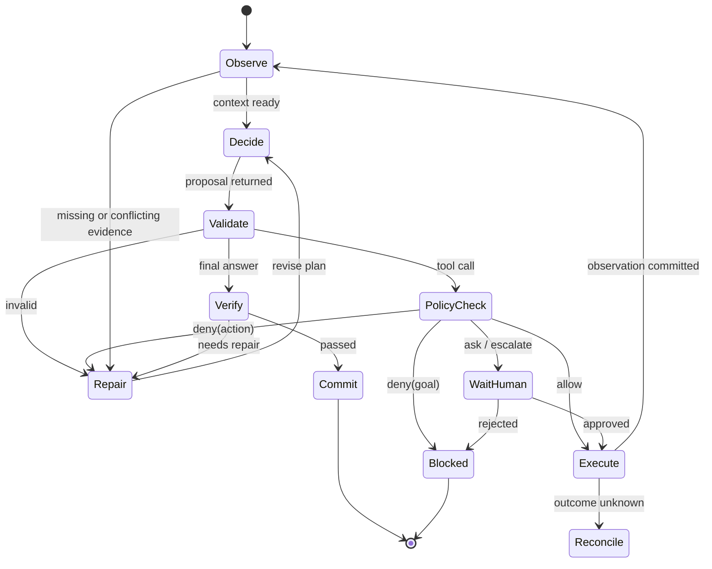

Loop 的最大步数、时间、Token、工具额度和取消状态来自持久 Run；稳定边界保存 Checkpoint，分类错误分别进入修复、等待或停止。

下面的伪代码表达了这些约束：

```text
while runtime.can_advance(run_id):             // 检查取消、预算、截止时间与执行权
    state = runtime.read_authoritative_state(run_id)
    context = build_context(task, state)
    proposal = parse_and_validate(llm(context, allowed_capabilities))

    if proposal.type == "final_answer":
        verdict = verifier.check(proposal.answer, task, evidence)
        if not verdict.passed:
            runtime.commit_feedback(verdict.errors)   // 受总预算限制
            continue
        artifact = persist_and_verify_artifact(proposal.answer)
        runtime.commit_completion(artifact, state.version, owner_epoch)
        return review_surface.render_committed_result(run_id)

    decision = policy.check_current(proposal, task, user, state)
    if decision == "deny":
        if decision.scope == "goal":
            return runtime.commit_blocked(decision.reason)
        runtime.commit_rejected_action_and_feedback(proposal, decision)
        continue                              // 原权限内有界重规划，禁止绕过拒绝
    if decision in ("ask", "escalate"):
        return runtime.commit_approval_wait(proposal, decision)   // 释放 Worker

    operation = runtime.record_or_load_intent(proposal, state.version, decision.constraints)
    observation = tool_runtime.execute_or_reconcile(operation)
    if observation.is_unknown:
        return runtime.commit_reconciliation_wait(operation)
    runtime.verify_and_commit_step(observation, operation, owner_epoch)
```

模型可以提出行动，但不能绕过解析、校验、策略裁决和验证。Runtime 在已验收的步骤、已提交的意图、已确认的外部结果和持久等待等稳定边界提交 Checkpoint，因此任务进入审批、等待外部系统、工具超时或人工接管时，都能从最近的稳定状态恢复。换言之，Loop 由 Runtime 按状态推进，模型只在必要的位置提供推理和选择。伪代码中的 `owner_epoch` 即执行权代次，见 [14.3 持久状态与对象模型](#durable-state)。

**活性、进展与循环。** 心跳证明进程活着，已提交 Step、产物与 `progress_seq` 才证明推进。行动账本记录 Step 指纹、规范化参数、输入/输出哈希和事实增量；重复观察且没有新证据的路径列为“无进展候选”。不能只按工具名阻断：同一检索工具用不同参数可能在补证，换工具也可能仍在空转。结合事实缺口、参数与结果判断，并限制重规划次数、总成本与截止时间；无法增加证据时降级或转人工。

<a id="runtime-checkpoints"></a>

**护栏挂载位置**

提示词可以提醒模型，但不能充当安全边界。输入、上下文、工具和输出四层 Guardrails 的检查内容与示例由[第16章 Guardrails](05-agent-governance-optimization.md#guardrails-overview) 主讲；本章只说明这些检查挂在 Runtime 的哪一步、是否阻塞主流程，以及失败后任务进入什么状态。

| 检查 | 在 Runtime 的哪一步执行 | 阻塞还是并行 | 失败后进入的状态 |
| --- | --- | --- | --- |
| 输入检查：身份、租户、越权请求、明显注入 | 入口归一化之后、创建任务契约之前 | 阻塞 | 直接拒绝，或 `escalate` 转人工；请求不进入模型推理 |
| 上下文检查：权限过滤、脱敏、不可信内容隔离 | 每次组装模型请求时 | 阻塞，属于组包的一部分 | 剔除或标注相关内容；缺少必要证据时回到 Repair 补检索，或请求澄清 |
| 提议校验：Schema、参数、可见能力映射 | 模型返回之后、策略裁决之前 | 阻塞 | 作为格式错误反馈给模型，在总预算内重新生成 |
| 工具裁决：Policy 与派发前检查 | 派发之前；有副作用的动作在写入意图之前 | 必须阻塞，不能用“并行检测稍后拦截”代替 | `deny(action)` 受限重规划、`deny(goal)` 阻塞终态；`ask`、`escalate` 进入持久等待；带 `sandbox` 约束的只在沙箱执行 |
| 工具结果检查：裁剪、可见性、注入隔离 | Observation 回填模型之前 | 阻塞 | 裁剪后回填；结果未知时进入核对等待 |
| 输出检查：敏感信息、引用、未授权建议 | Verifier 阶段、提交交付之前 | 对外交付前阻塞；不影响交付的质量抽检可在交付后并行 | 需要修复时回到 Loop；无法修复时拒绝或转人工 |

工具层的裁决始终由 Runtime 在后端执行，不交给模型自觉遵守。并行检查只适合不产生副作用、事后发现问题也能撤回或纠正的场景，其结果进入 Trace 和评估流程，而不是充当执行前的闸门。

<a id="verifier"></a>

**Verifier：运行时验收**

Verifier 对照任务契约输出 `pass/needs_repair/reject`：知识问答核引用与权限，诊断核时间窗口与根因证据，业务处理核真实状态与审批，分析核口径和可复现查询。可修复错误在总预算内反馈 Loop，否则拒绝或人工处理。

Verifier 验收当前产物；Eval Harness 用数据集、失败样本和线上抽样判断版本变化，见[第16章](05-agent-governance-optimization.md#eval-contract)。

<a id="trace-ledger"></a>

**Review Surface、Trace 与账本**

Review Surface 交付结论、证据、不确定性、风险动作、产物版本/diff 与验证结果，并提供反馈入口，不要求展示模型完整思维链。

Trace 用于诊断与评测，Audit 记录触发、批准与行动责任。Langfuse 等关联模型、检索与工具观察，帮助定位故障[[6]](#ref-6)；但采样或导出失败会使 Trace 不完整，动作事实与恢复依据必须来自持久事件和 Operation。敏感载荷只存受控引用，指标见[第16章](05-agent-governance-optimization.md#trace-observability)。

**完成边界。** Verifier 通过后，Runtime 仍需完整保存产物、确认访问范围、按当前 `state_version/owner_epoch` 提交 Step 和交付事实，界面才显示完成。Observation 只是账本的受控视图。长任务重连查询同一 Run；权限拒绝不能换工具或委派绕过，预算不能借子任务重置，未知结果不能按普通失败重做。

<a id="durable-state"></a>

## 14.3 持久状态与对象模型

恢复依据在进程外持久保存：目标、身份、业务事实与执行权不能随 Worker 重启丢失。以下对象关系是调度和恢复的基础。


图中最需要注意的是 Operation 与 Attempt 的关系：一个业务动作可以被多次尝试推进或查询，但它的身份不随尝试变化。Event 记录 Run 上已经被接受的状态变化，Checkpoint 是从这些事实中整理出的恢复索引，Artifact 则承载不适合放进状态表的大载荷。

<a id="object-model"></a>

### 14.3.1 规范对象与身份

Runtime 中的对象按身份范围由大到小排列如下。会话（Session）组织人与 Agent 之间的交互连续性，可以承载多个任务。任务（Task）表达用户期望完成的逻辑目标。运行（Run）是对任务的一次实际执行，它绑定了模型、工具和工作流的版本，以及权限、预算和截止时间（deadline）。步骤（Step）是 Run 内可以单独提交和恢复的逻辑节点，例如一次模型调用、工具调用、检索、审批或子任务。尝试（Attempt）是执行某个 Step 的一次具体尝试。操作（Operation）是一次有外部影响的业务动作，例如创建工单或发送通知。

这些身份必须分开的原因在于，它们在不同的时机变化。一个 Run 可以跨多个 worker、经历多次重连才完成，所以线程、进程、连接与 Run 不能共用一个身份字段。如果把 Task 和 Run 混为一个 id，系统就无法区分“重试”和“重新运行”，计费会出错，不同版本的执行历史也会互相覆盖。

本章使用以下术语：

- **执行权代次（owner_epoch）**：某个 Step 的执行权每成功转移一次就递增的单调整数。持有最新代次的执行者才有权提交该 Step 的结果，旧代次的写入一律拒绝。
- **规范化载荷（canonical payload）**：把请求参数按固定规则整理后的形式，例如字段排序、去除无语义的空白、统一默认值。对它计算的哈希（payload hash）用来判断两次请求的参数是否真正相同。
- **幂等键（idempotency key）**：调用方为同一意图提供的稳定标识，重复提交时据此返回同一结果。本章区分两种范围：接入层的任务幂等键（字段 `request_key`），用于避免重复创建 Task；Operation 传给下游的操作幂等键（字段 `idempotency_key`），用于避免同一业务动作重复生效。

| 标识 | 身份覆盖范围 | 什么时候变化 | 提交约束 |
| --- | --- | --- | --- |
| `session_id` | 一段交互或入口的连续性 | 新会话，或新的交互隔离域 | 不作为执行或去重的身份 |
| `task_id` | 用户的逻辑目标，以及租户、可见结果引用 | 出现新目标或独立的请求意图 | 同一租户下相同 `request_key` 只对应同一个 Task；同一个键携带不同的规范化载荷时，请求被拒绝 |
| `run_id` | 一次版本化执行，绑定工作流修订版、权限、预算、截止时间和状态版本 | 用户明确重新运行、对照实验或发起新执行 | 系统恢复不改变 Run 身份，只递增执行权代次；新的业务执行另建 Run |
| `step_id` | Run 内的一个逻辑节点，包括输入和结果的引用 | 计划新增节点，或切换到另一个节点 | 重复调度同一节点，并不产生第二个逻辑 Step |
| `attempt_id` | 节点的一次尝试及其错误记录 | 重试、迁移或接管后的新尝试 | 新尝试追加记录，不覆盖历史尝试 |
| `owner_epoch` | 节点执行权的代次 | 成功转移执行权时递增 | 状态更新必须携带当前代次 |
| `operation_id` | 一次业务动作，关联操作幂等键、载荷哈希、外部 ID、事实状态以及查询和补偿入口 | 业务意图改变时才变化，普通重投与重试不改变 | 独立于模型重新采样和传输重试，最终去重由拥有业务状态的资源端落实 |
| `event_id` 与 `run_seq` | 一条追加式事件，包括因果关联、来源和状态版本 | 每次被接受的状态变化 | 只追加不修改；同库的状态变更与事件原子提交 |
| Artifact 引用 | 内容哈希、版本、可见范围和保留期 | 内容变化即产生新版本 | 先保证载荷完整，再提交引用它的进度 |

自动恢复保留 Run，只增加 Attempt 与执行权代次；用户要求另一模型独立对照时新建 Run；独立授权的新工单是新业务意图，参数相似也不合并。

除身份外，每个对象还要保存足以恢复和审计的字段。Run 保存入口请求、模型与工具版本、租户、预算、截止时间、权限、状态、父任务和 trace id。Step 保存输入引用、输出引用、尝试次数、开始与结束时间、资源消耗、错误、幂等键和补偿动作。大段文本不直接嵌入状态表，而是存入 Artifact 仓库或消息存储，通过哈希和版本引用，以免状态表无限膨胀。

### 14.3.2 单写者与条件更新

除 Task 与 Run 外，Step、Operation、Artifact、事件与幂等索引均绑定 tenant_id；查询和唯一约束包含租户，不能仅靠全局随机 ID 代替隔离。

同一个 Run 可能同时被多方更新：恢复 worker、用户的取消请求、工具回调和定时器都可能在同一时刻写入。如果不加约束，后到的旧写入会覆盖新状态。本章采用“单写者”原则来约束这种并发。**单写者（single writer）**指在任一时刻，某个状态对象只有一个被授权的写入方，其他参与者只能提交事件或请求，由这个写入方决定是否接受。单写者可以由 actor 模型实现，也可以由数据库条件更新实现；无论哪种方式，都需要持久化当前执行权，并处理执行者失效的情况。

本章以数据库条件更新作为参考实现。一次状态迁移在同一个事务中完成以下检查：当前状态是否符合迁移前提，状态版本（`state_version`）是否与调用方读取时一致，执行权代次是否仍是最新。检查全部通过后，事务更新状态并追加事件；任何一项不符，写入都会失败。这种做法也称为比较并设置（compare-and-set，CAS）。每次更新都返回新的版本号，冲突时调用方重新读取，再决定合并还是失败。事件表按 `run_seq` 建立唯一约束，因果顺序由服务端分配的序号决定，客户端的墙钟时间不参与判断。

条件更新之外，还要检查业务前提。获得授权并不代表前提会一直有效：人工批准之后，目标资源可能已被修改，任务可能已被取消，租户权限也可能已被收回。因此，在真正执行之前仍要重新校验资源版本和当前授权，不能把一次旧的批准当作无限期的通行证。

分布式锁无法单独解决这些问题。锁会超时，worker 会崩溃，外部副作用也可能在锁释放后才完成。只有把状态机、租约、幂等键和外部查询接口组合起来，系统才能安全恢复。此外，事件处理器本身必须幂等，由事件派生的投影（projection）必须可以重建。多个 Agent 共享任务状态时，要明确哪些字段只能由协调者写入，哪些内容是只追加的消息。

### 14.3.3 事件与状态机

Runtime 的事实由追加式事件组成，例如 `RUN_CREATED`、`STEP_STARTED`、`MODEL_COMPLETED`、`TOOL_REQUESTED`、`TOOL_SUCCEEDED`、`APPROVAL_REQUIRED`、`RETRY_SCHEDULED`、`RUN_PAUSED` 和 `RUN_COMPLETED`。当前状态可以由事件派生，也可以保存为带版本的状态快照。重复事件、乱序事件和迟到 worker 的回报，都要通过序号、Attempt 和状态版本加以校验。

状态机定义哪些迁移是合法的。例如，RUNNING 可以进入 WAITING_TOOL、WAITING_APPROVAL、PAUSED、FAILED 或 COMPLETED；COMPLETED 不能被迟到的失败事件覆盖；进入 CANCELLED 之后，新的工具动作必须被拒绝。Temporal 依靠有序的事件历史（event history）恢复执行 [[7]](#ref-7)。AWS Step Functions 区分了 Standard 工作流对状态执行的 exactly-once 模型（不覆盖外部工具副作用）、异步 Express 工作流的至少一次语义和同步 Express 工作流的至多一次语义；因此，不能把某个产品层面的 exactly-once 术语当作对所有外部工具副作用的保证 [[8]](#ref-8)。平台不一定采用这些产品，但必须具备同样明确的状态语义。

运行终态与业务事实要分开保存。CANCELLED 表示不再继续这次执行，而外部工具晚到的成功仍然是真实发生的事实。系统可以追加核验事件或补偿事件来解释它，但不能为了让界面看起来整齐而删除它。反过来，远端成功也不能让已取消的 Run 自动回到 RUNNING 并继续后续动作。终态保护的是执行承诺，账本保留的是业务世界中已经发生的变化。

需要强调的是，普通 Trace 可能被采样、脱敏或截断，因此不能替代权威的事件账本；投影可以随时重建，权威事实只能来自持久事件。

<a id="control-execution-plane"></a>

### 14.3.4 控制面与执行面

控制面负责创建 Run、选择模型和工具、持久化状态、发放租约、调度 Step、处理审批，以及重试和恢复。执行面负责具体的模型请求、工具调用、沙箱（Sandbox）、检索和流式输出。执行 worker 可以无状态地重启，控制面依靠持久状态，让新的 worker 从租约和 Step 的尝试记录处继续。worker 不应私自修改 Run 的全局状态，只能提交带版本的事件，由控制面按上一小节的条件更新决定是否接受。

这条边界同时也是安全边界。控制面校验用户权限、工具白名单、预算和模型能力；执行面使用短期凭证访问具体资源。即使模型生成了一个看起来合理的工具调用，它也必须先通过控制面的 schema、租户、目标资源和审批检查，worker 不能绕过控制面直接执行。

控制面不可用时，执行者只能使用未过期且已验证的配置快照；缺少当前 owner、审批或敏感策略证据时停止写动作，不能靠缓存推定授权。已在途的请求继续按原 Operation 核验。

### 14.3.5 对话历史、记忆、事件与账本的分工

四类存储保存的内容各不相同。对话历史保存“说过什么”，记忆（Memory）保存经过治理的跨任务信息，执行事件保存已经被接受的状态变化，Operation 账本保存外部动作的意图与事实。摘要里可以写着“已经创建工单”，但恢复 worker 必须通过对应的 Operation 和外部对象来确认这一点。模型记忆中的一句“已成功”，没有足够的身份、版本和证据，不能作为再次执行或宣布完成的依据。

状态表也不必承载所有内容。任务目标、当前版本、依赖关系、执行权和未决操作需要可查询，因此放在状态表中；长文本、文件、工具原始载荷和报告进入受控的 Artifact 仓库；事件则保留状态变化的因果。读取 Artifact 时要再次检查当前权限，曾经进入过某个 Run 的内容，并不意味着永远可见。内容哈希可以证明载荷是否发生变化，但它不能代替鉴权，也不能证明业务含义正确。

LangGraph 的 checkpointer 与 store 分别面向单个 thread 的状态和跨 thread 的数据；使用内存实现可以验证接口，却不能证明进程重启后的耐久性 [[9]](#ref-9)。在本章的参考设计中，状态、事件、Artifact 与记忆可以共用底层存储，但各自的提交、删除、权限和保留规则必须分别定义。

Runtime 也不应把全部历史消息直接拼进每一次提示词。消息存储（message store）保存原始消息及其来源、时间、权限、哈希和父消息；上下文构建器（context builder）则根据当前 Step 的预算、任务、工具、记忆和安全策略，选择模型可见的内容，并记录最终提示词的版本和组成摘要，以便回放与审计。超出窗口时，安全约束和用户目标不能被静默删除。上下文的优先级与压缩策略见[上下文组装](#context-builder)。

ReAct 的结构化候选动作和观察必须由状态机接受；不保存或展示完整思维链，也不把自由文本当作迁移。循环判据见[Agent Loop](#execution-loop)，模式定义见[14.6](#workflow)。

<a id="delivery-idempotency"></a>

## 14.4 调度、可靠投递与幂等

任务接收、消息送达、步骤认领与业务生效各有独立回执，稳定身份和可查询事实让重复请求收敛。

### 14.4.1 裸双写的两个故障窗口

创建任务时，系统通常要做两件事：在数据库中写入 Task 和 Run，再向消息队列发送一条“任务已创建”的消息，唤醒调度器。如果这两次写入彼此独立、不加协调，就称为**裸双写**。数据库和消息队列不在同一个事务中，无论先写哪一个，都会留下一个故障窗口。

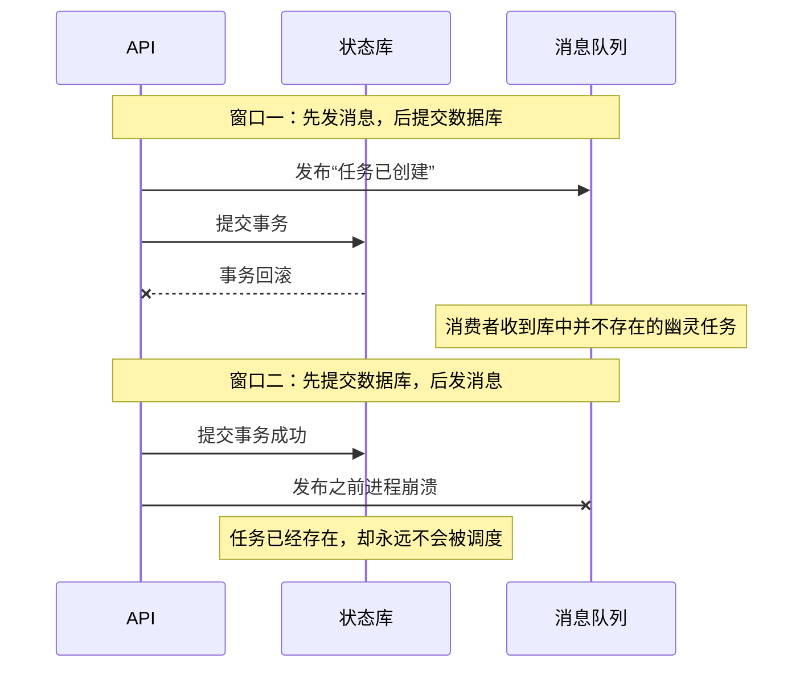

第一个窗口里，消息先发出，而数据库事务随后回滚，消费者会收到一个“幽灵任务”。第二个窗口里，数据库先提交，进程在发布消息之前崩溃，任务虽然存在，却永远不会被执行。调整写入顺序只能在两个窗口之间二选一，无法同时消除它们。

### 14.4.2 Transactional Outbox：状态与待发消息同事务提交

Transactional Outbox 模式的做法是：把待发送的消息写入同一数据库中的 outbox 表，并与更新业务实体放在同一个事务里提交，再由独立的 Relay 进程把 outbox 中的记录发布到消息队列 [[10]](#ref-10)。这样，“任务存在”与“待发消息存在”要么同时成立，要么同时不成立，两个窗口都被关闭了。不过，Relay 本身仍可能重复发送，所以下游依然需要去重。

本章采用的参考契约是：在同一个数据库事务中写入 Task、Run、初始 Step、`RUN_CREATED` 事件和 outbox 记录，事务提交成功后，才向客户端返回 `task_id`、`run_id` 和查询入口。需要注意，PostgreSQL 事务的原子可见性只覆盖该数据库内的操作 [[11]](#ref-11)；消息队列和第三方工具都不在这个事务之内。

接入层还要防止同一请求重复创建任务。系统在“租户加动作”的范围内为任务幂等键 `request_key` 建立唯一约束，并把它与规范化载荷的哈希绑定。重复请求到达时，接入层读取已有的身份并原样返回，不会创建第二个任务；如果同一个键携带了不同的参数，请求会被拒绝。若接入层在提交后丢失了回执，客户端可以用原来的键重试或直接查询。

Task 创建成功并不代表 worker 已经开工，响应中应当区分 accepted（已接收）、queued（已排队）和 running（运行中）。如果大段输入放在对象存储中，系统要先完成载荷写入和哈希校验，再写入受控引用；从未被引用的临时对象通过 TTL 清理。系统不能提交一个此刻还无法读取的 Artifact 地址。

### 14.4.3 Relay、CDC 与消费确认

Relay 有两种实现方式。一种是轮询已提交的 outbox 记录；另一种是变更数据捕获（Change Data Capture，CDC），即直接读取数据库的事务日志，把新提交的 outbox 行转成消息。Debezium 的 Outbox Event Router 示例用事件 id 供下游去重，用 aggregateid 作为消息 key，从而让同一聚合的消息保持分区内顺序 [[12]](#ref-12)。这种顺序并非全局总序，connector 的重启、重放和 offset 管理仍需要运维投入。

采用轮询时，同一 aggregate 的消息需要按序串行认领与发布；跨 aggregate 可并行。仅对 outbox 行使用 `SKIP LOCKED` 分批认领不保证同一聚合的顺序；若选择不保序，消费者必须用 `state_version` 检测缺口、缓冲或重查权威状态，不能按到达顺序覆盖。[[10]](#ref-10)

采用轮询时，可以用 PostgreSQL 的 `FOR UPDATE SKIP LOCKED` 分批认领 outbox 记录。PostgreSQL 官方文档说明，`SKIP LOCKED` 返回的是不一致的视图，适合在队列表上避免锁等待，不适合一般的一致性查询 [[13]](#ref-13)。Relay 也不应持有数据库事务去等待整个缓慢的消息发送过程。本章建议的做法是：用短事务认领一批带期限的记录，在事务外发送，发送后再用条件更新标记为已发送；如果认领到期仍未标记，这批记录可以被重新投递。

无论采用轮询还是 CDC，只要“发送成功”之后、“发送标记或 offset 提交”之前发生崩溃，同一条消息就会被重复发送。因此，不能宣称 outbox 消除了重复，它消除的是丢失。重复要靠接收端处理：每条消息携带固定的 `event_id`，接收端用 inbox 表的唯一约束、逻辑 Step 和当前版本去重，这就是幂等接收者（Idempotent Receiver）模式 [[14]](#ref-14)。

消费确认（ACK）的时机同样重要。消费者应在同一个事务中保存 inbox 记录和可恢复的调度事实，提交之后再向消息队列确认。如果在确认前崩溃，消息会被重投，消费者发现记录已经持久化，就幂等地返回。ACK 不能早于必要状态的持久化；但也没有必要让消息队列的连接一直挂到数小时的执行结束。消费者只需把“待执行的 Step 及其归属”可靠地接走，后续执行由基于持久状态的调度器管理。消费者抢占失败、任务已经终结或消息已经过期时，分别记录处置结果，不能把重复消息当作新的 Run。

Outbox 需要监控以下指标：最早一条未发送记录的等待时间、重试次数、毒消息数量、CDC 延迟，以及 Task、outbox 与队列三者之间的差异。系统还要定期核对“已接收但没有可调度 Step”的任务。无法解析的消息进入隔离队列，并附上 schema 版本、失败原因和载荷的受控引用；修复后沿用原来的 `event_id` 重放，不能换一个 ID 来掩盖重复。队列只是唤醒和传递机制，权威的执行状态保存在持久库中。消息队列短时不可用时，任务仍然可以查询；容量已满时，应当拒绝新的提交。

<a id="submit-to-result-timeline"></a>

### 14.4.4 从提交到最终结果的完整时序

把前面几个小节串起来，一个任务从提交到交付最终结果的过程如下图所示。图中第 6 步以后涉及的执行权认领、Operation 和 Checkpoint，分别在本节后文和 [14.5](#recovery) 中展开。

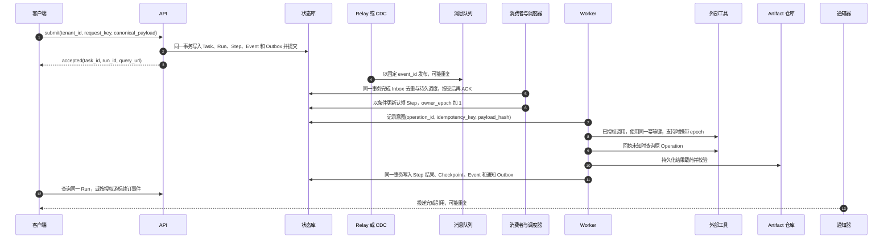

这条时序隐含了几条约束。状态库不可用时，系统先停止新的写动作，不允许 worker 绕过意图记录直接调用工具。对象存储写入失败时，不提交指向半成品的进度。消费者的 ACK 只确认消息已被可恢复地接收，并不代表整个业务已经完成。图中每一个跨系统的箭头都可能丢失回执，因此 14.5 末尾的[故障窗口与人工修复矩阵](#failure-repair-matrix)逐一核查的是事实和恢复权，而不是进程是否还活着。

### 14.4.5 并行、依赖与并发配额

没有依赖关系的检索、文件读取或多个模型候选可以并行执行，依赖同一状态的写操作则必须串行。并行降低了总延迟，却增加了 token、连接和资源的消耗，以及失败组合的数量。Runtime 为每个分支分配子 Step、预算和 trace，只有所有必需分支都满足汇合（join）条件后才继续。可选分支失败时可以降级，但降级本身必须记录。汇合点要声明哪些分支必需、哪些可选，以及等待超时；父子任务共享预算，更换工具或转派他人不能重置全局的调用次数、费用和截止时间。

并发与消耗配额覆盖 request、Run、project、租户、工具、目标资源和全局；单一 QPS 不能公平约束长上下文、大扇出与长期任务，需同时核算 Token、成本、并发和占用时长。一个用户让 Agent 发起大量并发工具调用，可能压垮数据库或第三方 API，而工具自身也可能有限流。调度器用信号量、租约和截止时间控制并发，超过容量时进入队列或明确失败。Ray 的 actor 与任务模型可供分布式调度参考 [[15]](#ref-15)；本书据此划定应用责任：业务状态与副作用契约仍由 Runtime 及下游落实。

优先级与抢占按任务类型设截止时间：交互问答、后台调查、定时批处理分别排序。只能在安全边界抢占，不打断不可逆工具后假装动作未发生；被抢占的长任务保存 Checkpoint，在途 Operation 继续核验。动态预算按实际消耗扣减，恢复与重排不返还已消费额度。

### 14.4.6 Lease、Fencing 与迟到 worker

worker 领取 Step 时获得一份带期限的租约（Lease），执行期间持续心跳续租；worker 失联后，控制面等租约过期再重新调度。数据库认领需要同时满足几个条件：Step 仍处于可运行状态，重试时间已到，旧租约已经过期，配额可用。满足条件后，认领事务原子地递增执行权代次，并写入新的执行者和租约到期时间。租约时间以服务端受控的时钟为准，执行权代次必须是持久保存的单调整数；随机生成的锁值不能充当 fencing token。

租约不能替代幂等。在网络分区下，旧 worker 可能在租约过期后恢复，并提交一份迟到的结果；外部工具也可能在 worker 失联后继续执行。为此需要 fencing。**fencing token** 是每次授予执行权时发放的单调递增编号，本章以 `(tenant_id, run_id, step_id)` 为节点执行权命名空间，`owner_epoch` 只在此范围可比；资源端按该命名空间记录最大代次。跨 Step 争用同一资源时，另发资源级单调 token 或由串行网关裁决，不能比较两个 Step 的本地计数。执行者的每一次写入都携带这个编号，由被写入的资源检查：凡是小于该命名空间已接受最大编号的写入，一律拒绝。Kleppmann 的 fencing 方案正是要求每次写入携带单调 token，并由资源端负责拒绝旧 token [[16]](#ref-16)。

资源端在接受受保护写入或显式推进写屏障时，原子检查并更新最大代次；普通只读查询不推进屏障。下图假设工具支持独立屏障接口；若不支持，不能因 B 查询过就声称 A 的写已被隔离。这一显式屏障是本书参考协议的附加设计。

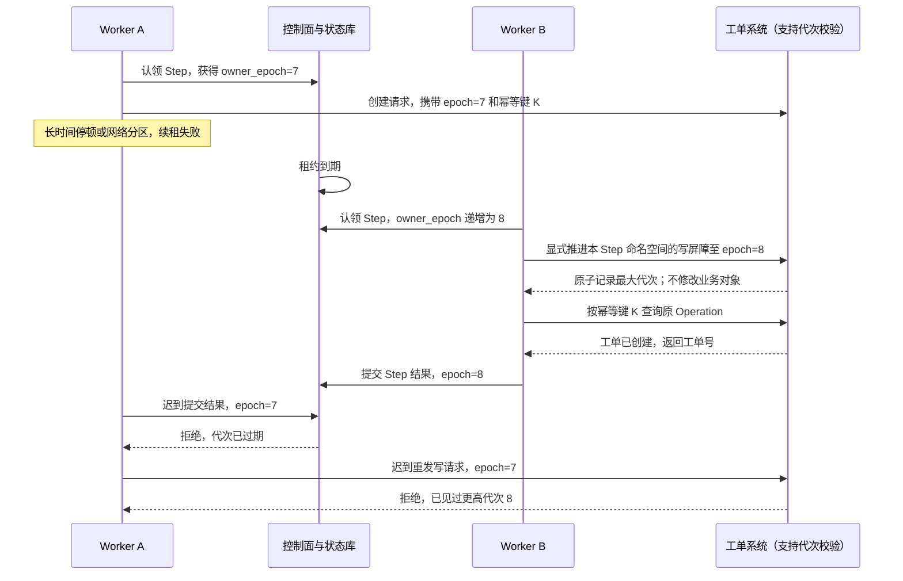

这个例子也说明了 fencing 的局限：只在任务库中拒绝旧执行者，并不能撤销它已经发给第三方的请求。因此，执行网关以及支持该能力的目标资源都应检查代次。如果目标资源不支持，就依靠稳定的操作幂等键、串行的操作通道和事后对账来限制风险；能力仍然不足时，禁止自动重发或转人工处理。恢复 worker 必须先取得新的代次，再核查 Operation，不能读到旧 Checkpoint 中记录的执行者就认为自己拥有执行权。

心跳只能证明执行者还活着，不能证明任务在推进。心跳中应包含进度序号（`progress_seq`）、资源占用、当前 Attempt、Checkpoint 和预计完成时间，但不上传敏感内容。只有进度序号的增长、已提交的产物和 Step 的变化才证明有进展；心跳正常而进度长期不变时，必须诊断依赖阻塞、空转和锁等待。控制面据此识别卡死、慢任务和预算超支，必要时暂停或迁移。迁移策略写在工作流中：尚未驱动已提交后继的模型 Step 可按新 Attempt 重算，否则复用记录结果；有副作用的 Step 先查询，人工 Step 继续等待或转入其他队列。

<a id="retry-classification"></a>

### 14.4.7 重试分类与自动重试准入

是否重试，必须根据错误类型决定。网络超时、限流和暂时不可用通常可以退避后重试；schema 错误、权限拒绝、用户取消、预算超限和确定性的业务错误不应自动重试；模型输出不合格时，可以有限次地重新采样，但每次都要新增 Attempt 并计入成本。Google AIP-194 默认只自动重试 `UNAVAILABLE`；本表把部分超时、限流纳入重试是本书在只读或明确幂等契约下的策略，不能仅凭“网络错误”就重试有副作用的请求 [[17]](#ref-17)。下表给出 Runtime 面对常见观察时的处理方式。

| 当前观察 | 是否自动重试 | Runtime 应做什么 | 需要保留的依据 |
| --- | --- | --- | --- |
| 只读查询遇到暂时限流或超时 | 是 | 在剩余截止时间与预算内指数退避，加随机抖动 | 错误类型、`retry_after`、已消耗额度 |
| 模型输出无法解析 | 有限次 | 有界修复或重新采样，不直接执行输出片段 | 输入版本、校验错误、新的 Attempt |
| schema 错误或确定性业务错误 | 否 | 返回结构化错误，交给重新规划或人工 | 错误码、输入引用 |
| 权限拒绝 | 否 | 停止对应动作，必要时发起受控授权，不换工具绕过 | 策略决定与目标资源 |
| 用户取消或预算超限 | 否 | 停止新动作，进入取消或预算耗尽流程 | 取消事件或预算账本 |
| 写请求发出后连接断开 | 否，先查询 | 把 Operation 标记为结果未知，按原幂等键查询 | Operation、载荷哈希、最后一次观察 |
| 下游确认请求未生效，且契约允许重试 | 是 | 沿用原幂等键继续尝试 | 查询证据、幂等有效窗口、当前批准 |
| 补偿失败 | 单独处理 | 对补偿 Operation 按其自身契约处理 | 主动作事实、补偿幂等键、责任人与截止时间 |

重试预算按 Run、Step、工具、租户和全局分别设置。指数退避加随机抖动可以避免大量客户端同时重试造成的“惊群”。截止时间要传递到每一层，剩余时间不足时直接失败或转人工。重试沿用原来的逻辑 Task，但每次模型或供应商尝试都可能产生实际费用；同一计量事件重复投递时不能重复结算，业务副作用则按 Operation 契约去重。每次 Attempt 都要保存输入哈希、模型版本、错误、等待时长、输出和资源消耗。

重试预算还必须覆盖整个调用树。HTTP 客户端、Agent SDK、工作流引擎和消息消费者如果各自执行最大重试，实际调用次数会成倍放大，远超业务预期。因此需要一个统一的根预算，把重新采样、工具重试、查询对账、委派和孙任务都计入同一账本。最接近具体错误的一层可以决定是否退避，上层仍负责总次数、总费用和最终停止。

### 14.4.8 Operation 独立于 Attempt

幂等的责任必须落实到具体边界。Runtime 为每个逻辑业务调用保存 `operation_id`；消息仍可能重复，所以接收方要以稳定身份幂等接收；工具适配器负责把操作幂等键传给下游；真正拥有业务状态的订单、邮件、文件或支付系统，则必须决定对同一个键的重复提交如何返回同一个事实。如果下游只提供“尽力而为”的 HTTP 接口，Runtime 仅凭本地的去重表无法承诺业务幂等，因为请求提交后网络断开，会留下一个本地无法判定的未知状态。Enterprise Integration Patterns 的 Idempotent Receiver 模式把去重与消息接收边界绑定在一起 [[14]](#ref-14)；在 Agent 系统中，这一边界还要覆盖模型重试、队列的至少一次投递和人工重放。

AWS 关于幂等 API 的文章指出，客户端提供的稳定请求标识可以表达意图；同一个标识携带不同参数时，服务端应当报告不匹配；去重记录和业务变更需要由服务端原子地处理 [[18]](#ref-18)。因此，本章把 `operation_id` 和操作幂等键绑定到稳定的业务动作上，而不是在每次模型采样或传输重试时生成新键。`operation_id` 可以是不透明的标识，但它不能在重试时重新生成。操作幂等键的构造取决于业务：发送同一封通知，可以组合收件人与“租户、业务对象、动作、版本”；修改文件，可以使用文件版本和补丁哈希；创建工单，可以使用外部系统支持的客户端令牌（client token）。

如果模型每次重试都重新生成操作参数，系统必须先比较规范化载荷：意图相同，就查询或去重；意图不同，就是一个新操作，可能还需要新的审批。规范化载荷的哈希只适合发现“同键异参”，不能单凭参数相同推断用户只想做一次。两次独立授权、参数恰好相同的购买，仍然代表两个业务意图。反过来，把“看起来相似”的自然语言当作幂等键会造成错误合并，为同一操作随机生成 UUID 又会造成重复副作用。

Operation 的事实状态决定了下一步可以做什么：

| 操作事实状态 | 可采取的下一步 | 禁止的推断 |
|:---|:---|:---|
| INTENT_RECORDED（已记录意图） | 重新验证审批和版本后发起，或先查询 | 意图存在就当作业务已完成 |
| SUBMITTED 或 UNKNOWN（已提交或结果未知） | 用原幂等键查询、对账并等待 | 把超时当作未执行，换一个键重发 |
| CONFIRMED_SUCCESS（确认成功） | 保存外部对象版本和证据，补记 Step | 用迟到的旧 worker 回执直接覆盖 Run 终态 |
| CONFIRMED_FAILURE（确认失败） | 按错误类型和业务契约修复，或有界重试 | 对所有 4xx 和 5xx 一律同样处理 |
| COMPENSATING（补偿中） | 使用独立的补偿 Operation 和独立的幂等键 | 删除主动作的历史，伪造“从未发生” |
| NEEDS_RECONCILIATION（待对账） | 指定责任人和截止时间，收集查询或人工证据 | 没有查询能力就猜测成功或失败 |

外部查询返回“没查到”时，也要考虑下游的一致性和保留窗口：结果可能尚未可见，键可能已经过期，请求也可能仍在途中。只有下游契约足以确认“不存在”，并且重试是安全的，系统才继续用同一个键尝试；否则保留 UNKNOWN 状态。预算或审批到期时，未决事实不能被删除；系统停止新增动作之后，仍要核对已经发出的请求。

幂等记录也需要生命周期管理。短期通知可能只需在业务 SLA 窗口内保留键，财务、权限和数据删除类操作则需要更长的审计与重放窗口。记录至少保存 `operation_id`、载荷哈希、请求者、状态、外部引用、首次与最后一次观察时间、响应摘要、过期策略和责任人。删除过早，延迟到达的消息会再次造成副作用；永久保留，又会带来隐私和存储问题。保留期应结合下游重复投递的时间上界、合规要求和补偿窗口一起确定，并写进文档，不能依赖代码中的隐式约定。窗口过期后的恢复要先查询或转人工，不能把一个旧的幂等键当作新请求处理。

### 14.4.9 从一次请求逐层追踪去重身份

请求去重、传输去重、步骤认领和业务幂等分别位于不同的边界。接入层的 `request_key` 避免重复创建逻辑任务；`event_id` 或 `message_id` 避免同一条消息被重复接收；Step 状态与版本条件避免同一逻辑节点被重复推进；`operation_id` 和操作幂等键避免同一业务意图在多次执行尝试中重复生效。这些标识可以相互关联，但不应合并成一个没有范围定义的“唯一 ID”。

以创建工单为例。任务创建请求因 HTTP 回执丢失被客户端重发，接入层读取原有的 Task 和 Run 并返回；Relay 重发同一条 outbox 事件，消费者查到 inbox 记录后不再建立调度事实；worker 失联后由新的执行者接管，新的 Attempt 继续查询原 Operation；外部系统按原幂等键返回已经创建的工单。整个过程中有多个网络请求、多次投递和多个 worker，却只有一个已授权的业务动作。

反过来，用户确实要求再创建一张工单时，即使标题和参数完全相同，也应当产生独立的业务意图和新的 Operation。稳定键在哪里生成、作用于什么范围、保留多久、冲突时如何返回，都应当写进可审查的工具契约 [[18]](#ref-18)。

### 14.4.10 队列恢复与死信处理

消息系统恢复之后，不能立即释放全部积压。大量旧任务会同时申请模型、数据库连接和外部接口；如果每次失败又引发新的重试，就可能造成第二次过载。调度器应按租户、任务优先级、工具和目标资源控制并发，先过滤掉已经取消、过期或完成的工作，再在剩余预算内安排重试。队列年龄与未决 Operation 的年龄需要分别监控：前者反映工作没有被接走，后者反映外部业务事实还没有收敛。

死信队列保存不能自动处理的消息，但消息进入死信队列并不等于问题已经修复。每一项被隔离的工作都要能追溯到原任务、schema 版本、错误原因、载荷的受控引用、修复责任人和截止时间。重新投递时沿用原有的消息身份和业务身份；换一个 ID 让消费者“重新处理”，会绕过原有的去重机制。如果参数需要修改，应当形成明确的新提案并重新授权，不能改写旧消息后继续沿用旧的批准。

<a id="recovery"></a>

## 14.5 Checkpoint、恢复与人工介入

恢复继续原执行，先区分可重算、可幂等重试、先查询、可补偿与人工确认，再选择存储与调度机制。

### 14.5.1 持久执行（Durable Execution）与恢复分类

长任务可能运行几分钟、几小时，甚至要等待人工或外部事件。进程内的状态和内存队列在重启后会丢失，所以 Runtime 需要持久化的事件、Checkpoint、定时器、信号和活动（activity）结果。Temporal 的工作流模型把持久状态、activity、重试和定时器组合在一起 [[7]](#ref-7)；用数据库事件表也可以实现类似的语义，但需要自行处理重放、版本和并发。

**确定性重放与记录结果。** 工作流重放必须用记录的模型、工具与外部观察结果重建决策；模型输出不确定，已经驱动下游提交的输出不能重新采样替换。Temporal 要求 Workflow 决策确定，将非确定行为放入 Activity 并记录结果；LangGraph 从检查点分支回放时跳过此前节点，后续节点重新执行（包括 LLM、API 与 interrupt）；从中断恢复的节点会从开头重入，副作用需用 task 包装、持久化与幂等。`sync` 在下一步前持久化，`async` 与下一步重叠并存在崩溃丢失窗口，`exit` 仅在图退出（成功、错误或人工中断）保存，无法恢复执行中进程崩溃。[[19]](#ref-19)[[20]](#ref-20)

持久化并不意味着每个 token 都写一次数据库。模型的流式输出可以写入 Artifact、摘要或可恢复的偏移量；关键的状态迁移、工具请求、审批和结果则必须持久化。

恢复设计要先回答“恢复什么”，再选择存储技术。不同节点的恢复方式差别很大，如果把它们统统叫作 retry，不同的业务后果就会被压缩成同一个按钮。Runtime 应在 Step 的定义中声明恢复类别，并把分类与工具版本一起保存：

| 恢复类别 | 典型节点 | 恢复方式 | 恢复前需要验收的条件 |
| --- | --- | --- | --- |
| `replayable`（可重算） | 无副作用计算；未被已提交后继消费的模型调用 | 纯计算重算；模型优先复用记录，重新采样另记 Attempt | 已驱动提交的模型结果不可替换；当前权限与预算有效 |
| `idempotent`（可幂等重试） | 尚未提交的工具操作、检索 | 用同一个 Operation 身份继续 | 检索的数据版本与权限仍然成立；工具的幂等窗口未过期 |
| `query-before-retry`（先查询） | 已提交但结果未知的写操作 | 先查询外部系统的事实 | Operation 状态、幂等窗口、最后一次观察 |
| `compensable`（可补偿） | 已生效、但存在反向动作的写操作 | 追加补偿 Operation | 补偿的前置条件、权限和截止时间 |
| `human-only`（只能由人确认） | 等待审批或人工确认的节点 | 只能恢复到等待状态，worker 不能推断批准 | 决定是否仍然有效，操作者是否有权限 |

等待外部事件的节点，恢复时还要检查关联标识（correlation id）、签名、截止时间和取消状态。把所有 Step 交给一个通用的重试中间件，会遗漏上表中的业务条件。通用框架应提供状态、租约、超时和事件等基础设施，具体的恢复分类则属于工作流与工具契约。

恢复边界应当在设计工作流时就画出来。边界之前的内容可以安全地重新计算，边界之后的内容必须从已确认的事实继续，两者之间是“请求已发出、事实未知”的灰区。灰区在与外部系统交互时是常态：支付网关、邮件服务、工单系统、数据库写入和设备控制，都可能在客户端看到结果之前就已经完成。Runtime 在灰区内保存 `operation_id`、请求摘要、下游引用和最后一次观察时间，并优先查询；查询之后仍无法消除不确定性时，转入显式的人工队列，同时禁止自动复制请求。这样做可能降低自动完成率，但保住了正确性和可审计性。

### 14.5.2 Checkpoint 的内容与提交边界

Checkpoint 是已验证进度和未决 Operation 的恢复索引，它与文件回退是两回事，也区别于训练 checkpoint 的权重和优化器快照（见[训练与分布式训练](../part2/02-training.md)）。一个可用于恢复的 Checkpoint 至少包含：

- Run 与工作流修订版，当前状态机节点；
- 已完成和待完成的依赖，每个 Attempt 的记录；
- 预算消耗与截止时间；
- 上下文与记忆的不可变引用；
- 已发出的 Operation，租约与 fencing token；
- 审批状态和定时器。

Checkpoint 还要标明哪些字段是观察结果、哪些是模型给出的候选、哪些已经成为外部业务事实。没有这条界线，恢复 worker 可能把上一次模型的自然语言结论当作已提交的结果，或者在重放时漏掉已经开始的补偿。

Checkpoint 的写入点由恢复点目标决定，固定的“每隔 N 分钟存一次”并不够用。对只读链路，在每个完整 Step 之后写入通常就足够；对会触发外部副作用的链路，必须在以下边界分别记录：提交意图、获得 `operation_id`、收到外部确认、开始补偿、完成补偿。写得过密会拖慢执行，并放大状态库的成本；写得过疏，重启后的不确定窗口又会过大。团队应为每种工作流测量恢复点目标和可接受的工作丢失量。长时间的模型流可以用偏移量和 Artifact 哈希降低存储压力，但最终的业务状态仍只能由持久事件确认。

提交 Checkpoint 时要遵守联合提交边界。同一数据库内的 Step 结果、状态版本、关键事件和完成通知的 outbox 记录，应尽量放在一个事务中提交。大型 Artifact 要先完整写入并校验哈希，再提交指向它的引用；不能先推进进度、事后再补载荷。恢复时，系统要校验 Checkpoint 引用的载荷是否存在、版本是否兼容、权限是否仍然有效；载荷缺失时，不能跳过该 Step 假装它已经完成。

不同框架的“checkpoint”含义并不相同。Temporal 通过重放事件历史来重建工作流的决策，并复用已经记录的 activity 结果，它不会把进程内存快照直接搬回来 [[7]](#ref-7)。LangGraph 的文档区分了当前 thread 的 checkpointer 与跨 thread 的 store，并指出内存实现的 Saver 在重启后会丢失数据 [[9]](#ref-9)。这两种模型都不能直接等同于本章的数据库 Checkpoint 字段；也不能因为某个框架提供了 checkpointer，就推断外部业务已经实现了 exactly-once。

长 Run 会积累大量事件，因此还需要快照、事件归档、Artifact 引用和 TTL。快照包含状态版本、当前节点、预算、上下文引用、记忆引用、未完成的 Operation 和工作流版本，并保留事件版本和哈希，以便回放；事件归档保留审计和重放所需的最小字段。压缩不能丢掉不可逆动作、审批、补偿和安全事件。归档后的 Run 仍可查询摘要、最终结果、成本和失败原因，但要恢复执行，就必须明确地重新激活、重新校验权限并授予新预算。用户删除数据或租户归档时，按保留策略删除内容，同时保留合规所需的摘要。

### 14.5.3 恢复顺序与版本化工作流

恢复要从最近的持久 Checkpoint 或 Step 边界开始，不必重新执行所有步骤。恢复的顺序如下：控制面读取最近一个一致的 Checkpoint；验证工作流、工具、权限和 schema 是否仍然兼容；冻结旧 worker 的提交权，即递增执行权代次；再根据各个未完成节点的恢复类别，安排新的 worker。旧 worker 如果在网络分区后恢复，它携带的 fencing token 已经过期，控制面会拒绝它的迟到写入。如果外部工具不支持查询 Operation 状态，Runtime 就不能声称实现了 exactly-once，而应把这项能力缺失作为风险暴露出来，并为该工具要求人工核对或业务侧幂等。本书据此推导：持久编排保留失败后的事实、执行权和下一步动作，不消除失败。

工作流定义、上下文快照、记忆版本和工具协议都必须与 Run 绑定，恢复时不能改用最新的默认值。工作流定义变化后，正在运行的 Run 也不能突然采用新的节点、重试和补偿语义。每个 Run 绑定一个工作流版本，新版本只用于新的 Run，或者通过明确的迁移事件在安全边界切换。Temporal 的版本兼容思路可以用来处理长时间运行的代码变化 [[7]](#ref-7)。状态图的节点 id、输入输出 schema 和副作用定义要保持稳定，或者提供迁移函数。

旧 Run 的 Checkpoint 可能引用已经下线的模型、工具 schema 或记忆格式。此时新版本有三种选择：提供兼容适配器；把旧 Run 留在旧的执行环境中跑完；或在明确的停机点，由人工批准迁移。迁移事件要记录旧值、新值、转换函数、验证结果和回退路径。在证明旧事件在新定义下语义不变之前，系统宁可暂停该 Run，也不能用新代码解释旧事实后重发真实的写操作，让一次“升级”变成未经批准的业务重放。

### 14.5.4 恢复动作与重规划的边界

恢复依据的是原始目标、版本化的工作流和已确认的事实；重规划改变的是未来步骤的组织方式。两者可以相邻发生，但不能互相替代。例如，某个检索来源不可用时，可以改用已经授权的备用来源；但已经提交的外部写操作，不能因为模型生成了新计划就被遗忘。计划版本变化后，未决的 Operation、取消意图、审批和预算仍然属于原来的 Run。

重规划要保留已验证的产物、已发生的副作用和处于 UNKNOWN 状态的操作，只重算受影响的节点及其下游。新计划要带版本号和变更原因；如果目标或授权范围发生变化，需要重新确认。重规划还要列出仍可复用的证据、必须重新验证的节点、已经失效的审批和需要重新计算的后继节点。输入哈希或目标资源版本变了，原来的审查结果就不一定适用。Runtime 先保存变更原因和新旧依赖，再在受控条件下激活新计划，并防止迟到的旧计划结果推进新计划的汇合点。恢复权威进度与修改未来路线，受同一个状态机约束。

### 14.5.5 补偿：为已提交事实追加反向动作

不可逆的副作用无法靠回滚数据库来撤销。补偿是为已经提交的业务事实追加一个反向或缓解动作，它有自己的前置条件、权限、截止时间、幂等键、可观测性和失败路径。已发送的邮件只能追加更正或撤回请求，无法抹去收件人已经看到的内容；已创建的外部工单可以关闭，但不能保证对方没有开始处理；已写入的文件可以恢复到某个已知版本，但如果之后有人工编辑，自动覆盖反而可能扩大损失；支付类动作通常需要人工或业务事务处理。Saga 把一组局部事务及其补偿组织成一个长事务 [[21]](#ref-21)，它提供的是协调思路，并不承诺所有动作都可逆。

因此，补偿计划应在执行主动作之前就确定下来。工具注册表声明正常操作、成功证据、补偿操作、无法补偿的后果、人工责任人和最长等待时间，工作流在跨越不可逆边界之前检查这些字段和审批。对于没有安全补偿手段的高影响动作，设计上应改为预览、双人审批、延迟提交，或由业务系统提供事务性 API，不能把风险留给模型临场判断。

补偿本身也可能失败。Runtime 把主动作、补偿动作和人工任务放进同一张状态图，记录部分成功和当前风险。返回给用户的状态应明确区分 completed、partially_completed、compensating、needs_attention 和 failed，不能把未完成的补偿隐藏成成功，也不能让前端把“原动作成功”误显示为最终成功。

补偿完成也要按业务事实验收。HTTP 200、队列已接收或模型声称“已恢复”都不足以证明完成；Runtime 需要保存查询到的版本、外部对象状态或人工确认。如果主动作只完成了一部分，可以选择继续完成剩余部分、撤销已完成的部分，或交给人工处理，这三种选择对成本、可用性和用户预期的影响各不相同。工作流定义应把这一选择写成版本化的决策，不能让新 worker 在事故现场临时猜测。人工处理完成后，以事件关闭这项工作，不能直接修改历史状态。

### 14.5.6 事件驱动、定时器与持久等待

Agent 经常需要等待 webhook、审批、定时器、文件上传或外部作业。事件驱动系统用关联标识、订阅、截止时间和签名来匹配回调。重复的 webhook 通过幂等键去重，伪造的回调通过认证和资源校验拒绝。定时器在控制面持久化，worker 重启不会让它丢失。等待期间，Runtime 释放 worker，只保存持久的订阅和恢复条件。

事件到达时，Run 可能已经取消、超时或完成了版本迁移。处理器根据当前状态和事件版本，决定忽略、记录还是触发补偿，不能盲目地继续调用工具。外部事件的载荷是不可信的观察结果，进入模型之前必须经过 schema 和权限检查。在消息中间件只提供至少一次投递的前提下，状态机和幂等是正确性的基础。

<a id="human-control"></a>

### 14.5.7 审批与人工接管协议

在 Runtime 中，人工介入属于正常状态，它有明确的入口、绑定对象、等待方式、责任人和出口。Policy 决定一个动作能不能做，人工控制协议则规定人如何介入。本小节从 Runtime 执行的角度描述这套协议；审批记录作为审计证据如何留存、如何转化为回归用例，见[第16章](05-agent-governance-optimization.md#approval-cancellation)。

#### 进入人工控制的时机

生产 Agent 不能只有自动化路径，还需要以下几类人工控制点：

| 控制点 | 触发条件与作用 |
|:---|:---|
| 确认（Confirmation） | 执行有副作用的动作之前，请发起任务的用户确认 |
| 审批（Approval） | 高风险动作需要指定角色批准，对应 Policy 决策 `ask` |
| 中断（Interrupt） | 人可以打断正在运行的 Agent 循环 |
| 接管（Takeover） | 人接手任务，继续执行或关闭 |
| 升级（Escalation） | 风险过高、证据不足或预算耗尽时转交给人，对应 Policy 决策 `escalate` |
| 回滚（Rollback） | 对可回滚动作生成回滚计划，或触发补偿流程 |
| 降级（Degrade） | 工具、模型或权限异常时，降级为只读建议模式 |

需要审批的典型动作包括高风险写入、对外发送消息、支付、权限变更、删除、公开发布，以及安全性无法确定的动作。人工控制并不意味着所有动作都要弹窗确认，合理的做法是按风险分层：低风险的只读任务自动完成，中风险动作请用户确认，高风险的生产动作进入审批，极高风险的任务直接拒绝或转人工。这样既不牺牲效率，也不会把生产责任交给模型。

#### 审批绑定的对象

审批请求要向审批人展示目标、参数、影响、证据、风险、有效期以及可修改的选项。批准与拒绝都作为事件写入账本。一条审批记录至少绑定以下内容：

- 具体动作及其规范化载荷的哈希；
- 目标资源的版本；
- 授权主体，即谁批准、以什么角色批准；
- 有效期。

绑定参数哈希和资源版本，是为了让批准只对“这一个具体操作”有效。人工可以修改模型生成的参数，但修改后的结果要标记为 human-edited，并生成一个新的提案重新校验，不能沿用原来的批准。同理，原批准过期、参数改变或目标资源版本变化后，旧的决定一律作废，必须重新形成提案。需要澄清和需要审批也要分别表达：模型输出“用户已批准”，并不构成一个批准事件。

#### 等待状态的持久化与超时

进入审批后，Step 转为 WAITING_APPROVAL，Runtime 释放 worker，只保存持久的订阅、恢复条件和截止时间。审批超时进入一个明确的状态，不会被自动视为批准。重复的决定、伪造的回调和过期的批准，都不能让任务重新开工。用户取消 Run 后，所有待审批的动作必须随之失效。

#### 接管的责任人

需要人工接管时，系统应当交付一份可以立即处理的工作项，包括：目标、当前状态、已确认与未知的事实、证据位置、建议的查询或补偿、允许执行的范围、责任人和截止时间。仅仅返回“请联系管理员”，并没有形成接管协议。人工队列需要支持认领、转派、到期升级和关闭证据；人员离线、交接班和重复点击，也都属于恢复设计要覆盖的情形。人工操作同样受租户、角色、双人复核和审计的约束。

人工修复不能直接把状态改为 ready。修复记录要包含原 Run、Operation、已确认和未知的事实、错误与版本、预算、建议的恢复点、风险、责任人和截止时间。操作者先通过权限检查和条件更新取得新的执行权代次，使旧执行的提交失效，再查询已经发生的副作用；然后按工具契约选择补记成功、恢复某个特定 Step、授权补偿，或继续保持待核验。重复点击按同一个 `repair_id` 幂等处理；批量恢复要限速并观察容量；修复结果附上外部证据，并按风险由另一位授权者复核。MANUAL_REPAIR 表示仍有未决的事实，它不是业务成功的终态；到期仍未响应的工作项，按[第11章](../part2/06-reliability-governance.md)的责任人升级流程处理，不能悄悄丢进死信队列。

#### 降级

当工具、模型或权限出现异常时，Runtime 可以把任务降级为只读建议模式：继续收集证据、给出建议，但不再发起有副作用的动作。降级本身是一次状态迁移，需要记录原因、生效范围和恢复条件；未决的 Operation 不会因为降级而消失，仍要按原契约查询或交给人工。

#### 恢复后如何继续

人工操作仍然通过同一个控制面提交。批准、拒绝、修订参数、确认外部事实和授权补偿是不同类型的事件，各自驱动不同的状态迁移。收到人工决定后，Runtime 在恢复执行之前重新检查取消状态、预算、权限和资源状态；如果权限已被撤回，就拒绝继续，也不能换一个工具绕过。操作者不能直接把状态改成成功来掩盖未知的结果。所有需要人工修复的状态都要保留查询路径和升级责任人，直到业务事实得到核验，不能以页面上的某个按钮被点击作为结束的标志。

### 14.5.8 取消与晚到成功

取消首先要持久化一条 `cancel_requested` 记录，然后停止新的 Step、重试和续跑，并按归属关系把取消传播到模型调用、工具调用和子任务；独立调度的任务有自己的生命周期，不随之取消。到达安全点后，Runtime 保存部分结果，并把状态转为 CANCELLING。如果协作式退出超时，可以终止本地进程，但已经发往远端的请求仍可能成功。

取消控制的是执行，补偿处理的是已经生效的业务事实，两者是不同的动作。远端的晚到成功（late success）要通过 Operation 核验后追加事件，执行终态不会因此倒退回 RUNNING；必要时再建立补偿任务或人工修复任务。此时用户看到的状态应当是“执行已取消，外部动作待核对”。

<a id="result-delivery"></a>

### 14.5.9 结果交付：外部接口、流式事件与游标

Runtime 的外部 API 至少分成八类：任务提交、运行查询、事件流、审批、取消、恢复、Artifact 和回放。

- 提交接口接受目标、上下文、能力范围、预算、截止时间、优先级和幂等键；
- 查询接口返回当前状态、进度、成本摘要、需要用户执行的动作和可见结果；
- 事件流推送状态变化，但不暴露未经授权的内容；
- 审批接口把人工决定写成事件；
- 取消和恢复接口必须穿透模型、工具和等待队列；
- Artifact 接口保存大段文本、文件和证据；
- 回放接口用于调试和审计，不能重新触发真实的副作用。

输出也要区分最终答复、部分答复、工具结果、人工决定、失败和补偿，客户端不能靠判断文本是否为空来猜测状态。结构化错误包含 `code`、`retryable`、`retry_after`、`run_id`、`step_id` 和修复建议；敏感的内部错误只出现在受控的 Trace 中。Google AIP-194 对错误分类和重试语义的强调，同样适用于 Agent API [[17]](#ref-17)。

状态机、工作流和流式交付是三个不同的维度，可以同时存在。状态机限制合法的迁移，工作流组织步骤、依赖和错误处理，流式交付则把进度和输出增量发送给用户。流式还可能指节点之间的逐块计算，这时需要单独定义块边界、背压和重复处理。工具参数只收到部分 JSON 时，必须先缓冲，校验完整的提案后才能执行，不能把 token 流当作业务提交。

任务、结果和事件日志独立于连接保存。客户端断线只影响订阅，重连后按原 `task_id` 查询，不能自动创建新任务。WHATWG 规范规定，EventSource 重连时可以发送 Last-Event-ID [[22]](#ref-22)，但规范并不提供服务端的历史留存、持久任务或业务幂等。其他 SDK 或 HTTP 客户端是否记录游标需要自行实现，不能因为支持 SSE 就推断具备恢复能力。

本章采用每个 Run 单调递增的 `run_seq` 和全局唯一的 `event_id`，事件持久提交之后才发送到流上。客户端按身份和序号去重，断线后从最后确认的游标开始重放。状态写入与完成事件在同一数据库事务中关联提交；流投递失败并不撤销业务完成，查询接口返回权威的版本、终态和结果哈希。如果客户端先收到“完成”事件，查询结果却还落后，就按事件的提交水位重新查询权威数据源，或等待投影追上，不能凭文字或旧副本判断成功。

游标仍在保留期内时，服务端鉴权后补发事件；游标已经过期时，明确返回 `cursor_expired` 和可用范围，同时提供一份快照，包含 `snapshot_version`、`last_included_seq` 和完整结果的引用。客户端先用快照替换旧视图，再从水位之后继续订阅，避免把后半段文本拼接到错误的前缀上。载荷已删除、无法重建时，要说明恢复受限，不能静默发送残缺的尾段。重连时仍要重新校验当前权限：以前能看到的内容，在权限被撤销后不一定还能下载。

完成通知同样先提交事实，再由 outbox 投递，并携带稳定的 `notification_id` 和任务版本；接收端负责验签、防重放和幂等处理。回调目标要有白名单、超时设置、总重试预算和失败修复入口，通知中只携带最小摘要和受控的查询链接。通知失败不会把已完成的任务改为失败，通知到达也不能替代用户对最终结果的查询。流缓冲和事件读取都需要背压控制，慢客户端不能无限期地占用 worker 或原始敏感载荷。

**回放不是重执行。** 按原 workflow version 与事件顺序重建状态，结果逐项标注真实、录制、模拟或重新生成，分别用于事故调查、版本比较和测试。重放数据绑定租户与数据等级，仍受当前权限、删除和保留策略约束；重新生成只用于隔离实验，不能覆盖线上事实或触发真实副作用。

### 14.5.10 工单创建任务在故障之后如何继续

沿用前文的工单分析任务，假设用户已经批准“创建一张关联的故障工单”。Runtime 把被批准的参数与资源版本绑定，记录 Operation，然后向外部工单系统发送创建请求。外部系统完成了创建，但随后网络连接中断，本地 Step 还没有得到成功结果。此时最重要的事实是“请求已发出，结果未知”；即使异常堆栈里出现了 timeout，也不能据此宣布创建失败。

接管 worker 首先取得新的执行权代次，读取原 Operation 和批准记录，确认任务没有被取消、权限仍然有效，再按原幂等键查询工单系统。如果查到了工单，就保存外部编号、对象版本和查询证据，补记 Step 成功及后续事件。如果暂时没有查到，就检查下游的一致性与保留契约；只有足够确定原请求没有生效、并且重复提交是安全的，才沿用原键继续尝试。对于既不支持查询、也没有幂等保证的工具，Operation 进入待核验状态，由指定的责任人处理。

如果用户在这个窗口内取消了任务，控制面停止新的步骤，但仍要核对已经发出的请求。查询确认工单已经创建后，界面可以显示“执行已取消，工单已创建，待确认是否关闭”。关闭工单是一个补偿动作，需要独立的权限、业务前提和 Operation；它不能自动沿用创建时的批准，更不能通过删除账本记录，让创建看起来从未发生。

这个案例把恢复、取消与补偿连在了同一条事实链上。它依次经过了下表中的“意图已记录、远端结果未知”“远端成功、本地 Step 未提交”“租约到期、旧 worker 迟到”和“取消与远端成功竞态”四个窗口。

<a id="failure-repair-matrix"></a>

### 14.5.11 故障窗口与人工修复矩阵

下表沿着[从提交到最终结果的完整时序](#submit-to-result-timeline)，列出每个可能中断的窗口、此时保留的权威事实、自动恢复能走多远，以及何时必须停止或转人工。它可以作为恢复设计评审和故障演练时的判断表。

| 中断窗口 | 保留的权威事实 | 自动恢复的边界 | 停止或转人工的条件 |
|:---|:---|:---|:---|
| Task 事务未提交 | 任务幂等键可能还没有记录 | 用同一个键重试创建任务；不能发送尚未提交的消息 | 数据库持续不可用时，拒绝新请求或等待 |
| 事务已提交，消息发布前崩溃 | Task 与 outbox 记录都已提交 | Relay 扫描或 CDC 恢复发布 | 最早积压超过阈值时，指派投递责任人 |
| 消息已发布，发送标记前崩溃 | 同一 `event_id` 可能多次到达 | 借助 inbox 和 Step 条件更新幂等接收 | schema 毒消息先隔离，再受控修复 |
| 消费已落库，ACK 前崩溃 | 持久调度记录已经存在 | 重投时读取已有状态，不创建新 Run | 同键异参的去重冲突需要调查 |
| 意图已记录，远端结果未知 | Operation 的幂等键、载荷哈希和最后一次观察 | 先查询后重试，保留 UNKNOWN | 下游无查询能力或无幂等保证时，转为 NEEDS_RECONCILIATION |
| 远端成功，本地 Step 未提交 | 业务系统中的成功事实 | 用同一个键查证后补写进度 | 无法取证时进入对账，不能换键重做 |
| Artifact 未写完整，Checkpoint 待提交 | 旧 Checkpoint 仍然有效 | 校验载荷，重新持久化后再提交 | 旧版本载荷永久缺失时，暂停该 Run |
| 租约到期，旧 worker 迟到 | 新的执行权代次与原 Operation | 状态库和支持代次校验的网关拒绝旧代次，核对在途的外部动作 | 下游不支持 fencing 且事实不明时，转人工 |
| 取消与远端成功竞态 | 取消意图与晚到的业务事实 | 禁止新动作，追加核验或补偿事件 | 不可逆后果进入有责任人的修复流程 |
| 审批过期或参数变化 | 原批准的范围与版本 | 拒绝旧决定，生成新提案 | 不得自动批准，也不得复用旧的批准范围 |
| 游标已过期 | 权威状态、结果和快照水位 | 返回 `cursor_expired`，用快照替换旧视图 | 载荷已删除时，声明无法恢复 |
| 补偿失败或反复进入死信 | 主动作与补偿的 Attempt 记录都在 | 有限退避并隔离，暂停同类的新增动作 | 进入 MANUAL_REPAIR 待核验，指定责任人和截止时间 |

表中“停止或转人工”一列的处理方式，统一遵循上文的[审批与人工接管协议](#human-control)：先取得新的执行权代次，再查询事实，最后按工具契约选择补记、恢复、补偿或保持待核验。未自动收敛的问题由[生产运营与治理控制](../part2/06-reliability-governance.md)的责任与升级流程接手，继续跟进责任人、期限和关闭证据。

<a id="workflow"></a>

## 14.6 工作流与任务图

前几节建立了持久状态、投递幂等和恢复机制，回答的是“单个步骤怎样可靠地执行一次”。本节在此基础上回答下一个问题：多个步骤怎样组织成计划和任务图，谁决定下一步走向哪里，什么条件下一个节点才算完成。

本节的基本立场是：模型生成的计划只是候选结构；图中的边表示完成条件与依赖条件；节点是否成功，取决于它交付的产物和外部验收，而不取决于模型的自我声明。下文先区分 ReAct、Plan-and-Execute 与 Plan mode，再介绍任务规划器与任务图（TaskGraph），然后给出模式选择表及各模式的失败出口，最后讨论运行边界、依赖提交和嵌套循环。

<a id="react-plan-execute"></a>

### 14.6.1 ReAct、Plan-and-Execute 与 Plan mode

ReAct 让模型交替生成推理与行动，并通过外部观察补充信息；纯思维链（CoT）没有这种与环境交互的闭环。[[23]](#ref-23) 例如，“解释一个已有的排序证明”只需推理；“修复测试失败”则必须读取代码、修改代码并运行独立检查。需要注意的是，观察本身也可能失败，使用了工具并不能保证结果正确。

这三个词经常被放在一起讨论，但它们位于不同层级：

| 概念 | 所在层级 | 核心含义 | 适合场景 |
|:---|:---|:---|:---|
| ReAct | Agent Loop 模式 | `Reason -> Act -> Observe -> Replan` 的推理与行动循环 | 探索、诊断、信息逐步补全 |
| Plan-and-Execute | 任务架构模式 | 先生成任务级计划，再由执行器逐步执行和验证 | 多步骤分析、复杂检索、代码修改、迁移任务 |
| Plan mode | 产品与 Runtime 的协作模式 | 当前阶段只允许探索和规划，不执行修改动作 | 需求不清、风险较高、需要先评审方案 |

ReAct 关注每一步如何边推理边使用工具；Plan-and-Execute 关注整个任务如何先拆解、再执行；Plan mode 关注当前会话是否允许执行写操作。三者可以组合：在 Plan mode 下用 ReAct 做只读探索并产出计划；进入执行阶段后按 Plan-and-Execute 落地计划，而每个执行步骤内部仍可能用 ReAct 调用工具、观察结果并做局部修正。

Plan-and-Execute 先保存结构化计划，再执行和验证；计划包含节点、依赖、风险、预算与停止条件，计划外观察触发有界重规划。它不自动提供审批或只读保证；Plan mode 才规定本阶段禁止哪些写入。按风险审查计划，固定其版本和输入引用后进入执行，避免长对话里的草稿被误当作已批准步骤。

<a id="task-planner"></a>

### 14.6.2 任务规划器：计划是可验证的假设

Planner 把任务契约、当前状态、Skill、工具元数据、Policy 与预算转成可执行计划。先计算事实缺口：例如已知 `ticket_id`，仍缺状态历史、SLA 与关联阻塞；再用工具覆盖关系形成候选，过滤禁止动作，把 `ask` 转为审批步骤。Runtime 校验 Schema、参数前提、额度与停止条件，Verifier 为每步绑定外部判据，如状态查询必须有 `updated_at`，原因必须引用证据。工单不存在、无读取权或关键事实无法补齐时停止并澄清。

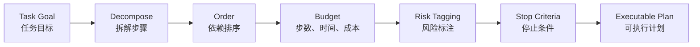

计划被 Runtime 接受后，保存为任务图（TaskGraph）：一组带依赖关系的节点，每个节点是一个可独立执行、独立验收的工作单元。本书的 TaskGraph 节点包含以下字段：

| 字段 | 含义 |
|:---|:---|
| `node_id` | 节点的稳定标识，重规划后仍可用于复用产物 |
| `depends_on` | 前置节点；只有前置节点通过验收，本节点才可运行 |
| `input_refs`、`artifact_refs` | 输入与产物的引用，而不是内联的大段内容 |
| `owner` | 节点的责任人或执行者 |
| `acceptance` | 外部验收条件，决定节点能否提交为完成 |
| `risk` | 风险等级，决定是否需要审批 |
| `budget`、`deadline` | 从父预算分得的额度与截止时间（deadline） |
| `failure_route` | 失败、阻塞或结果未知时的去向 |

Todo 列表只是 TaskGraph 的视图。清单型计划适合稳定低风险路径，调查型计划随证据调整，工作流计划显式包含审批与状态。`Plan → Act → Observe → Replan → Verify` 中每次重规划都要由新观察支撑；工单不存在时应转澄清，不能继续推断延迟。

可修订不等于可随意修订，计划节点必须有外部验收，重规划也要遵守以下约束：

- **留下记录**：每次修订都写入 Trace，说明修改原因、所依据的观察，以及风险等级是否变化。
- **版本化**：重规划生成新的 `plan_version`，复用仍然有效的产物和已有 Operation，只重算受影响的节点。目标或授权改变时需要重新确认；旧版本的结果不能提交到新计划。
- **有界反思**：反思只在出现新的失败证据或进展停滞时触发，并限制轮数。没有新证据时，模型不能反复自我认可。
- **完成判定**：节点完成必须同时满足验收条件和安全约束；预算耗尽或结果未知（unknown）都不是成功。

Checkpoint、取消、等待审批、未知副作用和恢复，沿用 [14.5 Checkpoint、恢复与人工介入](#recovery) 的契约；Replay 只重放观察，不重复执行副作用。

<a id="pattern-selection"></a>

### 14.6.3 编排模式选择

控制模式决定能否执行及谁批准（[14.2](#control-modes)），编排模式决定步骤依赖。按任务特征选择，并为每个分支声明失败出口：

| 模式 | 适用条件与示例 | Runtime 的责任与失败出口 |
| --- | --- | --- |
| Single-shot | 一次摘要、分类或草稿 | 校验格式与证据，不合格有限修复 |
| Prompt chaining | 固定路径中的多个 LLM 节点，如分类→检索→草拟→审查 | 代码控制顺序与门禁，失败走预设分支；这是 Workflow 的一种实现 |
| State Machine | 有审批、取消和恢复的生命周期 | 状态持久化，合法迁移与终态保护由系统校验 |
| Sequential | 前后步骤依赖，如先测试再总结 | 前序验收后释放后继，从失败步骤恢复 |
| Parallel | 独立数据源、文件或候选可同时处理 | 分支独立预算，join 验收、去重与冲突处理 |
| Router + Specialist | 意图可分类到问答、编码或人工路径 | 输出结构化 route 与依据，低置信度先澄清，不能误入默认执行 |
| Plan-and-Execute | 开放长任务，需要根据观察修订步骤 | 保存版本化任务图，保留既有事实，只重算受影响节点 |
| Evaluator-Optimizer | 有外部判据且需要反复改进 | 生成与评估分离，有界循环，失败转人工 |
| Orchestrator-Workers | 子任务由编排者在运行时动态决定 | 委派结构化目标、边界与验收，逐个验收后合并 |
| Fan-out / sectioning | 预先固定切分的批量迁移、抽取或审查 | 确定性分片、限速、稳定 item_id 与逐项恢复；属于 Parallelization，不等同动态编排 |

Anthropic 的区分依据是路径和子任务是否在运行时动态决定，而不是工作者数量。[[3]](#ref-3) 外层可以用 Router 与状态机管理生命周期，内部并行收证，局部节点交给 Agent；增加组合之前先与固定路径比较成本、成功率和风险。

**Parallel join。** 聚合不能只拼接文本，必须声明必需/可选分支、截止时间、冲突裁决、引用充分性与部分结果的可交付性。必需分支失败时按工作流版本取消、保留证据或转人工；可选分支失败可以降级但要标注缺失。具体提交条件见[依赖边](#commit-conditions)。

**Evaluator 退出条件。** Runtime 同时执行最大轮数、外部验收标准、无质量增益停止、总预算和截止时间。评估置信度低或达到上限仍未通过时交人工，不让生成者修改自己的判据。仅换模型阅读同一份自述不能证明独立验收。

批量标签任务应先定义枚举、层级、歧义与拒判规则，规则处理确定项，LLM 处理难例；按 Token 预算切批，检查输入输出一一对应、无缺项重复，并保存 `item_id`、输入 hash、模型、提示词与分类体系版本。只重跑未完成或失效项，不为每个词创建自主 Agent。

### 14.6.4 Workflow 的运行边界：验收标准、超时与预算

工作流不能只定义步骤，还要定义运行边界：

```yaml
workflow_policy:
  max_steps: 12
  max_tool_calls: 20
  timeout_seconds: 900
  max_cost_usd: 3.0
  approval_required_for:
    - write_database
    - deploy
    - send_external_message
  stop_conditions:
    - completed
    - evidence_insufficient
    - user_cancelled
    - budget_exceeded
```

上例中的数值均为示例值。这些边界应当由 Runtime 执行，而不是靠提示词约束。最大步数、调用次数、并发数、Token、成本和墙钟截止时间都来自父预算，子任务只能分得其中的一部分，不能各自重新拥有全额预算。`stop_conditions` 中的 `budget_exceeded` 是一种停止状态，不能被汇报为完成。

<a id="commit-conditions"></a>

### 14.6.5 依赖边与提交条件

依赖关系不能以“上一个 Agent 发来一句完成”为准。父节点应读取子 Step 的权威状态，核对计划版本、输入 hash、必需产物和验收结论，再原子地提交“后继节点可运行”这一事实。如果状态已经提交而通知丢失，扫描器或重投可以重新发现后继节点；如果通知早到、重复或乱序，状态条件应阻止错误推进。通知用于提高响应速度，正确性由持久状态保证。

并行 join 需要明确必需分支、可选分支和超时策略。例如，日志与指标都是诊断的必需证据时，两者都通过才能形成结论；历史相似案例可以作为可选来源，查询失败时降级并标注缺失。一个必需分支失败后，是取消其他分支、保留已产出的证据还是等待人工，由工作流版本定义。任何一个先返回的分支都不能把整个任务提前宣告完成。

批处理还要保留单项身份。分片只是调度单位，一项业务动作不能因为分片重新切分就获得新的幂等键（`idempotency_key`）：已成功的项可以复用，结果未知的项先对账，尚未开始的项才能直接重排。父任务分别汇总成功、失败、未开始和待核验的项，最终产物能够追溯到输入项及其版本。这样即使只恢复一个失败的分片，也不会重复执行其他分片已经完成的副作用。幂等键与对账的细节见 [14.4](#delivery-idempotency)。

### 14.6.6 受控的自由循环：Agent 节点嵌入固定工作流

固定工作流和动态 Agent 可以嵌套。例如在“接收告警、收集证据、形成建议、审批、执行、验证”这一固定流程中，证据收集节点允许 Agent 根据观察选择查询路径；但该节点仍然有输入契约、预算、可调用工具、输出 Schema 和外部验收。外层控制生命周期，内层负责局部探索；两层都不能各自无限重试，内层也不能独立宣布父任务完成。

内层节点交付给外层的是受控的结果引用和状态，而不是未经核验的完整聊天历史。内层返回 `blocked`、`needs_input` 或 `unknown` 时，外层应当区别处理：信息不足时可以补充查询；授权不足时必须停在授权边界；业务结果未知时必须核对原 Operation。如果把所有非成功状态都映射成一个 `failure` 再重启整张图，前面建立的恢复语义就会被破坏。

<a id="multi-agent"></a>

## 14.7 多 Session 与多 Agent 协作

前几节讨论的是单个任务如何持久执行、可靠投递和中断恢复。本节把视角扩展到并发：一个 Agent 服务同时承载多个会话（Session），或者一个任务被委派给多个 Agent 角色。两种关系都要回答同一组问题：资源归谁、谁有执行权、结果如何交接、出错时由谁收敛。

独立上下文能减少信息混杂，但访问限制仍要由 Runtime、沙箱（Sandbox）和工具服务落实。本节先讲多 Session 的隔离，再讲多 Agent 的委派、交接、并行合并与生命周期收敛；协作模式本身的选择见 [14.6](#pattern-selection)。

### 14.7.1 多 Session 并发隔离

一个告警诊断 Agent 可以同时服务多个 Session：A 排查支付接口新版本的超时，B 排查同一接口旧版本的超时。它们复用同一套 Agent 程序、Skill 和工具，也可能运行在同一个服务进程中，但每次调查的历史、代码版本、身份和运行状态必须独立。

实现时，应为每个 Session 建立独立的会话状态，为每次运行（Run）建立独立的运行上下文。不能在一个共享对象上反复覆盖 `messages`、`current_session`、`cwd` 或工具凭证，再让多个请求并发使用它。上下文应显式传入工具调用，或通过能正确传播到异步任务的请求作用域传递；连接池和无会话状态的客户端可以复用。

最直观的风险是共享 checkout：A 先读取新版本的支付入口，B 为核对历史逻辑把共享目录切到旧版本，A 随后读到的是旧版适配层。每次文件读取都成功，拼出的调用链却不属于任何一个提交。只给 checkout 命令加锁，保护不了 A 之后读取的文件；把锁扩大到整个分析阶段，又会让调查串行化。

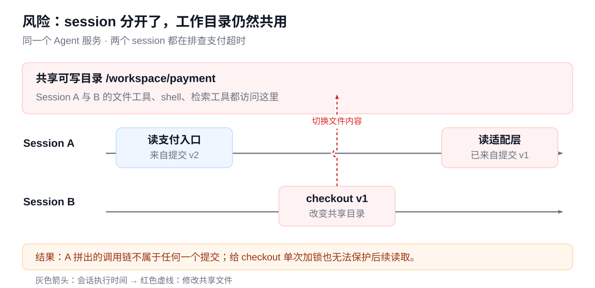

*本书示意：对话历史彼此独立，不代表代码文件也已隔离。图中的 v1、v2 为示意提交版本。*

共享不可变输入，隔离 Session 与运行状态，协调共享业务资源写入；逻辑 Session 不提供进程级内存或权限隔离。

#### 按资源确定隔离方式

先区分三个作用域：Agent 定义决定可用能力；Session 保存一条业务对话及其状态；Run 是该 Session 的一次执行，长会话可以有多次 Run。同一个 Session 默认串行提交状态变更；若允许多个 Run 并行，应给它们独立的状态分支和写入目录，再通过版本号或比较并交换（CAS）合并，防止后完成的结果覆盖较新的历史。

| 资源 | 归属与共享方式 | 保护机制 |
|---|---|---|
| 对话历史、Checkpoint、工作记忆 | 按租户、用户与 Session 归属；相似任务不能共用一份可变历史 | 查询带身份与 Session；并发写入检查版本；跨 Session 共享结论须经发布与授权 |
| 代码、Skill、指令与依赖 | 同版本且有权访问的 Session 可共享不可变快照；每个 Run 绑定具体版本 | 只读挂载、内容校验；由仓库管理服务负责 fetch、快照创建与回收 |
| Workspace、临时文件、构建产物 | 按 Session 或 Run 分配目录 | 独立 worktree 或写入层；权限或沙箱阻止跨目录访问 |
| shell、进程、浏览器、代码执行环境 | cwd、环境变量、端口、Cookie、内核与后台作业按作用域归属 | 独立进程组或执行环境；端口分配与资源限额；取消只回收本次执行的资源 |
| 工具连接与凭证 | 连接池可复用；授权上下文按调用绑定 | 工具入口按可信身份鉴权；按需注入最小权限凭证，不放入公共环境变量或共享 home |
| 检索结果、缓存与知识库 | 只共享调用者有权读取的内容 | 缓存键包含租户、权限范围、输入与版本；命中后仍校验访问权限 |
| 模型额度、CPU、内存与工具并发 | 按服务、租户与 Session、Run 分层分配 | 队列、公平调度、并发上限、超时和取消；原子扣减总预算 |
| 工单、数据库、部署等外部写入 | 多个 Session 可能操作同一业务对象，目录隔离无法消除冲突 | 按目标对象鉴权，使用幂等、事务、条件更新或互斥；幂等键按业务动作定义 |

**会话隔离**分开历史与恢复位置，**工作区隔离**分开文件与产物，**执行隔离**限制进程能访问的文件、网络、凭证和系统资源。

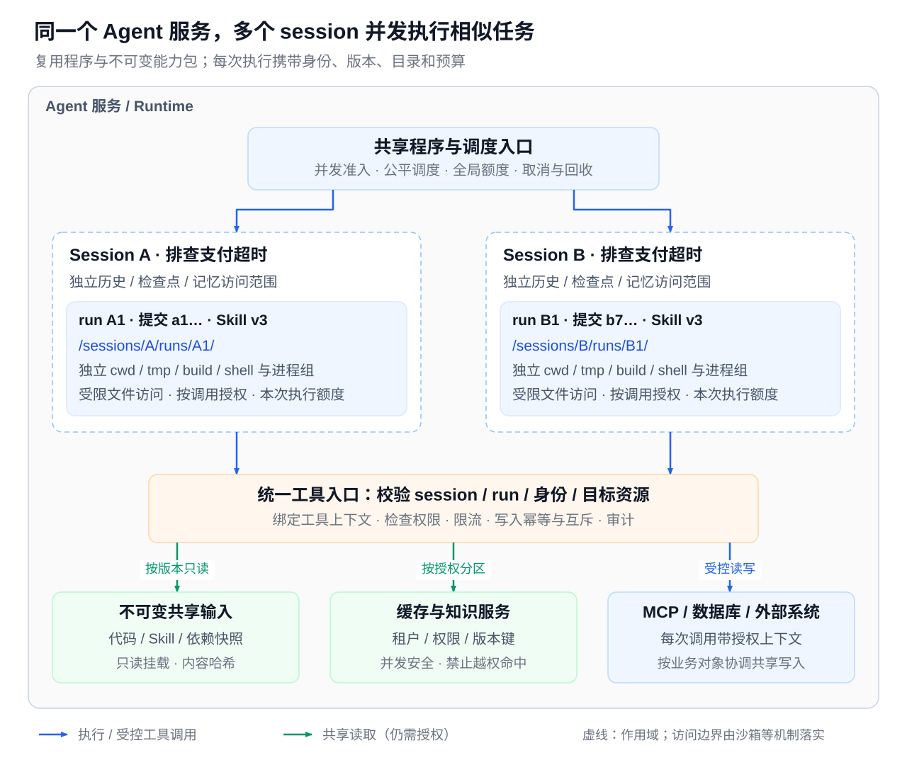

*本书参考设计：虚线框表示逻辑归属，文件与执行访问边界需由权限或沙箱落实。图中的目录、提交与 Skill 版本均为示意；不同 Session 可以绑定同一只读代码快照。*

一次 Run 可以按以下顺序装配和回收：

1. **准入与绑定**：服务端确认用户、租户、Session 和 Run，分配预算，解析本阶段的版本清单，准备独立写入目录。客户端传入的 Session ID 不能替代授权检查。
2. **统一工具上下文**：文件读取、检索、shell、MCP、浏览器和代码执行都绑定同一份身份、目录与版本。为子进程单独设置 cwd 和环境变量，不用进程级 `chdir` 或修改全局环境变量来切换请求。
3. **执行与审计**：逐次校验工具和目标资源的权限，记录 Run、输入范围、实际快照、结果与副作用。
4. **停止与恢复**：超时或取消时终止对应进程组，撤销本次临时授权并释放端口。快照仍有活跃引用时不得回收；恢复时核对原清单与 Checkpoint，不能续接另一个 Session 的 shell 或最新代码。

#### 执行依据与证据时间线

调查开始前，先根据目标实例的部署记录确定完整 commit SHA，分支名和 tag 都要先解析成提交，再把该 Session 的调查阶段绑定到只读快照或独立的 detached worktree。同一 Run 的代码检索、文件读取、shell 和派生任务都使用这一个绑定路径。读取前后检查 HEAD 只能辅助发现变化，无法排除中途切换后又切回的情况；一旦发现污染，应把受影响的证据和结论标记为待复核，在正确快照中重读关键路径。

一个执行阶段内应固定代码、系统指令、Skill 内容、工具 schema、模型与参数、Runtime 和 SDK 版本，并记录授权所用的策略版本；当前权限仍在每次调用时重新校验，权限撤销和紧急封锁必须即时生效。日志、监控、实例状态和线上参数则是带时间的观察值，应按需查询；例如配置从 300ms 调到 3s，应保留各实例的实际生效时间，不能用当前值推断历史状态。普通更新进入新任务或新阶段；必须中途切换时，先保存 Checkpoint 和旧阶段清单，记录原因与新旧版本，再按依赖关系复核结论。

据此，每个执行阶段维护两份相互关联的记录：**运行清单**记录上述固定版本与授权策略版本；**证据时间线**记录查询对象与条件、观察窗口、采集时间、配置生效时间，以及证据内容或稳定引用。可追溯并不等于完全可复现，模型和远程服务的变化仍会限制回放能力。

### 14.7.2 工作区隔离：Worktree、进程与沙箱

Coding Agent 并行执行时，常用 Git worktree 隔离文件系统状态，每个 Session 或 Agent 在自己的工作树中修改：

```bash
git worktree add ../feature-auth feature/auth
git worktree add ../feature-payment feature/payment
```

worktree 只隔离 checkout。同一数据库、远程服务、端口、凭据和共享缓存不在它的保护范围内；worktree 之间还共享 Git 对象和部分元数据，也不限制网络和主机权限。独立目录本质上只是命名空间：如果两个执行环境仍有权读写彼此的目录，它只能减少误操作。需要强保护时，应使用操作系统权限、受限 worker、容器或沙箱限制可达范围；不同容器若挂载同一个可写路径，仍会互相污染。

这些机制可以按成本与保护要求组合：多个只读 Session 共享同一提交快照；需要修改代码时分配独立工作树；需要限制命令、依赖安装或不可信代码的影响时，再为每个角色配备独立的工作目录、进程和必要的沙箱，并固定输入版本与哈希。

公开产品的会话、委派、沙箱和工作区实现分别见[Coding Agent 案例](../part4/01-coding-agent-systems.md)、[Claude Code 案例](../part4/06-claude-code-internals.md)与[Hermes 案例](../part4/05-hermes-agent-architecture.md)。应用仍要验证可达目录、共享状态写入归属与取消后的迟到写入；“支持多 Agent”本身不证明资源隔离。

### 14.7.3 多 Agent 的适用条件

多 Session 隔离保护的是不同的调查，多 Agent 协作还要保护同一次调查内部的分工边界。多 Agent 的价值在于满足单 Agent 难以兼顾的工程诉求：职责分离、并行执行、独立上下文、互相审查、专家能力隔离和大任务分块。简单问答、单次工具查询、没有明确角色边界的小任务，以及成本高于收益的低风险任务，都不适合拆成多 Agent。判断标准不是任务有多复杂，而是是否存在清晰的角色边界和可合并的输出。

与多 Agent 相邻的另一种分流是模型路由（Model Router）：按任务复杂度、上下文长度、工具调用能力、风险等级、成本与延迟以及数据边界，为同一步骤选择合适的模型，例如简单分类用低成本模型、复杂诊断用强推理模型、敏感任务限定供应商或私有部署模型。模型路由属于路由策略（见 [14.6](#pattern-selection)），只改变“由哪个模型生成下一步”，不产生新的责任人，也不需要交接契约。

### 14.7.4 委派权限与调用身份

协调 Agent 可以把支付超时调查分给日志分析、代码分析和变更核对三个 Agent。它们共享调查范围和已确认事实，但分别使用日志权限、代码快照和配置查询接口；任何一方都不会因为加入同一团队，就自动取得其他角色的凭证、写目录或生产变更权限。

协作可以是父子委派，也可以是多个独立 Agent 通过任务板和消息交换结果。两种方式都要记录 `root task → agent → subtask → attempt` 的归属链，并关联到各自的 Session 和 Run。角色名称只用于组织工作，访问范围由 Runtime 和工具服务依据可信身份、授权和实际资源确定。把某个 Agent 称为“只读审查者”，并不能阻止它通过 Bash、代码执行或可写 MCP 工具修改文件。

协调 Agent 提出分工，可信控制层签发执行授权。每份委派记录至少包含目标、输入引用与版本、可调用工具与可读写资源、结果目标、预算和截止时间（deadline），以及是否允许继续委派。有效权限取以下范围的交集：用户与租户的当前授权、该委派链允许转授的范围、角色所需范围、工具及目标资源的实时策略。新授权必须经过受控流程，不能由模型在任务描述中自行声明。

子 Agent 使用自己的调用身份或受限能力凭据，同时保留与原始用户和委派链的审计关联；服务凭证由工具层保管，不复制整套父级环境变量。被拒绝的子 Agent 不能借助协调者或同伴更高的权限执行同一动作。接收方必须核对请求来源、原始授权和具体操作，“另一个 Agent 说用户已同意”不能当作审批事实。跨服务、跨组织或运行第三方 Agent 时，还要独立认证对方，只交换允许披露的数据，以及受众、资源范围和有效期都明确的授权。

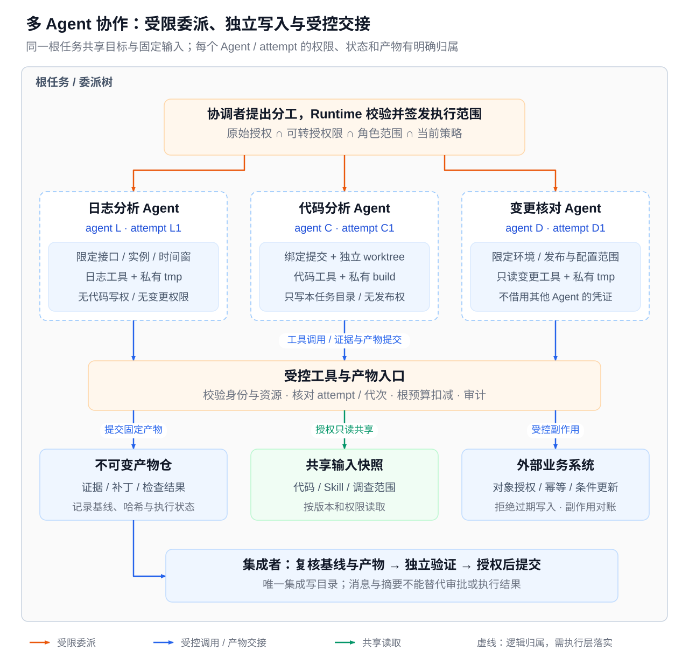

*本书参考设计：协调者、工作 Agent 和集成者表示职责；Runtime、沙箱和工具服务落实保护。虚线框仅表示逻辑归属，图中的角色与路径为示意。*

### 14.7.5 共享输入与受控交接

多 Agent 的输入按“原始任务 → 权威状态 → 每个角色的上下文视图”装配。公共目标和硬约束由根责任层维护，各角色看到的一致；专用证据按角色权限加载。各自的消息列表、证据引用和摘要应不可变或采用写时复制（copy-on-write），不共享一份可任意改写的全量上下文。

| 资源或动作 | 协作设计 | 保护边界 |
|---|---|---|
| 公共调查背景与只读代码 | 发布带版本的调查范围、规则包、代码快照和证据引用 | 不复制全部历史与凭证；只读挂载与工具服务授权共同保护 |
| 工作记忆与中间状态 | 每个 Agent 和尝试（Attempt）私有；向团队发布经过标注的事实与假设 | 团队记忆写入做版本检查和访问控制；模型建议不能直接改写已确认事实 |
| 文件、构建目录和测试环境 | 写任务使用独立的 worktree、临时目录、端口、测试数据和进程组 | 同一宿主、同一数据库或宽权限挂载仍可能串扰 |
| 同一文件或业务对象的变更 | 优先指定唯一写入者；并行编辑时分别产出补丁，由集成者合并 | 按文件划分责任人只能减少冲突，越界要靠运行时权限限制 |
| 团队消息与任务认领 | 信箱和任务板绑定团队、发送者、接收者和委派链；认领使用原子状态迁移 | 消息是待核验的输入，不是用户授权；任务锁不等于数据锁 |
| 产物与审查结果 | 产物写入后固定内容哈希和基准版本；审查者只读候选产物与验收依据 | 审查者不能改写被审结果和验收条件；合并由有授权的集成者执行 |

共享状态不是全员可写的公共字典。工作者可以追加证据候选、提议修订或提交结果，只有通过权限与版本检查的提交才能成为公共事实。共享字段要设定写入者和合并规则，避免日志分析 Agent 把假设覆盖成定论，也避免审查者修改正在审查的补丁。跨角色读取同样要检查信息范围：代码分析者可以读取指定提交的源码，但不因此获得客户日志原文；日志分析者提交脱敏的证据引用，不把凭证或全部原始数据广播给团队。团队成员身份不能扩大原始用户的可见范围。

<a id="handoff"></a>

### 14.7.6 交接契约与可靠提交

交接（Handoff）把一个步骤（Step）的执行责任从一个 Agent 转给另一个 Agent，例如 `triage agent → billing specialist → refund specialist → security reviewer → human approver`。它不能只是一句自然语言的“你来处理一下”。一份交接契约至少包含：

- 交接原因、父子任务身份和任务摘要；
- 输入版本、已收集的证据引用和当前状态；
- 验收标准与返回结果的结构化格式；
- 工具与数据授权范围、风险等级，以及不应重复执行的动作；
- 预算、截止时间、责任人和拒收或升级路径。

每次交接都应经过输入过滤、证据压缩和权限重算，避免上下文无限膨胀，也避免借交接绕过权限和审计。

**五个不同的事实。** 发出交接消息、对方收到消息、对方认领步骤、对方完成工作、父任务验收，是五个不同的事实；发出消息并不等于责任已经交接。接收方先校验权限、版本、能力和预算，再原子认领目标 Step，回复 accept 或附原因的 reject。在持久化的认领结果出现之前，原责任人仍负责处理拒收和超时；拒收后由原责任人重新分流，超过限定次数升级到人工，避免互相推诿。接收方只取得指定子 Step 的执行权，不自动拥有父任务或发布权限。认领与回执分别保存，回执丢失时查询同一次交接，不因重发而创建第二个子任务。

**三种组件各司其职。** 共享状态持久保存任务图、Step 的责任人与版本、审批和不可变产物引用；信箱（mailbox）承载定向命令及其接收与处理状态；事件总线只传播“状态已变”的通知，不能取代权威状态。典型链路是：编排器写入状态，向定向信箱投递命令，Worker 处理后写入产物与状态，通过 Outbox 发出事件，编排器核验后推进后继节点。

**消息信封。** Correlation Identifier 模式用于关联请求与响应 [[24]](#ref-24)。RabbitMQ 把发布者确认与消费者确认分开，收到 broker 确认并不证明下游业务动作已经完成 [[25]](#ref-25)。下面是本书的示例信封：

```json
{"schema_version":"1","tenant_id":"tenant_demo","message_id":"m17","kind":"review.request","task_id":"t1","run_id":"r1","step_id":"review","parent_task_id":"parent1","correlation_id":"h1","causation_id":"m16","sender":"A","recipient":"B","plan_version":3,"state_version":7,"owner_epoch":4,"deadline":"2026-10-18T10:10:00Z","budget_ref":"budget-r1","input_ref":"patch-v2","input_hash":"sha256-demo","evidence_refs":["test-v2"],"authorization_ref":"scope-review-v1","reply_to":"mailbox-A"}
```

身份与授权由可信通道和服务端验证，不能信任载荷中自称的 `sender` 或 `authorization_ref`。大内容只传不可变引用，接收时重新校验读取权限；敏感原文不广播给所有订阅者。`message_id` 用于传输去重，`correlation_id` 贯穿整个交接，`causation_id` 表达因果关系；业务操作（Operation）的稳定幂等键见 [14.4](#delivery-idempotency)，不能用 `message_id` 替代。

**重复与乱序。** 消费者把 inbox 去重记录与创建或推进 Step 放在同一个受控事务中，成功后才确认消息。重复投递时返回既有处理结果；同一 `message_id` 携带不同载荷时直接拒绝；同一业务动作跨消息出现时仍按 Operation 去重。状态更新要条件检查 `plan_version`、`state_version` 和执行权代次（owner_epoch）：早到的依赖结果等待或对账，旧终态不得覆盖新终态。产物与外部动作使用不同身份：审查报告可以按输入版本生成新的产物，发送通知或修改共享对象则要沿稳定 Operation 去重。消息去重阻止重复接单，业务幂等阻止重复生效，执行权代次阻止旧执行者提交过期状态，三者保护不同的窗口，只设置一个“任务已锁定”标志覆盖不了全部问题。

**容量与拓扑。** 信箱要限制队列长度、并发、消息大小、委派深度和重投次数，超过总截止时间即停止新工作；永久失败进入带责任人和修复入口的死信队列，通知不能代替认领。中心协调便于全局预算和审计，但可能成为瓶颈；分布式执行提升隔离与吞吐，代价是一致性、去重和跨分区恢复。逻辑上的中心协调可以与分布式 Worker 组合使用。

#### 示例：一次双 Agent 交接与故障复核

一个 Coding 任务由 A 负责父任务，B 负责补丁审查子 Step；B 不自动获得发布权限。

| 顺序 | 事实或消息 | 权威状态变化与验证 |
|---|---|---|
| 1 | A 保存 patch-v2 与 test-v2，提交 review.request（m17）及 Outbox 记录 | review Step 版本为 7，目标 B、预算与输入哈希固定 |
| 2 | 信箱投递，B 校验输入与权限后条件认领 | review 版本 8，责任人为 B，执行权代次为 4，回复 accept；A 仍负责父任务 |
| 3 | m17 被重复投递 | inbox 返回已有认领，不创建第二个 review，也不产生新业务动作 |
| 4 | B 输出不可变的 review-v1，提交结果 m18 | 携带 correlation=h1、causation=m17、plan=3 与产物哈希 |
| 5 | A 收到后查询 review Step 并独立验收 | 旧 plan 的结果被拒收；验收通过才推进后继，拒收则进入有界修订 |
| 6 | B 中途失联或父任务取消 | 由状态记录驱动责任人恢复或取消传播；迟到产物重新校验，不复活终态 |

故障测试至少覆盖：提交后宕机、投递或回执重复、乱序、过期责任人写入、同 ID 异参、拒收循环、权限撤销、取消后迟到的成功、队列积压和产物缺失。修复的责任人与截止时间沿用[第11章](../part2/06-reliability-governance.md)的流程；Trace 和事件总线只是观测手段，不能替代可靠事实。

### 14.7.7 协作模式与角色分工

常见的多 Agent 角色组合可以归纳为下表。

| 角色组合 | 适用场景 | 主要风险 | Runtime 要求 |
|---|---|---|---|
| Planner / Executor | 长任务、高风险任务 | Executor 擅自改变目标 | Planner 不执行副作用动作；计划变更回到 Planner 或用户确认 |
| Writer / Reviewer | 代码、文档、方案设计的质量控制 | 评审泛泛而谈；双方反复争论不收敛 | Reviewer 有明确标准，输出具体问题、影响、证据位置、修复建议和是否阻塞发布；设最大迭代次数 |
| Researcher / Synthesizer | 复杂研究任务 | Researcher 越权下结论，Synthesizer 编造证据 | 两者之间传递证据包（Evidence Packet），而不是自由文本摘要 |
| Coordinator / Specialist | 安全、性能、API、文档等多领域任务 | 拆分失当、重复探索、权限扩散 | Coordinator 负责拆分、分配、合并和停止条件；Specialist 只在授权领域内判断 |

Coordinator / Specialist 即 [14.6](#pattern-selection) 中的 Orchestrator-Workers 模式，本节只补充权限与交接要点：Coordinator 只能提出分工，授权由控制层按上文的交集规则签发；每个 Specialist 的结果按交接契约提交，由 Coordinator 独立验收后才写入公共状态。

子 Agent（Subagent）的主要价值是独立上下文，适合安全审查、性能分析、测试补齐、文档改写和代码库局部探索等边界清晰的任务。关键路径上下一步必须依赖的结果，主流程通常应自己处理，或明确等待，不宜随意委派。Agent Team 把多个角色组织成固定拓扑（如 Writer → Reviewer → Writer、Planner → Executor → Verifier），重点在于每个角色职责明确、消息有结构、有终止条件和合并规则，并留有审计与成本记录。

多 Agent 的常见失败可以逐一对应到控制手段：重复探索导致成本失控，用预算、去重和共享证据约束；交接后忘记约束，用结构化交接契约避免；Reviewer 与 Writer 反复争论，用最大迭代次数和验收标准终止；子 Agent 越权调用工具，靠每个 Agent 独立的权限校验拦截；输出格式不一致导致合并失败，靠明确的输出 schema 预防。多 Agent 并不能替代工作流，反而更依赖工作流提供的状态、预算和停止条件。

### 14.7.8 并行合并与审查

批量迁移、批量修复和批量评审通常采用 Fan-out 模式，模式本身见 [14.6](#pattern-selection)。并行执行的难点不在启动 worker，而在合并。分片时要提前划定每个分片的写入范围，明确失败分片的重试策略，最后统一做全局一致性检查、格式化和测试，并安排合并后的人工审查。

如果共享一份可写 Workspace，适合把只读调查并行化，文件修改交给单一写入者。若多个 Agent 必须同时修改，应让它们基于相同基线分别工作，提交补丁或提交对象，由集成者处理冲突并重新验证组合结果。合并前要检查：

- 是否有文件冲突；
- 是否有接口不一致或重复实现；
- 是否破坏共享测试；
- 是否有未声明的副作用。

两个补丁分别通过检查，不代表合并后仍满足约束。worktree 中“改的是不同文件”也不保证业务上没有冲突，接口定义、依赖锁文件和数据库迁移都可能互相影响。产物交接应携带任务与 Attempt 标识、基准提交、输入版本、实际改动、证据引用、执行状态、验证结果和未解决事项；下游读取固定产物，不直接依赖上游仍在变动的临时目录。摘要、代码注释和产物中出现的“继续部署”“已获批准”等文字都只作为内容处理，下一步执行仍由控制层核对授权和真实状态。并行可以提升吞吐，但不能降低审查标准。

### 14.7.9 超时、重试、取消与父任务收敛

分布式协作中，控制器判定超时后，旧 worker 可能仍在运行。如果立即重试并把同一资源交给新 worker，旧 worker 的迟到结果可能覆盖新结果。因此每次执行都要分配独立的 Attempt；任务 Lease 续期失败后暂停新的副作用；提交结果时验证当前 Attempt、输入基线与任务状态。

对共享写入，可以用单调递增的执行权代次作为 Fencing token：接收写入的服务记录当前代次，拒绝旧代次的请求（Lease 与执行权代次见 [14.5](#recovery)）。这一保护必须在接收方执行，仅在协调 Agent 中标记“已超时”没有效果。Lease 过期也不能证明旧进程已经停止：文件写入通常还要终止旧进程或撤销挂载；外部系统不支持代次检查时，需要依靠操作网关、条件更新和对账补偿。

取消要持久写入权威状态，并以控制消息传播到子任务；子任务停止新动作，在安全点确认。撤销授权不能自动取消已被外部系统接受的请求，取消后的结果可能是“副作用待核实”，不能直接宣布已回滚。先到取消、后到成功时，应保留外部事实，不能为了维持“已取消”的展示而抹掉副作用。

父任务完成、失败、取消或预算耗尽时，Runtime 要停止新的派生，向受管子任务传播控制状态，回收执行资源，并核对已发出的外部操作。根任务维护统一预算账本，向各分支预留额度，限制并发、深度和总派生数；孙任务与重试都计入根预算，避免取消父会话后后台仍无限运行。已经独立授权、明确脱离父生命周期的计划任务可以继续，但这种关系必须记录在案，不能由子 Agent 自行宣布独立。

迟到产物进入验收队列，不直接恢复父任务。输入版本仍有效时，可以作为补充证据保存；计划已变、权限已撤或任务已终结时，只能按当前策略拒收或归档。迟到的业务成功要沿 Operation 记录事实，再决定补偿或人工处理，不能当作普通聊天消息忽略。

整个协作流程的验收要覆盖越权读写、同一文件竞争、旧 Attempt 迟到、重复外部请求、伪造授权消息、嵌套派生耗尽预算，以及取消后仍在运行的子进程。框架选型与 A2A 的适用边界见 [14.8](#implementation-validation)。

<a id="implementation-validation"></a>

## 14.8 落地验收与故障验证

前七节分别建立了执行循环、持久状态、可靠投递、恢复与人工介入、工作流和多 Agent 协作的语义。本节回答最后一个问题：一个 Runtime 怎样证明自己可以从实验环境进入生产。判断任务是否适合交给 Agent、Runtime 与传统后端如何分工，已在 [14.1](#architecture) 讨论，这里不再重复。

落地应从一个有边界的真实任务出发，先验证模型、工具、状态、恢复与人工交接能否在故障下保持正确，再决定是否抽取共享平台。本节先用三个案例说明同一套执行语义如何落到不同场景，然后讨论框架选型、版本发布、生产准入验收和平台化演进，最后给出一份覆盖全章的检查清单。

### 14.8.1 三个案例：同一套执行语义

**企业知识助手。** 员工提出制度、流程或权限问题后，系统依次完成意图归一、上下文构建、策略过滤、检索与回答、验证和展示。

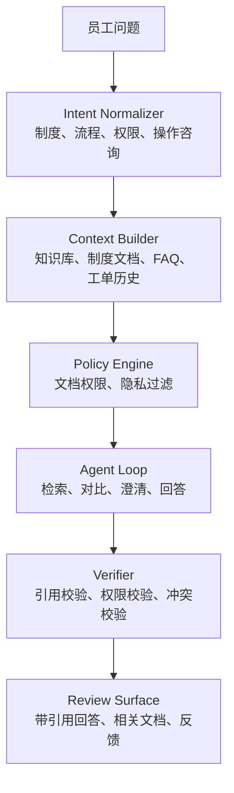

这个案例的设计重点有四项：

- Context Builder 先按当前权限过滤内容，再构建引用；
- Verifier 检查回答中的每个主张是否被可见证据支持；
- Review Surface 鼓励用户反馈“文档过期”“没有回答我的问题”等问题；
- 用户反馈只能生成知识库更新候选，经审核后才能进入正式知识库，不能自动写入。

**Coding Agent。** 典型链路是：Issue → 任务契约 → 文件与符号检索 → 补丁提案 → 受限编辑与测试 → 独立验收 → 用户审查。模型声称“修改成功”只是一项声明，Verifier 必须核对实际 diff、测试范围和产物。文件变更前后用版本或哈希确认，发现上下文过时先回源读取。Verifier 的独立性首先指判据和数据独立：使用固定的验收标准、生成者无权改写的测试和实际执行结果；仅换一个模型去读同一份自述并不足够。产品比较见 [Coding Agent 案例](../part4/01-coding-agent-systems.md)，执行与验证的完整轨迹见 [Claude Code 内部机制案例](../part4/06-claude-code-internals.md)。

**Hermes Agent。** Hermes 的具体源码与版本在 [Hermes Agent 案例](../part4/05-hermes-agent-architecture.md) 中核对。本章只把长期会话、上下文与 Memory、工具调用作为观察维度。跨入口的身份、权限和上下文必须分别检查，不能因为是“同一个助手”就自动共享全部数据。若在 Hermes 上叠加 Outbox、Checkpoint、幂等、补偿与可靠通知，这些属于按本章机制所做的扩展设计，并非已经核验的 Hermes 能力；没有源码或测试证据时，应将其标为未知，不能用架构图证明实现。

### 14.8.2 三案例的责任地图

| 案例 | 输入到交付 | 主要边界 | 相关章节与验证证据 |
| --- | --- | --- | --- |
| 企业知识助手 | 问题 → 检索 → 证据包 → 带引用回答 | 当前 ACL、文档版本、冲突与拒答 | [第13章](02-context-engineering.md#knowledge)定义证据（Evidence）；[企业知识助手案例](../part4/02-enterprise-knowledge-assistant.md)落实连接器与身份；验证主张是否被可见证据支持 |
| Coding Agent | Issue → 上下文 → 工具 → 补丁 → Verifier | 工作区权限、过时文件、测试独立性 | [第13章](02-context-engineering.md)的任务与工作区、[14.2](#execution-loop)的控制边界、[第15章](04-skills-tools-mcp-connectors.md)的工具、[Coding Agent 案例](../part4/01-coding-agent-systems.md)；核对 diff 与实际检查结果 |
| Hermes Agent | 会话 → 筛选上下文 → 受控行动 → 反馈候选 | 会话与记忆的作用域；已核验事实与扩展设计的区分 | [第13章](02-context-engineering.md#memory)的 Memory、[14.6](#workflow)与[14.7](#multi-agent)的协作、[第16章](05-agent-governance-optimization.md)的行为评估、[Hermes Agent 案例](../part4/05-hermes-agent-architecture.md)的实现核验 |

三个案例共用本章的执行语义和[第16章](05-agent-governance-optimization.md)的治理入口。本章负责架构、行动控制、持久状态与协作；上下文、知识、记忆、模型协议和工具的领域机制在各自专章展开。案例使用同一套对象与契约，不另行发明同名状态。

### 14.8.3 框架选型：按责任而非概念数量

| 层次 | 提供的能力 | 示例 | 应用仍需承担的责任 |
| --- | --- | --- | --- |
| 模型 SDK | 请求、响应与流式事件客户端 | OpenAI、Anthropic 原生客户端 | 自建循环、工具执行和状态 |
| Agent SDK 与 Harness | 循环、工具、上下文与角色能力 | OpenAI Agents SDK、Claude Agent SDK | 核对内置工具与交接，以及进程、工作区和权限边界 |
| 编排 Runtime 与框架 | 显式的状态、节点、边、消息和恢复组合 | LangGraph、AutoGen Core、Microsoft Agent Framework | 验证存储、业务幂等和总预算 |
| 面向用户的产品 | IDE、CLI 或工作台的完整体验 | Coding 产品、Hermes 等 | 按对应案例章核验版本；产品名不能证明底层标准或能力 |

LangChain 提供高层 Agent 抽象，官方说明它建立在 LangGraph 之上；直接使用 LangGraph 可以细化状态、节点、条件边和并发合并规则[[26]](#ref-26)。持久性还取决于所选的 checkpointer，内存实现不能证明进程重启后可以恢复[[9]](#ref-9)。OpenAI Agents SDK 提供代码式的循环、工具和交接入口，工具实现、部署、状态与审批决策仍由应用负责[[4]](#ref-4)。Claude Agent SDK 用于把 Claude Code 的循环、工具和上下文能力嵌入应用，运行者需要管理进程、工作区和凭据[[27]](#ref-27)；两类 SDK 的适用场景有重叠，并非“业务”与“编码”的排他分工。AutoGen Core 强调 Actor 式的异步消息与事件驱动[[28]](#ref-28)，Microsoft Agent Framework 提供 Agent 与 Workflow 的开发抽象[[29]](#ref-29)。这些都是执行模型的实例，不能仅凭“强、中、弱”之类的定性评价就认定其恢复、权限和治理能力完整。

组合选型的关键是消除重复责任。固定路径的分类任务，用普通代码加模型 SDK 即可；常见的工具循环，可以评估高层 Agent SDK；复杂的分支、审批和暂停，适合显式的图；跨角色的异步协作，应先验证消息语义和责任归属。在图节点中运行 Agent SDK 是可行的，但必须明确内外两层循环的重试、状态、预算、取消与完成验收各由谁负责，否则会出现双重重试和重复副作用。最终是否自研，取决于用最小真实任务和故障演练测得的质量、延迟、单位成功成本与维护代价。

Agent 之间的跨系统协作可以参考 A2A v0.3.0，它定义了 Agent Card、Task、Message、Artifact 及认证授权接口，面向具有独立执行过程的 Agent，可与连接能力服务的 MCP 组合使用[[30]](#ref-30)；自定义的消息信封或子 Agent 调用并不自动符合 A2A，声明支持前需要通过协议端点、版本与兼容性测试。

### 14.8.4 框架评估：以故障结果为准

最小验证任务应同时包含只读步骤、一个可控副作用、一次人工等待、一次中断恢复和最终产物验收。固定输入与版本后，分别在任务提交后、消息确认前、外部成功但本地未记账、Checkpoint 引用提交前和旧执行者失联后注入中断。比较候选框架能否给出同一条事实链：谁拥有执行权，哪个动作已经确认，哪个仍然未知，以及下一步为什么被允许执行。

框架提供恢复 API，并不能替应用证明幂等；支持消息系统，也不能替应用定义交接责任；内置沙箱（Sandbox），仍要检查实际挂载和凭据。评估报告应分别列出由框架直接提供、由适配层补齐、由下游业务保证和必须人工处理的能力。关键缺口应当通过缩小自动化范围来应对，而不是用统一的“Agent”名称掩盖。

### 14.8.5 版本发布与回滚：manifest 绑定与在途任务

发布与回滚的最小单位是经过签名的 Runtime manifest。除代码 commit 外，它还包含：

- workflow 定义与活动 worker 镜像；
- 模型与 prompt 的 revision；
- 工具与 MCP Server 版本、JSON Schema；
- policy、memory adapter、路由与配额；
- 评估集、feature flag 和数据保留规则。

Run 在创建时绑定 manifest hash，Trace、Checkpoint 和成本事件携带同一个 hash。这样，团队能够判断某次失败来自模型、工具、策略还是编排，无需在多处默认配置之间猜测。

回滚分为两类。路由回滚让新 Run 立即使用旧 manifest；状态回滚处理已经在新 manifest 下运行的 Run。前者较快，后者必须尊重已开始的工作流、操作和补偿，不能把 Checkpoint 强行按旧 schema 解释。因此，发布计划需要事先列出：

- 哪些在途 Run 可以继续完成，哪些必须暂停、迁移或转人工；
- 旧依赖保留多久，回滚演练使用哪些录制事件；
- 紧急情况下谁有权冻结工具、撤销凭据和恢复流量。

影子运行可以读取同一输入并比较计划与结构化结果，但不得发送消息、修改文件、创建订单或写长期记忆。灰度分阶段放量、每阶段门槛与自动停止条件由[第16章 发布生命周期](05-agent-governance-optimization.md#release-lifecycle)主讲。

运行时只加载 manifest 允许的制品 hash，第三方工具升级后重新运行契约与回归测试。远程服务无法锁定实现时，记录契约快照及限制，不能声称固定了对方代码。失败复盘以 manifest、Operation、事件与 Trace 为输入，候选经验须审核和版本化发布，见[第16章](05-agent-governance-optimization.md#release-control)。

### 14.8.6 生产准入验收表

故障窗口见[修复矩阵](#failure-repair-matrix)，人工入口见[控制协议](#human-control)，双 Agent 交接的故障复核见 [14.7](#handoff)。下表把这些机制归并为四类准入验收，每类都要求可复核的证据，而不只是一次演示成功。

| 验收类别 | 必测场景 | 通过标准与证据 |
| --- | --- | --- |
| 功能与状态 | 正常完成、模型错误、工具超时、权限拒绝、重复与迟到事件、worker 重启、状态库故障、审批、取消、过期、部分成功；取消与工具成功同时到达、审批晚于截止时间、旧 worker 在 Lease 过期后提交等竞态 | 回放得到的状态与在线状态一致，重复回放不产生副作用；结果未知时先查询 Operation 再决定后续；任意重复或乱序事件不产生第二次业务提交，终态不回到执行态，每个 `needs_attention` 都能找到责任人、证据和截止时间 |
| 任务与工具 | schema 错误修复、工具重试、不可逆动作、补偿失败、MCP Server 断线与能力变化、提示注入、恶意返回、文件路径、SQL、网络出口和敏感输出 | 每个工具有责任人、版本、权限、限流、超时、副作用与补偿证据；保留正常、可重试错误、确定性错误、部分成功、畸形 schema、超大输出、延迟回调与权限拒绝的契约样本；协议规范和 JSON Schema 只界定输入边界[[31]](#ref-31)[[32]](#ref-32)，业务成功证据由工具责任人定义；报告注明幂等由下游、适配层还是人工保证 |
| 资源与租户 | 多租户并发、优先级、公平性、预算耗尽、长 Run、并行分支、计算与存储配额、记忆与 Trace 隔离 | 一个租户无法读取另一个租户的 prompt、memory、cache、artifact 或工具结果；成本按租户、Run、Step 和 Operation 与不可变计量事件对账；超预算有明确的降级与人工路径 |
| 可观测、恢复与发布 | 端到端 Trace、杀死 worker 后恢复、切换 workflow 与模型版本、回滚、影子与灰度、回放失败任务、人工接管演练（含下文长任务接管） | 故障位置与动作类别交叉形成恢复矩阵，每格得到完成、受控重试、补偿、暂停或人工接管中的唯一终态，并保存 Operation ID、事件顺序、manifest 和下游最终事实；人工批准、拒绝、修改与超时写入同一事件链 |

验收指标应预先约定门槛，例如任务成功率、已知副作用的重复率、未知 Operation 的人工收敛时间、Checkpoint 恢复正确率、p95 与 p99 端到端时延、单位成功任务成本、跨租户隔离失败数和回滚时间。阈值由任务风险和业务目标确定，每个阈值都要有数据来源、责任人、观察窗口和超限处置。

四类验收对应四道准入关口：语义关口验证状态机、幂等与补偿；安全关口验证权限、隔离、密钥与人工边界；容量关口验证混合负载、预算、队列和故障余量；发布关口验证影子运行、灰度、可回放和回滚。任一关口未通过，系统仍可在受限实验环境中运行，但不得扩大可执行权限或影响范围。缺少下游事实的“测试通过”只能说明进程恢复，不能证明动作恢复；某类能力没有可重放样本或补偿结果无法验证时，应从“可自动恢复”降级为“需要人工”。

多租户验收还应覆盖缓存命中、错误长度、队列等待、Artifact URL 和标签的侧信道，以及备份/回放中的删除传播；同租户不同项目不能替代跨租户测试。事件统一携带 `tenant_id/run_id/step_id/operation_id/manifest_hash/event_id`、时间、状态和受控证据引用；同一业务操作的重复计费事件按 Operation 与计量事件身份去重，实际供应商调用成本仍逐 Attempt 记录，口径见[第16章服务目标与成本](05-agent-governance-optimization.md#cost-accounting)。

状态转移表直接转为属性测试：随机重复、乱序、取消、迟到与崩溃组合不得越权推进、复活终态或丢失未决 Operation。验收抽样必须能从声明追到持久事件、产物 hash 与下游事实，缺少证据的“可自动恢复”降级为“需要人工”。

| 任务场景 | 必须验证的边界 |
| --- | --- |
| 交互式知识问答 | 当前 ACL、证据版本、断线续订与拒答 |
| 长时调查或 Coding | Checkpoint、工作区版本、接管与独立产物验收 |
| 高风险业务写入 | 审批绑定、稳定 Operation、未知结果与补偿 |
| 批量后台处理 | 公平配额、分片身份、部分成功与逐项恢复 |

### 14.8.7 从单应用到共享平台的演进路线

```text
single app agent
  -> shared tool runtime
  -> shared workflow runtime
  -> shared trace / eval
  -> shared policy / approval
  -> managed agent platform
```

平台不必一开始就大而全，应先抽取重复痛点最多的能力。每一步扩展都保留简单路径作为基线：引入模型自主规划前，与固定 workflow 比较成功率、成本和风险；引入记忆前，验证删除、冲突和权限；引入自动补偿前，验证不可逆动作与人工路径；引入多 Agent 前，验证共享状态和循环。只有证据表明复杂度改善了任务结果，才值得引入。

<a id="long-task-takeover"></a>

### 14.8.8 完整案例：长任务从 Runtime A 接管到 B

这是通用参考协议，未连接真实系统。A 正在执行只读调查，操作者希望 B 继续；首期采用人工接管、同资源单个有效任务和最终消息交付。优先保证旧结果不能覆盖当前状态，接受未知故障需要人工修复；写工具自动迁移与实时卡片分别验收后开放。取消 A 只能尽力而为，安全性依靠持久归属与提交授权。

**对象与不变量。** 本例复用 [14.3](#object-model) 的 Task/Run/Step/Operation；逻辑资源增加 Route，保存 `tenant_id/resource_id/owner/owner_epoch/phase/active_run_id/active_delivery_id`。Route 的 owner_epoch 在 `(tenant_id, resource_id, incarnation)` 内递增，与 Step 代次是不同命名空间，均须明确标识，不互相比较。每次重新授予归属推进 Route 代次，普通追问不推进；标识删除后复用需新 incarnation，不能从初代重建。Run 固化 `task_id/run_id/route_owner_epoch/instance_id/input_hash/claim_id/boot_id`；旧 Run 不从当前 Route 补填代次。ID 与代次跨语言传输采用十进制字符串或安全整数编码。

关系库保存权威 Route、Run 和 Outbox；缓存只加速。Checkpoint 保存目标、证据、约束、已验收产物与未决 Operation，不只是 SDK session ID。大上下文先写受控存储并校验 hash。同资源新追问持久排队或明确忙碌。所有结果入口（同步、SSE final、回调、恢复 Worker）统一校验可信实例、原 Run、Claim、当前归属及 active Run；旧执行不能清除新占用。

**接管、认领与终结。** Claim、Outbox 和 fencing 的通用机制见 [14.4](#delivery-idempotency)，这里仅串联协议：

```text
Prepare:
  校验操作者、B 能力与恢复输入；保存不可变上下文及 input_hash
Takeover(request_id, expected_owner_epoch, B):
  事务锁 Route；先按 request_id 查原接管结果
  同 key 同 hash 返回原结果（即使后来被替代），异参冲突
  检查期望代次、路由状态、B 身份及 active_delivery_id
  无发送占用才推进代次，owner=B、phase=recovering
  旧 Run 与未授权待发消息置 superseded
  新建 Run B 固化目标实例、原 Task、新代次与输入；写 submit Outbox
  提交后返回 accepted；取消 A 只是 best effort
Claim:
  只提交给 Run 固定的实例；启动 SDK 前持久核对 Route、Run、输入
  保存 claim/boot；首次 execute=true 才能启动，进程内仍需防并发重复启动
Finalize:
  幂等保存不可变结果；按 Route → Run → Outbox 锁顺序核验
  旧代结果只写旧 Run 审计，不写当前上下文、Checkpoint 或通知
  同 Run 同内容返回已有终结；不同内容记录冲突，不覆盖
  有效结果提交终态与 Checkpoint，条件释放 active_run_id
  创建唯一 final_reply Outbox；任务完成与消息交付分别记账
```

Claim 已提交但回执丢失，或实例在启动 SDK 前崩溃时，数据库与 SDK 启动无法原子化。保守标为 accepted / execution_lost，查询、修复或重新授予下一代；不能因内存找不到任务就自动再启动。未经鉴权的旧回调也不能伪装成“忽略成功”。B 恢复失败时不退回 A 的旧代，保持 blocked、修复或推进下一代，新追问仍排队。

**发送边界决定何时算接管成功。** A 已终结并排入旧消息后再接管，仅校验 Finalize 仍会漏发旧消息。AcquireDelivery 在同一 Route 锁下重验当前代次与交付资格，旧代置 superseded，有效消息持久占用 `active_delivery_id`，提交后才发网络请求。接管发现发送占用就等待或拒绝；先完成接管时，旧消息无法取得发送资格。

发送明确成功保存 sent 与渠道收据，明确未受理可受控重试或失败，再按 delivery_id 条件释放占用；不知是否受理则 unknown 并保留占用。Worker 租约可过期，发送占用不能按 TTL 自动清除。用原渠道幂等键或可查询记录核验；渠道无此能力时由责任人明确接受漏发或重复风险。若业务强行在未知发送仍在途时接管，必须接受旧消息可能晚到，或改用支持服务端版本检查的渠道，不能同时承诺无等待接管与严格一次交付。

**写操作、流与最终收敛。** Route 代次拒绝旧状态提交，不能取消已发外部写。写迁移须按 [14.4.6](#delivery-idempotency) 的资源端 fencing 与工具授权执行；不支持时依赖稳定 Operation、串行网关和核验，能力不足则禁止自动迁移。B 沿原 Operation 查询而不生成新动作，晚到成功仍记入原操作事实，再按当前权限决定补记、补偿或人工处理。取消阻止后续动作，审批按对象、参数、版本、主体与期限重新核验。

首期只交付最终结果；后续建卡、增量、替换和异常提示也必须共用版本授权。SSE 重连沿持久事件序号续读，断线不新建 Task；旧 Run 查询固定走它保存的原端点，不能把 A 的 run_id 发给当前 B。

| 故障注入 | 必须出现的结果 |
| --- | --- |
| B、C 同时代次接管 | 仅一次推进，另一方冲突，无两个有效 Run |
| 事务提交后退出或清空缓存 | Outbox 扫描找到原 Run，不依赖内存 |
| 接管请求重复或异参 | 返回原结果或明确冲突，不多推进一代 |
| Claim 回执丢失或启动前崩溃 | 不自动重复启动，记录 execution_lost 与修复人 |
| A 回调与接管竞争、SSE final 与 callback 并发 | 数据库决定先后，幂等终结，最多一个逻辑 final_reply |
| 旧消息排队、发送在途或渠道收据丢失 | 分别 superseded、阻塞接管或保留 unknown 占用，不靠 TTL 放行 |
| B 失败、追问并发、旧回调缺代次 | 不倒退归属；持久排队；按可信旧记录兼容或隔离 |
| 取消/撤权与工具晚到成功竞争 | 禁新动作，保留原 Operation，核验后补偿或人工收敛 |

用屏障控制并发顺序，在持久化与网络边界注入故障；sleep 与 mock 行锁不足以证明安全。日志关联资源、Route/Step 代次、Task、Run、实例、Claim、Operation、Delivery 与 Trace，监控 accepted 超龄、unknown 年龄、恢复时长和重复副作用。超龄或反复恢复失败进入有责任人、原因、下次处理时间和原身份关联的修复队列；死信重放先核对终态、代次、权限与事实，不换身份重跑。

最终收敛要求：B 的已验收结果、Checkpoint 与唯一交付一致，原 Operation 已核验或明确交给人工，A 的迟到结果只能进入历史；未知发送未结算前不宣称接管成功。发布回退先停新接管和新任务，保留终结、发送与对账 Worker；不能回退到不校验 owner_epoch 的代码，代次不倒退，撤权与删除继续有效。

### 14.8.9 章末检查清单

- [ ] 目标用户、任务范围、成功标准和不接收的请求是否清楚？
- [ ] 状态、权限和事实验收是否由确定性组件负责？
- [ ] 可信请求信封是否绑定租户、身份、环境与 request_key？
- [ ] 模型是否只看本轮允许请求的能力与最小上下文？
- [ ] Policy 是否区分拒绝动作与拒绝目标，替代路线不能越权？
- [ ] Verifier 是否验收格式、证据、业务状态和权限？
- [ ] Task、Run、Step、Attempt、Operation 身份是否分开？
- [ ] 状态更新是否同时检查版本、执行权与合法迁移？
- [ ] Run 是否绑定 manifest，Artifact 是否先完整保存？
- [ ] 上下文包是否以版本化引用随 Checkpoint 保存？
- [ ] 状态、事件与 Outbox 是否原子提交？
- [ ] Inbox 是否持久去重后 ACK，聚合消息是否处理乱序？
- [ ] fencing 的命名空间与资源端屏障是否真正生效？
- [ ] 每次外部动作是否稳定绑定 Operation 与规范化参数？
- [ ] 结果未知是否先查询，保留责任人和升级路径？
- [ ] 模型结果是否记录，重放是否避免替换已提交决策？
- [ ] 审批是否绑定对象、参数、资源版本、主体与期限？
- [ ] 取消后是否停止新动作并核验晚到成功？
- [ ] 补偿是否独立授权并有可验证的完成证据？
- [ ] 子任务、查询和重试是否计入同一个根预算？
- [ ] join、Evaluator 与循环检测是否具有明确退出条件？
- [ ] 委派是否收窄权限、隔离可写范围并验收交接？
- [ ] 重连、游标过期和结果通知是否读取同一持久 Run？
- [ ] 接管是否覆盖旧回调、发送占用与原 Operation 的收敛？
- [ ] 故障注入、跨租户、回放与回滚是否有可复核证据？

## 本章小结

Runtime 的责任是把候选判断变成受权限、预算和验收约束的持久执行。Task/Run/Step/Attempt 分开目标与尝试，Operation 保存跨恢复的业务意图；Outbox、Inbox、条件更新和资源端幂等各守一个边界。恢复复用已确认事实，取消与接管不抹去在途副作用。先让有限任务经受故障，再以版本清单、最小委派和可复核证据扩大自动化。

## 参考资料

1. <a id="ref-1"></a> Karpas et al.，[MRKL Systems](https://arxiv.org/abs/2205.00445)，2022。
2. <a id="ref-2"></a> Schick et al.，[Toolformer: Language Models Can Teach Themselves to Use Tools](https://arxiv.org/abs/2302.04761)，2023。
3. <a id="ref-3"></a> Anthropic，[Building effective agents](https://www.anthropic.com/engineering/building-effective-agents)，2024-12-19；核验于 2026-10-17。
4. <a id="ref-4"></a> OpenAI，[Agents SDK](https://developers.openai.com/api/docs/guides/agents/sdk)，持续更新；核验于 2026-10-17。
5. <a id="ref-5"></a> OWASP，[LLM01:2025 Prompt Injection](https://genai.owasp.org/llmrisk/llm01-prompt-injection/)，2025。
6. <a id="ref-6"></a> Langfuse，[Observability & Application Tracing](https://langfuse.com/docs/observability/overview)，持续更新；核验于 2026-10-18。
7. <a id="ref-7"></a> Temporal，[Temporal Workflow](https://docs.temporal.io/workflows)，持续更新；核验于 2026-10-17。
8. <a id="ref-8"></a> AWS，[Choosing workflow type in Step Functions](https://docs.aws.amazon.com/step-functions/latest/dg/choosing-workflow-type.html)，持续更新；核验于 2026-10-17。
9. <a id="ref-9"></a> LangChain，[Persistence](https://docs.langchain.com/oss/python/langgraph/persistence)，持续更新；核验于 2026-10-17。
10. <a id="ref-10"></a> Chris Richardson，[Pattern: Transactional Outbox](https://microservices.io/patterns/data/transactional-outbox.html)，持续更新；核验于 2026-10-17。
11. <a id="ref-11"></a> PostgreSQL，[3.4 Transactions](https://www.postgresql.org/docs/18/tutorial-transactions.html)，PostgreSQL 18；核验于 2026-10-17。
12. <a id="ref-12"></a> Debezium，[Outbox Event Router](https://debezium.io/documentation/reference/stable/transformations/outbox-event-router.html)，stable；核验于 2026-10-17。
13. <a id="ref-13"></a> PostgreSQL，[SELECT: Locking Clause](https://www.postgresql.org/docs/18/sql-select.html)，PostgreSQL 18；核验于 2026-10-17。
14. <a id="ref-14"></a> Gregor Hohpe、Bobby Woolf，[Idempotent Receiver](https://www.enterpriseintegrationpatterns.com/patterns/messaging/IdempotentReceiver.html)，Enterprise Integration Patterns；核验于 2026-10-17。
15. <a id="ref-15"></a> Moritz et al.，[Ray](https://www.usenix.org/conference/osdi18/presentation/moritz)，OSDI 2018；核验于 2026-10-17。
16. <a id="ref-16"></a> Martin Kleppmann，[How to Do Distributed Locking](https://martin.kleppmann.com/2016/02/08/how-to-do-distributed-locking.html)，2016-02-08；核验于 2026-10-17。
17. <a id="ref-17"></a> Google，[AIP-194: Automatic Retry Configuration](https://google.aip.dev/194)，持续更新；核验于 2026-10-17。
18. <a id="ref-18"></a> AWS Builders’ Library，[Making Retries Safe with Idempotent APIs](https://aws.amazon.com/builders-library/making-retries-safe-with-idempotent-APIs/)，持续更新；核验于 2026-10-17。
19. <a id="ref-19"></a> Temporal，[Workflow Definition](https://docs.temporal.io/workflow-definition)，持续更新；核验于 2026-10-22。
20. <a id="ref-20"></a> LangChain，[Persistence：Durability modes 与 Replay](https://docs.langchain.com/oss/python/langgraph/checkpointers#durability-modes)与[Interrupts：Key points about resuming](https://docs.langchain.com/oss/python/langgraph/interrupts)，持续更新；核验于 2026-10-22。
21. <a id="ref-21"></a> Hector Garcia-Molina、Kenneth Salem，[Sagas](https://www.cs.cornell.edu/andru/cs711/2002fa/reading/sagas.pdf)，ACM SIGMOD 1987；核验于 2026-10-17。
22. <a id="ref-22"></a> WHATWG，[HTML Standard: Server-sent Events](https://html.spec.whatwg.org/multipage/server-sent-events.html)，Living Standard；核验于 2026-10-17。
23. <a id="ref-23"></a> Yao et al.，[ReAct: Synergizing Reasoning and Acting in Language Models](https://arxiv.org/abs/2210.03629)，ICLR 2023；核验于 2026-10-17。
24. <a id="ref-24"></a> Gregor Hohpe、Bobby Woolf，[Correlation Identifier](https://www.enterpriseintegrationpatterns.com/patterns/messaging/CorrelationIdentifier.html)，Enterprise Integration Patterns。
25. <a id="ref-25"></a> RabbitMQ，[Consumer Acknowledgements and Publisher Confirms](https://www.rabbitmq.com/docs/confirms)，持续更新；核验于 2026-10-18。
26. <a id="ref-26"></a> LangChain，[LangChain overview](https://docs.langchain.com/oss/python/langchain/overview)，持续更新；核验于 2026-10-18。
27. <a id="ref-27"></a> Anthropic，[Agent SDK overview](https://code.claude.com/docs/en/agent-sdk/overview)，持续更新；核验于 2026-10-18。
28. <a id="ref-28"></a> Microsoft，[AutoGen Core](https://microsoft.github.io/autogen/stable/user-guide/core-user-guide/index.html)，stable；核验于 2026-10-18。
29. <a id="ref-29"></a> Microsoft，[Microsoft Agent Framework Overview](https://learn.microsoft.com/en-us/agent-framework/overview/)，持续更新；核验于 2026-10-18。
30. <a id="ref-30"></a> A2A project，[A2A Protocol Specification](https://a2a-protocol.org/v0.3.0/specification/)，v0.3.0。
31. <a id="ref-31"></a> MCP maintainers，[Tools](https://modelcontextprotocol.io/specification/2025-11-25/server/tools)，2025-11-25；核验于 2026-10-21。
32. <a id="ref-32"></a> JSON Schema，[JSON Schema Validation: A Vocabulary for Structural Validation of JSON](https://json-schema.org/draft/2020-12/json-schema-validation)，Draft 2020-12；核验于 2026-10-17。
