<a id="第-15-章-agent-runtime架构执行编排与可靠性工程"></a>

# 第 16 章 Agent Runtime：架构、执行编排与可靠性工程

Agent Runtime 负责把用户目标转成受控的执行过程：建立任务契约，绑定身份、能力和预算，驱动模型与工具，保存已经确认的进度，并在失败、等待或中断后决定怎样继续。模型提供候选判断，Runtime 使这些判断成为可追踪、可恢复和可验收的行动。

本章从执行方说明 Runtime 怎样按任务类型选择、加载和使用外围能力，并组织执行、等待与恢复。外围能力怎样构建、注册、授权和隔离，参考[工具系统工程](04-skills-tools-mcp-connectors.md)相关内容；本章只消费其契约，不重复构建教程。文中的组件可以合并在一个进程中，也可以按需要拆分；对象名、字段、JSON、SQL 和数值均是教学示例，不是统一标准。故障时序用于解释设计约束，不代表已经完成真实系统的故障注入或性能测试。所有未注明实测来源的限额与时间都仅为示例。

<a id="architecture"></a>


<a id="151-runtime-的职责与边界"></a>

## 16.1 Runtime 的职责与边界

[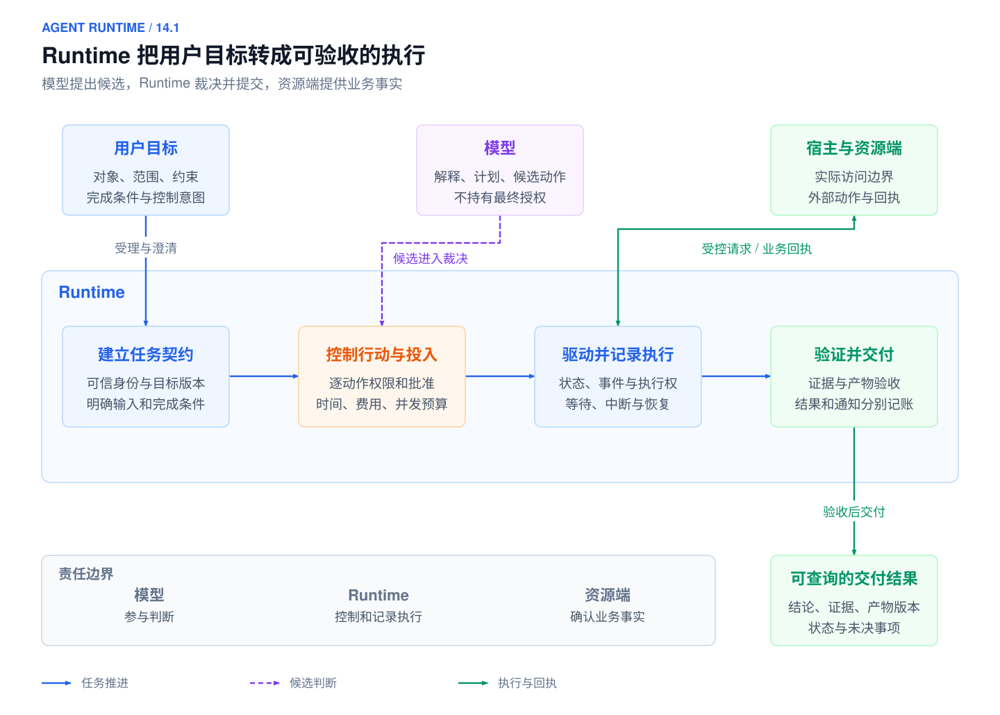](../images/agent-runtime-14-1-overview.svg)

*图 16-1：Runtime 职责概览：目标、候选判断、受控执行、事实记录与验收交付*

*从目标到交付的责任边界；模型提议、执行裁决与业务事实分别确认。本书参考设计，点击图片查看 SVG。*

Runtime 的设计从任务承诺开始。用户交付一个目标，系统需要说明是否受理、当前做到哪里、正在等待什么、哪些动作需要批准、结果依据什么成立。一次模型请求成功，只能说明获得了输出；任务是否允许继续、动作是否已生效、结果能否交付，需要应用维护的事实和规则来回答。

本章贯穿同一次告警诊断教学运行：`ALR-20260429-017` 报告 `order-service` P95 从 210ms 升至 2.1s，Runtime 建立 `run_0429_017`，在 `trace_20260429_017` 中关联取证、审批、建单与通知。指标、日志和 Runbook 用于只读调查，`create_incident_ticket` 需要批准；不提供重启与回滚工具。建单回执丢失时接管者查到原工单 `INC-4821`，通知仍可能重复。这些数值和结果均是虚构教学设定，诊断质量由治理章节另行验收。短问答可以直接完成，长任务可以跨请求等待；两者共享责任模型，实现强度由实际承诺决定。


<a id="1511-从模型输出到任务承诺"></a>

### 16.1.1 从模型输出到任务承诺

模型具备选择工具、综合证据和修订计划的能力，为动态任务提供了基础。MRKL 与 Toolformer 分别研究模块组合与模型学习调用工具的机制。[[1]](#ref-1)[[2]](#ref-2) 本书据此区分能力描述与执行授权：即使模型能提出某个调用，Runtime 仍要把它限制在可信系统允许的范围内；后一句是本书的工程边界，不是这两篇论文给出的安全保证。

| 承诺 | Runtime 必须维护什么 | 可检查的结果 |
| --- | --- | --- |
| 明确目标 | 输入对象、范围、约束、完成条件及其版本 | 组件使用同一份任务契约，缺失字段有澄清状态 |
| 控制行动 | 当前主体、资源范围、策略和必要批准 | 每次动作具有可核对的裁决，不因模型换路线而越权 |
| 有界执行 | 时间、调用次数、费用、并发和取消意图 | 重试与委派共用总预算，达到边界后停止新增工作 |
| 保存进度 | 已接受的结果、未决动作、等待条件和执行责任 | 进程退出后仍知道哪些事实成立，哪些需要核验 |
| 验证并交付 | 验收依据、产物版本、访问资格和交付状态 | 可以区分计算完成、业务生效与通知结果 |

这些承诺可以由普通函数和请求内状态实现，也可以依靠持久调度。关键是如实声明故障后的行为：只支持请求内计算时，不能把响应中的“处理中”当作重启后仍可继续的承诺；只有完成持久受理后，才可以向调用方承诺任务身份和查询入口长期有效。

任务目标还会发生变化。用户补充一个条件，可能是在修改当前任务，也可能是在提出独立目标。系统应保存被接受的修订，并使未来动作采用新约束；已经发生的外部动作不能因目标改变而从历史中消失。持续触发的任务还需规定触发条件、有效期限、资源访问范围和通知方式，一次授权不能自动延伸成无限期行动权。

<a id="1512-agent-loopharnessworkflow-与-runtime"></a>

### 16.1.2 Agent Loop、Harness、Workflow 与 Runtime

这几个术语观察的是不同层次，实际实现可以重叠。先区分它们的职责，有助于判断某个 SDK 或自建模块究竟提供了什么。

| 概念 | 关注的问题 | 与 Runtime 的关系 |
| --- | --- | --- |
| Agent Loop | 如何根据当前观察提出下一步行动，何时继续或结束 | 是决策与行动循环，不独立拥有用户授权和业务事实 |
| Harness | 如何为模型组织上下文、工具、约束、验证和反馈 | 是围绕模型的工作环境，可以承担 Runtime 的部分实现 |
| Workflow | 步骤之间有什么顺序、分支、依赖和失败出口 | 定义路径，可嵌入一个或多个有界 Agent 节点 |
| Orchestrator | 谁激活节点、分配分支并汇总结果 | 承担协调职责，需要依赖状态与执行权机制 |
| Runtime | 一个任务如何从受理走到执行、等待、恢复和交付 | 负责端到端生命周期与责任边界 |

固定 Workflow 的路径由代码预先规定，动态 Agent 的下一步由模型结合观察决定；复杂任务可以将两者组合。[[3]](#ref-3) Runtime 同时支撑这两种执行方式，不要求所有任务都动态规划，也不要求有工具的任务都循环多轮。

模型适合解释、摘要、候选计划、证据归纳和允许范围内的路径选择。身份认证、租户归属、额度预留、状态提交和业务回执核验则需要明确规则。工具返回“已执行”、模型输出“已完成”、界面收到最后一段文本，都需要放到任务契约中判断其真实含义。

Runtime 与宿主环境也有边界。Runtime 决定动作资格和执行限制，操作系统、容器、沙箱以及资源端负责真正限制文件、进程、网络和业务资源的可达范围。目录命名、角色提示词和工具列表可以减少误用，但不能替代底层访问控制。


<a id="runtime-model-boundaries"></a>

<a id="1513-设计约束与责任边界"></a>

### 16.1.3 设计约束与责任边界

模型负责基于当前输入提出候选解释、计划、工具动作或结束建议；Runtime 负责检查这些提议是否满足任务契约、权限、预算和验收要求。模型可以帮助理解意图，但不能自行补造用户授权；可以建议任务完成，但不能仅凭自己的判断改写权威终态。

因此必须区分三种权力：**提出下一步、批准执行、确认事实**。Agent Loop 与 Planner 承担提议职责，Policy 与人工控制承担授权职责，状态管理与 Verifier 接受有证据的结果，业务后端提供外部动作的事实依据。任何替代工具或子 Agent 都沿用这些边界。

<a id="llm-的工程特性与控制边界"></a>

**LLM 的工程特性与控制边界**

| 特性 | 工程后果 | Runtime 的控制手段 |
| --- | --- | --- |
| 概率生成，而非规则执行 | 相同输入可能得到不同输出；模型可能补全缺失信息或违反约束 | 结构化输出、确定性校验、有界修复与不确定时的停止条件 |
| 模型不持有提示词之外的权威任务状态 | 可能重复已完成步骤、淡化早期约束或把临时假设当作事实 | 在系统中保存任务状态、已接受的决策与 Operation，不依赖聊天记忆维持执行正确性 |
| 对上下文敏感 | 错误文档、过期 Memory、工具错误与恶意指令都可能改变输出 | 检索与权限过滤、来源和时效标注、冲突处理、注入隔离及输入边界检查 |
| 可以辅助判断，但不能承担系统责任 | 适合意图识别、摘要、候选方案、风险解释与证据归纳 | 权限、生产变更、金额计算、审计与最终事实确认由确定性组件和有权主体负责 |

这些特性解释了为何需要独立的状态、授权与验收组件；“让模型参与判断，由系统承担责任”是本书的设计原则，不能理解为模型天然具备可靠风险判断能力。

上述约束决定三个设计原则。第一，系统记录的状态必须能解释模型当前依据什么继续；第二，每个动作都在实际派发时核验资格，不能把循环入口的一次检查当作永久许可；第三，失败状态要保留不确定性，超时和取消不能证明外部动作没有发生。

可靠性也包含活性：系统既要阻止错误动作，也要让正常工作能够完成，让阻塞有责任人和处理期限。对所有失败一律暂停会造成无人处理的积压；对所有失败一律重试则会扩大成本和副作用。后续架构与状态模型要同时表达自动推进、持久等待、人工处理及最终收敛。

### 16.1.4 先走通一次正常执行

对 run_0429_017，先受理诊断目标，绑定可用的模型、工具、知识来源和任务预算。知识系统交付候选 Evidence，Context Builder 按第 13 章规则装配，模型提出查询或答案；Runtime 裁决动作并消费工具观察，直到满足验收、需要等待或必须停止。

```python
# 教学伪代码：各服务接口省略实现；每次推进只处理一个逻辑决策边界。
def advance(run_id):
    run = ledger.read_current(run_id)
    ledger.require_runnable(run)
    evidence = knowledge.read_for_gap(run.evidence_gap, scope=run.scope)
    package = context.build(run, evidence, capability_snapshot=run.capabilities)
    proposal = models.propose(package)
    decision = policy.evaluate_current(run, proposal)
    if decision.requires_wait:
        return ledger.persist_wait(run, decision)
    policy.require_allowed(decision)
    if proposal.is_answer:
        return verifier.accept_and_commit(run, proposal)
    dispatch = ledger.prepare_authorized_dispatch(run, proposal, decision)
    observation = tools.execute_or_query(dispatch)
    return ledger.accept_observation_and_schedule(run, observation)
```

模型 API 负责输入输出协议（第 12 章），上下文系统定义本轮信息组织（第 13 章），工具系统提供受控调用（外部工具章），知识系统维护检索与证据生命周期（外部知识章）。Runtime 决定何时使用它们、如何反馈到下一轮以及谁有权提交状态。该简例不包含并发与崩溃原子性；执行权、决策持久化和 C1–C7 的完整条件见后文，不能把整段函数无条件重跑。

<a id="runtime-components"></a>

<a id="152-架构与核心对象"></a>

## 16.2 架构与核心对象

[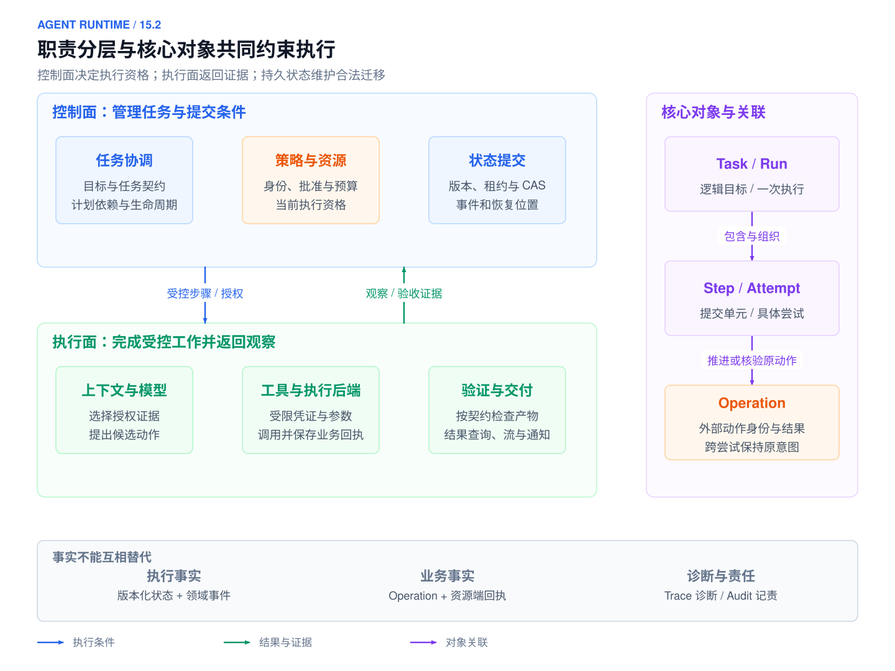](../images/agent-runtime-14-2-overview.svg)

*图 16-2：Runtime 架构概览：控制面、执行面、对象身份与权威事实*

*组件按职责协作，状态、事件与资源端回执承担不同事实责任。本书参考设计，点击图片查看 SVG。*

下列区分避免把本书字段误当作产品标准：

| 层次 | 内容 | 适用边界 |
| --- | --- | --- |
| 业界机制 | Outbox、Idempotent Receiver、CAS、fencing、Saga、持久工作流 | 各有存储、资源端或确定性前提，参考相邻来源 |
| 本书参考设计 | C1–C7、对象状态名、恢复类别、Step 代次命名空间、显式写屏障 | 用于说明责任；接入框架时须做映射，不宣称框架自动提供 |

Runtime 可以按逻辑责任拆成控制面、执行面与横切设施，再通过共同的对象模型协作。本节采用“版本化状态与事件共同提交”的参考实现：状态库负责当前事实，事件保留变化过程，Worker 提交结果提案，由受控状态接口决定是否接受。它并不要求每个组件成为独立服务。


<a id="control-execution-plane"></a>

<a id="runtime-component-planes"></a>

<a id="1521-控制面执行面与组件分工"></a>

### 16.2.1 控制面、执行面与组件分工

[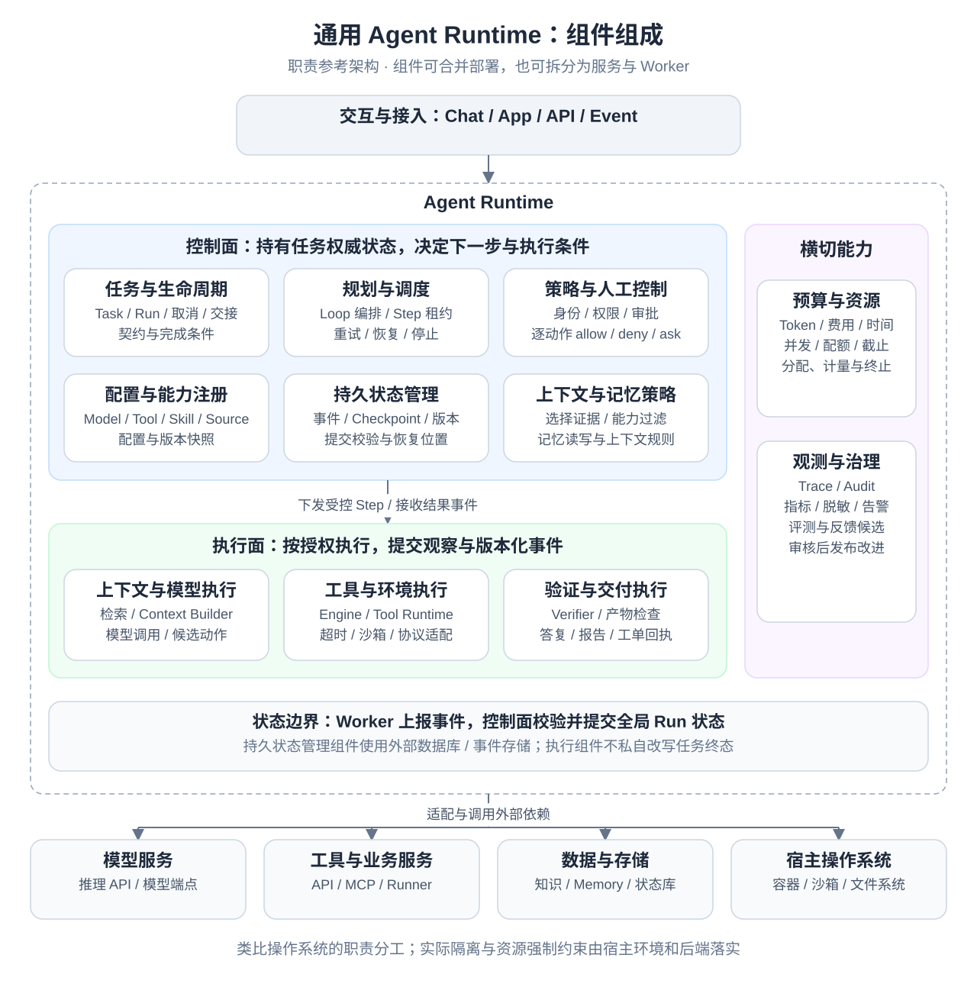](../images/agent-runtime-component-architecture.svg)

*图 16-3：通用 Agent Runtime 组件组成：控制面、执行面、横切能力与外部依赖*

*通用组件参考设计。控制面持有任务权威状态，执行面运行受控步骤；预算与观测贯穿各组件，宿主环境落实实际隔离。点击图片查看 SVG。*

<a id="控制面管理任务事实与执行条件"></a>

**控制面：管理任务事实与执行条件**

控制面持有 Task / Run 的权威状态，决定任务契约、依赖关系、执行资格与完成条件。入口路由与意图归一负责把请求变成明确的任务；能力目录提供可选的模型、工具、Skill 与数据源；规划与循环控制提出候选步骤；Policy 与人工控制决定哪些动作获准执行；调度与状态管理负责执行权及状态提交。模型可以参与意图理解和规划，但候选计划、候选动作与已提交事实必须分开保存。

<a id="执行面完成受控计算并返回证据"></a>

**执行面：完成受控计算并返回证据**

执行面包括上下文装配、模型调用、工具适配、实际执行、结果检查与交付适配。它根据控制面提供的任务、版本和权限工作，返回结构化观察、验证结果、产物与回执。执行 Worker 可以保留当前调用句柄、进程信息和局部缓存，但这些局部状态不能替代持久任务事实，也不能成为它自行推进全局 Run 状态的依据。

<a id="横切能力约束并记录各组件的工作"></a>

**横切能力：约束并记录各组件的工作**

预算与生命周期控制贯穿模型调用、工具执行和委派；身份与凭证管理限定资源访问范围；Trace、Audit 与指标记录因果、用量和裁决证据。它们通过统一接口作用于各组件，各自的预算、授权和审计记录仍须有明确归属，不能形成另一套相互冲突的任务状态。数据库、消息系统、对象存储和沙箱提供底层支撑，Runtime 负责在它们之上建立一致的任务语义。

下表进一步定义各组件管理的信息。“管理状态”不代表组件拥有一套独立数据库；权威状态应通过统一的提交边界维护，执行组件可以只保存局部句柄与受控引用。

| 组件 | 核心职责 | 管理的状态或配置 | 职责边界 |
| --- | --- | --- | --- |
| 入口路由（Event & Intake Router） | 识别请求、回调与触发事件，关联任务入口 | 入口类型、请求标识、可信身份信封与关联信息 | 接收消息不代表业务动作已完成；不自行决定任务目标 |
| 意图归一（Intent Normalizer） | 明确目标、范围、约束与交付条件 | 任务契约、输入版本、待澄清字段 | 不把模型推测当作用户已确认的事实或授权 |
| 能力目录（Registries / Catalog） | 描述可选模型、工具、Skill、数据源及验证器 | 能力标识、版本、Schema、依赖与适配器绑定 | 注册不等于授权；Skill 是方法说明，不能授予工具权限 |
| 规划器与编排器（Planner / Orchestrator） | 表达步骤、依赖、分支与子任务关系 | 候选计划、已接受的任务图、节点契约与依赖 | 计划不等于执行事实，不拥有绕过 Policy 的权力 |
| 循环控制器（Agent Loop） | 根据当前观察提出继续、澄清、修订或结束 | 已记录的模型决策、当前观察引用与循环位置 | 模型提议不能直接提交状态、授予权限或宣告任务成功 |
| 策略与人工控制（Policy / Approval） | 判断动作资格，管理审批与人工决策 | 策略版本、裁决记录、审批对象与有效范围 | 批准只覆盖绑定的动作；裁决本身不执行工具 |
| 调度器（Scheduler） | 管理依赖就绪、任务分配、并发与执行权 | 待执行项、队列关联、租约与执行代次 | 获得执行权不代表外部副作用已经发生 |
| 状态与恢复管理（State / Checkpoint） | 接受合法迁移，保存可恢复的任务事实 | Task / Run / Step / Attempt、Operation、事件与 Checkpoint | 持久记录不能代替业务后端的真实回执；快照不等于撤销能力 |
| 上下文构建与记忆接口（Context / Memory） | 选择本轮可见证据，受控读写跨任务信息 | 上下文包、来源与版本引用、记忆访问及写入记录 | 记忆不是执行账本；历史可见不代表当前仍有访问权 |
| 模型调用适配器（Model Adapter） | 封装模型请求、响应与用量 | 请求参数、模型标识、调用结果与用量记录 | 模型服务提供候选输出，不掌握任务状态与授权的最终决定权 |
| 执行引擎（Execution Engine） | 在获准范围内驱动调用，管理局部超时与进程 | 当前 Attempt、调用句柄、截止时间与执行结果 | 不自行创建新的业务意图，不越过调度器决定全局执行权 |
| 工具运行时与连接器（Tool Runtime / Connector） | 映射能力、校验参数、适配协议并规范化观察 | 工具绑定、连接会话、请求与回执关联 | 连接成功不代表获准访问；协议适配不保证业务写入幂等 |
| 执行后端（Execution Backend） | 执行 Shell、沙箱任务或业务 API 请求 | 进程、工作区、资源端状态及业务回执 | 实际隔离与副作用由后端落实，Runtime 中的声明不能替代它们 |
| 验证器（Verifier） | 按规则检查格式、证据、产物与业务结果 | 验证规则版本、检查结果及证据引用 | 验证器报告是否达标，任务终态仍由控制面接受并提交 |
| 产物与交付（Artifact / Delivery） | 保存产物版本，向用户或渠道提供结果 | 产物引用、内容哈希、交付记录与渠道回执 | 任务完成、产物保存与通知送达是不同事实 |
| 预算与生命周期控制（Budget / Lifecycle） | 限制轮数、时间、费用、并发及子任务用量 | 根预算、分配与消耗记录、截止时间、取消信号 | 重试或委派不能重置预算；取消信号不证明在途动作已撤销 |
| 身份与凭证管理（Identity / Credentials） | 绑定租户与主体，提供受限资源访问凭证 | 主体映射、凭证引用、作用域与有效期 | 凭证可用不代表业务批准，密钥值不进入模型上下文 |
| 观测与审计（Observability / Audit） | 关联执行过程、裁决、成本与诊断证据 | Trace、审计事件、指标与关联标识 | 诊断日志不替代领域状态、Operation 账本或业务事实 |

这里的 Runtime 是上述职责的整体，而不是与 Agent Loop、Execution Engine 并列的另一个执行节点。同样，“控制面 / 执行面”划分的是决策与执行责任，不是按组件名称机械划分进程：例如 Verifier 的规则归控制面管理，检查可以在 Worker 中运行，检查结果由控制面接受；上下文访问规则与实际检索也可以分别部署。

逻辑上的控制面可以直接调用同进程执行器，也可以通过持久调度驱动远程 Worker。网络边界增加了失败窗口，拆分部署后还需要明确请求去重、调用超时与结果未知的处理，不能把进程内函数调用的假设直接搬到 RPC 上。

<a id="runtime-module-interfaces"></a>

<a id="1522-模块接口与执行契约"></a>

### 16.2.2 模块接口与执行契约

组件传递带身份、版本、约束和输入引用的不可变数据。入口提交受理身份；Context Builder 返回上下文包；模型返回提议；Policy 返回当前裁决；执行器返回观察；状态接口条件提交进度，Verifier 判断验收。前面的短循环展示调用顺序，后面的 C1–C7 明确持久边界。

每个接收方验证可信身份，不能因为载荷含 tenant_id 或 authorization_ref 就接受。敏感连接、实现地址和凭证引用来自运行绑定，不能由模型拼接。错误通道保留发生层次、可重试提示、可能效果和关联对象；等待返回持久记录与触发条件。

嵌套工作流约定唯一的总预算、重试与取消责任。局部节点可以修复本层失败，但不能重置根额度、放宽权限或直接完成父任务。完整工具输入输出契约由[外部能力接入](04-skills-tools-mcp-connectors.md#tool-contract)定义。

<a id="object-model"></a>
<a id="runtime-object-identities"></a>
<a id="durable-state"></a>

<a id="1523-对象身份作用域与关联"></a>

### 16.2.3 对象身份、作用域与关联

组件名称说明“谁负责”，对象身份说明“负责哪件事”。以下对象构成本章的参考模型，不会因为组件拆分或 Worker 更换而重新定义。

| 对象 | 本次 ALR 中的含义 | 稳定边界 |
| --- | --- | --- |
| Task | 用户要完成的诊断目标与契约 | 新目标才产生新 Task |
| Run | run_0429_017 的一次版本化执行 | 重连、重启和接管保留该身份 |
| Step | 取证、形成草稿、建单等逻辑提交节点 | 重试不重建逻辑节点 |
| Operation | 创建 INC-4821 的独立业务意图 | 多次尝试/查询使用原身份 |


对象身份绑定租户与作用域。状态版本与执行权代次分别阻止旧数据覆盖和旧执行者推进，详细字段在可靠性部分按故障引入；Trace/Span 和传输请求 ID 只用于关联，不替代业务身份。

以下对象关系是本书参考设计中调度和恢复的基础，不要求每个产品都暴露全部对象：

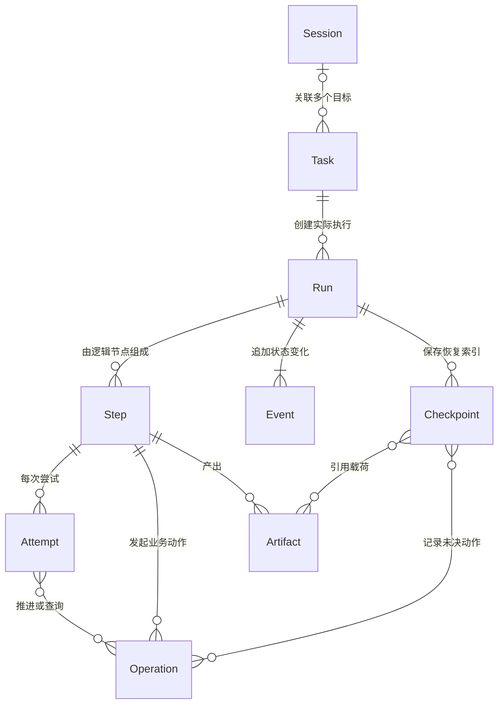

图中最需要注意的是 Operation 与 Attempt 的关系：一个业务动作可以被多次尝试推进或查询，但它的身份不随尝试变化。Event 记录 Run 上已经被接受的状态变化，Checkpoint 是从这些事实中整理出的恢复索引，Artifact 则承载不适合放进状态表的大载荷。

这些身份必须分开的原因在于，它们在不同的时机变化。一个 Run 可以由不同 worker 接续，经历多次重连才完成，所以线程、进程、连接与 Run 不能共用一个身份字段。如果把 Task 和 Run 混为一个 id，系统就无法区分“重试”和“重新运行”，计费会出错，不同版本的执行历史也会互相覆盖。

本节先使用 Task、Run、Step、Operation 四个稳定对象。Session 记录交互，Attempt 记录一次尝试，Event/Checkpoint/Artifact 分别提供变化记录、恢复索引和版本化载荷；它们在后续执行与恢复中逐步展开。执行权代次和两种幂等键的字段约束在[执行权与迟到提交](#failure-ownership)处定义。

<a id="连接与运行绑定"></a>

**连接与运行绑定**

| 对象 | 定义与归属 | 不能混同的事实 |
| --- | --- | --- |
| Connector 定义 | 可复用的实现、端点类型、协议与能力契约 | 已安装适配器不代表任何用户已授权连接 |
| Connection | 用户或组织对某个外部账户和资源的授权关系，有明确责任人 | 连接存在不代表所有任务都能使用其中全部权限 |
| Run Binding | 将选定 Connection 收窄到本次 Run 的动作、资源与策略版本 | 子 Agent 不自动继承完整连接权限 |

例如，同一个工单 Connector 可服务多个组织；Connection A 属于租户 A，Run R 仅绑定项目 P 的读取与待审批创建权限。后续每次调用都使用这个受限绑定，而不是由模型输入的 URL 或项目名自由选择连接。绑定如何参与派发见 [本次执行的能力绑定](#execution-run-binding)。

<a id="runtime-fact-authority"></a>

<a id="1524-状态机与条件提交"></a>

### 16.2.4 状态机与条件提交

状态机定义对象允许处于哪些状态，以及哪些变化具有业务意义。Run 的执行状态、Step 的推进状态、Operation 的外部结果和用户界面的展示状态是不同维度：例如 Run 已取消，仍可能存在需要核验的在途 Operation；界面中的“处理中”也不应成为后端状态的权威来源。下表先说明事实归属，随后定义状态迁移与提交规则。

| 信息 | 权威来源及管理责任 | 不能替代它的信息 |
| --- | --- | --- |
| 目标与约束 | Task 契约及明确接受的修订 | 模型猜测、未确认的历史摘要 |
| 执行状态与执行权 | 控制面接受的持久状态、领域事件与版本记录 | Worker 内存、连接存活或队列可见性 |
| 业务副作用 | Operation 账本中关联的资源端回执与核验事实 | 模型宣称成功、工具调用已发出 |
| 可供继续使用的执行依据 | Checkpoint 引用的已提交事实、配置和产物 | SDK session ID 或一份对话摘要 |
| 对话与跨任务信息 | 消息存储与受治理的 Memory | 任务事件账本；两者不互相替代 |
| 诊断与审计证据 | Trace、Audit、指标及其关联记录 | 不能仅凭普通 Trace 重建全部任务事实 |

<a id="run-的状态维度"></a>

**Run 的状态维度**

| 状态 | 含义 | 允许的后续处理 |
| --- | --- | --- |
| `QUEUED` | 已受理并等待调度 | 取得执行资格后进入运行，或接收取消 |
| `RUNNING` | 正在推进可执行步骤 | 继续、进入等待、暂停、取消或提交终态 |
| `WAITING` | 已登记审批、输入、事件或定时器 | 满足匹配条件后恢复，超时按契约处理 |
| `PAUSED` | 当前禁止自动推进，但保留恢复可能 | 明确恢复授权和条件后重新排队 |
| `CANCELLING` | 已禁止新工作，正在停止执行和登记在途责任 | 到达执行停止边界后提交取消结果 |
| `COMPLETED` | 任务完成条件已经通过并提交 | 保持终态；通知重试独立处理 |
| `FAILED` | 当前执行无法按契约完成 | 保留证据；修复或重新执行采用明确入口 |
| `CANCELLED` | 当前执行承诺已经结束 | 核验在途外部事实，不再激活普通后继 |

`WAITING` 另存 `wait_kind`，区分等待输入、审批、人工核验、工具作业和定时器；`FAILED` 另存错误与恢复分类。结果完整性、通知状态和 Operation 事实通过独立字段表达，避免把几十种组合塞进同一状态枚举。运行仍在进行时，已经有部分产物也不表示进入完成终态。

Step 的状态可以细化为等待依赖、可运行、执行中、等待外部结果、已完成和失败；其迁移需要满足计划版本、输入版本及验收条件。Attempt 只记录本次尝试的开始、结果和用量，Operation 则独立记录外部动作是否发生。子 Step 的失败不一定使整个 Run 失败，是否允许修复或部分交付由父契约决定。

除 Task 与 Run 外，Step、Operation、Artifact、事件与幂等索引均绑定 tenant_id；查询和唯一约束包含租户，不能仅靠全局随机 ID 代替隔离。

同一个 Run 可能同时被恢复 Worker、取消请求、回调和定时器更新。处理并发有两类方案：actor 等单写者机制把命令交给唯一有效写入方串行处理；CAS 允许多个请求竞争提交，但只接受符合当前版本和状态条件的迁移，失败者重读后决策。两者都要防止过期执行者写入，不能把“采用 CAS”直接称为物理单写者。本章以下以 CAS 加执行代次作为参考实现。

本章以数据库条件更新作为参考实现。一次状态迁移在同一个事务中完成以下检查：当前状态是否符合迁移前提，状态版本（`state_version`）是否与调用方读取时一致，执行权代次是否仍是最新。检查全部通过后，事务更新状态并追加事件；任何一项不符，写入都会失败。这种做法也称为比较并设置（compare-and-set，CAS）。每次更新都返回新的版本号，冲突时调用方重新读取，再决定合并还是失败。事件表按 `run_seq` 建立唯一约束，因果顺序由服务端分配的序号决定，客户端的墙钟时间不参与判断。

条件更新之外，还要检查业务前提。获得授权并不代表前提会一直有效：人工批准之后，目标资源可能已被修改，任务可能已被取消，租户权限也可能已被收回。因此，在真正执行之前仍要重新校验资源版本和当前授权，不能把一次旧的批准当作无限期的通行证。

分布式锁无法单独解决这些问题。锁会超时，worker 会崩溃，外部副作用也可能在锁释放后才完成。只有把状态机、租约、幂等键和外部查询接口组合起来，系统才能安全恢复。此外，事件处理器本身必须幂等，由事件派生的投影（projection）必须可以重建。多个 Agent 共享任务状态时，要明确哪些字段只能由协调者写入，哪些内容是只追加的消息。

Runtime 的事实由追加式事件组成，例如 `RUN_CREATED`、`STEP_STARTED`、`MODEL_COMPLETED`、`TOOL_REQUESTED`、`TOOL_SUCCEEDED`、`APPROVAL_REQUIRED`、`RETRY_SCHEDULED`、`RUN_PAUSED` 和 `RUN_COMPLETED`。当前状态可以由事件派生，也可以保存为带版本的状态快照。重复事件、乱序事件和迟到 worker 的回报，都要通过序号、Attempt 和状态版本加以校验。

状态机定义哪些迁移是合法的。例如，RUNNING 可以进入 WAITING、PAUSED、CANCELLING、FAILED 或 COMPLETED；WAITING 通过 `wait_kind` 说明是在等工具、批准还是输入。COMPLETED 不能被迟到的失败事件覆盖；进入 CANCELLED 之后，新的普通业务动作必须被拒绝。持久工作流可以依据有序事件历史重建推进位置。[[4]](#ref-4) 状态机执行一次、消息投递一次与外部动作生效一次属于不同保证；本章通过状态条件、稳定 Operation 和资源端契约分别处理，不能用一个“exactly-once”标签概括。

运行终态与业务事实要分开保存。CANCELLED 表示不再继续这次执行，而外部工具晚到的成功仍然是真实发生的事实。系统可以追加核验事件或补偿事件来解释它，但不能为了让界面看起来整齐而删除它。反过来，远端成功也不能让已取消的 Run 自动回到 RUNNING 并继续后续动作。终态保护的是执行承诺，账本保留的是业务世界中已经发生的变化。

普通 Trace 可能被采样、脱敏或截断，不能替代持久状态。本章以一致提交的状态与领域事件为恢复依据，派生投影可以重建；外部动作是否生效仍需核对资源端证据。


<a id="trace-ledger"></a>

<a id="1525-存储职责事件与观测"></a>

### 16.2.5 存储职责、事件与观测

四类存储保存的内容各不相同。对话历史保存“说过什么”，记忆（Memory）保存经过治理的跨任务信息，执行事件保存已经被接受的状态变化，Operation 账本保存外部动作的意图与事实。摘要里可以写着“已经创建工单”，但恢复 worker 必须通过对应的 Operation 和外部对象来确认这一点。模型记忆中的一句“已成功”，没有足够的身份、版本和证据，不能作为再次执行或宣布完成的依据。

状态表也不必承载所有内容。任务目标、当前版本、依赖关系、执行权和未决操作需要可查询，因此放在状态表中；长文本、文件、工具原始载荷和报告进入受控的 Artifact 仓库；事件则保留状态变化的因果。读取 Artifact 时要再次检查当前权限，曾经进入过某个 Run 的内容，并不意味着永远可见。内容哈希可以证明载荷是否发生变化，但它不能代替鉴权，也不能证明业务含义正确。

单次执行的恢复状态与跨任务共享信息应采用不同的存储契约；内存实现可以验证接口，但无法证明进程重启后的耐久性。[[5]](#ref-5) 在本章的参考设计中，状态、事件、Artifact 与记忆可以共用底层存储，但各自的提交、删除、权限和保留规则必须分别定义。

Runtime 也不应把全部历史消息直接拼进每一次提示词。消息存储（message store）保存原始消息及其来源、时间、权限、哈希和父消息；上下文构建器（context builder）则根据当前 Step 的预算、任务、工具、记忆和安全策略，选择模型可见的内容，并记录最终提示词的版本和组成摘要，以便回放与审计。超出窗口时，安全约束和用户目标不能被静默删除。上下文的优先级与压缩策略见[上下文组装](#context-builder)。

ReAct 的结构化候选动作和观察必须由状态机接受；不保存或展示完整思维链，也不把自由文本当作迁移。循环判据见[Agent Loop](#execution-loop)，模式定义见[16.4.4 编排模式、依赖图与汇合](#workflow)。

Trace 记录一次执行经过哪些组件、各次调用耗时以及用量，Audit 保存谁触发、批准或执行了什么。两者需要关联 Task、Run 和 Operation，但普通诊断记录可能采样、截断或延迟导出，不能据此推导完整业务事实。强审计要求的行动记录要进入可确认的持久路径，再异步导出诊断视图。

可以为每个 Run 建立可查询的执行账本：任务版本、状态序号、当前节点、Attempt、调用输入摘要、裁决、外部动作和产物引用都能相互定位。账本不保存模型完整思维链；需要解释的是使用了哪些证据、采取了哪些动作、为什么通过或停止。敏感正文存放受控载荷，日志仅保留必要索引，访问日志本身也需要权限管理。

运行指标应从这些对象派生：排队时长与执行时长分开，模型、工具、审批等待和交付各有耗时；成功任务成本包含失败尝试与核验；UNKNOWN Operation 的数量和年龄独立于 Run 成功率。否则进程都正常、终态都好看，也可能掩盖长期无人处理的外部事实。

<a id="runtime-startup"></a>

<a id="153-启动与任务受理"></a>

## 16.3 启动与任务受理

[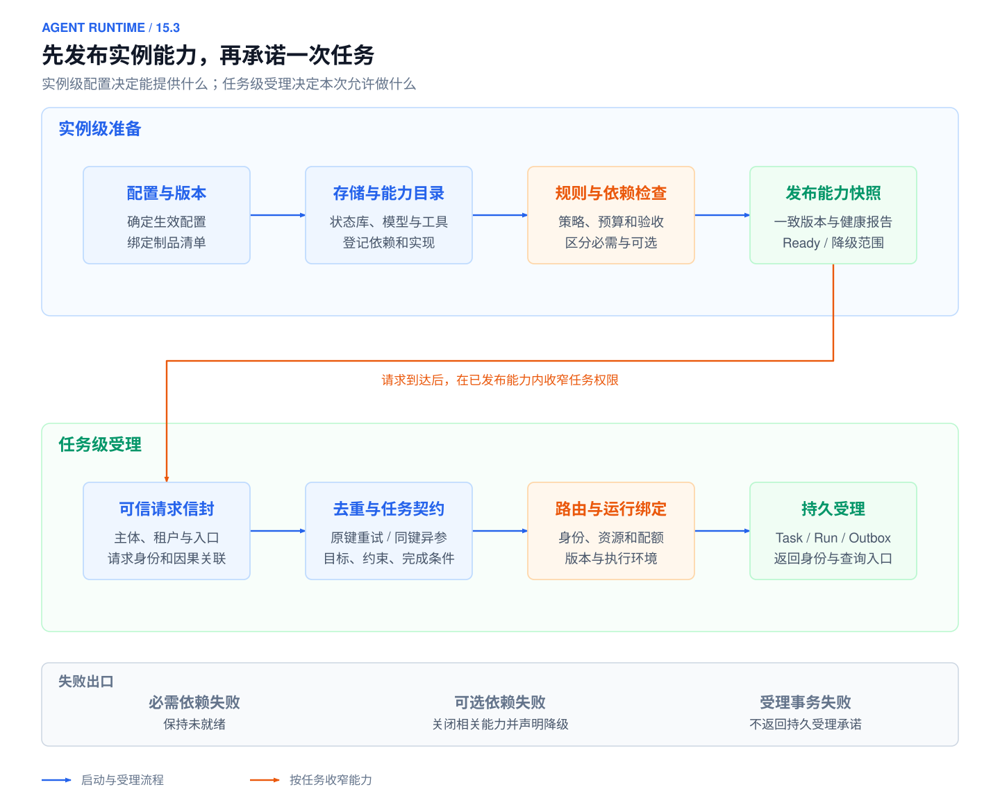](../images/agent-runtime-14-3-overview.svg)

*图 16-4：Runtime 启动与受理概览：实例准备、能力发布、可信输入和持久受理*

*上半部分准备实例能力，下半部分在本次身份与资源范围内建立任务承诺。本书参考设计，点击图片查看 SVG。*

启动建立实例可以提供的能力，受理把这些能力收窄为一次具体任务的承诺。前者处理部署配置、实现版本和依赖，后者处理用户身份、目标、资源和本次预算。两阶段不能混同：实例拥有一个可执行工具，不代表当前用户可以调用它。

<a id="1531-读取配置与外围能力快照"></a>

### 16.3.1 读取配置与外围能力快照

Runtime 启动时读取经过验收的 manifest，关联模型适配器、工作流、Prompt、Skill、工具契约、Connector、Policy、Verifier 和预算模板。它检查引用是否齐全、格式是否兼容、必需与可选依赖是否区分。能力侧怎样打包、实现和注册，参考[工具契约与接入](04-skills-tools-mcp-connectors.md#tool-contract)相关内容。

状态、事件、Outbox、Artifact 和观测客户端按部署角色初始化；数据库迁移由发布流程负责。密钥只以受控引用传递，不进入模型、快照或日志。无效的必需依赖阻止 Ready；可选来源故障只关闭对应能力，并公开降级范围。连接可达不证明当前用户有权调用，也不证明结果质量。

<a id="capability-discovery-loading"></a>
<a id="startup-capability-catalog"></a>

<a id="1532-发现可见加载与授权"></a>

### 16.3.2 发现、可见、加载与授权

| 外围系统提供什么 | Runtime 怎样消费 | 此时尚未成立的事实 |
| --- | --- | --- |
| 版本化 Tool Registry 与输入输出契约 | 检查工具名、版本及受信实现绑定 | 工具已注册不等于本次任务可执行 |
| Skill 元数据与按需正文入口 | 按任务类型匹配方法，加载后记录包版本 | 方法加载不授予资源权限 |
| MCP server/discover 与 tools/list 结果 | 核对逐请求版本和能力，校验远端描述并归一到本地目录 | 远端描述与 annotations 不是授权依据 |
| Connector 的 Connection 与权限作用域 | 创建收窄的 Run Binding | 连接存在不等于可使用全部权限 |
| 沙箱与执行后端的资源配置接口 | 分配本 Run 的目录、网络、进程和额度 | 目录分开不代表凭据与外部资源隔离 |

生命周期分别记录已安装、已发现、已可见、已加载、已获准执行，不能用一个 enabled 推断全部成立。延迟加载的能力只在首次使用前补齐发现与契约检查，未知工具不先行暴露为可执行。凭证按派发时的当前授权解析，当前撤权优先于历史快照。

<a id="startup-ready"></a>
<a id="startup-version-updates"></a>

<a id="1533-就绪版本更新与退出"></a>

### 16.3.3 就绪、版本更新与退出

启动顺序是配置校验、存储连接、读取能力目录、绑定规则、依赖检查、一致发布快照、Ready。API 就绪要能持久受理和查询；Worker 就绪要能认领自己支持版本的工作；本地执行器要能落实工作区与资源约束。允许先排队后执行时公开期限与积压，不能无界接受任务。

新 Run 绑定 manifest 和能力快照，在途 Run 不随默认值悄悄切版本。Worker 不支持该版本时加载兼容制品或等待；未经验证不使用新工具语义解释旧 Operation。回滚只改变后续路由，不撤销已发生动作和当前安全限制，完整发布组合参考[治理与调优中的发布控制](05-agent-governance-optimization.md#release-control)。

退出时先关闭新接入和认领，再提交可恢复边界，登记未决 Operation、等待与交付责任。审批和外部作业等待释放 Worker，由持久记录接续。排空超时也不能把已发出的请求记为未执行，最后保存审计与用量再关闭连接；退出实例不等于结束 Run。

<a id="execution-intake-contract"></a>

<a id="1534-请求信封去重与任务契约"></a>

### 16.3.4 请求信封、去重与任务契约

入口接收用户请求、授权事件或队列消息，先识别它是新目标、当前任务的补充、继续执行，还是查询状态。可信信封绑定租户、主体、会话、环境、请求标识及关联标识；这些字段来自鉴权与路由，不能由模型或正文中的自述覆盖。

意图归一把“查一下为什么延迟，需要处理时先给我看草稿”变成契约：调查哪个告警、可访问哪些数据、时间范围、是否只读、预期证据与草稿格式，以及哪些信息必须澄清。缺少关键对象时先保存待澄清状态，不凭猜测启动写动作。一次消息不必对应新 Task，关联规则由入口契约明确规定。

请求去重键在租户与入口约定的作用域内唯一，并绑定规范化请求摘要。同键同内容返回原受理结果，同键异参报告冲突；不能仅凭自然语言相似度合并独立请求。

**C1：**在一个本地事务中建立 Task / Run，绑定契约与配置版本，保存请求去重结果及调度 Outbox，再返回 accepted 和查询身份。accepted 只承诺任务已被可靠受理。事务与投递之间的故障见 [16.5.2 持久投递、去重与积压恢复](#failure-delivery)。

<a id="请求信封与任务契约示例"></a>

**请求信封与任务契约示例**

Web、企业 IM、IDE、工单、告警、Webhook、定时任务和委派都可以作为入口。路由把原始事件归一为信封，负责来源、可信身份、环境、请求去重与因果关联；Intent Normalizer 负责目标理解，Planner 负责执行顺序。以下告警事件为教学示例，信封身份由入口鉴权绑定，不相信外部载荷自报角色。

```json
{
  "request_id": "req_0429_017",
  "channel": "alert_webhook",
  "tenant_id": "tenant_demo",
  "actor": {"type": "system", "id": "trusted_alert_source"},
  "payload_type": "incident_diagnosis",
  "payload": {"alert_id": "ALR-20260429-017", "service": "order-service", "started_at": "2026-04-29T02:37:00Z"},
  "request_key": "ALR-20260429-017",
  "correlation_id": "trace_20260429_017",
  "environment": "production"
}
```

Runtime 识别为只读诊断任务，补齐受信实体与查询时间窗，再建立契约。模型可以提出查哪些证据，不能扩大到重启或回滚。

```json
{
  "task_id": "task_0429_017",
  "run_id": "run_0429_017",
  "task_type": "incident_diagnosis",
  "user_goal": "调查 order-service 延迟升高，输出带证据的假设和事故工单草稿",
  "entities": {"alert_id": "ALR-20260429-017", "service": "order-service"},
  "allowed_actions": ["get_alert_details", "list_recent_deployments", "prometheus_query_range", "kubernetes_get_pods", "loki_search", "search_runbooks"],
  "requires_approval": ["create_incident_ticket", "send_slack_message"],
  "blocked_actions": ["restart_service", "rollback_deployment"],
  "success_criteria": ["核对时间窗和来源版本", "假设与事实分开", "批准后建单需核验INC编号", "任务结果与通知状态分别记录"]
}
```

实体或目标不明确时返回 `ask_clarification` 和缺失字段。契约中的 allowed / blocked / requires_approval 是本次目标的约束，派发时仍需 Policy 检查当前对象和授权。校验后的同一份契约供 Planner、Context Builder、Registry、Policy、Verifier 与交付界面使用，避免各组件自行解释目标。

<a id="runtime-intake-routing"></a>

<a id="1535-路由会话与受理责任"></a>

### 16.3.5 路由、会话与受理责任

入口路由应区分目标定位与执行定位。目标定位确定租户、用户、会话及任务；执行定位寻找能读取对应状态、加载正确版本并访问指定执行环境的实例。身份来自认证和可信渠道映射，模型只辅助理解目标，不决定请求属于哪个租户或借用哪组凭证。

会话路由可以采用固定实例、共享存储或可迁移绑定。固定实例容易实现，但实例失效后，需要找到原状态和文件才能继续；共享存储降低迁移门槛，却仍需控制并发写入和执行权。保存一个会话 ID 只是保存索引，接收实例若没有原始历史、产物、版本和权限，就不能据此承诺恢复。

新消息到达时，接口明确采用哪一种语义：新建目标、补充当前任务、排队下一轮、请求中断后改向，或只查询状态。补充消息写成带序号的输入事件；当前步骤可以在安全边界读取新版本。若新信息改变已提交结论的前提，应将相关后继标为待复核，而不是在进程中的提示词里悄悄覆盖旧输入。

受理回执至少包含 Task、Run、受理状态和查询方式。同步请求可以在连接内等待，但连接断开不代替任务取消；异步接口返回后，执行责任由持久记录承担。接入层在容量不足时要决定拒绝、持久排队或按优先级降级，并公开队列与截止时间关系，不能接受无限期无法履行的任务。

请求去重也应保存生命周期。记录至少覆盖客户端允许的重试窗口和可能的延迟投递时间；旧键过期后的行为必须明确。不同入口可能承载同一业务事件，是否合并需要业务事件身份和契约，而不是根据文本相似度自动合并。用户明确发起独立执行时，保存新 Run 与原目标的关联，费用、版本和结果分别核算。

<a id="runtime-task-execution"></a>

<a id="154-执行循环与任务收敛"></a>

## 16.4 执行循环与任务收敛

[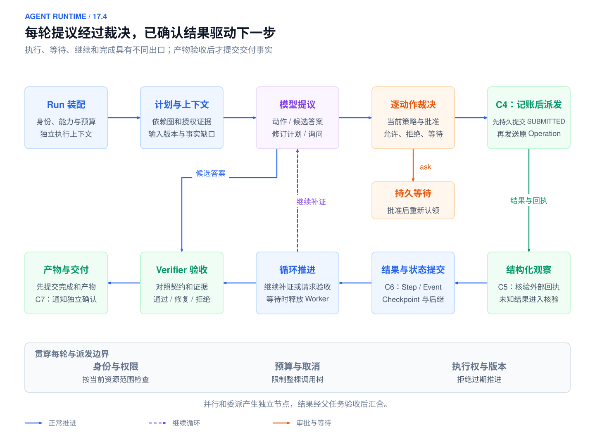](../images/agent-runtime-14-4-overview.svg)

*图 16-5：Runtime 执行概览：装配、模型提议、逐动作裁决、工具观察与验收交付*

*工具动作循环补证；审批进入持久等待，候选答案经过验证后交付。本书参考设计，点击图片查看 SVG。*

受理之后，控制层把任务装配为可执行的 Run，按照计划或有界循环驱动工作。本节展开带持久状态的参考执行协议，短时同步实现可以合并进程与调用边界。正常路径的关键是：每一步都能说清当前输入、允许的动作、接受的结果与下一次提交；合法等待会释放执行资源，完成需要验证与交付。

<a id="execution-commit-map"></a>

<a id="1541-执行链路与提交边界"></a>

### 16.4.1 执行链路与提交边界

一次任务可归并为接入、装配、规划、决策、执行、验收交付六个阶段。上下文与决策可以循环，任务图也可以并行，但已经接受的事实都要经过明确的持久边界。以下 C1–C7 是本书对提交边界的编号，不是七个跨系统原子事务；一个编号可以包含本地提交与外部回执两个协议阶段。

| 提交点 | 保存或确认的事实 | 正常路径 | 故障窗口 |
| --- | --- | --- | --- |
| C1 任务受理 | Task / Run、请求去重结果与调度 Outbox 同一事务提交 | 任务受理 | [投递异常](#failure-delivery) |
| C2 消息投递与可恢复接收 | Relay 的投递记录、消费者持久去重与接续责任 | 调度与执行 | [投递异常](#failure-delivery) |
| C3 步骤认领 | 当前执行者、租约与对象范围内的 `owner_epoch` | 调度与执行 | [执行权异常](#failure-ownership) |
| C4 副作用意图 | Operation、稳定幂等键、规范化参数及授权关联 | 调度与执行 | [副作用异常](#failure-side-effects) |
| C5 外部回执确认 | 已核验的业务结果、外部对象和回执证据 | 调度与执行 | [副作用异常](#failure-side-effects) |
| C6 结果与 Checkpoint | Step 结果、版本、事件及可用产物引用；完成时提交 Run 终态 | 循环推进与验收 | [中断恢复](#failure-recovery) |
| C7 交付与通知 | 待交付记录及渠道接受、送达或可查询结果的事实 | 验收与交付 | [交付异常](#failure-result-delivery) |

观测沿这些边界关联 `tenant_id/request_id/task_id/run_id/step_id/attempt_id`，有外部写入时关联 `operation_id`，并记录 manifest、状态版本和执行代次。模型、工具、审批与交付可各有 Span；异步边界通过关联字段连接，不要求一个 Run 只能有一条 Trace。

Trace 记录“经过了哪里”，状态与领域事件记录“接受了什么事实”。普通 Trace 被采样或截断不应改变业务结果；C1–C7 的关键事实应能从持久记录核对，不能用诊断日志代替提交依据。


<a id="connector-runtime"></a>

<a id="execution-run-binding"></a>

<a id="1542-run-装配预算与资源隔离"></a>

### 16.4.2 Run 装配、预算与资源隔离

装配读取 C1 绑定的 manifest 与契约，并结合当前身份与资源权限，生成本次 Run 的执行包：模型配置、允许请求的工具与 Skill、数据源范围、工作区、上下文规则、根预算及验收器。实例级目录可以很大，模型只看到本次任务需要且允许请求的子集；可见能力也不等于本次动作已获批准。

工作区绑定租户、任务、路径和可写范围。只读调查可以共享不可变材料，涉及修改时需要明确排他或隔离策略；Worktree 隔离文件版本，不隔离共享进程、凭证和网络。子任务只获得完成其契约所需的最小范围。

根预算包含轮数、时间、Token、费用、工具与并发额度。并发派发前预留额度，实际用量返回后结算并释放未用预留；在途费用未知时不能过早释放成可重复使用余额。重试、重新采样、查询核验、委派及孙任务共享同一根账本，子预算之和不能把总上限放大。预算耗尽的处理见[取消与停止](#failure-cancellation)。

产物是带版本的 Run Binding 与执行包，保存身份、权限与凭证引用，不保存明文密钥。该包说明当前任务的装配结果，后续执行仍需检查当前授权与剩余预算。

<a id="把模型提议映射回可信能力与连接"></a>

**把模型提议映射回可信能力与连接**

模型返回的工具名必须映射回本 Run 绑定的可信注册对象，核对 Schema、版本、资源范围和已加载实现；不能把输出中的任意路径、命令入口或端点当作新工具直接执行。安装、发现、可见、加载与获准执行的区别见 [能力目录](#startup-capability-catalog)。

Connector / Connection / Run Binding 的定义见 [runtime object identities](#runtime-object-identities)。派发时从可信上下文取得 `tenant_id/user_id/connection_id` 与凭证引用，模型给出的项目、URL 或资源范围必须与绑定求交集。以项目 P 的读取绑定提出项目 Q 的写入时，不能自动切到另一组织的连接；子 Agent 只取得被收窄的委托绑定。

连接服务在派发前检查当前所有权与授权，明文凭据仅留在服务端或受控凭证提供方。连接凭据按当前授权解析，授权失效后的收敛见 [16.5.6 取消、授权变化与人工接管](#failure-human-control)。

Agent 定义决定程序可提供的能力，Session 组织连续交互，Run 是某个 Task 的实际执行，可以关联 Session，也可以由授权事件独立触发。同一个 Session 默认串行提交共享历史；若多个 Run 并行，应为它们分配状态分支和写入目录，再通过版本检查与明确合并规则提交，防止后完成的结果覆盖较新的历史。

| 资源 | 归属与共享方式 | 保护机制 |
|---|---|---|
| 对话历史、Checkpoint、工作记忆 | 按租户、用户与 Session 归属；相似任务不能共用一份可变历史 | 查询带身份与 Session；并发写入检查版本；跨 Session 共享结论须经发布与授权 |
| 代码、Skill、指令与依赖 | 同版本且有权访问的 Session 可共享不可变快照；每个 Run 绑定具体版本 | 只读挂载、内容校验；由仓库管理服务负责 fetch、快照创建与回收 |
| Workspace、临时文件、构建产物 | 按 Session 或 Run 分配目录 | 独立 worktree 或写入层；权限或沙箱阻止跨目录访问 |
| shell、进程、浏览器、代码执行环境 | cwd、环境变量、端口、Cookie、内核与后台作业按作用域归属 | 独立进程组或执行环境；端口分配与资源限额；取消只回收本次执行的资源 |
| 工具连接与凭证 | 连接池可复用；授权上下文按调用绑定 | 工具入口按可信身份鉴权；按需注入最小权限凭证，不放入公共环境变量或共享 home |
| 检索结果、缓存与知识库 | 只共享调用者有权读取的内容 | 缓存键包含租户、权限范围、输入与版本；命中后仍校验访问权限 |
| 模型额度、CPU、内存与工具并发 | 按服务、租户与 Session、Run 分层分配 | 队列、公平调度、并发上限、超时和取消；原子扣减总预算 |
| 工单、数据库、部署等外部写入 | 多个 Session 可能操作同一业务对象，目录隔离无法消除冲突 | 按目标对象鉴权，使用幂等、事务、条件更新或互斥；幂等键按业务动作定义 |

**会话隔离**分开历史与恢复位置，**工作区隔离**分开文件与产物，**执行隔离**限制进程能访问的文件、网络、凭证和系统资源。

<a id="执行包的传递"></a>

**执行包的传递**

工具实现以显式参数接收执行上下文，或使用能够跨异步任务正确传播的请求作用域。不能使用进程级 `chdir`、全局 `current_session` 或修改公共环境变量来切换请求。每次调用从上下文取得身份、目录、版本、截止时间和凭证引用；连接池可以共享，授权上下文按调用绑定。

文件修改任务可分配独立工作树或写入层，但目录隔离不保护共享数据库、网络服务和主机凭证。需要强保护时，利用文件权限、独立进程组、容器或沙箱限制可达范围；不同容器挂载同一个可写目录仍会发生冲突。取消只回收属于本次 Run 的进程、端口和临时授权，不能误杀其他任务。

预算预留可以表示为 `available = limit - settled - reserved`。派发前原子检查并增加预留，返回后按计量事件幂等结算；调用结果未知时保留相应在途额度，再查询费用或采用已声明的保守口径。不能把请求超时直接当作未计费，也不能让多个并发分支各自读取同一笔余额后全部放行。预算账本与状态提交需要足够的关联，才能解释中断后哪些费用已发生、哪些额度仍被占用。


<a id="control-modes"></a>


<a id="execution-planning"></a>

<a id="1543-按任务类型选择能力与控制模式"></a>
<a id="把确定性处理与模型判断分开"></a>

### 16.4.3 按任务类型选择能力与控制模式

在同一 ALR Run 中，取证是有界只读探索，建单是批准后写入，外部作业是持久等待。选择控制方式后，动作仍逐次经过当前授权，不因阶段分类获得永久资格。

| 条件 | 控制方式 | 能力消费与验收 |
| --- | --- | --- |
| 路径稳定、输入明确 | 固定 Workflow | 直接调用已绑定能力，按节点契约验收 |
| 下一次查询依赖上次证据 | 有界 ReAct/Agent Loop | 逐轮装配、查询和反证，缺口/预算决定停止 |
| 可先拆出有依赖的子问题 | Plan-and-Execute | 计划版本化，执行时按当前状态裁决 |
| 独立证据可并行 | DAG/fan-out 与显式 join | 标明必需与可选分支，全部必需结果通过才推进 |
| 已发写入/外部作业未结束 | Operation 查询或持久等待 | 保存原身份与触发条件，不重新规划同一副作用 |

控制模式不代替权限。模型负责允许范围内的选择和解释，确定性系统负责身份、预算、状态提交与效果核验。产品 Plan mode 是权限策略，Plan-and-Execute 是编排方法，两者不能混同。

<a id="execution-risk-modes"></a>

<a id="workflow"></a>

<a id="1544-编排模式依赖图与汇合"></a>

### 16.4.4 编排模式、依赖图与汇合

<a id="task-planner"></a>

规划器根据契约和证据缺口提出步骤，例如读取工单时间线、检索制度、查询相关日志、解释延迟、生成跟进建议。Runtime 校验步骤是否可执行、依赖是否闭合、预算是否可承受，以及结果怎样验收，再接受计划版本。计划表达未来工作的假设，不表示这些工作已经完成。

在本书的任务图设计中，节点描述逻辑输入、输出、依赖与验收条件，激活后映射到一个或多个可追踪的 Step；一个包含内部 Loop 的复合节点还需关联其内部 Step。Attempt 是节点实际执行的尝试，不应在每次重试时变成新的逻辑节点。动态扩图保存修订版与新增依赖，后继只能消费当前计划中已接受的结果。

固定 Workflow 可包含有界 Agent Loop，明确外层/内层重试、预算、取消、验收和状态归属即可，不能建立两套无限重试。

<a id="react-plan-execute"></a>

ReAct 让模型交替生成推理与行动，并通过外部观察补充信息；纯思维链（CoT）没有这种与环境交互的闭环。[[6]](#ref-6) 例如，“解释一个已有的排序证明”只需推理；“修复测试失败”则必须读取代码、修改代码并运行独立检查。需要注意的是，观察本身也可能失败，使用了工具并不能保证结果正确。

这三个词经常被放在一起讨论，但它们位于不同层级：


ReAct 关注每一步如何边推理边使用工具；Plan-and-Execute 关注整个任务如何先拆解、再执行；只读规划阶段关注当前会话是否允许执行写操作。三者可以组合：在只读规划阶段下用 ReAct 做只读探索并产出计划；进入执行阶段后按 Plan-and-Execute 落地计划，而每个执行步骤内部仍可能用 ReAct 调用工具、观察结果并做局部修正。

Plan-and-Execute 先保存结构化计划，再执行和验证；计划包含节点、依赖、风险、预算与停止条件，计划外观察触发有界重规划。它不自动提供审批或只读保证；只读规划阶段才规定本阶段禁止哪些写入。按风险审查计划，固定其版本和输入引用后进入执行，避免长对话里的草稿被误当作已批准步骤。

<a id="pattern-selection"></a>

按步骤依赖和不确定性选择编排，并为每个分支声明失败出口：


工作流与动态编排的区别在于路径和子任务是否在运行时决定，而不是工作者数量。[[3]](#ref-3) 外层可以用 Router 与状态机管理生命周期，内部并行收证，局部节点交给 Agent；增加组合之前先与固定路径比较成本、成功率和风险。

<a id="commit-conditions"></a>

<a id="节点契约与计划修订"></a>

**节点契约与计划修订**

| 字段 | 含义 |
|:---|:---|
| `node_id` | 节点的稳定标识，重规划后仍可用于复用产物 |
| `depends_on` | 前置节点；只有前置节点通过验收，本节点才可运行 |
| `input_refs`、`artifact_refs` | 输入与产物的引用，而不是内联的大段内容 |
| `owner` | 节点的责任人或执行者 |
| `acceptance` | 外部验收条件，决定节点能否提交为完成 |
| `risk` | 风险等级，决定是否需要审批 |
| `budget`、`deadline` | 从父预算分得的额度与截止时间（deadline） |
| `failure_route` | 失败、阻塞或结果未知时的去向 |

模型提出的计划要检查依赖闭合、参数前提、授权、预算、节点验收与失败出口。修订保存新 `plan_version`、原因及受影响节点，已确认产物和未决 Operation 继续保留；只有输入和验收仍有效的结果才可复用。旧计划结果不能凭完成时间晚而覆盖新计划。

依赖关系不能以“上一个 Agent 发来一句完成”为准。父节点应读取子 Step 的权威状态，核对计划版本、输入 hash、必需产物和验收结论，再原子地提交“后继节点可运行”这一事实。如果状态已经提交而通知丢失，扫描器或重投可以重新发现后继节点；如果通知早到、重复或乱序，状态条件应阻止错误推进。通知用于提高响应速度，正确性由持久状态保证。

并行 join 需要明确必需分支、可选分支和超时策略。例如，日志与指标都是诊断的必需证据时，两者都通过才能形成结论；历史相似案例可以作为可选来源，查询失败时降级并标注缺失。一个必需分支失败后，是取消其他分支、保留已产出的证据还是等待人工，由工作流版本定义。任何一个先返回的分支都不能把整个任务提前宣告完成。

批处理还要保留单项身份。分片只是调度单位，一项业务动作不能因为分片重新切分就获得新的幂等键（`idempotency_key`）：已成功的项可以复用，结果未知的项先对账，尚未开始的项才能直接重排。父任务分别汇总成功、失败、未开始和待核验的项，最终产物能够追溯到输入项及其版本。这样即使只恢复一个失败的分片，也不会重复执行其他分片已经完成的副作用。幂等键与对账的细节见[外部副作用](#failure-side-effects)。

<a id="受控的自由循环agent-节点嵌入固定工作流"></a>

**受控的自由循环：Agent 节点嵌入固定工作流**

固定工作流和动态 Agent 可以嵌套。例如在“接收告警、收集证据、形成建议、审批、执行、验证”这一固定流程中，证据收集节点允许 Agent 根据观察选择查询路径；但该节点仍然有输入契约、预算、可调用工具、输出 Schema 和外部验收。外层控制生命周期，内层负责局部探索；两层都不能各自无限重试，内层也不能独立宣布父任务完成。

内层节点交付给外层的是受控的结果引用和状态，而不是未经核验的完整聊天历史。内层返回 `blocked`、`needs_input` 或 `unknown` 时，外层应当区别处理：信息不足时可以补充查询；授权不足时必须停在授权边界；业务结果未知时必须核对原 Operation。如果把所有非成功状态都映射成一个 `failure` 再重启整张图，前面建立的恢复语义就会被破坏。

并发配额覆盖 Run、租户、工具、目标资源和全局，不能只用请求 QPS 限制大扇出任务。对独立分支可以并行派发；共享资源写入则需要串行、资源版本条件或明确合并。优先级和抢占只在安全边界生效，被抢占任务保存进度，在途 Operation 继续核验。并发组织不提供业务幂等，外部动作保证仍由应用和资源端契约定义。


<a id="context-builder"></a>

<a id="memory-interface"></a>

<a id="execution-context-package"></a>

<a id="1545-上下文记忆与模型请求"></a>

### 16.4.5 上下文、记忆与模型请求

Context Builder 读取当前契约、已提交进度和本轮证据缺口，从授权数据源与 Memory 中检索材料，执行访问过滤、版本核对、去重和预算选择，再组织模型输入。材料包含来源、权限、时间和引用标识；外部文档、网页与工具文本作为证据，不能提升为系统指令。

本轮上下文包包含任务目标、安全约束、当前状态摘要、选中的证据、方法说明、本轮工具 Schema 与剩余预算。长载荷进入受控 Artifact 存储，Run 与 Checkpoint 保存不可变引用、哈希和包版本，而不是只保存一句无法追溯的摘要。

发送模型请求前确认目标与约束未在压缩中丢失，权限过滤先于暴露，模型适配器负责协议转换与用量记录。记忆可帮助延续背景，但“记得已创建工单”不能替代 Operation 与业务回执。本节按以下契约消费上下文，具体来源选择与压缩原理统一见第 13 章。

| Runtime 接收项 | 执行前要求 | 失败出口 |
| --- | --- | --- |
| 任务约束 | 当前目标、授权范围与完成条件没有丢失 | 停止并澄清 |
| 证据 | 来源、版本、时间与当前 ACL 可核验 | 补证或返回不足 |
| 状态摘要 | 未知动作仍关联原 Operation | 查询/对账，不重复派发 |
| 能力集合 | 与当前身份及策略匹配 | 拒绝不可用动作 |

上下文包和记忆写入策略的完整定义参考[上下文工程](02-context-engineering.md#context-assembly)。Runtime 保存不可变包引用与过滤记录，恢复时检查其完整性、当前访问权和输入依赖；模型只看到状态投影，不能写回权威执行状态。Memory 候选需要受控发布，不直接把模型猜测或一次工具失败变成长期规则。

<a id="输入版本与证据时间"></a>

**输入版本与证据时间**

一个执行阶段固定任务契约、方法说明、工具 Schema、模型参数和输入制品版本；外部状态以观察记录表达，附带查询范围、采集时间和资源更新时间。历史判断要使用对应时间的证据，不能用当前配置解释过去的行为。版本固定不豁免当前撤权和数据删除要求，恢复读取材料时仍需检查权限。

模型适配器把上下文包转换成目标协议，规范化文本、工具提议、结束原因、错误和用量。流式增量先组成完整结构，再交由后续校验，不能把未闭合 JSON 片段派发为调用。记录逻辑模型、实际服务返回的标识、请求参数、输入包引用和用量；供应商别名或远端实现可变化时，应如实说明重现限制。

调用失败是否重新采样由错误分类与总预算决定。模型切换也需检查工具 Schema、结构化输出、上下文限制和数据边界是否兼容；切换成功不是原任务完成的证据。已经被接受并驱动后继的输出在恢复时复用，不能通过重新采样改变先前已提交的决策。

<a id="execution-policy-approval"></a>


<a id="policy-engine"></a>

<a id="human-control"></a>

<a id="1546-动作裁决与审批等待"></a>

### 16.4.6 动作裁决与审批等待

模型输出先解析为候选答案、工具调用或计划修订，再检查 Schema、工具标识、参数、目标对象及与任务的关联。结构有效只证明可以进入裁决，Policy 仍按当前主体、资源、环境、审批和预算决定是否执行。每个动作分别裁决，不能只在 Loop 开始前统一检查一次。

正常的 `allow` 路径携带沙箱、审计和凭证范围等约束交给执行引擎；`ask` 路径先保存待审批动作，绑定对象、规范化参数摘要、资源版本、审批角色与有效期，提交等待事件及交互通知，然后释放 Worker。批准事件经鉴权、去重并核验与待审批记录匹配后，记录决定，恢复可运行状态，执行前再次核对当前事实。

审批批准的是绑定的动作，不是整个会话的无限授权；目标或参数变化需重新裁决。`deny`、`escalate`、批准失效及审批超时的处理见 [16.5.6 取消、授权变化与人工接管](#failure-human-control)。此处的等待是合法正常状态，不应伪装成一个持续占用进程的函数调用。

<a id="policy-的结构化输入与输出"></a>

**Policy 的结构化输入与输出**

Policy 检查的是主体、契约、具体参数、环境与当前状态，而不是一句自然语言请求。以下输入由 Runtime 从可信对象装配；展示字段为教学简化，执行时还须关联草稿内容哈希、资源版本和持久审批记录。

```json
{
  "tenant_id": "tenant_demo",
  "user": {
    "id": "u_123",
    "role": "oncall_lead"
  },
  "task": {
    "intent": "create_incident_ticket"
  },
  "tool_call": {
    "name": "create_incident_ticket",
    "args": {
      "project_id": "P",
      "alert_id": "ALR-20260429-017",
      "draft_version": "v1",
      "draft_hash": "sha256:teaching-draft-v1",
      "resource_version": "alert-v7"
    },
    "side_effect": "compensatable_write",
    "data_sensitivity": "internal"
  },
  "context": {
    "environment": "production",
    "evidence_count": 2
  }
}
```

对应输出可以是：

```json
{
  "decision": "ask",
  "reason": "创建跟进工单需要有权人员批准当前草稿",
  "required_approver_role": "oncall_lead",
  "constraints": [
    "audit"
  ],
  "audit_tags": [
    "ticket_creation",
    "side_effect"
  ]
}
```

| 决策或约束 | 语义 | 责任边界 |
| --- | --- | --- |
| `allow` | 当前动作允许执行 | 带上具体执行限制，不构成未来动作的批准 |
| `deny` | 拒绝动作；`scope=goal` 时拒绝目标 | 按 [16.5.6 取消、授权变化与人工接管](#failure-human-control) 收敛，替代路线不得绕过 |
| `ask` | 请当前用户或指定角色批准绑定的动作 | 先保存持久等待，批准后重新核对当前事实 |
| `escalate` | 当前主体或自动化路径无权作出判断 | 转交有权角色或人工接管，不降格成普通点击确认 |
| `sandbox` | 附加在 allow 上的沙箱或 dry-run 约束 | 不构成独立批准，由实际后端落实隔离 |
| `audit` | 附加在 allow 上的加强记录要求 | 不替代持久动作事实与业务回执 |

相同工具在测试环境与生产环境、公开文档与客户私密数据上可能得到不同裁决。批准之后草稿、目标、资源版本或连接授权变化，都要重新检查。输入、上下文、提议、工具、结果与输出的检查必须挂到对应执行边界，异常处理见 [16.5 可靠性、安全与恢复](#runtime-failures)。

人工控制点的风险策略由[治理控制点](05-agent-governance-optimization.md#guardrails-overview)统一定义。Runtime 在本次提议上消费 allow/deny/ask/escalate 决定，持久登记等待、批准绑定、超时与接管事件；批准后仍在派发时核验，不把风险表作为永久执行资格。

<a id="审批绑定的对象"></a>

**审批绑定的对象**

审批请求要向审批人展示目标、参数、影响、证据、风险、有效期以及可修改的选项。批准与拒绝都作为事件写入账本。一条审批记录至少绑定以下内容：

- 具体动作及其规范化载荷的哈希；
- 目标资源的版本；
- 授权主体，即谁批准、以什么角色批准；
- 有效期。

绑定参数哈希和资源版本，是为了让批准只对“这一个具体操作”有效。人工可以修改模型生成的参数，但修改后的结果要标记为 human-edited，并生成一个新的提案重新校验，不能沿用原来的批准。同理，原批准过期、参数改变或目标资源版本变化后，旧的决定一律作废，必须重新形成提案。需要澄清和需要审批也要分别表达：模型输出“用户已批准”，并不构成一个批准事件。


<a id="delivery-idempotency"></a>

<a id="runtime-dispatch-protocol"></a>

<a id="1547-调度工具调用与结构化观察"></a>

### 16.4.7 调度、工具调用与结构化观察

调度器从已接受的计划中选择依赖满足、预算及并发额度可用的 Step。通过 Outbox 把工作交给执行者，消费者建立持久接收记录，使执行责任可以在进程退出后被重新发现。

**C2：**Relay 在取得中间件确认后记录投递进度；消费者持久去重并保存可接续处理的责任后，才返回消费确认（ACK）。两者分别确认，ACK 不是业务完成。**C3：**认领事务检查 Step 可运行性与旧租约，原子保存执行者、租约和新的 `owner_epoch`，执行者据此开始本次 Attempt。重复投递与旧执行者竞争分别见 [16.5.2 持久投递、去重与积压恢复](#failure-delivery)、[16.5.3 租约、执行权与迟到提交](#failure-ownership)。

执行引擎按已裁决的动作调用 Tool Runtime，后者再次校验参数、取得受限凭证并适配到业务 API、远程工具协议、Shell 或沙箱。只读结果形成带来源和调用关联的结构化观察（Observation）；业务写入先进入稳定 Operation，不能直接把模型调用标识当作业务幂等键。

**C4：**真正发出创建工单请求前，持久记录 Operation、原始业务意图、稳定幂等键、规范化参数哈希及审批关联。**C5：**后端确认创建后，保存工单编号、版本与回执证据，并核验其对应原 Operation。C4 与 C5 分属本地和外部边界，不构成跨系统原子提交；不确定窗口见 [16.5.4 外部副作用、未知结果与补偿](#failure-side-effects)。

外部异步作业、Webhook 和定时器走持久等待：保存原操作或作业身份、订阅条件、截止时间和预期事件，再释放 Worker。事件到达后先鉴权、去重并匹配当前等待，再安排后续推进；查询状态和重连沿同一 Run 进行，不新建任务。

<a id="工具执行接口"></a>

**工具执行接口**

工具描述至少保存输入与输出 Schema、读写性质、资源范围、超时、错误分类、幂等能力、查询能力以及必要的补偿入口。方法说明可以告诉模型怎样选择工具，执行资格由可信目录、运行绑定和实际策略决定。协议适配器只解决如何调用，不自动保证权限、幂等或结果正确。

调用时从 Run Binding 读取连接与凭证引用，将模型参数中的资源范围与授权范围求交集。适配器按目标协议发送请求，采集资源端回执，再转换成统一观察。用户输入中的任意端点、路径或脚本名称不能成为可信注册对象；确需动态目标时，明确允许列表与校验规则，防止借工具访问未授权资源。

Tool Runtime 返回统一 ToolResult，完整信封参考[工具系统的结果契约](04-skills-tools-mcp-connectors.md#tool-result)。Runtime 读取调用身份、coverage、effect、error 和分页标记：`partial` 表示仍有缺口，不能据此确认范围内无异常；`effect.disposition=unknown` 关联原 Operation 并进入核验等待。相同 `success` 也需要核对实体、时间、来源版本和覆盖范围，不自动成为权威结论。

观察进入模型之前先检查结构、来源、当前访问资格与载荷大小。大型原始载荷留在受控存储，模型获得摘要、少量样本与下钻引用；摘要不能丢掉覆盖缺口和错误状态。结果成为事实前仍要通过相应检查，工具文本中的指令不改变系统规则。

<a id="execution-loop-commit"></a>

<a id="execution-loop"></a>


<a id="1548-循环推进持久等待与停止"></a>

### 16.4.8 循环推进、持久等待与停止

执行结果经过输出 Schema、来源与权限检查后形成结构化观察。Runtime 接受观察和模型决策记录，更新当前事实，再决定下一轮是补证、生成答案还是等待已登记的外部事件。已提交的模型结果与候选动作必须可追踪，不能只存在进程中的消息数组里。

**C6：**在一个稳定 Step 边界，将验收过的结果引用、状态版本、领域事件及 Checkpoint 一致提交；需要派发后继时，同事务记录其 Outbox。大型载荷先完整写入并校验，再提交引用。中断后怎样识别最后一个有效边界见 [16.5.5 Checkpoint、持久执行与版本恢复](#failure-recovery)。

每一轮读取当前执行权、取消状态、预算和截止时间。停止条件来自任务契约和状态机：证据与结果满足验收条件则进入交付，合法等待则释放执行资源；无进展、超时或预算耗尽的路径见 [取消、授权变化与人工接管](#failure-cancellation)。心跳只证明活性，新增证据、已提交 Step、产物变化和 `progress_seq` 才证明任务推进。

本节描述正常推进，格式修复、拒绝、审批失效与结果未知等异常处理见 [16.5 可靠性、安全与恢复](#runtime-failures)。轮数、时间、Token、工具额度与取消状态始终来自当前持久 Run，候选模型输出必须经过校验和裁决才能成为执行请求。

下面的伪代码表示一个复合决策 Step 的推进：内部提议与操作分别持久记录，实现时也可拆为多个子 Step。示例聚焦正常控制分支，费用结算、异常捕获和后台续租由外围接口承担；状态更新采用当前版本条件，同一节点重试保留逻辑身份。

```python
def advance_step(run_id, step_id):
    claim = state.claim_ready_step(run_id, step_id)
    run = state.read_current(run_id)
    lifecycle.require_runnable(run, claim)
    proposal = decisions.load_committed(run_id, step_id)
    if proposal is None:
        package = context.build(run, step_id)
        proposal = model.propose(package, budget.reserve_model(run_id))
        proposal = validate_proposal(proposal, package)
        claim, proposal = decisions.commit_if_current(claim, package.version, proposal)
    run = state.read_current(run_id)
    lifecycle.require_runnable(run, claim)
    if proposal.kind == "answer":
        checks = verifier.check(run.contract, proposal.result_ref)
        return state.commit_verification(claim, proposal, checks)
    if proposal.kind in {"needs_input", "revise_plan"}:
        return state.commit_control_proposal(claim, proposal)
    action = policy.evaluate_current(run, proposal)
    if action.requires_wait:
        return state.commit_wait(claim, action.wait_record)
    policy.require_allowed(action)
    operation = effects.record_intent_if_needed(claim, action)
    dispatch = state.authorize_dispatch_if_current(claim, action, operation)
    result = executor.execute_or_reconcile(dispatch)
    observation = validate_observation(result)
    if observation.requires_reconciliation:
        return state.commit_reconciliation_wait(dispatch, operation, observation)
    return state.commit_result(dispatch, observation, next_work=True)
```

决策槽位按 `(run_id, step_id)` 唯一约束，保存所用包版本但不以包版本作为查找键。两个执行者都未读到决策时可以各自产生候选，只有符合版本和执行权的原子提交被接受；冲突者停止、重读已提交槽位，不继续执行自己的候选。进程在提交前崩溃可以重新采样，已提交决策恢复时复用；明确重规划创建新逻辑 Step，并保留原 Operation 与历史。候选决策在执行前保存，但记录决策不是永久授权。`commit_if_current` 在冲突时终止本轮推进，成功时返回更新后的提交凭据；最终派发还要核对取消、授权和执行权。多个工具提议拆成独立受控动作，不把一次模型输出当作整批批准。结果未知进入核验等待，不能把整段函数无条件重跑。

等待记录至少包含等待类型、关联对象、事件匹配条件、截止时间、已消费事件和恢复节点。定时器存在持久库，由扫描器或调度器触发，不依赖某个进程里的 sleep。事件先鉴权去重，检查任务仍在等待该对象后才安排推进；先到事件也可保存为待消费输入，由等待登记事务匹配，避免订阅前后的事件丢失窗口。

用户补充信息、要求暂停或取消时，运行中的外部调用未必可以即时停止。Runtime 先保存控制事件，在安全点采用新状态，并向支持中断的后端传播信号。停止条件包括完成、等待、证据不足、无进展、预算耗尽、拒绝及取消；这些结果应可机读地区分。心跳持续而没有新证据、产物或状态变化时，进展检查可以暂停空转，而不是继续无限反思。

<a id="execution-verification-delivery"></a>


<a id="verifier"></a>


<a id="1549-验收产物与结果交付"></a>

### 16.4.9 结果验收与完成提交

模型提出最终答案后，Verifier 按契约检查格式、引用、事实与业务状态。只读调查要解释结论依赖哪些可访问证据，草稿要满足约定字段；批准创建工单的任务，还要关联已确认的工单编号与回执。模型的一句“完成”不能代替这些检查。

先完整保存产物、核对哈希及访问范围，再按当前状态版本与执行权提交完成。**C6 的任务完成边界：**Run 终态、最终产物引用、验收证据、关键事件与待交付 Outbox 一致提交。它证明任务结果可查询，不证明通知已送达。

Verifier 以 `pass/needs_repair/reject` 表达验收结果：知识问答核对引用与权限，诊断核对时间窗口及原因证据，业务处理核对真实状态与审批，分析任务核对统计口径和可复现查询。`needs_repair` 只能在剩余总预算内反馈 Loop；无法修复则拒绝或转人工，具体处理见 [16.5.1 失败分类、重试与安全拦截](#failure-model-tool)。

运行时 Verifier 验收当前产物；离线评测使用数据集和失败样本比较版本质量，不能代替本次任务的检查。交付界面（Review Surface）展示结论、证据、不确定性、风险动作、产物版本或 diff、验证结果及反馈入口，不要求展示模型完整思维链。Observation 是执行事实的受控视图，界面读取已提交结果后才显示任务完成。

<a id="result-delivery"></a>

### 16.4.10 交付接口、事件游标与通知

**C7：**交付 Worker 按交付身份读取已提交结果，核验当前接收人、权限与版本资格，发送后保存渠道回执。渠道仅确认受理时记录“已受理”，只有契约能够证明送达时才记录“已送达”。同步查询、最终通知与服务器发送事件（SSE）均引用同一持久 Run 和产物版本；SSE 按事件游标续读，连接断开不改变任务结果。交付竞争和未知发送见 [16.5.7 交付与协作故障的收敛](#failure-result-delivery)。

Runtime 的外部 API 至少分成八类：任务提交、运行查询、事件流、审批、取消、恢复、Artifact 和回放。

- 提交接口接受目标、上下文、能力范围、预算、截止时间、优先级和幂等键；
- 查询接口返回当前状态、进度、成本摘要、需要用户执行的动作和可见结果；
- 事件流推送状态变化，但不暴露未经授权的内容；
- 审批接口把人工决定写成事件；
- 取消和恢复接口必须穿透模型、工具和等待队列；
- Artifact 接口保存大段文本、文件和证据；
- 回放接口用于调试和审计，不能重新触发真实的副作用。

输出也要区分最终答复、部分答复、工具结果、人工决定、失败和补偿，客户端不能靠判断文本是否为空来猜测状态。结构化错误包含 `code`、`retryable`、`retry_after`、`run_id`、`step_id` 和修复建议；敏感的内部错误只出现在受控的 Trace 中。错误信封的设计可参考 AIP-193，自动重试策略另参考 AIP-194，两者不能互相代替。[[7]](#ref-7)[[8]](#ref-8)

状态机、工作流和流式交付是三个不同的维度，可以同时存在。状态机限制合法的迁移，工作流组织步骤、依赖和错误处理，流式交付则把进度和输出增量发送给用户。流式还可能指节点之间的逐块计算，这时需要单独定义块边界、背压和重复处理。工具参数只收到部分 JSON 时，必须先缓冲，校验完整的提案后才能执行，不能把 token 流当作业务提交。

任务、结果和事件日志独立于连接保存。客户端断线只影响订阅，重连后按原 `task_id` 查询，不能自动创建新任务。WHATWG 规范规定，EventSource 重连时可以发送 Last-Event-ID [[9]](#ref-9)，但规范并不提供服务端的历史留存、持久任务或业务幂等。其他 SDK 或 HTTP 客户端是否记录游标需要自行实现，不能因为支持 SSE 就推断具备恢复能力。

本章采用每个 Run 单调递增的 `run_seq` 和全局唯一的 `event_id`，事件持久提交之后才发送到流上。客户端按身份和序号去重，断线后从最后确认的游标开始重放。状态写入与完成事件在同一数据库事务中关联提交；流投递失败并不撤销业务完成，查询接口返回权威的版本、终态和结果哈希。如果客户端先收到“完成”事件，查询结果却还落后，就按事件的提交水位重新查询权威数据源，或等待投影追上，不能凭文字或旧副本判断成功。

游标仍在保留期内时，服务端鉴权后补发事件；游标已经过期时，明确返回 `cursor_expired` 和可用范围，同时提供一份快照，包含 `snapshot_version`、`last_included_seq` 和完整结果的引用。客户端先用快照替换旧视图，再从水位之后继续订阅，避免把后半段文本拼接到错误的前缀上。载荷已删除、无法重建时，要说明恢复受限，不能静默发送残缺的尾段。重连时仍要重新校验当前权限：以前能看到的内容，在权限被撤销后不一定还能下载。

完成通知同样先提交事实，再由 outbox 投递，并携带稳定的 `notification_id` 和任务版本；接收端负责验签、防重放和幂等处理。回调目标要有白名单、超时设置、总重试预算和失败修复入口，通知中只携带最小摘要和受控的查询链接。通知失败不会把已完成的任务改为失败，通知到达也不能替代用户对最终结果的查询。流缓冲和事件读取都需要背压控制，慢客户端不能无限期地占用 worker 或原始敏感载荷。

<a id="execution-agent-collaboration"></a>


<a id="handoff"></a>


<a id="multi-agent"></a>

<a id="15410-多-agent-的委派与父任务收敛"></a>

### 16.4.11 多 Agent 的委派与父任务收敛

多 Agent 适用于可以独立验收的分工，例如不同证据范围的调查、独立方案审查或大任务分块。普通并行工具调用与模型路由不会自动产生新的责任人，只有确实需要独立上下文、角色能力或权限边界时，才引入子任务与交接。

协调者提出分工，可信控制层签发委派权限。子任务绑定根任务、父 Run、目标、输入版本、输出 Schema、验收条件、预算、截止时间与是否允许继续委派。有效权限取原用户当前授权、可转授范围、角色需求和工具实时策略的交集；角色名不授予权限，子 Agent 也不能通过父级或同伴绕开拒绝。

每个子任务拥有私有消息、执行上下文和可写范围。公共目标、硬约束和已确认事实由根责任层维护，角色只获得有权读取的投影；原始日志、凭证和整段历史不默认广播。共享状态不能成为全员可写字典，工作者追加证据候选与产物，协调层通过版本和验收条件把它们接受为公共事实。

| 交接阶段 | 持久记录 | 推进条件 |
| --- | --- | --- |
| 发起 | 交接身份、目标契约、输入引用和定向消息 | 原责任人保留拒收与超时处理责任 |
| 接收 | 消息去重、能力与授权检查 | 不因收到消息就获得父任务写入权 |
| 认领 | 子 Step、Attempt、执行权及接收决定 | 持久责任建立后返回接受或拒绝回执 |
| 完成 | 固定产物、输入版本、验证结果和未决事项 | 子任务提交自身结果，不直接完成父任务 |
| 父任务验收 | 结果是否符合当前计划、依赖与证据要求 | 条件满足后提交父节点和后继调度意图 |

消息中使用独立的 `message_id` 去重，用 `correlation_id` 关联一次交接，用 `causation_id` 表达因果；这些字段不替代 Operation 的业务身份。关联标识模式提供请求与响应的对应关系，而发布确认与消费确认仍是不同事实。[[10]](#ref-10)[[11]](#ref-11) 回执丢失后查询原交接，不能因重发就建立第二个子任务。

汇合需要声明必需分支、可选分支、截止时间、冲突裁决和部分结果规则。子结果有分歧时比较输入范围、证据时间、版本与推断依据，不能简单多数投票。必要证据不足则继续补证、交付明确受限的结果或转人工，不把多个弱结论拼成确定答案。

如果多个子任务修改同一资源，优先使用唯一写入者；需要并行修改时，分别基于相同基线产出固定补丁或变更集，由集成者核对并验证组合结果。各自通过不等于合并后通过。迟到产物进入受控验收，不直接激活已经结束的父任务。

父任务维护整棵调用树的预算、委派深度和派生数量。父任务结束后停止新委派，对受管子任务传播控制状态，保存部分产物，并继续核验在途写入。独立授权且明确脱离父生命周期的任务可以继续，但独立关系由控制层记录，不能由子 Agent 自行宣布。

<a id="runtime-failures"></a>

<a id="155-可靠性安全与恢复"></a>

## 16.5 可靠性、安全与恢复

[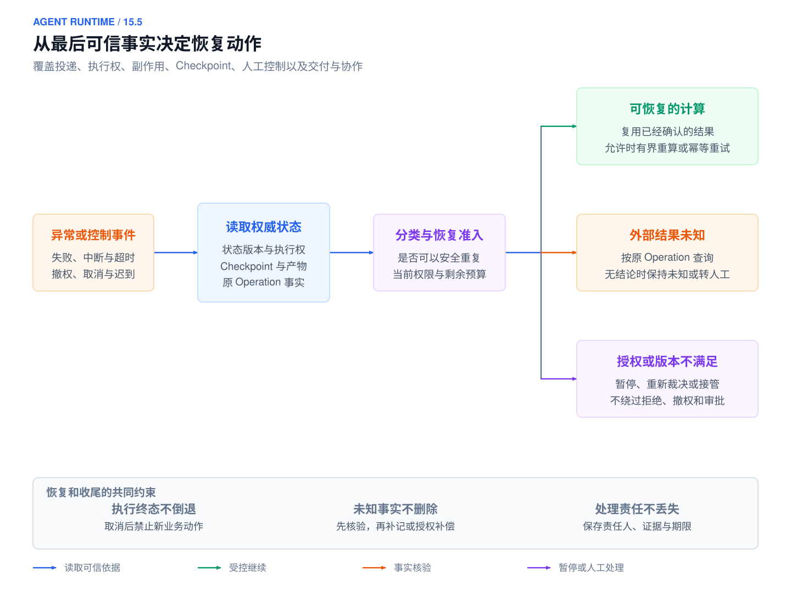](../images/agent-runtime-14-5-overview.svg)

*图 16-6：Runtime 恢复概览：读取可信事实，分类选择继续、查询核验或人工处理*

*先核对状态、执行权与外部动作，再决定允许的恢复路径。本书参考设计，点击图片查看 SVG。*

可靠性设计从最后一个可信提交点出发，判断已经确认什么、还不知道什么、谁负责核验以及允许采取什么动作。下文将机制放在对应故障窗口中解释；重试、幂等、执行权和补偿各自保护不同边界，组合使用也不能超出下游实际提供的保证。

<a id="failure-classification"></a>


<a id="retry-classification"></a>

<a id="failure-model-tool"></a>

<a id="1551-失败分类重试与安全拦截"></a>

### 16.5.1 失败分类、重试与安全拦截

错误不能只按 HTTP 状态码分组。Runtime 至少要知道错误发生在哪个边界、是否可能产生副作用、哪个对象仍有执行权，以及剩余授权与预算是否允许继续。相同的网络超时，发生在只读检索和创建工单之后，会要求不同的处理。

处理顺序是：**读取权威事实 → 限制继续扩大影响 → 判断是否可安全重复 → 校验当前权限与预算 → 记录下一步及责任**。暂时故障不等于可重试；未知结果不等于失败；补偿也不等于删除历史。无法自动判定时，保存可查询的阻塞状态、原因、责任人和下次处理时间，不能无限循环或静默丢弃。

是否重试，必须根据错误类型决定。网络超时、限流和暂时不可用通常可以退避后重试；schema 错误、权限拒绝、用户取消、预算超限和确定性的业务错误不应自动重试；模型输出不合格时，可以有限次地重新采样，但每次都要新增 Attempt 并计入成本。AIP-194 默认只自动重试 `UNAVAILABLE`；本表把部分超时、限流纳入重试是本书在只读或明确幂等契约下的策略，不能仅凭“网络错误”就重试有副作用的请求 [[8]](#ref-8)。下表给出 Runtime 面对常见观察时的处理方式。

| 当前观察 | 是否自动重试 | Runtime 应做什么 | 需要保留的依据 |
| --- | --- | --- | --- |
| 只读查询遇到暂时限流或超时 | 是 | 在剩余截止时间与预算内指数退避，加随机抖动 | 错误类型、`retry_after`、已消耗额度 |
| 模型输出无法解析 | 有限次 | 有界修复或重新采样，不直接执行输出片段 | 输入版本、校验错误、新的 Attempt |
| schema 错误或确定性业务错误 | 否 | 返回结构化错误，交给重新规划或人工 | 错误码、输入引用 |
| 权限拒绝 | 否 | 停止对应动作，必要时发起受控授权，不换工具绕过 | 策略决定与目标资源 |
| 用户取消或预算超限 | 否 | 停止新动作，进入取消或预算耗尽流程 | 取消事件或预算账本 |
| 写请求发出后连接断开 | 否，先查询 | 把 Operation 标记为结果未知，按原幂等键查询 | Operation、载荷哈希、最后一次观察 |
| 下游确认请求未生效，且契约允许重试 | 取决于契约 | 核验原键能否继续推进；缓存失败响应时不能无限同键重试 | 查询证据、幂等有效窗口、当前批准 |
| 补偿失败 | 单独处理 | 对补偿 Operation 按其自身契约处理 | 主动作事实、补偿幂等键、责任人与截止时间 |

重试预算按 Run、Step、工具、租户和全局分别设置。指数退避加随机抖动可以避免大量客户端同时重试造成的“惊群”。截止时间要传递到每一层，剩余时间不足时直接失败或转人工。重试沿用原来的逻辑 Task，但每次模型或供应商尝试都可能产生实际费用；同一计量事件重复投递时不能重复结算，业务副作用则按 Operation 契约去重。每次 Attempt 都要保存输入哈希、模型版本、错误、等待时长、输出和资源消耗。

重试预算还必须覆盖整个调用树。HTTP 客户端、Agent SDK、工作流引擎和消息消费者如果各自执行最大重试，实际调用次数会成倍放大，远超业务预期。因此需要一个统一的根预算，把重新采样、工具重试、查询对账、委派和孙任务都计入同一账本。最接近具体错误的一层可以决定是否退避，上层仍负责总次数、总费用和最终停止。

<a id="把安全检查落实到执行边界"></a>

**把安全检查落实到执行边界**

外部文档、检索结果和工具返回可能包含恶意指令。提示词注入的风险在于把数据内容误当成更高权限的指令；输入或输出扫描只能减少部分风险，不能构成完整隔离。[[12]](#ref-12) Runtime 因此在上下文中保留来源与可信级别，在工具入口核对身份和资源，在执行后端限制实际可达范围，并对输出与交付再次检查接收资格。

只读权限也需要限定资源和用途；允许查询一个项目不能借通用搜索工具读取所有项目。错误修复、换模型、改工具和委派都不能扩大原授权。敏感内容的脱敏要在进入模型或发送给接收人之前发生，不能只在日志展示时隐藏。权限拒绝作为结构化结果保存，供后续规划避开，而不是让模型自由寻找另一条高权限路径。

证据不足属于任务层面的失败条件。工具返回部分结果、数据来源冲突或引用无法支持结论时，验证器记录具体缺口，允许在剩余预算内补证或有限修复；不合格输出不能被格式正确掩盖。保存输入与检查结果后，才能判断缺陷发生在检索、工具契约、上下文、推理还是验收规则。

<a id="failure-delivery"></a>

<a id="1552-持久投递去重与积压恢复"></a>

### 16.5.2 持久投递、去重与积压恢复

创建任务时，系统通常要做两件事：在数据库中写入 Task 和 Run，再向消息队列发送一条“任务已创建”的消息，唤醒调度器。如果这两次写入彼此独立、不加协调，就称为**裸双写**。数据库和消息队列不在同一个事务中，无论先写哪一个，都会留下一个故障窗口。

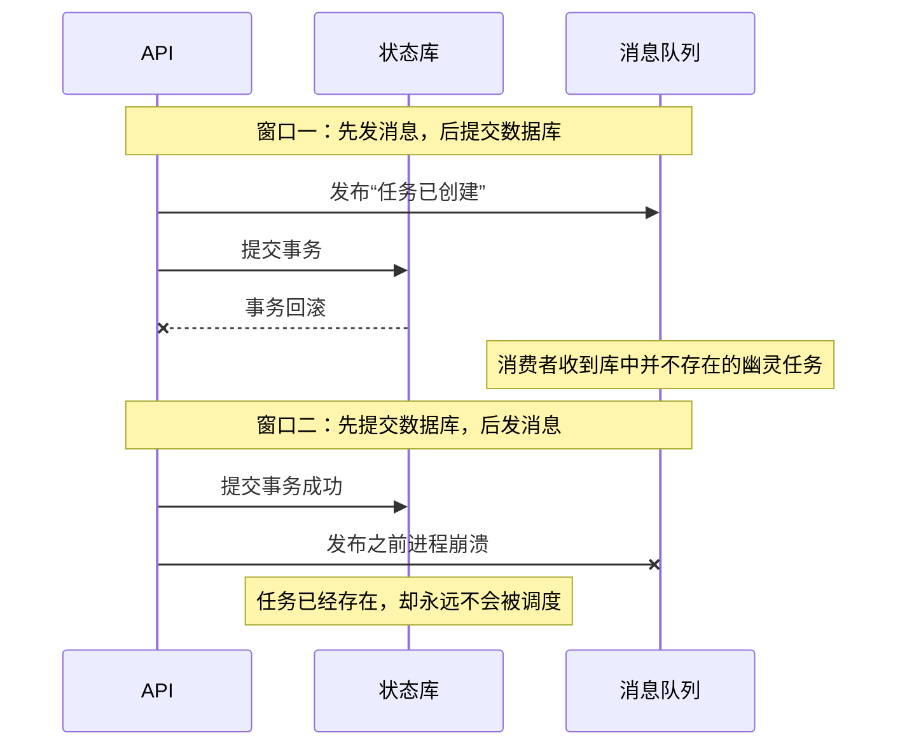

调整数据库写入与消息发布的顺序，只能在两个窗口之间选择，无法同时关闭它们；如果另有持久扫描器修复漏调度，该扫描器本身也构成接续协议的一部分。

Transactional Outbox 模式的做法是：把待发送的消息写入同一数据库中的 outbox 表，并与更新业务实体放在同一个事务里提交，再由独立的 Relay 进程把 outbox 中的记录发布到消息队列 [[13]](#ref-13)。这样，“任务存在”与“待发消息存在”要么同时成立，要么同时不成立，两个窗口都被关闭了。不过，Relay 本身仍可能重复发送，所以下游依然需要去重。

本章采用的参考契约是：在同一个数据库事务中写入 Task、Run、初始 Step、`RUN_CREATED` 事件和 outbox 记录，事务提交成功后，才向客户端返回 `task_id`、`run_id` 和查询入口。需要注意，单个关系数据库事务的原子可见性只覆盖该数据库内的操作 [[14]](#ref-14)；消息队列和第三方工具都不在这个事务之内。

客户端丢失受理回执后，沿用原 `request_key` 查询或重试。受理去重、消息去重和外部动作幂等分属不同边界；Outbox 持久存在只能证明工作可被重新发现，不能证明 Worker 已运行或业务已经生效。

<a id="relaycdc-与消费确认"></a>

**Relay、CDC 与消费确认**

Relay 有两种实现方式。一种是轮询已提交的 outbox 记录；另一种是变更数据捕获（Change Data Capture，CDC），即直接读取数据库的事务日志，把新提交的 outbox 行转成消息。一种 Outbox 事件路由实现使用事件身份供下游去重，使用聚合身份作为消息 key，让同一聚合的消息保持分区内顺序 [[15]](#ref-15)。这种顺序并非全局总序，connector 的重启、重放和 offset 管理仍需要运维投入。

采用轮询时，同一 aggregate 的消息需要按序串行认领与发布；跨 aggregate 可并行。仅对 outbox 行使用 `SKIP LOCKED` 分批认领不保证同一聚合的顺序；若选择不保序，消费者必须用 `state_version` 检测缺口、缓冲或重查权威状态，不能按到达顺序覆盖。这是本书对并发认领的推导；PostgreSQL 对 SKIP LOCKED 的不一致视图说明见 [[16]](#ref-16)。

支持行锁的数据库可以用 `FOR UPDATE SKIP LOCKED` 分批认领 Outbox；这种不一致视图适合队列表避开锁等待，不适合一般的一致性查询。[[16]](#ref-16) Relay 用短事务认领带期限的记录，在事务外发送，再条件更新发送标记；超期未确认的记录允许重投，不能持有长事务等待网络返回。

无论采用轮询还是 CDC，“发送成功”之后、“发送标记或 offset 提交”之前崩溃，都可能造成重复发送。Outbox 避免的是业务已提交而待发意图没有记录这一类丢失；实际推进仍依赖存储耐久性与 Relay 可用性。接收端用固定 `event_id`、Inbox 唯一约束、逻辑 Step 和当前版本去重，这就是幂等接收者（Idempotent Receiver）模式。[[17]](#ref-17)

消费确认（ACK）的时机同样重要。消费者应在同一个事务中保存 inbox 记录和可恢复的调度事实，提交之后再向消息队列确认。如果在确认前崩溃，消息会被重投，消费者发现记录已经持久化，就幂等地返回。ACK 不能早于必要状态的持久化；但也没有必要让消息队列的连接一直挂到数小时的执行结束。消费者只需把“待执行的 Step 及其归属”可靠地接走，后续执行由基于持久状态的调度器管理。消费者抢占失败、任务已经终结或消息已经过期时，分别记录处置结果，不能把重复消息当作新的 Run。

Outbox 需要监控以下指标：最早一条未发送记录的等待时间、重试次数、毒消息数量、CDC 延迟，以及 Task、outbox 与队列三者之间的差异。系统还要定期核对“已接收但没有可调度 Step”的任务。无法解析的消息进入隔离队列，并附上 schema 版本、失败原因和载荷的受控引用；修复传输或实现问题后沿用原来的 `event_id` 重放，不能换一个 ID 来掩盖重复。队列只是唤醒和传递机制，权威的执行状态保存在持久库中。消息队列短时不可用时，任务仍然可以查询；容量已满时，应当拒绝新的提交。

<a id="队列恢复与死信处理"></a>

**队列恢复与死信处理**

消息系统恢复之后，不能立即释放全部积压。大量旧任务会同时申请模型、数据库连接和外部接口；如果每次失败又引发新的重试，就可能造成第二次过载。调度器应按租户、任务优先级、工具和目标资源控制并发，先过滤掉已经取消、过期或完成的工作，再在剩余预算内安排重试。队列年龄与未决 Operation 的年龄需要分别监控：前者反映工作没有被接走，后者反映外部业务事实还没有收敛。

死信队列保存不能自动处理的消息，但消息进入死信队列并不等于问题已经修复。每一项被隔离的工作都要能追溯到原任务、schema 版本、错误原因、载荷的受控引用、修复责任人和截止时间。重新投递时沿用原有的消息身份和业务身份；换一个 ID 让消费者“重新处理”，会绕过原有的去重机制。如果参数需要修改，应当形成明确的新提案并重新授权，不能改写旧消息后继续沿用旧的批准。

<a id="failure-ownership"></a>

<a id="1553-租约执行权与迟到提交"></a>

### 16.5.3 租约、执行权与迟到提交

在 run_0429_017 的 Worker A 崩溃后，Worker B 取得新执行权；此时才需要区分原业务身份与新的尝试身份。

本章使用以下术语：

- **执行权代次（owner_epoch）**：某个 Step 每次成功授予新的执行权时递增的持久单调整数；首次授予、租约到期后的重新认领、迁移与强制接管都属于新授予，同一有效租约内续租、调用重试及同一认领请求的幂等重放不推进代次。持有最新代次的执行者才有权提交该 Step 的结果，旧代次的写入一律拒绝。
- **规范化载荷（canonical payload）**：把请求参数按固定规则整理后的形式，例如字段排序、去除无语义的空白、统一默认值。对它计算的哈希（payload hash）用来判断两次请求的参数是否真正相同。
- **幂等键（idempotency key）**：调用方为同一意图提供的稳定标识，重复提交时据此返回同一结果。本章区分两种范围：接入层的任务幂等键（字段 `request_key`），用于避免重复创建 Task；Operation 传给下游的操作幂等键（字段 `idempotency_key`），用于避免同一业务动作重复生效。

| 标识 | 身份覆盖范围 | 什么时候变化 | 提交约束 |
| --- | --- | --- | --- |
| `session_id` | 一段交互或入口的连续性 | 新会话，或新的交互隔离域 | 不作为执行或去重的身份 |
| `task_id` | 用户的逻辑目标，以及租户、可见结果引用 | 出现新目标或独立的请求意图 | 同一租户和入口幂等作用域下，相同 `request_key` 只对应同一个 Task；同键异参拒绝 |
| `run_id` | 一次版本化执行，绑定工作流修订版、权限、预算、截止时间和状态版本 | 用户明确重新运行、对照实验或发起新执行 | 系统恢复不改变 Run 身份；重新尝试与归属转移分别记录 Attempt 与执行权代次；新的业务执行另建 Run |
| `step_id` | Run 内的一个逻辑节点，包括输入和结果的引用 | 计划新增节点，或切换到另一个节点 | 重复调度同一节点，并不产生第二个逻辑 Step |
| `attempt_id` | 节点的一次尝试及其错误记录 | 重试、迁移或接管后的新尝试 | 新尝试追加记录，不覆盖历史尝试 |
| `owner_epoch` | 节点执行权的代次 | 成功授予新执行权时递增 | 状态更新必须携带当前代次 |
| `operation_id` | 一次业务动作，关联操作幂等键、载荷哈希、外部 ID、事实状态以及查询和补偿入口 | 业务意图改变时才变化，普通重投与重试不改变 | 独立于模型重新采样和传输重试，最终去重由拥有业务状态的资源端落实 |
| `event_id` 与 `run_seq` | 一条追加式事件，包括因果关联、来源和状态版本 | 每次被接受的状态变化 | 只追加不修改；同库的状态变更与事件原子提交 |
| Artifact 引用 | 内容哈希、版本、可见范围和保留期 | 内容变化即产生新版本 | 先保证载荷完整，再提交引用它的进度 |

自动恢复保留 Run；需要重新尝试某个 Step 时新增 Attempt，需要转移执行权时推进 owner_epoch，不能把每次重试都当作一次归属转移。用户要求另一模型独立对照时新建 Run；独立授权的新工单是新业务意图，参数相似也不合并。

除身份外，每个对象还要保存足以恢复和审计的字段。Run 保存入口请求、模型与工具版本、租户、预算、截止时间、权限、状态、父任务和 trace id。Step 保存输入引用、输出引用、尝试次数、开始与结束时间、资源消耗、错误、幂等键和补偿动作。大段文本不直接嵌入状态表，而是存入 Artifact 仓库或消息存储，通过哈希和版本引用，以免状态表无限膨胀。


worker 领取 Step 时获得一份带期限的租约（Lease），执行期间持续心跳续租；worker 失联后，控制面等租约过期再重新调度。数据库认领需要同时满足几个条件：Step 仍处于可运行状态，重试时间已到，旧租约已经过期，配额可用。满足条件后，认领事务原子地递增执行权代次，并写入新的执行者和租约到期时间。租约时间以服务端受控的时钟为准，执行权代次必须是持久保存的单调整数；随机生成的锁值不能充当 fencing token。

租约不能替代幂等。在网络分区下，旧 worker 可能在租约过期后恢复，并提交一份迟到的结果；外部工具也可能在 worker 失联后继续执行。为此需要 fencing。**fencing token** 是每次授予执行权时发放的单调递增编号，本章以 `(tenant_id, run_id, step_id)` 为节点执行权命名空间，`owner_epoch` 只在此范围可比；资源端按该命名空间记录最大代次。跨 Step 争用同一资源时，另发资源级单调 token 或由串行网关裁决，不能比较两个 Step 的本地计数。执行者的每一次写入都携带这个编号，由被写入的资源检查：凡是小于该命名空间已接受最大编号的写入，一律拒绝。fencing 方案要求每次写入携带单调 token，并由资源端负责拒绝旧 token [[18]](#ref-18)。

执行者应在租约结束前留出时钟误差、派发与取消传播的安全余量；剩余有效期不足时不开始新写入。余量由部署测量决定，不给出通用毫秒值。资源端在接受受保护写入或显式推进写屏障时，原子检查并更新最大代次；普通只读查询不推进屏障。下图假设工具支持独立屏障接口；若不支持，不能因 B 查询过就声称 A 的写已被隔离。这一显式屏障是本书参考协议的附加设计。

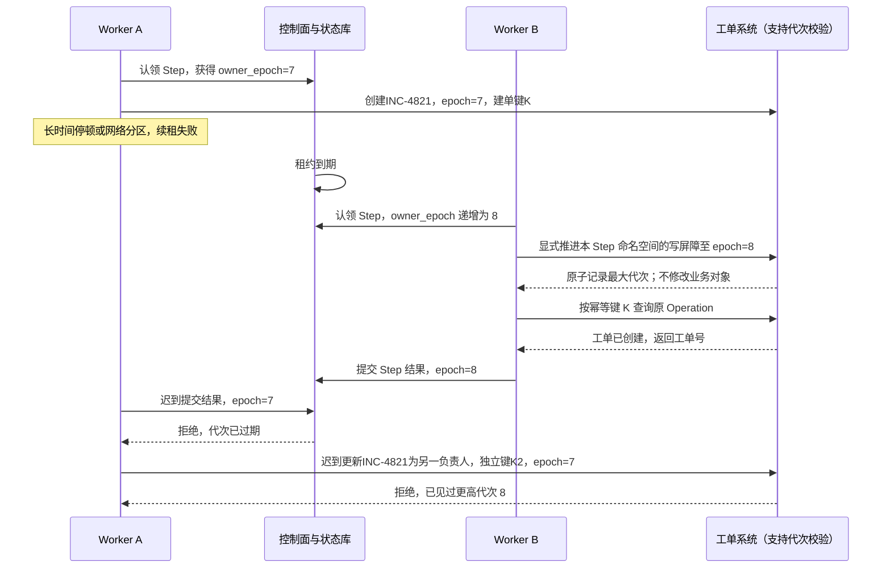

K2 与建单 K 不同，普通按键去重挡不住这一独立字段更新；拒绝它的是资源端代次屏障。这个例子也说明 fencing 的局限：只在任务库中拒绝旧执行者，并不能撤销它已经发给第三方的请求。因此，执行网关以及支持该能力的目标资源都应检查代次。如果目标资源不支持，就依靠稳定的操作幂等键、串行的操作通道和事后对账来限制风险；能力仍然不足时，禁止自动重发或转人工处理。恢复 worker 必须先取得新的代次，再核查 Operation，不能读到旧 Checkpoint 中记录的执行者就认为自己拥有执行权。

心跳只能证明执行者还活着，不能证明任务在推进。心跳中应包含进度序号（`progress_seq`）、资源占用、当前 Attempt、Checkpoint 和预计完成时间，但不上传敏感内容。只有进度序号的增长、已提交的产物和 Step 的变化才证明有进展；心跳正常而进度长期不变时，必须诊断依赖阻塞、空转和锁等待。控制面据此识别卡死、慢任务和预算超支，必要时暂停或迁移。迁移策略写在工作流中：尚未驱动已提交后继的模型 Step 可按新 Attempt 重算，否则复用记录结果；有副作用的 Step 先查询，人工 Step 继续等待或转入其他队列。

<a id="failure-side-effects"></a>

<a id="1554-外部副作用未知结果与补偿"></a>

### 16.5.4 外部副作用、未知结果与补偿

幂等的责任必须落实到具体边界。Runtime 为每个逻辑业务调用保存 `operation_id`；消息仍可能重复，所以接收方要以稳定身份幂等接收；工具适配器负责把操作幂等键传给下游；真正拥有业务状态的订单、邮件、文件或支付系统，则必须决定对同一个键的重复提交如何返回同一个事实。如果下游只提供“尽力而为”的 HTTP 接口，Runtime 仅凭本地的去重表无法承诺业务幂等，因为请求提交后网络断开，会留下一个本地无法判定的未知状态。幂等接收者（Idempotent Receiver）模式把去重与消息接收边界绑定在一起 [[17]](#ref-17)；在 Agent 系统中，这一边界还要覆盖模型重试、队列的至少一次投递和人工重放。

幂等 API 的设计经验表明，稳定请求标识表达业务意图，同键异参应报告冲突，去重记录和业务变更由资源端原子处理。[[19]](#ref-19) 本章据此把 `operation_id` 与操作幂等键绑定到原业务动作，在模型重新采样、传输重试和 Worker 接管时保持不变。键可以是不透明标识，也可以关联租户、业务对象、动作与授权版本，但必须区分两次独立意图。

如果模型每次重试都重新生成操作参数，系统必须先比较规范化载荷：意图相同，就查询或去重；意图不同，就是一个新操作，可能还需要新的审批。规范化载荷的哈希只适合发现“同键异参”，不能单凭参数相同推断用户只想做一次。两次独立授权、参数恰好相同的购买，仍然代表两个业务意图。反过来，把“看起来相似”的自然语言当作幂等键会造成错误合并，为同一操作随机生成 UUID 又会造成重复副作用。

Operation 的事实状态决定了下一步可以做什么；`MANUAL_REPAIR` 是有责任人的人工工作项，不属于 Run 或工具 Attempt 的成功终态。主操作部分生效时保留其效果明细，再决定继续、补偿或人工，不用单一失败值抹平。

下表采用本书参考状态模型。事实维度描述外部世界，处理维度描述 Runtime 当前承担的工作，两者分别保存，不能靠一个枚举相互替代。

| 外部效果事实 `effect_state` | 证据要求 | 可采取的下一步 |
| --- | --- | --- |
| INTENT_RECORDED | 本地持久意图，尚无提交证据 | 重验权限与版本后提交，或明确撤回未发出的提案 |
| SUBMITTED / UNKNOWN | 已发出或无法排除已经发出 | 原身份查询、等待和对账；超时不能推为未生效 |
| CONFIRMED_SUCCESS | 可信外部回执或可授权查询结果 | 保存对象与版本，推进满足条件的后继 |
| CONFIRMED_FAILURE | 权威证据确认这次动作未达到目标 | 按错误性质及下游重试契约处理 |
| PARTIALLY_APPLIED | 权威证据给出已生效部分和未知部分 | 保留明细，对未知部分核验，独立决定补偿 |

| 处理状态 `resolution_state` | 责任与约束 |
| --- | --- |
| PENDING | 尚未完成本轮处置；不代表外部尚未执行 |
| NEEDS_RECONCILIATION | 需要查询/对账，记录责任人、期限和查询入口 |
| COMPENSATING | 正在推进独立补偿 Operation；主动作事实仍保留 |
| MANUAL_REPAIR | 自动处理已停止，等待授权人工核验或修复 |
| RESOLVED | 当前处置已完成；具体业务结果仍从事实维度读取 |

例如 `(UNKNOWN, MANUAL_REPAIR)` 表示结果未明且已交人工；不能因为人工认领便改为成功。`(CONFIRMED_SUCCESS, COMPENSATING)` 表示主动作已成功、业务决定用另一个动作抵消效果；补偿成功也不删除主动作历史。只有所需 Operation 都有满足任务契约的确定事实、验收通过且没有未决必需工作时，Run 才能提交 `COMPLETED`。必需 Operation 仍为 UNKNOWN 时，即便模型给出答案、Worker 已退出、通知已发出，也必须阻止完成提交。

<a id="合法迁移与证据条件"></a>

**合法迁移与证据条件**

| 原状态 | 事件与前置条件 | 事实变化 | 处理变化 |
| --- | --- | --- | --- |
| INTENT_RECORDED | 当前执行权、批准、参数及资源版本均有效，记录派发 | SUBMITTED | PENDING |
| SUBMITTED | 超时、断连或接管，无法排除外部提交 | UNKNOWN | NEEDS_RECONCILIATION |
| SUBMITTED / UNKNOWN | 可信查询确认原身份对应对象已生效 | CONFIRMED_SUCCESS | RESOLVED 或转独立补偿 |
| SUBMITTED / UNKNOWN | 下游契约足以确认原请求未生效且不再在途 | CONFIRMED_FAILURE | 按契约重试或 RESOLVED |
| UNKNOWN | 查询不可用、幂等窗口过期或超出自动核验预算 | 保留 UNKNOWN | MANUAL_REPAIR |
| 任意已确认事实 | 接收到重复/迟到旧回执 | 去重，不以旧执行权改写 Run | 保存审计；必要时触发当前责任人核验 |

迁移要用条件更新核对状态版本与执行权代次。事实证据可以晚到，接受证据与允许原 Worker 继续推进是两件事：取消后的成功回执应被核验并保存，普通后继仍受取消边界阻止。发现同一幂等键对应不同参数，应先隔离冲突，不能把它当作一次正常重试。

下面给出三条教学故障轨迹。第一，远端创建工单成功、本地回执落库前进程退出：恢复沿原 Operation 查询，查到原工单后补记成功，不能创建第二张工单。第二，取消先提交、成功响应后到：Run 维持取消状态，记录外部事实，由明确责任人决定是否另行撤销或通知。第三，人工接管后旧 Worker 仍在请求：账本拒绝旧代次推进；若外部服务不支持 fencing，远端效果仍可能产生，必须沿原身份核验。三条轨迹都说明本地提交围栏只限制本地事实的写者，跨系统保证仍依赖资源端契约。

外部查询返回“没查到”时，也要考虑下游的一致性和保留窗口：结果可能尚未可见，键可能已经过期，请求也可能仍在途中。只有下游契约足以确认“不存在”，并且重试是安全的，系统才继续用同一个键尝试；否则保留 UNKNOWN 状态。预算或审批到期时，未决事实不能被删除；系统停止新增动作之后，仍要核对已经发出的请求。

Stripe API v1 会缓存已开始执行请求的首个状态与响应，包括 500；API v2 的重试语义不同，可能继续失败或部分完成的工作。[[20]](#ref-20) 因此“确认未生效”不保证原键能继续推进。派生新提交键必须先取得未生效/旧请求结束的可靠证据，记录旧键与新键映射并重验批准；否则保留 UNKNOWN，不能换键绕过未知事实。

幂等记录也需要生命周期管理。短期通知可能只需在业务 SLA 窗口内保留键，财务、权限和数据删除类操作则需要更长的审计与重放窗口。记录至少保存 `operation_id`、载荷哈希、请求者、状态、外部引用、首次与最后一次观察时间、响应摘要、过期策略和责任人。删除过早，延迟到达的消息会再次造成副作用；永久保留，又会带来隐私和存储问题。保留期应结合下游重复投递的时间上界、合规要求和补偿窗口一起确定，并写进文档，不能依赖代码中的隐式约定。窗口过期后的恢复要先查询或转人工，不能把一个旧的幂等键当作新请求处理。

补偿为已发生的事实追加反向或缓解动作，拥有独立的授权、前置条件、幂等键、截止时间与验收。已发通知不能抹去接收人的阅读，恢复文件版本也可能覆盖后续人工修改。Saga 将局部事务及其补偿组织成长事务，提供协调思路，不承诺所有影响可逆。[[21]](#ref-21)

因此，补偿计划应在执行主动作之前就确定下来。工具注册表声明正常操作、成功证据、补偿操作、无法补偿的后果、人工责任人和最长等待时间，工作流在跨越不可逆边界之前检查这些字段和审批。对于没有安全补偿手段的高影响动作，设计上应改为预览、双人审批、延迟提交，或由业务系统提供事务性 API，不能把风险留给模型临场判断。

补偿完成也要按业务事实验收。HTTP 200、队列已接收或模型声称“已恢复”都不足以证明完成；Runtime 需要保存查询到的版本、外部对象状态或人工确认。如果主动作只完成了一部分，可以选择继续完成剩余部分、撤销已完成的部分，或交给人工处理，这三种选择对成本、可用性和用户预期的影响各不相同。工作流定义应把这一选择写成版本化的决策，不能让新 worker 在事故现场临时猜测。人工处理完成后，以事件关闭这项工作，不能直接修改历史状态。

<a id="failure-recovery"></a>


<a id="recovery"></a>

<a id="1555-checkpoint持久执行与版本恢复"></a>

### 16.5.5 Checkpoint、持久执行与版本恢复

持久工作流仍要求工作流逻辑按事件历史确定性重放，并对代码演进采用兼容版本或 patch；Activity 在允许重试时可能至少一次执行，其副作用仍依赖 Operation 和下游幂等，不能把持久执行等同于外部生效一次。[[22]](#ref-22)[[23]](#ref-23)

长任务可能运行几分钟、几小时，甚至要等待人工或外部事件。进程内的状态和内存队列在重启后会丢失，所以 Runtime 需要持久化的事件、Checkpoint、定时器、信号和活动（activity）结果。一种持久工作流实现通过有序事件保存状态、活动结果、重试与定时器。[[4]](#ref-4) 自建数据库事件表也需承担同样的重放、版本和并发责任。

**确定性重放与记录结果。** 工作流重放必须用记录的模型、工具与外部观察结果重建决策；模型输出不确定，已经驱动下游提交的输出不能重新采样替换。一种方式把非确定的模型与工具调用封装成独立活动并记录结果，重放时由历史驱动确定性决策。[[23]](#ref-23) 另一种方式从节点检查点重新进入，未提交节点可能从头执行，因而必须保证副作用已有稳定身份和可核验结果。持久化也有同步、异步和仅在退出时保存的差异：同步保存缩小下一步前的丢失窗口，异步保存增加吞吐但可能丢失最近进度，仅退出时保存则无法兑现执行中崩溃后的续接。[[24]](#ref-24)

持久化并不意味着每个 token 都写一次数据库。模型的流式输出可以写入 Artifact、摘要或可恢复的偏移量；关键的状态迁移、工具请求、审批和结果则必须持久化。

恢复设计要先回答“恢复什么”，再选择存储技术。不同节点的恢复方式差别很大，如果把它们统统叫作 retry，不同的业务后果就会被压缩成同一个按钮。Runtime 应在 Step 的定义中声明恢复类别，并把分类与工具版本一起保存：

| 恢复类别 | 典型节点 | 恢复方式 | 恢复前需要验收的条件 |
| --- | --- | --- | --- |
| `replayable`（可重算） | 无副作用计算；未被已提交后继消费的模型调用 | 纯计算重算；模型优先复用记录，重新采样另记 Attempt | 已驱动提交的模型结果不可替换；当前权限与预算有效 |
| `idempotent`（可幂等重试） | 有明确幂等契约的工具动作；允许重新观察的检索 | 保持逻辑调用身份；有外部写入时保持原 Operation | 数据版本与权限符合契约，写入幂等窗口仍有效 |
| `query-before-retry`（先查询） | 已提交但结果未知的写操作 | 先查询外部系统的事实 | Operation 状态、幂等窗口、最后一次观察 |
| `compensable`（可补偿） | 已生效、但存在反向动作的写操作 | 追加补偿 Operation | 补偿的前置条件、权限和截止时间 |
| `human-only`（只能由人确认） | 等待审批或人工确认的节点 | 只能恢复到等待状态，worker 不能推断批准 | 决定是否仍然有效，操作者是否有权限 |

等待外部事件的节点，恢复时还要检查关联标识（correlation id）、签名、截止时间和取消状态。把所有 Step 交给一个通用的重试中间件，会遗漏上表中的业务条件。通用框架应提供状态、租约、超时和事件等基础设施，具体的恢复分类则属于工作流与工具契约。

恢复边界之间可能出现“请求已发出、事实未知”的窗口。此时沿原 Operation 查询并保存观察；查询不能消除不确定性时转入核验队列，禁止自动复制业务动作。可重算内容、已确认事实和未知副作用必须分别处理。

Checkpoint 是已验证进度和未决 Operation 的恢复索引，不保存完整进程内存，也不能撤销外部副作用。一个可用于恢复的 Checkpoint 至少包含：

- Run 与工作流修订版，当前状态机节点；
- 已完成和待完成的依赖，每个 Attempt 的记录；
- 预算消耗与截止时间；
- 上下文与记忆的不可变引用；
- 已发出的 Operation；历史租约与 fencing token 仅供审计，恢复不能据此复用授权；
- 审批状态和定时器。

Checkpoint 还要标明哪些字段是观察结果、哪些是模型给出的候选、哪些已经成为外部业务事实。没有这条界线，恢复 worker 可能把上一次模型的自然语言结论当作已提交的结果，或者在重放时漏掉已经开始的补偿。

写入点由恢复需求决定，不能只按固定分钟间隔保存。只读步骤可在完整结果边界提交；外部写入则分别记录意图、回执与补偿进展。密集写入增加存储成本，稀疏写入扩大进度丢失窗口，取舍应通过恢复实验验证。模型流可以保留偏移量和载荷引用，最终业务状态仍需独立提交。

提交 Checkpoint 时要遵守联合提交边界。同一数据库内的 Step 结果、状态版本、关键事件和完成通知的 outbox 记录，应尽量放在一个事务中提交。大型 Artifact 要先完整写入并校验哈希，再提交指向它的引用；不能先推进进度、事后再补载荷。恢复时，系统要校验 Checkpoint 引用的载荷是否存在、版本是否兼容、权限是否仍然有效；载荷缺失时，不能跳过该 Step 假装它已经完成。

Checkpoint 接口需要声明恢复粒度、持久化时机和重入范围，不能仅凭接口名称推断恢复能力。事件历史重放与节点快照是不同实现，二者都需要独立处理非确定调用、外部写入和版本兼容。

事件归档与快照压缩应保留恢复需要的状态、预算、版本、未决动作和引用，以及审批、补偿与安全事件。归档结果可以查询；重新激活须重新校验权限和预算，不能把已消耗额度清零。删除或保留载荷时同时处理引用与访问策略，避免快照保留一条实际已不可用的恢复路径。

恢复先读取最近一致边界，检查载荷、格式、版本与当前权限；再通过条件认领取得新执行权，隔离旧提交，按节点恢复类别安排执行。资源端写屏障和原 Operation 核验随后按副作用契约落实。不能从旧快照读取一个 owner 标识，就推断新进程已经拥有执行权。

Run 绑定工作流、输入、上下文和工具版本，恢复不能随默认值升级而改变节点、重试与补偿语义。旧制品不可用时，选择兼容适配、保留旧环境或在安全边界显式迁移；迁移记录旧值、新值、转换函数、检查结果和回退路径。未证明兼容时暂停，不用新定义重新解释旧动作。当前撤权、删除和紧急封锁始终优先于历史版本固定。

<a id="恢复动作与重规划的边界"></a>

**恢复动作与重规划的边界**

恢复还原原执行的权威进度，重规划修改未来路线。新计划保存版本、变更原因、可复用证据、失效审批和受影响后继；未决 Operation、取消意图和已消耗预算继续保留。目标或授权变化需要明确接受，输入或资源版本变化使原验收失效。激活新计划时校验依赖，拒绝迟到的旧计划结果推进新汇合点。

事件到达时，Run 可能已经取消、超时或完成了版本迁移。处理器根据当前状态和事件版本，决定忽略、记录还是触发补偿，不能盲目地继续调用工具。外部事件的载荷是不可信的观察结果，进入模型之前必须经过 schema 和权限检查。在消息中间件只提供至少一次投递的前提下，状态机和幂等是正确性的基础。

<a id="failure-human-control"></a>

<a id="failure-cancellation"></a>

<a id="1556-取消授权变化与人工接管"></a>

### 16.5.6 取消、授权变化与人工接管

取消、截止时间到达或预算耗尽后，先持久记录停止推进的决定，阻止新的认领、模型调用、工具动作与委派，并向可中断的执行后端传播信号。进程收到信号不等于外部请求已撤销；任务终态与业务动作事实分开保存。

对于已经在途的 Operation，迟到成功仍需写入原账本并核验证据，但不能把已取消 Run 改回运行中。随后按当前权限决定是否补记、补偿或转人工。核验与安全收尾需有单独声明的责任和受控资源额度，不能以“预算已用完”为由丢弃事实，也不能借收尾无限执行新业务。

超时还要区分单次调用与整个 Run：前者可能只终止一个 Attempt，后者限制任务继续推进，两者都不能证明下游未执行。心跳存在但长期无事实增量时，按证据与参数指纹识别无进展候选，限制重规划，必要时暂停或转人工；不能只按同一工具出现次数判断循环。

面向用户明确展示“已停止继续执行”及“仍在核验的动作”，不要让一个 cancelled 标签掩盖已发生的副作用。

Policy 的 `deny(action)` 禁止当前动作，可以在原目标与权限内有界重规划；`deny(goal)` 表示目标本身不允许，记录 `FAILED` 及目标拒绝原因。`escalate` 转入 `WAITING(human_review)` 和待认领人工工作项，由指定角色判断或接管，不能被解释为普通的用户确认。

审批超时、批准过期或对象、参数、资源版本发生变化时，原批准不能直接复用。保存失效原因与原绑定关系，重新裁决并根据当前事实请求批准；拒绝不能通过改用另一个工具或子 Agent 绕开。重复审批事件按原身份返回既有决定，冲突决定进入明确的裁定流程。

无人接管、证据不足或无法安全自动处理时，任务保持可查询阻塞并公开责任与下次处理时间。人工可以批准一个有边界的风险选择，但不能把未知外部结果变成凭空确认。协议细节见 [16.4.6 动作裁决与审批等待](#human-control)。

Connection 授权失效时保存授权等待与原绑定，不能自动换成更宽权限连接。重新授权也不能证明先前写请求未发生：写入回执丢失仍沿原 Operation 与业务键查询；撤销连接不等于取消在途写入，无查询或幂等能力时转人工核验。

进入审批后，Step 转为等待批准，Run 标记 `WAITING` 并记录 `wait_kind=approval`，Runtime 释放 Worker，只保存持久订阅、恢复条件和截止时间。审批超时按契约暂停或失败，不会自动视为批准。重复决定、伪造回调和过期批准不能让任务重新开工；取消后，待审批动作随之失效。

<a id="接管的责任人"></a>

**接管的责任人**

需要人工接管时，系统应当交付一份可以立即处理的工作项，包括：目标、当前状态、已确认与未知的事实、证据位置、建议的查询或补偿、允许执行的范围、责任人和截止时间。仅仅返回“请联系管理员”，并没有形成接管协议。人工队列需要支持认领、转派、到期升级和关闭证据；人员离线、交接班和重复点击，也都属于恢复设计要覆盖的情形。人工操作同样受租户、角色、双人复核和审计的约束。

人工强制接管必须经当前角色授权，以同一原子事务撤销旧租约并授予新代次；它可以早于旧租约自然到期，但仍需资源端隔离和在途对账，不能只改 owner 字段。重复 repair_id 返回原决定。人工修复不能直接把状态改为 ready。修复记录要包含原 Run、Operation、已确认和未知的事实、错误与版本、预算、建议的恢复点、风险、责任人和截止时间。操作者先通过权限检查和条件更新取得新的执行权代次，使旧执行的提交失效，再查询已经发生的副作用；然后按工具契约选择补记事实、恢复特定 Step、授权补偿，或继续核验。重复点击按同一 `repair_id` 幂等处理，批量恢复限速并观察容量，结果附上外部证据。`MANUAL_REPAIR` 表示核验工作项仍待处理，不是 Run 成功状态；到期未响应时按责任链升级。

可恢复的运行保留在 PAUSED 或 WAITING。COMPLETED、FAILED 和 CANCELLED 不经普通 resume 回到运行；用户明确要求重新执行时创建新 Run，并关联原动作与结果。补记外部事实只更新核验记录，不改变原执行终态；新执行也不能重复制造尚未核清的原业务意图。

当工具、模型或权限出现异常时，Runtime 可以把任务降级为只读建议模式：继续收集证据、给出建议，但不再发起有副作用的动作。降级本身是一次状态迁移，需要记录原因、生效范围和恢复条件；未决的 Operation 不会因为降级而消失，仍要按原契约查询或交给人工。

<a id="恢复后如何继续"></a>

**恢复后如何继续**

批准、拒绝、修订参数、确认事实和授权补偿是不同事件，由同一控制面接受。继续之前复查取消、预算、权限和资源状态；人工回交附带证据，未决项保留核验与升级责任，不能直接修改数据库或把按钮点击当作完成依据。

<a id="failure-result-delivery"></a>

<a id="failure-collaboration"></a>

<a id="1557-交付与协作故障的收敛"></a>

### 16.5.7 交付与协作故障的收敛

**C6 完成、C7 未发送：**从已提交的交付 Outbox 继续发送，不重新执行任务或重算答案。**渠道已受理、本地未保存回执：**交付状态为未知，按原交付幂等键或渠道查询核对；渠道无去重和查询能力时，必须明确接受漏发或重复风险，不能承诺严格一次通知。

交付前检查当前代次、接收人、权限与产物版本；读取旧 Run 的查询仍关联其原结果，不应错误指向当前执行者。SSE 断线按持久游标续订，游标过期提供快照与重新同步入口，不能为了续流新建 Task。

接管还会与旧消息发送竞争。发送前，交付 Worker 在状态库登记“正在发送 N 号通知”。接管者先查这条记录：旧 Worker 尚未派发则作废旧占用后重发；已派发但结果未知则先查渠道，再决定是否重发。Worker 租约过期不能自动清除“是否已发送仍未知”的占用。

若要求未知发送仍在途时立即接管，就必须接受旧消息晚到，或使用支持版本检查的交付渠道。界面应分别展示任务完成与通知状态，渠道失败不改写已验收的任务事实。

子 Agent 失联、超时或提交不合格结果时，协调者先读取子任务持久状态与已提交产物，区分没有开始、只读计算中断、已提交结果和存在未决副作用。可以局部重算的分支沿原子任务建立新 Attempt；有写入的分支先核对 Operation，不能重新委派就重置业务身份。

输入、契约或计划版本改变后，迟到结果可以进入历史审计，但只有满足当前节点验收条件的结果才能参与 join。重复交接消息持久去重；共享可写资源通过隔离、串行或版本合并处理，不能靠“Agent 已完成”推断冲突解决。

父任务取消时停止新委派，传播取消并保存各子任务状态；仍在途的写入、交付和补偿继续有明确责任。部分分支成功后，父任务按契约决定是否接受部分结果、等待、替代或人工处理，不能在缺少必要证据时宣布完整成功。

互相委派、重复审阅或嵌套 Loop 可能形成协作空转，根预算、委派深度与进展检查需要覆盖整棵调用树。只增加 Agent 数量不能增加总授权或预算。协作对象与交接契约见 [16.4.11 多 Agent 的委派与父任务收敛](#multi-agent)。

同一 `message_id` 携带不同载荷时拒绝并记录冲突；早到的依赖结果先保存，不跳过前驱验收；旧计划、旧执行权和旧输入的结果不能覆盖当前事实。消息去重阻止重复接单，Operation 幂等阻止重复业务生效，执行权校验阻止旧提交，三种机制不能用一个锁标志代替。

父任务处于终态并不代表所有远端操作都消失。协调层持续管理未决清单，明确由哪个 Run、核验工作项或人工责任人收尾；资源回收不能删除这份清单。受理新的调查或恢复分支时先核对旧动作，避免独立子任务在后台重复写入。

队列长度、并发、委派深度、消息体积和截止时间共同约束协作容量。恢复积压时按根预算与资源配额限速，永久错误转入有责任人的隔离队列。对迟到补充结果，要根据当前权限决定可否保留或展示；可以作为历史证据的产物，也不一定仍有资格参与当前任务汇合。

<a id="failure-repair-matrix"></a>


<a id="failure-scenarios"></a>

<a id="1558-故障窗口与验证矩阵"></a>

### 16.5.8 故障窗口与验证矩阵

同一次告警运行的故障链路如下。T2 的错误诊断与 T4 的执行恢复是两件事：建单不重复不能证明报告正确，完整质量回归参考[治理中的失败闭环](05-agent-governance-optimization.md#failure-improvement-loop)。

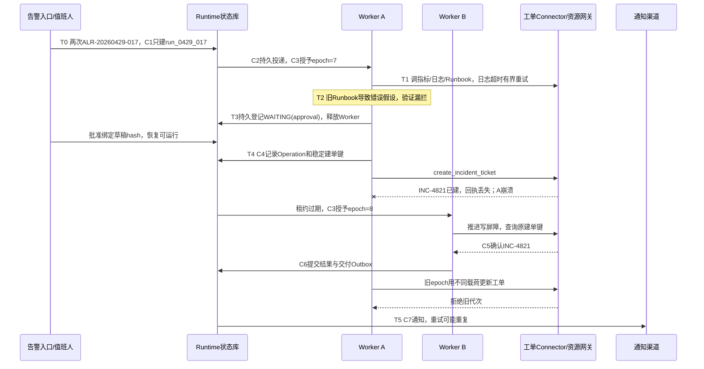

下表沿着[任务执行的提交点](#execution-commit-map)，列出每个可能中断的窗口、此时保留的权威事实、自动恢复能走多远，以及何时必须停止或转人工。它可以作为恢复设计评审和故障演练时的判断表。

| 中断窗口 | 保留的权威事实 | 自动恢复的边界 | 停止或转人工的条件 |
|:---|:---|:---|:---|
| Task 事务未提交 | 任务幂等键可能还没有记录 | 用同一个键重试创建任务；不能发送尚未提交的消息 | 数据库持续不可用时，拒绝新请求或等待 |
| 事务已提交，消息发布前崩溃 | Task 与 outbox 记录都已提交 | Relay 扫描或 CDC 恢复发布 | 最早积压超过阈值时，指派投递责任人 |
| 消息已发布，发送标记前崩溃 | 同一 `event_id` 可能多次到达 | 借助 inbox 和 Step 条件更新幂等接收 | schema 毒消息先隔离，再受控修复 |
| 消费已落库，ACK 前崩溃 | 持久调度记录已经存在 | 重投时读取已有状态，不创建新 Run | 同键异参的去重冲突需要调查 |
| 意图已记录，远端结果未知 | Operation 的幂等键、载荷哈希和最后一次观察 | 先查询后重试，保留 UNKNOWN | 无自动查询/核验路径或核验窗口已过时，保留 `(UNKNOWN, MANUAL_REPAIR)`；仍可查证时才进入对账。无幂等保证单独限制重试，不等于不可查询 |
| 远端成功，本地 Step 未提交 | 业务系统中的成功事实 | 用同一个键查证后补写进度 | 无法取证时进入对账，不能换键重做 |
| Artifact 未写完整，Checkpoint 待提交 | 旧 Checkpoint 仍然有效 | 校验载荷，重新持久化后再提交 | 旧版本载荷永久缺失时，暂停该 Run |
| 租约到期，旧 worker 迟到 | 新的执行权代次与原 Operation | 状态库和支持代次校验的网关拒绝旧代次，核对在途的外部动作 | 下游不支持 fencing 且事实不明时，转人工 |
| 取消与远端成功竞态 | 取消意图与晚到的业务事实 | 禁止新动作，追加核验或补偿事件 | 不可逆后果进入有责任人的修复流程 |
| 审批过期或参数变化 | 原批准的范围与版本 | 拒绝旧决定，生成新提案 | 不得自动批准，也不得复用旧的批准范围 |
| 游标已过期 | 权威状态、结果和快照水位 | 返回 `cursor_expired`，用快照替换旧视图 | 载荷已删除时，声明无法恢复 |
| 补偿失败或反复进入死信 | 主动作与补偿的 Attempt 记录都在 | 有限退避并隔离，暂停同类的新增动作 | 进入 MANUAL_REPAIR 待核验，指定责任人和截止时间 |

矩阵中的窗口应通过明确控制故障顺序来验证。例如，让外部写入已经提交、本地回执尚未落库，再终止执行者；恢复后核对是否沿原 Operation 找到原对象。再让取消先提交、成功回执后到，检查业务事实被保留但普通后继没有继续运行。竞争场景通过屏障或可控代理复现，不能用固定 sleep 假定时序。

验证结果同时检查对象身份、状态版本、外部事实、预算和处理责任。Mock 返回成功只能说明调用路径可达；进程重新启动也不能证明任务恢复正确。未知结果和无法自动修复的工作必须保留原因、核验入口、责任人和期限，直到获得证据或转入明确的人工处理协议。

<a id="runtime-incremental-evolution"></a>


<a id="156-工程实现与渐进建设"></a>

## 16.6 工程实现与渐进建设

[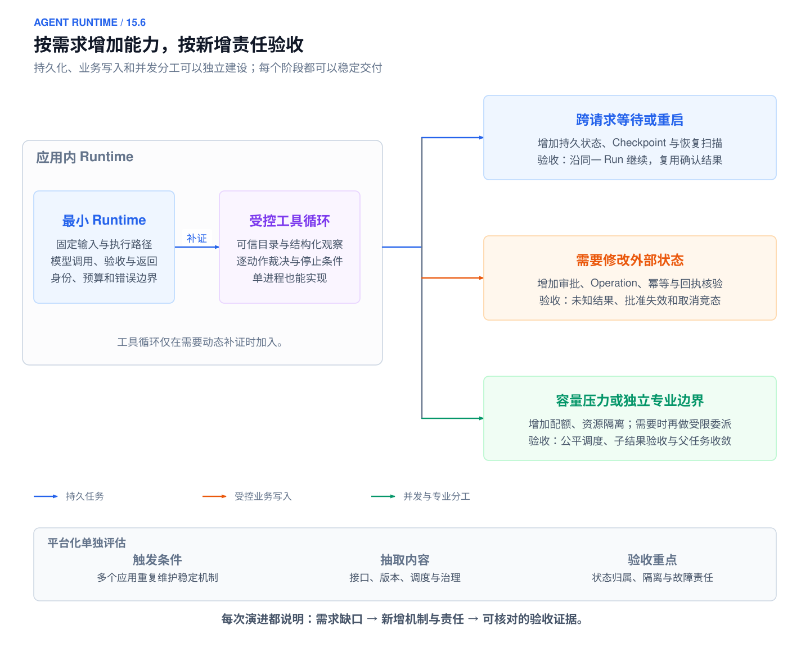](../images/agent-runtime-14-6-overview.svg)

*图 16-7：Runtime 建设概览：最小实现与按需增加的持久化、业务写入和并发能力*

*能力扩展由需求触发，持久化、写入与并发各有独立的验收责任。本书参考设计，点击图片查看 SVG。*

实现 Runtime 可以从单进程开始，按任务需要增加持久性、受控写入和并发。组件是责任边界，不是首版部署清单；每次引入新机制，都应明确它解决了什么失败、需要维护什么状态以及怎样验收。

<a id="1561-先以失败触发机制增长"></a>

### 16.6.1 先以失败触发机制增长

首版用请求内状态完成固定只读路径，保留身份、权限、有界执行、验收和错误出口。不要因为组件图里有队列、租约和多 Agent 就全部部署；应先有一个无法由现有保证覆盖的失败，再引入新增状态。下表是建设决策，不重述前文状态机。

| 触发条件 | 新增机制与权威状态 | 验收证据 | 尚不承担的保证 |
| --- | --- | --- | --- |
| 固定资料不能回答任务，下一查询依赖观察 | 有界工具循环、Observation 和逐动作裁决 | 同一任务下补到真实证据；失败/空集/unknown 分开 | 不因加循环就承诺长任务恢复 |
| 请求结束后仍需等待或继续 | 持久 Task/Run/Step、事件、Checkpoint、唤醒记录 | 在等待和结果提交边界杀进程，原身份可继续 | 不靠保存消息保证外部效果恰好一次 |
| 首次允许业务写入 | Operation、资源端幂等/查询、审批绑定和对账 | 提交成功但回执丢失，恢复后查询原动作且不重复写 | 不把本地唯一键当远端幂等 |
| 多 Worker 可能同时推进同一 Run | 租约、版本条件提交、fencing 与原执行权记录 | 旧 Worker 迟到提交被拒，既有外部效果仍有人核验 | 本地围栏不撤销已经完成的远端动作 |
| 同一租户或任务占满资源 | 分层并发、根预算预留、公平队列与背压 | 突发/降额下可拒绝或排队，子任务与重试均入总账 | 队列不能增加下游容量 |
| 一项任务确实有可独立验收的专业工作 | 子任务契约、最小委派、交接与汇总验收 | 子结果可追溯，合并后满足父任务约束 | 多角色不自动提高正确性或形成安全隔离 |

<a id="1562-将状态访问收拢到可替换接口"></a>

### 16.6.2 将状态访问收拢到可替换接口

业务调用只经受理、推进、查询、控制、验收和交付接口，不直接读写 SDK 消息数组。即使底层暂时用内存，接口也要能区分业务事实、处理状态和展示投影。迁移到数据库时冻结同一套状态转移和错误语义，避免“换了存储以后重新生成一次”改变业务身份。

最小可验收样例选择一个已知输入、一个工具失败和一次用户取消，分别验证完成、受限失败与停止后的责任。加持久化后重复同样的样例，再加入提交前/提交后崩溃；加写入后才引入回执丢失和对账。每批机制都有先前基线作为对照，不能只演示一条成功路径证明系统可靠。

<a id="1563-用迁移和回退验证责任没有丢失"></a>

### 16.6.3 用迁移和回退验证责任没有丢失

版本升级先决定旧 Run 是固定旧契约继续、明确迁移还是终止后交接。迁移记录原版本、目标版本、状态映射和未决 Operation；新代码读不了旧 Checkpoint 时进入可诊断等待，不能静默重置为第一步。流程版本方案与状态兼容机制见前文，不由模型摘要代替。

Temporal 的 Worker Versioning 为长寿命 Workflow 提供一个具体参照：pinned Workflow 绑定起始 Worker Deployment Version，不能让另一版本的Worker随意接管；因此仍服务旧Workflow的版本需要保留可用Worker。无法采用该部署方案时，Patching 是另一类保持历史重放兼容的方法，SDK规则须按语言与版本核对。[[25]](#ref-25) 这处理的是代码演化与历史确定性，不替代工具幂等、审批重验或外部结果核查。本书参考设计也应区分固定执行版本与显式状态迁移，不能把更新Prompt当作全部在途Run已安全升级。

关闭自动写入只阻止新动作，原 Operation 的查询、对账和必要补救继续保留。人工接管也沿同一身份记录事实与授权，不能绕过审计写一份无法关联的外部结果。回退演练应验证：旧版本能识别新状态的降级表示，未知动作不会被当作失败重做，用户仍能查询已经确认的交付。

<a id="1564-用实际瓶颈决定并发与平台化"></a>

### 16.6.4 用实际瓶颈决定并发与平台化

先从 Trace 区分额度等待、工具等待、状态锁竞争和模型计算。只有稳定路径的排队成为瓶颈时，才扩大 Worker；若瓶颈是同一资源的串行约束，增加 Worker 会提高争用而非吞吐。工作区隔离和写者规则先于并行修改，根预算与共享下游限额先于扩大委派。

每阶段都可停留。新增机制必须改善可验证完成率、尾延迟、成本或恢复负担中的具体目标，并保持权限与副作用约束。指标和发布决策回到第 17 章；这里的交付是一个责任可追踪、能够在声明故障范围内继续或停止的 Runtime，而不是组件数量最多的平台。

## 本章小结

[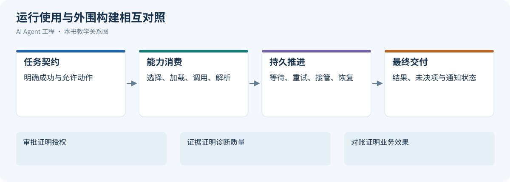](../images/review-agent-runtime-07.svg)

*图 16-8：运行使用与外围构建相互对照*


Agent Runtime 以任务契约组织目标，以版本化状态保存事实，以逐动作裁决限制执行。Session、Task、Run、Step、Attempt 和 Operation 分别表达连续交互、业务目标、执行、逻辑节点、尝试和外部动作；它们的身份不能因重试或迁移而混淆。执行循环通过可信能力完成工作，Checkpoint 和事件保存继续依据，幂等与资源端核验处理不确定副作用。取消、恢复与人工接管都在同一套状态和责任边界内推进，最后以验收过的产物与可查询的交付事实结束。

## 参考资料


正文的对象、接口与提交协议属于本书参考设计；以下资料支撑相邻的通用机制，不作为具体 Agent 产品行为的说明。各机制的适用前提见对应参考资料。

1. <a id="ref-1"></a> Karpas et al.，[MRKL Systems](https://arxiv.org/abs/2205.00445)，2022；核验于 2026-10-24。
2. <a id="ref-2"></a> Schick et al.，[Toolformer: Language Models Can Teach Themselves to Use Tools](https://arxiv.org/abs/2302.04761)，2023；核验于 2026-10-24。
3. <a id="ref-3"></a> Anthropic，[Building effective agents](https://www.anthropic.com/engineering/building-effective-agents)，2024-12-19；核验于 2026-10-17。
4. <a id="ref-4"></a> Temporal，[Temporal Workflow](https://docs.temporal.io/workflows)，持续更新；核验于 2026-10-17。
5. <a id="ref-5"></a> LangChain，[Persistence](https://docs.langchain.com/oss/python/langgraph/persistence)，持续更新；核验于 2026-10-17。
6. <a id="ref-6"></a> Yao et al.，[ReAct: Synergizing Reasoning and Acting in Language Models](https://arxiv.org/abs/2210.03629)，ICLR 2023；核验于 2026-10-17。
7. <a id="ref-7"></a> Google，[AIP-193: Errors](https://google.aip.dev/193)，2019；核验于 2026-10-24。
8. <a id="ref-8"></a> Google，[AIP-194: Automatic Retry Configuration](https://google.aip.dev/194)，持续更新；核验于 2026-10-17。
9. <a id="ref-9"></a> WHATWG，[HTML Standard: Server-sent Events](https://html.spec.whatwg.org/multipage/server-sent-events.html)，Living Standard；核验于 2026-10-17。
10. <a id="ref-10"></a> Gregor Hohpe、Bobby Woolf，[Correlation Identifier](https://www.enterpriseintegrationpatterns.com/patterns/messaging/CorrelationIdentifier.html)，Enterprise Integration Patterns；核验于 2026-10-24。
11. <a id="ref-11"></a> RabbitMQ，[Consumer Acknowledgements and Publisher Confirms](https://www.rabbitmq.com/docs/confirms)，持续更新；核验于 2026-10-18。
12. <a id="ref-12"></a> OWASP，[LLM01:2025 Prompt Injection](https://genai.owasp.org/llmrisk/llm01-prompt-injection/)，2025；核验于 2026-10-24。
13. <a id="ref-13"></a> Chris Richardson，[Pattern: Transactional Outbox](https://microservices.io/patterns/data/transactional-outbox.html)，持续更新；核验于 2026-10-17。
14. <a id="ref-14"></a> PostgreSQL，[3.4 Transactions](https://www.postgresql.org/docs/18/tutorial-transactions.html)，PostgreSQL 18；核验于 2026-10-17。
15. <a id="ref-15"></a> Debezium，[Outbox Event Router](https://debezium.io/documentation/reference/stable/transformations/outbox-event-router.html)，stable；核验于 2026-10-17。
16. <a id="ref-16"></a> PostgreSQL，[SELECT: Locking Clause](https://www.postgresql.org/docs/18/sql-select.html)，PostgreSQL 18；核验于 2026-10-17。
17. <a id="ref-17"></a> Gregor Hohpe、Bobby Woolf，[Idempotent Receiver](https://www.enterpriseintegrationpatterns.com/patterns/messaging/IdempotentReceiver.html)，Enterprise Integration Patterns；核验于 2026-10-17。
18. <a id="ref-18"></a> Martin Kleppmann，[How to Do Distributed Locking](https://martin.kleppmann.com/2016/02/08/how-to-do-distributed-locking.html)，2016-02-08；核验于 2026-10-17。
19. <a id="ref-19"></a> AWS Builders’ Library，[Making Retries Safe with Idempotent APIs](https://aws.amazon.com/builders-library/making-retries-safe-with-idempotent-APIs/)，持续更新；核验于 2026-10-17。
20. <a id="ref-20"></a> Stripe，[Idempotent requests](https://docs.stripe.com/api/idempotent_requests)，持续更新；核验于 2026-10-24。区分 API v1/v2。
21. <a id="ref-21"></a> Hector Garcia-Molina、Kenneth Salem，[Sagas](https://www.cs.cornell.edu/andru/cs711/2002fa/reading/sagas.pdf)，ACM SIGMOD 1987；核验于 2026-10-17。
22. <a id="ref-22"></a> Temporal，[Activity Definition：Idempotency](https://docs.temporal.io/activity-definition#idempotency)，持续更新；核验于 2026-10-24。支撑允许重试时的活动执行边界，Operation 账本为本书设计。
23. <a id="ref-23"></a> Temporal，[Workflow Definition](https://docs.temporal.io/workflow-definition)，持续更新；核验于 2026-10-22。
24. <a id="ref-24"></a> LangChain，[Persistence：Durability modes 与 Replay](https://docs.langchain.com/oss/python/langgraph/checkpointers#durability-modes)与[Interrupts：Key points about resuming](https://docs.langchain.com/oss/python/langgraph/interrupts)，持续更新；核验于 2026-10-22。
25. <a id="ref-25"></a> Temporal，[Worker deployment and performance: Worker Versioning](https://docs.temporal.io/best-practices/worker#use-worker-versioning-to-safely-deploy-new-workflow-code)，持续更新文档；核验于 2026-10-24。
