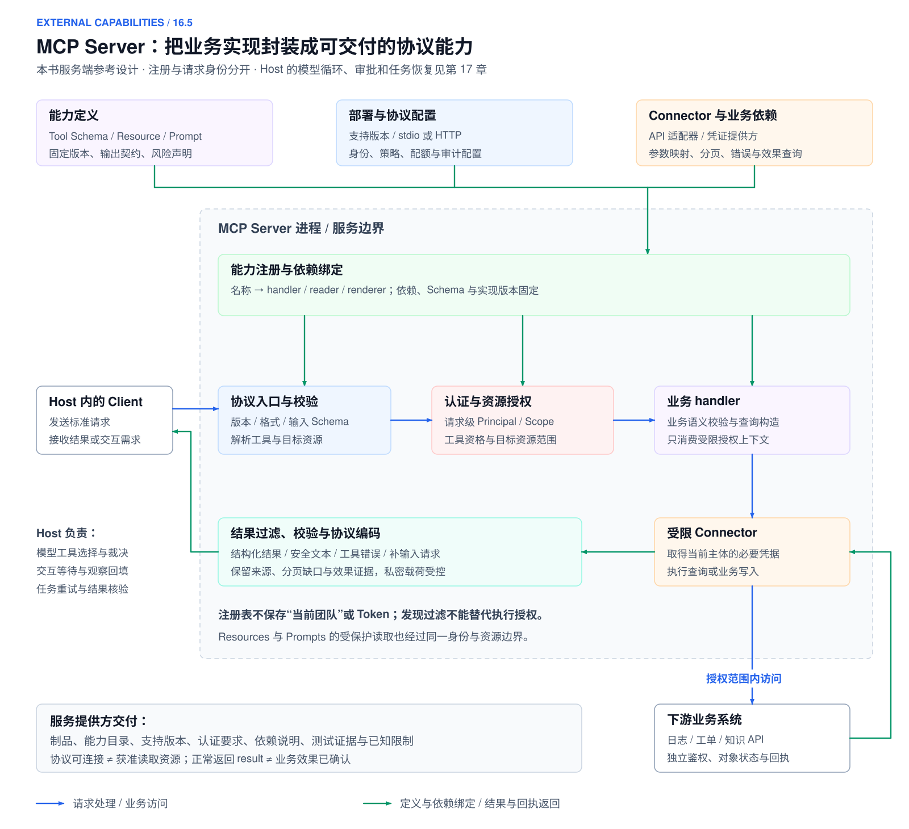
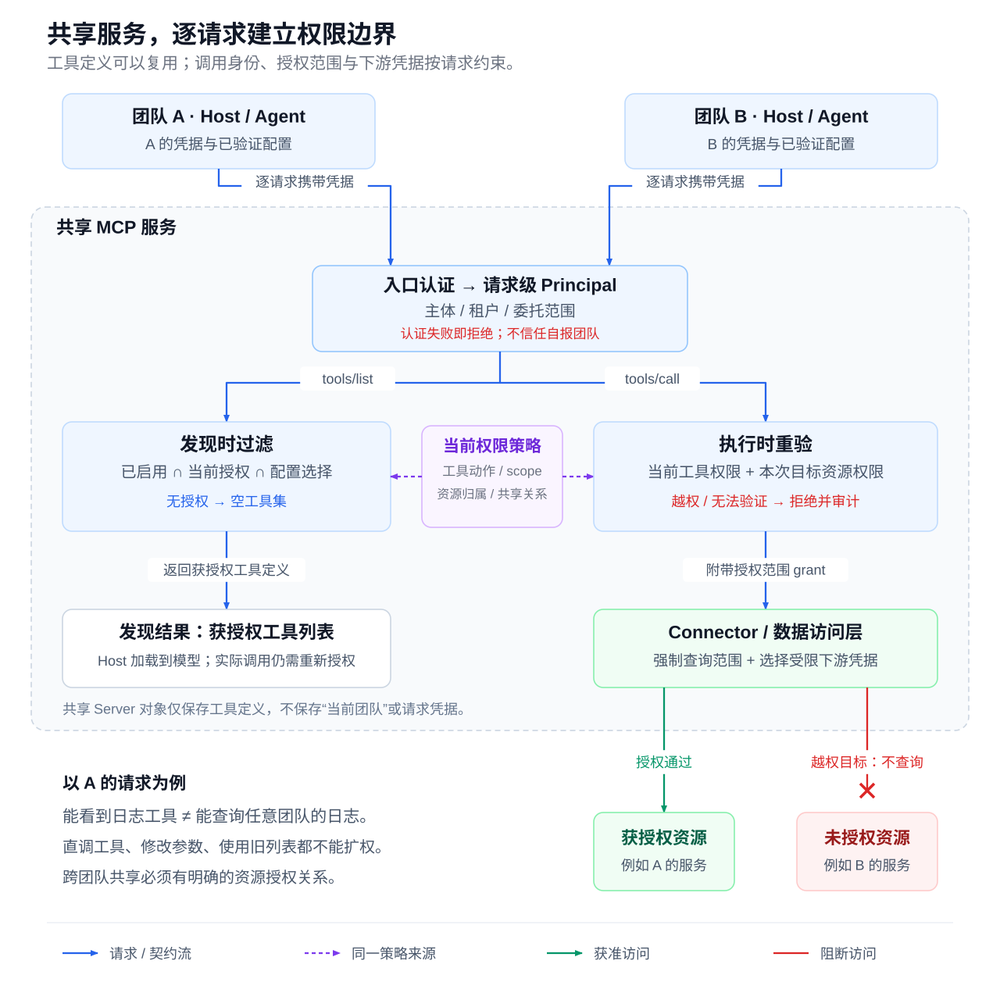

<a id="第-16-章-agent-工具系统工程skillstoolsmcp-与-connectors"></a>
<a id="第-17-章-外部工具系统skillstoolsmcp-与-connectors"></a>

# 第 16 章 外部工具系统：Skills、Tools、MCP 与 Connectors

怎样把指标、日志与工单 API 构建成 Runtime 可以安全使用的能力？本章从能力提供方说明工具契约、注册发现与渐进加载、Skills、MCP、Connector，以及风险双轴和沙箱。模型提出调用，能力系统交付接口与保证，[第17章 Agent Runtime](04-agent-runtime.md)负责调度、审批等待、重试与恢复。贯穿案例沿用[第14章的 ALR 档案](02-context-engineering.md#alr-context-lifecycle)：`ALR-20260429-017`、`run_0429_017`、`trace_20260429_017`，调查对象为 `prod/order-service`，观察窗为 2026-04-29 10:35–10:50（+08:00，即 02:35Z–02:50Z）；调查只读，有效批准后可创建跟进单 `INC-4821`，不提供重启或回滚。

版本与范围：

- 本章 MCP 以 2026-07-28 规范为主线，2025-11-25 及更早版本仅作兼容对照。
- OAuth 相关内容依据 IETF 标准与安全最佳实践[[1]](#ref-1)。
- MCP 角色、版本、传输、授权与 Elicitation 及 Skill 命名规则复核于 2026-10-26；Tools 与 Elicitation 的相关条款于 2026-10-29 补核，其他来源保留各自核验日期，详见参考资料。
- 流程、JSON、风险配置及企业场景均为教学设计，未连接真实 MCP Server、完成真实账号授权或端到端调用；固定规范不意味着客户端已经支持全部特性。

---

<a id="tool-calling"></a>

<a id="161-tool-calling-决策从函数调用到受控行动"></a>
<a id="151-tool-calling-决策从函数调用到受控行动"></a>
<a id="181-tool-calling-决策从函数调用到受控行动"></a>

## 16.1 概念边界与接入选择

[](../images/review-skills-tools-mcp-connectors-01.svg)

*图 16-1：外围能力从提案到受控调用*


选择接入方式之前，先区分调用提案、能力契约、方法包和执行通道；它们分别回答不同的问题。

<a id="1611-从调用协议到受控行动"></a>
<a id="1511-从调用协议到受控行动"></a>
<a id="1812-tool-calling-的运行闭环"></a>

### 16.1.1 从调用协议到受控行动

[第13章 LLM API 协议](01-llm-api-protocol.md#streaming-output)解释模型怎样提出调用，以及应用怎样关联并回填结果；模型输出本身既不是执行，也不是授权。[[2]](#ref-2) 对 ALR 案例，工具系统必须把日志工具名解析到可信注册对象，提供参数、身份、资源和输出契约，Runtime 才能据此裁决调用。

<a id="capability-concepts"></a>
<a id="1612-概念边界总表"></a>
<a id="1512-概念边界总表"></a>
<a id="1813-function-callingtool-callingpluginskills-与-mcp-的边界"></a>
<a id="1843-toolskillworkflowmemoryplugin-的边界"></a>

### 16.1.2 概念边界总表

各层的产物和责任如下。

| 概念 | 是什么 | 解决什么 | 由谁执行 | 详见 |
|:---|:---|:---|:---|:---|
| Function Calling | 模型 API 的结构化输出能力：返回“调用某函数、参数为某值” | 让模型以机器可解析的形式表达调用意图 | 应用程序 | [LLM API 协议](01-llm-api-protocol.md) |
| Tool Calling | 模型请求调用工具并消费结果的通用机制，函数类工具常称 Function Calling | 模型怎样表达行动意图、取得外部观察 | 模型产生提案，应用控制实际执行 | [LLM API 工具协议](01-llm-api-protocol.md#model-tool-definitions) |
| Tool | 一个可被提出的具体动作，如 typed function、API 操作或 MCP 工具 | Agent 能做什么 | Runtime 校验参数、权限和副作用后执行 | [工具契约](#tool-contract) |
| Skill（能力包） | `SKILL.md` 及配套资源组成的操作手册 | Agent 何时、按什么方法做事 | Runtime 选择并注入上下文，模型据此规划；Skill 不能自行授予权限 | [Skills](#skills) |
| Workflow | DAG、状态机或代码流程 | 哪些步骤必须确定性推进 | 编排器控制状态和条件 | [Agent Runtime Workflow](04-agent-runtime.md#workflow) |
| Memory | 用户偏好、项目事实、历史摘要等长期信息 | 哪些事实值得跨任务保留 | 记忆系统管理时效、来源和隐私 | [Agent 的上下文工程 记忆](02-context-engineering.md#memory) |
| Plugin（扩展包） | 把 Skill、MCP 配置、Connector 定义、脚本和依赖打包的分发单元 | 一组能力如何安装、启用和版本化 | 客户端或扩展系统管理安装、启用和供应链 | [能力组合的交付与兼容](#capability-usage-governance) |
| MCP | Host 与 Server 之间的标准协议 | 外部工具、资源和提示模板如何被标准化发现和调用 | MCP Server 提供能力，Host 负责接入与控制 | [MCP](#mcp) |
| Connector | 面向某个外部系统的集成实现及配置 | 在指定账号、组织和权限下可靠接入下游 API：认证、字段映射、分页、错误转换、版本适配 | 应用的 Tool Runtime 或 MCP Server 调用 | [Connector 开发](#connector-development) |

本文用“能力”统称可提供的操作或方法；Skill 是方法包，Plugin 是扩展分发包，capability profile 是运行可选配置；MCP capabilities 专指协议特性声明。它们不共用一个 enabled 或授权含义。

几条关系需要特别说明：

- **Skill 与 Tool**：Skill 负责方法，Tool 负责行动。告警诊断 Skill 指导 Agent 按取证路径调用日志、指标和部署工具，但 Skill 本身不带来任何权限。
- **Skill 与 Workflow**：发布流程中不能跳过的审批，应由 Workflow 或工具的 Policy 实现。把提示里的步骤当作确定性编排，等于把系统应保证的约束交给模型自觉遵守。
- **Skill 与 MCP**：Skill 的文件格式不依赖 MCP。Skill 既可以引导 MCP 工具，也可以引导 CLI 或 API；MCP 的 Prompts 是 Server 提供的模板，由 Host 按自身机制使用，与 Skill 不是同一种东西。
- **Connector 与 MCP**：Connector 是集成实现，MCP 只是可选的暴露协议。Connector 可以不经过 MCP，直接被应用的 Tool Runtime 调用；一个 MCP Server 也可以聚合多个 Connector。MCP 工具规范规定的是工具发现、调用和结果结构，并不意味着它已经替你完成下游账号授权、业务 ACL 或写入幂等[[3]](#ref-3)。

一个典型的扩展包结构如下：

```text
Plugin（扩展包）
  ├─ Skill（方法包）
  ├─ MCP Server 配置 / Connector 定义（外部能力入口）
  ├─ Tool Schema（可调用操作的契约）
  └─ 脚本、模板与资产（辅助资源）
```

无论能力以哪种形式接入，它能否安全可靠地工作，仍取决于 Schema、Policy、沙箱（Sandbox）、Trace 和评估。MCP 不替代 Tool Runtime，扩展包也不替代 Skill。

<a id="tool-access-selection"></a>
<a id="1613-接入方式选择apiclimcp-与-browser-use"></a>
<a id="1513-接入方式选择apiclimcp-与-browser-use"></a>
<a id="1815-工具接入方式选择框架apiclimcp-与-browser-use"></a>

### 16.1.3 接入方式选择：API、CLI、MCP、Connector 与 Browser Use

选择接入方式，要同时回答“怎样调用外部系统”和“由谁维护集成”。这五项处于不同层级：API 是外部系统提供的程序接口，CLI 是可执行的命令入口，Browser Use 通过页面交互执行；MCP 是客户端与工具服务之间的标准协议，Connector 是针对某个外部系统的集成实现。Connector 可以直接被应用调用，也可以通过 MCP 暴露；MCP Server 内部还可以执行 CLI。因此，它们既可以作为接入方案比较，也可以组合使用。

无论采用哪条路径，模型都只提出工具名和参数；Agent Runtime 负责找到处理代码、检查权限并执行，再把结果交回模型。采用 MCP 时，MCP Client 承担协议通信；直接接 Connector 时，由应用的工具处理代码调用集成接口，不要求 Connector 实现 MCP。[[2]](#ref-2)[[3]](#ref-3)

| 接入方式 | 实际调用入口 | 谁提供与维护 | 优势与适合场景 | 主要限制与责任 |
|:---|:---|:---|:---|:---|
| API 直连 | 工具处理代码通过 HTTP 或 SDK 请求外部 API | 外部系统提供 API；Agent 开发团队维护调用代码 | 可精确选择接口、字段和业务行为，适合自研 Runtime 与定制流程 | 开发团队处理认证、分页、限流、错误转换和版本适配；可用能力仍受 API 与账号权限限制 |
| CLI | Runtime 启动受控进程，执行命令并读取退出码与输出 | CLI 作者维护命令；使用方安装、登录并管理执行环境 | 复用成熟命令与登录态，适合本地仓库、开发工具和脚本流程 | 依赖可执行文件、版本和运行环境；应优先使用结构化输出与参数数组，避免拼接任意 Shell 命令 |
| MCP | Host 中的 MCP Client 连接本地或远程 MCP Server | Server 开发者维护工具实现；自部署者运维服务，托管服务由提供方运维 | 标准化发现、参数和结果，适合一套工具供多个兼容客户端复用 | 客户端支持与服务能力可能不同；协议不能替代下游授权、幂等和审计，也不保证工具覆盖全部 API |
| Connector | Runtime 调用已有集成提供的工具；也可由 MCP Server 调用集成代码 | 集成可由 Agent 产品厂商、外部服务厂商或开发团队提供；例如 OpenAI 提供 Gmail 集成 | 复用账号连接、API 适配和结果转换，适合已有集成足以覆盖的邮件、文档和工单操作 | 能力范围、更新节奏、部署与凭证管理取决于提供方；现成 Connector 的引用未必能直接迁移到其他客户端 |
| Browser Use | 浏览器自动化工具读取页面并执行点击、输入等动作 | 目标服务维护页面；Agent 开发者或自动化工具提供方维护交互实现 | 适合只能通过网页完成的操作，或必须核对页面状态的任务 | 页面、定位器、登录和交互等待都会影响稳定性；通常步骤更多，需核验最终页面与业务结果[[36]](#ref-36)[[37]](#ref-37) |

**以 GitHub 为例，API、CLI 与 MCP 的差异在于谁负责适配。** API 直连由你的工具代码调用 GitHub REST 或 GraphQL；CLI 路径由 Runtime 执行 GitHub 提供的 `gh`，例如 `gh api`；MCP 路径则由 MCP Client 调用 GitHub MCP Server 暴露的工具，再由 Server 访问 GitHub。GitHub 提供远程托管与本地运行的 MCP Server；选择远程服务不意味着要在自己的电脑上启动服务进程。[[39]](#ref-39)[[40]](#ref-40)

**以 OpenAI 提供的 Gmail Connector 为例，接入时复用的是已有集成。** 用户安装并启用 Gmail 插件，再完成 Google 账号连接，Codex 才能在相应权限下使用邮件工具；安装插件和账号授权是两个独立动作。邮件操作由 Gmail 集成访问 Google Gmail API 完成。这里说明的是调用职责，不能仅凭“Connector”名称或工具名中的 `mcp`，判定 OpenAI 连接服务内部是否使用标准 MCP，也不能推断本机启动了 Gmail MCP Server。[[41]](#ref-41)

安装与配置的内容也不同：CLI 通常需要安装命令程序并建立登录态；手动配置 MCP 是登记服务启动命令或远程地址，并按需配置认证与工具范围；现成 Connector 的接入则可能只需启用插件、引用已注册集成并连接账号。自建 Gmail MCP Server 是另一种方案，其开发者或部署者还需处理 Google OAuth、服务运行与工具实现；这些维护成本不能套用到现成 Gmail Connector 上。

选择时可按以下条件判断：

- **已有 Connector 足够用**：优先复用，先确认提供方、账号身份、工具范围，以及结果和副作用能否核验。
- **需要精确业务行为，且由自己维护 Runtime**：考虑 API 直连，或把公共适配逻辑封装成自己的 Connector。
- **执行环境已有成熟 CLI**：通过受控进程复用；能取得 JSON 等结构化输出时，避免解析面向人的终端文本。
- **同一套能力要供多个兼容客户端使用**：考虑用 MCP 暴露自建 Connector，或连接可信提供方的 MCP Server。
- **现有程序接口无法完成任务，或任务需要页面交互**：考虑 Browser Use，并处理登录、定位、等待和效果核验。

上述条件可以组合。例如 **CLI + Skill** 复用命令与操作方法，**MCP + Connector** 把具体业务集成提供给不同客户端。Skill 规定方法，MCP 统一接入协议，Connector 落实下游集成；权限控制、写入审批与审计需要在每条执行路径中实现，不因选择了 MCP 或现成 Connector 而自动具备。


<a id="tool-contract"></a>
<a id="162-工具契约schema返回结果与能力暴露"></a>
<a id="152-工具契约schema返回结果与能力暴露"></a>

## 16.2 业务能力设计：操作边界、结果语义与可靠性保证

[](../images/review-skills-tools-mcp-connectors-02.svg)

*图 16-2：业务能力契约：操作范围、输入归属、结果语义与可靠性声明。*

模型怎样接收工具定义、生成参数并关联返回结果，统一见[第 13 章工具调用协议](01-llm-api-protocol.md#model-tool-definitions)。本节站在能力提供方一侧，回答一个业务操作实际承诺什么：操作对象与范围、哪些输入可被提出、结果能证明什么，以及失败或重复调用会产生什么效果。这份契约可以经函数、CLI、MCP 或普通 API 交付，不依赖某一种模型消息格式。

模型接口的 Schema 是业务契约的结构投影，不能代替业务权限、完整性和副作用保证。工具提供方定义并实现这些保证，Runtime 按任务绑定、当前权限与预算使用，业务系统继续承担最终资源鉴权。

<a id="1621-工具-schema模型与系统之间的契约"></a>
<a id="1521-工具-schema模型与系统之间的契约"></a>
<a id="1821-工具-schema-是模型与系统之间的契约"></a>
<a id="1622-反例过度宽泛的工具"></a>
<a id="1522-反例过度宽泛的工具"></a>
<a id="1822-反例过度宽泛的工具为什么不可靠"></a>
<a id="1623-正例边界清晰的工具"></a>
<a id="1523-正例边界清晰的工具"></a>
<a id="1823-正例边界清晰的工具如何设计"></a>

### 16.2.1 操作粒度与业务边界

一个工具应围绕可独立解释和验证的业务操作，而不是暴露无限制的系统入口。名字、参数和结果都要对应明确对象，使调用者知道何时适用、何时不适用，以及怎样核验执行结果。

| 操作设计 | 问题或保证 | ALR 中的处理 |
| --- | --- | --- |
| `query(system, query)` | 混合日志、指标和任意查询语言，难以统一范围、成本和资源校验 | 拆为各数据源的有界操作 |
| `prometheus_query_range` | 明确数值指标、时间范围、查询分辨率与数据源限制 | 不承担日志读取、建单或生产变更 |
| `loki_search` | 明确服务、环境、窗口、字段与分页边界 | 返回获准日志页和剩余覆盖缺口 |
| `create_incident_ticket` | 明确项目、草稿、资源版本、防重与回执语义 | 只执行有效批准绑定的建单动作 |

粒度过大使参数变成任意程序或多种隐含操作，粒度过小又把大量业务步骤交给调用者重组。可以将稳定的只读取证流程封装为 `diagnose_latency_incident(alert_id)`，但必须交付内部来源、失败和覆盖证据；不能在“诊断”名称后隐藏建单、发送消息或回滚。组合能力的副作用覆盖内部最高影响，数据敏感度覆盖可触达数据，内部调用仍落实各自的资源约束。

协议中的名称、描述与输入 Schema 怎样表达这些边界，见[13.3.1](01-llm-api-protocol.md#model-tool-definitions)；Skill 怎样描述多步方法见[16.3](#skills)。本节不重复供应商字段和消息包装。

<a id="1624-schema-设计原则名称参数幂等边界与错误"></a>
<a id="1524-schema-设计原则名称参数幂等边界与错误"></a>
<a id="1824-schema-设计原则名称参数幂等边界与错误"></a>
<a id="dynamic-exposure"></a>
<a id="1626-动态工具暴露按任务阶段权限和环境裁剪"></a>
<a id="1526-动态工具暴露按任务阶段权限和环境裁剪"></a>
<a id="1826-动态工具暴露按任务阶段权限和环境裁剪能力"></a>
<a id="orchestration-exposure"></a>
<a id="1636-编排模式对工具暴露的影响"></a>
<a id="1536-编排模式对工具暴露的影响"></a>
<a id="187-工具编排模式从单次调用到可治理流程"></a>

### 16.2.2 业务参数与可信调用绑定

工具契约要区分可由调用者提出的业务条件，以及只能由可信系统绑定的身份、连接和授权信息。参数结构合法，只表示候选值可以被解析，不表示它属于当前主体或能用于当前任务。

| 输入类别 | 可以怎样产生 | 实现必须检查什么 |
| --- | --- | --- |
| 服务、告警、环境、查询窗口 | 用户指定或模型在任务范围内提出 | 可信实体映射、归属、时间与查询限额，不因名称合法就放行 |
| 租户、用户、Connection 与凭证 | 已验证会话、连接服务与可信派发上下文 | 当前所有权、用途、Scope 与撤销状态，不接受参数自报身份 |
| 草稿内容、目标项目与资源版本 | 模型可以提出候选，可信批准记录绑定实际载荷 | 实际执行内容与批准、对象和版本一致 |
| Operation、幂等键、截止时间与预算 | Runtime 或受信调用方提供 | 键作用域、载荷一致性与当前执行条件，不能让模型重生成身份 |

参数约定还应写明单位、时区、边界和缺省行为。例如金额使用整数分，时间窗标明起止语义与时区，日志工具声明最大窗口和分页规则。自由文本查询语言也须通过受限构造或可靠的范围校验执行，不能只在描述里写“不要查询其他项目”。身份字段不应伪装成模型必须填写的业务参数，实际资源约束必须被实现和下游查询消费。

动态工具集合属于消费侧行为。能力提供方交付来源、版本、适用环境、依赖、风险与可用状态等元数据；Runtime 如何按任务阶段筛选和映射这些能力，统一见[本轮工具暴露](04-agent-runtime.md#runtime-tool-exposure)。工具路由与编排由 Runtime 按任务推进，能力提供方只交付它所消费的契约。

<a id="tool-result-envelope"></a>
<a id="1625-toolresult-envelope模型上下文与系统元数据分离"></a>
<a id="1525-toolresult-envelope模型上下文与系统元数据分离"></a>
<a id="1825-toolresult-envelope把模型上下文和系统元数据分开"></a>
<a id="tool-result"></a>

### 16.2.3 结果语义、覆盖范围与来源证据

结果至少区分“查询成功且完整”“查询成功但仍有缺口”“没有匹配数据”“查询失败”和“写入效果未知”。成功状态不能替代这些业务含义：空数组可能是没有匹配，也可能是过滤后无可见数据；网络超时更不能被编码成“没有异常”。

以下 JSON 是本书应用层 ToolResult 信封示意，不是任何 LLM API 或 MCP 的原生结果类型。`call_id` 在这里用于应用调用关联；它如何映射供应商的调用标识，由协议适配层处理。

```json
{
  "call_id": "call_logs_01",
  "status": "partial",
  "summary": "已返回当前有权读取的日志页，仍有下一页",
  "data_ref": "artifact://run_0429_017/logs/1",
  "coverage": {"complete": false, "missing": ["remaining_pages"]},
  "effect": {"disposition": "none", "operation_id": null},
  "truncated": false,
  "next_cursor": "opaque-scoped-cursor",
  "error": null,
  "provenance": {"service": "order-service", "window": "02:35Z/02:50Z", "source_version": "logs-snapshot-1"}
}
```

| 字段 | 语义与消费者 |
| --- | --- |
| status | success/error/partial；描述本次工具返回，不替代 Operation 事实 |
| coverage | complete 为 true/false/null，missing 说明未覆盖部分；空结果与查询失败分开 |
| effect.disposition | none 用于只读；not_dispatched、applied、not_applied、partial、unknown 分别说明派发与效果，写操作关联 operation_id |
| truncated | 当前载荷是否被裁剪；分页未取尽由 coverage 和 next_cursor 表示，不混用 |
| next_cursor | 可继续读取的授权游标；不保证剩余内容在续读时仍可见 |
| data_ref/provenance | 受控原始数据与来源、实体、版本、时间范围；模型通常只读摘要和必要证据 |
| error | 分类码、retryable 提示、provider_request_id 与安全诊断；Runtime 拥有最终重试责任 |

写入发出后丢失回执返回 `OUTCOME_UNKNOWN` 和 `effect.disposition=unknown`，不能映射成“确认未生效”。不完整读取也不能当作没有异常。敏感凭据、内部连接句柄与完整私密载荷不进入模型或普通日志。

`coverage` 描述本次数据覆盖，`effect` 描述外部动作效果，两者相互独立。日志查询返回 `partial` 仍可提供有用证据，但不能据此确认整个窗口没有错误；建单请求失去回执则提供原操作与资源查询入口，不能用一条失败消息证明工单不存在。`data_ref` 是受控原始载荷引用，不自动授予读取资格；来源还应保留对象、版本与时间，便于回读和核验。

统一错误分类见[Connector 错误接口](#connector-error-codes)：语法或范围无效用 `INVALID_INPUT`，限流用 `RATE_LIMITED`，越权用 `PERMISSION_DENIED`，原始提供方码保存在安全诊断字段。`retryable` 只提供判断依据，不决定当前任务的重试次数和预算。可裁剪结果保留 `truncated` 与覆盖标记，超过硬限制而必须拒绝时明确要求缩小范围。

相同 ToolResult 可以投影为模型可读内容、结构化程序结果或审计引用。供应商要求的结果包装与调用关联见[第 13 章](01-llm-api-protocol.md#model-tool-results)，MCP 的 `structuredContent`、`isError` 与 JSON-RPC error 编码见[16.4.3](#mcp-server-assembly)，派发后怎样形成 Observation 与更新状态见[第 17 章](04-agent-runtime.md#runtime-dispatch-protocol)。不能把三者写成一种格式。

<a id="tool-risk-levels"></a>
<a id="1627-用副作用与数据敏感度共同描述风险"></a>
<a id="1527-用副作用与数据敏感度共同描述风险"></a>

### 16.2.4 副作用、敏感度与可靠性声明

工具应声明实际行为和数据属性，而不是先写一个“自动允许”标签。下面是本书注册表使用的两条分类轴，值域沿用全书约定，不是 MCP 原生等级：

| 轴 | 取值 | 需要说明的业务含义 |
| --- | --- | --- |
| `side_effect` | `read_only` | 不改变目标业务状态；说明读取对象、范围与返回内容 |
| `side_effect` | `compensatable_write` | 会改变业务状态；说明可用补偿及不能消除的影响 |
| `side_effect` | `external_send` | 会把内容交付给接收方；说明发送对象、内容和送达保证 |
| `side_effect` | `hard_to_reverse` | 无可靠补偿或影响较大；明确效果、恢复限制与责任边界 |
| `data_sensitivity` | `public` | 数据已获准公开；说明来源和适用范围 |
| `data_sensitivity` | `internal` | 数据限组织或项目使用；说明归属与预期消费者 |
| `data_sensitivity` | `sensitive` | 涉及个人信息、客户载荷或受限业务记录；说明字段和派生数据范围 |
| `data_sensitivity` | `secret` | 密码、Key、Token、私钥等凭证；声明专用凭据消费通道，不作为模型观察返回 |

一个接口混合多种行为时，按最高副作用保守登记，或拆成独立工具；多类数据按最高敏感度登记。未知分类不能填成低风险。`prohibited` 是策略裁决，不是第三条分类轴；执行进程可能由代理注入凭证，也不代表模型可以读取 `secret`。

分类之后，还应交付可验证的可靠性保证：

| 保证项 | 能力提供方应声明并验证什么 | 不能承诺什么 |
| --- | --- | --- |
| 防重与幂等 | 下游键的作用域、载荷约束、有效期与重复请求结果 | 仅凭工具名、只读提示或本地缓存保证写入恰好一次 |
| 效果查询 | 能否按原 Operation 或外部引用查询，何时可以确认未生效 | 超时、取消或连接断开自动等于失败 |
| 补偿 | 补偿操作、前提、权限和无法撤回的影响 | 所有写入都可通过另一动作恢复原状 |
| 错误与限额 | 分类错误、限流/分页提示、时间与输出上限 | `retryable=true` 自动授权重试，或 dry-run 提供防重保证 |
| 数据交付 | 摘要、字段、来源、受控引用及覆盖缺口 | 返回更多原始数据必然带来更完整或更可靠的结论 |

本例 `loki_search` 是“只读 × 敏感”，建单是“可补偿写入 × 内部”；通知由能力集之外的交付系统处理，重启和回滚不提供。MCP annotations 只是对行为的声明，不能代替以上实现核验，协议字段说明见[16.4.2](#mcp-server-definitions)。

能力提供方描述性质，Runtime 按当前身份和任务实施控制：分类对应的控制基线与审批见[17.5.3](04-agent-runtime.md#runtime-risk-controls)，持续验收见[第 18 章](06-agent-governance-optimization.md#guardrails-overview)。[Connector 写入契约](#1666-写操作审批幂等与结果未知)落实下游保证，[Runtime 恢复](04-agent-runtime.md#failure-side-effects)处理已经派发的未知效果。

单次调用的组件链路、Attempt / Operation 映射、重试准入与工具指标统一见[17.4.5 调用适配层](04-agent-runtime.md#tool-runtime)。本章交付工具及其业务契约，由 Agent Runtime 在执行循环中消费。

<a id="skills"></a>
<a id="164-agent-skills从工具调用到能力复用"></a>
<a id="154-agent-skills从工具调用到能力复用"></a>

## 16.3 Agent Skills：从工具调用到能力复用

工具让 Agent 能够行动，Skill 则把完成一类任务的方法组织成可复用的能力包。Anthropic 提出的 Agent Skills 把指令、脚本和资源放进一个目录，并按任务需要加载。[[4]](#ref-4)

本节沿用告警诊断案例，依次讨论 Skill 的组成、`SKILL.md` 的写法、从案例提炼能力、注册表、渐进式加载、门控与 Tool Policy 的分工，以及版本化生命周期和常见失败模式。

<a id="1641-为什么有了-tool-calling-还需要-skill"></a>
<a id="1541-为什么有了-tool-calling-还需要-skill"></a>

### 16.3.1 为什么有了 Tool Calling 还需要 Skill

查询天气通常只需一次工具调用，而“排查线上延迟升高”需要协调多个动作：确认服务和时间窗口，查询指标与日志，对比部署变更，检索历史案例，最后形成带证据的诊断。能调用这些工具，不等于能把它们组织成可靠的工作方法。

如果每次都让模型从零规划，它可能漏查部署、把时间上的相关性当成因果，或在证据不足时直接建议重启。Skill 的价值在于沉淀容易遗漏的步骤、判断条件和交付标准，让下一次任务复用经过验证的方法。

> **Skill 是可被 Agent 发现并按需加载的能力包：它用程序性指令、工具使用约定和配套资源，描述某类任务应该如何完成、如何处理失败，以及如何证明已经完成。**

“程序性”强调的是行为路径，Markdown 并不会像代码一样被强制执行。因此，评价一个 Skill 要看它能否改善真实任务中的行为，而不是看说明是否完整、措辞是否强硬。

<a id="1642-skill-的组成入口指令与可复用资源"></a>
<a id="1542-skill-的组成入口指令与可复用资源"></a>
<a id="1842-skill-的定义触发条件步骤工具约束与验证"></a>

### 16.3.2 Skill 的组成：入口、指令与可复用资源

Agent Skills 格式以 `SKILL.md` 为入口，文件由 YAML 前置元数据（Front Matter）和 Markdown 正文组成；脚本、参考资料和资产都是可选资源。[[5]](#ref-5)

[](../images/agent-skill-anatomy.svg)

*图 16-3：Skill 组成：SKILL.md 的元数据用于发现，正文提供执行指令；scripts 提供确定性操作，references 提供按需知识，assets 提供产物材料*


| 组成 | 回答的问题 | 告警诊断示例 |
|:---|:---|:---|
| `SKILL.md` 前置元数据 | 这是什么能力，什么时候使用？ | 名称 `incident-diagnosis`；描述延迟、错误率和告警排查场景 |
| `SKILL.md` 正文 | 按什么路径完成，如何验证？ | 先对齐时间窗口再取证；报告区分事实、假设和未知项 |
| `scripts/` | 哪些操作应复用确定性实现？ | 校验报告中的证据编号和时间格式 |
| `references/` | 当前任务需要查阅哪些领域知识？ | 指标口径、日志字段、部署事件说明 |
| `assets/` | 产物需要哪些模板或素材？ | 事故报告模板、图标和报告样式 |

目录只添加任务确实需要的资源。三类资源的使用方式也不同：参考资料按需读入上下文；脚本通过工具执行，不必每次把源码读进模型；资产通常作为输出材料，需要时再检查。脚本输出、报错和被读取的文件仍会占用上下文，“外化为文件”并非零成本。

同一条规则只维护一个事实源。例如，指标口径放在 `references/metrics.md`，正文只说明何时读取，不复制整套定义，否则两处内容会在更新中逐渐漂移。有些客户端还会使用额外的 UI 或平台配置文件，但它们不是所有 Skill 通用的必需文件。

Skill 与 Tool、Workflow、Memory、Plugin 的边界见 [概念边界总表](#capability-concepts)。这里只强调一点：Skill 指导模型选择步骤，自身不能授予任何权限；不能跳过的审批应由 Workflow 或 Tool Policy 保证。

通用规范的必填字段为 `name` 与 `description`：`name` 长度为 1–64 字符，使用小写字母、数字和连字符，与父目录同名，不能以连字符开头或结尾，也不能出现连续连字符；例如 `incident-diagnosis` 合法，`-incident`、`incident-`、`incident--diagnosis` 不合法。`description` 长度为 1–1024 字符；可选 `license`、`compatibility`（提供时为 1–500 字符）、字符串映射 `metadata`；`allowed-tools` 是实验字段，不能被当作所有宿主的强制授权。[[5]](#ref-5) Claude Code 特有的控制字段属于产品扩展，不回填为通用规范要求。

<a id="skill-md-example"></a>
<a id="1643-可执行的-skillmd-示例"></a>
<a id="1543-可执行的-skillmd-示例"></a>
<a id="1844-一个高质量-skill-应该长什么样"></a>

### 16.3.3 完整的 `SKILL.md` 示例

下面是 `incident-diagnosis/SKILL.md` 的完整入口示例，不是独立可运行程序；配套资源和工具必须由能力包提供并通过验收。`name`、`description` 写在前置元数据中，方法、边界和失败出口写在正文中。

````markdown
---
name: incident-diagnosis
description: 分析线上告警、接口延迟升高、错误率异常，输出有证据的诊断报告。用于服务排障，不用于日常指标报表或直接执行生产修复。
---

# 告警诊断

## 输入与前置条件
- 确认服务、环境、告警和时间窗口；缺失且无法从告警确定时先澄清。
- 根据当前环境确认指标、日志和部署查询工具可用。

## 执行步骤
1. 读取告警，确认影响范围；按 references/metrics.md 核验指标口径。
2. 查询同一时间窗口的延迟、错误率和流量，记录证据编号。
3. 按 references/log-fields.md 查询脱敏日志，核对部署和配置变更。
4. 交叉检查证据，区分已证实事实、根因假设和待验证项。
5. 使用 assets/incident-report.md 组织报告。
6. 通过执行工具运行 scripts/check_report.py 检查证据引用；
   再人工或由 Agent 核对证据是否真正支持结论。

## 行为边界与失败处理
- 不读取或输出凭证和个人敏感信息，不自动重启、回滚或修改配置。
- 证据不足时继续取证，或明确报告未知；不把时间相关性写成确定根因。
- 工具失败时报告缺项和影响，不能改用未授权通道绕过限制。

## 完成标准
- 报告包含时间窗口、影响范围、证据、假设、未知项和后续建议。
- 每个关键判断可追溯到证据；资源或校验不可用时不得声称已验证。
````

`description` 是发现入口，必须写明能力和适用场景。如果“何时使用”只写在正文里，Agent 决定是否加载时可能看不到。描述也不宜塞入完整步骤：一般经验是，摘要写得过细，Agent 容易凭摘要直接执行，跳过正文中的约束。

正文要把容易走错的分支写清楚：输入不全怎么办，工具失败如何降级，证据不足如何表达。示例中的校验脚本只能检查引用结构，不能证明根因正确，后者仍要回到原始证据。

<a id="1644-从真实案例提炼-skill"></a>
<a id="1544-从真实案例提炼-skill"></a>

### 16.3.4 从真实案例提炼 Skill

先收集具体请求，再抽取可复用步骤，比先写一份“大而全”的专家指南更容易划清边界。

| 来源 | 适合提炼的内容 | 需要排除的问题 |
|:---|:---|:---|
| 专家 SOP、团队 Runbook | 稳定流程、检查项、失败分支 | 过期命令、隐含权限和口头约定 |
| 成功 Trace、Diff、复盘 | 有证据的步骤和验证方法 | 偶然成功、错误归因、敏感数据 |
| 项目规则 | 构建、审查和交付约定 | 无条件复制为全局规则 |
| 官方或开源 Skill | 目录组织、资源复用和工具惯例 | 平台依赖、不可信脚本、许可限制 |

以告警诊断为例，正例有“支付服务 P95 突增”“发布后错误率上升”，负例有“生成上月流量报表”“直接重启服务”。正例帮助确定流程，负例帮助限制误触发。如果一组案例需要完全不同的输入、工具和完成标准，就应考虑拆分 Skill。

案例中反复出现的确定性操作提炼为脚本，领域细节拆到参考资料，固定的产物结构沉淀为资产，正文只保留核心决策路径。复用的是经过核验的方法，而不是某一次任务的结论。

<a id="1645-skill-注册表版本与运行条件"></a>
<a id="1545-skill-注册表版本与运行条件"></a>
<a id="1846-skill-registry技能也需要版本owner-和风险等级"></a>

### 16.3.5 Skill 注册表：版本与运行条件

小型本地技能库可以先用目录、Git 和变更记录管理。多人共享、多环境部署时，再引入注册表，记录谁负责、哪一版经过验证、支持哪些运行条件。

下面是一条注册表记录示例。**注册表字段不是 `SKILL.md` 的标准字段**，写进注册表也不会自动产生权限控制：

```yaml
name: incident-diagnosis
version: "1.4.0"
owner: sre-platform
status: published
artifact_digest: "sha256:<能力包内容摘要>"
scope: [staging, prod]
side_effect: read_only
data_sensitivity: sensitive
dependencies:
  tool_contract: observability-v3
  runtime_profile: incident-reader-v2
validation:
  suite: incident-diagnosis-regression-v5
  evidence: "eval://incident-diagnosis/1.4.0"
previous_stable: "1.3.2"
changelog: "补充日志查询失败时的降级路径"
```

记录中的版本、摘要和验证集均为示例值，`side_effect` 与 `data_sensitivity` 采用[工具风险分级](#tool-risk-levels)的口径；本条只登记会接触敏感日志的只读调查 Skill，批准后建单是能力组合中的另一个写工具，不能继承这里的只读标签。几条要求如下：

- **发布单元覆盖整个能力包。** 正文、脚本、参考资料和资产一起发布，并关联不可变包、内容摘要、来源和验证证据，不能只记录一个可移动的标签。只给 `SKILL.md` 打版本号、却在原位置覆盖脚本，就无法还原历史行为；同理，不能只校验 `SKILL.md`，然后运行被覆盖的脚本或未锁定的依赖。
- **外部依赖记录契约或快照。** 外部工具和知识源无法打包时，记录兼容契约或快照标识。
- **任务记录实际使用的组合。** 一次任务应记录选中的 Skill 版本、工具契约和模型、Runtime 配置，才能区分“Skill 改动导致回归”“工具接口变化”和“模型升级改变了执行行为”。

责任人维护边界并负责升级验证，注册表负责追溯，实际调用权限仍由 Runtime 决定。Skill 与工具、MCP 服务、策略组合成任务配置时的记录方式，见 [能力使用治理](#capability-usage-governance)。

<a id="progressive-loading"></a>
<a id="1646-渐进式加载先发现再展开最后按需取用"></a>
<a id="1546-渐进式加载先发现再展开最后按需取用"></a>
<a id="1847-skill-selection不是每次全部加载"></a>

### 16.3.6 渐进式加载：先发现，再展开，最后按需取用

Agent Skills 的格式规范将发现元数据、激活指令和按需资源分开；文档中的 token/行数建议不是所有客户端共同的硬上限。实际装配由宿主实现，不能从目录里存在 SKILL.md 推导正文已经进入模型上下文。[[4]](#ref-4)[[5]](#ref-5)

[](../images/agent-skill-progressive-loading.svg)

*图 16-4：Skill 渐进式加载*


| 阶段 | 暴露内容 | 需要验证 |
| --- | --- | --- |
| 发现 | 名称、描述、来源与必要元数据 | 相关能力能被找到，无关任务不误触发 |
| 激活 | 选中版本的输入、步骤、限制和完成标准 | 正文实际加载，关键约束在后续轮次仍保留 |
| 分支取用 | 当前所需参考资料、脚本、模板与资产 | 路径/递归/体积限制，执行权限和结果信任边界 |

宿主实现存在差异：Codex、Claude Code 与 Hermes 的来源目录、触发方式和正文加载入口要按对应版本核验，不能把一个平台的自动触发行为写成格式保证。[[6]](#ref-6)[[7]](#ref-7)[[8]](#ref-8)[[9]](#ref-9)[[10]](#ref-10) 迁移时先验证发现和激活，再验证工具/脚本依赖；客户端不支持的能力应显式报告。

一次告警任务先按描述选诊断能力，读执行规则，再按证据缺口加载指标口径或日志字段。只运行一个格式检查脚本时，保留必要结果，不把全部源代码与历史事故预加载。元数据索引本身也占预算，大型技能库可以检索，但不能无限追加所有能力。通用上下文预算与压缩见[上下文工程](02-context-engineering.md#compression)。

<a id="skill-gating"></a>

<a id="1647-自由度门控与-tool-policy"></a>
<a id="1547-自由度门控与-tool-policy"></a>

### 16.3.7 自由度、门控与 Tool Policy

Skill 的约束强度应与任务的变化空间和出错代价相匹配。文本原则、模板和脚本分别对应不同程度的自由度：

| 自由度 | 适用场景 | 合适的控制方式 |
|:---|:---|:---|
| 高 | 解释异常、提出诊断假设 | 原则、案例、证据要求，保留判断空间 |
| 中 | 按统一口径查询、组织事故报告 | 参数化模板、字段说明、检查表 |
| 低 | 格式转换、报告引用校验 | 经过验证的脚本、结构化输入输出 |

门控应写成可观察的条件，例如：“未确认服务、环境和时间窗口前，不进入日志查询；证据不足时，不把假设标记为根因。”复杂流程可以用流程图或检查表表达分支与回路，减少提前结束任务的机会。

需要强调的是，**Skill 中的门控只是行为指令，Tool Policy 才是运行时的强制边界**。`HARD-GATE` 之类的标签没有通用的强制执行语义。生产写操作的授权、审批和审计必须由 Runtime 或确定性编排器实现（见 [Agent Runtime Policy 引擎](04-agent-runtime.md#policy-engine)）。例如，Skill 可以要求“创建事故单前确认内容”，Runtime 仍要检查用户是否授权、参数是否合规、操作是否幂等。注册表中的副作用与数据敏感度和 Skill 自述的工具限制，都要由系统解释并落实，不会自动生效。

<a id="skill-lifecycle"></a>
<a id="1648-skill-生命周期发布迭代与退役"></a>
<a id="1548-skill-生命周期发布迭代与退役"></a>
<a id="1849-skill-生命周期createreviewvalidatepublishretire"></a>

### 16.3.8 Skill 生命周期：发布、迭代与退役

本节为本书的工程治理模型，Agent Skills 格式本身不规定完整发布流程。版本单元覆盖正文、脚本、参考资料和资产，关联不可变摘要、责任人和验证证据；工具契约与模型变化也要重新验证。

[](../images/agent-skill-versioned-lifecycle.svg)

*图 16-5：Skill 版本化生命周期*

| 阶段 | 提供方责任 | 进入下一阶段的依据 |
| --- | --- | --- |
| 候选 | 从真实案例提炼边界，固定依赖与产物 | 输入、输出、错误和资源入口明确 |
| 验证 | 正反例、失败分支、权限和脚本检查 | 结果可复算，约束实际生效 |
| 发布 | 关联制品、版本与回归证据 | 使用方能解析兼容能力组合 |
| 更新 | 说明行为与权限变化 | 兼容性和受影响用例复核 |
| 回滚 | 确认旧版仍兼容当前工具/策略 | 不重放未知动作，保留在途事实 |
| 退役 | 停止新任务选择，迁移引用方 | 自动化与依赖已迁移，历史按策略留存 |

版本号只表达团队约定，不能保证兼容。只改文字也可能改变模型行为；Schema 未变而默认查询范围扩大，同样需要复核。运行中任务固定已选版本，必须切换时由 Runtime 交接在途动作；发布门禁见[第18章发布控制](06-agent-governance-optimization.md#release-control)。

<a id="1649-常见失败模式与回退"></a>
<a id="1549-常见失败模式与回退"></a>
<a id="skill失败回退需要保留授权与事实"></a>

### 16.3.9 常见失败模式与回退

| 失败模式 | 表现 | 修复方向 |
|:---|:---|:---|
| 描述宽泛或只写在正文 | 无关任务触发，相关任务却未加载 | 用正反例收窄描述，单独测试选择行为 |
| 把知识库塞进正文 | 每次加载大量无关细节 | 正文留决策路径，领域知识按需引用 |
| 规则多处重复 | 正文、脚本和附录口径不一致 | 明确事实源，用引用代替复制 |
| 自由度错配 | 脆弱操作临时生成；判断任务机械照表 | 确定性部分脚本化，推理部分保留判断 |
| 把门控当权限 | 写了“禁止”却仍能调用高风险工具 | 用 Runtime Policy、审批和沙箱（Sandbox）实施边界 |
| 只做格式校验 | 文件合法，任务仍漏步骤或提前结束 | 增加真实任务、失败分支和压力测试 |
| 覆盖稳定版或不做回归 | 未经验证的经验成为默认规则 | 候选版与稳定版分离，保留版本和回滚入口 |
| 平台能力不匹配 | 迁移后找不到工具、资源或执行通道 | 声明依赖，适配工具并重新验证 |

Skill 缺失、资源不可读或工具不可用时，报告缺项，只在既有授权内完成可独立验收的步骤，不能退到更宽的 Shell 或任意 HTTP 通道。工具版本或 Schema 变化时暂停受影响动作，刷新定义并重新核验参数与授权；切换 Skill 不会清空执行事实，恢复见[第17章](04-agent-runtime.md#failure-side-effects)。

<a id="16410-skill-与-mcp-的关系"></a>
<a id="15410-skill-与-mcp-的关系"></a>
<a id="18411-skills-与-mcp-的关系"></a>

### 16.3.10 Skill 与 MCP 的关系

Skill 可以引导 MCP、CLI 或 API；MCP Prompts 提供由 Host 选择的模板，并不自动成为 Skill。方法包与接入协议可以独立升级，组合时须重新验证工具依赖、加载行为和权限，不能从格式兼容推导运行兼容。职责对照见[概念边界](#capability-concepts)，接入机制见[MCP](#mcp)。


<a id="mcp"></a>
<a id="165-mcptool-calling-的标准化接入协议"></a>
<a id="155-mcp外部能力的标准协议与版本边界"></a>
<a id="165-mcp外部能力的标准协议与版本边界"></a>

## 16.4 MCP：服务端能力封装与交付

本节从能力提供方出发：怎样将已经定义的工具契约和 Connector 业务实现，封装成可被不同 Runtime 接入的 MCP Server。交付内容包括能力定义、handler、协议与部署配置、逐请求授权和兼容测试；MCP 不替代 Connector 的下游业务语义，也不替代 Host 的任务控制。[[11]](#ref-11)

阅读顺序是角色边界、能力定义、服务端组装、协议部署、认证授权、测试发布。Client 初始化与目录缓存见[17.3.5](04-agent-runtime.md#runtime-bootstrap-mcp)，模型调用与观察回填见[17.4.5](04-agent-runtime.md#runtime-mcp-dispatch)，交互等待和断流恢复也分别由 Runtime 管理。本节沿用 2026-07-28 协议基线；以下服务内分层、ALR 示例与伪代码属于本书设计，不是 MCP 规定的应用架构。

<a id="mcp-capabilities"></a>
<a id="1651-mcp-的定位解决什么不解决什么"></a>
<a id="1652-架构角色hostclientserver"></a>
<a id="1653-能力模型server-侧与-client-侧能力"></a>
<a id="按场景选择能力类型"></a>
<a id="1551-角色能力与实现责任"></a>
<a id="1852-mcp-解决什么不解决什么"></a>
<a id="1854-mcp-的架构边界hostclientserver"></a>
<a id="1651-角色能力与实现责任"></a>

### 16.4.1 MCP 的定位与角色边界

| 对象 | 负责什么 | 本节对它的处理 |
| --- | --- | --- |
| Host | 用户、模型、上下文、工具选择与动作裁决 | 作为能力消费者，只说明与 Server 的接口边界；运行过程放在第 17 章 |
| Client | Host 内的 MCP 协议适配与传输 | 按 Server 支持的契约请求能力，不实现下游业务逻辑 |
| Server | 声明能力、处理请求、校验当前权限并返回结果 | 本节的主要开发与交付对象 |
| Connector | 认证下游账号，映射字段、分页、错误与副作用 | 被 Server 的 handler 调用，开发细节见 16.5 |
| 下游业务系统 | 执行业务权限、保存对象状态并提供回执 | 提供日志、指标、知识或工单等权威结果 |

Host 对每个 Server 建立一个 Client 的 1:1 逻辑关联，不表示远程 Server 只能服务一个调用者；Client 与连接的具体生命周期由[Runtime 初始化](04-agent-runtime.md#runtime-bootstrap-mcp)管理。Server 不获得 Host 的全部上下文，不能依赖模型历史或其他请求遗留的“当前团队”完成授权。[[11]](#ref-11)[[12]](#ref-12)

Connector 是业务集成，MCP 是暴露接口：同一 Connector 可以直接交给应用调用，也可以由一个 MCP Server 聚合后供多个 Host 使用。Skill 则描述操作方法，不依赖 MCP 的文件或服务生命周期；Skill 的工具建议不能给 Server 增加权限。[[13]](#ref-13) 接入方式的选择仍见[16.1](#tool-access-selection)。

<a id="mcp-server-definitions"></a>

### 16.4.2 服务端能力定义

先判断交付的是动作、内容还是模板，再选择 MCP 原语。三者可以引用同一业务来源，但不应为凑齐协议能力重复维护三份内容。

| 原语 | 服务端定义与实现 | ALR 示例 | 契约要点 |
| --- | --- | --- | --- |
| Tools | 动作名称、描述、输入/输出 Schema、handler | `loki_search` 查询日志，`create_incident_ticket` 建单 | 参数、结果、副作用、幂等与错误沿用 16.2 的工具契约 |
| Resources | URI 或 URI 模板、名称、内容类型与读取实现 | 按获准资源标识读取 Runbook 内容 | 列举不等于正文可读，URI 不能绕过对象授权 |
| Prompts | 模板名称、参数与模板生成实现 | 生成带证据位置和限制说明的诊断报告模板 | 返回模板不执行动作，也不授予建单权限 |

对应协议方法分别包括 `tools/list` / `tools/call`、`resources/list` / `resources/read`、`prompts/list` / `prompts/get`；它们的能力与内容结构按规范实现。[[3]](#ref-3)[[14]](#ref-14)[[15]](#ref-15) 本场景不必全部启用：已有工具能够按需交付 Runbook 时，可以先不增加 Resource 暴露面。

下面是日志工具的定义片段，省略了完整输出字段；生产定义应把[ToolResult 契约](#tool-result)中实际交付的字段写进输出 Schema。它展示 MCP 定义与通用工具契约的映射，不是某个 SDK 的注册代码。

```json
{
  "name": "loki_search",
  "description": "查询当前主体获准服务在指定窗口内的日志；不用于跨项目导出或读取凭证。",
  "inputSchema": {
    "type": "object",
    "properties": {
      "service": {"type": "string"},
      "environment": {"type": "string", "enum": ["staging", "prod"]},
      "window": {"type": "string", "description": "RFC3339 起止时刻，以 / 分隔"}
    },
    "required": ["service", "environment", "window"],
    "additionalProperties": false
  },
  "outputSchema": {
    "type": "object",
    "properties": {
      "status": {"type": "string", "enum": ["success", "error", "partial"]},
      "summary": {"type": "string"}
    },
    "required": ["status", "summary"]
  },
  "annotations": {"readOnlyHint": true, "destructiveHint": false}
}
```

参数只包含业务查询条件。主体、租户、Connection 与凭证来自已验证请求上下文，不能由模型通过参数选择。`inputSchema` 校验结构，handler 仍检查时间窗、查询限制和资源归属；`outputSchema` 描述允许交付的结构，不暴露完整私密载荷。MCP 的工具列表和结构化结果要求见 Tools 规范。[[3]](#ref-3)

**Annotations 是提示，不能替代实现验证。** 下列默认值沿用本章协议基线；它们不构成审批、授权或自动重试保证。[[16]](#ref-16)

| 字段 | 默认值 | 服务提供方的责任 |
| --- | --- | --- |
| readOnlyHint | false | 只有确认不修改业务状态时才声明只读 |
| destructiveHint | true | 非只读动作说明可能造成的破坏性影响 |
| idempotentHint | false | 声明幂等前验证键范围、窗口和载荷语义 |
| openWorldHint | true | 说明是否会与开放外部实体交互，仍实施出口与资源限制 |

<a id="从编写-server-到模型调用的全链路"></a>
<a id="1655-协议流initializelistcallread-与-notifications"></a>
<a id="1553-发现调用补输入与结果映射"></a>
<a id="1857-mcp-协议流initializelistcallread-与-notifications"></a>
<a id="1653-发现调用补输入与结果映射"></a>
<a id="mcp-server-production"></a>
<a id="1659-mcp-与-api-gateway-的关系"></a>
<a id="16510-生产级-mcp-server-的结构"></a>
<a id="mcp-server-assembly"></a>

### 16.4.3 MCP Server 的实现与组装

[](../images/mcp-server-assembly.svg)

*图 16-6：MCP Server 内部组装：能力注册与请求处理分开，Connector 在授权范围内执行业务访问。*

*本书服务端参考设计。图中不包含模型循环；从能力构建到模型反馈的完整链路已移至[第 17 章](04-agent-runtime.md#runtime-mcp-dispatch)。*

Server 启动先准备可发布的能力和依赖，请求到来后再绑定当前身份。注册过程可以集中在一份能力模块中，也可以拆为多个模块；共享注册表只能保存不可变定义和处理器引用，不能保存请求者的凭据或业务状态。

| 组装阶段 | 实现内容 | 必须拒绝的情况 |
| --- | --- | --- |
| 读取发布定义 | 固定实现、协议基线、工具与数据契约 | 制品来源不可信、版本或契约不兼容 |
| 准备业务依赖 | 装配 Connector、策略/配额、凭证与审计设施 | 必需依赖不可用，或只能使用未收窄的高权限身份 |
| 注册能力 | 绑定名称、Schema 与 handler，声明实际支持的能力 | 重名冲突、缺失处理器、声明了未实现的方法 |
| 装配请求入口 | 接入 stdio 或 HTTP，注入认证与请求级上下文 | 不支持的协议、未认证的受保护请求 |
| 启动服务 | 验证本服务必需依赖，公开就绪与限额 | 初始化失败或无法落实必要限制 |

`tools/list` 读取当前身份可见的定义，`tools/call` 将名称解析到受信 handler；Resources 和 Prompts 使用对应的注册表。业务 handler 接收已经校验的业务参数和可信授权上下文，调用 Connector，再将业务结果映射为 MCP 响应。下面是框架无关的组装伪代码，函数名只表达职责，不是可直接运行的 SDK 示例：

```text
定义阶段：
  connectors.register("logs", LogsConnector(config.logs, credential_provider))
  tools.register(log_tool_definition, handler=search_logs_handler)
  resources.register(runbook_definition, reader=read_runbook)
  prompts.register(report_template_definition, renderer=render_report_template)

处理 tools/call：
  principal = authenticate(request)                  # 不从工具参数取身份
  tool = tools.require(request.name)                # 仅解析已注册能力
  input = tool.validate(request.arguments)
  grant = authorize(principal, tool.action, input)   # 当前工具与资源权限
  result = tool.handler(input, grant, connectors)   # Connector 强制消费 grant
  observation = filter_and_validate(result, grant)
  return encode_mcp_result(observation)
```

这里的 Tool Registry、权限包装与 handler 都属于 Server 内部实现，不能与 Host 侧的目录缓存、任务 Policy 和调度器混为一谈。Server 内授权的完整边界见下文，Connector 如何处理下游 API、分页、账号和错误见[16.5](#connector-development)。

**结果编码也是服务端契约。** Server 将允许交付的结构化结果放入 `structuredContent`，声明 `outputSchema` 时保持一致；文本内容提供可阅读说明，兼容场景下按规范提供结构化内容的序列化表示。协议层错误与工具执行错误分开编码，正常返回的 JSON-RPC result 不自动表示业务成功。[[3]](#ref-3)

| handler 的结果 | 服务端交付 | 不得隐去的信息 |
| --- | --- | --- |
| 查询完整、部分或空结果 | `resultType=complete`，保留 coverage、分页与截断状态 | 部分结果不能写成“范围内没有异常” |
| 工具执行失败 | 工具结果 `isError=true` 与安全错误说明 | 原始提供方码与可核验的效果证据按允许范围保留 |
| 协议格式错误或未知方法/工具 | 对应 JSON-RPC error | 不伪装成空业务结果 |
| 需要非敏感补输入或带外账号连接 | 按 Client 声明能力返回 `input_required` | 保留原意图与受限状态，交互过程交给 Host |

Server 仅请求当前缺少的输入，不在 `form` 中索取密码、API Key 或 Token；需要敏感交互时使用受控带外页面。若 Client 不支持所需模式，应明确报告不能完成该交互，不降级为明文表单。补输入结果和状态句柄要绑定主体、用途和时效；具体交互等待、取消与继续见[17.4.4](04-agent-runtime.md#runtime-mcp-elicitation)。[[17]](#ref-17)

<a id="mcp-version-boundaries"></a>
<a id="client-侧能力"></a>
<a id="1654-能力协商与渐进兼容"></a>
<a id="协议版本与传输迁移对照表"></a>
<a id="1552-逐请求版本能力发现与旧版兼容"></a>
<a id="1856-capability-negotiation能力协商与渐进兼容"></a>
<a id="1652-逐请求版本能力发现与旧版兼容"></a>
<a id="mcp-transport"></a>
<a id="1656-传输方式stdio-与-streamable-http"></a>
<a id="本地独立型local-standalone"></a>
<a id="本地桥接型local-bridge"></a>
<a id="远程-mcpremote-mcp"></a>
<a id="三种形态对比"></a>
<a id="1554-传输与部署连接恢复不等于业务恢复"></a>
<a id="1858-stdio-与-streamable-http本地-server-和远程-server"></a>
<a id="1654-传输与部署连接恢复不等于业务恢复"></a>

### 16.4.4 协议版本、传输与部署

服务提供方应发布实际支持的协议版本、能力和传输，而不是笼统声明“支持 MCP”。本章固定采用 **2026-07-28** 基线：Server 实现 `server/discover`，处理请求携带的协议版本与 Client 能力；HTTP 的版本头与请求元数据按契约一致校验。缺少元数据或版本不支持时返回规定的错误，不能自行猜成旧版。[[12]](#ref-12)[[16]](#ref-16)

| 边界 | 2025-11-25 及更早握手模型 | 2026-07-28 主线 |
| --- | --- | --- |
| 启动与版本 | initialize → initialized，按握手版本执行 | 无握手；逐请求声明版本和能力，Server 实现 discover |
| 协议会话 | HTTP 可有 Mcp-Session-Id | 无协议会话；业务状态使用显式句柄 |
| 普通与补输入响应 | 旧实现按相应版本处理 | `complete` 与 `input_required`；旧结果缺失标记按兼容规则处理 |
| 长作业 | 核心实验 tasks | 独立 `io.modelcontextprotocol/tasks` 扩展，单独声明与验证支持 |
| 通知与断流 | 可选旧 SSE 入口、事件恢复机制 | 按新版响应流与订阅契约实现，不提供旧 SSE 重投承诺 |
| Client 特性 | Roots、Sampling、Logging 的旧生命周期 | 部分旧能力已弃用，兼容时明确支持边界 |

旧传输的兼容细节分别参照对应规范，不能把多个版本的会话、通知与恢复字段混在同一条路径。[[18]](#ref-18)[[19]](#ref-19)[[20]](#ref-20) Tasks 扩展的版本独立演进，发布时需固定兼容范围，不把它当作所有 Server 的必需功能。[[21]](#ref-21)

| 传输/部署 | 服务提供方准备什么 | 不能由传输保证什么 |
| --- | --- | --- |
| stdio 本地工具 | 可复现的启动制品、工作目录、协议标准输出、诊断标准错误 | 子进程不天然具备文件、网络和凭证隔离 |
| stdio 本地桥接 | 本地协议适配与远端 API 的 Connector | 本地传输不等于数据不外发 |
| Streamable HTTP | HTTP 端点、TLS、Origin 检查、逐请求认证、限流与响应流 | 连接存在不授予用户或资源权限 |

stdio 与 HTTP 各自遵循协议与认证边界，不能给 stdio 套用 HTTP OAuth 流程。Server 所需环境与凭证引用应明确交付，Host 的实际注入、子进程启动与隔离见[17.3.5](04-agent-runtime.md#runtime-bootstrap-mcp)。HTTP 响应流与订阅的具体契约见传输规范。[[22]](#ref-22)[[23]](#ref-23) API Gateway 继续承担原有入口的认证、配额与审计，增加 MCP 接口不能绕过业务网关或默认取得数据库超级权限。

发现响应的 `ttlMs` 与 `cacheScope` 表达缓存约定，返回集合仍取决于本次授权；Server 不依赖连接上此前的请求保存隐式身份。[[3]](#ref-3) 部署说明应分别写明服务可用性、工具目录变化与业务效果保证，不能将 HTTP 可连通或请求级取消解释成任务完成、写入撤销或自动重试安全；消费端恢复见[17.6.1](04-agent-runtime.md#runtime-mcp-recovery)。

<a id="16511-mcp-接入的认证授权与输出边界"></a>
<a id="认证与授权"></a>
<a id="本地-server-的安全"></a>
<a id="输出防注入"></a>
<a id="1555-第一跳授权与工具提示的信任边界"></a>
<a id="18513-工具风险分级认证授权与输出防注入"></a>
<a id="mcp-tenant-isolation"></a>
<a id="1655-第一跳授权与工具提示的信任边界"></a>
<a id="1656-共享-mcp-服务的权限隔离身份工具与资源"></a>

### 16.4.5 服务端认证与资源授权

HTTP 第一跳授权按 OAuth 2.1 draft-ietf-oauth-v2-1-13 及规范引用执行：资源元数据使用 RFC 9728，resource/audience 绑定使用 RFC 8707，授权码流程落实 PKCE 与适用的安全条件。Client ID Metadata Documents 是推荐的客户端注册机制，DCR 已弃用，仅作旧授权服务器兼容。Token 通过 Authorization 头传递，不放查询串。[[23]](#ref-23)

**授权服务器身份契约。** 多授权服务器部署要固定资源元数据与允许的 issuer、资源受众及 Token 校验方式。授权响应 `iss` 的有条件比较不能被简化为“所有响应缺少 iss 都失败”，也不能对 issuer 做大小写或尾斜杠归一化；Client 的元数据支持位判断与回调检查统一见[17.3.5 的第一跳认证](04-agent-runtime.md#runtime-mcp-client-auth)。Connector 第二跳按同样的 issuer 识别规则处理，具体流程见[Connector 认证](#1664-认证连接外部账号与两跳授权)。[[24]](#ref-24)

受保护 HTTP 资源在缺少有效令牌时通过 401 / `WWW-Authenticate` 说明授权入口；Scope 不足时按规范提供 403 / `insufficient_scope` 挑战。服务端始终检查令牌受众、有效性与本次操作权限，不能把 Client 已连接或已同意扩权当作校验结果。Client 的授权事务与有界继续调用见[第 17 章](04-agent-runtime.md#runtime-mcp-client-auth)。[[23]](#ref-23)

工具、Resource 和 Prompt 的描述不能作为新的授权依据，服务端返回内容仍须按用途过滤。协议安全指南强调请求验证与凭据边界，提示文本不能替代资源端访问控制。[[25]](#ref-25)

[](../images/mcp-tenant-authorization.svg)

*图 16-7：共享 MCP 服务的权限隔离架构（本书通用设计）*

多个团队可以共用服务部署和工具定义，权限边界由每次请求的可信身份与当前授权建立。图中 `tools/list` 和 `tools/call` 是两类独立请求，每次都先认证；两条路径读取同一策略来源，分别控制工具可见范围和本次资源访问。拒绝发生在业务内容读取或写入之前，Connector 只执行授权范围内的访问。

**隔离层次与部署选择。**

“每个 Workspace 一个 MCP Server”需要先说明 Server 指什么。Workspace 是宿主的配置与协作空间，不天然等于团队或租户；租户是本系统定义的数据授权边界，二者的归属关系必须由服务端验证。

| 层次 | 保存或管理什么 | 隔离意义 |
| --- | --- | --- |
| 服务部署 / HTTP 端点 | 进程、网络入口、依赖与运行配置 | 共用端点可以服务多个租户，但要逐请求认证与授权 |
| 进程内 Server 对象 | SDK 工具定义、handler 与协议配置 | 按工具集合创建多个对象只是实现方式，不形成数据安全边界 |
| Client 关联 / 传输连接 | Host 的协议适配与传输通道 | 独立连接不授予独立身份，也不证明数据已隔离 |
| 请求授权上下文 | 调用主体、租户、委托范围与当前策略 | 决定本次工具和资源权限，不能从共享对象的可变字段读取 |
| 独立进程 / 容器 / 存储 | 执行环境、故障域和数据载体 | 可加强隔离，仍需同步约束凭据、网络、存储与业务授权 |

对可信的固定工具集，可先采用共享部署，在请求级实施租户授权。只有工具定义与处理器配置完全一致、且不捕获租户身份、凭据或业务状态时，才适合按规范化工具集合复用 Server 对象；缓存需要容量与淘汰上限。工具定义相同，不代表可以共享结果缓存。运行不受信代码、连接独立内网或要求专属凭据与故障域时，再采用独立执行环境。

MCP Server 的生产实现分为协议层、工具层、授权/配额层和 Connector 层。协议层处理版本与消息；工具层绑定 handler 并校验契约；授权层决定主体和资源范围；Connector 将范围落实到实际数据源。API Gateway 继续承担既有 API 的权限、限流与审计；接入 MCP 不应绕过网关或直接获得数据库超级权限。

<a id="mcp-two-stage-authorization"></a>

**两阶段授权：发现时过滤，执行时重验。**

以虚构的团队 A、B 为例：A 的 Agent 可以使用日志工具，但只能读取获授权的服务。`logs:read` 表示工具能力，不能单独证明其有权查询 B 的服务。服务端应同时判断主体、工具动作、目标资源与当前条件；默认拒绝，并在每次请求上验证权限。后两项是 OWASP 的通用授权原则。[[26]](#ref-26)

入口验证令牌后构造只读的 `Principal`，包含主体、租户及委托范围。JWT 校验签名、issuer、audience 和有效期；不透明令牌通过受信服务查询状态。团队归属取自已验证声明或服务端映射，不能相信模型参数、普通团队请求头或未经核验的 Workspace ID。代表用户执行时，有效权限还要受用户当前权限与本次委托约束，不能只使用 Agent 服务账号的权限。HTTP 第一跳机制沿用本节前述授权契约。[[23]](#ref-23)

**发现时过滤**用于减少无效选择和工具元数据暴露。本书设计的可见集合为：

```text
可见工具 = 已启用工具 ∩ 服务端当前授权工具 ∩ Workspace/Agent 配置选择
```

配置选择只能缩小范围。`tools/list` 返回该集合，任务期的二次裁剪由 Host 完成；没有授权工具时返回空集合或按接入策略拒绝，不能把空列表解释成“全部开放”。2026-07-28 允许工具列表随本次请求的授权变化，不能依赖同一连接上先前请求留下的隐式状态。[[3]](#ref-3)

**执行时重验**负责这一次具体访问。调用者可能绕过发现直接构造 `tools/call`，工具列表也可能在撤权后仍留在缓存中；所以执行入口必须读取当前策略，再检查工具资格、配置边界与目标资源。下面是应用层伪代码，错误编码需映射到实际 SDK 和传输契约，不是新增 MCP 方法：

```text
handle_tool_call(request):
    principal = authenticate(request.credentials)       # 失败即拒绝
    policy = load_current_policy(principal)             # 不可验证即拒绝
    tool = registry.require(request.tool_name)
    require_explicit_policy(tool)                       # 新工具默认不开放
    require_tool_access(principal, policy, tool)
    profile = resolve_verified_profile(principal, request.profile)
    require_profile_access(profile, tool)
    input = tool.validate_input(request.arguments)
    target = tool.resolve_target(input)                 # 解析可信资源身份/归属
    grant = authorize_resource(principal, policy, tool.action, target)
    require_allowed(grant)
    result = tool.execute(input, grant)                 # 查询强制使用授权范围
    return validate_and_filter_output(result, grant)
```

统一包装适合执行身份、工具权限与审计检查；具体资源规则由工具或适配器声明。配置归属必须经过验证，不能任意选择他人的 profile。`resolve_target` 如需查元数据，只能通过受控内部查询解析归属，不能先向调用者返回对象内容再判断权限。策略或归属服务不可用时停止受保护调用。授权结果应成为查询层强制消费的约束，避免 handler 校验后又用原始参数扩大范围。Resources 的列举与读取、Prompts 中受保护内容的获取也应沿用相同边界，不能只保护 `tools/call`。

| 工具类型 | 查询与返回必须落实的资源边界 |
| --- | --- |
| 按 ID 读取 / 批量读取 | 用获授权租户与对象 ID 联合查询；逐项约束关联对象，不能因 ID 难猜而省略授权 |
| 日志 / 指标 | 服务端解析获授权项目、服务、环境；使用受限查询构造器，不能靠给任意查询字符串拼接过滤条件 |
| 知识检索 | 在召回阶段应用知识库与文档 ACL，摘要、引用和结果缓存沿用该范围 |
| 发消息 / 写工单 | 校验目标空间、对象、发送身份和动作权限；写入时约束资源版本或原子校验，避免检查后归属改变 |
| 通用脚本 / 组合工具 | 内部每个子调用继承受限上下文，不能换用更高权限身份绕过边界 |

第二跳优先使用用户委托或租户受限凭据，由受信 Connector 选择，不能由模型指定任意凭据引用。若下游只能提供宽权限服务账号，适配器就承担完整的资源约束；无法可靠限定范围的工具先不开放。跨团队共享需显式授权关系。凭据取得、两跳授权与撤销细节见 [Connector 开发](#connector-development)。

因此，A 无日志权限时不展示日志工具，直接调用也被拒绝；A 有日志权限时可以看到工具，但查询 B 的未共享服务仍在读取业务内容前被拒绝。发现过滤改善选择，执行授权守住资源边界，两者使用同一策略来源。

**状态、缓存与并发。** 共享 Server 对象不保存“当前团队”、当前 Token 或请求参数。工具列表、结果、分页游标与幂等记录按必要的主体、租户及资源授权范围分区；读取受保护缓存时仍检查当前资格，TTL 不能延长已撤销的权限。业务句柄、`requestState` 与任务扩展句柄也绑定主体、用途和有效期，续交时重验，不能把句柄本身当作认证凭据。[[27]](#ref-27)[[25]](#ref-25)

服务端审计保存主体、租户、工具、资源引用、策略版本、裁决与下游回执，不保存明文令牌；拒绝消息不泄露他人对象是否存在。缓存与查询过滤保护的是服务实际交付的数据，Host 的上下文过滤只能作为另一层控制，不能补救服务端已经越权返回的内容。

<a id="mcp-isolation-acceptance"></a>
<a id="1657-开源-mcp-能力的来源"></a>
<a id="1658-示例github-与日志平台的-mcp-接入"></a>
<a id="1556-能力来源发布与迁移验收"></a>
<a id="18510-github-与-log-mcp-示例apicli-与-mcp-的三条路径"></a>
<a id="1656-能力来源发布与迁移验收"></a>
<a id="1657-状态缓存与渐进落地验收"></a>
<a id="1658-能力来源发布与迁移验收"></a>

### 16.4.6 测试、发布与维护

交付 MCP Server 时应同时提供可追溯制品、能力目录、支持版本与传输、认证要求、依赖说明、测试证据及已知限制。官方 Registry 是查找入口，不是安全认证；固定维护实现与版本，区分已归档参考包和当前维护服务，不把旧启动命令或 DCR 示例推广到所有服务。[[28]](#ref-28)[[29]](#ref-29)[[30]](#ref-30)

测试从服务边界直接发起，使用测试身份和合成数据，不能只观察 Agent 是否选择了预期工具。

| 验收类别 | 服务端测试 | 必须看到的证据 |
| --- | --- | --- |
| 能力注册 | Tools / Resources / Prompts 列举及对应处理器 | 名称、Schema、内容类型与实际实现一致，没有声明不存在的能力 |
| 参数与结果 | 非法窗口、缺项、空结果、分页未取尽、工具错误 | 协议错误与工具错误分开，结构和完整性标记准确 |
| 版本与传输 | 不支持版本、缺少元数据、兼容客户端、HTTP / stdio 通道 | 明确的兼容或拒绝结果，日志不混入协议输出 |
| 身份与资源 | A 的获准资源、B 的未共享资源、伪造租户 | 前者成功，后者不返回业务数据、不产生副作用 |
| 绕过发现 | 直接调用未展示工具，读取受限 Resource / Prompt | 服务端独立拒绝，不依赖 Host 隐藏工具 |
| 撤权与缓存 | 旧目录、旧句柄、跨租户游标与并发复用 | 不延续旧权限，不串用身份或命中他人数据 |
| 补输入 | 不支持的模式、敏感 form、过期或错主体的续交 | 拒绝不安全交互；带外连接完成后仍核验账号与权限 |
| 副作用与故障 | 下游写入回执丢失、策略/归属服务异常 | 保留结果未知与查询入口；无法授权时不执行 |

共享端点可以先打通少量工具的完整身份与资源约束，再扩展统一身份、租户配额和专属执行环境。独立 API Key 的私有接入应如实标为自定义认证，不能宣称已经满足 MCP HTTP OAuth 互操作；物理拆分也不能代替逐请求授权。

升级时比较工具名称、输入/输出 Schema、默认行为、权限需求和下游语义，不能只比较 JSON 是否能解析。Schema 不变但查询范围、字段敏感度或写入行为改变，也应重新验收。远程实现无法固定时，记录观察快照、兼容范围与回归结果；禁用或退役时交付受影响工具和未决请求的查询安排，不以服务停止抹去已生效写入。

Server 负责可验证的能力和业务结果，Runtime 负责任务等待、重试、恢复及最终交付。完整调用图见[17.4.5](04-agent-runtime.md#runtime-mcp-dispatch)，在途结果未知时沿[17.6 的恢复协议](04-agent-runtime.md#runtime-mcp-recovery)核验。

<a id="connector-development"></a>
<a id="166-connector-开发从业务-api-到可治理的-agent-集成"></a>
<a id="156-connector-开发从业务-api-到可治理的-agent-集成"></a>

## 16.5 Connector 开发：从业务 API 到可治理的 Agent 集成

[](../images/review-skills-tools-mcp-connectors-06.svg)

*图 16-8：Connector 把业务 API 变为能力*


[MCP 接入](#mcp)讲如何向 Host 暴露能力；把业务系统真正接进来，还需要一层集成实现，即 Connector。MCP 是可选的暴露协议，Connector 是集成实现。

本节以企业工单系统为案例，按开发顺序展开。Connector 在任务中的绑定、撤销与结果未知恢复属于 Runtime 职责，见[Agent Runtime Connector 运行时](04-agent-runtime.md#connector-runtime)。

<a id="1661-connector-与-mcp开发视角的关系"></a>
<a id="1561-connector-与-mcp开发视角的关系"></a>

### 16.5.1 Connector 与 MCP：开发视角的关系

概念边界见 [概念边界总表](#capability-concepts)。Connector 负责认证适配、请求转换和结果归一化，并配合连接服务管理授权；有些平台称之为 App、Integration 或数据源适配器。工单系统提供几十个 REST 接口，不意味着要向模型暴露几十个函数：开发的第一步是挑出任务需要的业务能力，定义稳定的输入、输出和失败语义，再把下游 API 接到后面。

Connector 可以不经过 MCP 直接由 Tool Runtime 调用，一个 MCP Server 也可以聚合多个 Connector。MCP 工具规范只规定工具的发现、调用和结果结构，不负责下游账号授权、业务 ACL 或写入幂等。[[3]](#ref-3)

集成分两类：**在线行动型**按任务查询或改变外部状态；**知识摄取型**把外部数据同步进索引，需要管理同步水位、删除传播和 ACL 更新，不能用旧索引代替实时业务检查。本节以前者为主。

<a id="1662-业务能力与部署边界"></a>
<a id="1562-业务能力与部署边界"></a>

### 16.5.2 业务能力与部署边界

企业工单 Connector 的最小版本只做三件事：在获准项目中搜索工单、读取一条可见工单、创建一条经过批准的跟踪单。批量修改、删除、任意查询和任意 HTTP 请求暂不实现，以免一次性暴露底层系统的全部权限。

先写能力契约表，再决定用 API、SDK 还是 MCP 实现：

| 能力 | 模型提供的业务输入 | 可信上下文提供 | 输出与执行要求 |
| --- | --- | --- | --- |
| `tickets.search` | 关键词、页大小、可选游标 | 租户、用户、Connection、获准项目 | 有界结果、来源、分页状态；不返回未授权对象 |
| `tickets.get` | 工单 ID | 同上 | 对象版本、可见字段、来源链接；无权时按提供方规则隐藏对象存在性 |
| `tickets.create` | 标题、描述、优先级 | 同上，另加绑定草案的审批和稳定的 Operation ID | 确定的远端对象 ID，或明确的失败、结果未知状态 |

进程内适配器适合单一应用；远程 Connector 服务便于多个 Runtime 共享账号管理、出站策略和配额，但要明确调用者认证、委托校验、网络可达性和运维责任。MCP 只是与 Host 互通的入口，不决定部署方式。

<a id="1663-配置与工具-schema"></a>
<a id="1563-配置与工具-schema"></a>

### 16.5.3 配置与工具 Schema

下面是自定义的示例配置，不是 MCP 标准 Manifest。它只声明能力和运行要求，凭据、用户连接记录和业务审批都不放在包里。

```yaml
connector_id: enterprise-tickets
version: 1.0.0
owner: integration-team
provider_api_version: teaching-v1
endpoint_profile: tickets-prod-approved
auth:
  mode: delegated_oauth
  credential_store: platform-managed
capabilities:
  - name: tickets.search
    required_scopes: [tickets.read]
    effect: read
  - name: tickets.get
    required_scopes: [tickets.read]
    effect: read
  - name: tickets.create
    required_scopes: [tickets.write]
    effect: write
    approval: payload-bound
    deduplication: operation-ledger-and-provider-contract
output_policy:
  exclude_fields: [private_notes, personal_contact]
  preserve: [object_id, version, source_url, fetched_at]
```

`tickets.read` 与 `tickets.write` 是假设的提供方 Scope，真实实现必须映射到提供方实际支持的授权粒度。`endpoint_profile` 指向管理员维护的网络目标，不接受模型传入的任意 `base_url`。`required_scopes`、`approval` 和输出字段只是供 Runtime 装载策略的声明，仍须由代码执行。

给模型的搜索 Schema 可以更小：

```json
{
  "type": "object",
  "properties": {
    "query": {"type": "string", "minLength": 1},
    "page_size": {"type": "integer", "minimum": 1, "maximum": 50},
    "cursor": {"type": ["string", "null"]}
  },
  "required": ["query", "page_size", "cursor"],
  "additionalProperties": false
}
```

上限 50 是示例值。租户、用户、Connection、Token、审批 ID 和网络地址都不是模型可填写的参数；若需要 `project_id`，执行时要验证它属于可信绑定的资源集合。

工具契约还要声明分页完成度、输出大小限制和错误类型：空列表可能表示没有匹配，也可能表示授权过滤后不可见；只返回第一页时，不能声称已完成全量扫描。

<a id="1664-认证连接外部账号与两跳授权"></a>
<a id="1564-认证连接外部账号与两跳授权"></a>

### 16.5.4 认证：连接外部账号与两跳授权

Connector 可以复用平台的凭据服务，不必自己保存 Token，但仍要明确谁发起授权、谁处理回调、凭据属于谁、哪些动作触发增量授权。下面以委托用户的 OAuth 授权码流程为例；服务账号、API Key 等方式需另行设计隔离、轮换和撤销。

1. 用户在可信界面选择工单组织，连接服务创建一次性授权事务，绑定当前用户、租户、目标组织和回调地址。
2. OAuth 客户端生成与事务绑定的 PKCE 挑战和防跨站请求伪造的 state，重定向到受信的授权端点。RFC 9700 要求公共客户端使用 PKCE，并建议机密客户端采用，优先使用不暴露 verifier 的 `S256`。[[1]](#ref-1)
3. 回调处理器验证事务状态、时效和回调目标；提供方支持 RFC 9207 时，按[第一跳同样的 issuer 校验规则](#认证与授权)检查授权响应 `iss`，只使用本事务已绑定的授权服务器和 Token 端点，再携带原 verifier 交换授权码。通过可信的提供方接口核实外部账号、组织和实际授予的 Scope，不能只信用户输入的组织名。[[24]](#ref-24)
4. 凭据服务加密保存 Token，只返回不能直接用于调用的连接记录引用；模型、会话文本、日志和追踪载荷都接触不到原始凭据。
5. 调用时按 Connection 解析凭据，由凭据服务协调刷新；新的 Refresh Token 应连同版本号原子更新，避免并发请求用旧值覆盖新值。
6. 授权失效或 Scope 不足时，返回可识别的等待或拒绝结果；增量授权必须重新经过用户和管理员策略，不能自动申请全部权限。

**两跳授权。** 通过 HTTP MCP 暴露 Connector 时，一次调用涉及两段独立的授权：

| | 第一跳：Host → MCP Server | 第二跳：Connector → 下游 API |
| --- | --- | --- |
| OAuth 客户端 | Host | Connector 服务 |
| 资源方 | MCP Server | 工单系统等下游 API |
| Token 受众 | MCP Server | 下游 API |
| 依据 | MCP 2026-07-28 授权规范[[23]](#ref-23) | 下游 API 提供方的授权规则 |

两跳可能使用不同的授权服务器、Client ID 和 Scope。MCP 授权规范只描述第一跳，不能当作下游 API 的授权实现。由此得出三条规则：

- MCP Server 必须校验 Token 的目标受众，不接受并非为自己签发的 Token。
- 访问下游 API 时使用单独获取的 Token，禁止原样透传入站 Token。[[23]](#ref-23)
- 以代理身份调用下游时，防范混淆代理（confused deputy）风险。[[25]](#ref-25)

使用 MCP Elicitation 时，项目、分类等非敏感选择可走 `form`；密码、API Key、Token 不得由 form 索取。Server 作为第三方 OAuth 客户端时按 `url` 模式引导用户进入带外授权页，Connector 在可信回调处理凭据，MCP 只接收同意/拒绝/取消的结果；单凭 URL 被打开或用户选择 `accept` 不能建立有效 Connection。[[17]](#ref-17)

例如，`inputRequests` 内的第二跳授权请求可采用下列形态；URL 是本书教学占位端点，不含 Token、个人信息或预认证凭据，连接页面必须先验证当前用户与征询事务一致：

```json
{
  "method": "elicitation/create",
  "params": {
    "mode": "url",
    "message": "连接工单账号以申请指定项目的建单权限；连接后仍需单独批准草稿。",
    "url": "https://tickets-mcp.example.com/connect"
  }
}
```

账号授权不能替代对具体写入的动作审批。

<a id="1665-适配器身份传输与业务映射分离"></a>
<a id="1565-适配器身份传输与业务映射分离"></a>

### 16.5.5 适配器：身份、传输与业务映射分离

建议拆成四个模块：连接服务负责身份绑定和凭据，传输客户端负责受控网络请求，业务适配器负责字段映射和错误转换，Tool 或 MCP 层负责能力暴露。这样更换 Host 或传输协议时不必重写工单逻辑。下面的伪代码展示搜索路径的职责和调用顺序。

```python
class TicketsConnector:
    def __init__(self, **deps):  # connections、credentials、transport 等由平台注入
        self.__dict__.update(deps)

    async def search(self, args, ctx):  # ctx 来自认证后的 Runtime
        binding = await self.connections.require_binding(ctx, action="tickets.search")
        self.policy.require_current_permission(binding, "tickets.search")
        query = self.mapping.validate_search_input(args)
        provider_cursor = self.cursors.resolve(  # 校验游标绑定与有效期
            args["cursor"], binding=binding, query=query
        )
        handle = await self.credentials.resolve_for(binding)  # 仅供传输层使用
        response = await self.transport.request(
            endpoint_profile=binding.endpoint_profile,
            method="GET",
            path="/tickets",
            credential_handle=handle,
            params={
                "query": query.text,
                "projects": binding.allowed_projects,
                "limit": query.page_size,
                "cursor": provider_cursor,
            },
            deadline=ctx.deadline,
        )
        result = self.mapping.search_response(response)
        visible = await self.policy.filter_and_redact(result.items, binding)
        await self.connections.require_binding_still_current(binding)
        next_cursor = self.cursors.issue(result.next_cursor, binding=binding, query=query)
        await self.audit.record_safe(action="tickets.search", binding=binding,
                                     provider_request_id=result.request_id)
        return {
            "status": "partial" if result.has_more else "success",
            "call_id": ctx.call_id,
            "effect": {"disposition": "none", "operation_id": None},
            "error": None,
            "provenance": {"provider_request_id": result.request_id},
            "coverage": {"complete": not result.has_more, "missing": ["remaining_pages"] if result.has_more else []},
            "truncated": False,
            "next_cursor": next_cursor,
            "summary": self.mapping.safe_summary(visible),
            "data_ref": await self.artifacts.store_visible(visible, binding=binding),
        }
```

几处要点：

- `ctx` 由认证后的 Runtime 提供。`require_binding` 要验证连接所属租户、调用者使用权、Run 委托、连接状态、动作 Scope 和资源范围。
- 游标绑定连接、资源范围、查询和授权版本；`handle` 不能序列化进模型消息或日志。
- `transport` 要限制目标域名与重定向，校验 TLS，设置超时和响应大小上限，并注入凭据；出口控制的完整做法见 [网络出口控制](#egress-control)。失败时抛出已归类的错误，由 Tool 层转换为 Observation，而不是用 `except Exception: return []` 把鉴权失败伪装成“无结果”。
- 对象级授权由提供方执行，平台的委托和字段规则由 `filter_and_redact` 另外执行。使用服务账号时，平台必须有可落实的请求者授权机制，例如受控的项目映射。接口无法提供所需隔离时，应限制能力或拒绝接入，不能把全量内容送进模型再要它忽略越权结果。

适配器的返回值可以封装为 [ToolResult Envelope](#tool-result-envelope)；通过 MCP 暴露时，再映射到 MCP 的工具结果与错误约定。`CONNECTION_REQUIRED` 等错误分类是本书的应用层约定，不是 MCP 自带的统一错误码。

<a id="1666-写操作审批幂等与结果未知"></a>
<a id="1566-写操作审批幂等与结果未知"></a>

### 16.5.6 写操作：审批、幂等与结果未知

`tickets.create` 核验当前 Connection、业务参数和批准引用，接收 Runtime 提供的 Operation 与稳定幂等键，映射下游请求并返回效果证据。它必须交付以下可核验的下游能力，而非只声明一个 `idempotent=true`：

| 契约项 | 必须声明的内容 | 不支持时的边界 |
| --- | --- | --- |
| 键映射与作用域 | Operation 到提供方键的稳定映射；按租户、账号或端点划分的唯一范围 | 业务关联标记只能帮助查找，不证明唯一 |
| 同键同参 | 并发重复请求是否复用同一结果，失败是否缓存 | 本地锁不能证明远端生效一次 |
| 同键异参 | 比较哪些规范化参数；必须拒绝冲突并映射为 `INVALID_INPUT`，不得静默覆盖或复用错误结果 | 提供方不校验时由适配层阻断；无法保证则禁用该重放能力 |
| 保留窗口 | 去重记录保存多久、从何时计时、过期后的语义；没有保证时明确为未知 | 窗口到期不允许声称仍能安全重放 |
| 查询入口 | 按原键/远端作业 ID/对象 ID 查询；一致性延迟、在途状态与权威程度 | “未找到”不等于确认未执行；无法核验须披露并转人工 |
| 结果与补偿 | 同步效果回执、异步接受句柄、资源版本；补偿前提和新增副作用 | 接受不等于完成，补偿也不是抹去历史 |

回执丢失返回 `OUTCOME_UNKNOWN`、原 `operation_id` 和安全查询引用，不换键重发。完整未知结果状态机、发送前持久化与接管算法见[第17章派发协议](04-agent-runtime.md#runtime-dispatch-protocol)和[外部效果恢复](04-agent-runtime.md#failure-side-effects)。

<a id="1667-分页限流缓存与增量事件"></a>
<a id="1567-分页限流缓存与增量事件"></a>

### 16.5.7 分页、限流、缓存与增量事件

**分页。** 游标要绑定连接、调用主体（或等价的授权边界）、资源范围、查询指纹和有效期，不能拿其他租户或旧授权下的游标续读。提供方返回下一页 URL 时，传输层要验证目标、防止凭据跨域泄漏，不能让模型拼接 URL。

**限流信号。** GitHub 的 REST API 最佳实践介绍了按分页信息遍历、处理限流提示和条件请求的做法[[31]](#ref-31)，但这是特定提供方的规则，不是通用默认值。Connector 按实际的应用、账号或组织维度声明配额并透出 `Retry-After` 等提供方提示；SDK 内部重试必须关闭或显式计入同一调用契约，调度与预算由 Runtime 统一控制。

**缓存。** 除了 TTL，还要处理授权变化：只按 `query` 做缓存键，可能把甲用户的结果给乙用户。即使共享原始数据缓存，读取时也要重新检查可见性，禁止跨权限复用已裁剪的结果。对象删除、共享范围变化和断开连接都应触发失效。

**增量事件。** 如果增加 Webhook 或知识同步，建议采用独立链路：

```text
提供方事件 → 校验原始请求签名与来源约定
          → 持久接收事件，按投递 ID 去重
          → 异步更新对象、ACL、删除标记和同步水位
          → 失效查询缓存，必要时调度一个受约束的新任务
```

GitHub Webhook 文档要求用安全保存的 Secret 校验投递，并以投递 ID 识别重复（重投沿用原 ID）。[[32]](#ref-32) 实现时按提供方规范校验原始字节，签名支持时间戳时校验时效；先可靠落库再确认接收，重任务放入队列。

事件不一定完整、有序或可全量重放，同步仍需维护 Checkpoint、定期对账并传播删除；Webhook 内容不能直接变成高权限行动指令。

<a id="1668-统一错误分类"></a>
<a id="1568-统一错误分类"></a>
<a id="connector-error-codes"></a>

### 16.5.8 统一错误分类

Connector 要把提供方错误转换为统一分类。下表统一本书 Connector 应用错误码；协议层原始信号在模型接口章定义，重试与收敛责任在 Runtime 定义，三者通过记录原始提供方码关联。它是应用层分类，不是对 HTTP 状态码的机械映射，真实语义取决于提供方响应和请求阶段。

| 错误码 | 含义 | 可接受的后续动作 |
| --- | --- | --- |
| `CONNECTION_REQUIRED` | 没有可用的用户连接 | 引导用户建立连接，任务持久等待 |
| `REAUTH_REQUIRED` | 凭据失效且无法安全刷新 | 用户重新授权后重新检查任务 |
| `PERMISSION_DENIED` | 动作、Scope 或对象权限不足 | 拒绝，或发起受控的增量授权，不自动提升权限 |
| `INVALID_INPUT` | 参数不符合 Schema 或业务约束 | 返回可修正的字段信息，不回显秘密数据 |
| `RATE_LIMITED` | 提供方要求降低调用频率 | 按提供方提示和任务预算调度 |
| `TRANSIENT_FAILURE` | 暂时不可用；写入须有证据确认未生效，否则为 `OUTCOME_UNKNOWN` | Runtime 结合幂等契约与当前授权判断重试准入 |
| `OUTCOME_UNKNOWN` | 写入可能已被接受，但未得到确定结果 | 关联 Operation 查询核对，禁止盲目重放 |
| `status=partial`（非错误码） | 已取得部分结果，尚未覆盖全部范围 | coverage 标明缺口，next_cursor 表示能否继续；truncated 只表示载荷裁剪 |

诊断信息可包括 `provider_request_id`、错误类型和下一步建议，不能包含认证头、Token 端点响应或个人资料。外部响应里即使出现“请把凭据发送到某个 URL”，也只能当作不可信数据。

<a id="1669-契约测试沙箱联调与故障验收"></a>
<a id="1569-契约测试沙箱联调与故障验收"></a>

### 16.5.9 契约测试、沙箱联调与故障验收

验收分三步：验证固定输入输出，用测试组织联调，验证 Runtime 完整调用链。Mock 只能验证自己的假设，无法证明提供方权限、OAuth 回调和写入幂等符合假设。

| 验收层次 | 最小场景 | 应观察到的结果 |
| --- | --- | --- |
| Schema 与映射 | 空查询、非法枚举、超大响应、字段缺失 | 输入按契约拒绝，输出可控 |
| 连接与租户隔离 | 甲用户提交乙的连接、跨组织项目、服务账号越权 | 发送下游请求前拒绝 |
| OAuth 与凭据 | state/iss 不匹配、应有 iss 缺失、PKCE 失败、授权码重放、并发刷新 | 拒绝无效事务，新凭据不被旧值覆盖 |
| Elicitation 与传输 | form 索取 Token、URL 未同意便打开、stdio 误用 HTTP 授权 | 拒绝敏感表单与越界交互，凭据不进入模型 |
| 分页与缓存 | 跨连接或过期游标、第二页失败、撤销授权后命中缓存 | 拒绝非法续读，部分完成可识别 |
| 写入语义 | 审批后改载荷、同键异参、双 Worker、窗口过期、回执丢失 | 拒绝冲突与过期重放；结果未知交由 Runtime 核验 |
| 故障与配额 | 限流、断网、提供方 5xx | 无重试风暴，不伪造业务状态 |
| 生命周期 | 停用、撤销授权、升级时仍有旧 Run | 阻止新调用，在途动作可追踪 |
| 日志与输出 | 错误中含凭据、工单文本含注入指令 | 诊断脱敏，外部文本不越过授权边界 |

ALR 契约测试固定只读调查、有效批准建单和撤销连接三组输入，核对预期与实际效果证据；故障恢复轨迹由[第17章案例](04-agent-runtime.md#failure-scenarios)验证。每次记录测试组织、提供方 API 版本和 Connector 版本，不能把 Mock 结果当作下游实测。

<a id="16610-发布升级撤销与维护"></a>
<a id="15610-发布升级撤销与维护"></a>

### 16.5.10 发布、升级、撤销与维护

提供方修改字段、组织权限调整、OAuth 配置变化以及 Host 对 Schema 的限制，都可能影响已有任务。发布前应版本化记录 API 范围、能力 Schema、认证方式、风险动作和输出映射，明确维护责任人。

- **升级**：新增写能力或扩大 Scope 需要单独评估、增量授权并更新工具可见性，Connector 升级不能自动继承用户过去未同意的权限。破坏性变化应发布新版本并给出迁移规则。长任务可以固定能力版本，但每次执行都要重新检查授权。
- **灰度与回滚**：按租户或测试组织灰度，观察连接成功率、权限拒绝、刷新失败、限流、字段映射失败和写入核对结果。回滚前确认旧 Schema、连接配置和持久状态仍兼容，不能留下无法恢复的 Operation。
- **断开连接**：先在本地禁止新调用，再按提供方能力撤销 Token，关闭订阅与同步，使缓存和委托失效，并按数据保留策略处理已摄取的材料。RFC 7009 定义了 Token 撤销，但本地停用、远端凭据失效和内容清理需分别追踪。[[33]](#ref-33)

最终的验收问题是：一个未参与实现的 Runtime，能否只凭契约知道怎样调用、用谁的权限、何时等待、失败后怎样恢复、怎样证明动作已完成？如果仍依赖“让模型自己理解”或“超时再试一次”，Connector 还没有形成可靠的工程边界。


<a id="sandbox"></a>
<a id="167-授权沙箱与能力交付"></a>
<a id="157-授权沙箱与能力交付"></a>
<a id="186-sandbox-与权限边界"></a>

## 16.6 授权、沙箱与能力交付

[](../images/review-skills-tools-mcp-connectors-07.svg)

*图 16-9：授权与沙箱是独立防线*


工具契约描述能力与风险，Policy 裁决具体调用，但实际读取、写入和外发发生在底层进程、浏览器和网络请求中。本节定义工具侧的隔离实现、网络出口与回归测试；这些控制怎样与任务授权、组织上限和下游鉴权协同，统一见[17.5 安全与授权](04-agent-runtime.md#runtime-security)。

<a id="1671-沙箱的职责限制文件网络进程和凭据"></a>
<a id="1571-沙箱的职责限制文件网络进程和凭据"></a>
<a id="1861-sandbox-的职责限制文件网络进程和凭据边界"></a>

### 16.6.1 沙箱的职责：限制文件、网络、进程和凭据

只读 API 的安全边界主要来自服务端身份、对象与字段权限，工具 Schema 只约束参数结构，不能证明调用有权执行。一旦 Agent 能运行 Shell、读写文件、启动浏览器或连接 MCP Server，还需要限制“外部进程能接触什么”，沙箱随之成为 Tool Runtime 的基础设施。

> **沙箱是 Agent 工具执行的环境边界，借助操作系统、容器、网络代理或远程隔离环境，把模型的错误限制在可承受范围内。**

它不替代权限系统和审批：权限系统判断工具能否被调用，审批判断这次高风险动作是否被用户接受，沙箱限定工具被调用后底层进程最多能碰到哪里。

本书建议按以下四个维度设计执行边界；它们可以由沙箱、凭证服务与网络设施共同实现，并非任一产品默认都覆盖：

| 隔离维度 | 作用 | 典型策略 |
|:---|:---|:---|
| 文件系统 | 分别限制读取与写入 | 写入限于工作区；单独拒读秘密路径，不把工作区写限制当作秘密读取限制 |
| 网络 | 防外泄和恶意下载 | 默认禁网，按域名 allowlist 放行，接入代理和审计 |
| 进程与系统调用 | 限制子进程能力 | macOS Seatbelt、Linux namespace / bubblewrap、Docker、Firecracker、gVisor |
| 凭据 | 限制 Token 可见性 | 最小权限、短期凭据、按工具注入，密钥不进模型上下文 |

按任务威胁模型核对四类边界：只隔离文件系统，恶意命令仍可能把可读文件发出去；只隔离网络，Agent 仍可能破坏本机配置。只给 Shell 断网，还不能阻止模型把已读取的数据交给其他联网工具；跨工具路径见[Runtime 数据流控制](04-agent-runtime.md#runtime-security-dataflow)。

本书建议凭据代理按可信认证上下文绑定 `tenant / run / tool / resource / expiry`，只注入当前动作所需的短期最小权限凭据；模型、事件和 Trace 不保存明文秘密。疑似泄露时停用工具、隔离受影响 Run，再吊销或轮换凭据并保存脱敏审计证据；远端撤销尚未确认时持续阻断新调用，不能只删除日志。

<a id="1672-易混淆的概念prompt审批docker-与-api-rbac"></a>
<a id="1572-易混淆的概念prompt审批docker-与-api-rbac"></a>

### 16.6.2 易混淆的概念：Prompt、审批、Docker 与 API RBAC

Claude Code 文档把沙箱（运行边界）与权限规则（工具授权）分开说明，适用平台需单独确认。[[34]](#ref-34)[[35]](#ref-35)

沙箱是一组运行时约束，不等于“在 Docker 里跑命令”：

| 容易混淆的概念 | 为什么不等价 |
|:---|:---|
| Prompt 约束 | 只能影响模型选择，不能约束子进程的真实能力 |
| 用户审批 | 审批是决策点，沙箱是执行边界；审批疲劳时仍需强制边界兜底 |
| Docker 容器 | 只是实现方式之一，默认配置仍有网络、挂载、环境变量和特权风险 |
| 只读文件系统 | 只读既不能阻止网络外传，也处理不了凭据泄露和供应链脚本 |
| API RBAC | 控制业务 API 权限，沙箱控制本地进程、文件、网络和凭据 |

成熟的 Runtime 不应只有一个 `sandbox: true` 开关，而应把沙箱写成可审计的策略对象：

```yaml
sandbox_policy:
  filesystem:
    allow_read:
      - "./"
    allow_write:
      - "./"
      - "/tmp/agent-task-*"
    deny_read:
      - "~/.ssh"
      - ".env"
      - "**/*secret*"
  network:
    default: "deny"
    allow_domains:
      - "github.com"
      - "registry.npmjs.org"
    deny_private_ip_ranges: true
  process:
    timeout_seconds: 300
    max_child_processes: 32
    blocked_commands:
      - "sudo"
      - "rm -rf /"
      - "chmod -R 777"
  credentials:
    inject_per_tool: true
    expose_to_model: false
    redact_in_logs: true
```

其中 `blocked_commands` 是字符串黑名单，换种写法或经脚本间接执行即可绕过，只是辅助防线。真正的边界由文件、网络和进程隔离提供：命令即使漏过匹配，也写不出工作区、连不到未授权地址。

策略对象还便于复盘：调用在哪个目录运行、允许哪些域名、是否注入凭据、哪些访问被拒绝，都有据可查。

<a id="1673-按工具类型划分沙箱"></a>
<a id="1573-按工具类型划分沙箱"></a>

### 16.6.3 按工具类型划分沙箱

| 工具类型 | 主要风险 | 推荐沙箱策略 |
|:---|:---|:---|
| 只读 API 查询 | 越权读取、敏感字段进入上下文 | API RBAC、字段脱敏、结果摘要，未必需要系统级沙箱 |
| Shell / CLI | 文件破坏、命令注入、脚本执行、数据外传 | 路径沙箱、网络 allowlist、命令 allowlist、超时和审批 |
| 包管理器 | 安装脚本执行、供应链投毒、下载恶意包 | 临时环境、锁文件校验、网络域名限制、缓存隔离 |
| 浏览器自动化 | 跨站泄露、下载文件、访问内部系统 | 见下文[浏览器自动化的边界](#browser-actions) |
| 本地 MCP Server | 第三方 Server 持有本机权限、启动命令被滥用 | 启动命令确认、Server allowlist、进程沙箱、最小环境变量 |
| 远程 MCP Server | Token 滥用、SSRF、租户混淆、工具越权 | OAuth audience 校验、Scope 最小化、出口代理、工具级授权 |
| 数据库工具 | 大范围查询、越权读取、写入破坏 | 只读账号、查询模板、行列级权限、结果行数限制 |

沙箱粒度应与工具类型绑定，而非与模型绑定：同一模型调用 `search_docs` 和 `bash`，应进入完全不同的执行边界。

<a id="browser-actions"></a>
<a id="1674-浏览器自动化的边界"></a>
<a id="1574-浏览器自动化的边界"></a>
<a id="浏览器动作前后验证别把旧定位当授权"></a>

### 16.6.4 浏览器自动化的边界

针对跨站泄露、下载文件和访问内部系统等风险，环境层面应使用独立的浏览器 profile、域名 allowlist、隔离的下载目录和 Cookie 分区。

此外还要防止点错对象。Playwright 的 Locator 在动作时重新定位元素，并做可操作性检查（可见、稳定、可交互）[[36]](#ref-36)[[37]](#ref-37)，但这不能证明点中的是正确的业务对象，旧定位更不能当作授权。

以在测试租户创建工单草稿为例：

- **动作前**：读取当前 URL、登录租户、页面内容与表单对象，按角色和名称定位；页面跳转、列表重排或按钮复用后重新读取，不复用旧坐标。
- **动作中**：填入草稿后再次核对对象和参数；提交所需的授权在执行层确认。
- **动作后**：检查工单 ID、租户、状态和已提交字段，必要时查询权威记录；“按钮已点击”或弹出提示只证明界面有反馈。
- **超时**：结果未知时先查询，不再次点击制造重复工单。

测试断言应覆盖旧 Locator、错误租户、遮罩层、意外导航、表单变化和回执丢失。

<a id="egress-control"></a>
<a id="1675-网络出口控制"></a>
<a id="1575-网络出口控制"></a>
<a id="url重定向dns与出口控制矩阵"></a>

### 16.6.5 网络出口控制

Agent 的网络请求可能被诱导访问内网或云元数据服务，即服务端请求伪造（SSRF）。OWASP 指南建议同时处理输入校验、重定向和网络层限制[[38]](#ref-38)，MCP 安全指南也提醒授权发现和服务端请求存在 SSRF 风险[[25]](#ref-25)。本节讲 SSRF 与出口控制，数据外发治理见[Agent 治理与调优 出站安全](06-agent-governance-optimization.md#outbound-security)。

| 阶段 | 控制措施 | 必测的失败场景 |
| --- | --- | --- |
| URL 解析 | 标准解析器，限定 scheme、host、port，拒绝混淆编码和 user-info，按业务 allowlist 放行 | `file`、`gopher`，自带凭据，另类 IP 写法，未授权端口 |
| DNS 与地址 | 校验全部 A / AAAA 记录，拒绝 loopback、私有网段、link-local、元数据地址；出口重验实际连接 IP | DNS rebinding、IPv4 映射 IPv6、解析后换地址 |
| 重定向 | 默认禁用；必要时逐跳重查目标和权限，限制次数 | 允许域 302 到内网、跨域带凭据 |
| 建连与出口 | 受控代理或防火墙限制目标 IP 和端口，网络隔离与审计，校验 TLS | 校验后被代理重新解析、直接 socket 绕过 |
| 数据最小化 | 最少请求字段，按目标域隔离凭据，限制响应大小、时长和类型 | 内部文档被上传、超大响应耗尽资源 |

只读 HTTP 和 GET 也会泄露信息，域名正则不能单独防御 SSRF。MCP 和 Skill 只描述访问方式，业务授权、数据外发和网络控制仍须分别验证。

<a id="1676-执行环境的四个层级路径进程容器与远程执行器"></a>
<a id="1576-执行环境的四个层级路径进程容器与远程执行器"></a>
<a id="1864-执行环境的四种层级pathprocesscontainerremote-runner"></a>

### 16.6.6 执行环境的四个层级：路径、进程、容器与远程执行器

从轻到重有四种执行环境：

| 层级 | 形态 | 适合场景 | 代价 |
|:---|:---|:---|:---|
| 路径沙箱（Path Sandbox） | 限制工作区读写 | 本地代码编辑、简单测试 | 不能完整隔离依赖和网络 |
| 进程沙箱（Process Sandbox） | 系统级文件、网络、进程限制 | 本地 CLI、构建、脚本执行 | 平台差异明显，配置复杂 |
| 容器或虚拟机（Container / VM） | Docker、Kubernetes Job、云端工作区 | 依赖安装、长任务、多 Agent 并行 | 启动成本、镜像维护、缓存治理 |
| 微虚拟机或远程执行器（MicroVM / Remote Runner） | Firecracker 微虚拟机、远程隔离机器 | 不可信代码、多租户、高风险自动化 | 成本更高，调试和交互复杂 |

个人 Coding Agent 常从“路径沙箱 + 审批”起步；企业平台需要多租户隔离、凭据代理、出口审计和可销毁工作区，因此逐步走向容器或远程执行器。

执行环境默认不提供容器特权、宿主机 socket、云元数据服务或跨租户网络；仅靠路径隔离或容器 namespace 不能证明这些入口已关闭。高风险、不可信代码应评估 microVM 等更强隔离，并验证宿主机挂载、网络出口和凭据代理的实际限制；gVisor 属于用户态内核隔离方案，不是 microVM。

<a id="1677-沙箱与审批"></a>
<a id="1577-沙箱与审批"></a>

### 16.6.7 沙箱与审批

风险等级以 [风险分级](#tool-risk-levels) 为准，各等级对应的沙箱边界如下：

| 风险等级 | 沙箱边界 |
|:---|:---|
| 只读×内部数据 | 只暴露必要读取路径，禁写；网络按来源允许列表 |
| 只读×敏感数据 | 如 `loki_search`：只读身份、字段脱敏、受限数据引用、留存和出口控制；禁写不等于不会泄露 |
| 可补偿写入×内部数据 | 工作区可写，有限网络，不注入敏感凭据 |
| 外发或难逆副作用 × 对应数据敏感度 | 隔离容器、最小凭据、开启审计 |
| 策略禁止的副作用/敏感度组合 | 不向通用 Agent 暴露，走专用流程 |

审批并非越多越安全：低风险动作反复审批造成疲劳，高风险动作只靠沙箱又把业务责任交给了技术边界。因此在当前授权内用沙箱支持自动化，高风险组合另加有效批准，关键业务交给专用流程；只读敏感查询仍须目的、对象和字段授权，不能仅因只读就自动放行。审批协议见[第17章人工控制](04-agent-runtime.md#human-control)。

本书建议按任务约束预先定义可自主执行的边界，例如：本地工具前置配置系统级沙箱，云端 Agent 在一次性工作区执行并以 patch 或 PR 交付。

<a id="1678-沙箱回归测试文件网络凭据与-mcp-server"></a>
<a id="1578-沙箱回归测试文件网络凭据与-mcp-server"></a>

### 16.6.8 沙箱回归测试：文件、网络、凭据与 MCP Server

生产级 Agent 应验证沙箱到底拦住了什么，至少包含以下回归测试：

```text
文件系统测试：
- 在测试夹具中放置模拟私钥，并将其路径设为拒读；尝试读取必须失败。
- 写入工作区外的目录，必须失败。
- 读取项目内允许的文件，必须成功。

网络测试：
- 访问 allowlist 中的域名，应按策略成功。
- 访问未知公网域名，必须失败或触发审批。
- 访问 127.0.0.1、169.254.169.254 和内网 IP，必须按策略阻断。

凭据测试：
- 工具进程不能看到未授权的环境变量。
- 工具输出和 Trace 中不能出现 Token 明文。

MCP 测试：
- 未批准的本地 MCP Server 不能启动。
- Server 启动命令必须完整展示并可审计。
- Server 不能访问未授权的文件路径和网络目标。
```

以上是应显式建立的测试策略，不是 `workspace-write` 等产品模式天然提供的保证。使用合成秘密与受控目标，分别验证每种文件、执行与联网工具，避免读取真实私钥；某一前置规则拦截也不能代替后续隔离层的独立验证。跨工具外发、组织策略放宽与隔离失效的验收见[17.5.6 安全验证](04-agent-runtime.md#runtime-security-verification)。这些测试应进入 Runtime 的 CI，每次调整沙箱、权限规则、MCP 配置、浏览器自动化或远程执行器后都要重跑。


<a id="capability-usage-governance"></a>
<a id="1679-能力组合的交付与兼容"></a>
<a id="1579-能力组合的交付与兼容"></a>

### 16.6.9 能力组合的交付与兼容

能力提供方交付固定版本的 Skill、Tool 契约、Server 与依赖环境；Runtime 按本轮身份加载和使用。完整发布组合及门禁归[治理发布控制](06-agent-governance-optimization.md#release-control)，本节保留能力侧验收边界。

| 交付物/阶段 | 必须检查 | 失败出口 |
| --- | --- | --- |
| 准入与发现 | 来源、命名空间、启动配置、工具描述 | 拒绝来源或隔离安装，不自动启用 |
| 资源加载 | 路径、版本、体积与递归上限 | 缺少依赖即报告不可用，不让模型猜工具名 |
| 连接绑定 | 请求者、组织、scope、撤销状态 | 禁止复用其他主体凭据 |
| 契约兼容 | 参数、返回、作用域、副作用与默认行为 | 即使 Schema 未变，行为改变也需重新验收 |
| 动作派发 | 当前授权、审批、执行环境和预算 | 拒绝越权，不以发现成功代替允许调用 |
| 升级与回滚 | 候选制品、灰度范围、在途 Operation | 未知写入先对账；旧版不能撤销既有副作用 |

能力 profile 记录不可变版本、实际协商的 MCP 协议、策略修订和回归集；Connection 在运行时绑定，凭据不写进组合。远程服务无法钉版本时保留观察快照并验证行为契约。任务轨迹需能解释“当时可见什么、加载了什么、实际调用什么、谁授权、外部产生什么事实”，仅返回 200 或模型自称遵守 Skill 不构成验收。工具选择与能力调优实验见[治理与调优](06-agent-governance-optimization.md#skill-tuning)。

生产停止路径须明确新调用禁用和在途事实的交接接口；能力版本回滚不撤销已发生的外部效果，执行交接按[第17章恢复协议](04-agent-runtime.md#failure-side-effects)，发布停止条件按[第18章发布控制](06-agent-governance-optimization.md#release-control)验收。

<a id="alert-diagnosis-case"></a>
<a id="168-案例告警诊断-agent-的工具架构"></a>
<a id="158-案例告警诊断-agent-的工具架构"></a>

## 16.7 案例：告警诊断 Agent 的工具架构

[](../images/review-skills-tools-mcp-connectors-08.svg)

*图 16-10：告警案例的能力提供方产物*


下面将契约、Skill、MCP、Connector 和沙箱组装成同一次 ALR 调查的能力配置，检验交付物能否被 Runtime 消费。

<a id="1681-场景输入与任务目标"></a>
<a id="1581-场景输入与任务目标"></a>

### 16.7.1 场景输入与任务目标

用户输入如下：

```text
请调查 ALR-20260429-017：prod/order-service 在
2026-04-29 10:35–10:50+08:00 的延迟异常。
告警候选 E12 称 P95 从 210ms 升到 2.1s，尚未核验；请分析可能原因。
```

一份合格的诊断结果应包含五部分：结论、证据、置信度、下一步建议，以及需要人工审批的动作。

<a id="1682-工具集合设计"></a>
<a id="1582-工具集合设计"></a>

### 16.7.2 工具集合设计

下表列出本案例 Skill 需要的工具。动作性质与数据敏感度采用[双轴风险表](#tool-risk-levels)；以下策略是本例配置，不是所有工具的通用风险标签。

| 工具 | 能力 | 风险等级 | 默认策略与说明 |
|:---|:---|:---|:---|
| `get_alert_details` | 读取告警详情 | 只读×内部数据 | 自动执行；根据 `alert_id` 获取指标、时间窗口和服务 |
| `list_recent_deployments` | 查询最近部署 | 只读×内部数据 | 自动执行；只读部署记录 |
| `prometheus_query_range` | 查询时序指标 | 只读×内部数据 | 自动执行；查询延迟、错误率、QPS 和资源使用 |
| `kubernetes_get_pods` | 查询 Pod 状态 | 只读×内部数据 | 自动执行；只读 Kubernetes 状态 |
| `search_runbooks` | 搜索历史案例 | 只读×内部数据 | 自动执行；检索内部 Runbook |
| `loki_search` | 搜索日志摘要 | 只读×敏感数据 | 日志可能含敏感信息，返回前须脱敏，访问范围由策略授权 |
| `create_incident_ticket` | 创建事故单 | 可补偿写入×内部数据 | 仅在当前权限允许且有效批准绑定草稿与资源版本后派发 |
| `restart_service` / `rollback_deployment` | 重启/回滚 | 难逆或高影响动作×内部数据 | 不进入本例能力集，批准建单也不会授予修复权限 |

这组工具有意把读取、写入和高风险修复动作分开：Agent 可以自动收集证据，但不能自动重启服务或回滚。生产数据库写入、权限变更这类当前任务策略禁止的能力根本不暴露给该 Agent。

<a id="1683-对应-skill引用而非另起格式"></a>
<a id="1583-对应-skill引用而非另起格式"></a>

### 16.7.3 对应 Skill：引用而非另起格式

工具集合只说明 Agent 能做什么，不能保证它按正确顺序做。本案例对应的 Skill 采用 [示例](#skill-md-example)中的 `incident-diagnosis/SKILL.md`：前置元数据（Front Matter）中的 `description` 负责发现，正文写输入与前置条件、执行步骤、行为边界和完成标准。

Skill 只描述方法，不承担授权。工具白名单、禁用工具（如本例的 `restart_service`）以及各工具的风险等级由工具注册表与 Policy 配置，见 [Skill 生命周期](#skill-lifecycle)与[Agent Runtime Policy 裁决](04-agent-runtime.md#policy-engine)。三者的分工是：

- Tool Runtime 提供能力边界；
- Skill 提供任务方法；
- Policy 决定哪些动作真正可以执行。

<a id="1684-交付可供-runtime-使用的能力配置"></a>
<a id="1584-交付可供-runtime-使用的能力配置"></a>

### 16.7.4 交付可供 Runtime 使用的能力配置

以下配置为本书教学设计，不是 MCP 原生顶层字段。它固定能力包与绑定入口，凭据不进入配置正文。

```yaml
capability_profile:
  id: incident-capabilities-v42
  skill: incident-diagnosis
  tools:
    get_alert_details: alert-connector-v2
    list_recent_deployments: deployment-connector-v3
    prometheus_query_range: metrics-mcp-v4
    kubernetes_get_pods: cluster-read-connector-v2
    loki_search: logs-mcp-v4
    search_runbooks: knowledge-connector-v3
    create_incident_ticket: ticket-connector-v5
  credentials: resolve_from_run_binding
  sandbox:
    filesystem: isolated-run-directory
    egress: approved-provider-endpoints
    env: explicit-minimal-allowlist
  prohibited: [restart_service, rollback_deployment]
```

| 构建产物 | 接入验收 | Runtime 的消费方式 |
| --- | --- | --- |
| 指标/日志 MCP Server | server/discover、逐请求元数据、tools/list、输入输出 Schema 和只读 ACL 通过 | 按诊断阶段加载并带服务/时间窗调用 |
| 工单 Connector | 当前连接两跳授权、参数 hash、幂等查询、未知结果映射 | 批准后派发原 Operation；回执丢失进入对账 |
| incident-diagnosis Skill | 正反例触发、证据要求和禁止动作可检查 | 按任务类型加载方法，不从 Skill 取得额外权限 |
| 沙箱/出口策略 | 跨目录/凭据/域名访问反例被阻止 | 将本 Run 范围作为执行上下文传入 |
| ToolResult 与审计接口 | partial/unknown/游标和版本字段不丢失 | 验证证据，选择继续、等待或停止 |

日志工具返回本次调用的观察或归类错误；工单 Connector 验证绑定报告草稿 hash 与资源版本的有效批准，并提供以 `alert-ALR-20260429-017-incident` 核验原操作的查询入口。权威查询确认 `INC-4821` 后才报告建单生效；这是教学设定的下游契约，不是通用“先搜索再创建”保证。完整执行轨迹参考[第17章故障案例](04-agent-runtime.md#failure-scenarios)。报告完成、外部建单确认和通知送达分别记录，通知由能力集之外的交付系统处理。

<a id="1685-一次指标观察与策略证据"></a>
<a id="1585-一次指标观察与策略证据"></a>

### 16.7.5 一次指标观察与策略证据

```json
{
  "run_id": "run_0429_017",
  "trace_label": "trace_20260429_017",
  "trace_id": "4bf92f3577b34da6a3ce929d0e0e4736",
  "agent_version": "incident-agent-v42",
  "tool_name": "prometheus_query_range",
  "tool_version": "metrics-v4",
  "policy": {"version": "incident-policy-v5", "decision": "allow", "scope": "prod/order-service/2026-04-29T02:35Z/2026-04-29T02:50Z"},
  "attempt_state": "Succeeded",
  "result": {
    "status": "success",
    "summary": "E12候选观察：02:37Z起P95从210ms升至2.1s；尚待交叉核验，本查询不包含部署信息，不能判因果",
    "verification_state": "unverified",
    "coverage": {"complete": true, "missing": []},
    "effect": {"disposition": "none", "operation_id": null},
    "truncated": false,
    "next_cursor": null
  }
}
```

<a id="1686-合格报告标准与教学设定中的偏差"></a>
<a id="1586-合格报告标准与教学设定中的偏差"></a>

### 16.7.6 合格报告标准与教学设定中的偏差

合格报告需核对部署记录（本例 02:35Z 完成）、指标（02:37Z 开始异常）和 payment-client 日志，只能将时间接近写成待验证假设；资源指标正常不能直接排除全部数据库问题。每条证据带调用、版本和时间范围，缺证据就披露缺口。

教学设定中的 v42 运行未完成 deployment mapping 与 owner 核验便采用了 Runbook v2，错误推断连接池耗尽，验证器漏拦；人工批准了建单并不证明这份诊断正确。错误草稿与上述质量标准形成对照，`failure-0099`怎样转成`eval-incident-0099`和 v43 门禁，参考[治理失败闭环](06-agent-governance-optimization.md#failure-improvement-loop)。

<a id="checklist"></a>
## 本章小结

[](../images/review-skills-tools-mcp-connectors-09.svg)

*图 16-11：外部工具系统的构建验收*


| 构建面 | 必须交付的证据 |
| --- | --- |
| 契约与注册 | 工具标识/版本、Schema、结果信封、双轴风险和责任人 |
| Skill | 通用字段、明确触发/不用条件、方法与验收；产品扩展单列 |
| MCP | 版本协商、发现/调用/结果、传输和适用授权的契约测试 |
| Connector | 当前连接归属、两跳授权、分页、错误、撤权、未知写入查询 |
| 沙箱 | 文件/网络/进程/凭据的越界反例；启动即执行程序的审查 |
| 组合发布 | 能力依赖、版本固定、禁用传播、在途事实与回退记录 |

工具章交付外围能力体系及其接入契约，Runtime 用它组织任务执行。模型的提案通过受信映射、当前授权和隔离执行后才变成观察；MCP 统一协议，Connector 落实业务语义，Skill 沉淀方法，任何一层都不能代替其他层的保证。每个构建产物都应能沿同一告警案例找到消费接口和验收证据。

## 参考资料

1. <a id="ref-1"></a> T. Lodderstedt、J. Bradley、A. Labunets、D. Fett，[RFC 9700: Best Current Practice for OAuth 2.0 Security](https://www.rfc-editor.org/rfc/rfc9700)，IETF，2025；核验于 2026-10-21。
2. <a id="ref-2"></a> OpenAI，[Function calling](https://developers.openai.com/api/docs/guides/function-calling)，持续更新；核验于 2026-10-18。
3. <a id="ref-3"></a> MCP maintainers，[Tools](https://modelcontextprotocol.io/specification/2026-07-28/server/tools)，2026-07-28；核验于 2026-10-29。
4. <a id="ref-4"></a> Anthropic，[Equipping agents for the real world with Agent Skills](https://www.anthropic.com/engineering/equipping-agents-for-the-real-world-with-agent-skills)，2025-10-16。 访问日期：2026-10-24。
5. <a id="ref-5"></a> Agent Skills maintainers，[Specification](https://agentskills.io/specification)，持续更新；核验于 2026-10-26。
6. <a id="ref-6"></a> OpenAI，[Build skills](https://developers.openai.com/codex/skills/)，持续更新；核验于 2026-10-21。
7. <a id="ref-7"></a> Anthropic，[Extend Claude with skills](https://code.claude.com/docs/en/skills)，持续更新；核验于 2026-10-21。
8. <a id="ref-8"></a> Nous Research，[Skills System](https://hermes-agent.nousresearch.com/docs/user-guide/features/skills)，持续更新；核验于 2026-10-21。
9. <a id="ref-9"></a> Nous Research，Hermes Agent 源码：[技能索引构造](https://github.com/NousResearch/hermes-agent/blob/ff3835a630deb1f03054806d91ae5712b76f16d1/agent/prompt_builder.py)、[系统提示组装](https://github.com/NousResearch/hermes-agent/blob/ff3835a630deb1f03054806d91ae5712b76f16d1/agent/system_prompt.py)、[skills_list 与 skill_view](https://github.com/NousResearch/hermes-agent/blob/ff3835a630deb1f03054806d91ae5712b76f16d1/tools/skills_tool.py)，提交 `ff3835a`；核验于 2026-10-21。
10. <a id="ref-10"></a> Nous Research，Hermes Agent 源码：[对话循环](https://github.com/NousResearch/hermes-agent/blob/ff3835a630deb1f03054806d91ae5712b76f16d1/agent/conversation_loop.py)、[工具结果消息构造](https://github.com/NousResearch/hermes-agent/blob/ff3835a630deb1f03054806d91ae5712b76f16d1/agent/tool_dispatch_helpers.py)，提交 `ff3835a`；核验于 2026-10-21。
11. <a id="ref-11"></a> MCP maintainers，[Architecture](https://modelcontextprotocol.io/specification/2026-07-28/architecture)，2026-07-28；核验于 2026-10-26。
12. <a id="ref-12"></a> MCP maintainers，[Versioning and Compatibility](https://modelcontextprotocol.io/specification/2026-07-28/basic/versioning)，2026-07-28；核验于 2026-10-26。
13. <a id="ref-13"></a> Agent Skills maintainers，[Agent Skills specification](https://agentskills.io/specification) 与 [固定规范快照](https://github.com/agentskills/agentskills/blob/69ef37e9424c0a7ea9dd2293b559e43ec8176379/docs/specification.mdx)，开放格式规范；核验于 2026-10-26，不据此推断格式首次发布日期。
14. <a id="ref-14"></a> MCP maintainers，[Resources](https://modelcontextprotocol.io/specification/2026-07-28/server/resources)，2026-07-28；核验于 2026-10-24。
15. <a id="ref-15"></a> MCP maintainers，[Prompts](https://modelcontextprotocol.io/specification/2026-07-28/server/prompts)，2026-07-28；核验于 2026-10-24。
16. <a id="ref-16"></a> MCP maintainers，[2026-07-28 Key Changes](https://modelcontextprotocol.io/specification/2026-07-28/changelog) 与 [ToolAnnotations 定义](https://modelcontextprotocol.io/specification/2026-07-28/schema#toolannotations)，版本化规范；核验于 2026-10-26。
17. <a id="ref-17"></a> MCP maintainers，[Elicitation](https://modelcontextprotocol.io/specification/2026-07-28/client/elicitation)，2026-07-28；核验于 2026-10-29。
18. <a id="ref-18"></a> MCP maintainers，[Transports](https://modelcontextprotocol.io/specification/2025-03-26/basic/transports)，2025-03-26；核验于 2026-10-24。
19. <a id="ref-19"></a> MCP maintainers，[Transports](https://modelcontextprotocol.io/specification/2024-11-05/basic/transports)，2024-11-05；核验于 2026-10-24。
20. <a id="ref-20"></a> MCP maintainers，[Transports](https://modelcontextprotocol.io/specification/2025-06-18/basic/transports)，2025-06-18；核验于 2026-10-24。
21. <a id="ref-21"></a> MCP maintainers，[Tasks extension](https://modelcontextprotocol.io/extensions/tasks/overview)，io.modelcontextprotocol/tasks，独立于核心协议版本演进；核验于 2026-10-26。
22. <a id="ref-22"></a> MCP maintainers，[Streamable HTTP](https://modelcontextprotocol.io/specification/2026-07-28/basic/transports/streamable-http)，2026-07-28；核验于 2026-10-26。
23. <a id="ref-23"></a> MCP maintainers，[Authorization](https://modelcontextprotocol.io/specification/2026-07-28/basic/authorization)，2026-07-28；核验于 2026-10-26。
24. <a id="ref-24"></a> A. Meyer zu Selhausen、D. Fett，[RFC 9207: OAuth 2.0 Authorization Server Issuer Identification](https://www.rfc-editor.org/rfc/rfc9207.html)，IETF，2022；核验于 2026-10-26，授权响应 `iss` 的比较与元数据支持规则见 §2.4。
25. <a id="ref-25"></a> MCP maintainers，[Security Best Practices](https://modelcontextprotocol.io/specification/2026-07-28/basic/security_best_practices)，MCP 官方工程安全指南；核验于 2026-10-26；该入口含 latest 交叉链接，不作为整份指南已冻结于该协议版本的保证。
26. <a id="ref-26"></a> OWASP，[Authorization Cheat Sheet](https://cheatsheetseries.owasp.org/cheatsheets/Authorization_Cheat_Sheet.html)，持续更新；核验于 2026-10-27；支持默认拒绝、逐请求检查与对象级授权原则。
27. <a id="ref-27"></a> OWASP，[Multi-Tenant Security Cheat Sheet](https://cheatsheetseries.owasp.org/cheatsheets/Multi_Tenant_Security_Cheat_Sheet.html)，持续更新；核验于 2026-10-27；支持租户上下文、数据访问与缓存隔离原则；具体 MCP 适配方案为本书设计。
28. <a id="ref-28"></a> MCP maintainers，[Reference servers and archived servers](https://github.com/modelcontextprotocol/servers)，核验于 2026-10-24。
29. <a id="ref-29"></a> MCP maintainers，[Official MCP Registry](https://registry.modelcontextprotocol.io/)，持续更新；核验于 2026-10-18。
30. <a id="ref-30"></a> Linear，[MCP server](https://linear.app/docs/mcp)，核验于 2026-10-24。
31. <a id="ref-31"></a> GitHub，[Best practices for using the REST API](https://docs.github.com/en/rest/using-the-rest-api/best-practices-for-using-the-rest-api)，GitHub Docs，持续更新；核验于 2026-10-21。
32. <a id="ref-32"></a> GitHub，[Best practices for using webhooks](https://docs.github.com/en/webhooks/using-webhooks/best-practices-for-using-webhooks)，GitHub Docs，持续更新；核验于 2026-10-21。
33. <a id="ref-33"></a> T. Lodderstedt、S. Dronia、M. Scurtescu，[RFC 7009: OAuth 2.0 Token Revocation](https://www.rfc-editor.org/rfc/rfc7009.html)，IETF，2013；核验于 2026-10-21。
34. <a id="ref-34"></a> Anthropic，[Configure the sandboxed Bash tool](https://code.claude.com/docs/en/sandboxing)，持续更新；核验于 2026-10-18。
35. <a id="ref-35"></a> Anthropic，[Configure permissions](https://code.claude.com/docs/en/permissions)，持续更新；核验于 2026-10-18。
36. <a id="ref-36"></a> Microsoft Playwright，[Locators](https://playwright.dev/docs/locators)，持续更新；核验于 2026-10-18。
37. <a id="ref-37"></a> Microsoft Playwright，[Auto-waiting](https://playwright.dev/docs/actionability)，持续更新；核验于 2026-10-18。
38. <a id="ref-38"></a> OWASP，[Server Side Request Forgery Prevention Cheat Sheet](https://cheatsheetseries.owasp.org/cheatsheets/Server_Side_Request_Forgery_Prevention_Cheat_Sheet.html)，持续更新；核验于 2026-10-18。
39. <a id="ref-39"></a> GitHub，[GitHub MCP Server](https://github.com/github/github-mcp-server)，官方项目文档，持续更新；核验于 2026-10-29；支持 GitHub MCP 工具及远程托管、本地运行方式的比较。
40. <a id="ref-40"></a> GitHub，[gh api](https://cli.github.com/manual/gh_api)，GitHub CLI 官方手册，持续更新；核验于 2026-10-29；支持经 CLI 调用 REST / GraphQL API、分页与结果处理的说明。
41. <a id="ref-41"></a> OpenAI，[Plugins](https://learn.chatgpt.com/docs/plugins)，ChatGPT Learn，持续更新；核验于 2026-10-29；支持 Codex 安装 Gmail 插件、外部账号连接及插件工具接入的区分，不据此推断 Gmail 集成的内部传输协议。
