<a id="第-16-章-agent-工具系统工程skillstoolsmcp-与-connectors"></a>
<a id="第-17-章-外部工具系统skillstoolsmcp-与-connectors"></a>

# 第 16 章 外部工具系统：Skills、Tools、MCP 与 Connectors

怎样把指标、日志与工单 API 构建成 Runtime 可以安全使用的能力？本章从能力提供方说明工具契约、注册发现与渐进加载、Skills、MCP、Connector，以及风险双轴和沙箱。模型提出调用，能力系统交付接口与保证，[第17章 Agent Runtime](04-agent-runtime.md)负责调度、审批等待、重试与恢复。贯穿案例沿用[第14章的 ALR 档案](02-context-engineering.md#alr-context-lifecycle)：`ALR-20260429-017`、`run_0429_017`、`trace_20260429_017`，调查对象为 `prod/order-service`，观察窗为 2026-04-29 10:35–10:50（+08:00，即 02:35Z–02:50Z）；调查只读，有效批准后可创建跟进单 `INC-4821`，不提供重启或回滚。

版本与范围：

- 本章 MCP 以 2026-07-28 规范为主线，2025-11-25 及更早版本仅作兼容对照。
- OAuth 相关内容依据 IETF 标准与安全最佳实践[[1]](#ref-1)。
- MCP 角色、版本、传输、授权与 Elicitation 及 Skill 命名规则复核于 2026-10-26；其他来源保留各自核验日期，详见参考资料。
- 流程、JSON、风险配置及企业场景均为教学设计，未连接真实 MCP Server、完成真实账号授权或端到端调用；固定规范不意味着客户端已经支持全部特性。

---

<a id="tool-calling"></a>

<a id="161-tool-calling-决策从函数调用到受控行动"></a>
<a id="151-tool-calling-决策从函数调用到受控行动"></a>
<a id="181-tool-calling-决策从函数调用到受控行动"></a>

## 16.1 概念边界与接入选择

[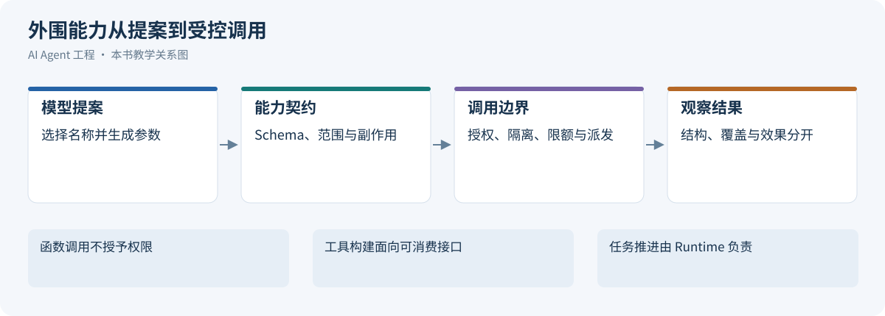](../images/review-skills-tools-mcp-connectors-01.svg)

*图 16-1：外围能力从提案到受控调用*


选择接入方式之前，先区分调用提案、能力契约、方法包和执行通道；它们分别回答不同的问题。

<a id="1611-从调用协议到受控行动"></a>
<a id="1511-从调用协议到受控行动"></a>
<a id="1812-tool-calling-的运行闭环"></a>

### 16.1.1 从调用协议到受控行动

[第13章 LLM API 协议](01-llm-api-protocol.md#streaming-output)解释模型怎样提出调用，以及应用怎样关联并回填结果；模型输出本身既不是执行，也不是授权。[[2]](#ref-2) 对 ALR 案例，工具系统必须把日志工具名解析到可信注册对象，提供参数、身份、资源和输出契约，Runtime 才能据此裁决调用。

<a id="capability-concepts"></a>
<a id="1612-概念边界总表"></a>
<a id="1512-概念边界总表"></a>
<a id="1813-function-callingtool-callingpluginskills-与-mcp-的边界"></a>
<a id="1843-toolskillworkflowmemoryplugin-的边界"></a>

### 16.1.2 概念边界总表

各层的产物和责任如下。

| 概念 | 是什么 | 解决什么 | 由谁执行 | 详见 |
|:---|:---|:---|:---|:---|
| Function Calling | 模型 API 的结构化输出能力：返回“调用某函数、参数为某值” | 让模型以机器可解析的形式表达调用意图 | 应用程序 | [LLM API 协议](01-llm-api-protocol.md) |
| Tool Calling | 围绕调用提案的运行时事务：校验、裁决、执行、记录、回填 | Agent 如何安全地感知和行动 | Tool Runtime | [Tool Runtime](#tool-runtime) |
| Tool | 一个可被提出的具体动作，如 typed function、API 操作或 MCP 工具 | Agent 能做什么 | Runtime 校验参数、权限和副作用后执行 | [工具契约](#tool-contract) |
| Skill（能力包） | `SKILL.md` 及配套资源组成的操作手册 | Agent 何时、按什么方法做事 | Runtime 选择并注入上下文，模型据此规划；Skill 不能自行授予权限 | [Skills](#skills) |
| Workflow | DAG、状态机或代码流程 | 哪些步骤必须确定性推进 | 编排器控制状态和条件 | [Agent Runtime Workflow](04-agent-runtime.md#workflow) |
| Memory | 用户偏好、项目事实、历史摘要等长期信息 | 哪些事实值得跨任务保留 | 记忆系统管理时效、来源和隐私 | [Agent 的上下文工程 记忆](02-context-engineering.md#memory) |
| Plugin（扩展包） | 把 Skill、MCP 配置、Connector 定义、脚本和依赖打包的分发单元 | 一组能力如何安装、启用和版本化 | 客户端或扩展系统管理安装、启用和供应链 | [能力组合的交付与兼容](#capability-usage-governance) |
| MCP | Host 与 Server 之间的标准协议 | 外部工具、资源和提示模板如何被标准化发现和调用 | MCP Server 提供能力，Host 负责接入与控制 | [MCP](#mcp) |
| Connector | 面向某个外部系统的集成实现及配置 | 在指定账号、组织和权限下可靠接入下游 API：认证、字段映射、分页、错误转换、版本适配 | 应用的 Tool Runtime 或 MCP Server 调用 | [Connector 开发](#connector-development) |

本文用“能力”统称可提供的操作或方法；Skill 是方法包，Plugin 是扩展分发包，capability profile 是运行可选配置；MCP capabilities 专指协议特性声明。它们不共用一个 enabled 或授权含义。

几条关系需要特别说明：

- **Skill 与 Tool**：Skill 负责方法，Tool 负责行动。告警诊断 Skill 指导 Agent 按取证路径调用日志、指标和部署工具，但 Skill 本身不带来任何权限。
- **Skill 与 Workflow**：发布流程中不能跳过的审批，应由 Workflow 或工具的 Policy 实现。把提示里的步骤当作确定性编排，等于把系统应保证的约束交给模型自觉遵守。
- **Skill 与 MCP**：Skill 的文件格式不依赖 MCP。Skill 既可以引导 MCP 工具，也可以引导 CLI 或 API；MCP 的 Prompts 是 Server 提供的模板，由 Host 按自身机制使用，与 Skill 不是同一种东西。
- **Connector 与 MCP**：Connector 是集成实现，MCP 只是可选的暴露协议。Connector 可以不经过 MCP，直接被应用的 Tool Runtime 调用；一个 MCP Server 也可以聚合多个 Connector。MCP 工具规范规定的是工具发现、调用和结果结构，并不意味着它已经替你完成下游账号授权、业务 ACL 或写入幂等[[3]](#ref-3)。

一个典型的扩展包结构如下：

```text
Plugin（扩展包）
  ├─ Skill（方法包）
  ├─ MCP Server 配置 / Connector 定义（外部能力入口）
  ├─ Tool Schema（可调用操作的契约）
  └─ 脚本、模板与资产（辅助资源）
```

无论能力以哪种形式接入，它能否安全可靠地工作，仍取决于 Schema、Policy、沙箱（Sandbox）、Trace 和评估。MCP 不替代 Tool Runtime，扩展包也不替代 Skill。

<a id="tool-access-selection"></a>
<a id="1613-接入方式选择apiclimcp-与-browser-use"></a>
<a id="1513-接入方式选择apiclimcp-与-browser-use"></a>
<a id="1815-工具接入方式选择框架apiclimcp-与-browser-use"></a>

### 16.1.3 接入方式选择：API、CLI、MCP 与 Browser Use

Agent 需要连接外部系统时，应当先看任务类型、执行环境和治理要求，再决定是否引入 MCP。从上到下，工具系统可以分为四层：Skill 规定流程、判断标准和验证方式；工具接口（Function Calling、MCP 工具、Shell 工具或内置 Connector）规定 Agent 能提出什么动作；执行通道（API、CLI、浏览器自动化或本地运行时）负责真正执行；最下面是外部系统。API、CLI 和 Browser Use 属于执行通道，MCP 属于工具接口，因此 MCP 与 CLI 并非简单的替代关系。

| 接入方式 | 所在层级 | 适合场景 | 主要优势 | 主要风险与限制 |
|:---|:---|:---|:---|:---|
| API | 系统底层接口 | 自研 Runtime、强控制需求、稳定的业务能力 | 能力完整，错误处理可控 | 需要自行维护集成、认证、分页、错误处理和 SDK |
| CLI | 本地执行通道 | 个人开发、本地仓库操作、已有成熟命令和登录态 | 简单、成本低，复用成熟工具 | 存在 Shell 注入风险，输出需要解析，依赖本机环境，命令必须受控 |
| MCP | Agent 工具协议 | 多客户端复用、多用户授权、企业治理 | 标准化发现与统一工具接口，便于审计 | 需要部署和运维 Server，有 Schema 维护成本，以及权限和供应链风险 |
| Browser Use | 图形界面自动化通道 | 没有 API、CLI 和 MCP 可用时操作页面 | 不依赖目标系统提供接口 | 慢、脆弱、成本高，桌面权限难以隔离 |

以 GitHub 为例，Runtime 可以直接调用 REST 或 GraphQL API，也可以通过 Shell 工具执行 `gh`，或连接 GitHub MCP Server；后两条路径最终仍会调用 GitHub API。

选择分两步。先确定方法载体：重复任务的方法、约束与验收可以写成 Skill、项目规则或 Runbook。再选择“工具接口 × 执行通道”：稳定 API 可直连或封装 Connector，多 Host 复用可经 MCP，本机已有成熟 CLI 可通过受控进程调用，只有缺少可靠接口时再考虑浏览器。Skill 与 API/CLI/MCP 不是互斥候选，方法和通道可以组合。

个人开发者常用的最小组合是 **CLI + Skill**：CLI 调用成熟工具，Skill 沉淀项目流程、检查标准和交付规范。企业或平台级 Agent 更常采用 **MCP + Policy + Audit**：MCP 负责标准化地分发能力，Policy 划定权限边界，Audit 保留责任链。


<a id="tool-contract"></a>
<a id="162-工具契约schema返回结果与能力暴露"></a>
<a id="152-工具契约schema返回结果与能力暴露"></a>

## 16.2 工具契约：Schema、返回结果与能力暴露

[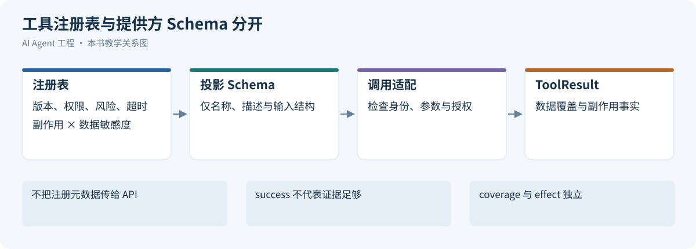](../images/review-skills-tools-mcp-connectors-02.svg)

*图 16-2：工具注册表与提供方 Schema 分开*


[Tool Calling 决策](#tool-calling)讨论了何时让模型调用工具，本节讨论工具以什么形态交给模型。工具契约由三部分组成：模型据以选择和填参的 Schema，模型与 Runtime 共同消费的返回结构，以及每轮实际暴露的工具集合。

<a id="1621-工具-schema模型与系统之间的契约"></a>
<a id="1521-工具-schema模型与系统之间的契约"></a>
<a id="1821-工具-schema-是模型与系统之间的契约"></a>

### 16.2.1 工具 Schema：模型与系统之间的契约

工具 Schema 是模型的操作说明书，直接决定模型能否选对工具、生成正确参数、读懂工具结果。好的工具定义应满足四个目标：

| 目标 | 含义 |
|:---|:---|
| 可发现 | 模型能迅速判断工具的适用场景 |
| 可约束 | 参数空间尽量小 |
| 可验证 | Runtime 能依据 Schema 做确定性校验 |
| 可恢复 | 失败时返回可操作的错误 |

不确定的判断留给模型，确定性的约束交给 Runtime。

<a id="1622-反例过度宽泛的工具"></a>
<a id="1522-反例过度宽泛的工具"></a>
<a id="1822-反例过度宽泛的工具为什么不可靠"></a>

### 16.2.2 反例：过度宽泛的工具

下面这个工具看起来很灵活，实际上把太多决策丢给了模型：

```json
{
  "name": "query",
  "description": "Query internal systems",
  "parameters": {
    "type": "object",
    "properties": {
      "system": {"type": "string"},
      "query": {"type": "string"}
    },
    "required": ["system", "query"]
  }
}
```

模型无从知道 `system` 该填 Prometheus、Loki 还是工单系统，`query` 该写 SQL、PromQL 还是自然语言；怎样重试、是否含敏感数据、有无副作用也没有交代。这类工具看似“能力很强”，实则把复杂度转移给模型推理，权限控制和审计也难以落地。

<a id="1623-正例边界清晰的工具"></a>
<a id="1523-正例边界清晰的工具"></a>
<a id="1823-正例边界清晰的工具如何设计"></a>

### 16.2.3 正例：边界清晰的工具

更好的做法是把意图、输入格式、适用范围和默认策略都写进 Schema：

```json
{
  "type": "function",
  "name": "prometheus_query_range",
  "description": "Query Prometheus time series data for production service diagnostics. Use this only for numeric metrics such as latency, error rate, QPS, CPU, and memory. Do not use it for logs, traces, user data, or write operations.",
  "strict": true,
  "parameters": {
    "type": "object",
    "additionalProperties": false,
    "properties": {
      "promql": {
        "type": "string",
        "description": "A valid PromQL range query. Do not include destructive or admin operations."
      },
      "start_time": {
        "type": "string",
        "description": "Start time in RFC3339 format."
      },
      "end_time": {
        "type": "string",
        "description": "End time in RFC3339 format."
      },
      "step_seconds": {
        "type": "integer",
        "description": "Query resolution in seconds. Use 60 for incident diagnosis."
      }
    },
    "required": ["promql", "start_time", "end_time", "step_seconds"]
  }
}
```

模型仍需推理，但推理被限定在可控范围内，Runtime 也能据此做校验、风险分级和审计。

<a id="1624-schema-设计原则名称参数幂等边界与错误"></a>
<a id="1524-schema-设计原则名称参数幂等边界与错误"></a>
<a id="1824-schema-设计原则名称参数幂等边界与错误"></a>

### 16.2.4 Schema 设计原则：名称、参数、幂等、边界与错误

**名称使用“动作 + 对象”。** 优先使用 `search_logs`、`get_order_by_id`、`create_incident_ticket`，少用 `handle_request`、`execute`、`process` 这类泛化名称。

**参数尽量结构化。** 有固定取值就用 `enum`；时间有格式要求，就写明是 RFC3339、Unix 时间戳还是相对时间。不要让模型去猜隐式约定。

**写操作声明防重与核验契约。** 幂等键由可信 Runtime 按 Operation 提供，模型只填业务参数；重新规划可能改变模型生成的字符串，不能靠它建立稳定身份。`dry_run` 只预览变更，不能防重；下游的键范围、窗口、查询和失败语义见[Connector 写入契约](#1666-写操作审批幂等与结果未知)，执行算法见[第17章外部动作幂等](04-agent-runtime.md#failure-side-effects)。

**描述要写清何时不用。** 例如“不要用于查询用户 PII”“不要用于生产环境写操作”“只有当用户明确要求发送通知时才调用”。

**返回结果面向下一步推理。** 原始日志、完整 SQL 结果、几百 KB 的 JSON 都会污染上下文，结果应包含摘要、关键字段、证据链接和原始数据引用。

**错误是接口的一部分。** 工具统一采用[应用错误分类](#connector-error-codes)：PromQL 语法错误映射为 `INVALID_INPUT`，限流为 `RATE_LIMITED`，越权为 `PERMISSION_DENIED`。原始提供方码放在 `error.provider_code`；可裁剪的大结果用 `truncated` 和 `coverage` 表示，超过硬限制而必须拒绝时用 `INVALID_INPUT` 并给出缩小范围的建议，不能另造一套顶层错误码。

<a id="tool-result-envelope"></a>
<a id="1625-toolresult-envelope模型上下文与系统元数据分离"></a>
<a id="1525-toolresult-envelope模型上下文与系统元数据分离"></a>
<a id="1825-toolresult-envelope把模型上下文和系统元数据分开"></a>

### 16.2.5 ToolResult Envelope：模型上下文与系统元数据分离

建议所有工具返回统一的 Envelope：

<a id="tool-result"></a>

以下 JSON 是本书应用层结果信封示意；MCP 字段在适配层映射，不声称协议原生定义了全部字段。

```json
{
  "call_id": "call_logs_01",
  "status": "partial",
  "summary": "已返回当前有权读取的日志页，仍有下一页",
  "data_ref": "artifact://run_0429_017/logs/1",
  "coverage": {"complete": false, "missing": ["remaining_pages"]},
  "effect": {"disposition": "none", "operation_id": null},
  "truncated": false,
  "next_cursor": "opaque-scoped-cursor",
  "error": null,
  "provenance": {"service": "order-service", "window": "02:35Z/02:50Z", "source_version": "logs-snapshot-1"}
}
```

| 字段 | 语义与消费者 |
| --- | --- |
| status | success/error/partial；描述本次工具返回，不替代 Operation 事实 |
| coverage | complete 为 true/false/null，missing 说明未覆盖部分；空结果与查询失败分开 |
| effect.disposition | none 用于只读；not_dispatched、applied、not_applied、partial、unknown 分别说明派发与效果，写操作关联 operation_id |
| truncated | 当前载荷是否被裁剪；分页未取尽由 coverage 和 next_cursor 表示，不混用 |
| next_cursor | 可继续读取的授权游标；不保证剩余内容在续读时仍可见 |
| data_ref/provenance | 受控原始数据与来源、实体、版本、时间范围；模型通常只读摘要和必要证据 |
| error | 分类码、retryable 提示、provider_request_id 与安全诊断；Runtime 拥有最终重试责任 |

写入发出后丢失回执返回 `OUTCOME_UNKNOWN` 和 `effect.disposition=unknown`，不能映射成“确认未生效”。不完整读取也不能当作没有异常。敏感凭据、内部连接句柄与完整私密载荷不进入模型或普通日志。

MCP 2026-07-28 版 Tools 规范对工具结果有两点约定。[[3]](#ref-3) 第一是结构化输出：工具可在定义中声明 `outputSchema`，调用结果在 `structuredContent` 中返回符合该 Schema 的结构化数据，客户端可据此校验；为了兼容，工具同时应在文本内容中给出一份序列化结果。本书 Envelope 使用 `data_ref` 指向受控原始载荷；MCP 的 `structuredContent` 承载允许交付的结构化观察，不自动解引用私密载荷。

第二是两类错误的区分：

- **协议错误**：在 JSON-RPC 层以标准错误返回，例如调用了未知工具、请求结构不符合调用格式、服务端内部错误。模型通常难以自行修正。
- **工具执行错误**：作为正常结果返回，并将 `isError` 置为 `true`，例如下游 API 失败、参数值不符合要求（日期格式错误、数值越界）、业务规则拒绝。错误内容应反馈给模型，供其调整参数后重试。

工具结果不是越完整越好，而要摘要可读、数据可追溯、错误可恢复、证据可审计。

<a id="dynamic-exposure"></a>
<a id="1626-动态工具暴露按任务阶段权限和环境裁剪"></a>
<a id="1526-动态工具暴露按任务阶段权限和环境裁剪"></a>
<a id="1826-动态工具暴露按任务阶段权限和环境裁剪能力"></a>

### 16.2.6 动态工具暴露：按任务、阶段、权限和环境裁剪

工具定义占用上下文，也会增加误选概率，因此不要一次性交出全部工具，而应按任务、阶段、用户权限和运行环境动态暴露。以诊断 order-service 延迟升高为例（示例）：

| 阶段 | 暴露的工具 |
|:---|:---|
| 理解问题 | `get_alert_details`、`search_runbooks`、`list_recent_deployments` |
| 收集证据 | `prometheus_query_range`、`loki_search`、`kubernetes_get_pods` |
| 建议行动 | `create_incident_ticket`（仅在审批绑定草稿与资源版本后暴露） |

这样可减少无关能力和误选机会，但改变工具前缀也可能降低缓存命中；缓存与能力最小化要按实际计量取舍，不能保证同时改善。完整注册表由能力系统维护，Runtime 绑定其可信快照，模型只看到本轮允许使用的工具。

Token 成本取决于本轮暴露了多少信息，而不是安装了多少 Server、扩展包或 Skill。能力注册表保存不可变标识、命名空间、来源、版本、Schema 摘要、双轴风险、依赖和可用环境；发现阶段只返回必要摘要，选中后才读取完整契约。别名必须映射到受信注册对象，不能由模型拼出后端地址。Skill 的发现元数据、激活正文和资源取用见[渐进式加载](#progressive-loading)；Runtime 固定本 Run 的能力快照，执行时仍重验当前授权。

<a id="orchestration-exposure"></a>
<a id="1636-编排模式对工具暴露的影响"></a>
<a id="1536-编排模式对工具暴露的影响"></a>
<a id="187-工具编排模式从单次调用到可治理流程"></a>

工具路由（Tool Router）先从已准入的目录选出相关子集，再交给主模型；规则、Embedding 或轻量模型都可以做相关性排序，但路由命中不授予权限。找不到合适能力时应报告缺项，不能退到任意 HTTP 或 Shell。

工作流即工具（Workflow-as-Tool）把已验证的多步流程封装成一个高层契约。例如只读的 `diagnose_latency_incident(alert_id)` 内部收集指标、日志和部署记录，再生成候选报告，减少可见工具数，代价是探索灵活性下降。其副作用按内部最高影响登记，敏感度覆盖所有可触达数据，内部步骤保留授权和审计；若包含审批写入，必须显式声明，不能藏在“诊断”名称后。ReAct、Plan-and-Execute 等执行模式与选择条件见[第17章编排模式](04-agent-runtime.md#pattern-selection)。


<a id="tool-risk-levels"></a>

<a id="1627-用副作用与数据敏感度共同描述风险"></a>
<a id="1527-用副作用与数据敏感度共同描述风险"></a>

### 16.2.7 用副作用与数据敏感度共同描述风险

副作用与数据敏感度是两个独立的策略输入：只读日志仍可能泄密，“可补偿”也不意味着能撤回已经被人看见的信息。下面是本书注册表采用的完整枚举，不是 MCP 原生等级。

| 轴 | 取值 | 判定与控制含义 |
| --- | --- | --- |
| `side_effect` | `read_only`（只读） | 不改变业务状态；仍约束查询范围、输出和外传 |
| `side_effect` | `compensatable_write`（可补偿写入） | 可通过明确的后续动作补偿，但不承诺恢复全部影响；声明补偿前提 |
| `side_effect` | `external_send`（外发） | 向消息渠道或外部接收方送出数据；限定接收方、内容和送达保证 |
| `side_effect` | `hard_to_reverse`（难逆或高影响动作） | 无可靠补偿，或补偿不能消除业务损失；专用流程和强审批 |
| `data_sensitivity` | `public`（公开） | 已获准公开的数据；仍防误操作和资源滥用 |
| `data_sensitivity` | `internal`（内部） | 限组织或项目使用；校验主体、租户与资源范围 |
| `data_sensitivity` | `sensitive`（敏感） | 个人信息、客户载荷、受限业务记录；字段最小化、脱敏、限制留存与接收方 |
| `data_sensitivity` | `secret`（秘密凭据） | 密码、Key、Token、私钥等；只由隔离的凭据设施消费，不进入模型或普通输出 |

一个接口包含多类行为时，按最高副作用保守登记，或拆为独立工具；多类数据按最高敏感度登记。未知分类不能按低风险处理，应先拒绝准入并人工核定。`prohibited` 是策略裁决，不是第三条风险轴；凭据代理在执行中注入秘密，也不等于模型可读取 `secret`。

以下矩阵给出本书的默认控制基线；具体环境和法规可进一步收紧，不能仅凭表格自动授权。

| 副作用 × 敏感度 | `public` | `internal` | `sensitive` | `secret` |
| --- | --- | --- | --- | --- |
| `read_only` | 有界自动读取 | 当前 ACL 与资源过滤 | 目的绑定、字段脱敏、受限产物和审计；必要时审批 | 禁止模型读取，专用凭据通道 |
| `compensatable_write` | 载荷校验、去重及补偿契约 | 另加对象权限与绑定草稿的批准 | 另加最小载荷、强审批与留存控制 | 禁止通用工具写入，走专用凭据流程 |
| `external_send` | 接收方白名单与发送授权 | 另加组织外发规则、内容审查 | 默认阻断，例外须审批并落实脱敏/DLP | 禁止外发 |
| `hard_to_reverse` | 专用流程、强审批与效果核验 | 另加生产范围和责任人确认 | 另加数据合规审查，无法满足即阻断 | 禁止通用 Agent 执行 |

本例 `loki_search` 是“只读 × 敏感”，建单是“可补偿写入 × 内部”；通知由能力集之外的交付系统处理，重启和回滚不提供。MCP annotations 只是提示，不可信的 `readOnlyHint`、`idempotentHint` 不能代替实现核验。[[3]](#ref-3) 策略强制与审批等待见[第17章动作裁决](04-agent-runtime.md#policy-engine)，验收与回归见[第18章治理护栏](06-agent-governance-optimization.md#guardrails-overview)。

<a id="tool-runtime"></a>
<a id="163-调用适配接口把外围能力接入-runtime"></a>
<a id="153-调用适配接口把外围能力接入-runtime"></a>
<a id="183-tool-runtime生产级工具调用的控制平面"></a>

## 16.3 调用适配接口：把外围能力接入 Runtime

[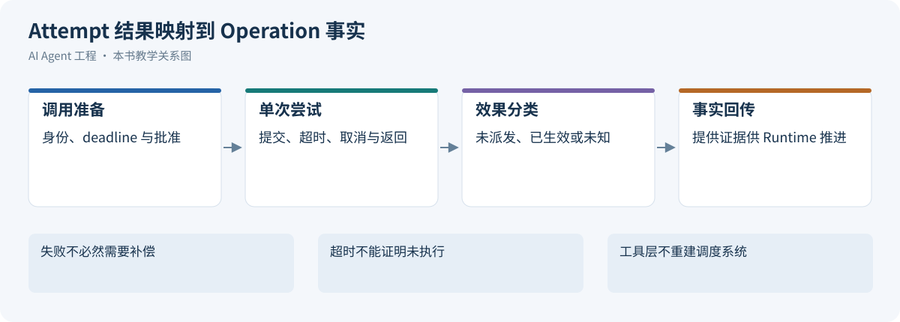](../images/review-skills-tools-mcp-connectors-03.svg)

*图 16-3：Attempt 结果映射到 Operation 事实*


本章将执行单次受控工具调用的实现称为调用适配层（Tool Runtime），与负责整项任务生命周期的 Agent Runtime 区分。

工具从 5 个增长到 50 个后，难点从“怎么写工具函数”转向“怎么治理工具调用”。只把函数绑定给模型还不够，需要构建受控的调用适配接口：可信注册对象、Schema 校验、凭据解析、Executor/Adapter、Result Normalizer 与审计接口都要齐全。全局任务控制仍归 Runtime，本层接收派发上下文并返回结果。

<a id="1631-组件与调用链路"></a>
<a id="1531-组件与调用链路"></a>
<a id="1832-tool-runtime-核心组件registryvalidatorpolicyexecutor-与-trace"></a>

### 16.3.1 组件与调用链路


| 组件 | 职责 | 关键设计点 |
|:---|:---|:---|
| Tool Registry | 管理工具元数据、版本、风险等级 | 支持按任务动态暴露工具 |
| Schema Validator | 校验参数与类型 | 严格模式、默认值、范围约束 |
| Policy Engine | 裁决是否允许调用 | 输出 `allow / deny / ask / escalate`，见[Agent Runtime Policy Engine](04-agent-runtime.md#policy-engine) |
| Executor | 执行一次派发 | 消费截止时间、限并发、隔离执行；重试由 Runtime 调度 |
| Adapter | 对接外部系统 | API、CLI、MCP、数据库、消息队列 |
| Result Normalizer | 统一返回格式 | 成功与失败 Envelope、错误码 |
| Observation Mapper | 生成模型上下文 | 摘要、证据、压缩、脱敏 |
| Audit 与 Trace | 记录调用链路 | 会话、用户、工具、参数、结果 |

MVP 阶段这些组件可以在同一进程内，但职责边界必须清晰，否则系统会退化成“模型返回 JSON，应用随手执行”。

<a id="tool-call-state-machine"></a>
<a id="1632-单次调用尝试与-operation-的映射"></a>
<a id="1532-单次调用尝试与-operation-的映射"></a>
<a id="1833-工具调用状态机从-requested-到-observed"></a>

### 16.3.2 单次调用尝试与 Operation 的映射

调用适配接口接收 Runtime 提供的 run_id、call_id、operation_id（写操作）、稳定幂等键、参数哈希、批准引用、资源版本和截止时间。返回字段必须区分未派发、已确认生效、已确认未生效、部分生效和未知，并提供当前可用的查询入口与外部对象引用。

`effect.disposition` 是适配层交付的效果证据，不是另一套 Operation 状态机；取消本地执行不能证明远端未生效。下游去重与查询保证见[Connector 写入契约](#1666-写操作审批幂等与结果未知)，完整状态机、重试与接管见[第17章 Operation 恢复](04-agent-runtime.md#failure-side-effects)。


<a id="1633-失败模式误选工具参数错误重复副作用与注入攻击"></a>
<a id="1533-失败模式误选工具参数错误重复副作用与注入攻击"></a>
<a id="1834-失败模式误选工具参数错误重复副作用与注入攻击"></a>

### 16.3.3 失败模式：误选工具、参数错误、重复副作用与注入攻击

| 失败模式 | 根因 | 修复策略 |
|:---|:---|:---|
| 误选工具（该查日志却查了指标） | 描述重叠、暴露过多 | 缩小工具集合，写清边界 |
| 参数错误 | Schema 太宽 | `enum`、`format`、严格 Schema |
| Shell 注入或误执行 | CLI 参数未结构化 | 参数数组、命令 allowlist、审批 |
| 重复副作用（重复建单、发消息） | 重试缺少幂等保护 | Runtime 生成幂等键，结果未知先对账 |
| 返回过大 | 没有摘要和分页 | Observation Mapper 摘要与引用 |
| 权限漂移 | 凭据与角色权限不一致 | 工具级授权测试 |
| 错误不可恢复 | 错误码不可操作 | 结构化错误码加 `retryable` |
| 注入攻击 | 外部数据被当成指令 | 标记不可信来源，与指令隔离 |
| 成本失控 | 缺少预算与停止条件 | 调用次数、Token 预算、截止时间 |

网页、文档、日志和工单都可能夹带指令，工具输出一律按不可信数据处理。按风险等级的防护要求见 [工具风险分级](#tool-risk-levels)，护栏的总体框架见[Agent 治理与调优 Guardrails 总览](06-agent-governance-optimization.md#guardrails-overview)。

这些失败模式应在设计评审和 Eval 中覆盖。

<a id="1634-重试策略写进工具元数据"></a>
<a id="1534-重试策略写进工具元数据"></a>
<a id="1835-重试策略哪些失败可以重试哪些不能"></a>

### 16.3.4 重试准入：工具声明哪些保证

工具元数据声明可供 Runtime 判断的事实，不定义任务的重试次数或退避预算：

```python
from dataclasses import dataclass

@dataclass
class RetryContract:
    idempotent: bool
    retryable_error_codes: set[str]
    downstream_contract_ref: str | None
```

`idempotent` 指已核验的语义，不是从工具名或 MCP hint 推断；条件性去重必须在 `downstream_contract_ref` 声明键范围、载荷约束和窗口。`retryable_error_codes` 只能选自[统一错误码](#connector-error-codes)，即使含 `RATE_LIMITED` 或 `TRANSIENT_FAILURE`，也不保证当前写入可安全重发。是否重试、何时重试、预算与未知结果处理由[第17章重试分类](04-agent-runtime.md#retry-classification)决定。

<a id="1635-工具专属指标"></a>
<a id="1535-工具专属指标"></a>

### 16.3.5 工具专属指标

通用 Trace、成功率与 SLO 见[Agent 治理与调优 Trace 与可观测性](06-agent-governance-optimization.md#trace-observability)，这里只列工具专属指标：

| 指标 | 含义 | 异常时的排查方向 |
|:---|:---|:---|
| 误选率 | 人工标注选错的调用数/有有效选择标签的调用数 | 描述重叠、暴露过多 |
| 参数校验失败率 | Schema 拒绝数/到达参数校验的提案数 | Schema 太宽或描述不清 |
| 审批率（`approval_rate`） | 审批请求数/可裁决提案数；批准数/已决审批数，待决另列 | 风险分级或暴露策略 |
| 结果截断率 | 带 truncated 结果数/有效工具返回数；分页未取尽另列 | 缺少摘要、过滤或聚合 |
| 上下文预算占用（`observation_token_size`） | 每调用实际进入上下文的 Token 数，按工具/任务切片报告分布；超预算数/有预算记录的调用数 | Observation 压缩不足 |
| 单工具延迟与成本（`tool_latency_ms`、`tool_cost_estimate`） | 固定窗口内全部已结束 Attempt 延迟分布，超时另列；外部 API 与后续上下文费用/调用数，另计失败及重试 | 下游性能、调用过多 |

某个工具成功率低，可能是实现问题，也可能是 Schema 描述导致模型常生成错误参数，因此统计时应区分协议错误和工具执行错误。

<a id="skills"></a>
<a id="164-agent-skills从工具调用到能力复用"></a>
<a id="154-agent-skills从工具调用到能力复用"></a>

## 16.4 Agent Skills：从工具调用到能力复用

工具让 Agent 能够行动，Skill 则把完成一类任务的方法组织成可复用的能力包。Anthropic 提出的 Agent Skills 把指令、脚本和资源放进一个目录，并按任务需要加载。[[4]](#ref-4)

本节沿用告警诊断案例，依次讨论 Skill 的组成、`SKILL.md` 的写法、从案例提炼能力、注册表、渐进式加载、门控与 Tool Policy 的分工，以及版本化生命周期和常见失败模式。

<a id="1641-为什么有了-tool-calling-还需要-skill"></a>
<a id="1541-为什么有了-tool-calling-还需要-skill"></a>

### 16.4.1 为什么有了 Tool Calling 还需要 Skill

查询天气通常只需一次工具调用，而“排查线上延迟升高”需要协调多个动作：确认服务和时间窗口，查询指标与日志，对比部署变更，检索历史案例，最后形成带证据的诊断。能调用这些工具，不等于能把它们组织成可靠的工作方法。

如果每次都让模型从零规划，它可能漏查部署、把时间上的相关性当成因果，或在证据不足时直接建议重启。Skill 的价值在于沉淀容易遗漏的步骤、判断条件和交付标准，让下一次任务复用经过验证的方法。

> **Skill 是可被 Agent 发现并按需加载的能力包：它用程序性指令、工具使用约定和配套资源，描述某类任务应该如何完成、如何处理失败，以及如何证明已经完成。**

“程序性”强调的是行为路径，Markdown 并不会像代码一样被强制执行。因此，评价一个 Skill 要看它能否改善真实任务中的行为，而不是看说明是否完整、措辞是否强硬。

<a id="1642-skill-的组成入口指令与可复用资源"></a>
<a id="1542-skill-的组成入口指令与可复用资源"></a>
<a id="1842-skill-的定义触发条件步骤工具约束与验证"></a>

### 16.4.2 Skill 的组成：入口、指令与可复用资源

Agent Skills 格式以 `SKILL.md` 为入口，文件由 YAML 前置元数据（Front Matter）和 Markdown 正文组成；脚本、参考资料和资产都是可选资源。[[5]](#ref-5)

[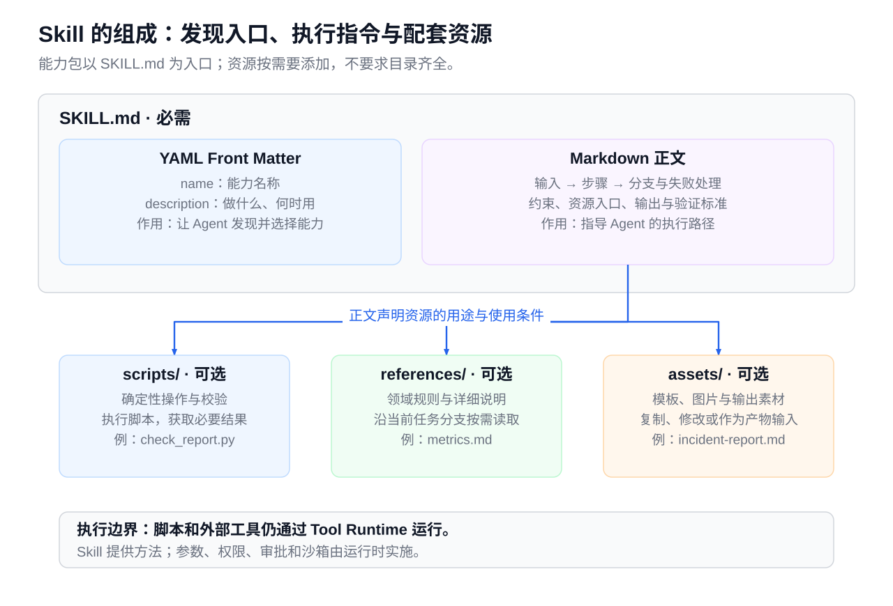](../images/agent-skill-anatomy.svg)

*图 16-4：Skill 组成：SKILL.md 的元数据用于发现，正文提供执行指令；scripts 提供确定性操作，references 提供按需知识，assets 提供产物材料*


| 组成 | 回答的问题 | 告警诊断示例 |
|:---|:---|:---|
| `SKILL.md` 前置元数据 | 这是什么能力，什么时候使用？ | 名称 `incident-diagnosis`；描述延迟、错误率和告警排查场景 |
| `SKILL.md` 正文 | 按什么路径完成，如何验证？ | 先对齐时间窗口再取证；报告区分事实、假设和未知项 |
| `scripts/` | 哪些操作应复用确定性实现？ | 校验报告中的证据编号和时间格式 |
| `references/` | 当前任务需要查阅哪些领域知识？ | 指标口径、日志字段、部署事件说明 |
| `assets/` | 产物需要哪些模板或素材？ | 事故报告模板、图标和报告样式 |

目录只添加任务确实需要的资源。三类资源的使用方式也不同：参考资料按需读入上下文；脚本通过工具执行，不必每次把源码读进模型；资产通常作为输出材料，需要时再检查。脚本输出、报错和被读取的文件仍会占用上下文，“外化为文件”并非零成本。

同一条规则只维护一个事实源。例如，指标口径放在 `references/metrics.md`，正文只说明何时读取，不复制整套定义，否则两处内容会在更新中逐渐漂移。有些客户端还会使用额外的 UI 或平台配置文件，但它们不是所有 Skill 通用的必需文件。

Skill 与 Tool、Workflow、Memory、Plugin 的边界见 [概念边界总表](#capability-concepts)。这里只强调一点：Skill 指导模型选择步骤，自身不能授予任何权限；不能跳过的审批应由 Workflow 或 Tool Policy 保证。

通用规范的必填字段为 `name` 与 `description`：`name` 长度为 1–64 字符，使用小写字母、数字和连字符，与父目录同名，不能以连字符开头或结尾，也不能出现连续连字符；例如 `incident-diagnosis` 合法，`-incident`、`incident-`、`incident--diagnosis` 不合法。`description` 长度为 1–1024 字符；可选 `license`、`compatibility`（提供时为 1–500 字符）、字符串映射 `metadata`；`allowed-tools` 是实验字段，不能被当作所有宿主的强制授权。[[5]](#ref-5) Claude Code 特有的控制字段属于产品扩展，不回填为通用规范要求。

<a id="skill-md-example"></a>
<a id="1643-可执行的-skillmd-示例"></a>
<a id="1543-可执行的-skillmd-示例"></a>
<a id="1844-一个高质量-skill-应该长什么样"></a>

### 16.4.3 完整的 `SKILL.md` 示例

下面是 `incident-diagnosis/SKILL.md` 的完整入口示例，不是独立可运行程序；配套资源和工具必须由能力包提供并通过验收。`name`、`description` 写在前置元数据中，方法、边界和失败出口写在正文中。

````markdown
---
name: incident-diagnosis
description: 分析线上告警、接口延迟升高、错误率异常，输出有证据的诊断报告。用于服务排障，不用于日常指标报表或直接执行生产修复。
---

# 告警诊断

## 输入与前置条件
- 确认服务、环境、告警和时间窗口；缺失且无法从告警确定时先澄清。
- 根据当前环境确认指标、日志和部署查询工具可用。

## 执行步骤
1. 读取告警，确认影响范围；按 references/metrics.md 核验指标口径。
2. 查询同一时间窗口的延迟、错误率和流量，记录证据编号。
3. 按 references/log-fields.md 查询脱敏日志，核对部署和配置变更。
4. 交叉检查证据，区分已证实事实、根因假设和待验证项。
5. 使用 assets/incident-report.md 组织报告。
6. 通过执行工具运行 scripts/check_report.py 检查证据引用；
   再人工或由 Agent 核对证据是否真正支持结论。

## 行为边界与失败处理
- 不读取或输出凭证和个人敏感信息，不自动重启、回滚或修改配置。
- 证据不足时继续取证，或明确报告未知；不把时间相关性写成确定根因。
- 工具失败时报告缺项和影响，不能改用未授权通道绕过限制。

## 完成标准
- 报告包含时间窗口、影响范围、证据、假设、未知项和后续建议。
- 每个关键判断可追溯到证据；资源或校验不可用时不得声称已验证。
````

`description` 是发现入口，必须写明能力和适用场景。如果“何时使用”只写在正文里，Agent 决定是否加载时可能看不到。描述也不宜塞入完整步骤：一般经验是，摘要写得过细，Agent 容易凭摘要直接执行，跳过正文中的约束。

正文要把容易走错的分支写清楚：输入不全怎么办，工具失败如何降级，证据不足如何表达。示例中的校验脚本只能检查引用结构，不能证明根因正确，后者仍要回到原始证据。

<a id="1644-从真实案例提炼-skill"></a>
<a id="1544-从真实案例提炼-skill"></a>

### 16.4.4 从真实案例提炼 Skill

先收集具体请求，再抽取可复用步骤，比先写一份“大而全”的专家指南更容易划清边界。

| 来源 | 适合提炼的内容 | 需要排除的问题 |
|:---|:---|:---|
| 专家 SOP、团队 Runbook | 稳定流程、检查项、失败分支 | 过期命令、隐含权限和口头约定 |
| 成功 Trace、Diff、复盘 | 有证据的步骤和验证方法 | 偶然成功、错误归因、敏感数据 |
| 项目规则 | 构建、审查和交付约定 | 无条件复制为全局规则 |
| 官方或开源 Skill | 目录组织、资源复用和工具惯例 | 平台依赖、不可信脚本、许可限制 |

以告警诊断为例，正例有“支付服务 P95 突增”“发布后错误率上升”，负例有“生成上月流量报表”“直接重启服务”。正例帮助确定流程，负例帮助限制误触发。如果一组案例需要完全不同的输入、工具和完成标准，就应考虑拆分 Skill。

案例中反复出现的确定性操作提炼为脚本，领域细节拆到参考资料，固定的产物结构沉淀为资产，正文只保留核心决策路径。复用的是经过核验的方法，而不是某一次任务的结论。

<a id="1645-skill-注册表版本与运行条件"></a>
<a id="1545-skill-注册表版本与运行条件"></a>
<a id="1846-skill-registry技能也需要版本owner-和风险等级"></a>

### 16.4.5 Skill 注册表：版本与运行条件

小型本地技能库可以先用目录、Git 和变更记录管理。多人共享、多环境部署时，再引入注册表，记录谁负责、哪一版经过验证、支持哪些运行条件。

下面是一条注册表记录示例。**注册表字段不是 `SKILL.md` 的标准字段**，写进注册表也不会自动产生权限控制：

```yaml
name: incident-diagnosis
version: "1.4.0"
owner: sre-platform
status: published
artifact_digest: "sha256:<能力包内容摘要>"
scope: [staging, prod]
side_effect: read_only
data_sensitivity: sensitive
dependencies:
  tool_contract: observability-v3
  runtime_profile: incident-reader-v2
validation:
  suite: incident-diagnosis-regression-v5
  evidence: "eval://incident-diagnosis/1.4.0"
previous_stable: "1.3.2"
changelog: "补充日志查询失败时的降级路径"
```

记录中的版本、摘要和验证集均为示例值，`side_effect` 与 `data_sensitivity` 采用[工具风险分级](#tool-risk-levels)的口径；本条只登记会接触敏感日志的只读调查 Skill，批准后建单是能力组合中的另一个写工具，不能继承这里的只读标签。几条要求如下：

- **发布单元覆盖整个能力包。** 正文、脚本、参考资料和资产一起发布，并关联不可变包、内容摘要、来源和验证证据，不能只记录一个可移动的标签。只给 `SKILL.md` 打版本号、却在原位置覆盖脚本，就无法还原历史行为；同理，不能只校验 `SKILL.md`，然后运行被覆盖的脚本或未锁定的依赖。
- **外部依赖记录契约或快照。** 外部工具和知识源无法打包时，记录兼容契约或快照标识。
- **任务记录实际使用的组合。** 一次任务应记录选中的 Skill 版本、工具契约和模型、Runtime 配置，才能区分“Skill 改动导致回归”“工具接口变化”和“模型升级改变了执行行为”。

责任人维护边界并负责升级验证，注册表负责追溯，实际调用权限仍由 Runtime 决定。Skill 与工具、MCP 服务、策略组合成任务配置时的记录方式，见 [能力使用治理](#capability-usage-governance)。

<a id="progressive-loading"></a>
<a id="1646-渐进式加载先发现再展开最后按需取用"></a>
<a id="1546-渐进式加载先发现再展开最后按需取用"></a>
<a id="1847-skill-selection不是每次全部加载"></a>

### 16.4.6 渐进式加载：先发现，再展开，最后按需取用

Agent Skills 的格式规范将发现元数据、激活指令和按需资源分开；文档中的 token/行数建议不是所有客户端共同的硬上限。实际装配由宿主实现，不能从目录里存在 SKILL.md 推导正文已经进入模型上下文。[[4]](#ref-4)[[5]](#ref-5)

[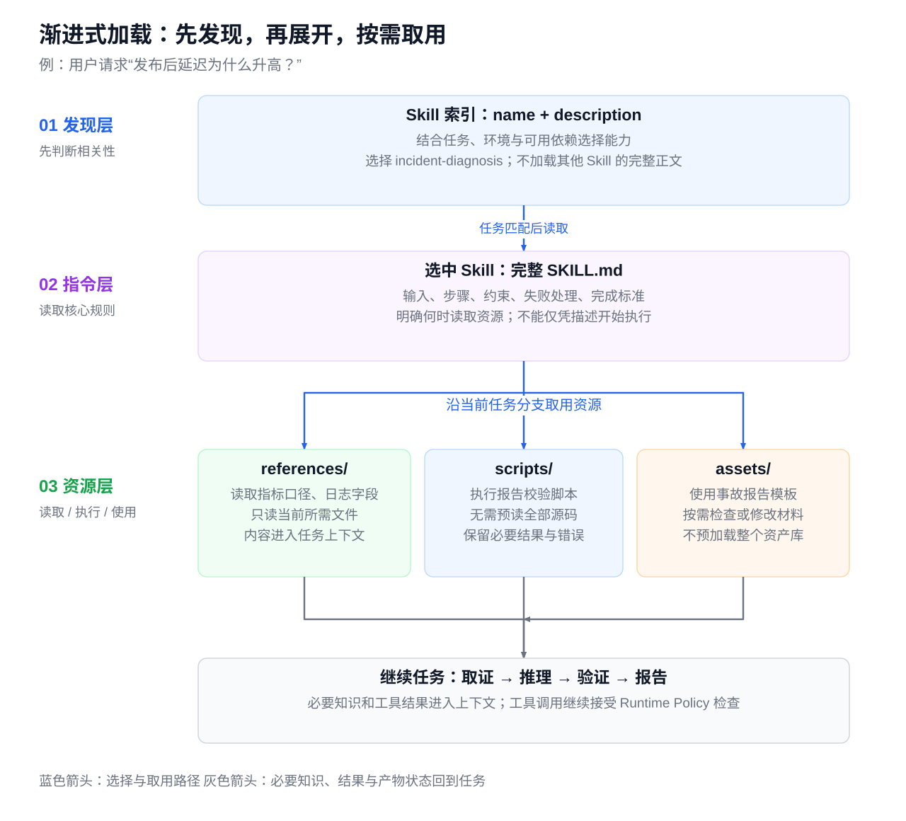](../images/agent-skill-progressive-loading.svg)

*图 16-5：Skill 渐进式加载*


| 阶段 | 暴露内容 | 需要验证 |
| --- | --- | --- |
| 发现 | 名称、描述、来源与必要元数据 | 相关能力能被找到，无关任务不误触发 |
| 激活 | 选中版本的输入、步骤、限制和完成标准 | 正文实际加载，关键约束在后续轮次仍保留 |
| 分支取用 | 当前所需参考资料、脚本、模板与资产 | 路径/递归/体积限制，执行权限和结果信任边界 |

宿主实现存在差异：Codex、Claude Code 与 Hermes 的来源目录、触发方式和正文加载入口要按对应版本核验，不能把一个平台的自动触发行为写成格式保证。[[6]](#ref-6)[[7]](#ref-7)[[8]](#ref-8)[[9]](#ref-9)[[10]](#ref-10) 迁移时先验证发现和激活，再验证工具/脚本依赖；客户端不支持的能力应显式报告。

一次告警任务先按描述选诊断能力，读执行规则，再按证据缺口加载指标口径或日志字段。只运行一个格式检查脚本时，保留必要结果，不把全部源代码与历史事故预加载。元数据索引本身也占预算，大型技能库可以检索，但不能无限追加所有能力。通用上下文预算与压缩见[上下文工程](02-context-engineering.md#compression)。

<a id="skill-gating"></a>

<a id="1647-自由度门控与-tool-policy"></a>
<a id="1547-自由度门控与-tool-policy"></a>

### 16.4.7 自由度、门控与 Tool Policy

Skill 的约束强度应与任务的变化空间和出错代价相匹配。文本原则、模板和脚本分别对应不同程度的自由度：

| 自由度 | 适用场景 | 合适的控制方式 |
|:---|:---|:---|
| 高 | 解释异常、提出诊断假设 | 原则、案例、证据要求，保留判断空间 |
| 中 | 按统一口径查询、组织事故报告 | 参数化模板、字段说明、检查表 |
| 低 | 格式转换、报告引用校验 | 经过验证的脚本、结构化输入输出 |

门控应写成可观察的条件，例如：“未确认服务、环境和时间窗口前，不进入日志查询；证据不足时，不把假设标记为根因。”复杂流程可以用流程图或检查表表达分支与回路，减少提前结束任务的机会。

需要强调的是，**Skill 中的门控只是行为指令，Tool Policy 才是运行时的强制边界**。`HARD-GATE` 之类的标签没有通用的强制执行语义。生产写操作的授权、审批和审计必须由 Runtime 或确定性编排器实现（见 [Agent Runtime Policy 引擎](04-agent-runtime.md#policy-engine)）。例如，Skill 可以要求“创建事故单前确认内容”，Runtime 仍要检查用户是否授权、参数是否合规、操作是否幂等。注册表中的副作用与数据敏感度和 Skill 自述的工具限制，都要由系统解释并落实，不会自动生效。

<a id="skill-lifecycle"></a>
<a id="1648-skill-生命周期发布迭代与退役"></a>
<a id="1548-skill-生命周期发布迭代与退役"></a>
<a id="1849-skill-生命周期createreviewvalidatepublishretire"></a>

### 16.4.8 Skill 生命周期：发布、迭代与退役

本节为本书的工程治理模型，Agent Skills 格式本身不规定完整发布流程。版本单元覆盖正文、脚本、参考资料和资产，关联不可变摘要、责任人和验证证据；工具契约与模型变化也要重新验证。

[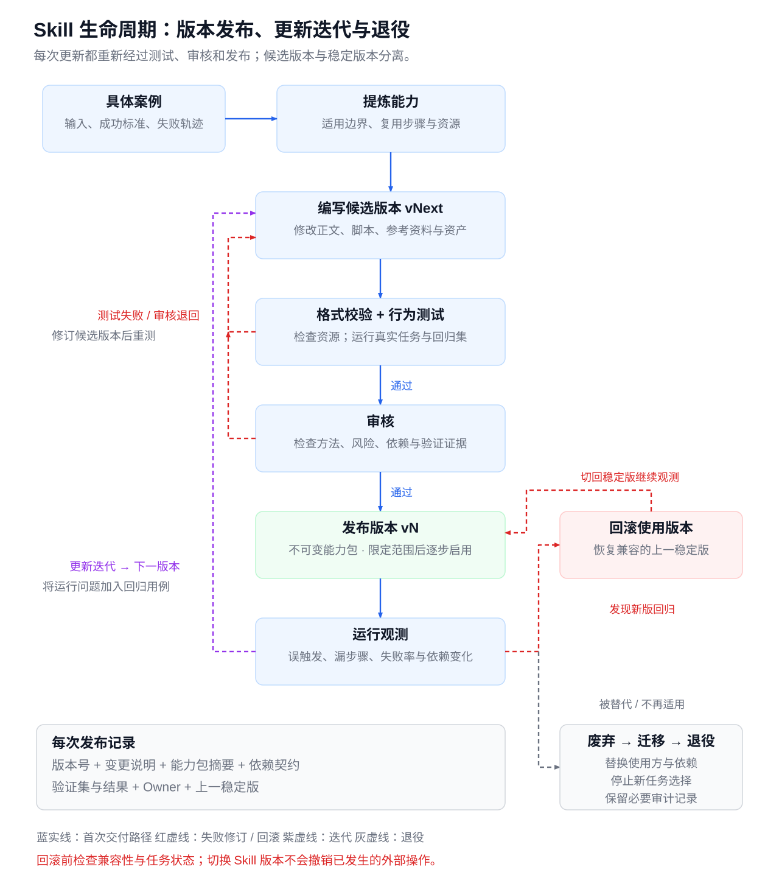](../images/agent-skill-versioned-lifecycle.svg)

*图 16-6：Skill 版本化生命周期*

| 阶段 | 提供方责任 | 进入下一阶段的依据 |
| --- | --- | --- |
| 候选 | 从真实案例提炼边界，固定依赖与产物 | 输入、输出、错误和资源入口明确 |
| 验证 | 正反例、失败分支、权限和脚本检查 | 结果可复算，约束实际生效 |
| 发布 | 关联制品、版本与回归证据 | 使用方能解析兼容能力组合 |
| 更新 | 说明行为与权限变化 | 兼容性和受影响用例复核 |
| 回滚 | 确认旧版仍兼容当前工具/策略 | 不重放未知动作，保留在途事实 |
| 退役 | 停止新任务选择，迁移引用方 | 自动化与依赖已迁移，历史按策略留存 |

版本号只表达团队约定，不能保证兼容。只改文字也可能改变模型行为；Schema 未变而默认查询范围扩大，同样需要复核。运行中任务固定已选版本，必须切换时由 Runtime 交接在途动作；发布门禁见[第18章发布控制](06-agent-governance-optimization.md#release-control)。

<a id="1649-常见失败模式与回退"></a>
<a id="1549-常见失败模式与回退"></a>
<a id="skill失败回退需要保留授权与事实"></a>

### 16.4.9 常见失败模式与回退

| 失败模式 | 表现 | 修复方向 |
|:---|:---|:---|
| 描述宽泛或只写在正文 | 无关任务触发，相关任务却未加载 | 用正反例收窄描述，单独测试选择行为 |
| 把知识库塞进正文 | 每次加载大量无关细节 | 正文留决策路径，领域知识按需引用 |
| 规则多处重复 | 正文、脚本和附录口径不一致 | 明确事实源，用引用代替复制 |
| 自由度错配 | 脆弱操作临时生成；判断任务机械照表 | 确定性部分脚本化，推理部分保留判断 |
| 把门控当权限 | 写了“禁止”却仍能调用高风险工具 | 用 Runtime Policy、审批和沙箱（Sandbox）实施边界 |
| 只做格式校验 | 文件合法，任务仍漏步骤或提前结束 | 增加真实任务、失败分支和压力测试 |
| 覆盖稳定版或不做回归 | 未经验证的经验成为默认规则 | 候选版与稳定版分离，保留版本和回滚入口 |
| 平台能力不匹配 | 迁移后找不到工具、资源或执行通道 | 声明依赖，适配工具并重新验证 |

Skill 缺失、资源不可读或工具不可用时，报告缺项，只在既有授权内完成可独立验收的步骤，不能退到更宽的 Shell 或任意 HTTP 通道。工具版本或 Schema 变化时暂停受影响动作，刷新定义并重新核验参数与授权；切换 Skill 不会清空执行事实，恢复见[第17章](04-agent-runtime.md#failure-side-effects)。

<a id="16410-skill-与-mcp-的关系"></a>
<a id="15410-skill-与-mcp-的关系"></a>
<a id="18411-skills-与-mcp-的关系"></a>

### 16.4.10 Skill 与 MCP 的关系

Skill 可以引导 MCP、CLI 或 API；MCP Prompts 提供由 Host 选择的模板，并不自动成为 Skill。方法包与接入协议可以独立升级，组合时须重新验证工具依赖、加载行为和权限，不能从格式兼容推导运行兼容。职责对照见[概念边界](#capability-concepts)，接入机制见[MCP](#mcp)。


<a id="mcp"></a>
<a id="165-mcptool-calling-的标准化接入协议"></a>
<a id="155-mcp外部能力的标准协议与版本边界"></a>

## 16.5 MCP：外部能力的标准协议与版本边界

MCP 统一外部能力的发现、描述、调用与内容交付，业务实现仍由 Server 与 Connector 完成。Host 负责用户、模型、上下文和调用策略，Client 在 Host 内适配协议，Server 暴露有边界的工具和数据。接入选择见[API、CLI、MCP 与 Browser](#tool-access-selection)。[[11]](#ref-11)

<a id="mcp-capabilities"></a>

<a id="1651-mcp-的定位解决什么不解决什么"></a>
<a id="1652-架构角色hostclientserver"></a>
<a id="1653-能力模型server-侧与-client-侧能力"></a>
<a id="按场景选择能力类型"></a>
<a id="1551-角色能力与实现责任"></a>
<a id="1852-mcp-解决什么不解决什么"></a>
<a id="1854-mcp-的架构边界hostclientserver"></a>

### 16.5.1 角色、能力与实现责任

| 对象 | 交付物 | 本例中的责任 |
| --- | --- | --- |
| Host | 模型可见工具与当前调用裁决 | 选择日志工具、限制服务和窗口，消费返回观察 |
| Client | 版本化 JSON-RPC 请求与结果适配 | tools/list 发现、tools/call 调用、错误与内容映射 |
| Server | 可验证的能力描述与业务 handler | 校验参数、检查当前权限，调用日志/工单 Connector |
| 下游业务系统 | 对象状态、版本与效果回执 | 确认工单是否存在及属于哪个业务意图 |

2026-07-28 架构仍规定：Host 为每个 Server 创建一个 Client，每个 Client 与对应 Server 保持 **1:1 的逻辑关联**；移除的是协议层 session 和 `initialize` 握手，不是这层关联。同一远程 Server 可服务多个 Host/Client，1:1 不表示服务端只能有一个调用者。连接是传输通道，关联是 Host 内的职责划分，session 是旧版协议的生命周期状态，三者不能互换。Server 不获得 Host 的全部上下文，跨调用业务状态需显式句柄；访问其他来源或扩大权限需要独立契约。[[11]](#ref-11)[[12]](#ref-12)[[16]](#ref-16)

Tools 描述可调用动作，Resources 描述由应用选择读取的内容，Prompts 提供任务模板；获取模板不授予写权限，列出资源也不代表正文已进入模型。[[3]](#ref-3)[[13]](#ref-13)[[14]](#ref-14) Agent Skills 是独立的能力包格式，不依赖 MCP；allowed-tools 的执行意义取决于宿主，不能替代授权。[[15]](#ref-15)

<a id="mcp-version-boundaries"></a>

<a id="client-侧能力"></a>
<a id="1654-能力协商与渐进兼容"></a>
<a id="协议版本与传输迁移对照表"></a>
<a id="1552-逐请求版本能力发现与旧版兼容"></a>
<a id="1856-capability-negotiation能力协商与渐进兼容"></a>

### 16.5.2 逐请求版本、能力发现与旧版兼容

本章固定采用官方 **2026-07-28** 版本化规范，区分该版契约与旧版兼容行为；SDK、Host 的实际支持需另行验收。每个请求在 `params._meta` 中声明协议版本和 Client 能力，Client 信息按规范建议携带；HTTP 还携带相同的 `MCP-Protocol-Version`。Server 必须实现 `server/discover`，Client 可先发现，也可直接请求并处理 `UnsupportedProtocolVersionError`，不再用 `initialize` 建立协议会话。[[12]](#ref-12)[[17]](#ref-17)

下面是只读日志调用的教学消息；JSON-RPC id 标识本次传输请求，不能当作逻辑 Operation 的幂等键。HTTP 的 Mcp-Method 以及适用的 Mcp-Name 等头按目标方法设置。[[16]](#ref-16)

```json
{
  "jsonrpc": "2.0",
  "id": 3,
  "method": "tools/call",
  "params": {
    "_meta": {
      "io.modelcontextprotocol/protocolVersion": "2026-07-28",
      "io.modelcontextprotocol/clientCapabilities": {},
      "io.modelcontextprotocol/clientInfo": {"name": "incident-host", "version": "1.0"}
    },
    "name": "loki_search",
    "arguments": {
      "service": "order-service",
      "environment": "prod",
      "window": "2026-04-29T10:35:00+08:00/2026-04-29T10:50:00+08:00"
    }
  }
}
```

| 边界 | 2025-11-25 及更早握手模型 | 2026-07-28 主线 |
| --- | --- | --- |
| 启动与版本 | initialize → initialized，按握手版本执行 | 无握手；每请求声明版本/能力，Server 实现 discover |
| 协议会话 | HTTP 可有 Mcp-Session-Id | 移除协议会话；业务跨调用状态用显式句柄 |
| 响应类型 | 不要求 resultType | 普通结果 complete，补输入 input_required；旧响应缺失按 complete 兼容 |
| 长作业 | 核心中的实验 tasks | io.modelcontextprotocol/tasks 扩展，显式核对支持 |
| 断流 | 可选 SSE 恢复/重投 | 不支持 SSE 续传；新请求 ID 重发，业务身份保持原意图 |
| 客户端特性 | Roots、Sampling、Logging 旧生命周期 | 标记 Deprecated；不应作为新集成的长期基础 |

变更与兼容依据当前规范及旧传输条款。[[17]](#ref-17)[[18]](#ref-18)[[19]](#ref-19)[[20]](#ref-20) 双时代客户端按官方探测流程选择版本，旧客户端不能凭连接成功使用新版；能力发现失败、版本不相交或工具契约漂移时停止相应调用。兼容层不改变当前授权，也不能把旧的会话缓存当成新请求的身份凭据。

<a id="从编写-server-到模型调用的全链路"></a>
<a id="1655-协议流initializelistcallread-与-notifications"></a>
<a id="1553-发现调用补输入与结果映射"></a>
<a id="1857-mcp-协议流initializelistcallread-与-notifications"></a>

### 16.5.3 发现、调用、补输入与结果映射

[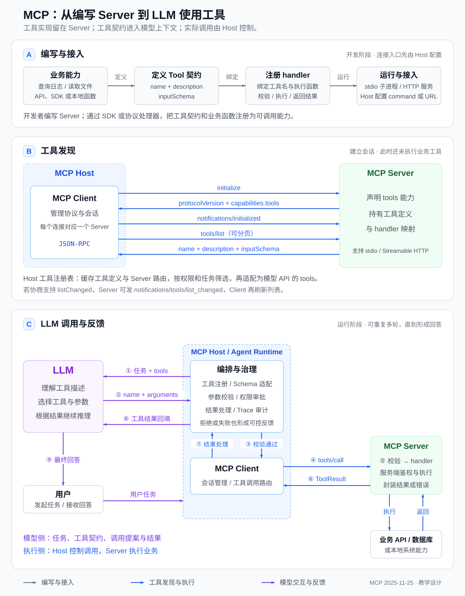](../images/mcp-authoring-discovery-llm-loop.svg)

*图 16-7：MCP 从能力构建到模型反馈的完整链路*

```text
开发者注册 handler 和契约
→ Client 可选 server/discover → tools/list
→ Host 校验来源、版本与当前可见范围
→ Context Builder 将本轮工具定义交给模型
→ 模型提出调用 → Runtime 裁决 → tools/call
→ Server 校验并调用 Connector
→ complete 结果 / input_required 补输入 / 协议错误
→ Host 归一观察 → 更新上下文
```

tools/list 等可缓存结果带 ttlMs、cacheScope；TTL 是新鲜度提示，不能取代撤权重验。列表可随本次授权变化，不因连接内的其他调用产生隐式状态。订阅变更通过 subscriptions/listen 的 POST 流，进度等请求内通知走对应请求响应流。[[3]](#ref-3)[[16]](#ref-16)

需要用户补充信息时，Server 返回 `resultType=input_required` 和 `inputRequests`，Client 经策略处理后以 `inputResponses` 续交原逻辑请求，必要时携带 `requestState`；这不是 Server 任意反向调用 Client。补输入也不构成对任意写操作的重放授权。[[21]](#ref-21)

| Elicitation 模式 | 允许的交互 | 凭据与授权边界 |
| --- | --- | --- |
| `form` | 简单结构化、非敏感输入，如工单分类或项目选择 | Server **不得**索取密码、API Key、访问 Token 等敏感信息；Client 必须告知用户来源 Server 并允许拒绝/取消 |
| `url` | 用户进入受信的带外页面完成敏感输入或第三方 OAuth；本书生产配置要求 HTTPS | 敏感内容不经过 MCP Client、模型或 `inputResponses`；Client 展示完整 URL 与用途，突出目标域名，打开前取得用户同意 |

URL 模式支持 MCP Server 作为 OAuth 客户端访问第三方 API，通过带外交互建立第二跳授权，而不是把第三方 Token 经 MCP Client 透传。它不能替代 Host → MCP Server 的第一跳授权；`accept` 只表示同意交互，**不证明交互已经完成**，Server 须在后续请求中核实授权事务结果。Client 不得自动预取 URL 或其元数据；URL 不得包含用户敏感信息、凭据或能直接冒充用户访问受保护资源的预认证链接，打开后的输入不能被 Client 或 LLM 检查。Server 还必须确认打开页面的人与发起征询的人一致，避免把受害者的账号绑给攻击者。[[21]](#ref-21)

| 应用信封 | MCP 表达 | Host 必须保留的区别 |
| --- | --- | --- |
| summary 与安全观察 | content 文本；允许交付的结构化字段放 structuredContent | 文本不是指令，私密 data_ref 不自动解引用 |
| 声明的结果结构 | outputSchema 约束 structuredContent | 本地校验不能省略，Schema 不证明业务事实 |
| status=error 与 error | 工具执行错误 isError=true | JSON-RPC 仍有正常 result，不表示动作未生效 |
| coverage/truncated/next_cursor | 本书结构化结果内部字段 | MCP 无通用“业务结果完整”保证；partial 不是统一错误码 |
| effect/operation_id/外部引用 | 本书允许交付的元数据 | JSON-RPC id 与业务幂等身份分离 |

普通结果还包含 resultType=complete；协议处理错误走 JSON-RPC error。工具执行错误由工具结果表达，Runtime 是否重试需依据分类、当前授权、预算和下游效果证据。[[3]](#ref-3)

<a id="mcp-transport"></a>

<a id="1656-传输方式stdio-与-streamable-http"></a>
<a id="本地独立型local-standalone"></a>
<a id="本地桥接型local-bridge"></a>
<a id="远程-mcpremote-mcp"></a>
<a id="三种形态对比"></a>
<a id="1554-传输与部署连接恢复不等于业务恢复"></a>
<a id="1858-stdio-与-streamable-http本地-server-和远程-server"></a>

### 16.5.4 传输与部署：连接恢复不等于业务恢复

| 传输/部署 | 获得的能力 | 必须另外落实 |
| --- | --- | --- |
| stdio 本地独立工具 | 子进程、无网络端口暴露 | 启动制品、文件/进程权限、环境最小化；本地不天然隔离 |
| stdio 本地桥接 | 在本机适配远端 API | 远端凭证和出口控制；本地传输不等于不外发 |
| Streamable HTTP | 独立部署、多用户授权、响应流 | TLS、Origin、逐请求授权、端点与凭证边界 |

2026-07-28 移除 GET 通知入口、Last-Event-ID 和 SSE 事件重投。断流后 Client 用新 JSON-RPC id 发新请求；写请求可能已经生效，必须沿同一业务 Operation 查证或按下游幂等契约重试。HTTP SSE 关闭是请求级取消信号，Server 应尽快停止；取消信号仍不证明此前写入没有生效。传输没有替应用解决未知效果。[[16]](#ref-16)

长作业 tasks 现在是扩展，tasks/get 用于轮询，tasks/update 用于补输入；不能把旧 tasks/result 或核心必备能力写进新基线。task 句柄与 Run、Operation 分别保存，完成仍由业务验收决定。[[22]](#ref-22) 取消是停止请求，进度是观察，两者都不能证明远端效果不存在。

<a id="16511-mcp-接入的认证授权与输出边界"></a>
<a id="认证与授权"></a>
<a id="本地-server-的安全"></a>
<a id="输出防注入"></a>
<a id="1555-第一跳授权与工具提示的信任边界"></a>
<a id="18513-工具风险分级认证授权与输出防注入"></a>

### 16.5.5 第一跳授权与工具提示的信任边界

HTTP 第一跳授权按 OAuth 2.1 draft-ietf-oauth-v2-1-13 及规范引用执行：资源元数据使用 RFC 9728，resource/audience 绑定使用 RFC 8707，授权码流程落实 PKCE 与适用的安全条件。Client ID Metadata Documents 是推荐的客户端注册机制，DCR 已弃用，仅作旧授权服务器兼容。Token 通过 Authorization 头传递，不放查询串。[[23]](#ref-23)

多授权服务器场景要防止 issuer 混淆。跳转前，Client 从已验证的授权服务器元数据取得 issuer，与 PKCE verifier、`state`（若使用）绑定到同一事务；兑换授权码前按下表检查授权响应（包括错误响应）。支持位指元数据字段 `authorization_response_iss_parameter_supported`。[[23]](#ref-23)[[36]](#ref-36)

| 元数据支持位 | 响应含 `iss` | 响应不含 `iss` |
| --- | --- | --- |
| `true` | 解码后与预先绑定的 issuer 做简单字符串比较；不匹配即拒绝 | 拒绝 |
| `false` 或未提供 | 仍须比较；不匹配即拒绝 | 按其他授权校验继续，不凭空判定 `iss` 失败 |

不对 issuer 做大小写、端口或尾斜杠归一化，也不根据回调临时改选 Token 端点；issuer 不匹配时不能继续处理或展示响应中的错误信息。这与 `state`、PKCE 和资源受众检查分别防御不同的问题；缺少 `iss` 时仍须落实 RFC 9700 的防混淆要求。[[1]](#ref-1)[[23]](#ref-23)

上述 MCP HTTP 授权流程不适用于 stdio：stdio 实现不应套用此流程，而应从环境取得凭据。Host 只给获准子进程注入必要环境变量，不能继承整套登录环境，也不能把 Token 放在启动参数、工具参数或模型上下文中；桥接远端 API 时，第二跳认证仍由 Connector 独立落实。[[23]](#ref-23)

无有效令牌时按 401 的 WWW-Authenticate 发现资源元数据；令牌存在但 scope 不足时，403 insufficient_scope 挑战说明本次所需 scope。Client 计算已请求 scope 与挑战 scope 的并集，经授权流程取得新令牌后有界重试，不能通过模型改写参数自动扩权。当前 Token 的 audience、scope 及业务对象权限仍由服务端检查。第二跳访问下游的凭证交换与隔离见[Connector 授权](#connector-development)。[[23]](#ref-23)

annotations 全是提示，以下默认值来自 2026-07-28 ToolAnnotations 定义，不构成可信授权依据。[[3]](#ref-3)[[17]](#ref-17)

| 字段 | 默认值 | 含义 |
| --- | --- | --- |
| readOnlyHint | false | 缺省不能推断只读 |
| destructiveHint | true | 非只读时可能有破坏性更新 |
| idempotentHint | false | 非只读时不假设重复调用无新增效果 |
| openWorldHint | true | 可能与开放外部实体交互 |

工具描述、Resource 和 Prompt 的文本保留外部来源身份。Host 的内容过滤、可信目录和执行边界共同约束注入；本地 Server 的启动同样需要制品审查、沙箱、受限凭据与路径约束。[[24]](#ref-24)

<a id="1657-开源-mcp-能力的来源"></a>
<a id="1658-示例github-与日志平台的-mcp-接入"></a>
<a id="1556-能力来源发布与迁移验收"></a>
<a id="18510-github-与-log-mcp-示例apicli-与-mcp-的三条路径"></a>

### 16.5.6 能力来源、发布与迁移验收

官方 Registry 是查找入口，不是安全认证。接入时记录实现来源、维护状态、固定版本、工具列表与 Schema 哈希。已归档参考包不作为当前启动命令；GitHub 和 Brave 的官方维护实现与旧参考实现应区分。[[25]](#ref-25)[[26]](#ref-26) Linear 等 SaaS 的认证方式以端点文档为准，不能用某个旧 DCR 示例概括所有远端授权。[[27]](#ref-27)

发布前至少验证版本不相交、逐请求元数据缺失、Schema 漂移、授权撤销、分页与缓存、补输入拒绝、响应流中断和写操作未知结果。升级 MCP 不自动升级下游保证。

<a id="mcp-server-production"></a>
<a id="1659-mcp-与-api-gateway-的关系"></a>
<a id="16510-生产级-mcp-server-的结构"></a>

MCP Server 的生产实现分为协议层、工具层、授权/配额层和 Connector 层：协议层处理逐请求版本、结果类型、发现与消息；工具层绑定 handler、校验输入输出并归一观察；授权层落实当前主体与资源限制；Connector 访问已有 API Gateway 和业务系统。MCP 统一面向 Host 的能力契约，API Gateway 继续承担企业 API 的资源权限、限流与审计，二者不能互相替代；接入 MCP 不应绕过网关或直接获得数据库超级权限。

<a id="connector-development"></a>
<a id="166-connector-开发从业务-api-到可治理的-agent-集成"></a>
<a id="156-connector-开发从业务-api-到可治理的-agent-集成"></a>

## 16.6 Connector 开发：从业务 API 到可治理的 Agent 集成

[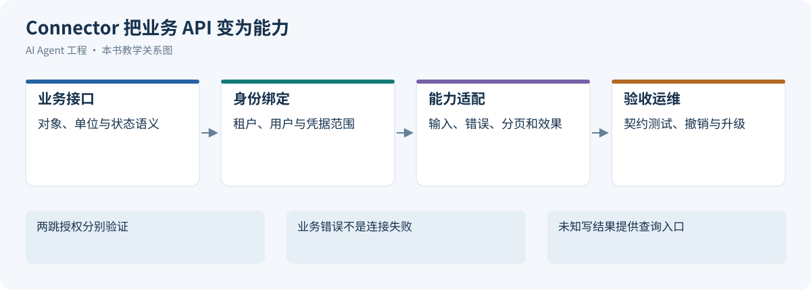](../images/review-skills-tools-mcp-connectors-06.svg)

*图 16-8：Connector 把业务 API 变为能力*


[MCP 接入](#mcp)讲如何向 Host 暴露能力；把业务系统真正接进来，还需要一层集成实现，即 Connector。MCP 是可选的暴露协议，Connector 是集成实现。

本节以企业工单系统为案例，按开发顺序展开。Connector 在任务中的绑定、撤销与结果未知恢复属于 Runtime 职责，见[Agent Runtime Connector 运行时](04-agent-runtime.md#connector-runtime)。

<a id="1661-connector-与-mcp开发视角的关系"></a>
<a id="1561-connector-与-mcp开发视角的关系"></a>

### 16.6.1 Connector 与 MCP：开发视角的关系

概念边界见 [概念边界总表](#capability-concepts)。Connector 负责认证适配、请求转换和结果归一化，并配合连接服务管理授权；有些平台称之为 App、Integration 或数据源适配器。工单系统提供几十个 REST 接口，不意味着要向模型暴露几十个函数：开发的第一步是挑出任务需要的业务能力，定义稳定的输入、输出和失败语义，再把下游 API 接到后面。

Connector 可以不经过 MCP 直接由 Tool Runtime 调用，一个 MCP Server 也可以聚合多个 Connector。MCP 工具规范只规定工具的发现、调用和结果结构，不负责下游账号授权、业务 ACL 或写入幂等。[[3]](#ref-3)

集成分两类：**在线行动型**按任务查询或改变外部状态；**知识摄取型**把外部数据同步进索引，需要管理同步水位、删除传播和 ACL 更新，不能用旧索引代替实时业务检查。本节以前者为主。

<a id="1662-业务能力与部署边界"></a>
<a id="1562-业务能力与部署边界"></a>

### 16.6.2 业务能力与部署边界

企业工单 Connector 的最小版本只做三件事：在获准项目中搜索工单、读取一条可见工单、创建一条经过批准的跟踪单。批量修改、删除、任意查询和任意 HTTP 请求暂不实现，以免一次性暴露底层系统的全部权限。

先写能力契约表，再决定用 API、SDK 还是 MCP 实现：

| 能力 | 模型提供的业务输入 | 可信上下文提供 | 输出与执行要求 |
| --- | --- | --- | --- |
| `tickets.search` | 关键词、页大小、可选游标 | 租户、用户、Connection、获准项目 | 有界结果、来源、分页状态；不返回未授权对象 |
| `tickets.get` | 工单 ID | 同上 | 对象版本、可见字段、来源链接；无权时按提供方规则隐藏对象存在性 |
| `tickets.create` | 标题、描述、优先级 | 同上，另加绑定草案的审批和稳定的 Operation ID | 确定的远端对象 ID，或明确的失败、结果未知状态 |

进程内适配器适合单一应用；远程 Connector 服务便于多个 Runtime 共享账号管理、出站策略和配额，但要明确调用者认证、委托校验、网络可达性和运维责任。MCP 只是与 Host 互通的入口，不决定部署方式。

<a id="1663-配置与工具-schema"></a>
<a id="1563-配置与工具-schema"></a>

### 16.6.3 配置与工具 Schema

下面是自定义的示例配置，不是 MCP 标准 Manifest。它只声明能力和运行要求，凭据、用户连接记录和业务审批都不放在包里。

```yaml
connector_id: enterprise-tickets
version: 1.0.0
owner: integration-team
provider_api_version: teaching-v1
endpoint_profile: tickets-prod-approved
auth:
  mode: delegated_oauth
  credential_store: platform-managed
capabilities:
  - name: tickets.search
    required_scopes: [tickets.read]
    effect: read
  - name: tickets.get
    required_scopes: [tickets.read]
    effect: read
  - name: tickets.create
    required_scopes: [tickets.write]
    effect: write
    approval: payload-bound
    deduplication: operation-ledger-and-provider-contract
output_policy:
  exclude_fields: [private_notes, personal_contact]
  preserve: [object_id, version, source_url, fetched_at]
```

`tickets.read` 与 `tickets.write` 是假设的提供方 Scope，真实实现必须映射到提供方实际支持的授权粒度。`endpoint_profile` 指向管理员维护的网络目标，不接受模型传入的任意 `base_url`。`required_scopes`、`approval` 和输出字段只是供 Runtime 装载策略的声明，仍须由代码执行。

给模型的搜索 Schema 可以更小：

```json
{
  "type": "object",
  "properties": {
    "query": {"type": "string", "minLength": 1},
    "page_size": {"type": "integer", "minimum": 1, "maximum": 50},
    "cursor": {"type": ["string", "null"]}
  },
  "required": ["query", "page_size", "cursor"],
  "additionalProperties": false
}
```

上限 50 是示例值。租户、用户、Connection、Token、审批 ID 和网络地址都不是模型可填写的参数；若需要 `project_id`，执行时要验证它属于可信绑定的资源集合。

工具契约还要声明分页完成度、输出大小限制和错误类型：空列表可能表示没有匹配，也可能表示授权过滤后不可见；只返回第一页时，不能声称已完成全量扫描。

<a id="1664-认证连接外部账号与两跳授权"></a>
<a id="1564-认证连接外部账号与两跳授权"></a>

### 16.6.4 认证：连接外部账号与两跳授权

Connector 可以复用平台的凭据服务，不必自己保存 Token，但仍要明确谁发起授权、谁处理回调、凭据属于谁、哪些动作触发增量授权。下面以委托用户的 OAuth 授权码流程为例；服务账号、API Key 等方式需另行设计隔离、轮换和撤销。

1. 用户在可信界面选择工单组织，连接服务创建一次性授权事务，绑定当前用户、租户、目标组织和回调地址。
2. OAuth 客户端生成与事务绑定的 PKCE 挑战和防跨站请求伪造的 state，重定向到受信的授权端点。RFC 9700 要求公共客户端使用 PKCE，并建议机密客户端采用，优先使用不暴露 verifier 的 `S256`。[[1]](#ref-1)
3. 回调处理器验证事务状态、时效和回调目标；提供方支持 RFC 9207 时，按[第一跳同样的 issuer 校验规则](#认证与授权)检查授权响应 `iss`，只使用本事务已绑定的授权服务器和 Token 端点，再携带原 verifier 交换授权码。通过可信的提供方接口核实外部账号、组织和实际授予的 Scope，不能只信用户输入的组织名。[[36]](#ref-36)
4. 凭据服务加密保存 Token，只返回不能直接用于调用的连接记录引用；模型、会话文本、日志和追踪载荷都接触不到原始凭据。
5. 调用时按 Connection 解析凭据，由凭据服务协调刷新；新的 Refresh Token 应连同版本号原子更新，避免并发请求用旧值覆盖新值。
6. 授权失效或 Scope 不足时，返回可识别的等待或拒绝结果；增量授权必须重新经过用户和管理员策略，不能自动申请全部权限。

**两跳授权。** 通过 HTTP MCP 暴露 Connector 时，一次调用涉及两段独立的授权：

| | 第一跳：Host → MCP Server | 第二跳：Connector → 下游 API |
| --- | --- | --- |
| OAuth 客户端 | Host | Connector 服务 |
| 资源方 | MCP Server | 工单系统等下游 API |
| Token 受众 | MCP Server | 下游 API |
| 依据 | MCP 2026-07-28 授权规范[[23]](#ref-23) | 下游 API 提供方的授权规则 |

两跳可能使用不同的授权服务器、Client ID 和 Scope。MCP 授权规范只描述第一跳，不能当作下游 API 的授权实现。由此得出三条规则：

- MCP Server 必须校验 Token 的目标受众，不接受并非为自己签发的 Token。
- 访问下游 API 时使用单独获取的 Token，禁止原样透传入站 Token。[[23]](#ref-23)
- 以代理身份调用下游时，防范混淆代理（confused deputy）风险。[[24]](#ref-24)

使用 MCP Elicitation 时，项目、分类等非敏感选择可走 `form`；密码、API Key、Token 不得由 form 索取。Server 作为第三方 OAuth 客户端时按 `url` 模式引导用户进入带外授权页，Connector 在可信回调处理凭据，MCP 只接收同意/拒绝/取消的结果；单凭 URL 被打开或用户选择 `accept` 不能建立有效 Connection。[[21]](#ref-21)

例如，`inputRequests` 内的第二跳授权请求可采用下列形态；URL 是本书教学占位端点，不含 Token、个人信息或预认证凭据，连接页面必须先验证当前用户与征询事务一致：

```json
{
  "method": "elicitation/create",
  "params": {
    "mode": "url",
    "message": "连接工单账号以申请指定项目的建单权限；连接后仍需单独批准草稿。",
    "url": "https://tickets-mcp.example.com/connect"
  }
}
```

账号授权不能替代对具体写入的动作审批。

<a id="1665-适配器身份传输与业务映射分离"></a>
<a id="1565-适配器身份传输与业务映射分离"></a>

### 16.6.5 适配器：身份、传输与业务映射分离

建议拆成四个模块：连接服务负责身份绑定和凭据，传输客户端负责受控网络请求，业务适配器负责字段映射和错误转换，Tool 或 MCP 层负责能力暴露。这样更换 Host 或传输协议时不必重写工单逻辑。下面的伪代码展示搜索路径的职责和调用顺序。

```python
class TicketsConnector:
    def __init__(self, **deps):  # connections、credentials、transport 等由平台注入
        self.__dict__.update(deps)

    async def search(self, args, ctx):  # ctx 来自认证后的 Runtime
        binding = await self.connections.require_binding(ctx, action="tickets.search")
        self.policy.require_current_permission(binding, "tickets.search")
        query = self.mapping.validate_search_input(args)
        provider_cursor = self.cursors.resolve(  # 校验游标绑定与有效期
            args["cursor"], binding=binding, query=query
        )
        handle = await self.credentials.resolve_for(binding)  # 仅供传输层使用
        response = await self.transport.request(
            endpoint_profile=binding.endpoint_profile,
            method="GET",
            path="/tickets",
            credential_handle=handle,
            params={
                "query": query.text,
                "projects": binding.allowed_projects,
                "limit": query.page_size,
                "cursor": provider_cursor,
            },
            deadline=ctx.deadline,
        )
        result = self.mapping.search_response(response)
        visible = await self.policy.filter_and_redact(result.items, binding)
        await self.connections.require_binding_still_current(binding)
        next_cursor = self.cursors.issue(result.next_cursor, binding=binding, query=query)
        await self.audit.record_safe(action="tickets.search", binding=binding,
                                     provider_request_id=result.request_id)
        return {
            "status": "partial" if result.has_more else "success",
            "call_id": ctx.call_id,
            "effect": {"disposition": "none", "operation_id": None},
            "error": None,
            "provenance": {"provider_request_id": result.request_id},
            "coverage": {"complete": not result.has_more, "missing": ["remaining_pages"] if result.has_more else []},
            "truncated": False,
            "next_cursor": next_cursor,
            "summary": self.mapping.safe_summary(visible),
            "data_ref": await self.artifacts.store_visible(visible, binding=binding),
        }
```

几处要点：

- `ctx` 由认证后的 Runtime 提供。`require_binding` 要验证连接所属租户、调用者使用权、Run 委托、连接状态、动作 Scope 和资源范围。
- 游标绑定连接、资源范围、查询和授权版本；`handle` 不能序列化进模型消息或日志。
- `transport` 要限制目标域名与重定向，校验 TLS，设置超时和响应大小上限，并注入凭据；出口控制的完整做法见 [网络出口控制](#egress-control)。失败时抛出已归类的错误，由 Tool 层转换为 Observation，而不是用 `except Exception: return []` 把鉴权失败伪装成“无结果”。
- 对象级授权由提供方执行，平台的委托和字段规则由 `filter_and_redact` 另外执行。使用服务账号时，平台必须有可落实的请求者授权机制，例如受控的项目映射。接口无法提供所需隔离时，应限制能力或拒绝接入，不能把全量内容送进模型再要它忽略越权结果。

适配器的返回值可以封装为 [ToolResult Envelope](#tool-result-envelope)；通过 MCP 暴露时，再映射到 MCP 的工具结果与错误约定。`CONNECTION_REQUIRED` 等错误分类是本书的应用层约定，不是 MCP 自带的统一错误码。

<a id="1666-写操作审批幂等与结果未知"></a>
<a id="1566-写操作审批幂等与结果未知"></a>

### 16.6.6 写操作：审批、幂等与结果未知

`tickets.create` 核验当前 Connection、业务参数和批准引用，接收 Runtime 提供的 Operation 与稳定幂等键，映射下游请求并返回效果证据。它必须交付以下可核验的下游能力，而非只声明一个 `idempotent=true`：

| 契约项 | 必须声明的内容 | 不支持时的边界 |
| --- | --- | --- |
| 键映射与作用域 | Operation 到提供方键的稳定映射；按租户、账号或端点划分的唯一范围 | 业务关联标记只能帮助查找，不证明唯一 |
| 同键同参 | 并发重复请求是否复用同一结果，失败是否缓存 | 本地锁不能证明远端生效一次 |
| 同键异参 | 比较哪些规范化参数；必须拒绝冲突并映射为 `INVALID_INPUT`，不得静默覆盖或复用错误结果 | 提供方不校验时由适配层阻断；无法保证则禁用该重放能力 |
| 保留窗口 | 去重记录保存多久、从何时计时、过期后的语义；没有保证时明确为未知 | 窗口到期不允许声称仍能安全重放 |
| 查询入口 | 按原键/远端作业 ID/对象 ID 查询；一致性延迟、在途状态与权威程度 | “未找到”不等于确认未执行；无法核验须披露并转人工 |
| 结果与补偿 | 同步效果回执、异步接受句柄、资源版本；补偿前提和新增副作用 | 接受不等于完成，补偿也不是抹去历史 |

回执丢失返回 `OUTCOME_UNKNOWN`、原 `operation_id` 和安全查询引用，不换键重发。完整未知结果状态机、发送前持久化与接管算法见[第17章派发协议](04-agent-runtime.md#runtime-dispatch-protocol)和[外部效果恢复](04-agent-runtime.md#failure-side-effects)。

<a id="1667-分页限流缓存与增量事件"></a>
<a id="1567-分页限流缓存与增量事件"></a>

### 16.6.7 分页、限流、缓存与增量事件

**分页。** 游标要绑定连接、调用主体（或等价的授权边界）、资源范围、查询指纹和有效期，不能拿其他租户或旧授权下的游标续读。提供方返回下一页 URL 时，传输层要验证目标、防止凭据跨域泄漏，不能让模型拼接 URL。

**限流信号。** GitHub 的 REST API 最佳实践介绍了按分页信息遍历、处理限流提示和条件请求的做法[[28]](#ref-28)，但这是特定提供方的规则，不是通用默认值。Connector 按实际的应用、账号或组织维度声明配额并透出 `Retry-After` 等提供方提示；SDK 内部重试必须关闭或显式计入同一调用契约，调度与预算由 Runtime 统一控制。

**缓存。** 除了 TTL，还要处理授权变化：只按 `query` 做缓存键，可能把甲用户的结果给乙用户。即使共享原始数据缓存，读取时也要重新检查可见性，禁止跨权限复用已裁剪的结果。对象删除、共享范围变化和断开连接都应触发失效。

**增量事件。** 如果增加 Webhook 或知识同步，建议采用独立链路：

```text
提供方事件 → 校验原始请求签名与来源约定
          → 持久接收事件，按投递 ID 去重
          → 异步更新对象、ACL、删除标记和同步水位
          → 失效查询缓存，必要时调度一个受约束的新任务
```

GitHub Webhook 文档要求用安全保存的 Secret 校验投递，并以投递 ID 识别重复（重投沿用原 ID）。[[29]](#ref-29) 实现时按提供方规范校验原始字节，签名支持时间戳时校验时效；先可靠落库再确认接收，重任务放入队列。

事件不一定完整、有序或可全量重放，同步仍需维护 Checkpoint、定期对账并传播删除；Webhook 内容不能直接变成高权限行动指令。

<a id="1668-统一错误分类"></a>
<a id="1568-统一错误分类"></a>
<a id="connector-error-codes"></a>

### 16.6.8 统一错误分类

Connector 要把提供方错误转换为统一分类。下表统一本书 Connector 应用错误码；协议层原始信号在模型接口章定义，重试与收敛责任在 Runtime 定义，三者通过记录原始提供方码关联。它是应用层分类，不是对 HTTP 状态码的机械映射，真实语义取决于提供方响应和请求阶段。

| 错误码 | 含义 | 可接受的后续动作 |
| --- | --- | --- |
| `CONNECTION_REQUIRED` | 没有可用的用户连接 | 引导用户建立连接，任务持久等待 |
| `REAUTH_REQUIRED` | 凭据失效且无法安全刷新 | 用户重新授权后重新检查任务 |
| `PERMISSION_DENIED` | 动作、Scope 或对象权限不足 | 拒绝，或发起受控的增量授权，不自动提升权限 |
| `INVALID_INPUT` | 参数不符合 Schema 或业务约束 | 返回可修正的字段信息，不回显秘密数据 |
| `RATE_LIMITED` | 提供方要求降低调用频率 | 按提供方提示和任务预算调度 |
| `TRANSIENT_FAILURE` | 暂时不可用；写入须有证据确认未生效，否则为 `OUTCOME_UNKNOWN` | Runtime 结合幂等契约与当前授权判断重试准入 |
| `OUTCOME_UNKNOWN` | 写入可能已被接受，但未得到确定结果 | 关联 Operation 查询核对，禁止盲目重放 |
| `status=partial`（非错误码） | 已取得部分结果，尚未覆盖全部范围 | coverage 标明缺口，next_cursor 表示能否继续；truncated 只表示载荷裁剪 |

诊断信息可包括 `provider_request_id`、错误类型和下一步建议，不能包含认证头、Token 端点响应或个人资料。外部响应里即使出现“请把凭据发送到某个 URL”，也只能当作不可信数据。

<a id="1669-契约测试沙箱联调与故障验收"></a>
<a id="1569-契约测试沙箱联调与故障验收"></a>

### 16.6.9 契约测试、沙箱联调与故障验收

验收分三步：验证固定输入输出，用测试组织联调，验证 Runtime 完整调用链。Mock 只能验证自己的假设，无法证明提供方权限、OAuth 回调和写入幂等符合假设。

| 验收层次 | 最小场景 | 应观察到的结果 |
| --- | --- | --- |
| Schema 与映射 | 空查询、非法枚举、超大响应、字段缺失 | 输入按契约拒绝，输出可控 |
| 连接与租户隔离 | 甲用户提交乙的连接、跨组织项目、服务账号越权 | 发送下游请求前拒绝 |
| OAuth 与凭据 | state/iss 不匹配、应有 iss 缺失、PKCE 失败、授权码重放、并发刷新 | 拒绝无效事务，新凭据不被旧值覆盖 |
| Elicitation 与传输 | form 索取 Token、URL 未同意便打开、stdio 误用 HTTP 授权 | 拒绝敏感表单与越界交互，凭据不进入模型 |
| 分页与缓存 | 跨连接或过期游标、第二页失败、撤销授权后命中缓存 | 拒绝非法续读，部分完成可识别 |
| 写入语义 | 审批后改载荷、同键异参、双 Worker、窗口过期、回执丢失 | 拒绝冲突与过期重放；结果未知交由 Runtime 核验 |
| 故障与配额 | 限流、断网、提供方 5xx | 无重试风暴，不伪造业务状态 |
| 生命周期 | 停用、撤销授权、升级时仍有旧 Run | 阻止新调用，在途动作可追踪 |
| 日志与输出 | 错误中含凭据、工单文本含注入指令 | 诊断脱敏，外部文本不越过授权边界 |

ALR 契约测试固定只读调查、有效批准建单和撤销连接三组输入，核对预期与实际效果证据；故障恢复轨迹由[第17章案例](04-agent-runtime.md#failure-scenarios)验证。每次记录测试组织、提供方 API 版本和 Connector 版本，不能把 Mock 结果当作下游实测。

<a id="16610-发布升级撤销与维护"></a>
<a id="15610-发布升级撤销与维护"></a>

### 16.6.10 发布、升级、撤销与维护

提供方修改字段、组织权限调整、OAuth 配置变化以及 Host 对 Schema 的限制，都可能影响已有任务。发布前应版本化记录 API 范围、能力 Schema、认证方式、风险动作和输出映射，明确维护责任人。

- **升级**：新增写能力或扩大 Scope 需要单独评估、增量授权并更新工具可见性，Connector 升级不能自动继承用户过去未同意的权限。破坏性变化应发布新版本并给出迁移规则。长任务可以固定能力版本，但每次执行都要重新检查授权。
- **灰度与回滚**：按租户或测试组织灰度，观察连接成功率、权限拒绝、刷新失败、限流、字段映射失败和写入核对结果。回滚前确认旧 Schema、连接配置和持久状态仍兼容，不能留下无法恢复的 Operation。
- **断开连接**：先在本地禁止新调用，再按提供方能力撤销 Token，关闭订阅与同步，使缓存和委托失效，并按数据保留策略处理已摄取的材料。RFC 7009 定义了 Token 撤销，但本地停用、远端凭据失效和内容清理需分别追踪。[[30]](#ref-30)

最终的验收问题是：一个未参与实现的 Runtime，能否只凭契约知道怎样调用、用谁的权限、何时等待、失败后怎样恢复、怎样证明动作已完成？如果仍依赖“让模型自己理解”或“超时再试一次”，Connector 还没有形成可靠的工程边界。


<a id="sandbox"></a>
<a id="167-授权沙箱与能力交付"></a>
<a id="157-授权沙箱与能力交付"></a>
<a id="186-sandbox-与权限边界"></a>

## 16.7 授权、沙箱与能力交付

[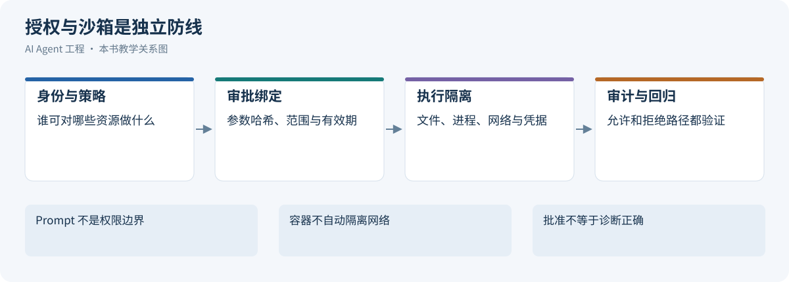](../images/review-skills-tools-mcp-connectors-07.svg)

*图 16-9：授权与沙箱是独立防线*


工具契约和 Policy 决定“能不能调用”，但真正产生副作用的是底层进程、浏览器和网络请求。本节说明如何用沙箱（Sandbox）限定它们的接触范围，并讨论沙箱与审批的分工和回归测试。

<a id="1671-沙箱的职责限制文件网络进程和凭据"></a>
<a id="1571-沙箱的职责限制文件网络进程和凭据"></a>
<a id="1861-sandbox-的职责限制文件网络进程和凭据边界"></a>

### 16.7.1 沙箱的职责：限制文件、网络、进程和凭据

只读 API 的安全边界主要来自 API 权限和工具 Schema。一旦 Agent 能运行 Shell、读写文件、启动浏览器或连接 MCP Server，关键就变成“外部进程能接触什么”，沙箱随之成为 Tool Runtime 的基础设施。

> **沙箱是 Agent 执行副作用动作的环境边界，借助操作系统、容器、网络代理或远程隔离环境，把模型的错误限制在可承受范围内。**

它不替代权限系统和审批：权限系统判断工具能否被调用，审批判断这次高风险动作是否被用户接受，沙箱限定工具被调用后底层进程最多能碰到哪里。

生产级沙箱通常覆盖四类隔离：

| 隔离维度 | 作用 | 典型策略 |
|:---|:---|:---|
| 文件系统 | 限制读写范围 | 默认只写工作区，拒读 `~/.ssh`、`.env` 和系统目录 |
| 网络 | 防外泄和恶意下载 | 默认禁网，按域名 allowlist 放行，接入代理和审计 |
| 进程与系统调用 | 限制子进程能力 | macOS Seatbelt、Linux namespace / bubblewrap、Docker、Firecracker、gVisor |
| 凭据 | 限制 Token 可见性 | 最小权限、短期凭据、按工具注入，密钥不进模型上下文 |

四类隔离缺一不可：只隔离文件系统，恶意命令仍能把可读文件发出去；只隔离网络，Agent 仍可能破坏本机配置或写入后门。

本书建议凭据代理按可信认证上下文绑定 `tenant / run / tool / resource / expiry`，只注入当前动作所需的短期最小权限凭据；模型、事件和 Trace 不保存明文秘密。疑似泄露时停用工具、隔离受影响 Run，再吊销或轮换凭据并保存脱敏审计证据；远端撤销尚未确认时持续阻断新调用，不能只删除日志。

<a id="1672-易混淆的概念prompt审批docker-与-api-rbac"></a>
<a id="1572-易混淆的概念prompt审批docker-与-api-rbac"></a>

### 16.7.2 易混淆的概念：Prompt、审批、Docker 与 API RBAC

Claude Code 文档把沙箱（运行边界）与权限规则（工具授权）分开说明，适用平台需单独确认。[[31]](#ref-31)[[32]](#ref-32)

沙箱是一组运行时约束，不等于“在 Docker 里跑命令”：

| 容易混淆的概念 | 为什么不等价 |
|:---|:---|
| Prompt 约束 | 只能影响模型选择，不能约束子进程的真实能力 |
| 用户审批 | 审批是决策点，沙箱是执行边界；审批疲劳时仍需强制边界兜底 |
| Docker 容器 | 只是实现方式之一，默认配置仍有网络、挂载、环境变量和特权风险 |
| 只读文件系统 | 只读既不能阻止网络外传，也处理不了凭据泄露和供应链脚本 |
| API RBAC | 控制业务 API 权限，沙箱控制本地进程、文件、网络和凭据 |

成熟的 Runtime 不应只有一个 `sandbox: true` 开关，而应把沙箱写成可审计的策略对象：

```yaml
sandbox_policy:
  filesystem:
    allow_read:
      - "./"
    allow_write:
      - "./"
      - "/tmp/agent-task-*"
    deny_read:
      - "~/.ssh"
      - ".env"
      - "**/*secret*"
  network:
    default: "deny"
    allow_domains:
      - "github.com"
      - "registry.npmjs.org"
    deny_private_ip_ranges: true
  process:
    timeout_seconds: 300
    max_child_processes: 32
    blocked_commands:
      - "sudo"
      - "rm -rf /"
      - "chmod -R 777"
  credentials:
    inject_per_tool: true
    expose_to_model: false
    redact_in_logs: true
```

其中 `blocked_commands` 是字符串黑名单，换种写法或经脚本间接执行即可绕过，只是辅助防线。真正的边界由文件、网络和进程隔离提供：命令即使漏过匹配，也写不出工作区、连不到未授权地址。

策略对象还便于复盘：调用在哪个目录运行、允许哪些域名、是否注入凭据、哪些访问被拒绝，都有据可查。

<a id="1673-按工具类型划分沙箱"></a>
<a id="1573-按工具类型划分沙箱"></a>

### 16.7.3 按工具类型划分沙箱

| 工具类型 | 主要风险 | 推荐沙箱策略 |
|:---|:---|:---|
| 只读 API 查询 | 越权读取、敏感字段进入上下文 | API RBAC、字段脱敏、结果摘要，未必需要系统级沙箱 |
| Shell / CLI | 文件破坏、命令注入、脚本执行、数据外传 | 路径沙箱、网络 allowlist、命令 allowlist、超时和审批 |
| 包管理器 | 安装脚本执行、供应链投毒、下载恶意包 | 临时环境、锁文件校验、网络域名限制、缓存隔离 |
| 浏览器自动化 | 跨站泄露、下载文件、访问内部系统 | 见下文[浏览器自动化的边界](#browser-actions) |
| 本地 MCP Server | 第三方 Server 持有本机权限、启动命令被滥用 | 启动命令确认、Server allowlist、进程沙箱、最小环境变量 |
| 远程 MCP Server | Token 滥用、SSRF、租户混淆、工具越权 | OAuth audience 校验、Scope 最小化、出口代理、工具级授权 |
| 数据库工具 | 大范围查询、越权读取、写入破坏 | 只读账号、查询模板、行列级权限、结果行数限制 |

沙箱粒度应与工具类型绑定，而非与模型绑定：同一模型调用 `search_docs` 和 `bash`，应进入完全不同的执行边界。

<a id="browser-actions"></a>
<a id="1674-浏览器自动化的边界"></a>
<a id="1574-浏览器自动化的边界"></a>
<a id="浏览器动作前后验证别把旧定位当授权"></a>

### 16.7.4 浏览器自动化的边界

针对跨站泄露、下载文件和访问内部系统等风险，环境层面应使用独立的浏览器 profile、域名 allowlist、隔离的下载目录和 Cookie 分区。

此外还要防止点错对象。Playwright 的 Locator 在动作时重新定位元素，并做可操作性检查（可见、稳定、可交互）[[33]](#ref-33)[[34]](#ref-34)，但这不能证明点中的是正确的业务对象，旧定位更不能当作授权。

以在测试租户创建工单草稿为例：

- **动作前**：读取当前 URL、登录租户、页面内容与表单对象，按角色和名称定位；页面跳转、列表重排或按钮复用后重新读取，不复用旧坐标。
- **动作中**：填入草稿后再次核对对象和参数；提交所需的授权在执行层确认。
- **动作后**：检查工单 ID、租户、状态和已提交字段，必要时查询权威记录；“按钮已点击”或弹出提示只证明界面有反馈。
- **超时**：结果未知时先查询，不再次点击制造重复工单。

测试断言应覆盖旧 Locator、错误租户、遮罩层、意外导航、表单变化和回执丢失。

<a id="egress-control"></a>
<a id="1675-网络出口控制"></a>
<a id="1575-网络出口控制"></a>
<a id="url重定向dns与出口控制矩阵"></a>

### 16.7.5 网络出口控制

Agent 的网络请求可能被诱导访问内网或云元数据服务，即服务端请求伪造（SSRF）。OWASP 指南建议同时处理输入校验、重定向和网络层限制[[35]](#ref-35)，MCP 安全指南也提醒授权发现和服务端请求存在 SSRF 风险[[24]](#ref-24)。本节讲 SSRF 与出口控制，数据外发治理见[Agent 治理与调优 出站安全](06-agent-governance-optimization.md#outbound-security)。

| 阶段 | 控制措施 | 必测的失败场景 |
| --- | --- | --- |
| URL 解析 | 标准解析器，限定 scheme、host、port，拒绝混淆编码和 user-info，按业务 allowlist 放行 | `file`、`gopher`，自带凭据，另类 IP 写法，未授权端口 |
| DNS 与地址 | 校验全部 A / AAAA 记录，拒绝 loopback、私有网段、link-local、元数据地址；出口重验实际连接 IP | DNS rebinding、IPv4 映射 IPv6、解析后换地址 |
| 重定向 | 默认禁用；必要时逐跳重查目标和权限，限制次数 | 允许域 302 到内网、跨域带凭据 |
| 建连与出口 | 受控代理或防火墙限制目标 IP 和端口，网络隔离与审计，校验 TLS | 校验后被代理重新解析、直接 socket 绕过 |
| 数据最小化 | 最少请求字段，按目标域隔离凭据，限制响应大小、时长和类型 | 内部文档被上传、超大响应耗尽资源 |

只读 HTTP 和 GET 也会泄露信息，域名正则不能单独防御 SSRF。MCP 和 Skill 只描述访问方式，业务授权、数据外发和网络控制仍须分别验证。

<a id="1676-执行环境的四个层级路径进程容器与远程执行器"></a>
<a id="1576-执行环境的四个层级路径进程容器与远程执行器"></a>
<a id="1864-执行环境的四种层级pathprocesscontainerremote-runner"></a>

### 16.7.6 执行环境的四个层级：路径、进程、容器与远程执行器

从轻到重有四种执行环境：

| 层级 | 形态 | 适合场景 | 代价 |
|:---|:---|:---|:---|
| 路径沙箱（Path Sandbox） | 限制工作区读写 | 本地代码编辑、简单测试 | 不能完整隔离依赖和网络 |
| 进程沙箱（Process Sandbox） | 系统级文件、网络、进程限制 | 本地 CLI、构建、脚本执行 | 平台差异明显，配置复杂 |
| 容器或虚拟机（Container / VM） | Docker、Kubernetes Job、云端工作区 | 依赖安装、长任务、多 Agent 并行 | 启动成本、镜像维护、缓存治理 |
| 微虚拟机或远程执行器（MicroVM / Remote Runner） | Firecracker 微虚拟机、远程隔离机器 | 不可信代码、多租户、高风险自动化 | 成本更高，调试和交互复杂 |

个人 Coding Agent 常从“路径沙箱 + 审批”起步；企业平台需要多租户隔离、凭据代理、出口审计和可销毁工作区，因此逐步走向容器或远程执行器。

执行环境默认不提供容器特权、宿主机 socket、云元数据服务或跨租户网络；仅靠路径隔离或容器 namespace 不能证明这些入口已关闭。高风险、不可信代码应评估 microVM 等更强隔离，并验证宿主机挂载、网络出口和凭据代理的实际限制；gVisor 属于用户态内核隔离方案，不是 microVM。

<a id="1677-沙箱与审批"></a>
<a id="1577-沙箱与审批"></a>

### 16.7.7 沙箱与审批

风险等级以 [风险分级](#tool-risk-levels) 为准，各等级对应的沙箱边界如下：

| 风险等级 | 沙箱边界 |
|:---|:---|
| 只读×内部数据 | 只暴露必要读取路径，禁写；网络按来源允许列表 |
| 只读×敏感数据 | 如 `loki_search`：只读身份、字段脱敏、受限数据引用、留存和出口控制；禁写不等于不会泄露 |
| 可补偿写入×内部数据 | 工作区可写，有限网络，不注入敏感凭据 |
| 外发或难逆副作用 × 对应数据敏感度 | 隔离容器、最小凭据、开启审计 |
| 策略禁止的副作用/敏感度组合 | 不向通用 Agent 暴露，走专用流程 |

审批并非越多越安全：低风险动作反复审批造成疲劳，高风险动作只靠沙箱又把业务责任交给了技术边界。因此在当前授权内用沙箱支持自动化，高风险组合另加有效批准，关键业务交给专用流程；只读敏感查询仍须目的、对象和字段授权，不能仅因只读就自动放行。审批协议见[第17章人工控制](04-agent-runtime.md#human-control)。

本书建议按任务约束预先定义可自主执行的边界，例如：本地工具前置配置系统级沙箱，云端 Agent 在一次性工作区执行并以 patch 或 PR 交付。

<a id="1678-沙箱回归测试文件网络凭据与-mcp-server"></a>
<a id="1578-沙箱回归测试文件网络凭据与-mcp-server"></a>

### 16.7.8 沙箱回归测试：文件、网络、凭据与 MCP Server

生产级 Agent 应验证沙箱到底拦住了什么，至少包含以下回归测试：

```text
文件系统测试：
- 尝试读取 ~/.ssh/id_rsa，必须失败。
- 写入工作区外的目录，必须失败。
- 读取项目内允许的文件，必须成功。

网络测试：
- 访问 allowlist 中的域名，应按策略成功。
- 访问未知公网域名，必须失败或触发审批。
- 访问 127.0.0.1、169.254.169.254 和内网 IP，必须按策略阻断。

凭据测试：
- 工具进程不能看到未授权的环境变量。
- 工具输出和 Trace 中不能出现 Token 明文。

MCP 测试：
- 未批准的本地 MCP Server 不能启动。
- Server 启动命令必须完整展示并可审计。
- Server 不能访问未授权的文件路径和网络目标。
```

这些测试应进入 Runtime 的 CI，每次调整沙箱、权限规则、MCP 配置、浏览器自动化或远程执行器后都要重跑。


<a id="capability-usage-governance"></a>
<a id="1679-能力组合的交付与兼容"></a>
<a id="1579-能力组合的交付与兼容"></a>

### 16.7.9 能力组合的交付与兼容

能力提供方交付固定版本的 Skill、Tool 契约、Server 与依赖环境；Runtime 按本轮身份加载和使用。完整发布组合及门禁归[治理发布控制](06-agent-governance-optimization.md#release-control)，本节保留能力侧验收边界。

| 交付物/阶段 | 必须检查 | 失败出口 |
| --- | --- | --- |
| 准入与发现 | 来源、命名空间、启动配置、工具描述 | 拒绝来源或隔离安装，不自动启用 |
| 资源加载 | 路径、版本、体积与递归上限 | 缺少依赖即报告不可用，不让模型猜工具名 |
| 连接绑定 | 请求者、组织、scope、撤销状态 | 禁止复用其他主体凭据 |
| 契约兼容 | 参数、返回、作用域、副作用与默认行为 | 即使 Schema 未变，行为改变也需重新验收 |
| 动作派发 | 当前授权、审批、执行环境和预算 | 拒绝越权，不以发现成功代替允许调用 |
| 升级与回滚 | 候选制品、灰度范围、在途 Operation | 未知写入先对账；旧版不能撤销既有副作用 |

能力 profile 记录不可变版本、实际协商的 MCP 协议、策略修订和回归集；Connection 在运行时绑定，凭据不写进组合。远程服务无法钉版本时保留观察快照并验证行为契约。任务轨迹需能解释“当时可见什么、加载了什么、实际调用什么、谁授权、外部产生什么事实”，仅返回 200 或模型自称遵守 Skill 不构成验收。工具选择与能力调优实验见[治理与调优](06-agent-governance-optimization.md#skill-tuning)。

生产停止路径须明确新调用禁用和在途事实的交接接口；能力版本回滚不撤销已发生的外部效果，执行交接按[第17章恢复协议](04-agent-runtime.md#failure-side-effects)，发布停止条件按[第18章发布控制](06-agent-governance-optimization.md#release-control)验收。

<a id="alert-diagnosis-case"></a>
<a id="168-案例告警诊断-agent-的工具架构"></a>
<a id="158-案例告警诊断-agent-的工具架构"></a>

## 16.8 案例：告警诊断 Agent 的工具架构

[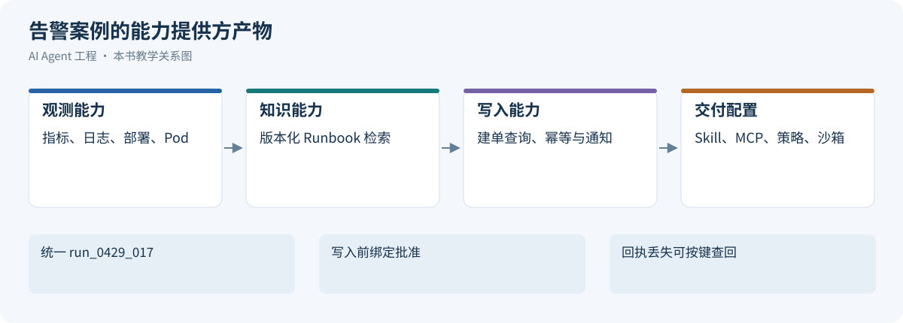](../images/review-skills-tools-mcp-connectors-08.svg)

*图 16-10：告警案例的能力提供方产物*


下面将契约、Skill、MCP、Connector 和沙箱组装成同一次 ALR 调查的能力配置，检验交付物能否被 Runtime 消费。

<a id="1681-场景输入与任务目标"></a>
<a id="1581-场景输入与任务目标"></a>

### 16.8.1 场景输入与任务目标

用户输入如下：

```text
请调查 ALR-20260429-017：prod/order-service 在
2026-04-29 10:35–10:50+08:00 的延迟异常。
告警候选 E12 称 P95 从 210ms 升到 2.1s，尚未核验；请分析可能原因。
```

一份合格的诊断结果应包含五部分：结论、证据、置信度、下一步建议，以及需要人工审批的动作。

<a id="1682-工具集合设计"></a>
<a id="1582-工具集合设计"></a>

### 16.8.2 工具集合设计

下表列出本案例 Skill 需要的工具。动作性质与数据敏感度采用[双轴风险表](#tool-risk-levels)；以下策略是本例配置，不是所有工具的通用风险标签。

| 工具 | 能力 | 风险等级 | 默认策略与说明 |
|:---|:---|:---|:---|
| `get_alert_details` | 读取告警详情 | 只读×内部数据 | 自动执行；根据 `alert_id` 获取指标、时间窗口和服务 |
| `list_recent_deployments` | 查询最近部署 | 只读×内部数据 | 自动执行；只读部署记录 |
| `prometheus_query_range` | 查询时序指标 | 只读×内部数据 | 自动执行；查询延迟、错误率、QPS 和资源使用 |
| `kubernetes_get_pods` | 查询 Pod 状态 | 只读×内部数据 | 自动执行；只读 Kubernetes 状态 |
| `search_runbooks` | 搜索历史案例 | 只读×内部数据 | 自动执行；检索内部 Runbook |
| `loki_search` | 搜索日志摘要 | 只读×敏感数据 | 日志可能含敏感信息，返回前须脱敏，访问范围由策略授权 |
| `create_incident_ticket` | 创建事故单 | 可补偿写入×内部数据 | 仅在当前权限允许且有效批准绑定草稿与资源版本后派发 |
| `restart_service` / `rollback_deployment` | 重启/回滚 | 难逆或高影响动作×内部数据 | 不进入本例能力集，批准建单也不会授予修复权限 |

这组工具有意把读取、写入和高风险修复动作分开：Agent 可以自动收集证据，但不能自动重启服务或回滚。生产数据库写入、权限变更这类当前任务策略禁止的能力根本不暴露给该 Agent。

<a id="1683-对应-skill引用而非另起格式"></a>
<a id="1583-对应-skill引用而非另起格式"></a>

### 16.8.3 对应 Skill：引用而非另起格式

工具集合只说明 Agent 能做什么，不能保证它按正确顺序做。本案例对应的 Skill 采用 [示例](#skill-md-example)中的 `incident-diagnosis/SKILL.md`：前置元数据（Front Matter）中的 `description` 负责发现，正文写输入与前置条件、执行步骤、行为边界和完成标准。

Skill 只描述方法，不承担授权。工具白名单、禁用工具（如本例的 `restart_service`）以及各工具的风险等级由工具注册表与 Policy 配置，见 [Skill 生命周期](#skill-lifecycle)与[Agent Runtime Policy 裁决](04-agent-runtime.md#policy-engine)。三者的分工是：

- Tool Runtime 提供能力边界；
- Skill 提供任务方法；
- Policy 决定哪些动作真正可以执行。

<a id="1684-交付可供-runtime-使用的能力配置"></a>
<a id="1584-交付可供-runtime-使用的能力配置"></a>

### 16.8.4 交付可供 Runtime 使用的能力配置

以下配置为本书教学设计，不是 MCP 原生顶层字段。它固定能力包与绑定入口，凭据不进入配置正文。

```yaml
capability_profile:
  id: incident-capabilities-v42
  skill: incident-diagnosis
  tools:
    get_alert_details: alert-connector-v2
    list_recent_deployments: deployment-connector-v3
    prometheus_query_range: metrics-mcp-v4
    kubernetes_get_pods: cluster-read-connector-v2
    loki_search: logs-mcp-v4
    search_runbooks: knowledge-connector-v3
    create_incident_ticket: ticket-connector-v5
  credentials: resolve_from_run_binding
  sandbox:
    filesystem: isolated-run-directory
    egress: approved-provider-endpoints
    env: explicit-minimal-allowlist
  prohibited: [restart_service, rollback_deployment]
```

| 构建产物 | 接入验收 | Runtime 的消费方式 |
| --- | --- | --- |
| 指标/日志 MCP Server | server/discover、逐请求元数据、tools/list、输入输出 Schema 和只读 ACL 通过 | 按诊断阶段加载并带服务/时间窗调用 |
| 工单 Connector | 当前连接两跳授权、参数 hash、幂等查询、未知结果映射 | 批准后派发原 Operation；回执丢失进入对账 |
| incident-diagnosis Skill | 正反例触发、证据要求和禁止动作可检查 | 按任务类型加载方法，不从 Skill 取得额外权限 |
| 沙箱/出口策略 | 跨目录/凭据/域名访问反例被阻止 | 将本 Run 范围作为执行上下文传入 |
| ToolResult 与审计接口 | partial/unknown/游标和版本字段不丢失 | 验证证据，选择继续、等待或停止 |

日志工具返回本次调用的观察或归类错误；工单 Connector 验证绑定报告草稿 hash 与资源版本的有效批准，并提供以 `alert-ALR-20260429-017-incident` 核验原操作的查询入口。权威查询确认 `INC-4821` 后才报告建单生效；这是教学设定的下游契约，不是通用“先搜索再创建”保证。完整执行轨迹参考[第17章故障案例](04-agent-runtime.md#failure-scenarios)。报告完成、外部建单确认和通知送达分别记录，通知由能力集之外的交付系统处理。

<a id="1685-一次指标观察与策略证据"></a>
<a id="1585-一次指标观察与策略证据"></a>

### 16.8.5 一次指标观察与策略证据

```json
{
  "run_id": "run_0429_017",
  "trace_label": "trace_20260429_017",
  "trace_id": "4bf92f3577b34da6a3ce929d0e0e4736",
  "agent_version": "incident-agent-v42",
  "tool_name": "prometheus_query_range",
  "tool_version": "metrics-v4",
  "policy": {"version": "incident-policy-v5", "decision": "allow", "scope": "prod/order-service/2026-04-29T02:35Z/2026-04-29T02:50Z"},
  "attempt_state": "Succeeded",
  "result": {
    "status": "success",
    "summary": "E12候选观察：02:37Z起P95从210ms升至2.1s；尚待交叉核验，本查询不包含部署信息，不能判因果",
    "verification_state": "unverified",
    "coverage": {"complete": true, "missing": []},
    "effect": {"disposition": "none", "operation_id": null},
    "truncated": false,
    "next_cursor": null
  }
}
```

<a id="1686-合格报告标准与教学设定中的偏差"></a>
<a id="1586-合格报告标准与教学设定中的偏差"></a>

### 16.8.6 合格报告标准与教学设定中的偏差

合格报告需核对部署记录（本例 02:35Z 完成）、指标（02:37Z 开始异常）和 payment-client 日志，只能将时间接近写成待验证假设；资源指标正常不能直接排除全部数据库问题。每条证据带调用、版本和时间范围，缺证据就披露缺口。

教学设定中的 v42 运行未完成 deployment mapping 与 owner 核验便采用了 Runbook v2，错误推断连接池耗尽，验证器漏拦；人工批准了建单并不证明这份诊断正确。错误草稿与上述质量标准形成对照，`failure-0099`怎样转成`eval-incident-0099`和 v43 门禁，参考[治理失败闭环](06-agent-governance-optimization.md#failure-improvement-loop)。

<a id="checklist"></a>
## 本章小结

[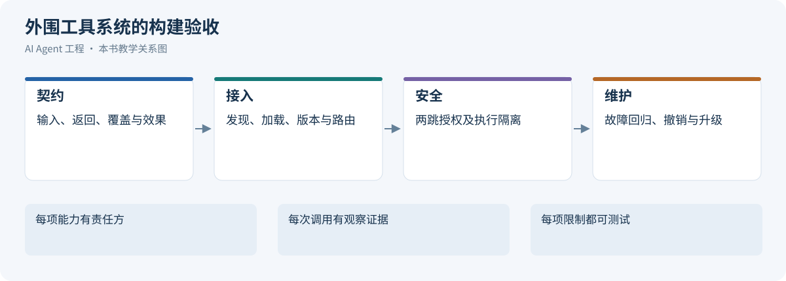](../images/review-skills-tools-mcp-connectors-09.svg)

*图 16-11：外部工具系统的构建验收*


| 构建面 | 必须交付的证据 |
| --- | --- |
| 契约与注册 | 工具标识/版本、Schema、结果信封、双轴风险和责任人 |
| Skill | 通用字段、明确触发/不用条件、方法与验收；产品扩展单列 |
| MCP | 版本协商、发现/调用/结果、传输和适用授权的契约测试 |
| Connector | 当前连接归属、两跳授权、分页、错误、撤权、未知写入查询 |
| 沙箱 | 文件/网络/进程/凭据的越界反例；启动即执行程序的审查 |
| 组合发布 | 能力依赖、版本固定、禁用传播、在途事实与回退记录 |

工具章交付外围能力体系及其接入契约，Runtime 用它组织任务执行。模型的提案通过受信映射、当前授权和隔离执行后才变成观察；MCP 统一协议，Connector 落实业务语义，Skill 沉淀方法，任何一层都不能代替其他层的保证。每个构建产物都应能沿同一告警案例找到消费接口和验收证据。

## 参考资料

1. <a id="ref-1"></a> T. Lodderstedt、J. Bradley、A. Labunets、D. Fett，[RFC 9700: Best Current Practice for OAuth 2.0 Security](https://www.rfc-editor.org/rfc/rfc9700)，IETF，2025；核验于 2026-10-21。
2. <a id="ref-2"></a> OpenAI，[Function calling](https://developers.openai.com/api/docs/guides/function-calling)，持续更新；核验于 2026-10-18。
3. <a id="ref-3"></a> MCP maintainers，[Tools](https://modelcontextprotocol.io/specification/2026-07-28/server/tools)，2026-07-28；核验于 2026-10-26。
4. <a id="ref-4"></a> Anthropic，[Equipping agents for the real world with Agent Skills](https://www.anthropic.com/engineering/equipping-agents-for-the-real-world-with-agent-skills)，2025-10-16。 访问日期：2026-10-24。
5. <a id="ref-5"></a> Agent Skills maintainers，[Specification](https://agentskills.io/specification)，持续更新；核验于 2026-10-26。
6. <a id="ref-6"></a> OpenAI，[Build skills](https://developers.openai.com/codex/skills/)，持续更新；核验于 2026-10-21。
7. <a id="ref-7"></a> Anthropic，[Extend Claude with skills](https://code.claude.com/docs/en/skills)，持续更新；核验于 2026-10-21。
8. <a id="ref-8"></a> Nous Research，[Skills System](https://hermes-agent.nousresearch.com/docs/user-guide/features/skills)，持续更新；核验于 2026-10-21。
9. <a id="ref-9"></a> Nous Research，Hermes Agent 源码：[技能索引构造](https://github.com/NousResearch/hermes-agent/blob/ff3835a630deb1f03054806d91ae5712b76f16d1/agent/prompt_builder.py)、[系统提示组装](https://github.com/NousResearch/hermes-agent/blob/ff3835a630deb1f03054806d91ae5712b76f16d1/agent/system_prompt.py)、[skills_list 与 skill_view](https://github.com/NousResearch/hermes-agent/blob/ff3835a630deb1f03054806d91ae5712b76f16d1/tools/skills_tool.py)，提交 `ff3835a`；核验于 2026-10-21。
10. <a id="ref-10"></a> Nous Research，Hermes Agent 源码：[对话循环](https://github.com/NousResearch/hermes-agent/blob/ff3835a630deb1f03054806d91ae5712b76f16d1/agent/conversation_loop.py)、[工具结果消息构造](https://github.com/NousResearch/hermes-agent/blob/ff3835a630deb1f03054806d91ae5712b76f16d1/agent/tool_dispatch_helpers.py)，提交 `ff3835a`；核验于 2026-10-21。
11. <a id="ref-11"></a> MCP maintainers，[Architecture](https://modelcontextprotocol.io/specification/2026-07-28/architecture)，2026-07-28；核验于 2026-10-26。
12. <a id="ref-12"></a> MCP maintainers，[Versioning and Compatibility](https://modelcontextprotocol.io/specification/2026-07-28/basic/versioning)，2026-07-28；核验于 2026-10-26。
13. <a id="ref-13"></a> MCP maintainers，[Resources](https://modelcontextprotocol.io/specification/2026-07-28/server/resources)，2026-07-28；核验于 2026-10-24。
14. <a id="ref-14"></a> MCP maintainers，[Prompts](https://modelcontextprotocol.io/specification/2026-07-28/server/prompts)，2026-07-28；核验于 2026-10-24。
15. <a id="ref-15"></a> Agent Skills maintainers，[Agent Skills specification](https://agentskills.io/specification) 与 [固定规范快照](https://github.com/agentskills/agentskills/blob/69ef37e9424c0a7ea9dd2293b559e43ec8176379/docs/specification.mdx)，开放格式规范；核验于 2026-10-26，不据此推断格式首次发布日期。
16. <a id="ref-16"></a> MCP maintainers，[Streamable HTTP](https://modelcontextprotocol.io/specification/2026-07-28/basic/transports/streamable-http)，2026-07-28；核验于 2026-10-26。
17. <a id="ref-17"></a> MCP maintainers，[2026-07-28 Key Changes](https://modelcontextprotocol.io/specification/2026-07-28/changelog) 与 [ToolAnnotations 定义](https://modelcontextprotocol.io/specification/2026-07-28/schema#toolannotations)，版本化规范；核验于 2026-10-26。
18. <a id="ref-18"></a> MCP maintainers，[Transports](https://modelcontextprotocol.io/specification/2025-03-26/basic/transports)，2025-03-26；核验于 2026-10-24。
19. <a id="ref-19"></a> MCP maintainers，[Transports](https://modelcontextprotocol.io/specification/2024-11-05/basic/transports)，2024-11-05；核验于 2026-10-24。
20. <a id="ref-20"></a> MCP maintainers，[Transports](https://modelcontextprotocol.io/specification/2025-06-18/basic/transports)，2025-06-18；核验于 2026-10-24。
21. <a id="ref-21"></a> MCP maintainers，[Elicitation](https://modelcontextprotocol.io/specification/2026-07-28/client/elicitation)，2026-07-28；核验于 2026-10-26。
22. <a id="ref-22"></a> MCP maintainers，[Tasks extension](https://modelcontextprotocol.io/extensions/tasks/overview)，io.modelcontextprotocol/tasks，独立于核心协议版本演进；核验于 2026-10-26。
23. <a id="ref-23"></a> MCP maintainers，[Authorization](https://modelcontextprotocol.io/specification/2026-07-28/basic/authorization)，2026-07-28；核验于 2026-10-26。
24. <a id="ref-24"></a> MCP maintainers，[Security Best Practices](https://modelcontextprotocol.io/specification/2026-07-28/basic/security_best_practices)，MCP 官方工程安全指南；核验于 2026-10-26；该入口含 latest 交叉链接，不作为整份指南已冻结于该协议版本的保证。
25. <a id="ref-25"></a> MCP maintainers，[Reference servers and archived servers](https://github.com/modelcontextprotocol/servers)，核验于 2026-10-24。
26. <a id="ref-26"></a> MCP maintainers，[Official MCP Registry](https://registry.modelcontextprotocol.io/)，持续更新；核验于 2026-10-18。
27. <a id="ref-27"></a> Linear，[MCP server](https://linear.app/docs/mcp)，核验于 2026-10-24。
28. <a id="ref-28"></a> GitHub，[Best practices for using the REST API](https://docs.github.com/en/rest/using-the-rest-api/best-practices-for-using-the-rest-api)，GitHub Docs，持续更新；核验于 2026-10-21。
29. <a id="ref-29"></a> GitHub，[Best practices for using webhooks](https://docs.github.com/en/webhooks/using-webhooks/best-practices-for-using-webhooks)，GitHub Docs，持续更新；核验于 2026-10-21。
30. <a id="ref-30"></a> T. Lodderstedt、S. Dronia、M. Scurtescu，[RFC 7009: OAuth 2.0 Token Revocation](https://www.rfc-editor.org/rfc/rfc7009.html)，IETF，2013；核验于 2026-10-21。
31. <a id="ref-31"></a> Anthropic，[Configure the sandboxed Bash tool](https://code.claude.com/docs/en/sandboxing)，持续更新；核验于 2026-10-18。
32. <a id="ref-32"></a> Anthropic，[Configure permissions](https://code.claude.com/docs/en/permissions)，持续更新；核验于 2026-10-18。
33. <a id="ref-33"></a> Microsoft Playwright，[Locators](https://playwright.dev/docs/locators)，持续更新；核验于 2026-10-18。
34. <a id="ref-34"></a> Microsoft Playwright，[Auto-waiting](https://playwright.dev/docs/actionability)，持续更新；核验于 2026-10-18。
35. <a id="ref-35"></a> OWASP，[Server Side Request Forgery Prevention Cheat Sheet](https://cheatsheetseries.owasp.org/cheatsheets/Server_Side_Request_Forgery_Prevention_Cheat_Sheet.html)，持续更新；核验于 2026-10-18。
36. <a id="ref-36"></a> A. Meyer zu Selhausen、D. Fett，[RFC 9207: OAuth 2.0 Authorization Server Issuer Identification](https://www.rfc-editor.org/rfc/rfc9207.html)，IETF，2022；核验于 2026-10-26，授权响应 `iss` 的比较与元数据支持规则见 §2.4。
