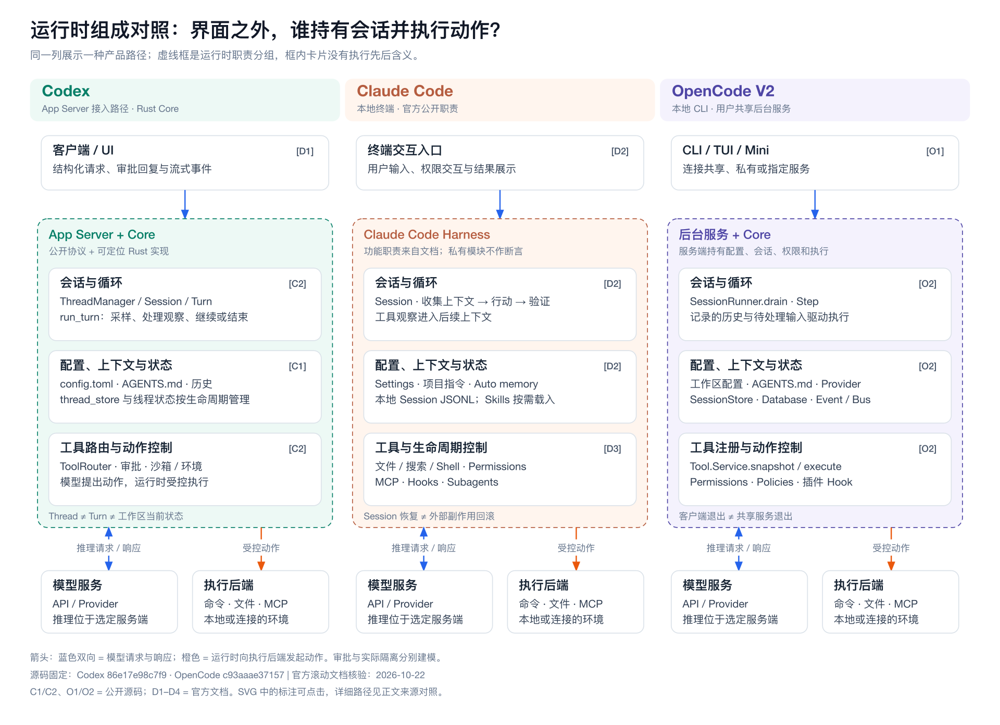
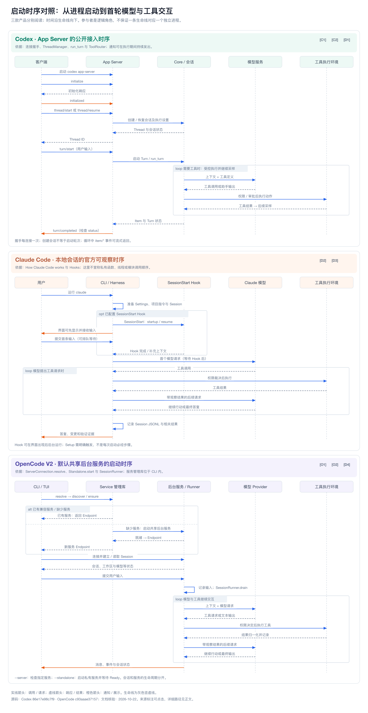

# 第17章 成熟 Coding Agent：Codex CLI、Claude Code 与 OpenCode 的实现、使用与调优

> 成熟的 Coding Agent 不是“会改代码的模型”，而是一个持续组织上下文、调度工具、约束副作用并验证结果的工程运行时。同一个运行时在不同人手里表现差异很大，差别主要来自使用者提供的任务、上下文、边界和验证。

**资料核验日期：2026-10-22。** 本章围绕三个产品展开：OpenAI 的 Codex CLI、Anthropic 的 Claude Code，以及开源项目 OpenCode（只讨论 2.x 版本线）。前四部分——组成、启动、执行、异常——讲这类系统怎样实现；后两部分——实践、调优——讲怎样用好它。每个讲实现的部分都以一张三产品对照表开头；实践与调优可以单独阅读，遇到机制名词时回到前文对应小节。

三个产品的公开程度不同，本章的结论因此带有不同的证据等级。

| 标记 | 含义 | 使用方式 |
| --- | --- | --- |
| 源码事实 | 公开仓库固定提交中可定位的文件与符号 | Codex 固定在 `86e17e98c7f9`（提交时间 2026-10-22 06:32 UTC），OpenCode 固定在 `c93aaae37157`（包版本 2.1.2）；不引用主分支 |
| 官方文档事实 | 官方文档页的陈述 | 文档滚动更新、没有版本快照，一律注明核验日期；文档写明版本门槛的，保留“vX 及以后” |
| 系统推导 | 根据公开证据做的架构解释 | 帮助理解，不等于产品内部的精确实现 |
| 本书建议 | 本书依据前述事实归纳的使用建议 | 只出现在实践与调优两部分，与官方建议分开标注 |
| 厂商报告 | 厂商自报的数字 | 写明范围与来源，不作为通用基准 |

Claude Code 没有公开核心源码，本章对它只引用官方文档，不使用逆向、泄露代码或社区猜测。官方没有使用“闭源”一词，仓库许可证只声明版权所有并指向商业条款，因此本章写作“核心程序未按开源许可证公开”。

还有一条限制需要提前说明：本章的行为结论来自阅读源码与官方文档，没有经过运行验证或故障注入。文档与源码不一致的地方，正文会指出，并以固定提交的源码为准；只能在源码里找到、文档没有承诺的行为，会标注“源码事实，非文档承诺”。版本敏感的内容（默认权限模式、命令名、配置键、模型名与别名）一律写明核验日期，正文不硬写模型名。

## 17.1 组成：三个产品由哪些部分构成

### 17.1.1 从代码生成到可审查交付

普通代码生成器的产物是文本片段。Coding Agent 的产物存在于仓库和执行环境里：它读取文件，向模型发起请求，调用工具修改代码、运行命令，再把结果交给人审查。模型的回答只是交付说明，不能代替真实的文件差异和验证结果。

三个产品可以抽象成同一条工作路径。这是本书用于分析的共同模型，不是任何产品的源码模块图：

~~~mermaid
flowchart LR
    A[用户任务] --> B[建立会话和任务上下文]
    B --> C[读取规则与代码证据]
    C --> D[模型选择下一步]
    D --> E{需要工具吗？}
    E -- 是 --> F[权限裁决与工具执行]
    F --> G[记录结果并反馈给模型]
    G --> D
    E -- 否 --> H[候选完成]
    H --> I[检查差异和验证证据]
    I --> J[向用户交付]
~~~

这条路径涉及四层事实，每一层都有一个容易混淆的地方：

| 层次 | 核心问题 | 不能混为一谈的事实 |
| --- | --- | --- |
| 任务与上下文 | 这一轮模型要解决什么、能看到哪些信息？ | 磁盘文件存在，不代表已进入上下文 |
| 模型与工具 | 模型提出什么行动，运行时如何执行？ | 模型生成工具调用，不代表工具已经成功 |
| 权限与隔离 | 哪些动作可以执行，动作影响到什么范围？ | 获得审批不等于进程被沙箱约束 |
| 验证与交付 | 哪些证据足以支持“完成”？ | 模型说测试通过，不等于测试进程实际成功 |

一次模型响应可以只含解释，也可以含一个或多个工具请求。运行时要把工具请求解析为可执行操作，检查参数与权限，调用本地或外部能力，把结果归入会话，再决定是否继续采样。所以主循环是一个受控状态机，不是单次提示词调用。工具可能失败、超时、被用户拒绝或被中断，可靠的运行时要把这些情况作为不同结果回送给模型，而不是把失败输出包装成成功；取消也不会撤回已经发生的外部副作用，远端请求、数据库写入和命令进程各有各的恢复语义。这些问题在 17.4 逐一展开。

### 17.1.2 三个产品与证据基础

| 项目 | Codex CLI | Claude Code | OpenCode（2.x） |
| --- | --- | --- | --- |
| 源码可见性 | CLI、SDK、App Server 等开源；IDE 扩展与 Codex 云端不开源；`openai/codex` 仓库不接受外部代码贡献[[1]](#ref-1) | 核心程序未按开源许可证公开：仓库 LICENSE 只声明版权所有并指向商业条款，仓库内是文档、示例、插件与变更记录；沙箱运行时是单独的开源包[[55]](#ref-55)[[36]](#ref-36) | 开源，MIT 许可证，默认分支 `dev`[[69]](#ref-69) |
| 本章的证据 | 固定提交的源码，加官方文档（learn.chatgpt.com） | 官方文档；更新记录在核验日最新为 2.1.308[[56]](#ref-56) | 固定提交的源码（包版本 2.1.2），加 2.x 官方文档 |
| 版本与地址风险 | 文档站已从 developers.openai.com 迁到 learn.chatgpt.com，旧地址永久重定向；旧的 `/codex/security` 现在指向另一个产品 Codex Security（漏洞扫描），不是沙箱与审批页[[8]](#ref-8) | 默认值与行为带版本门槛，模型别名随版本变化 | 1.x 与 2.x 命令名相同；2.x 有三处破坏性变更：插件 API、服务端 API 与客户端契约、终端配置改为单个 `cli.json`；2.x 仍读取 1.x 的配置位置并在内存中归一化[[59]](#ref-59) |
| 官方使用建议 | 有最佳实践指南[[19]](#ref-19) | 有最佳实践页与成本页[[32]](#ref-32)[[33]](#ref-33) | 2.x 文档中未见最佳实践或调优专页，只有功能文档 |

这张表也说明了开源与可审查的关系。源码可见提升了实现的可审计性，但代码存在不代表部署时启用了对应配置，默认功能也不代表每个版本、每个入口的行为一致；源码审查替代不了运行验证、权限测试和故障演练。闭源产品也并非不可分析：官方行为文档、协议说明和配置接口足以支撑严谨的系统比较，前提是把可观察事实和内部猜测分开。Claude Code 一栏的证据上限就是官方文档，本章不越过它。

固定提交并不是形式要求。Codex 固定提交的时间是 2026-10-22 06:32 UTC，核验当天主分支已经前进了约 4 小时，其中被本章引用的 `state/turn.rs` 当天就改了注释措辞（机制未变）[[20]](#ref-20)。如果引用主分支，同一个链接几小时后就可能不再支持原来的论断。

### 17.1.3 运行时组成对照

下表按职责归纳三个产品的公开组成。同一格里的职责不意味着同一个进程或同一个源码模块；Claude Code 一列只描述官方文档公开的行为，不推测私有模块。

| 职责 | Codex CLI | Claude Code | OpenCode 2.x |
| --- | --- | --- | --- |
| 入口与交互 | TUI、`codex exec` 与外部客户端。固定提交中 TUI 与 exec 以进程内方式承载 App Server 客户端；外部客户端经 stdio、Unix socket 或 WebSocket 连入[[2]](#ref-2)[[25]](#ref-25) | 终端、桌面、IDE、claude.ai/code、Remote Control、Slack、CI/CD；官方称各界面共享同一个循环[[31]](#ref-31) | TUI、Mini、非交互 `run`、桌面、网页（`pair`）；默认连接当前用户的共享后台服务[[57]](#ref-57) |
| 会话与执行对象 | 对外是 Thread → Turn → Item；核心里 Session 持有至多一个活动 Turn[[2]](#ref-2)[[20]](#ref-20) | Session 保存在本地 JSONL；resume 沿用同一会话 ID 追加，fork 复制到新 ID[[31]](#ref-31)[[38]](#ref-38) | 服务端持有 Session；执行以 drain 与 step 推进，开始时写入持久化的执行声明（claim）[[71]](#ref-71)[[72]](#ref-72) |
| 配置与上下文 | 分层 `config.toml`（项目层需受信）、AGENTS.md 指令链[[3]](#ref-3)[[6]](#ref-6) | 分层 Settings、CLAUDE.md、auto memory、按需加载的 Skills[[41]](#ref-41)[[40]](#ref-40)[[43]](#ref-43) | 全局、项目、系统配置；指令只认 AGENTS.md；Skills 仍兼容读取 `.claude/skills`[[58]](#ref-58)[[61]](#ref-61)[[65]](#ref-65) |
| 模型接入 | 模型提供商配置，含 `--oss` 本地提供商与 Bedrock 提供商[[4]](#ref-4) | Claude 模型，经 Anthropic API、云厂商平台或网关访问；缓存与推理发生在服务端[[34]](#ref-34)[[46]](#ref-46) | 来自 models.dev 的 Provider 与模型目录；可接本地模型[[60]](#ref-60) |
| 扩展与工具 | Skills、MCP、子 Agent、Hooks、Rules（实验）[[10]](#ref-10)[[11]](#ref-11)[[12]](#ref-12) | Skills、MCP、Hooks、Subagents、Plugins[[45]](#ref-45) | Skills、MCP、Commands、Plugins、Agents；MCP 工具默认经 Code Mode 的 `execute` 命名空间调用[[65]](#ref-65) |
| 权限与实际执行 | 审批策略与沙箱模式分开配置；沙箱机制在独立 crate 中实现[[7]](#ref-7)[[21]](#ref-21) | 权限模式与规则；沙箱默认关闭，只覆盖 Shell 命令[[34]](#ref-34)[[36]](#ref-36) | 有序权限规则与只能收紧的 Policies；未发现内置 OS 沙箱，Shell 以宿主用户权限运行[[63]](#ref-63)[[64]](#ref-64) |
| 持久化与恢复 | rollout 会话文件；`thread/resume`、`fork`、`revert`[[2]](#ref-2)[[4]](#ref-4) | JSONL 会话与 Checkpoint（只覆盖文件编辑）[[31]](#ref-31)[[37]](#ref-37) | Session API、快照与回退、共享服务模式下的重启续跑[[66]](#ref-66)[[68]](#ref-68)[[71]](#ref-71) |

*运行时组成对照。虚线框表示逻辑职责分组，不代表三款产品具有相同的进程划分；框内卡片不表示调用顺序。Claude Code 一列采用官方行为文档，不推测私有模块。图中标注的源码与文档依据见附录 B，点击图片查看 SVG。*

### 17.1.4 会话与执行对象：Session、Turn 与工作区

三个产品都把会话、本轮执行和工作区看作不同的东西，但对象的名字和边界各不相同。

Codex 的外部协议用 Thread、Turn、Item 三层：Thread 是会话，包含多个 Turn，Turn 包含消息、命令、文件变化等 Item[[2]](#ref-2)。核心里的 Session 保有线程、历史、配置和各类服务，长期存在；一个 Session 在任一时刻至多有一个运行中的任务。活动 Turn 的状态（取消令牌、待决审批、待处理输入、工具调用）挂在 Session 的 `active_turn` 之下，并不是独立于 Session 的对象[[20]](#ref-20)。所以会话可以继续存在而某个 Turn 已经结束，Turn 也可以被中断或追加输入，而不必重建会话；对持久化、统计、恢复和取消来说，这是两个不同的状态对象。

Claude Code 把对话、工具调用和结果写进本地明文 JSONL 会话文件。官方说明，resume 以同一会话 ID 重新打开并追加新消息，fork 则把历史复制到新的会话 ID；同一个会话在两个终端同时恢复且不 fork 时，两边的消息会交错写进同一份记录。官方还声明 JSONL 条目格式属于内部实现，随版本变化，不建议直接解析[[31]](#ref-31)[[38]](#ref-38)。

OpenCode 的会话归服务端持有。源码里执行过程以 drain 和 step 推进：开始执行时，Started 事件和执行声明在同一个事务里写入，这是它能在进程重启后续跑的基础（见 17.4.4）[[71]](#ref-71)[[72]](#ref-72)。

会话历史与工作区是第三组区别。官方文档明确写到，切换 Git 分支后 Claude 看到的是新分支的文件，会话历史保持不变[[31]](#ref-31)。这个例子说明，磁盘上有文件不代表已进入上下文，会话里有描述也不代表工作区仍是那个样子。会话记录是上下文资产，工作区是外部事实，本轮是短时执行状态，三者不能互相替代。

### 17.1.5 接入面与进程边界

Codex 的变化最大。固定提交中，TUI 的 `Cargo.toml` 已经不再依赖 `codex-core`，TUI 和 `codex exec` 都通过进程内的 App Server 客户端接入，源码注释写明这样做是为了保留 App Server 的语义，同时避免进程边界[[25]](#ref-25)。协议 crate 的 README 仍然写着“core 与 TUI 之间的内部类型”，已经落后于代码[[29]](#ref-29)。更准确的说法是：TUI、exec 和外部客户端共用 App Server 的请求与事件语义，TUI 以进程内方式承载它。App Server 有 stdio（默认）、Unix socket、WebSocket 和关闭四种传输；官方文档称 WebSocket 为 experimental and unsupported，`codex app-server` 命令主要用于开发与调试，可能不经通知变化[[2]](#ref-2)[[14]](#ref-14)[[25]](#ref-25)。

Claude Code 的官方描述是：它是围绕模型的外围层，提供工具并管理模型所见的上下文，也就是所谓 agentic harness；各个界面共用同一个循环[[31]](#ref-31)。官方没有公开进程和线程的划分。

OpenCode 2.x 把界面放在服务端之上。CLI 默认发现或启动当前用户的共享后台服务，客户端连上它；`--standalone` 启动私有服务，`--server` 连接指定服务，两者不能同时给出[[57]](#ref-57)[[70]](#ref-70)。私有服务由客户端拉起子进程，客户端关闭其标准输入时服务随之退出[[70]](#ref-70)。这个细节决定了“关闭界面是否等于结束服务”的答案：共享服务模式下不等于，私有服务模式下等于。

三者共同的取向，是把“怎样呈现任务”和“怎样执行任务”分开，前端不必复制一套模型循环。这是对公开协议与职责的架构概括（系统推导），不代表所有界面的功能完全相同。

### 17.1.6 模型接入与扩展层

OpenCode 把模型接入做成可替换的部分：Provider 与模型目录来自 models.dev，Provider 通过 `package` 字段选择运行时包，本地模型（Ollama、LM Studio、vLLM）可自动发现，任意 OpenAI 兼容服务可手动配置[[60]](#ref-60)。官方文档同时承认，这个抽象并不抹平差异：选项是 Provider 特定的，别的 Provider 包可能忽略或拒绝；目录之外的自定义模型默认假设 200,000 的上下文和 32,000 的输出上限，文档称这是回退假设，不是检测到的能力[[60]](#ref-60)。Codex 的仓库也含适配组件，配置文档列出自定义模型提供商、`--oss` 本地模式和 Bedrock 提供商[[4]](#ref-4)。Claude Code 使用 Claude 模型，通过 Anthropic API、云厂商平台或网关访问，缓存和推理都发生在服务端，“本地执行工具”并不意味着在本地运行模型[[46]](#ref-46)。

扩展层方面，三个产品的名字相近，但在循环中的位置不同。Claude Code 官方的划分最清楚：Skill 提供可复用的知识与工作流，MCP 接入外部服务，Hook 在生命周期事件上执行确定性动作，Subagent 把有边界的工作交给独立上下文，Plugin 只是打包与分发形式[[45]](#ref-45)。Codex 的 Skill 采用渐进披露：启动时只带每个技能的名称与描述，选用时才读完整的 `SKILL.md`；描述列表最多占模型上下文窗口的 2%（窗口未知时为 8,000 字符）[[11]](#ref-11)。OpenCode 的 Commands 里，`!` 嵌入的 Shell 块在工具权限流程之外运行，文档要求只使用可信来源；2.x 的插件 API 与 1.x 不兼容，1.x 插件不能在 2.x 运行[[65]](#ref-65)。这些扩展的内部注册、调度与持久化方式，凡是没有公开源码或官方实现说明的，本章不作断言。

### 17.1.7 权限、沙箱与审批：三层各管什么

权限相关的机制可以分成三层：决策层决定一个动作是否放行，隔离层限制放行后的进程能碰到什么，管理层决定谁能把规则收紧。

| 层次 | Codex CLI | Claude Code | OpenCode 2.x |
| --- | --- | --- | --- |
| 决策：动作是否放行 | 审批策略 `on-request`、`never`、`granular`（`untrusted` 已退役）；auto-review 可以代替用户审核已经需要审批的动作，但它是“换审核人”，不是授权[[8]](#ref-8)[[9]](#ref-9) | 六种权限模式；规则按 deny → ask → allow 求值，首个匹配生效；PreToolUse Hook 的决定不能绕过规则[[34]](#ref-34)[[35]](#ref-35) | 有序规则，三元组为 action、resource、effect，最后一个匹配者生效；多资源操作中任一资源命中 deny 即 deny[[63]](#ref-63)[[75]](#ref-75) |
| 隔离：放行后能碰什么 | 沙箱模式 `read-only`、`workspace-write`、`danger-full-access`；`workspace-write` 下 `.git`、`.agents`、`.codex`、`.aws` 递归只读[[7]](#ref-7) | 沙箱默认关闭，支持 macOS、Linux、WSL2；只覆盖 Shell 命令及其子进程，文件工具、MCP、Hook 在沙箱之外；官方称它降低风险，但不是完整的隔离边界[[36]](#ref-36) | 未发现内置 OS 沙箱；`shell` 以宿主用户的文件系统、进程和网络权限运行[[63]](#ref-63) |
| 管理：谁能收紧 | 配置层级与受管配置[[3]](#ref-3) | managed 设置优先级最高，managed 中的 deny 不能被覆盖[[41]](#ref-41)[[35]](#ref-35) | Policies：二元、不弹窗、只能收紧；来源越宽优先级越高[[64]](#ref-64) |

审批与隔离是两件事。Codex 官方的表述是：沙箱定义技术边界，审批策略决定在越过边界之前何时停下来询问[[7]](#ref-7)。同意运行某个命令不会让命令变安全；沙箱放行某个路径，也不意味着命令符合业务意图（系统推导）。代码层面也能看到这种分工：Codex 的路由、审批阶段和沙箱选择与重试编排分处不同文件，沙箱机制本身在独立的 crate 里[[21]](#ref-21)。

OpenCode 的默认配置需要特别注意：每个 Agent 的默认策略是 `* * allow`，只有读取 `.env` 一类文件会询问，项目目录外的读写默认也不询问[[63]](#ref-63)。所以“`ask` 会暂停动作”在默认配置下只覆盖很少的动作，想让它生效，要自己添加规则。

另一类常见的误解，是把角色或提示词当作边界。OpenCode 文档明确写到，隐藏某个 Agent 只控制可见性，不是安全手段[[62]](#ref-62)；Claude Code 文档则说，在 CLAUDE.md 或 Skill 里写“不要编辑 .env”只是请求而不是保证，必须发生的约束要放进 Hook[[45]](#ref-45)。

## 17.2 启动：从进程启动到首个模型请求

### 17.2.1 三个时间尺度

启动不是一个瞬间。进程启动准备服务与连接，会话初始化选择工作区与配置并建立或恢复历史，轮次启动把新的输入送进模型与工具循环。三者可以连续发生，也可以相隔很久：一个后台服务可以承载多个会话，一个会话可以执行多轮。恢复历史只是读回记录；旧的命令进程是否恢复、文件是否回到历史时刻，因产品而异，见 17.4.4。

后面三小节分别描述三个产品的启动路径，17.2.5 说明配置与指令什么时候生效，17.2.6 对照“就绪”在三个产品里分别指什么。

### 17.2.2 Codex：App Server 路径

以客户端启动 `codex app-server` 为例，协议路径是：启动服务、握手、建立或恢复 Thread、启动 Turn、消费事件直到 Turn 结束。TUI 与 `codex exec` 在固定提交中以进程内方式承载同一套 App Server 语义，没有进程边界，但步骤相同[[25]](#ref-25)。

| 阶段 | 动作 | 完成后得到什么 |
| --- | --- | --- |
| 启动服务 | 选择传输：`--listen` 默认 `stdio://`，可取 `unix://`、`ws://IP:PORT` 或 `off`[[25]](#ref-25) | 可接受连接的本地服务；此时还没有用户任务 |
| 连接握手 | 每个连接发送一次 `initialize`，再发 `initialized` 通知[[2]](#ref-2) | 连接完成协议初始化 |
| 建立或恢复会话 | `thread/start` 指定模型、工作目录、审批策略与沙箱；`thread/resume` 按 `threadId` 恢复；响应带回已加载的指令文件路径 `instructionSources`；必需的 MCP 服务器初始化失败时，二者都会失败[[2]](#ref-2) | Thread 身份与会话配置 |
| 启动轮次 | `turn/start` 提交用户输入和可选的本轮覆盖参数[[2]](#ref-2) | 活动 Turn |
| 执行循环 | 模型采样、工具调用、审批、命令与文件变化，以 `item/*` 与增量事件回传 | 消息、命令、文件变化等 Item |
| 收束本轮 | 收到 `turn/completed`，状态为 `completed`、`interrupted` 或 `failed` | 已结束的 Turn；Thread 可接收下一轮 |

握手的硬顺序是连接、`initialize`、建立或恢复 Thread、启动 Turn。官方文档说，握手之前的任何请求都会被拒绝，重复的 `initialize` 返回 “Already initialized”[[2]](#ref-2)。源码给出了更精确的细节：放行门设在 `initialize` 请求上，未初始化时返回 “Not initialized”；`initialized` 通知在服务端只被记录，并不参与放行[[25]](#ref-25)。所以“握手前的业务请求被拒绝”成立，“必须先发 `initialized` 才放行”则不是服务端强制的。另外，`turn/completed` 的状态可能是 `interrupted` 或 `failed`，不能仅凭事件名认定需求已经实现[[2]](#ref-2)。

有两处需要标注版本的不一致。其一，`--code-mode-host` 控制的是 App Server 向其 Code Mode 宿主发起的外向连接，不改变 `--listen`，也就是客户端怎样连入 App Server；这是两条不同的连接。官方文档的示例写的是 `wss://` 地址，而固定提交的源码只接受 `http://` 或 `https://`，并在测试里把 `wss://` 列为非法端点，所以本章不写具体的地址方案[[2]](#ref-2)[[25]](#ref-25)。其二，`code_mode_host` 特性默认开启，`code_mode` 特性仍在开发中、默认关闭，“默认会启动本地宿主”不能写成“默认启用 Code Mode”[[28]](#ref-28)。

### 17.2.3 Claude Code：Harness 与 Session

官方公开的是产品行为、配置与生命周期事件，没有公开足以重建核心程序的源码。下表按依赖关系归纳启动过程，不是私有函数调用顺序，也不表示各项准备严格串行。

| 阶段 | 官方资料能确认的行为 | 需要区分的边界 |
| --- | --- | --- |
| 启动与配置 | 在项目目录运行 `claude`；配置优先级从高到低为 managed、命令行、project local、共享 project、user[[41]](#ref-41) | 起始权限模式依版本而定（见下） |
| 指令与能力 | 从当前目录向上逐级载入 CLAUDE.md；auto memory 的 `MEMORY.md` 载入前 200 行或 25KB，先到者为准；载入 MCP 工具名与 Skill 的名称和描述[[40]](#ref-40)[[31]](#ref-31)[[43]](#ref-43) | 子目录里的 CLAUDE.md 要等 Claude 读、写或编辑该子目录的文件时才载入；`MEMORY.md` 的专题文件不在启动时载入 |
| 建立或恢复 Session | 新会话从全新的上下文窗口开始；`--continue` 与 `--resume` 以同一会话 ID 继续[[31]](#ref-31)[[38]](#ref-38) | 恢复的是历史，读到的仍是当前工作区的文件 |
| SessionStart Hook | 匹配值有 startup、resume、clear、compact、fork 五种[[42]](#ref-42) | 见下 |
| 首次输入与循环 | 处理输入，组合上下文，进入收集上下文、行动、验证的循环[[31]](#ref-31) | 每次工具使用都受权限规则控制 |

起始权限模式是版本敏感项。官方权限页写明：Claude Code v2.1.283 及以后，交互终端与 VS Code 会话内置的起始模式是 auto（由分类器模型审查动作）；`claude -p` 与 Agent SDK 在没有指定模式时，v2.1.302 及以后默认为 Manual，调用需要审批的动作会被拒绝，除非规则或 Hook 允许[[34]](#ref-34)。更新记录把 auto 作为默认起始模式的条目放在 2.1.284 的小节里，与权限页的版本号有出入[[56]](#ref-56)，所以正文不写死版本号，使用者以所用版本的文档为准。

SessionStart Hook 里最容易误判的是“界面出现”与“首个模型请求可发送”。对交互式启动、启动时恢复和 `/clear`，Hook 在后台运行，用户可以立即输入，但 Claude 的首次响应要等 Hook 完成；等待期间提交的 prompt 要到 Hook 结束才会送达，按 Esc 可以取回输入，Hook 继续运行。会话内的 `/resume` 则相反，要等 Hook 完成后才切换会话[[42]](#ref-42)。另一个事件 `Setup` 不在普通启动时触发，只用于 `--init-only`，或 `-p` 下的 `--init` 与 `--maintenance`；它不能阻塞，输出会被丢弃[[42]](#ref-42)。

### 17.2.4 OpenCode 2.x：连接服务与装配会话

OpenCode 的默认启动方式是发现或启动当前用户的共享后台服务，再让本地客户端连接它；该服务拥有会话、配置、集成、权限和工具执行[[57]](#ref-57)。源码里的连接决策是这样展开的：`--server` 与 `--standalone` 同时给出会直接报错；`--server` 先做一次超时 5 秒的 `server.info` 健康检查，版本不一致只警告并继续；`--standalone`，或服务配置为 `disabled`，走私有进程；否则发现或启动共享服务[[70]](#ref-70)。

私有服务的启动路径更值得细看。客户端以子进程执行 `serve --stdio --port 0`，随机生成密码并通过环境变量传给子进程，把子进程标准输出的第一行 `{url}` 当作就绪信号；子进程在就绪前退出就报错。源码注释把客户端持有的标准输入称为“所有权租约”，服务端在 stdio 模式下读到输入结束就退出[[70]](#ref-70)。

| 阶段 | 初始化或执行动作 | 完成后得到什么 |
| --- | --- | --- |
| 选择连接方式 | 共享服务发现或启动，或按参数选择私有服务、指定服务 | 到目标服务的连接 |
| 准备工作区配置 | 服务端按工作区生效配置、项目指令与集成；目录、凭证与配置按位置隔离[[60]](#ref-60) | 当前工作区的配置与指令范围 |
| 选择 Agent 与模型 | 确定主 Agent 与 Provider / Model；缺少凭证时用 `/connect`，再用 `/models` 选模型[[60]](#ref-60) | 可用于该会话的角色、模型与访问条件 |
| 建立或继续会话 | 经 Session 接口建立或读取会话，客户端提交输入[[68]](#ref-68) | 会话身份与消息 |
| 执行与权限交互 | 服务端运行模型与工具；规则为 `ask` 时等待客户端决定[[63]](#ref-63) | 工具结果，或明确的拒绝 |

配置里声明了 Provider 并不证明持有有效凭证，`/connect` 之后还要选择模型。诊断共享服务可以用 `opencode service status|start|stop|restart`，以及 `opencode api get /api/info`[[57]](#ref-57)。

### 17.2.5 配置与指令：谁生效、何时加载

“目录里有配置或说明文件”不等于“本次会话已经采用它”。三个产品对此各有规则。

| | Codex CLI | Claude Code | OpenCode 2.x |
| --- | --- | --- | --- |
| 配置层次（高到低） | 命令行与 `--config`、项目 `.codex/config.toml`（从根到当前目录，近者胜）、`--profile` 文件、用户、云端托管、系统、内置默认；项目层只在项目受信时生效[[3]](#ref-3) | managed、命令行、project local、共享 project、user；列表合并，managed 的 deny 不可覆盖[[41]](#ref-41) | 全局、项目、系统三处位置；2.x 仍读取 1.x 的位置并归一化[[58]](#ref-58)[[59]](#ref-59) |
| 指令文件 | AGENTS.md；全局目录先读 `AGENTS.override.md`，否则 `AGENTS.md`；项目从根（默认以 `.git` 为标记）走到当前目录，每目录至多一个文件，靠近当前目录的在后[[6]](#ref-6)[[26]](#ref-26) | CLAUDE.md，从当前目录向上逐级拼接；子目录的按需载入；以 user message 的形式在系统提示之后送达[[40]](#ref-40) | 只认 AGENTS.md，不回退到 CLAUDE.md；全局加上从当前目录向上的所有 AGENTS.md，不解决它们之间的冲突；下层目录的文件在读取文件或列目录时按需加载、就近优先[[61]](#ref-61) |
| 加载时机 | 每次运行（TUI 为每个会话开始时）重建指令链，没有缓存需要手工清除[[6]](#ref-6) | 会话开始载入；会话中编辑 CLAUDE.md 不会立刻生效，要到 `/clear`、`/compact` 或重启[[46]](#ref-46) | 根与全局文件的修改在下一次模型请求前以“指令更新”注入；已加载的嵌套文件被修改不会被自动检测，需要新会话[[61]](#ref-61) |
| 大小上限 | `project_doc_max_bytes` 默认 32 KiB，是各层合计的上限（源码如此；文档的几处表述口径互相矛盾，以源码为准）[[6]](#ref-6)[[26]](#ref-26) | 单个 CLAUDE.md 达到 4 MiB 即被跳过，官方建议少于 200 行；官方还指出，过长会让规则被淹没[[40]](#ref-40)[[32]](#ref-32) | `instructions` 数组可追加文件、glob 与 HTTP(S) 地址，地址拉取超时 5 秒[[61]](#ref-61)[[77]](#ref-77) |
| 如何核对实际加载了什么 | 响应中的 `instructionSources`；或在仓库根运行 `codex --ask-for-approval never "Summarize the current instructions."`[[2]](#ref-2)[[6]](#ref-6) | 运行 `/context` 确认文件已载入[[32]](#ref-32) | 未找到专门的核对手段 |

Codex 还有一道受信门：项目配置层只在项目被信任时加载，源码的表述是“加载但禁用”，禁用范围包括项目本地配置、Hook 和执行策略[[26]](#ref-26)。AGENTS.md 的处理在源码里另有一个条件，项目被显式标为 untrusted 时只返回用户层指令，而配置层的条件是“未被标为 trusted 即禁用”，两处边界情形不完全相同，本章没有运行验证[[26]](#ref-26)。

Claude Code 官方把这两种载体的性质写得很清楚：CLAUDE.md 与 Skill 是模型要解释的指令，Hook 是确定性执行；“不要编辑 .env”写在前者里只是请求[[45]](#ref-45)。因此指令文件应当承载模型猜不到的事实（命令、风格、约定），必须成立的约束则交给权限规则或 Hook。这一点在 17.5.4 展开。

### 17.2.6 就绪条件对照

*启动时序对照。三幅时序沿生命线向下阅读：实线为调用或请求，虚线为响应，橙色为通知或界面展示；`alt` 表示条件分支，`opt` 表示可选 Hook，`loop` 表示模型与工具的重复交互。参与者是逻辑角色，不保证对应独立进程；Claude Code 仅描述官方可观察顺序。图中标注的依据见附录 B。*

| 观察点 | Codex App Server | Claude Code 本地会话 | OpenCode 2.x |
| --- | --- | --- | --- |
| 进程或服务可用 | 服务启动并能接受连接 | CLI 已启动，界面可以显示 | 共享、私有或指定服务可被客户端连接 |
| 会话可用 | Thread 已建立或恢复，工作目录与执行设置已确定 | Session 已建立或恢复，指令与启动 Hook 参与上下文准备 | 服务端已确定工作区、Session、Agent 与模型条件 |
| 本轮可执行 | 连接已握手，`turn/start` 被接受；工具执行仍可能等待审批 | 输入经过启动等待与本轮处理后进入循环；工具仍逐次受控 | 输入已提交，模型与工具条件满足；规则为 `ask` 时动作会暂停 |
| 完成的证据 | Turn 状态、Item、文件差异与实际检查结果 | Session 中的工具结果、文件差异与检查结果 | Session 消息、工具结果、事件与实际工作区差异 |

通用的 Runtime 设计里，常把启动拆成加载配置、注册能力、编译策略、检查依赖、发布就绪几类职责。三个产品把这些职责分散在进程、工作区、会话、轮次四个阶段，部分延迟到首次使用，不能据此断言每个产品都有同名模块、会在启动时探测全部外部服务，或都会先跑完验证再接收输入。实践中应当分别检查连接、会话、模型请求与工具执行的可用条件：服务启动了，不代表会话建好；会话建好了，不代表某次工具调用已经获准。
## 17.3 执行：一轮任务怎样推进

### 17.3.1 共同的循环：收集上下文、行动、验证

Claude Code 官方把工作过程描述为三个阶段：收集上下文、采取行动、验证结果；这些阶段会按任务需要交错，修复类任务会反复穿插编辑和验证，理解类任务可能只需要检索[[31]](#ref-31)。官方同时把 Claude Code 定位为围绕模型的外围层，提供工具并管理上下文[[31]](#ref-31)。

Codex 的 Turn 主循环在源码里有一段骨架性的注释：模型请求函数调用时，运行时执行它，并在下一次采样请求里把输出送回模型；模型只返回助手消息时，运行时把它记入历史并认为这一轮完成[[20]](#ref-20)。这段注释描述的只是骨架。实际的 `run_turn` 还包含采样前压缩、Hook、MCP 启动要求、采样后压缩、Stop Hook、收尾压缩，以及邮箱抢占，引用这段注释时要注明它写的是骨架[[20]](#ref-20)。OpenCode 的 Session Runner 也一样：每一步请求之前先尝试自动压缩，处理步数上限，失败后再分流为重试、续写、输出超长、已压缩、整体恢复几类结果[[72]](#ref-72)。

三者共享的工程原则，是把模型的计划和工具的执行分开：模型提出候选动作，运行时解析、授权、执行并记录结果，再把观察带回下一轮。这个分工使人可以在循环中途介入。工具结果成为后续决策的新观察，用户的纠正也同样成为新输入，下一小节会看到三个产品各自怎样接收这类输入。

### 17.3.2 三个产品的循环实现与控制点

| 控制点 | Codex CLI | Claude Code | OpenCode 2.x |
| --- | --- | --- | --- |
| 循环的承载 | Session 持有至多一个活动 Turn；`run_turn` 反复采样[[20]](#ref-20) | 官方描述的三阶段循环；内部结构未公开[[31]](#ref-31) | Session Runner 的 drain 与 step；每步前先尝试压缩[[72]](#ref-72) |
| 运行中追加输入 | `turn/steer` 把输入追加到进行中的 Turn；评审与压缩任务不接受同轮 steer[[2]](#ref-2)[[27]](#ref-27) | 工具运行时输入并回车，消息排队，在同一轮内于工具调用完成后读取；`Ctrl+Enter` 立即发送[[49]](#ref-49) | 工作中按 Enter 是 steer，`Ctrl+X` 再 Enter 是排队[[57]](#ref-57) |
| 中断 | `turn/interrupt`，Turn 以 `interrupted` 结束[[2]](#ref-2) | Esc 立即停止，取消运行中的工具调用，保留上下文[[31]](#ref-31) | `session.interrupt`，先确认、后异步清理[[68]](#ref-68)[[71]](#ref-71) |
| 步数或轮数上限 | 本章未找到默认的步数上限 | `-p` 下可用 `--max-turns`，官方 CLI 参考写明默认无限制[[50]](#ref-50) | Agent 的 `steps` 达到上限后，最后一步保留工具定义但 `toolChoice` 设为 `none`，并要求只用文本总结；新的用户输入重置额度[[62]](#ref-62)[[72]](#ref-72) |
| 压缩的相位 | 采样前、回合中、回合后三个相位[[23]](#ref-23) | 临近上限时自动压缩；空闲时也可压缩[[31]](#ref-31)[[41]](#ref-41) | 每步请求前检查阈值；溢出后恢复一次[[73]](#ref-73) |

Codex 的 Turn 状态值得多说一句。活动 Turn 里有取消令牌、待决审批、待处理输入和工具调用，所以追加输入、审批等待和中断都发生在同一个状态对象里，而会话本身不受影响[[20]](#ref-20)。OpenCode 的循环则带有明确的持久化边界：每个模型步骤请求前后各捕获一次文件快照，步骤结束时把消耗的 token 和成本写进事件（见 17.6.1）[[66]](#ref-66)[[72]](#ref-72)[[77]](#ref-77)。

### 17.3.3 工具路由与权限裁决在循环中的位置

三个产品都把“模型能看到的工具声明”与“真正可执行的工具”分开。Codex 的 `ToolRouter` 里，`model_visible_specs`（模型可见的声明）和 `registry`（可执行的注册表）是两个不同的字段，模型返回的调用要先转换成内部的 `ToolCall` 再分发[[21]](#ref-21)。OpenCode 的 `Tool.snapshot` 同样返回模型可见的定义和执行函数，被 `*` 整体拒绝的工具会从定义中移除[[76]](#ref-76)。工具声明不等于执行权限，这是后面各种裁决的前提。

Codex 把审批、沙箱选择和重试串成一个流程：先按审批策略决定是否放行，再在选定的沙箱里首次尝试；如果被沙箱拒绝，按策略决定是否请求“去掉沙箱重试”的批准，批准后再做第二次尝试。源码注释说明，在 `never` 或 `on-request` 策略下不会去掉沙箱重试，而是返回一条保留原始输出的简短拒绝；文件头的注释还写明，自动审核给出的批准只适用于已审核的授权范围，升级沙箱重试需要对这次重试重新审核[[21]](#ref-21)。每次沙箱结果（拒绝、超时、信号、升级）都会作为遥测事件记录[[21]](#ref-21)。MCP 工具走同一套审批：官方称带有破坏性注解的 app 或 MCP 工具调用始终需要审批（除非该工具同时声明了读取注解）；`default_tools_approval_mode` 可取 `auto`、`prompt`、`writes`、`approve`，MCP 服务器的启动超时默认 10 秒，工具超时默认 60 秒[[8]](#ref-8)[[12]](#ref-12)。

Claude Code 的裁决顺序是：规则先于模式，按 deny、ask、allow 求值，首个匹配生效，具体度不改变顺序；PreToolUse Hook 的决定不能绕过规则，命中 deny 仍然阻断，命中 ask 仍然询问[[35]](#ref-35)。auto 模式在此之上加入一个分类器模型，在动作执行前审查：分类器看到的是用户消息、非只读的工具调用和 CLAUDE.md，工具结果被剥离，以免文件或网页里的敌对内容直接操纵分类器；读取、搜索和工作目录内的编辑不经过分类器。受保护的路径（`.git`、`.claude`、`.mcp.json` 等）的写入永远不被自动批准，bypass 模式除外[[34]](#ref-34)。官方还写明，企业与 API 账户上分类器调用计入 token 用量，每次检查要多一次往返，开销主要来自 Shell 命令和网络操作[[34]](#ref-34)。

OpenCode 的求值写在 `permission.ts` 里：先取该 Agent 与会话的规则；只要任一资源命中 deny 就直接 deny，已保存的批准不参与；否则合并已保存的批准，任一资源为 ask 则 ask，否则 allow；最后触发插件的 `permission.evaluate` 钩子，Policies 就是在这一步生效的[[75]](#ref-75)。规则为 ask 时，工具调用以 `Deferred` 挂起，客户端用 `once`、`always` 或 `reject` 回复，`always` 会写入项目级的持久 allow 规则，并且不会覆盖已配置的 deny[[63]](#ref-63)[[75]](#ref-75)。

这三套机制的共同点是：每一次动作都要单独裁决，不是在进入循环之前检查一次。差别在于谁来裁决——用户、规则、分类器，还是插件钩子——以及裁决之后进程还受不受沙箱约束（见 17.1.7）。

### 17.3.4 上下文管理：加载、压缩与按需读取

上下文是三个产品共同的瓶颈，也是它们差异最大的地方之一。

Claude Code 官方给出的上下文内容包括对话、文件与命令结果、项目指令、载入的 Skill 和系统指令。接近上限时，它先清理较旧的工具输出，必要时再摘要对话，官方明说，对话早期的详细指令可能因此丢失[[31]](#ref-31)。压缩之后哪些内容还在，官方也列了出来：根目录的 CLAUDE.md、无作用域的规则和 auto memory 会从磁盘重新注入；已调用的 Skill 正文重新注入，单个上限 5,000 token、合计上限 25,000 token，旧的先丢；嵌套的 CLAUDE.md 与按路径作用域的规则是读到文件时才载入，载入后进入消息历史，压缩时和其他内容一起被摘要，需要再次读取才会回来[[39]](#ref-39)[[40]](#ref-40)。触发点未设置时在模型的上下文上限处压缩，可以用 `autoCompactWindow`、`/autocompact` 或环境变量调整[[48]](#ref-48)；自 v2.1.290 起还有空闲压缩，在提示缓存过期之前趁空闲时压缩[[41]](#ref-41)。MCP 工具定义默认延迟加载，只有工具名和服务器说明进入上下文，但这只在受支持的模型上成立，Foundry 上的 Azure 托管部署、设置了 `CLAUDE_CODE_DISABLE_EXPERIMENTAL_BETAS` 或使用 HIPAA 配置时会关闭[[54]](#ref-54)。用户可以用 `/compact <指令>`、CLAUDE.md 里的 Compact Instructions 段落，以及 `/rewind` 中的“从此处摘要”来控制保留什么[[31]](#ref-31)[[37]](#ref-37)。

Codex 的自动压缩由阈值触发：当前范围内的 token 数达到自动压缩上限（含缓冲），或活动上下文达到模型的完整窗口，就强制压缩。源码里默认的上限是模型配置值与解析后窗口的 90% 之中较小的一个，官方文档只说“未设置时使用模型默认值”[[23]](#ref-23)[[5]](#ref-5)。压缩分采样前、回合中、回合后三个相位，回合后压缩由 `model_post_turn_compact_threshold_percent` 控制，省略或设为 0 表示关闭[[23]](#ref-23)[[26]](#ref-26)。压缩提示词要求产出一份“交接摘要”，包含进度、约束和剩余事项；它并没有声称摘要包含工作区的文件状态；压缩后保留的用户消息最多 20,000 token[[23]](#ref-23)。

OpenCode 2.x 的自动压缩默认开启：接近上限时总结整个当前对话，并在摘要旁保留最近约 15,000 token（`compaction.keep.tokens` 的默认值）；之后的压缩基于上一个检查点之后的对话更新已有摘要。每个步骤请求前都会检查：估算上下文达到天花板就压缩，天花板是窗口减去缓冲，缓冲未设置时取窗口的 15% 与 16k 中较大者；窗口未知则不触发自动压缩[[67]](#ref-67)[[73]](#ref-73)。官方文档直言“压缩是有损的”，摘要是结构化文本（目标、决策、进行中的工作、阻塞与下一步、相关文件），保留的近期对话里较长的工具输出会被缩短；固定指令与工具 schema 占满窗口时，压缩无效[[67]](#ref-67)。关于压缩用哪个模型，文档说“没有单独的压缩模型”，源码却会读取隐藏的 `compaction` Agent 的模型，二者的矛盾本章没有解决，不写成“可配置”，也不写成“绝对不能”[[67]](#ref-67)[[73]](#ref-73)。

三者共同说明了一件事：压缩保存的是任务的连续性，不是工作区的当前状态。压缩后的任务应当重新对照仓库：文件是否仍是记录中的版本，差异是否变了，测试是否针对当前差异运行。稳定的约束适合放进持久的指令，动态的代码事实应当回到来源重新读取；这两类信息在压缩中的命运完全不同，17.4.3 会说明具体后果。

### 17.3.5 委派与多 Agent

“上下文分开”和“工作区分开”是两件事：前者避免共享完整对话，后者避免并行写同一批文件。一个只读的子任务与主 Agent 共用目录不一定冲突，两个 Agent 即使上下文独立，也不会因此获得隔离的文件系统。

Codex 的子 Agent 继承当前的沙箱策略；官方提醒要更谨慎地对待并行写入的工作流，因为多个 Agent 同时编辑代码会产生冲突；自定义 Agent 文件不能覆盖沙箱、审批和 MCP 服务器的设置。内置的 Agent 有 default、worker、explorer，触发方式是用户直接要求，或 AGENTS.md、Skill 里有适用的指令；官方明说，子 Agent 工作流比同类单 Agent 运行消耗更多 token[[10]](#ref-10)。源码里多 Agent 有 V1 与 V2 两套工具集，`multi_agent` 特性默认开，`multi_agent_v2` 默认关[[28]](#ref-28)[[27]](#ref-27)。

Claude Code 的 Subagent 使用自己的上下文窗口，工具调用不进入主上下文，结束时返回摘要。fork 是例外：它从当前对话的副本开始，继承父会话的系统提示、工具与缓存；fork 模式在交互终端自 v2.1.232 起默认开启，整体自 v2.1.302 起默认开启[[44]](#ref-44)。并发的子 Agent 默认上限为 20，嵌套深度默认为 3，后者的默认值历经调整，二者都是版本敏感项[[44]](#ref-44)。官方还描述了一项防护：Claude Code 会扫描子 Agent 的最终报告，把仿冒系统提醒的文本无害化，并在报告前加一行说明“这是子 Agent 的话，不具备来自用户的授权”[[44]](#ref-44)。Worktree 隔离的强制检查有四项（文件编辑、命令的工作目录、git 重定向、命令形态），但并不跟踪 Shell 命令实际写入了哪些文件，`cp` 或重定向写入主检出不会被拒绝，只落入普通的权限与沙箱[[51]](#ref-51)。

OpenCode 区分 Primary Agent 与 Subagent。内置的有 Build（主 Agent，默认）、Plan（主 Agent，不编辑普通项目文件，可在 `~/.opencode/plan` 下写计划文件，Shell 仍受权限控制）、General（子 Agent，不能再启动子 Agent）和 Explore（子 Agent，官方称它搜索与读取而不编辑文件）。子 Agent 用自己的权限，不是父权限的子集，父 Agent 的 `subagent` 权限决定它能启动谁；嵌套深度默认为 1[[62]](#ref-62)[[76]](#ref-76)。源码里 Explore 默认拒绝一切，只放行 shell、read、glob、grep、webfetch、websearch 与 external_directory[[76]](#ref-76)；因为 shell 被放行，它能否保证只读，仍取决于 shell 的规则（系统推导）。

委派的结果是证据候选，不是最终证据：子 Agent 的摘要需要和差异、测试结果一起核对。并行修改还要先解决文件冲突，再验证合并后的整体。

### 17.3.6 验证与可审查交付

三个产品对“完成”的要求，官方材料的详细程度差别很大。

Claude Code 的官方最佳实践把验证做成了一个由弱到强的阶梯：在同一条 prompt 里要求运行检查并迭代；用 `/goal` 条件，由一个独立的评估器在每轮后复核；用 Stop Hook 把检查作为确定性的闸门，在检查通过前阻止本轮结束；用验证子 Agent 或动态工作流，让一个新的模型尝试推翻结果，使做事的 Agent 不是给自己打分的那个[[32]](#ref-32)。其中有两条边界需要记住：`/goal` 的评估器不调用工具，只能判断 Claude 已经呈现在对话里的内容[[53]](#ref-53)；Stop Hook 连续阻止结束有上限，默认 8 次，第 9 次起被覆盖并结束本轮，防止永远不满足的条件造成死循环[[42]](#ref-42)。

Codex 提供 `/review` 与 `codex review`，目标可以是未提交的改动、与基础分支的差异、某个提交或自定义提示；评审在源码里是独立的任务类型，不接受同轮 steer[[14]](#ref-14)[[20]](#ref-20)[[27]](#ref-27)。Codex 的 auto-review 要与它区分开：它是审批动作的审核人，不是代码评审，官方明说它是“换审核人”而不是授予权限[[9]](#ref-9)。评审规则可以写进最近的 AGENTS.md，官方建议把格式与 lint 检查留给 CI[[6]](#ref-6)。

OpenCode 的 2.x 文档没有专门的验证页，只有会话差异的接口 `GET /api/session/{id}/diff`，可以读到本会话的文件变化[[68]](#ref-68)。

这些材料指向同一个结论：验证要以当前差异和真实的执行结果为准，不以模型的自述为准。“测试通过”要能追溯到命令、退出状态和对应的代码版本；diff、命令输出、权限决策和未覆盖的范围，应当是人可以核对的交付物，而不只是一段说明。
## 17.4 异常：失败、中断与恢复

### 17.4.1 异常分类与证据现状

Coding Agent 的异常不止“工具报错”。至少有八类：工具失败与拒绝、用户中断与取消、上下文溢出与压缩失败、模型请求失败与重试、用量与限额、进程崩溃与会话恢复、文件回退，以及子 Agent 的失败与晚到结果。下表给出三个产品在每一类上的公开程度。

| 异常类型 | Codex CLI | Claude Code | OpenCode 2.x |
| --- | --- | --- | --- |
| 工具失败与拒绝 | 源码、文档 | 文档 | 源码、文档 |
| 中断与取消 | 源码、文档 | 文档 | 源码、文档 |
| 上下文溢出与压缩失败 | 源码 | 文档 | 文档、源码 |
| 模型请求失败与重试 | 源码、文档 | 文档 | 源码、文档 |
| 用量与限额 | 源码、文档 | 文档 | 源码；文档只有 Console 预算 |
| 崩溃后的恢复 | 未找到进程崩溃后续跑的描述；有 resume、fork | 文档（resume 的语义） | 源码有，文档没有对应页 |
| 文件回退 | 未找到现行的文件级撤销 | 文档 | 文档、源码 |
| 子 Agent 失败与晚到 | 源码、文档 | 文档 | 源码、文档 |

需要提醒的是，Codex 与 OpenCode 在这一部分的许多结论只来自源码，官方文档没有承诺，下文会逐处标注“源码事实，非文档承诺”；Claude Code 则完全依赖官方文档。这些结论没有经过故障注入验证。

### 17.4.2 工具失败、拒绝与取消：作为不同的结果回送

失败、拒绝、取消是三种不同的结果，可靠的运行时要分别回送，而不是合并成一个“失败”。

Codex 的工具失败默认不终止 Turn。`RespondToModel` 类的错误被写成工具输出，并把“需要后续采样”置为真，让下一次采样继续；只有 `Fatal` 才向上返回致命错误。非零退出码、超时和沙箱拒绝同样带着输出回送给模型。`apply_patch` 还有一个值得注意的情形：补丁可能在已经提交了一个前缀之后才被拒绝，事件仍然标记为失败，但本轮的差异会消费这个前缀，也就是文件修改不是原子的[[21]](#ref-21)。工具调用被取消时，回送给模型的是 “tool call cancelled”[[20]](#ref-20)。

Codex 的审批决定区分了“拒绝”与“中止”：`Denied` 表示这个动作不要执行，但会话继续，Agent 应当另想办法；`Abort` 表示 Agent 在用户下一条指令之前什么都不要做[[21]](#ref-21)。App Server 把客户端的 `decline` 映射为 `Denied`（“rejected by user”），把 `cancel` 映射为 `Abort`，客户端响应本身出错则映射为 `Denied`（“approval request failed”）；两种拒绝的 Item 状态是 `declined`，请求失败是 `failed`[[25]](#ref-25)[[2]](#ref-2)。随后 `Denied` 变成回送模型的拒绝结果，`Abort` 变成 `TurnAborted` 结束本轮，回送的文案会被截断到 900 token。源码还留有一条 TODO：`ToolError::Rejected` 同时被用于“用户拒绝”和部分“运行时失败”，所以不能把所有 `declined` 都解读为用户拒绝[[21]](#ref-21)。策略层面还有第三种拒绝：`approval_policy = never` 时，本该弹窗的请求直接得到拒绝理由，不会询问[[21]](#ref-21)。自动审核的拒绝则带着强约束文案——不得通过变通、间接执行或绕过策略去追求同一结果；官方文档称，同一个 Turn 内连续 3 次拒绝，或最近 50 次审核中累计 10 次拒绝，会中断本轮，审核的构建、会话和解析失败按“失败即关闭”处理，超时单独呈现，动作同样不会运行[[9]](#ref-9)[[8]](#ref-8)。源码中的阈值是同样的 3、10、50，但应用服务器的说明写明，只有 `circuit_break_action = "strict"` 时，`TurnAborted` 才携带“拒绝过多”的错误，文档没有区分这一点，默认值下的行为本章没有验证[[30]](#ref-30)[[27]](#ref-27)。

Claude Code 在权限提示上按 Esc 等于拒绝这个动作；后台子 Agent 的权限提示里，Esc 只拒绝那一次调用而不停止子 Agent[[31]](#ref-31)[[49]](#ref-49)。auto 模式下被分类器拦截的动作会列入 `/permissions` 的“最近拒绝”，可以按 `r` 手动批准后重试；Claude 会收到拒绝的原因。连续被拦截 3 次或累计 20 次，auto 模式暂停并退回逐次询问，阈值不可配置；`-p` 下没有可询问的对象，被拦截的动作不运行，但 Claude 继续而不是停止整个运行[[34]](#ref-34)。Hook 的失败语义是一个容易被忽略的细节：PreToolUse 的 command、http、mcp_tool 类 Hook 超时，默认不阻断工具调用，除非该 Hook 配置了 `onFailure: "block"`；退出码 2 才是阻断，其他非零退出码只是非阻断的错误[[42]](#ref-42)。也就是说，用 Hook 做强制检查时，要明确超时与失败时的行为，否则检查本身出问题会让动作放行。

OpenCode 的拒绝分两种形态。`reject` 不带说明，产生 `DeclinedError`：工具调用以 “The user declined this tool call” 失败，随后这一步以中断结束，回合停止；带说明的 `reject` 产生 `CorrectedError`，说明作为反馈交给模型，模型可以继续。同一个会话里其他待处理的权限请求会被一并拒绝。配置里的 deny 则产生 `BlockedError`，消息是 “Permission denied: <动作>” 或策略给出的原因[[75]](#ref-75)[[72]](#ref-72)。非交互的 `opencode run` 在没有人可以批准时，默认自动拒绝并附上反馈，让模型“不要这个动作，继续”；`--auto` 则对没有被明确 deny 的权限自动批准。这是源码事实，非文档承诺[[77]](#ref-77)。

同一个“拒绝”在三个产品里后果不同：Codex 的 `Denied` 让 Agent 另想办法，`Abort` 则让它停下；OpenCode 不带说明的拒绝会让回合停下，带说明的才继续；Claude Code 的 auto 拦截会把原因告诉模型。对使用者的含义是，拒绝时附上理由，通常比单纯点拒绝更能让 Agent 改道（本书建议，OpenCode 的 `CorrectedError` 是这一做法的机制基础）。

### 17.4.3 上下文溢出与有损压缩

压缩是为了在上下文受限时继续推进，代价是细节丢失，而且压缩本身也会失败。

Codex 的自动压缩是阈值触发的，不是溢出之后的补救。普通采样请求遇到 `ContextWindowExceeded` 时，源码的处理是标记总 token 已满并把错误抛出，这条路径里没有自动压缩后重试；唯一的例外是自动审核的预算耗尽时的一次压缩重试[[20]](#ref-20)。压缩失败按相位处理：采样前压缩失败，先把新输入写入历史（保证不丢），再报错并结束本轮；回合中失败，报错并结束本轮；回合后失败，只发警告并保留已经完成的回答[[20]](#ref-20)。压缩请求自己遇到超限时，从最老的历史项开始裁剪并重试，注释说明从开头裁剪是为了保住前缀缓存并保留近期消息；只剩一项仍超限则失败[[23]](#ref-23)。这意味着单条过大的输入（比如超大的工具输出）仍可能让当前 Turn 直接失败，`tool_output_token_limit` 是前置的防线[[5]](#ref-5)（系统推导）。

Claude Code 在接近上限时给出 “Prompt is too long” 或 “Context limit reached” 提示，自动压缩被关闭时会附带说明；自动压缩失败时错误带有原因[[47]](#ref-47)。如果单个文件或工具输出巨大，使压缩后立刻重新填满，数次之后会停止自动压缩并报错，不会无限循环，官方没有给出具体次数[[31]](#ref-31)。PreCompact Hook 以退出码 2 可以阻止压缩；如果这次压缩是为了从已返回的上下文超限错误中恢复，被阻止后底层错误会上浮，当前请求失败[[42]](#ref-42)。一个很实际的后果是：对话中口头说明的边界（比如“不要 push”）会被 auto 分类器当作阻断信号，但它不会被存成规则，而是每次从会话记录里重读，如果压缩把这条消息摘要掉，边界就可能丢失，官方的结论是硬性保证要用 deny 规则[[34]](#ref-34)。

OpenCode 的溢出恢复是：Provider 拒绝请求为“过长”且尚未产生输出时，压缩并重试一次；第二次仍被拒绝就作为错误返回。把自动压缩关掉，溢出恢复也一并关闭，只有用户可以压缩。溢出时压缩的目标会逐步缩小，首次取估算上下文的 70%，之后依次是 50% 和 35%[[67]](#ref-67)[[73]](#ref-73)。压缩失败会发布失败事件，自动压缩失败使该步骤以失败结束；进程死亡留下的“运行中”压缩，会在下一次 drain 开头被标记为中断[[72]](#ref-72)。

三者的共同点是，摘要保存的是任务的连续性。恢复的第一步应当是回到仓库核对，而不是相信摘要：文件是否仍是记录中的版本，差异是否变了，验证针对的是否还是当前代码。让摘要保存目标、关键证据、差异、验证结果和待办，比保存对话的复述更有用（本书建议）。

### 17.4.4 中断与恢复：恢复了什么，没有恢复什么

**中断。** Codex 的取消令牌贯穿采样、工具与审批等待。中断的流程是：先发取消，给任务 100 毫秒的宽限期自行结束，仍未结束就强制 abort，然后写入“被中断”标记，运行中断 Hook，发出 `TurnAborted`，并把会话记录刷到磁盘。源码注释解释了两处顺序：标记要先持久可见再发事件，因为有的客户端收到事件后会同步重读会话记录；待决审批要等取消被任务观察到之后再清理，避免审批等待以“模型可见的拒绝”的形式先于 `TurnAborted` 出现[[22]](#ref-22)。被中断的 Turn 会向模型历史写入一条说明：用户有意中断了上一轮，运行中的统一执行进程可能仍在后台运行，被中止的命令可能已部分执行[[22]](#ref-22)。这条说明由 `agents.interrupt_message` 控制，默认开启[[5]](#ref-5)。

Claude Code 的 Esc 立即停止，取消运行中的工具调用，保留上下文；用户中断不触发 Stop Hook[[31]](#ref-31)[[42]](#ref-42)。OpenCode 的中断接口先确认受理、后异步清理，空闲时是空操作。终态事件带有原因，`user` 会取消后台作业并释放执行声明，`shutdown` 保留声明以便重启续跑[[68]](#ref-68)[[71]](#ref-71)。被中断的步骤与工具作为 `aborted` 错误写进助手消息，仍处于流式或运行中的工具调用，会在下一次 drain 开头被统一标记为失败：“Tool execution interrupted”[[72]](#ref-72)。

**会话恢复。** 恢复读回的是历史，不等于世界回到了当时的样子。

Codex 的 `thread/resume` 有三种入口，对非运行中的线程按 `history`、非空 `path`、`thread_id` 的顺序取优先级，官方源码注释建议尽量只用 `thread_id`；恢复时使用与记录不同的模型，会发出警告，并在下一轮应用一次性的模型切换指令。`thread/fork` 可以在指定轮次之前或包含该轮分叉；分叉时若快照停在 Turn 中间，会追加与真实中断一样的 `<turn_aborted>` 标记[[27]](#ref-27)[[2]](#ref-2)。“恢复不会接管旧的命令进程”这一点，本章没有找到 Codex 的直接陈述，只有间接证据：中断标记自己承认后台进程可能仍在运行，`thread/revert` 不改文件。所以对 Codex，这句话只能写成推导。

Claude Code 官方列出了恢复时的状态：恢复压缩后的摘要加未被摘要的消息，沿用原来的模型；恢复时仍在运行、被进程结束打断的工具调用既不会完成也不会重跑，Claude 会看到“被截断”的标记，并被告知先检查它是否已经生效（除非设置了 `CLAUDE_CODE_RESUME_INTERRUPTED_TURN`）；有效的 `/goal` 延续但计数清零；会话级定时任务（未过期）恢复，后台 Bash 与 monitor 不恢复，后台子 Agent 与工作流变成“未完成”的备注；`--mcp-config`、`--settings` 等参数要重新传入[[38]](#ref-38)。官方还提到，后台会话（研究预览）是独立进程，可以脱离终端持续运行，这时“会话在不等于命令还在跑”的说法就不适用了[[38]](#ref-38)。会话文件写入失败有明确警告，例如磁盘写满时会提示最近的消息可能无法用于恢复，工作可以继续，但之后 `--resume` 可能缺少这些消息[[47]](#ref-47)。

OpenCode 的恢复机制最完整，也最容易被文档遗漏。开始执行时，Started 事件和执行声明（claim）在同一个事务里写入；成功、失败和用户中断释放声明，关停引起的中断保留声明。进程崩溃、SIGKILL 和优雅重启在数据库里留下相同的特征，启动时由重启续跑逻辑接手，并注入一条合成消息：“The server restarted while you were working. Continue from where you left off without repeating completed work.”[[71]](#ref-71)。源码注释把恢复语义写得很直白：恢复是至少一次的，本地协调防止的是并发的 drain，不是崩溃之后重复的外部副作用[[71]](#ref-71)。每个回合最多续跑 10 次，次数持久保存、只被终态事件重置，超过后以失败终结；运行中的后台 Shell 被记为 “Command cancelled because the server restarted”，运行中的后台子 Agent 会被恢复并在完成后通知父会话[[71]](#ref-71)。续跑只在服务以 service 模式运行（即共享后台服务）时安装，前台 `serve` 与 `--standalone` 私有进程不走这条路径（源码事实加推导）[[71]](#ref-71)。文档里没有对应的专页，这些都是源码事实，非文档承诺。OpenCode 的事件流按契约是易失的：慢消费者会溢出并使流失败，断线期间的事件不会补发，需要重新读取会话消息[[68]](#ref-68)。

### 17.4.5 回退边界：文件快照与外部副作用

三个产品的回退机制覆盖的对象并不一样。

| | Claude Code | Codex CLI | OpenCode 2.x |
| --- | --- | --- | --- |
| 回退什么 | 文件编辑与对话 | 对话历史 | 文件与对话 |
| 机制 | 每个启动一轮的用户 prompt 创建一个 checkpoint，编辑前快照；`/rewind` 提供六种动作（恢复代码和对话、仅恢复对话、仅恢复代码、从此处摘要、摘要至此处、取消）[[37]](#ref-37) | `thread/revert` 删除指定轮次及之后的所有 Turn，只改持久化的对话历史，不改本地文件；`thread/rollback` 已移除[[27]](#ref-27)[[2]](#ref-2) | 每个模型步骤请求前尝试一次快照，步骤成功或失败时再一次；`/undo` 暂存回退，`/redo` 取消，提交新的 prompt 即提交回退[[66]](#ref-66)[[74]](#ref-74) |
| 不覆盖 | Bash 命令造成的改动（`rm`、`mv`、`cp`）；子 Agent 的编辑（通常）；外部与并发会话的改动；数据库、API、部署等远端系统[[37]](#ref-37)[[31]](#ref-31) | 文件系统；本章没有找到现行的文件级撤销机制，源码注释写明快照已不再产生[[21]](#ref-21) | 被忽略的文件、活动目录之外的文件、Git 元数据、进程与数据库等副作用[[66]](#ref-66) |
| 限制 | 只保留最近 100 个 checkpoint 的文件快照，约 30 天后清理，清理后回退可能失败；符号链接与硬链接被跳过并警告；官方明说不能替代版本控制[[37]](#ref-37)[[47]](#ref-47) | 仅支持持久化的分页线程；官方最佳实践把“在同一批文件上不用 worktree 跑实时任务”列为常见错误[[19]](#ref-19)[[15]](#ref-15) | 尽力而为，捕获失败只记警告；范围是位于 Git worktree 内的活动目录，已跟踪与未被忽略的未跟踪文件，单个文件上限 2 MiB；会话运行中调用回退返回 409；没有 Git 仓库时只能回退对话[[66]](#ref-66)[[74]](#ref-74) |

三点补充。第一，OpenCode 的快照存放在数据目录下独立的 Git 对象库里，不创建提交、不移动分支，但可能包含完整的文件内容，官方提醒要把数据目录当作敏感数据；提交回退后消息从活动视图中移除，但不会从历史或快照存储中删除，官方明说这不是安全擦除；恢复会覆盖当前内容，包括取消暂存时[[66]](#ref-66)。第二，Codex 文档的指标表里仍有 `task.undo` 一项，但命令文档与源码里没有找到对应的用户入口，所以本章不写“Codex 有文件回滚”[[4]](#ref-4)。第三，Claude Code 的回退菜单在回退到较早的位置后，如果没有发新 prompt 就退出，被回退的消息可能在下次恢复时回来[[37]](#ref-37)。

这三套机制共同的边界是：回退能力必须和副作用类型对应。文件快照覆盖不了数据库迁移、API 请求、远端仓库操作和部署，这些需要单独的幂等、补偿或审计设计。

### 17.4.6 多 Agent 的晚到、冲突与收敛

Codex 对子 Agent 消息的归属有明确建模。回答已经展示之后，晚到的子 Agent 邮件保持排队，留给下一轮；如果之后同一任务又有显式的同轮工作（被 steer 的用户提示，或未打标签的前言后的工具调用），才重新打开“当前轮”。子 Agent 的终态结果回送父 Agent 是尽力而为，指标区分“入队成功”和“投递失败”[[20]](#ref-20)[[27]](#ref-27)。V2 的 `interrupt_agent` 不允许中断根 Agent 与自己，返回的是中断之前观察到的状态快照；目标未加载或已死亡视为成功中断[[27]](#ref-27)。在非交互流程里，需要新审批的动作会失败，并把错误回传给父工作流；非活动线程的审批请求，也可能在用户看着主线程时冒出来[[10]](#ref-10)。

Claude Code 的子 Agent 因 API 错误提前结束时，前台子 Agent 返回带“被中断未完成”标记的部分输出，后台子 Agent 被标记失败，通知中带有错误名和最后的输出，不丢失已完成的工作；配置了备用模型链时自动切换，并在报告首行标注；并发上限为 20，超过后 Claude 被告知不要重试[[47]](#ref-47)[[44]](#ref-44)。Agent teams 是实验功能，默认关闭，`/resume` 与 `/rewind` 不恢复进程内的队友[[44]](#ref-44)。

OpenCode 的子 Agent 失败以工具失败的形式返回父 Agent，并带上子会话 ID，方便继续：“Subagent failed (sessionID: …)”或“Subagent cancelled”；前台子 Agent 被中断时，同时中断子会话并取消作业；后台子 Agent 立即返回“正在后台工作”，完成后通知父会话[[76]](#ref-76)。

晚到的结果、被取消的任务和失败的子任务，都需要有明确的归属和终止条件。“spawn 之后等待”不是协作的全部，消息属于哪一轮、取消之后迟到的结果怎么处理，是更容易出问题的部分。

### 17.4.7 限额、限流与 Provider 故障

| | Codex CLI | Claude Code | OpenCode 2.x |
| --- | --- | --- | --- |
| 自动重试 | 退避从 200 毫秒起翻倍，最多 10% 抖动；`stream_max_retries` 默认 5（源码上限 100），`request_max_retries` 默认 4，`stream_idle_timeout_ms` 默认 300000[[5]](#ref-5)[[24]](#ref-24) | 瞬时失败最多重试 10 次，指数退避（`CLAUDE_CODE_MAX_RETRIES` 默认 10）[[47]](#ref-47) | 指数退避自 2 秒起，间隔上限 10 秒，最多 10 次，带抖动，总等待约 84 秒；Provider 的 `retryAfter` 取较大者，上限 15 分钟；传输超时类最多 3 次；响应头与流式块间隔的超时默认各 5 分钟[[72]](#ref-72)[[60]](#ref-60) |
| 不重试的情形 | `ContextWindowExceeded`、`UsageLimitReached`、`QuotaExceeded`、`InvalidRequest`、`Sandbox`、`Interrupted` 等；`ServerOverloaded` 仅当服务端给出建议延迟时才重试[[24]](#ref-24) | TLS 证书失败；已完成一个文本块或工具调用之后的服务器错误、断连或停滞；响应已完整之后的失败；组织策略拒绝[[47]](#ref-47) | 未找到不重试情形的完整清单；限流与 Provider 内部错误属于可重试的分支[[72]](#ref-72) |
| 流中断之后 | 连接类失败默认无限重试，5 秒起翻倍、上限 60 秒（`unbounded_connection_retries` 默认开）；重试用尽后可从 WebSocket 回退到 HTTPS[[24]](#ref-24) | 无人值守时，对“含文本、无工具调用”的截断响应自动让 Claude 继续，最多连续 3 次；交互会话里回复 `continue`[[47]](#ref-47) | 尚未输出可整体重试；已开始输出的中断流重试并注入“上一次回答被中断，从中断处继续”的合成提示；传输层的整体恢复只尝试一次[[72]](#ref-72) |
| 用量限额 | `UsageLimitReached` 不自动重试，但会刷新并保存最新的速率限制快照；TUI 在用量达 50%、75%、90%、95% 时预警，90% 时建议切换到更省额度的模型；官方称活动 Turn 触及限额时，Agent 可以继续该 Turn，受公平使用限制[[24]](#ref-24)[[18]](#ref-18) | session 与 weekly 限额跨模型共享，换模型无效；Opus 或 Sonnet 系列限额只限该系列；v2.1.234 起，交互会话在 claude.ai 订阅登录下可等待重置后自动续跑，且不重发上一条消息，再次触限最多再等 2 次[[47]](#ref-47)[[49]](#ref-49) | 文档只写了 Console 的预算：超限请求返回 HTTP 429，属于产品说明，不是本地运行时功能；本地 Provider 的限流走重试分支[[60]](#ref-60)[[72]](#ref-72) |

Claude Code 的重试规则里有一条值得单独引用的理由：已经完成了一个文本块或工具调用之后，如果出现服务器错误、断连或停滞，不会整体重试，因为“重新发送请求可能把同一批工具调用执行两次”，所以改为保留 Claude 已完成的输出，运行已完成的工具调用，并从它们的结果继续（v2.1.199 起）[[47]](#ref-47)。这是“重试要先区分有没有副作用”最直接的官方例证。无人值守时可以设置 `CLAUDE_CODE_RETRY_WATCHDOG=1`，对 429 与 529 无限重试，但对“花费上限或用量积分耗尽”的 429 立即失败[[47]](#ref-47)。

OpenCode 的输出被长度截断时，源码追加一条合成提示，要求把剩余工作拆小；连续三条助手消息都因长度结束就失败，错误是“仍然被截断”[[72]](#ref-72)。

以上数字只对各自产品、各自版本、各自配置口径成立，不能互相比较。

### 17.4.8 未找到与待核验

下面这些问题，本章没有找到公开的答案。写出来是为了防止读者把空白当成默认行为。

- Codex：现行的文件级撤销机制；Plan mode 是否有运行时的强制，只在提示词模板里读到“可以执行不改变状态的动作，不得执行会改变状态的动作”的规则，不能写成沙箱级的保证[[29]](#ref-29)；进程崩溃后自动续跑的机制；“恢复不接管旧进程”的直接陈述。
- Claude Code：Agent Loop 的内部终止判据与线程模型；会话 JSONL 的条目格式（官方称属内部实现）；压缩“反复重新填满”保护的具体次数[[31]](#ref-31)[[38]](#ref-38)。
- OpenCode：中止时运行中的 Shell 子进程是否被终止；重启后待处理的权限请求是否保留，源码里只见内存中的映射，位置关闭时会被取消；分叉的内部实现；压缩模型是否可配置，文档与源码互相矛盾[[67]](#ref-67)[[73]](#ref-73)[[75]](#ref-75)。
## 17.5 实践：用好 Coding Agent

前四部分描述了运行时怎样工作。这一部分讲使用者能做什么。

本节每条做法都标注依据：“官方建议”指官方文档明确写出的建议；“本书建议”指本书依据前文机制归纳的做法；OpenCode 2.x 没有最佳实践或调优专页，相关内容只是功能说明，不写成官方建议。产品行为带版本门槛的地方，以所用版本的文档为准。

### 17.5.1 杠杆在哪里：四类输入

运行时的表现在很大程度上取决于它拿到什么输入。使用者能影响的输入可以分成四类，与 17.1.1 的四层对应：

| 输入 | 内容 | 对应的机制 |
| --- | --- | --- |
| 任务 | 目标、范围、验收标准、禁区 | 本轮循环（17.3.1） |
| 上下文 | 稳定约束与动态事实 | 指令加载与压缩（17.2.5、17.3.4） |
| 边界 | 权限、沙箱、审批 | 裁决与隔离（17.1.7、17.3.3） |
| 验证 | 可运行的检查与审查方式 | 验证与交付（17.3.6） |

Claude Code 官方最佳实践页把大多数建议归到一个约束上：上下文窗口很快被填满，填满之后表现下降[[32]](#ref-32)。官方没有给出退化的量化数据，这是定性的陈述，本章把它作为实践与调优两部分共同的前提。Codex 官方指南的总纲是：不要把它当作一次性的助手，而要当作一个需要配置并持续改进的队友[[19]](#ref-19)。两者都在说同一件事：使用者的工作不是写出一条完美的提示，而是持续为运行时提供合适的输入。

这些输入分属三种角色：交付任务的委派者、维护指令文件、权限和扩展的配置者，以及设定组织级规则的管理者（Claude Code 的 managed 设置、OpenCode 的 Policies）。同一条做法对不同角色的杠杆不同，下文会在需要时指明。

### 17.5.2 交代任务：目标、上下文、约束与完成条件

Codex 官方建议提示包含四个要素：目标（Goal）、上下文（Context）、约束（Constraints）和完成条件（Done when）；完成条件的写法是“这一轮结束之前应当为真的事情，比如测试通过、行为改变、或某个缺陷不再复现”[[19]](#ref-19)（官方建议）。

Claude Code 官方用前后对照说明什么叫“具体”[[32]](#ref-32)（官方建议）：

| 方法 | 含糊的写法 | 具体的写法 |
| --- | --- | --- |
| 限定范围 | “给 foo.py 加测试” | “为 foo.py 写一个测试，覆盖用户已登出的边界情形，避免使用 mock” |
| 指向来源 | “ExecutionFactory 的接口为什么这么怪？” | “翻一下 ExecutionFactory 的 git 历史，总结这个接口是怎么变成现在这样的” |
| 引用既有模式 | “加一个日历组件” | 指向首页上已有的组件作为模式，要求沿用，并说明不要引入代码库里没有的库 |
| 描述症状 | “修一下登录的 bug” | 描述现象、可能的位置和“修好”的标准，并要求先写一个能复现问题的失败测试 |

官方同时说明，含糊的提示在探索阶段也有用，比如问“这个文件有什么可以改进的”，可能暴露自己没想到要问的东西[[32]](#ref-32)。较大的功能，官方建议先让 Claude 访谈用户，把完整的规格写进 `SPEC.md`，再开一个新会话去执行：新会话的上下文干净，只专注于实现；好的规格是自包含的，点明涉及的文件和接口，写明不在范围内的内容，并以端到端的验证步骤收尾[[32]](#ref-32)。Codex 同样建议在想法模糊时让 Codex 先反问[[19]](#ref-19)。

本书建议：一次只交代一个目标；把“不做什么”和“完成的证据是什么”写出来；缺少关键信息时，让 Agent 先提问，而不是任由它自行补全缺口。

### 17.5.3 先探索再规划再实现，以及何时跳过

Claude Code 官方推荐的流程有四个阶段：探索、规划、实现、提交。探索与规划阶段进入 plan mode（`claude --permission-mode plan`，或按 Shift+Tab 切换），Agent 只读文件、回答问题而不修改；规划之后可以用 `Ctrl+G` 在编辑器里直接修改计划，再切出 plan mode 去实现[[32]](#ref-32)（官方建议）。官方也明确指出 plan mode 有开销：改动一句话就能描述时，应当直接做，不必规划；规划在方向不确定、涉及多个文件或对被改的代码不熟悉时最有用[[32]](#ref-32)。成本页提到，规划可以避免初始方向错误造成的昂贵返工[[33]](#ref-33)。

Codex 的 Plan mode 通过 `/plan` 或 Shift+Tab 进入，官方的说明是：先收集上下文、提出澄清问题，在实现之前形成更扎实的计划；更长的多步任务可以使用 `PLANS.md`[[19]](#ref-19)（官方建议）。已经在工作时 `/plan` 暂时不可用[[14]](#ref-14)。有一点需要如实说明：源码里 Plan mode 的规则出现在提示词模板中，规定可以执行不改变状态的动作、不得执行会改变状态的动作；是否另有运行时的强制，本章没有核验，所以不能把它当作沙箱级的保证[[29]](#ref-29)。

OpenCode 2.x 有内置的 Plan 主 Agent：它探索并规划，不编辑普通项目文件，可以在 OpenCode 的计划目录下写计划文件，Shell 仍受权限控制；TUI 用 Shift+Tab 在 Agent 之间切换[[62]](#ref-62)[[57]](#ref-57)。文档只描述了功能，没有给出“何时先规划”的建议。

本书建议：用“能否一句话描述这次改动的 diff”来判断是否需要规划；规划的产物要落到文件里（`PLAN.md` 之类），因为 Claude Code 官方的对抗式审查示例，正是拿 diff 去对照 `PLAN.md` 检查每项需求是否实现[[32]](#ref-32)。

### 17.5.4 项目指令文件：写什么，不写什么

指令文件是使用者影响上下文最直接的手段，也是最容易写坏的。

Claude Code 官方的判断标准很直接：对 CLAUDE.md 的每一行问一句“删掉它会让 Claude 出错吗”，不会就删。该写的是 Claude 从代码里猜不到的东西：Shell 命令、与默认不同的代码风格、测试说明、仓库的分支与 PR 约定、项目特有的架构决定、开发环境的特殊要求、不自明的陷阱；不该写的是读代码就能知道的内容、语言的标准约定、长篇教程、频繁变化的信息、逐文件的描述。官方还说，文件过长会让 Claude 忽略其中一半规则，要像对待代码一样对待它：出问题时回来审视，定期修剪，改完观察行为是否真的变化；个别反复被忽略的规则可以只在那一行加强调，强调的行多了就没有一行突出；可以用 `/init` 生成起点，用 `/doctor` 让 Claude 提出可删减的内容；仅在部分场景才用到的领域知识，用 Skill 按需加载，而不是塞进每次都加载的文件[[32]](#ref-32)（官方建议）。官方成本页的数字建议是 CLAUDE.md 控制在 200 行以内[[33]](#ref-33)。

Codex 官方建议 AGENTS.md 覆盖仓库结构、运行与测试命令、约定、禁止事项以及如何验证；它的原话是，一个简短而准确的 AGENTS.md，比一个满是含糊规则的长文件更有用；Codex 反复犯同一个错误时，让它复盘，再把规则补进文件；`/init` 生成的模板要按团队的实际做法修改[[19]](#ref-19)（官方建议）。核对 AGENTS.md 是否生效，官方给了具体的办法：在仓库根目录运行 `codex --ask-for-approval never "Summarize the current instructions."`[[6]](#ref-6)。官方定价页也建议缩小 AGENTS.md 以节省额度[[18]](#ref-18)。

OpenCode 2.x 的文档只说明了功能：它只认 AGENTS.md，不回退到 CLAUDE.md，不解决多个文件之间的冲突，下层目录的文件按需加载[[61]](#ref-61)。把一个原本为 Claude Code 写的仓库迁到 OpenCode 2.x 时，这一点会直接影响指令是否生效。

三个产品的文件名、层级、加载时机和大小限制都不同（见 17.2.5），必须分别核对。本书建议：只写 Agent 猜不到的事实，写完用行为去检验，而不是只看文件内容；必须成立的约束不要只放在这里，因为 Claude Code 官方明说，指令文件里的“不要编辑 .env”只是请求而不是保证，必须每次发生的事要用 Hook 或权限规则[[45]](#ref-45)。

### 17.5.5 让验证成为任务的一部分

Claude Code 最佳实践页把“给 Claude 一个能验证自己工作的办法”放在第一位，理由是：Claude 在工作“看起来完成”时就会停下，如果没有一个能运行的检查，“看起来完成”就是唯一的信号，使用者自己成了验证回路。检查可以是测试套件、构建的退出码、linter、与固定样本比对输出的脚本，或者与设计稿比对的浏览器截图[[32]](#ref-32)（官方建议）。官方的对照示例是：不说“实现一个校验邮箱的函数”，而是给出几组期望的结果并要求实现后运行测试；不说“构建失败了”，而是贴出错误，要求修复并验证构建通过，同时“解决根因，不要压制错误”。官方还建议让 Claude 出示证据，而不是断言成功：测试输出、运行过的命令和返回值、或者结果的截图，因为审阅证据比自己重新验证更快，也适用于没有守着的会话[[32]](#ref-32)。

官方给出的闸门强度有四档（见 17.3.6）。对抗式审查需要注意一个细节：让审查者去“找缺口”，它通常会找出一些，即使工作本身没问题；追着每一条意见改，会造成过度设计，比如多余的抽象层和为不可能出现的情形写的测试。官方建议告诉审查者只报告影响正确性或既定需求的缺口，其余作为可选项[[32]](#ref-32)。官方对没法验证的东西的态度也很明确：如果无法验证，就不要发布[[32]](#ref-32)。

Codex 的官方建议与此一致：让 Codex 写或更新测试、运行检查、在接受之前审查 diff；`/review` 可以审查未提交的改动、与基础分支的差异或某个提交，也可以带自定义的指令[[19]](#ref-19)[[14]](#ref-14)。OpenCode 2.x 没有对应的官方建议，只有可以读到会话差异的接口[[68]](#ref-68)。

本书建议：把验证命令直接写进任务描述，把“完成”定义为命令的结果；审查时看命令、退出状态和对应的代码版本，而不是只看模型的叙述；判据不要由生成者来改写；报告里要写明哪些范围没有被验证。

### 17.5.6 权限与沙箱：从默认开始，渐进放权

Claude Code 官方给出了六种权限模式和各自适用的场景[[34]](#ref-34)：

| 模式 | 无需询问的内容 | 官方给出的适用场景 |
| --- | --- | --- |
| `default`（界面名 Manual） | 仅读取 | 逐项审查、敏感工作 |
| `acceptEdits` | 读取、文件编辑，以及工作目录内常见的文件系统命令（`mkdir`、`touch`、`rm`、`rmdir`、`mv`、`cp`、`sed`） | 迭代之后会在编辑器或 `git diff` 里审查的代码 |
| `plan` | 读取；auto 可用时还有分类器批准的命令 | 修改前探索 |
| `auto` | 全部，附带后台的安全检查 | 长任务、减少提示疲劳 |
| `dontAsk` | 工作目录内的读取与预先批准的工具，其余一律拒绝 | CI 与脚本 |
| `bypassPermissions` | 全部 | 仅限隔离的容器或虚拟机 |

三点需要强调。第一，官方对 auto 的表述是“减少权限提示，但不保证安全”，deny 规则在所有模式下都生效，包括 bypass[[34]](#ref-34)。第二，起始模式依版本而定（见 17.2.3），使用者不要凭印象判断“默认是逐次询问”。第三，官方最佳实践提醒，Manual 模式下点到第十次，往往就变成了点击而不是审查，减少提示的两种办法是预先批准确信安全的工具，以及启用沙箱[[32]](#ref-32)。

Codex 官方的建议是：新手从默认权限开始，只对可信的仓库或特定的工作流放宽；审批作用域选择“能让任务继续的最窄范围”，跨不相关的仓库时用单独的项目或 worktree，而不是放宽访问；`codex exec` 默认是只读沙箱，要写入需要显式指定 `--sandbox workspace-write`；自动审核会额外调用模型，增加用量[[19]](#ref-19)[[8]](#ref-8)[[13]](#ref-13)[[9]](#ref-9)。

OpenCode 2.x 的权限页给了一个“常见配置”示例：`shell` 默认询问，`git status`、`git diff` 允许，`git push` 拒绝；该页唯一明确的建议是优先使用窄的 Shell 允许列表，而不是试图识别所有危险命令的模式，因为目录推断是尽力而为的。想让项目目录外的访问先询问，要自己添加 `external_directory` 的 ask 规则[[63]](#ref-63)。

本书建议：把放权做成一个阶梯，从只读探索开始，依次是工作目录内的受限写入、允许列表内的命令、外部副作用的逐次审批；可预判的动作写成规则，需要判断的留给人；放权之前先确保有回退手段（版本控制）和验证手段。审批和隔离分开配置，不要指望点了同意就等于安全。

### 17.5.7 会话与上下文卫生

Claude Code 官方的会话管理建议集中在“尽早纠偏、积极管理上下文”：不相关的任务之间用 `/clear`；同一个问题纠正超过两次，说明上下文里已经堆满失败的尝试，应当清空并写一个吸收了教训的更具体的提示重来；需要控制压缩保留什么时，用 `/compact <指令>`，或者在 CLAUDE.md 里写明压缩时必须保留的内容；`/btw` 提出的旁支问题不进入对话历史；会话用 `/rename` 命名并像分支一样对待，用 `--continue` 或 `--resume` 回来[[32]](#ref-32)（官方建议）。官方还说，checkpoint 允许让 Claude 大胆尝试，不行就回退，但它只跟踪通过文件编辑工具做出的改动，不跟踪 Bash 命令，不能替代 git[[32]](#ref-32)。

Codex 官方建议一个对话对应一个连贯的工作单元，只在工作真正分叉时才 fork，用 `/compact` 或依赖自动压缩，用 `/status` 查看剩余的上下文容量，`/recap` 可以在不压缩上下文的情况下回顾对话[[19]](#ref-19)[[14]](#ref-14)。OpenCode 2.x 的 TUI 提供 `/btw` 与 `/undo`，工作中按 Enter 是 steer，`Ctrl+X` 再 Enter 是排队[[57]](#ref-57)，文档同样只是功能说明。

本书建议：压缩之后或者长时间中断之后，先让 Agent 重新读取工作区的当前状态，并重述当前有效的约束，因为只在对话里口头说明的约束可能已经被摘要掉（见 17.4.3）；用“一个会话一个目标”作为默认，只有在深度处理一个复杂问题、历史本身有价值时，才让上下文累积，官方也承认这些模式不是铁律[[32]](#ref-32)。

### 17.5.8 用扩展承载重复工作：Skill、MCP、Hook、Subagent

Claude Code 官方的选择指引是按“出现了什么情况”来触发建设的[[45]](#ref-45)（官方建议）：

| 出现的情况 | 该用什么 |
| --- | --- |
| 同一个约定或命令错了两次 | 写进 CLAUDE.md |
| 反复敲同一条提示，或第三次粘贴同一个流程 | 做成可调用的 Skill |
| 反复从浏览器或外部系统复制数据 | MCP |
| 为了找符号要读很多文件 | 代码智能插件 |
| 旁支任务淹没了主会话 | 子 Agent |
| 要求“每次都发生” | Hook |
| 第二个仓库要同样的配置 | 插件 |

官方还给出了各类机制对上下文的成本：CLAUDE.md 每次请求都带全文；Skill 每次请求只带描述；MCP 成本较低（工具名，schema 按需加载）；Hook 为零，除非返回输出；子 Agent 与主会话隔离[[45]](#ref-45)。Codex 的官方建议与此呼应：重复使用同一条提示、或反复纠正同一个流程，就应当做成 Skill，从 2 到 3 个具体用例开始，一个 Skill 只做一件事，描述写清做什么、何时用；MCP 用于上下文在仓库之外、数据经常变化或需要可重复集成的场景，从一两个工具开始，不要一上来就把所有工具都接进来；“Skill 定义方法，定时任务定义时间表”，先手动跑到可靠再定时[[19]](#ref-19)[[11]](#ref-11)[[12]](#ref-12)。OpenCode 2.x 也有 Skills、Commands、Plugins、MCP，文档只是功能说明；其中 Commands 的 Shell 块在权限流程之外运行，只应使用可信的来源[[65]](#ref-65)。

本书建议按约束的性质选择承载机制：必须每次发生的，用 Hook 或权限规则；方法和领域知识，用 Skill；外部数据与动作，用 MCP；边界清晰的独立调查，用子 Agent；模型猜不到的事实性约定，用指令文件。

### 17.5.9 并行与规模化：worktree、非交互模式与批量

Claude Code 官方给出了几种并行方式：用 worktree 让多个会话在隔离的检出里互不冲突；`claude -p` 非交互运行，可以输出 JSON 或流式 JSON，默认仍会创建可恢复的会话，除非加 `--no-session-persistence`；批量迁移可以先让 Claude 把要迁移的文件列成清单，再用脚本循环调用 `claude -p`，用 `--allowedTools` 预先批准需要的工具，配合 `--permission-mode dontAsk` 拒绝其余一切，官方明确建议先在两三个文件上试跑，再全量运行；`/batch` 会把改动拆给 5 到 30 个子 Agent，各在自己的 worktree 里工作；Writer / Reviewer 模式用新的上下文做审查，因为它不会偏向自己刚写的代码[[32]](#ref-32)[[50]](#ref-50)[[51]](#ref-51)（官方建议）。Agent teams 是实验功能，默认关闭[[32]](#ref-32)。

Codex 官方把“在同一批文件上不用 worktree 跑实时任务”列为常见错误；worktree 默认处于分离的 HEAD 状态，文档说明这样可以创建多个 worktree 而不污染分支，同时 Git 只允许一个分支同时在一处被检出；`codex exec --worktree` 可以直接在 worktree 里运行[[19]](#ref-19)[[15]](#ref-15)。定时任务在无人值守时用默认的沙箱设置运行，在 `workspace-write` 下，需要修改工作区外的文件、访问网络或操作本机应用的工具调用会失败；官方建议先手动跑到可靠再定时[[16]](#ref-16)[[19]](#ref-19)。CI 里的凭证，官方建议不要把 API key 设成会运行仓库受控代码的 job 级环境变量，GitHub 上用官方的 action[[13]](#ref-13)。

OpenCode 2.x 的 `opencode run` 支持 `--format json`、`--continue`、`--agent`、`--model provider/model#variant`；文档里的 CI 示例用 `--standalone`，让私有服务能拿到环境变量里的 API key[[57]](#ref-57)。需要注意源码里的行为：非交互运行遇到权限询问默认自动拒绝，`--auto` 才会自动批准没有被明确 deny 的权限（源码事实，非文档承诺）[[77]](#ref-77)。

三个产品的非交互入口默认行为各不相同：`claude -p` 在没有指定模式时，v2.1.302 及以后默认是 Manual，需要审批的调用被拒绝；`codex exec` 默认是只读沙箱；`opencode run` 自动拒绝权限询问[[34]](#ref-34)[[13]](#ref-13)[[77]](#ref-77)。这意味着同一个脚本换一个产品，需要的显式配置是不同的。

本书建议：并行的读取与调查可以放心铺开；并行的写入必须隔离工作区，或指定单一写入者；批量任务先在少量样本上试跑；无人值守的运行要有精确的允许列表，并且放在容器或沙箱里。

### 17.5.10 常见问题与诊断

下表合并了 Claude Code 官方列出的失败模式、Codex 官方列出的常见错误，以及对应的对策。

| 现象 | 常见原因 | 对策 | 依据 |
| --- | --- | --- | --- |
| 会话越来越慢、越来越贵，早先的指令像被忘了 | 一个会话里混杂了不相关的任务；纠正了多次仍然错，上下文里全是失败的尝试 | 不相关的任务之间清空；两次纠正未果就改写提示重来 | Claude Code 官方失败模式[[32]](#ref-32) |
| 指令文件里的规则被忽略 | 文件太长，规则被淹没；措辞含糊 | 修剪；必须成立的规则改成 Hook | Claude Code 官方[[32]](#ref-32) |
| 报告完成，但边界情形没处理 | 没有给可运行的验证 | 把验证命令写进任务，要求出示证据 | Claude Code 官方[[32]](#ref-32) |
| 调查读了几百个文件，上下文被占满 | 开放式的“去调查一下” | 限定范围，或交给子 Agent | Claude Code 官方[[32]](#ref-32) |
| 同一条提示里堆了很多长期规则 | 把持久的约定写进每个提示 | 放进 AGENTS.md 或 Skill | Codex 官方常见错误[[19]](#ref-19) |
| 方向错了才发现，已经改了很多 | 跳过了探索与规划 | 先规划再实现 | Codex、Claude Code 官方[[19]](#ref-19)[[32]](#ref-32) |
| 并行任务互相覆盖 | 在同一批文件上并行，没有隔离 | 用 worktree，或指定单一写入者 | Codex 官方[[19]](#ref-19) |
| 一开始就给了全部权限 | 没有从默认权限起步 | 从默认开始，对可信场景再放宽 | Codex 官方[[19]](#ref-19) |
| 定时任务时好时坏 | 手动运行尚未可靠就定了时 | 先手动稳定再定时 | Codex 官方[[19]](#ref-19) |
| 审批总是点同意 | 审批太多，失去了审查的意义 | 把可预判的动作写成规则，保留需要判断的审批 | Claude Code 官方[[32]](#ref-32) |

### 17.5.11 案例：修复一个失败的测试

下面是一个教学构造的案例，不是实测。它把前面几条做法串成一次完整的任务，只使用本章已经核对过的入口。任务是：用户报告会话超时之后登录失败，仓库已有测试，但没有覆盖这个情形。

| 阶段 | 做法 | Claude Code | Codex CLI | OpenCode 2.x |
| --- | --- | --- | --- | --- |
| 交代任务 | 写出症状、可能的位置和完成条件：先写一个能复现问题的失败测试，修复后该测试与既有测试都通过；写明不改动公共接口 | 按官方“描述症状”的写法[[32]](#ref-32) | 目标、上下文、约束、完成条件四要素[[19]](#ref-19) | 同左，文档没有对应的写法建议 |
| 探索与规划 | 先只读：读认证流程，列出要改的文件，把计划写成文件；改动超出一句话时才值得规划 | `claude --permission-mode plan`[[32]](#ref-32) | `/plan`[[14]](#ref-14) | 切换到 Plan 主 Agent[[62]](#ref-62) |
| 实现 | 在工作目录内可写，命令仍按规则询问或放行；不放宽到工作区之外 | 权限允许列表与沙箱[[32]](#ref-32) | 默认的沙箱与审批[[19]](#ref-19) | 自行添加 Shell 允许列表与 `external_directory` 的 ask 规则[[63]](#ref-63) |
| 验证 | 运行测试，要求出示命令、退出状态和输出，不接受“测试通过”的自述 | 官方：要求出示证据[[32]](#ref-32) | “完成条件”里写明测试通过[[19]](#ref-19) | 读取会话差异，自行核对[[68]](#ref-68) |
| 审查 | 看 diff；让没有参与实现的一方对照计划审查，只报告影响正确性或既定需求的缺口 | 新的子 Agent 对照计划审查[[32]](#ref-32) | `/review` 审查未提交的改动[[14]](#ref-14) | 没有对应的专门功能，自行审查差异 |
| 收尾 | 提交；下一个任务开新会话，不在这个会话里继续 | `/clear` 或 `/rename` 后切换[[32]](#ref-32) | 一个对话一个工作单元[[19]](#ref-19) | 同左，文档没有对应的建议 |

这个案例里没有哪一步依赖更聪明的模型。每一步改善的都是运行时拿到的输入：症状与完成条件让任务可验证，只读探索让方向先被审视，窄的权限限制了错误的影响范围，验证把“完成”变成可核对的结果，新的会话避免了无关的历史干扰。

### 17.5.12 选择时该问的问题

下表不是产品排名，只列出公开资料能回答的几个选择问题。

| 问题 | 公开资料给出的信息 |
| --- | --- |
| 需要审计内部实现吗？ | Codex 与 OpenCode 的源码可读，结论可以绑定固定提交；Claude Code 只能依据官方文档 |
| 需要什么样的隔离？ | Codex 有内置的沙箱模式；Claude Code 的沙箱可选、默认关闭且只覆盖 Shell 命令；OpenCode 2.x 的文档里未发现内置 OS 沙箱，需要容器与权限规则来补 |
| 需要接入哪些模型？ | OpenCode 有 Provider 目录与本地模型；Codex 可配置自定义提供商；Claude Code 使用 Claude 模型，但接入路径多样 |
| 需要官方的使用指南吗？ | Claude Code 与 Codex 有；OpenCode 2.x 没有专页 |
| 要无人值守或进 CI 吗？ | 三者都有非交互入口，默认的权限行为各不相同（见 17.5.9） |
## 17.6 调优：控制上下文、成本与质量

调优是在已经能用的基础上，有依据地改进耗时、成本、质量和稳定性。本章没有任何实测数据：下文出现的数字，要么是产品文档对当前版本行为的陈述，要么是厂商自报的数据，都会注明范围；调优建议标注“官方建议”或“本书建议”，OpenCode 2.x 在这一部分只有功能说明。

### 17.6.1 调优什么，怎样度量

可以调的目标有四个：任务质量、延迟、成本和可靠性。权限、验证与审查属于边界，不在调优的范围内（见 17.6.8）。

度量时有几个容易犯的错误。第一，按“每次请求”算成本会掩盖失败后返工的代价，按“每个成功完成的任务”算才能和质量放在一起比较（本书建议）。第二，产品内置的成本数字多半是估算：Claude Code 的 `/usage` 在本地按标价用 token 数计算美元数，官方明说这是估算，权威的账单要看控制台；计划用量的数字来自本机的会话历史，不含其他设备[[33]](#ref-33)。第三，模型的输出不确定，同一个任务要重复多次，看分布，而不是看一次运行（本书建议）。

Claude Code 官方成本页建议，先用一个小规模的试点组建立基线，再用跟踪工具推广，因为每位开发者的成本随模型选择、代码库大小和使用方式（比如同时开多个实例、使用自动化）差异很大[[33]](#ref-33)（官方建议）。官方自报的数字是：在企业部署中，平均每位开发者每个活跃日约 13 美元，每月 150 到 250 美元，90% 的用户每个活跃日低于 30 美元。这是 Anthropic 对其企业部署的自报，没有给出样本量、时间范围和模型构成，只能当作量级参考，不能当作可迁移的基准（厂商报告）[[33]](#ref-33)。

本书建议：先固定一组有代表性的任务，记录任务类型、上下文长度和工具调用次数；每次只改一个变量，在质量约束不变的条件下比较成功率、延迟和成本；把固定开销（每次请求都要付的系统提示、工具定义、指令文件、技能描述）与增长开销（对话、文件内容、命令输出）分开看。

### 17.6.2 上下文预算：最基本的约束

Claude Code 官方把上下文视为最重要的资源，并给出了一组具体手段[[33]](#ref-33)[[32]](#ref-32)（官方建议）：

- 任务之间用 `/clear` 重新开始，过期的上下文会在之后每条消息里白白消耗 token；清空前先用 `/rename`，之后可以 `/resume` 回来。
- 用 `/compact <指令>` 或 CLAUDE.md 里的 Compact Instructions 告诉压缩该保留什么。
- MCP 工具定义默认延迟加载；有现成命令行工具时优先用命令行（`gh`、`aws`、`gcloud`、`sentry-cli`），因为它们不增加逐个工具的清单；`/mcp` 可以禁用不用的服务器。
- 用 Hook 预处理输出：官方的示例是让 Hook 用 grep 取出日志里的 `ERROR` 行，把上下文从“数万个 token”降到“数百个”，这是示意性的说法，不是实测。
- 把流程性的专项指令从 CLAUDE.md 挪进 Skill，使基础上下文更小，CLAUDE.md 控制在 200 行以内。
- 把冗长的操作（跑测试、抓文档、处理日志）交给子 Agent，只让摘要回到主对话；子 Agent 自己的请求仍然计入用量。
- 写具体的提示：官方举例，“改进这个代码库”会触发大范围的扫描，而“给 auth.ts 里的登录函数加输入校验”则让读取的文件很少。

Codex 官方给出的建议更简短：缩小 AGENTS.md，限制使用的 MCP 服务器数量，因为每个 MCP 服务器都会给消息增加上下文[[18]](#ref-18)。可调的配置包括：Skill 描述列表的预算（最多占模型上下文窗口的 2%，窗口未知时为 8,000 字符，`skills.max_context_tokens` 上限为 10,000 token）、`tool_output_token_limit` 与逐工具的 `tools.<tool>.output_token_limit`（历史里单个工具输出的预算）、`project_doc_max_bytes`（默认 32 KiB）[[11]](#ref-11)[[5]](#ref-5)[[6]](#ref-6)。

OpenCode 2.x 的文档只列出了配置项：`compaction.keep.tokens` 默认 15,000，文档对这个参数唯一的取舍说明是“当近期的精确细节很重要时，加大 `keep.tokens`”；工具输出默认最多 2,000 行或 51,200 字节[[67]](#ref-67)[[58]](#ref-58)。这些配置项没有被写成官方的调优建议。

本书建议：先压缩固定开销，因为每一次请求都要付一遍，之后才轮到增长开销；对增长开销，靠隔离（子 Agent）、预处理（Hook 或脚本）和限定范围来控制，而不是等到上下文快满了再靠自动压缩补救。

### 17.6.3 模型与推理强度

Claude Code 官方的措辞是：Sonnet 能很好地处理大多数编码任务，成本比 Opus 低，Opus 留给复杂的架构决策和多步骤推理；简单的子 Agent 任务可以在其配置里指定 Haiku 级的模型；会话中途可以用 `/model` 切换[[33]](#ref-33)（官方建议，具体模型名和别名随版本变化，本章不硬写）。推理强度（effort）是另一个旋钮：扩展思考默认开启，思考 token 按输出计费，默认预算可达数万 token；简单任务可以用 `/effort` 降低强度，或在 `/config` 里关闭思考；有些模型无法关闭思考，`MAX_THINKING_TOKENS` 只对固定预算的模型有效，自适应推理的模型会忽略非零值[[33]](#ref-33)[[48]](#ref-48)。官方还指出，强度刻度是按模型校准的，同名的级别不代表同一个底层数值，`max` 级别可能边际收益递减并倾向于过度思考，推广之前应先测试[[48]](#ref-48)。

Codex 的配置键是 `model_reasoning_effort`，可选值依模型与客户端而不同。官方文档的一般性建议是：更高的推理强度可以改善复杂任务的结果，但更慢、更耗 token；先用默认值，需要更深入的规划或分析时再提高；选型页给出的方法是“保留满足质量门槛的最轻档位”；最佳实践指南按任务给出了低、中或高、超高三档的粗略对应，并为具体的模型给出了起点，那些起点含模型名，随版本变化，这里不转述[[17]](#ref-17)[[5]](#ref-5)[[19]](#ref-19)（官方建议）。Codex 还有快速模式：`/fast` 或 `service_tier = "fast"`，官方称它使用包含在订阅内的额度，倍率是标准的 2.5 倍，用购买的额度或企业按量计费时是 2 倍，这些倍率与模型有关，属版本敏感项[[17]](#ref-17)。子 Agent 的默认模型和推理强度也可单独配置（`agents.default_subagent_model`、`agents.default_subagent_reasoning_effort`）[[10]](#ref-10)。

OpenCode 2.x 的模型选择有明确的优先级：会话已选的模型优先于配置里的默认值；Agent 与命令都可以带自己的 `model`，命令的 `model` 优先于命令所选 Agent 的 `model`，再优先于当前会话模型；子 Agent 没配置模型时继承父会话[[60]](#ref-60)[[62]](#ref-62)[[65]](#ref-65)。推理相关的选项通过 `variants` 表达，例如 `reasoningEffort`；根配置的 `model` 只保留默认的 Provider 与模型，不保留变体，变体要在会话、运行、Agent 或命令上指定[[60]](#ref-60)。有一个容易误用的地方：Agent 配置里的 `request`（请求头与请求体覆盖）在 2.x 中目前不会随模型请求发送，官方文档明确要求把生效的请求设置配在 Provider、模型或变体上，所以“按 Agent 设置 temperature”不能写成 2.x 可用的能力[[62]](#ref-62)。小模型的用途是标题生成，写作 `agents.title.model`（1.x 的 `small_model` 被归一化到它）；标题生成不会阻塞模型执行[[59]](#ref-59)[[72]](#ref-72)。OpenCode 文档没有关于“何时选哪个模型”的建议。

### 17.6.4 缓存与会话节奏

Claude Code 官方对提示缓存写得最详细。缓存按请求前缀精确匹配，前缀中任何位置的变化都会令其后的全部内容重算，没有按文件或片段的缓存；请求的顺序是系统提示（核心指令与工具定义）、项目上下文（CLAUDE.md、auto memory、无作用域的规则）、对话，把不常变的放在前面[[46]](#ref-46)。缓存因不活动而过期，每次命中重置计时，API 有 5 分钟与 1 小时两档，1 小时档的缓存写入费率更高。官方文档对当前版本的默认值是：订阅下、计划用量内的主对话请求 1 小时，其他情形（用量积分、API key、云厂商）为 5 分钟；子 Agent、工作流、fork、压缩、会话标题等其他请求默认 5 分钟[[46]](#ref-46)。

会使缓存失效的动作官方列得很具体：切换模型（每个模型各有缓存，`opusplan` 每次进出 plan 都是一次切换，自动的模型备用切换也算）；切换推理强度（多数模型如此）；开启快速模式；连接或移除 MCP 服务器（工具定义延迟加载时不受影响）；压缩（设计上就会令对话层失效，系统提示与项目上下文层可以保持）；累积大量图片；升级 Claude Code。不会使缓存失效的动作包括：编辑仓库里的文件（以系统提醒的形式追加）、切换权限模式、调用 Skill、`/rewind`（回到已缓存的前缀，反而命中）、派生子 Agent（它的首个请求不读父缓存，但父缓存不受影响）。会话中编辑 CLAUDE.md 既不使缓存失效，也不会生效，要等到 `/clear`、`/compact` 或重启[[46]](#ref-46)。

这解释了成本页的一个观察：离开超过缓存有效期之后的第一条消息会未命中缓存，需要重新处理整个上下文；恢复一个旧会话后立刻 `/compact` 最贵，因为历史要按未缓存的输入计费；缓存仍热时压缩则便宜得多。官方建议在任务自然的间隔处手动 `/compact`，而不是等自动压缩在任务中途触发，放弃某条路径用 `/rewind` 而不是压缩[[46]](#ref-46)[[33]](#ref-33)（官方建议）。网关也是一个风险点：如果网关丢掉了 `cache_control` 标记却返回成功，整段对话历史每一轮都会按未缓存计费[[46]](#ref-46)。

Codex 在本章核对的材料里没有专门的缓存文档；源码里只有一条相关的注释：压缩请求超限时从最老的历史项开始裁剪，“是为了保住前缀缓存并保留近期消息”[[23]](#ref-23)。OpenCode 2.x 在需要缓存断点的路由上自动放置断点，经 OpenAI 兼容的代理访问 Claude 时需要把 `compatibility.cacheFormat` 设为 `anthropic`（或 `alibaba`），默认缓存约 5 分钟；压缩请求发送完整对话以复用常规请求的缓存前缀，最后一步保留工具定义以保持前缀[[60]](#ref-60)[[73]](#ref-73)[[72]](#ref-72)。它还有一个默认关闭的“保温”功能：空闲 4 分钟后发送一次丢弃响应的瞬态请求，持续到最近一次非保温请求之后 30 分钟，官方明说这会产生真实的 token 与费用[[65]](#ref-65)。

本书建议：长时间离开之前，在任务的自然断点处压缩或结束会话；避免在会话中途切换模型或推理强度；把稳定的内容留在前缀里，把易变的内容放在后面。

### 17.6.5 扩展与并行的成本

扩展和并行会增加请求数，成本随之上升。

Claude Code 官方列出了长会话里“看不见”的消耗来源：每次请求都发送完整对话；会话级的定时任务在空闲时仍按间隔触发并带着全部上下文；来自另一个会话的消息会在空闲时作为新的一轮送达；目标（goal）的检查在空闲时也会启动新的一轮，每个目标在两次用户提示之间最多 3 次空闲检查（v2.1.246 起），设置 `CLAUDE_CODE_GOAL_CHECKIN_MINUTES=0` 可关闭；子 Agent 与工作流各自发请求；Agent teams 的每个队友持续消耗直到退出；`/compact` 本身也要读完整对话[[33]](#ref-33)。后台功能（对话摘要等）也会少量消耗，官方称通常每个会话低于 0.04 美元，没有给出测量条件（厂商报告）[[33]](#ref-33)。

关于 Agent teams，官方称在队友处于 plan mode 时，token 用量约为标准会话的 7 倍，没有给出工作负载与测量方法，只能当作厂商报告的量级；官方建议队友用 Sonnet 级模型、团队保持小规模、spawn 提示保持聚焦、工作完成就关闭队友[[33]](#ref-33)。Agent teams 默认关闭[[33]](#ref-33)。

Codex 官方说明，子 Agent 工作流比同类的单 Agent 运行消耗更多 token；自动审核会额外调用模型，也增加用量；每个 MCP 服务器都会增加上下文[[10]](#ref-10)[[9]](#ref-9)[[18]](#ref-18)。OpenCode 2.x 的子 Agent 嵌套深度默认为 1，限制了嵌套的层数；子 Agent 可以配置自己的模型[[62]](#ref-62)。

本书建议：并行的收益是吞吐与隔离，代价是 token 和冲突，先量出单会话的基线，再判断并行是否值得；空闲时仍在运行的定时任务、目标检查和跨会话消息，是长期开着的会话里最容易被忽略的成本。

### 17.6.6 观测手段对照

| | Claude Code | Codex CLI | OpenCode 2.x |
| --- | --- | --- | --- |
| 会话内查看 | `/usage`（本地按标价估算；`/clear` 后归零自 v2.1.211 起；v2.1.251 起有 `Prompt cache (main)` 一行，给出缓存命中占比、未命中次数与原因）、`/context`、状态栏字段（`context_window.used_percentage` 只按输入 token 计算）、`/insights`（单次最多分析 200 个尚未分析过的会话）；计划用量按 Skill、子 Agent、插件、MCP 服务器归因并给出占比至少 10% 的建议[[33]](#ref-33) | `/status`（剩余的上下文容量与 token 用量）、`/usage`（需要服务端账号认证）、`/statusline` 页脚项；`codex exec --json` 的 `turn.completed.usage` 给出输入、缓存输入、输出、推理输出 token[[14]](#ref-14)[[13]](#ref-13)[[18]](#ref-18) | `opencode stats`，官方 CLI 页只有一句“显示可分享的用量统计”；对应的服务端接口属于实验接口[[57]](#ref-57)[[68]](#ref-68) |
| 指标导出 | OpenTelemetry：8 个指标（含 `cost.usage`，以及按 input、output、cacheRead、cacheCreation 区分的 `token.usage`、`active_time.total`），事件含 `api_request`、`api_error`、`api_retries_exhausted`（带 `total_attempts` 与 `total_retry_duration_ms`）、`compaction`[[52]](#ref-52) | OpenTelemetry 默认关闭，`[otel]` 选择导出器；指标含 `turn.e2e_duration_ms`、`turn.ttft.duration_ms`、`turn.ttfm.duration_ms`、`turn.token_usage`、`tool.call.duration_ms`、`approval.requested`、`task.compact`；`log_user_prompt` 默认不记录提示内容[[4]](#ref-4) | 未在 2.x 文档中找到；`openTelemetry` 这个实验配置键在 2.x 中被忽略[[59]](#ref-59) |
| 成本口径 | 按标价估算；官方称 OpenTelemetry 是唯一能近实时把每用户的 token 与成本推送到自有观测栈的方式[[33]](#ref-33) | 额度以用量面板与 `/status` 为准；token 用量随事件给出[[18]](#ref-18)[[2]](#ref-2) | 每一步的成本按模型目录的价格表计算（输入、输出加推理、缓存读写，支持按上下文大小分层定价），写入步骤结束事件；Copilot 的实际计费未接入（源码里有 TODO）[[77]](#ref-77) |

三者的度量口径不同，不能把数字直接拿来比较：同样叫“token”，Claude Code 的 `token.usage` 里 `input` 不含缓存读写，Codex 的 `token_type` 另有 `reasoning_output`，OpenCode 的成本把输出和推理合并计价[[52]](#ref-52)[[4]](#ref-4)[[77]](#ref-77)。

### 17.6.7 调优流程：基线、单变量、质量约束与回退

调优的流程本身与具体产品无关，但每一步都有产品层面的注意事项（本书建议）。

先建立基线：固定任务集、固定模型与配置版本，记录成功率、轮数、token 与耗时的分布，而不是平均值。再提出假设，例如“把专项流程从 CLAUDE.md 挪进 Skill 会降低每次请求的固定开销”，每次只改一个变量。比较时先看质量约束是否仍然满足，再看成本与延迟；质量下降的提速不算优化。改动要能回退：把指令文件、Settings 或配置文件放进版本控制，让一次调整就是一次可以撤销的提交。

产品的版本变化也会改变结果：默认的权限模式、压缩的触发点、缓存的有效期、模型别名所指向的模型，都随版本变化。调优记录里要写明产品版本和日期，升级之后用同一组任务复测，不要默认旧的结论仍然成立。

### 17.6.8 不应为省 Token 放弃的东西

有几类开销是不能省的。

验证。Claude Code 官方的成本页自己就把“给出验证目标”列为省钱的做法：Claude 能验证自己的工作时，会在需要使用者要求修复之前就发现问题[[33]](#ref-33)。去掉验证省下的 token，通常会以返工的形式加倍花掉。

权限与审查。降低审批频率可以减少打断，但应当通过把可预判的动作写成规则、收窄权限范围来实现，而不是把保护关掉。官方对 bypass 模式的界定是仅限隔离的容器或虚拟机[[34]](#ref-34)。

规划。官方成本页说明，规划可以避免初始方向错误造成的昂贵返工[[33]](#ref-33)；对复杂任务，省掉规划往往不是省钱。

推理强度。把强度降到低档适合明确、范围小的任务；对需要深入规划或调试的任务降低强度，可能得到更差的结果，再靠更多轮次补救（本书建议，官方的表述是“满足质量门槛的最轻档位”）[[17]](#ref-17)。

调优可以改变什么时候检查、以什么成本检查，但不应当改变是否检查。
## 本章小结

三个产品都把模型放进了一个由上下文、工具、权限和验证组成的闭环，公开程度和实现重点不同：Codex 与 OpenCode 可以沿固定提交的源码追踪运行时，Claude Code 只能依据官方文档分析它的外部行为与配置边界。

从实现看，有几条判断反复出现。会话、本轮执行和工作区是三种不同的对象，会话历史不能替代工作区的当前状态。界面出现不等于首个模型请求可以发送，服务启动也不等于会话已经建立。审批决定动作是否放行，沙箱限制放行后的进程能碰什么，两者不能互相替代。拒绝、失败和取消是不同的结果，应当分别回送。压缩保存的是任务的连续性，不是工作区的事实，恢复之后先回仓库核对。回退能力必须和副作用类型对应，文件快照覆盖不了数据库、接口和部署。

从使用看，运行时的表现取决于使用者提供的四类输入：任务、上下文、边界和验证。官方的最佳实践在这几点上高度一致：给出可运行的验证，复杂任务先规划，指令文件保持简短并持续修剪，一个会话处理一个目标，权限从保守开始渐进放宽，把调查隔离到子 Agent。成本主要由上下文大小和缓存命中情况决定，调优可以改变何时检查、以什么成本检查，但不应当改变是否检查。

本章的局限也要重申：所有行为结论来自阅读源码与官方文档，没有经过运行验证；文档与源码不一致处，以固定提交的源码为准并已标注；默认权限模式、命令名、配置键、模型名和各类阈值随版本变化，使用前应核对所用版本；OpenCode 2.x 在实践与调优方面没有官方建议，相关内容只是功能说明。

## 附录 A：阅读一个 Coding Agent 仓库的方法

分析另一个 Coding Agent 时，可以沿着下面的问题追源码，而不是从目录树开始随机浏览。表中的入口来自本章已经核对过的固定提交。

| 问题 | 应找的代码或文档 | 本章的例子 |
| --- | --- | --- |
| 一轮会话如何开始和结束？ | Session 或 Turn 的入口、请求队列、取消路径 | Codex 的 `run_turn` 与任务中断；OpenCode 的 `drain` 与执行声明[[20]](#ref-20)[[22]](#ref-22)[[71]](#ref-71)[[72]](#ref-72) |
| 模型请求如何携带上下文？ | 提示词与上下文构造、历史存储、压缩逻辑 | Codex 的压缩模块；OpenCode 的 `compaction.ts`[[23]](#ref-23)[[73]](#ref-73) |
| 工具如何注册和执行？ | 工具 schema、路由器、执行器、结果格式 | Codex 的 `ToolRouter`；OpenCode 的 `Tool.snapshot`[[21]](#ref-21)[[76]](#ref-76) |
| 谁能批准或拒绝操作？ | 权限规则、审批请求、Hook、策略的优先级 | Codex 的审批阶段与编排；OpenCode 的 `permission.ts`[[21]](#ref-21)[[75]](#ref-75) |
| 进程实际受哪些资源限制？ | 沙箱、路径控制、网络策略、子进程入口 | Codex 的独立沙箱 crate；OpenCode 的 `shell` 权限说明[[21]](#ref-21)[[63]](#ref-63) |
| 多 Agent 如何通信和隔离？ | 子任务创建、消息投递、工作区、取消与晚到结果 | Codex 的邮箱投递相位；OpenCode 的子 Agent 工具[[20]](#ref-20)[[76]](#ref-76) |
| 什么证据能证明完成？ | 测试结果、差异、会话状态、交付协议 | 会话差异接口、评审任务[[68]](#ref-68)[[27]](#ref-27) |
| 哪些功能只在托管环境可用？ | 云端接口、认证层、开源清单 | Codex 的开源清单[[1]](#ref-1) |

读源码时有三条纪律。第一，结论绑定提交、版本或核验日期；主分支当天就会前进。第二，README 和注释可能滞后于代码，例如 Codex 的协议 README 仍在描述已经不存在的 core 与 TUI 的直接通信，要以代码和依赖关系为准[[29]](#ref-29)[[25]](#ref-25)。第三，没有公开证据时，明确写“未找到”或“未知”，比补造一套内部架构更可靠。

## 附录 B：图示的文档与源码依据

两张图使用统一的证据标注。源码固定在 Codex `86e17e98c7f9` 与 OpenCode `c93aaae37157`（均核验于 2026-10-22）。连线、逻辑角色和时序排列是本书依据公开接口和实现归纳的说明，不把图中的每个中文职责名当成产品内部的类名。图中的标注是否与本表一致，需要对照图重新核对，本表按文字材料整理。

| 图中标注 | 外部文档或代码入口 | 支撑的节点与关系 |
| --- | --- | --- |
| C1：Codex 服务与会话 | `app-server/src/lib.rs::run_main_with_transport_options`、`message_processor.rs`、`core/src/thread_manager.rs::ThreadManager` | 服务启动、初始化检查、Thread 与 Turn 请求分发、会话管理[[25]](#ref-25)[[27]](#ref-27) |
| C2：Codex 循环与工具 | `core/src/session/turn.rs::run_turn`、`core/src/tools/router.rs::ToolRouter` | 模型采样、工具分发、结果进入下一轮；审批与沙箱在相邻的控制路径落实[[20]](#ref-20)[[21]](#ref-21) |
| O1：OpenCode 连接路径 | `packages/cli/src/services/server-connection.ts::resolve`、`standalone.ts::start` | 指定服务检查、共享服务发现与启动、私有子进程与就绪输出的等待[[70]](#ref-70) |
| O2：OpenCode 会话与工具 | `packages/core/src/session/runner/llm.ts::drain`、`packages/core/src/tool.ts::snapshot` 与 `execute` | 待处理输入、模型传输、步骤、事件与工具结果的归一化[[72]](#ref-72)[[76]](#ref-76) |
| D1：Codex 公开协议 | 官方 App Server 文档 | 每连接一次的握手、Thread、Turn、Item、审批与流式事件[[2]](#ref-2) |
| D2：Claude Code 公开职责 | 官方 How Claude Code works、Settings、Memory、Skills、Permissions | Harness、配置与指令、会话历史、按需加载、循环与工具权限[[31]](#ref-31)[[41]](#ref-41)[[40]](#ref-40)[[43]](#ref-43)[[35]](#ref-35) |
| D3：Claude Code 生命周期 | 官方 Hooks reference 的 `SessionStart` 与 `Setup` | 启动与恢复时的 Hook，首个模型请求的等待条件[[42]](#ref-42) |
| D4：OpenCode 2.x 产品约定 | 官方 CLI、Config、Providers、Instructions | 共享服务的职责、工作区配置、Agent 与模型的选择、项目指令[[57]](#ref-57)[[58]](#ref-58)[[60]](#ref-60)[[61]](#ref-61) |
## 参考资料

官方文档是滚动页面，没有版本快照；源码一律钉到固定提交。Codex 固定提交的提交时间为 2026-10-22 06:32 UTC，OpenCode 固定提交对应包版本 2.1.2。

1.  OpenAI，[Open Source](https://learn.chatgpt.com/docs/open-source)，Codex 开源组件清单与非开源组件说明；核验于 2026-10-22。
2.  OpenAI，[Codex App Server](https://learn.chatgpt.com/docs/app-server)，连接握手、Thread / Turn / Item、审批、错误与限流事件；持续更新，核验于 2026-10-22。
3.  OpenAI，[Config basics](https://learn.chatgpt.com/docs/config-file/config-basic)，分层配置、受信项目与特性开关；持续更新，核验于 2026-10-22。
4.  OpenAI，[Advanced configuration](https://learn.chatgpt.com/docs/config-file/config-advanced)，模型提供商、OpenTelemetry 与指标、状态位置；持续更新，核验于 2026-10-22。
5.  OpenAI，[Configuration reference](https://learn.chatgpt.com/docs/config-file/config-reference)，配置键与默认值；持续更新，核验于 2026-10-22。
6.  OpenAI，[Custom instructions with AGENTS.md](https://learn.chatgpt.com/docs/agent-configuration/agents-md)，指令发现、加载与大小上限；持续更新，核验于 2026-10-22。
7.  OpenAI，[Sandboxing](https://learn.chatgpt.com/docs/sandboxing)，沙箱模式与受保护路径；持续更新，核验于 2026-10-22。
8.  OpenAI，[Agent approvals & security](https://learn.chatgpt.com/docs/agent-approvals-security)，审批策略与安全；旧地址 `developers.openai.com/codex/security` 现指向另一产品 Codex Security，不要使用；持续更新，核验于 2026-10-22。
9.  OpenAI，[Auto-review](https://learn.chatgpt.com/docs/sandboxing/auto-review)，自动审核与连续拒绝的中断条件；持续更新，核验于 2026-10-22。
10.  OpenAI，[Subagents](https://learn.chatgpt.com/docs/agent-configuration/subagents)，子 Agent 的继承、配置与成本；持续更新，核验于 2026-10-22。
11.  OpenAI，[Build skills](https://learn.chatgpt.com/docs/build-skills)，Skill 的渐进披露与上下文预算；持续更新，核验于 2026-10-22。
12.  OpenAI，[MCP](https://learn.chatgpt.com/docs/extend/mcp)，MCP 配置、超时与审批；持续更新，核验于 2026-10-22。
13.  OpenAI，[Non-interactive mode](https://learn.chatgpt.com/docs/non-interactive-mode)，`codex exec` 的沙箱、输出与 CI 凭证；持续更新，核验于 2026-10-22。
14.  OpenAI，[Developer commands](https://learn.chatgpt.com/docs/developer-commands)，命令与斜杠命令；持续更新，核验于 2026-10-22。
15.  OpenAI，[Git worktrees](https://learn.chatgpt.com/docs/environments/git-worktrees)，worktree 的行为；持续更新，核验于 2026-10-22。
16.  OpenAI，[Automations](https://learn.chatgpt.com/docs/automations)，定时任务的权限与失败；持续更新，核验于 2026-10-22。
17.  OpenAI，[Models](https://learn.chatgpt.com/docs/models)；[Model selection](https://learn.chatgpt.com/docs/model-selection)；[Speed](https://learn.chatgpt.com/docs/agent-configuration/speed)，模型、推理强度与快速模式；持续更新，核验于 2026-10-22。
18.  OpenAI，[Pricing](https://learn.chatgpt.com/docs/pricing)，用量、限额与节省额度的建议；持续更新，核验于 2026-10-22。
19.  OpenAI，[Best practices](https://learn.chatgpt.com/guides/best-practices)，官方最佳实践指南（HTML 页，`.md` 孪生页返回 404）；持续更新，核验于 2026-10-22。
20.  OpenAI，[core/src/session/turn.rs](https://github.com/openai/codex/blob/86e17e98c7f901277aeeb4649cf1b01462b082f2/codex-rs/core/src/session/turn.rs)；[core/src/session/session.rs](https://github.com/openai/codex/blob/86e17e98c7f901277aeeb4649cf1b01462b082f2/codex-rs/core/src/session/session.rs)；[core/src/state/session.rs](https://github.com/openai/codex/blob/86e17e98c7f901277aeeb4649cf1b01462b082f2/codex-rs/core/src/state/session.rs)；[core/src/state/turn.rs](https://github.com/openai/codex/blob/86e17e98c7f901277aeeb4649cf1b01462b082f2/codex-rs/core/src/state/turn.rs)；[core/src/function_tool.rs](https://github.com/openai/codex/blob/86e17e98c7f901277aeeb4649cf1b01462b082f2/codex-rs/core/src/function_tool.rs)，Turn 主循环、Session 与 Turn 状态、取消与失败的回送；固定提交 `86e17e98c7f9`，核验于 2026-10-22。
21.  OpenAI，[core/src/tools/router.rs](https://github.com/openai/codex/blob/86e17e98c7f901277aeeb4649cf1b01462b082f2/codex-rs/core/src/tools/router.rs)；[core/src/tools/approvals.rs](https://github.com/openai/codex/blob/86e17e98c7f901277aeeb4649cf1b01462b082f2/codex-rs/core/src/tools/approvals.rs)；[core/src/tools/sandboxing.rs](https://github.com/openai/codex/blob/86e17e98c7f901277aeeb4649cf1b01462b082f2/codex-rs/core/src/tools/sandboxing.rs)；[core/src/tools/orchestrator.rs](https://github.com/openai/codex/blob/86e17e98c7f901277aeeb4649cf1b01462b082f2/codex-rs/core/src/tools/orchestrator.rs)；[core/src/tools/events.rs](https://github.com/openai/codex/blob/86e17e98c7f901277aeeb4649cf1b01462b082f2/codex-rs/core/src/tools/events.rs)；[core/src/stream_events_utils.rs](https://github.com/openai/codex/blob/86e17e98c7f901277aeeb4649cf1b01462b082f2/codex-rs/core/src/stream_events_utils.rs)；[protocol/src/protocol.rs](https://github.com/openai/codex/blob/86e17e98c7f901277aeeb4649cf1b01462b082f2/codex-rs/protocol/src/protocol.rs)；[core/src/config/mod.rs](https://github.com/openai/codex/blob/86e17e98c7f901277aeeb4649cf1b01462b082f2/codex-rs/core/src/config/mod.rs)，工具路由、审批、沙箱选择与重试、结果回送、审批决定类型；固定提交 `86e17e98c7f9`，核验于 2026-10-22。
22.  OpenAI，[core/src/tasks/mod.rs](https://github.com/openai/codex/blob/86e17e98c7f901277aeeb4649cf1b01462b082f2/codex-rs/core/src/tasks/mod.rs)；[core/src/context/turn_aborted.rs](https://github.com/openai/codex/blob/86e17e98c7f901277aeeb4649cf1b01462b082f2/codex-rs/core/src/context/turn_aborted.rs)，中断流程与被中断标记；固定提交 `86e17e98c7f9`，核验于 2026-10-22。
23.  OpenAI，[core/src/session/context_window.rs](https://github.com/openai/codex/blob/86e17e98c7f901277aeeb4649cf1b01462b082f2/codex-rs/core/src/session/context_window.rs)；[core/src/compact.rs](https://github.com/openai/codex/blob/86e17e98c7f901277aeeb4649cf1b01462b082f2/codex-rs/core/src/compact.rs)；[protocol/src/openai_models.rs](https://github.com/openai/codex/blob/86e17e98c7f901277aeeb4649cf1b01462b082f2/codex-rs/protocol/src/openai_models.rs)，上下文窗口、压缩触发与失败处理；固定提交 `86e17e98c7f9`，核验于 2026-10-22。
24.  OpenAI，[core/src/responses_retry.rs](https://github.com/openai/codex/blob/86e17e98c7f901277aeeb4649cf1b01462b082f2/codex-rs/core/src/responses_retry.rs)；[async-utils/src/backoff.rs](https://github.com/openai/codex/blob/86e17e98c7f901277aeeb4649cf1b01462b082f2/codex-rs/async-utils/src/backoff.rs)；[model-provider-info/src/lib.rs](https://github.com/openai/codex/blob/86e17e98c7f901277aeeb4649cf1b01462b082f2/codex-rs/model-provider-info/src/lib.rs)；[protocol/src/error.rs](https://github.com/openai/codex/blob/86e17e98c7f901277aeeb4649cf1b01462b082f2/codex-rs/protocol/src/error.rs)，重试、退避、可重试错误与用量限制错误；固定提交 `86e17e98c7f9`，核验于 2026-10-22。
25.  OpenAI，[app-server/src/lib.rs](https://github.com/openai/codex/blob/86e17e98c7f901277aeeb4649cf1b01462b082f2/codex-rs/app-server/src/lib.rs)；[app-server/src/message_processor.rs](https://github.com/openai/codex/blob/86e17e98c7f901277aeeb4649cf1b01462b082f2/codex-rs/app-server/src/message_processor.rs)；[app-server/src/request_processors/initialize_processor.rs](https://github.com/openai/codex/blob/86e17e98c7f901277aeeb4649cf1b01462b082f2/codex-rs/app-server/src/request_processors/initialize_processor.rs)；[app-server/src/in_process.rs](https://github.com/openai/codex/blob/86e17e98c7f901277aeeb4649cf1b01462b082f2/codex-rs/app-server/src/in_process.rs)；[app-server/src/bespoke_event_handling.rs](https://github.com/openai/codex/blob/86e17e98c7f901277aeeb4649cf1b01462b082f2/codex-rs/app-server/src/bespoke_event_handling.rs)；[app-server/src/code_mode_host.rs](https://github.com/openai/codex/blob/86e17e98c7f901277aeeb4649cf1b01462b082f2/codex-rs/app-server/src/code_mode_host.rs)；[app-server-transport/src/transport/mod.rs](https://github.com/openai/codex/blob/86e17e98c7f901277aeeb4649cf1b01462b082f2/codex-rs/app-server-transport/src/transport/mod.rs)；[tui/src/lib.rs](https://github.com/openai/codex/blob/86e17e98c7f901277aeeb4649cf1b01462b082f2/codex-rs/tui/src/lib.rs)；[tui/Cargo.toml](https://github.com/openai/codex/blob/86e17e98c7f901277aeeb4649cf1b01462b082f2/codex-rs/tui/Cargo.toml)；[cli/src/main.rs](https://github.com/openai/codex/blob/86e17e98c7f901277aeeb4649cf1b01462b082f2/codex-rs/cli/src/main.rs)，App Server 的传输、握手、审批映射，TUI 的进程内接入；固定提交 `86e17e98c7f9`，核验于 2026-10-22。
26.  OpenAI，[config/src/loader/mod.rs](https://github.com/openai/codex/blob/86e17e98c7f901277aeeb4649cf1b01462b082f2/codex-rs/config/src/loader/mod.rs)；[config/src/config_layer_source.rs](https://github.com/openai/codex/blob/86e17e98c7f901277aeeb4649cf1b01462b082f2/codex-rs/config/src/config_layer_source.rs)；[config/src/config_toml.rs](https://github.com/openai/codex/blob/86e17e98c7f901277aeeb4649cf1b01462b082f2/codex-rs/config/src/config_toml.rs)；[core/src/agents_md.rs](https://github.com/openai/codex/blob/86e17e98c7f901277aeeb4649cf1b01462b082f2/codex-rs/core/src/agents_md.rs)，配置分层、受信项目与 AGENTS.md 加载；固定提交 `86e17e98c7f9`，核验于 2026-10-22。
27.  OpenAI，[core/src/agent/control/interrupt.rs](https://github.com/openai/codex/blob/86e17e98c7f901277aeeb4649cf1b01462b082f2/codex-rs/core/src/agent/control/interrupt.rs)；[core/src/agent/control/completion.rs](https://github.com/openai/codex/blob/86e17e98c7f901277aeeb4649cf1b01462b082f2/codex-rs/core/src/agent/control/completion.rs)；[core/src/session/input_queue.rs](https://github.com/openai/codex/blob/86e17e98c7f901277aeeb4649cf1b01462b082f2/codex-rs/core/src/session/input_queue.rs)；[core/src/thread_manager.rs](https://github.com/openai/codex/blob/86e17e98c7f901277aeeb4649cf1b01462b082f2/codex-rs/core/src/thread_manager.rs)；[app-server-protocol/src/protocol/v2/thread.rs](https://github.com/openai/codex/blob/86e17e98c7f901277aeeb4649cf1b01462b082f2/codex-rs/app-server-protocol/src/protocol/v2/thread.rs)；[app-server/README.md](https://github.com/openai/codex/blob/86e17e98c7f901277aeeb4649cf1b01462b082f2/codex-rs/app-server/README.md)；[protocol/src/protocol.rs](https://github.com/openai/codex/blob/86e17e98c7f901277aeeb4649cf1b01462b082f2/codex-rs/protocol/src/protocol.rs)，多 Agent 控制、邮箱投递、fork、revert 与协议类型；固定提交 `86e17e98c7f9`，核验于 2026-10-22。
28.  OpenAI，[features/src/lib.rs](https://github.com/openai/codex/blob/86e17e98c7f901277aeeb4649cf1b01462b082f2/codex-rs/features/src/lib.rs)，特性开关与默认值；固定提交 `86e17e98c7f9`，核验于 2026-10-22。
29.  OpenAI，[core/README.md](https://github.com/openai/codex/blob/86e17e98c7f901277aeeb4649cf1b01462b082f2/codex-rs/core/README.md)；[protocol/README.md](https://github.com/openai/codex/blob/86e17e98c7f901277aeeb4649cf1b01462b082f2/codex-rs/protocol/README.md)；[collaboration-mode-templates/templates/plan.md](https://github.com/openai/codex/blob/86e17e98c7f901277aeeb4649cf1b01462b082f2/codex-rs/collaboration-mode-templates/templates/plan.md)，README 自述与 Plan mode 的提示词模板；固定提交 `86e17e98c7f9`，核验于 2026-10-22。
30.  OpenAI，[ext/guardian-reviewer/src/circuit_breaker.rs](https://github.com/openai/codex/blob/86e17e98c7f901277aeeb4649cf1b01462b082f2/codex-rs/ext/guardian-reviewer/src/circuit_breaker.rs)，自动审核的断路器常量；固定提交 `86e17e98c7f9`，核验于 2026-10-22。
31.  Anthropic，[How Claude Code works](https://code.claude.com/docs/en/how-claude-code-works)，Agent Loop、会话、上下文、压缩、Checkpoint；持续更新，核验于 2026-10-22。
32.  Anthropic，[Best practices](https://code.claude.com/docs/en/best-practices)，验证、规划、指令文件、权限、会话管理、并行与失败模式；持续更新，核验于 2026-10-22。
33.  Anthropic，[Manage costs effectively](https://code.claude.com/docs/en/costs)，成本度量、降本手段、长会话成本、Agent teams；持续更新，核验于 2026-10-22。
34.  Anthropic，[Permission modes](https://code.claude.com/docs/en/permission-modes)，权限模式、默认模式、auto 模式的分类器与回退；持续更新，核验于 2026-10-22。
35.  Anthropic，[Configure permissions](https://code.claude.com/docs/en/permissions)，权限规则的求值顺序与 Hook 的优先关系；持续更新，核验于 2026-10-22。
36.  Anthropic，[Sandboxing](https://code.claude.com/docs/en/sandboxing)，沙箱的覆盖范围与限制；持续更新，核验于 2026-10-22。
37.  Anthropic，[Checkpointing](https://code.claude.com/docs/en/checkpointing)，Checkpoint 与 rewind 的范围、限制；持续更新，核验于 2026-10-22。
38.  Anthropic，[Manage sessions](https://code.claude.com/docs/en/sessions)；[Agent view](https://code.claude.com/docs/en/agent-view)，会话存储、恢复与后台会话；持续更新，核验于 2026-10-22。
39.  Anthropic，[Context window](https://code.claude.com/docs/en/context-window)，压缩后保留的内容；持续更新，核验于 2026-10-22。
40.  Anthropic，[How Claude remembers your project](https://code.claude.com/docs/en/memory)，CLAUDE.md 与 auto memory 的加载；持续更新，核验于 2026-10-22。
41.  Anthropic，[Settings files and precedence](https://code.claude.com/docs/en/settings)；[Settings reference](https://code.claude.com/docs/en/settings-reference)，配置优先级、自动压缩与空闲压缩设置；持续更新，核验于 2026-10-22。
42.  Anthropic，[Hooks reference](https://code.claude.com/docs/en/hooks)，SessionStart、Setup、Stop、PreToolUse 与失败语义；持续更新，核验于 2026-10-22。
43.  Anthropic，[Extend Claude with skills](https://code.claude.com/docs/en/skills)，Skill 的按需加载；持续更新，核验于 2026-10-22。
44.  Anthropic，[Create custom subagents](https://code.claude.com/docs/en/sub-agents)；[Agent teams](https://code.claude.com/docs/en/agent-teams)，子 Agent 的上下文、fork、并发与失败；Agent teams 的限制；持续更新，核验于 2026-10-22。
45.  Anthropic，[Extend Claude Code](https://code.claude.com/docs/en/features-overview)，Skill、MCP、Hook、Subagent、Plugin 的职责与选择；持续更新，核验于 2026-10-22。
46.  Anthropic，[Prompt caching](https://code.claude.com/docs/en/prompt-caching)，缓存机制、有效期、失效与保持的动作；持续更新，核验于 2026-10-22。
47.  Anthropic，[Error reference](https://code.claude.com/docs/en/errors)，错误分类、自动重试、用量与限额；持续更新，核验于 2026-10-22。
48.  Anthropic，[Model configuration](https://code.claude.com/docs/en/model-config)，推理强度与自动压缩窗口；持续更新，核验于 2026-10-22。
49.  Anthropic，[Interactive mode](https://code.claude.com/docs/en/interactive-mode)，消息排队、中断与用量限额后的自动续跑；持续更新，核验于 2026-10-22。
50.  Anthropic，[Run Claude Code programmatically](https://code.claude.com/docs/en/headless)；[CLI reference](https://code.claude.com/docs/en/cli-reference)，非交互模式与命令行参数；持续更新，核验于 2026-10-22。
51.  Anthropic，[Worktrees](https://code.claude.com/docs/en/worktrees)，worktree 隔离的强制范围；持续更新，核验于 2026-10-22。
52.  Anthropic，[Monitoring usage](https://code.claude.com/docs/en/monitoring-usage)，OpenTelemetry 指标与事件；持续更新，核验于 2026-10-22。
53.  Anthropic，[Goal](https://code.claude.com/docs/en/goal)，`/goal` 条件与评估；持续更新，核验于 2026-10-22。
54.  Anthropic，[MCP](https://code.claude.com/docs/en/mcp)，MCP 工具搜索与延迟加载；持续更新，核验于 2026-10-22。
55.  Anthropic，[Claude Code GitHub repository](https://github.com/anthropics/claude-code)；[LICENSE.md](https://github.com/anthropics/claude-code/blob/main/LICENSE.md)，仓库内容与版权声明；核验于 2026-10-22。
56.  Anthropic，[Changelog](https://code.claude.com/docs/en/changelog)，版本锚点（核验日最新为 2.1.308）；持续更新，核验于 2026-10-22。
57.  OpenCode，[CLI](https://opencode.ai/v2/docs/cli/)；[CLI commands](https://opencode.ai/v2/docs/cli/commands/)；[TUI](https://opencode.ai/v2/docs/cli/tui/)，共享后台服务、standalone 与 server 连接、命令、steer 与排队；持续更新，核验于 2026-10-22。
58.  OpenCode，[Config](https://opencode.ai/v2/docs/config/)，配置位置与工具输出限制；持续更新，核验于 2026-10-22。
59.  OpenCode，[Migrate from V1](https://opencode.ai/v2/docs/migrate-v1/)，1.x 与 2.x 的差异与被忽略的配置键；持续更新，核验于 2026-10-22。
60.  OpenCode，[Providers](https://opencode.ai/v2/docs/providers/)；[Models](https://opencode.ai/v2/docs/models/)；[Console budgets](https://opencode.ai/v2/docs/console/budgets/)，Provider 与模型目录、变体、超时、提示缓存、Console 预算；持续更新，核验于 2026-10-22。
61.  OpenCode，[Instructions](https://opencode.ai/v2/docs/instructions/)，AGENTS.md 的加载与注入；持续更新，核验于 2026-10-22。
62.  OpenCode，[Agents](https://opencode.ai/v2/docs/agents/)，Primary Agent、Subagent、内置 Agent、步数上限；持续更新，核验于 2026-10-22。
63.  OpenCode，[Permissions](https://opencode.ai/v2/docs/permissions/)，权限规则、默认基线与审批；持续更新，核验于 2026-10-22。
64.  OpenCode，[Policies](https://opencode.ai/v2/docs/policies/)，只能收紧的策略；持续更新，核验于 2026-10-22。
65.  OpenCode，[Tools](https://opencode.ai/v2/docs/tools/)；[Skills](https://opencode.ai/v2/docs/skills/)；[Commands](https://opencode.ai/v2/docs/commands/)；[Plugins](https://opencode.ai/v2/docs/plugins/)；[MCP servers](https://opencode.ai/v2/docs/mcp-servers/)；[Warming](https://opencode.ai/v2/docs/warming/)，工具、Skill、命令、插件、MCP 与缓存保温；持续更新，核验于 2026-10-22。
66.  OpenCode，[Snapshots](https://opencode.ai/v2/docs/snapshots/)，快照与回退；持续更新，核验于 2026-10-22。
67.  OpenCode，[Compaction](https://opencode.ai/v2/docs/compaction/)，自动压缩与溢出恢复；持续更新，核验于 2026-10-22。
68.  OpenCode，[API](https://opencode.ai/v2/docs/api)，Session、事件、权限、回退、差异与压缩接口；持续更新，核验于 2026-10-22。
69.  Anomaly Innovations，[OpenCode repository](https://github.com/anomalyco/opencode)，开源项目与 MIT 许可证；核验于 2026-10-22。
70.  Anomaly Innovations，[packages/cli/src/services/server-connection.ts](https://github.com/anomalyco/opencode/blob/c93aaae37157d785f76a8e9a9243a6560e286468/packages/cli/src/services/server-connection.ts)；[packages/cli/src/services/standalone.ts](https://github.com/anomalyco/opencode/blob/c93aaae37157d785f76a8e9a9243a6560e286468/packages/cli/src/services/standalone.ts)；[packages/cli/src/server-process.ts](https://github.com/anomalyco/opencode/blob/c93aaae37157d785f76a8e9a9243a6560e286468/packages/cli/src/server-process.ts)，连接决策、私有服务启动与所有权租约；固定提交 `c93aaae37157`，核验于 2026-10-22。
71.  Anomaly Innovations，[packages/core/src/session/execution.ts](https://github.com/anomalyco/opencode/blob/c93aaae37157d785f76a8e9a9243a6560e286468/packages/core/src/session/execution.ts)；[packages/core/src/session/execution/restart.ts](https://github.com/anomalyco/opencode/blob/c93aaae37157d785f76a8e9a9243a6560e286468/packages/core/src/session/execution/restart.ts)；[packages/server/src/process.ts](https://github.com/anomalyco/opencode/blob/c93aaae37157d785f76a8e9a9243a6560e286468/packages/server/src/process.ts)，中断、写前声明与重启续跑；固定提交 `c93aaae37157`，核验于 2026-10-22。
72.  Anomaly Innovations，[packages/core/src/session/runner/llm.ts](https://github.com/anomalyco/opencode/blob/c93aaae37157d785f76a8e9a9243a6560e286468/packages/core/src/session/runner/llm.ts)；[packages/core/src/session/runner/step.ts](https://github.com/anomalyco/opencode/blob/c93aaae37157d785f76a8e9a9243a6560e286468/packages/core/src/session/runner/step.ts)；[packages/core/src/session/runner/retry.ts](https://github.com/anomalyco/opencode/blob/c93aaae37157d785f76a8e9a9243a6560e286468/packages/core/src/session/runner/retry.ts)；[packages/core/src/model-retry.ts](https://github.com/anomalyco/opencode/blob/c93aaae37157d785f76a8e9a9243a6560e286468/packages/core/src/model-retry.ts)，模型循环、失败分流与重试；固定提交 `c93aaae37157`，核验于 2026-10-22。
73.  Anomaly Innovations，[packages/core/src/session/compaction.ts](https://github.com/anomalyco/opencode/blob/c93aaae37157d785f76a8e9a9243a6560e286468/packages/core/src/session/compaction.ts)，自动压缩与溢出恢复；固定提交 `c93aaae37157`，核验于 2026-10-22。
74.  Anomaly Innovations，[packages/core/src/session/revert.ts](https://github.com/anomalyco/opencode/blob/c93aaae37157d785f76a8e9a9243a6560e286468/packages/core/src/session/revert.ts)；[packages/core/src/session.ts](https://github.com/anomalyco/opencode/blob/c93aaae37157d785f76a8e9a9243a6560e286468/packages/core/src/session.ts)；[packages/core/src/snapshot.ts](https://github.com/anomalyco/opencode/blob/c93aaae37157d785f76a8e9a9243a6560e286468/packages/core/src/snapshot.ts)，回退与快照；固定提交 `c93aaae37157`，核验于 2026-10-22。
75.  Anomaly Innovations，[packages/core/src/permission.ts](https://github.com/anomalyco/opencode/blob/c93aaae37157d785f76a8e9a9243a6560e286468/packages/core/src/permission.ts)；[packages/core/src/config/plugin/policy.ts](https://github.com/anomalyco/opencode/blob/c93aaae37157d785f76a8e9a9243a6560e286468/packages/core/src/config/plugin/policy.ts)，权限求值与 Policies；固定提交 `c93aaae37157`，核验于 2026-10-22。
76.  Anomaly Innovations，[packages/core/src/tool.ts](https://github.com/anomalyco/opencode/blob/c93aaae37157d785f76a8e9a9243a6560e286468/packages/core/src/tool.ts)；[packages/core/src/tool/plugin/subagent.ts](https://github.com/anomalyco/opencode/blob/c93aaae37157d785f76a8e9a9243a6560e286468/packages/core/src/tool/plugin/subagent.ts)；[packages/core/src/plugin/agent.ts](https://github.com/anomalyco/opencode/blob/c93aaae37157d785f76a8e9a9243a6560e286468/packages/core/src/plugin/agent.ts)，工具注册、子 Agent 工具与内置 Agent 权限；固定提交 `c93aaae37157`，核验于 2026-10-22。
77.  Anomaly Innovations，[packages/core/src/session/usage.ts](https://github.com/anomalyco/opencode/blob/c93aaae37157d785f76a8e9a9243a6560e286468/packages/core/src/session/usage.ts)；[packages/cli/src/commands/handlers/stats.ts](https://github.com/anomalyco/opencode/blob/c93aaae37157d785f76a8e9a9243a6560e286468/packages/cli/src/commands/handlers/stats.ts)；[packages/cli/src/run/noninteractive.ts](https://github.com/anomalyco/opencode/blob/c93aaae37157d785f76a8e9a9243a6560e286468/packages/cli/src/run/noninteractive.ts)；[packages/core/src/config/plugin/instruction.ts](https://github.com/anomalyco/opencode/blob/c93aaae37157d785f76a8e9a9243a6560e286468/packages/core/src/config/plugin/instruction.ts)，成本计算、用量统计、非交互运行与指令文件；固定提交 `c93aaae37157`，核验于 2026-10-22。
