# 第 24 章 DeepSeek Harness：一切皆插件的智能体运行时

DeepSeek Harness（简称 DSH，命令名 `dsh`）是 DeepSeek 于 2026 年 8 月开源的智能体运行时。它不是模型，而是把模型与文件、命令、工具、会话、沙箱连接起来的中介层；其核心主张是“一切皆插件”——模型适配器、工具注册表、会话日志乃至 Agent 循环本身都是可替换的 Cordis 插件。本报告基于固定提交的源码与仓库文档，辅以官方网站、发布说明和第三方评测，分析 DSH 的架构、领域模型、启动与回合时序、安全、可靠性、扩展生态和评测现状，并与 Claude Code、Codex、OpenCode、Pi、Hermes Agent 做同层比较。[[1]](#ref-1)

**资料范围与限制**：源码与文档对应 `deepseek-ai/deepseek-harness` 主分支提交 `ce7073d`（2026-10-30，根 `package.json` 版本 `0.2.2-alpha.2`），调研日期为 2026-11-03；本报告只做静态阅读，没有构建或运行 DSH。其他产品以 2026-11-03 读取的官方文档为准。文中“推断”表示由多处证据归纳、源码未直接写明的结论。

## 1 调研范围与总体结论

### 1.1 DSH 要解决的问题

#### 1.1.1 Agent = Model + Harness

过去两年，编码 Agent 的竞争主要发生在产品层：Claude Code、Codex、Cursor 等把模型、循环、工具、权限和界面打包成一个整体。对使用者而言，这些产品的“运行时”是固定的——可以挂 hooks、加 MCP、写 skills，但循环本身、会话格式、模型适配方式都不能换。第三方评测普遍用一句话概括 DSH 的立场：**Agent = Model + Harness**（这一表述多见于 DataCamp 等第三方文章，官网本身没有使用这一字样）。模型只是 Agent 的一部分，决定 Agent 行为的还有循环怎么组织、工具怎么呈现、上下文怎么压缩、失败怎么恢复、权限怎么控制；如果这些部分都被产品锁死，研究者和开发者就无法在 Harness 层做实验与定制。[[2]](#ref-2)

#### 1.1.2 三个具体痛点

从仓库文档与设计笔记可以归纳出 DSH 针对的三个痛点。第一是**运行时不可替换**：想换一种循环策略、一种工具呈现方式（例如让模型写代码调用工具）、一种会话存储后端，往往只能 fork 整个产品。第二是“**模型到底看到了什么**”**难以回答**：出错时很难从日志精确重建当时的模型请求，崩溃后的会话也常常处于不一致状态。第三是**模型与产品绑定**：Claude Code 只能用 Claude，Codex 默认用 OpenAI；DeepSeek 作为模型厂商，需要一个能充分发挥自家模型特性（前缀缓存、推理强度、长上下文）、又对其他模型开放的运行时。DSH 对这三点分别给出了答案：Cordis 插件化、“模型可见即已记录”的会话日志、以及严格约定的模型适配层。

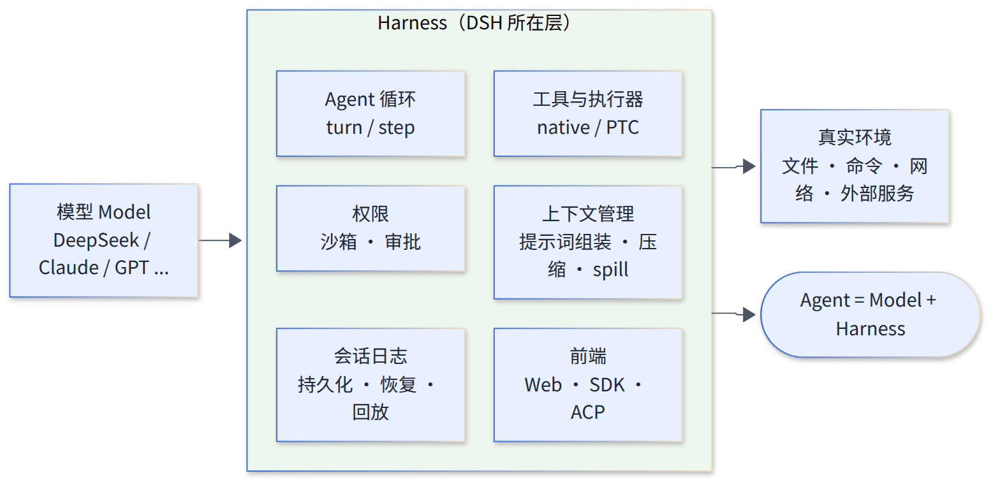

*图 1-1 Harness 在 Agent 中的位置：模型之外的循环、工具、上下文、会话、权限都属于 Harness*

### 1.2 材料来源与证据分级

#### 1.2.1 一手材料

本报告的主要证据来自仓库本身：根目录 README、SAFETY 与 BENCHMARK 文档，`docs/` 下的架构、能力接缝、事件映射、工具流水线、持久化目录、配置目录、术语表、测试与开发指南，`docs/subsystems/` 下约 70 份子系统文档，`docs/cookbook/` 下的开发手册，`docs/postmortem/` 下的四份事故复盘，`docs/upgrade-guide/` 下的 91 篇升级指南，以及 `packages/` 中核心包的源码（`core/agent`、`core/agent-loop`、`core/tools`、`core/system-prompt`、`core/session`、`boot/app-boot`、`bundle/*`、`preset/*`、`sandbox/*`、`llm/*`、`subagent/*` 等）。凡给出具体默认值或行为的地方，均对应该提交下的源码或文档。仓库同时提供中英双语文档，本报告优先引用中文版本。

#### 1.2.2 二手材料与对比材料

二手材料包括 DeepSeek 官网的 Harness 页面、GitHub 发布说明、Cordis 论文（arXiv:2608.25512）的摘要页，以及机器之心、量子位、DataCamp、DeepInfra、ContextOS、Wavect、Atlas Cloud、eesel、redreamality 等媒体与评测。[[3]](#ref-3)对比对象的描述依据 Anthropic、OpenAI、OpenCode、Pi、Nous Research 的官方文档与仓库 README。发布时间线、GitHub 星数等数据来自第三方统计，各来源之间存在冲突，本报告只引用互相一致的部分。

#### 1.2.3 证据口径

报告遵循三条规则。其一，关于“DSH 怎么做”的结论只引用源码与仓库文档；文档与源码不一致时以源码为准，并明确指出差异。其二，关于“DSH 的反响与表现”的结论引用第三方材料，并注明来源性质。其三，关于其他 Harness 的比较只比较文档写明的机制，不推测未公开的内部实现。

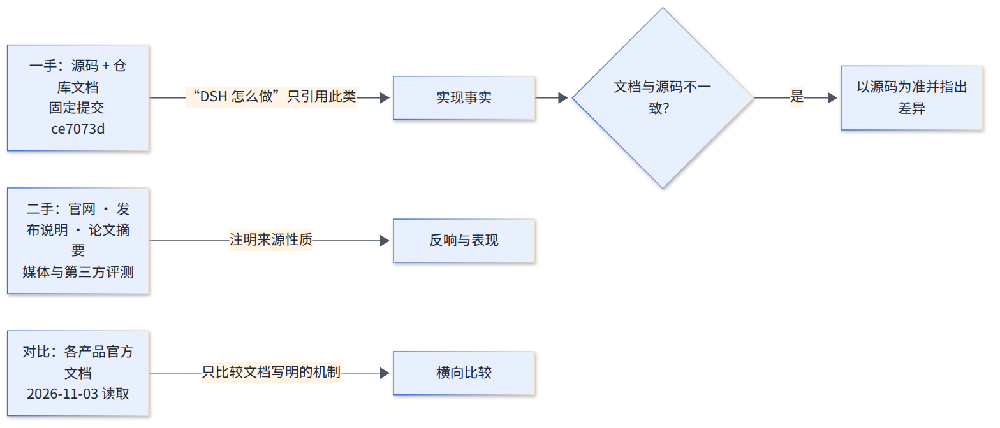

*图 1-2 证据来源与使用规则*

### 1.3 总体结论

#### 1.3.1 一句话定位

DSH 是一个**以 Cordis 为内核、以会话日志为唯一事实来源、以 profile/bundle/preset 为组合方式**的开源智能体运行时；它在 Harness 层与 Claude Code、Codex 同级，但把“可替换性”推到了极致——连 Agent 循环都只是配置树中的一行。它目前处于开发者预览阶段，所有发布均标记为 pre-release。

#### 1.3.2 五个核心结论

第一，**“一切皆插件”基本属实，但有清晰的边界**。Agent 循环、模型适配器、工具注册表、会话持久化、沙箱、审批都是可替换的 Cordis 插件，能力图列出 108 个上下文服务；不可替换的是 Cordis 框架本身和 `dsh` 启动器注入的少量启动事实。这一设计的代价是 372 个包、约 55.6 万行非测试 TypeScript 的体量和较高的学习门槛。

第二，**会话日志是 DSH 最有价值的设计**。“模型可见即已记录”是一条硬规则：每次模型请求都能从日志精确重建，失败尝试、重试、压缩、审批都有持久证据；崩溃后由读方在写所有权下追加合成收尾事件，为中断的工具调用标注“结果未知、不要盲目重试”；格式版本化，旧代际永不改写。这套机制在同类开源项目中最为严格。

第三，**工具流水线与 PTC 体现了“策略外置”的工程取向**。所有策略（审批、超时、spill、hooks）都挂在 waterfall 上，pre-execute 不允许改写参数，守卫只能收紧；PTC 让模型写程序调用工具，但每个子调用都重新走完整流水线，不绕过任何策略。

第四，**安全模型“只管写入”，默认值偏向开发便利**。沙箱跨 Linux、macOS、Windows、SSH 四类后端且失败即拒绝，但不限制读取、网络与进程可见性；凭据明文存放、同 UID 可读；插件、MCP、LSP 以宿主权限运行；会话日志默认随模型请求上传至 DeepSeek。官方 SAFETY 文档明确表示未经安全审计、不宜用于生产。

第五，**DSH 是“为 DeepSeek 模型优化、对其他模型开放”的运行时**。默认走 DeepSeek 的 Anthropic Messages 兼容协议，系统提示词的段序、`in-history` 提示词更新、`tool-addition` 增量工具激活、fork 省略模型参数等设计都服务于前缀缓存；同时经 `llm-pi-ai` 支持 42 个 provider，并能把 Claude Code、Codex 当作子代理调用。仓库中没有公布任何能力评测分数。

#### 1.3.3 发布与演进时间线

DSH 的演进速度本身就是理解它的重要背景。根据 GitHub 发布说明与媒体报道，关键节点如下：2026-08-13 仓库公开，以 v0.1 开发者预览版发布（同日审计的版本号为 0.1.0-rc.5）；08-19 Claude Code 与 Codex 子代理可作为组合包安装；08-21 修复 bubblewrap 经 `/proc/<pid>/root` 的沙箱逃逸，图片改走 Files API；08-25 Code Mode 更名为 PTC；08-31 移除可选的 SQLite 持久化后端；09-08 前后会话格式升级到 V3，并调整系统提示词以保住 KV cache；09-10 DeepSeek-V4.1-Flash 成为新会话默认模型；09-22 会话日志升级到 V4，工具输出改按 token 预算截断；09-23 新增 Web 终端、MCP resources、SSH 远程工作区，DeepSeek 适配器改为只走 Messages API；10-03 引入实验性的 Claude Code Mods 兼容层；10-17 插件热重载与自定义插件索引上线；10-28 发布 0.2.2-alpha.2，插件管理器支持第三方包更新与回滚，Node 最低版本提高到 24.9。两个半月里，会话格式升了两个大版本、持久化后端删掉一个、模型协议换了一次，这既说明团队敢于在预览期做破坏性调整，也提醒使用者必须固定版本。

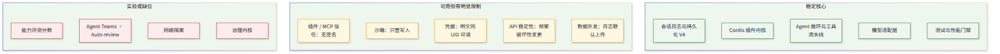

*图 1-3 DSH 总览：各组成部分及其成熟度（绿色为稳定核心，黄色为可用但有明显限制，红色为实验或缺位）*

### 1.4 与 DeepSeek Super-agent 的区别

#### 1.4.1 不在同一层

DeepSeek Super-agent 与 DSH 经常被混为一谈，原因是 Super-agent 的设计文章由“DeepSeek Harness 官方团队”于 2026-10-31 发表在 DSH 公众号上，媒体常把它报道为“DSH 的新功能”或“DeepSeek 的新 Agent 产品”。实际上两者处于不同层次：**DSH 是运行时底座，回答“一个 Agent 内部如何组合”；Super-agent 是搭在其上的编排架构与研究原型，回答“多个任务如何在尽量少占用人类注意力的前提下并行推进”**。用参考章节的类比，DSH 大致对应 Anthropic Agent SDK 或 Claude Code 运行时这一层，Super-agent bundle 大致对应构建其上的业务编排层。[[4]](#ref-4)[[5]](#ref-5)[[6]](#ref-6)

| 维度 | DeepSeek Harness（DSH） | DeepSeek Super-agent |
| --- | --- | --- |
| 性质 | 开源 Agent 运行时，开发者预览（2026-08-13 起） | 架构设计 + 研究原型，README 声明“not an official DeepSeek product” |
| 仓库 | `deepseek-ai/deepseek-harness` | `deepseek-ai/dsh-superagent-prototype` |
| 基本单位 | Session → Turn → Step | Trigger → Thread → Eval → Ticket → Assignment |
| 触发方式 | 人主动发起（Web / CLI / SDK / ACP） | 环境事件驱动（GitHub / 飞书轮询）+ 授权判断 |
| 授权重心 | 动作级（沙箱、审批、工具守卫） | 请求级（谁能发起工作、Mandate 能做到哪一步） |
| 持久化 | 版本化 JSONL 会话日志 | 自有 SQLite（Effects、Outbox） |
| 依赖关系 | 被依赖方 | 以 DSH bundle 形式加载，`package.json` 声明 `dsh.bundle`、`engines.dsh` 与 DSH peerDependencies |

#### 1.4.2 两者的接口

Super-agent 原型用到的 DSH 能力包括 bundle 打包机制、Agent preset（Router 与 Worker 两个预设）、Agent Session 与工具运行、jobs 后台化；而 Source、Trigger、Mandate、Ticket 等核心概念全部由 bundle 自建（详见第 8.5 节）。由此带来一个比较口径上的提醒：参考章节第 8 章拿 Super-agent 与 Codex、Claude Code、Hermes 比较，属于跨层比较；与这些产品同层的是 DSH，本报告第 10 章即在 Harness 层进行比较。

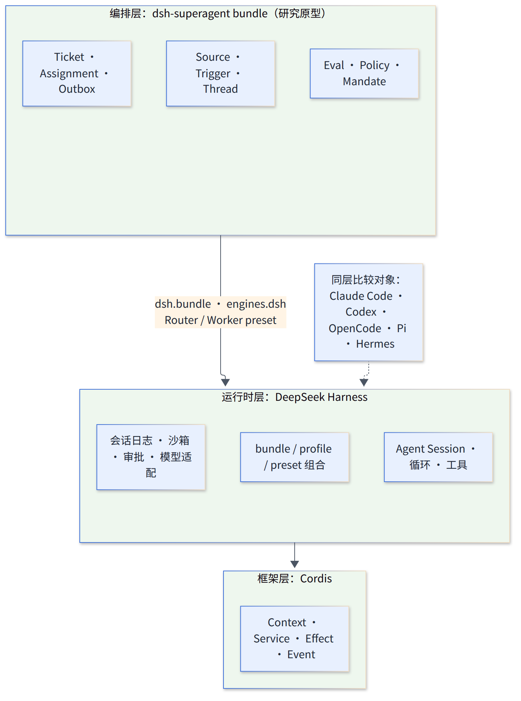

*图 1-4 DSH 与 Super-agent 的层次关系：Super-agent bundle 运行在 DSH 宿主中*

### 1.5 术语对照

#### 1.5.1 Cordis 术语与 DSH 术语

DSH 的文档同时使用 Cordis 框架术语和自己的产品术语，初读容易混淆。下表给出对照。

| Cordis 术语 | DSH 用语 | 说明 |
| --- | --- | --- |
| Context（`ctx`） | 上下文；`agent.ctx` 为 Agent 作用域上下文 | Agent 作用域上的注册同时有可见性与生命周期 |
| Service | 服务；按角色分 core / seam / service / bundle | 能力图共 108 个 |
| Plugin | 插件；配置项（一行 YAML） | `id` 是 Loader 的编辑地址 |
| Fiber | 已加载的插件实例 | 状态机 PENDING → LOADING → ACTIVE → UNLOADING → DISPOSED |
| `ctx.effect` / disposer | “注册即副作用” | 卸载时逆序撤销 |
| `inject` | 服务依赖 | 依赖未就绪时停在 PENDING |
| `isolate` / label | isolate realm | preset 的服务必须放在独立 realm |
| Loader + `cordis.yml` | profile 空根 + patch 层 | 每次启动重写空根 |
| Include `patches` | bundle patch / 用户 patch / `--patch` overlay | 同一语法 |
| Group（`cordis:group`） | preset 内承载 isolate 的分组 | — |

#### 1.5.2 几个容易误解的词

**seam** 指包含定义、提供方、消费方三种角色的完整能力，单一角色不叫 seam。**scope 与 isolate**：前者管注册项对谁可见，后者管服务名背后是哪个实例。**profile、bundle、preset**：profile 是进程级的具名组装，bundle 是可安装的 patch 层，preset 是会话级的子插件列表。**turn、step、round**：步骤是一次模型请求加其工具，轮次包含零或多个步骤，Round 是更外层的策略迭代（如 Goal Round）。**`cordis`** 一词有三义：框架本身、Creator 模式的 preset id、运行时检查工具包。**web** 一词也有两义：Web UI，以及 `ctx.web` 网页搜索与抓取能力。

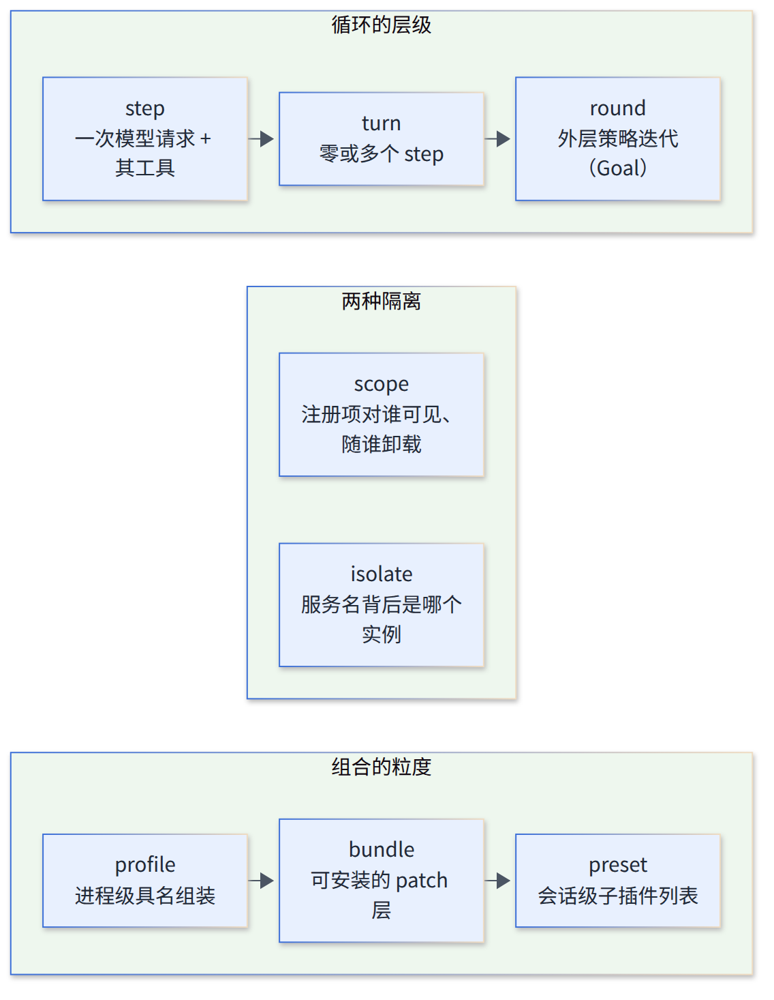

*图 1-5 容易混淆的三组概念：profile/bundle/preset、scope/isolate、turn/step/round*

## 2 架构组成

### 2.1 设计目标与约束

#### 2.1.1 四条贯穿全仓的原则

阅读架构文档、仓库约定和各子系统 README，可以归纳出四条贯穿全仓的设计原则，它们既是目标，也是对后续所有改动的约束。

第一，**没有特权内核**。“产品的每一部分都是插件，包括模型适配器、工具注册表、会话日志，以及 agent loop 本身，因此每个都可以从配置替换。”Agent 循环在 `dsh-base` 的配置里只是一行 `- id: agent-loop`，能力图把 `ctx.agentLoop` 标为“唯一的具体循环插件”，其他扩展包依赖 `dsh-agent` 的事件和服务，而不依赖循环本身。仓库规则写明：新行为挂到已有的扩展点上，改动循环必须同步更新架构文档。[[7]](#ref-7)

第二，**注册即副作用**。所有贡献都经 `ctx.effect()` 或 `ctx.on()` 安装，卸载时自动撤销。这让热重载、插件管理和 Agent 级作用域成为免费能力，而不是需要专门处理的特殊路径。

第三，**模型可见即已记录**（Model-visible ⟺ logged）。任何到达模型请求的内容都必须能从会话日志重建；新增一种模型可见输入，就必须新增一种会话事件。这条规则把可审计性、可回放性和崩溃恢复统一到同一份日志上。

第四，**显式优于隐式、配置失败要响亮**。包边界上的默认值必须是显式的 `resolve(request): Spec` 步骤；部署相关的取值必须是可校验的 `Config` 字段，不能写成插件内的硬编码常量；配置错误要在加载时或最早可判定的时刻失败，绝不静默跳过。

#### 2.1.2 原则带来的工程代价

这些原则的代价同样明显。“一切皆插件”带来 372 个包、108 个上下文服务和 163 个可配置包；“模型可见即已记录”要求 62 种会话事件都有类型、有迁移、有兼容性审查；“配置失败要响亮”意味着一个空的用户 patch 文件就会导致启动失败。仓库用极高的工程纪律来对冲这些复杂度：按文件 100% 的覆盖率门禁、录制会话快照回放、PR 级性能预算、生成式文档与漂移检查。对使用者而言，这是一个“可以改任何东西，但需要先读懂很多东西”的系统。

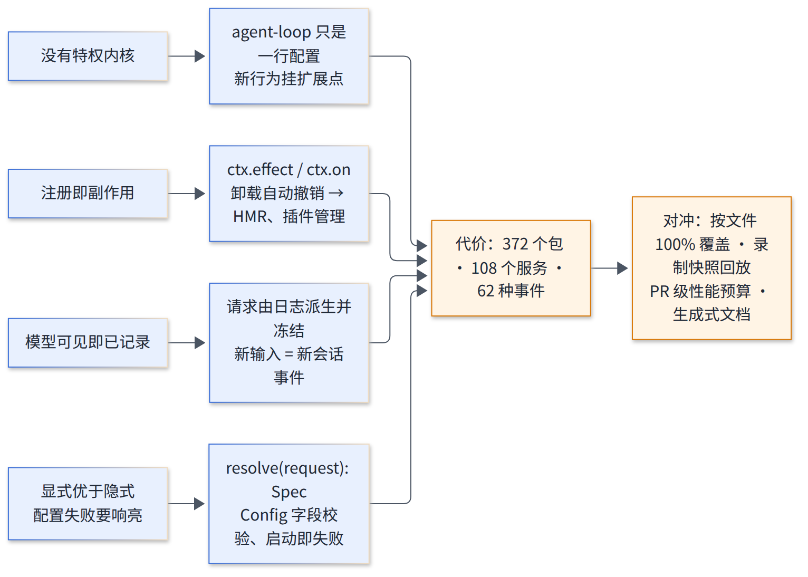

*图 2-1 DSH 的四条设计原则及其落地机制*

### 2.2 Cordis 内核：上下文、服务、事件与可逆副作用

#### 2.2.1 Cordis 是什么

Cordis 是 DSH 之前就存在的开源插件框架（Koishi 生态的底层），DSH 以源码形式把它 vendored 在 `vendor/` 下，并改名发布到 `@deepseek-ai` 作用域，包括框架核心 `cordis`、配置 schema 库 `schemastery`、配置装载器 `plugin-loader`、配置包含与 patch 叠加 `plugin-include`、分组 `plugin-group`、热重载 `plugin-hmr` 等。改名的理由是：harness 包把框架声明为 peer dependency，用上游名发布等于占用别人在 registry 上的名字。仓库 README 将设计渊源指向论文 *A Programming Paradigm for Spatiotemporal Composability*。[[8]](#ref-8)[[9]](#ref-9)

#### 2.2.2 五种事件分发模式

Cordis 的事件是 DSH 最重要的扩展机制。事件名通过 TypeScript 声明合并注册，分发模式有五种：`emit`（同步广播，不收集返回值）、`parallel`（并发运行并一同等待）、`serial`（按序运行，第一个非空返回值胜出）、`bail`（serial 的同步版本）和 `waterfall`（环绕式中间件，监听器收到 `next`，不调用 `next()` 即短路）。分发模式是公开约定的一部分，每个新事件都要用 `@mode` JSDoc 标签声明，生成目录会交叉校验。DSH 把事件分成三个域：**会话事件**是追加到日志、经 `session/event` 广播的持久事实；**Agent 事件**（`agent/*`）用于观察或拦截进行中的工作；**能力事件**（`fs/*`、`tools/*`、`telemetry/*`）向某个能力附加策略和适配器，而不需要导入循环。

| 模式 | 是否等待 | 语义 | DSH 中的典型事件 |
| --- | --- | --- | --- |
| emit | 否 | 广播通知，监听器异常逐个隔离 | `agent/status`、`agent/assistant-stream` |
| serial | 是 | 按序执行，可失败、可中断后续 | `agent/created`、`agent/turn-stopping` |
| waterfall | 是 | 环绕中间件，必须调用 `next()` | `agent/pre-step`、`llm/stream`、`tools/pre-execute` |
| parallel | 是 | 并发执行并等待全部 | 部分初始化与收尾事件 |
| bail | 否 | 同步版 serial | 少量同步决策点 |

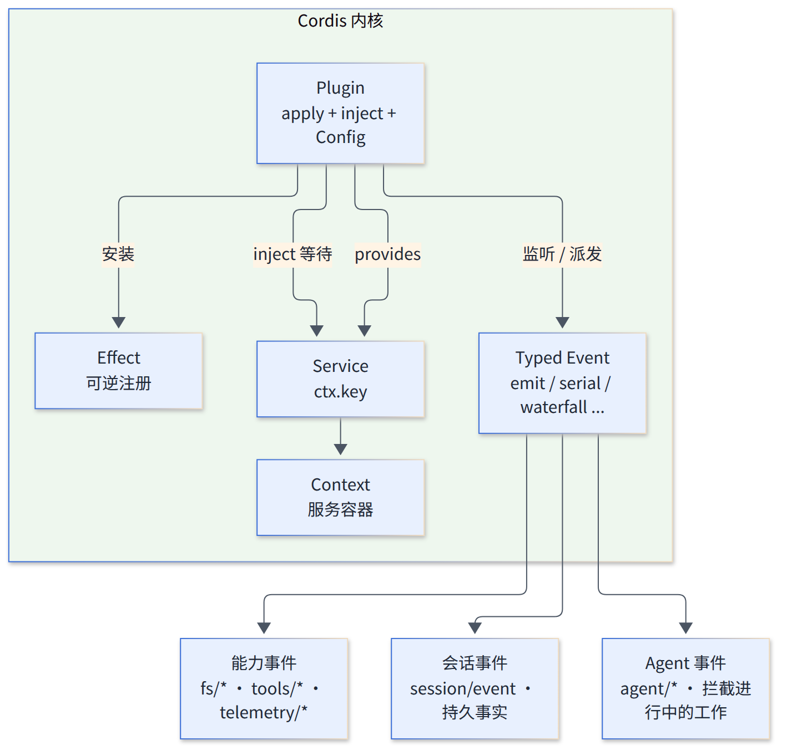

*图 2-2 Cordis 内核的五个概念及 DSH 的三个事件域*

### 2.3 分层：核心包、dsh-base 与前端组合包

#### 2.3.1 七个核心包

架构文档列出七个核心包，它们构成 Agent 运行的主干：`core/session`（仅追加的 SessionEvent 日志与内存存储，`ctx.sessions`）、`core/system-prompt`（提示词片段与工具 schema 组装，`ctx.systemPrompt`）、`core/tools`（作用域化的工具注册表与带把关的执行流水线，`ctx.tools`）、`core/agent`（Agent 接口、活跃 Agent 注册表与 `agent/*` 事件，`ctx.agents`）、`core/agent-loop`（默认驱动器，`ctx.agentLoop`）、`core/scope`（按 Agent 划分作用域的注册原语）和 `llm/llm`（消息与流式词汇表及适配器接缝，`ctx.llm`）。

#### 2.3.2 三层结构

在核心包之上，可以把运行中的 DSH 看成三层。最底层是 **vendored Cordis** 与零依赖工具库；中间层是 **dsh-base**，即模型适配器、工具、持久化、沙箱与审批策略、设置、凭据和遥测，被 web、headless、sdk、acp 四个 profile 共享；最上层是**前端组合包**：`dsh-web-app` 增加浏览器应用，`dsh-headless` 增加不带服务器的一次性运行器，`dsh-sdk-app` 增加 SDK JSON-RPC 服务器，`dsh-acp-app` 增加仅用于自动化的 ACP 服务器。`dsh-sdk-minimal` 是刻意保留的例外，它拥有完整的显式配置树，不应用 `dsh-base`。Web 组合包还做了一次“平面切分”：它禁用 base 中每个 Agent 自己的工具行，把 Agent 平面移到 preset 后面，让每个会话挂载自己的 preset，而共享注册表留在宿主平面。

仓库按功能把 372 个包分为 52 个分组，最大的是 `client`（69 个）、`experimental`（65 个）、`session`（22 个）和 `util`（21 个）。实验包与非实验包的界线是明确的：非实验包必须有产品用途或显式分类。

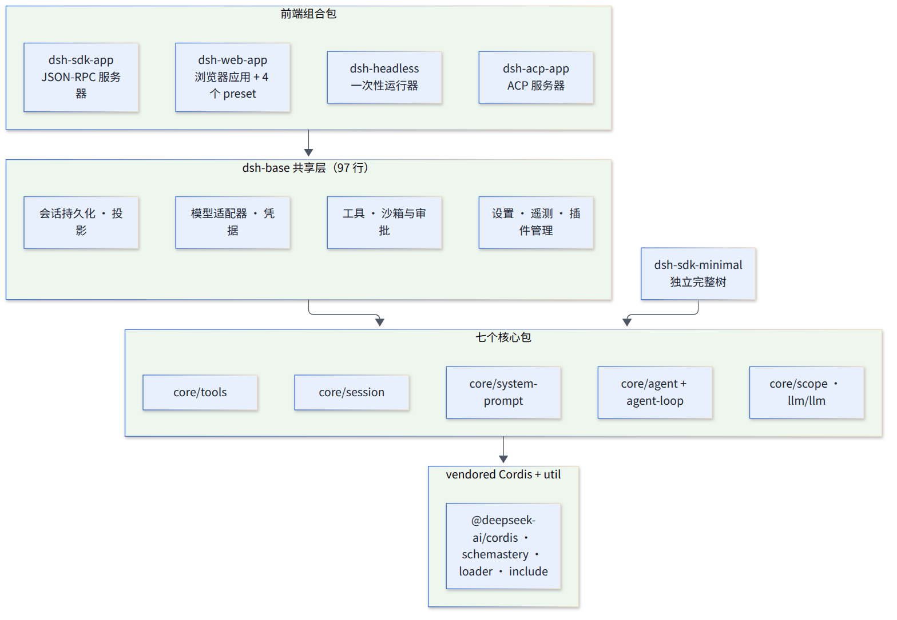

*图 2-3 DSH 的三层结构：vendored Cordis、dsh-base 共享层与前端组合包*

### 2.4 能力接缝（Capability Seam）

#### 2.4.1 三角色定义

“seam”是 DSH 文档里出现频率最高的词之一。它的定义是：一项可替换的能力，包含三种角色——声明接口的 **Service Definition**（一个拥有自己 `ctx.<key>` 的 Cordis Service，而不是 TypeScript interface）、实现它的 **Service Provider**，以及使用它的 **Consumer**（通常是面向模型的工具）。单一角色不构成 seam，添加一项能力意味着三者一并设计。规范范例是 shell：`dsh-shell` 是定义，`dsh-bash-local` 和 `dsh-bash-sandbox` 是提供方，`dsh-tool-bash` 是消费方。[[10]](#ref-10)

#### 2.4.2 为什么 seam 重要

seam 让“替换一个提供方就改变整个产品”成为可能。最典型的例子是执行世界：文件系统与进程提供方共享同一个执行世界，把 `ctx.fs` 和 `ctx.subprocess` 指向 SSH 远端，Bash、PTY 终端和 LSP 语言服务器就一并搬了过去，无需任何提供方专用的 fork。同样，`ctx.subagents` 背后的提供方从“新建一个进程内子 Agent”到“把一个轮次委派给 Codex 或 Claude Code”千差万别，消费方的 `subagent` 工具却不必知道。能力图共列出 108 个上下文服务，按角色分为 core 60 个、seam 36 个、service 10 个、bundle 1 个（agentLoop）。

| ctx 键 | 提供方示例 | 消费方示例 |
| --- | --- | --- |
| `ctx.llm` | `llm-deepseek`、`llm-pi-ai`、`llm-replay` | agent-loop、compaction |
| `ctx.shell` | `bash-local`、`bash-sandbox`、`pwsh-local` | `tool-bash`、`tool-pwsh` |
| `ctx.subprocess` | `subprocess-local`、`subprocess-ssh` | bash、terminal、lsp |
| `ctx.sandbox` | `sandbox-local`、`sandbox-ssh` | `bash-sandbox`、`terminal-bash` |
| `ctx.fs` | `fs-local`、`fs-sandbox`、`fs-ssh` | `tool-fs` |
| `ctx.subagents` | spawn、fork、acp、codex、claude-code、dsh-sdk | `tool-subagent`、workflow |
| `ctx.ptcRuntime` | `ptc-runtime-node` | `tool-executor-ptc`、`workflow-ptc` |
| `ctx.sessionPersistence` | `session-persistence-jsonl` | agent-loop、session-query |

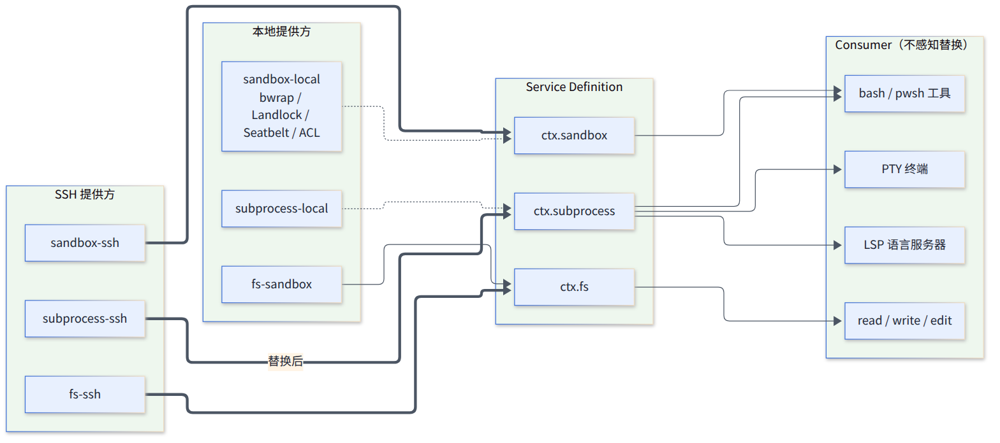

*图 2-4 能力接缝：替换 subprocess 与 fs 提供方，Bash、PTY、LSP 随执行世界一起迁移*

### 2.5 模型适配层

#### 2.5.1 协议：默认走 Anthropic Messages 兼容接口

一个与多数二手资料不同的事实是：DSH 的 DeepSeek 适配器默认使用 DeepSeek 的 **Messages 协议**（Anthropic 兼容），默认 `baseURL` 为 `https://api.deepseek.com/anthropic`，推理强度序列化为 `thinking` 与 `output_config.effort`，缓存用量字段映射自 `cache_read_input_tokens` 与 `cache_creation_input_tokens`。网上不少文章称它“说 OpenAI 协议”，这只对经 `llm-pi-ai` 接入的自定义网关成立：该适配器的自定义网关可在 `openai-completions`、`openai-responses`、`anthropic-messages` 三种协议中选择。[[11]](#ref-11)

#### 2.5.2 适配器约定与多提供方

`llm` 包定义了严格的适配器约定：内容块类型有 text、reasoning、image、file、tool-call、tool-addition、tool-removal；工具参数始终是原始 JSON 字符串；**一次适配器调用等于一次提供方尝试**，库内重试必须关闭，重试统一交给 `llm-retry`；上下文溢出统一报告为 `CONTEXT_WINDOW_EXCEEDED`；流空闲超时默认 5 分钟。DeepSeek 路由分为两种：`deepseek-official`（API key，放在 `x-api-key` 头）与 `deepseek-account`（账号 token，负责 401 失效与账号模型门控）。多提供方由 `llm-pi-ai` 承担，基于开源库 `pi-ai`，内置 42 个 provider 目录，涵盖 Anthropic、OpenAI、Google、Bedrock、Azure、OpenRouter、Moonshot、智谱、MiniMax、通义、小米等。

#### 2.5.3 为前缀缓存而设计的协议细节

模型能力声明中有两个很能体现 DeepSeek 关注点的字段：`systemPromptUpdate: 'in-history'` 让中途变化的系统提示词以历史中最新的 system 消息出现，而不是改写第 0 条消息；`toolUpdate: 'addition-only' | 'in-history'` 让新增工具通过后续 developer 消息中的 `tool-addition` 块激活。两者的目的都是“沿着已缓存的历史前进”，最大化前缀缓存命中率。默认模型 `deepseek-flash` 同时声明了这两项能力。关于默认模型名，源码中存在两套字符串：base 组合包和内置目录使用 `deepseek-flash`（显示名 DeepSeek-V4.1-Flash），TypeScript SDK、Python SDK、ACP 组合包和 dsh-sdk 子代理默认使用 `deepseek-v4-flash`；未列入目录的 id 会原样透传，因此两者可能是新旧别名并存。部分媒体所称的 `deepseek-v4-pro-0813` 在本次阅读的提交中未出现。

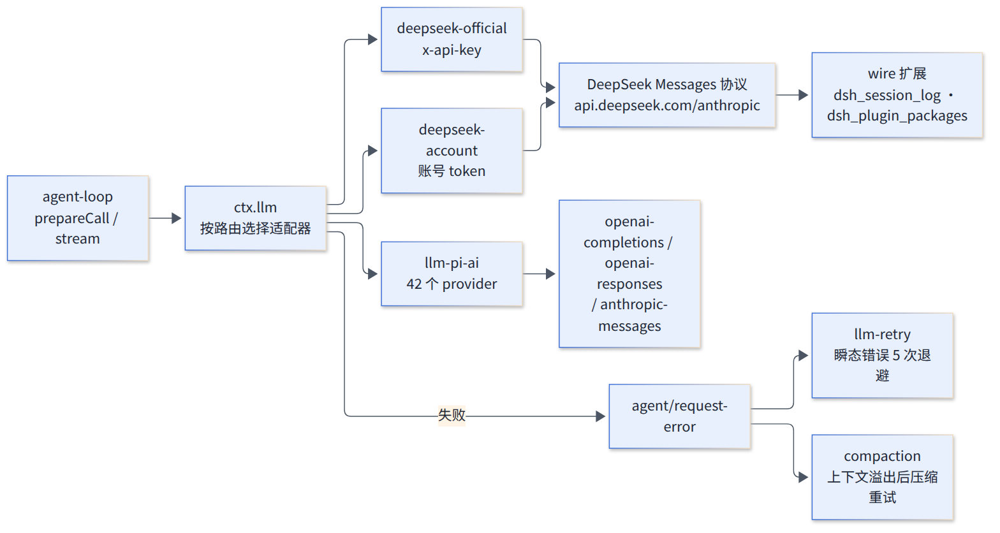

*图 2-5 模型适配层：路由、适配器约定与重试/压缩的分工*

### 2.6 工具注册表与执行器

#### 2.6.1 作用域化注册

`ctx.tools.register(definition, { when? })` 可以在全局或 Agent 作用域注册工具，作用域工具遮蔽同名全局工具，同层重名报错，`run_code` 这个名字保留给 PTC 传输。每个工具必须声明 `output { schema, render }`：`execute` 返回规范 JSON 值，`render` 再把它转换为模型可见内容，这样同一个结果既能给模型看，也能给 PTC 程序当作结构化值使用。`when` 条件在每个拟议步骤解析一次，产生该步骤的 `ResolvedToolSet`，决定工具声明、执行器分区和批次内每次调用的准入。`ctx.tools.restrict({ allow, deny })` 只能用于作用域上下文，多个限制取交集。

#### 2.6.2 执行器决定呈现方式

工具如何呈现给模型，由挂载的**执行器**决定，而不是一个配置开关。原生执行器 `tool-executor-native` 把每个可见工具的 `name`、`description`、`parameters` 投影为 schema；PTC 执行器 `tool-executor-ptc` 只返回一个 `run_code` schema，再通过提示词段把其余工具以生成的 TypeScript 或 Python SDK 形式呈现。早期版本的 `dsh-tools` 有一个 `mode: native | ptc` 配置，后来被移除并改为“挂载哪个执行器就是哪种模式”，混合呈现也一并删除。这是“插件优先于开关”原则的一个具体例子。

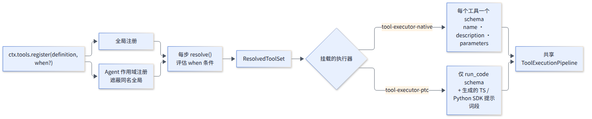

*图 2-6 工具注册表：作用域遮蔽、每步准入与执行器决定的两种呈现方式*

### 2.7 会话日志与投影

#### 2.7.1 日志是唯一事实来源

会话日志是模型所见上下文的来源，`deriveMessages()` 从中投影出模型历史。每个 `assistant/message` 都嵌入产生它的精确紧凑流（带时间戳），失败、重试、取消和流错误的尝试则以 `assistant/attempt` 保存而不进入模型历史。fork、恢复、transcript、遥测与持久化都从这些持久结算派生；实时 UI 增量来自进程本地的 `agent/assistant-stream`，如果进程在结算前被硬中断，不会留下持久的尝试流。

#### 2.7.2 投影接缝

`dsh-session-projection` 提供 `ctx.sessionProjections`：注册表只订阅一次 `session/event`，把每个已提交事件折叠进每个注册单元，客户端通过 `snapshot()` 读取选定的视图。文档的表述是：领域不持有任何订阅，客户端也从不折叠领域事件，它们收到的是成品值。投影定义包括 `init`、纯同步的 `apply`（与事件无关时须返回同一引用，用 `Object.is` 判定零下游工作）、可选的 wire 视图和用于缓存失效的 `stateVersion`。投影缓存插件按 200 个事件或 5 秒写一次检查点，日志始终权威，“崩溃可能使检查点陈旧，但不会使其领先于已提交事件”。

#### 2.7.3 消息投影与 transcript

模型所见与人所见是两条不同的投影。插件若需要改变模型看到的消息内容（例如图片省略插件把旧图片替换为占位符），必须用 `@messageProjection` 标记并通过 `ctx.sessions.registerMessageProjection()` 注册纯函数处理器；缺少处理器时，包括恢复在内的操作都会被拒绝，以免同一份日志在不同进程中派生出不同的模型历史。面向人类的 transcript 则读取“追加来源”事件，因为 surface 会有意遮蔽被压缩摘要替代的区间——用户在界面上仍能看到被压缩前的完整对话，而模型只看到摘要。会话引用（`@[label](dsh-session:…)`）把另一个会话的片段作为不可信快照注入，并记录被引用会话的格式版本与截止序号，保证引用同样可复现。

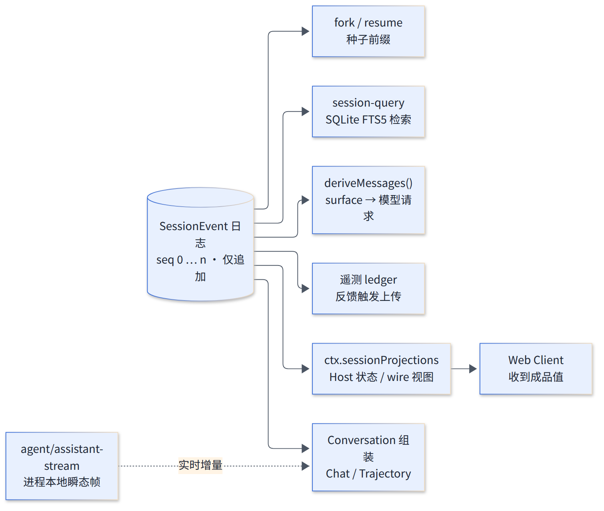

*图 2-7 会话日志与派生视图：模型历史、UI 投影、transcript、检索与遥测都从同一份日志计算*

### 2.8 前端形态与集成接口

#### 2.8.1 一个启动器，多种 profile

`dsh` 是唯一受支持的 Node 应用启动器，Web、Headless、SDK、ACP 都只是 profile。仓库用 `verify-application-entrypoints` 脚本把每个包 bin、可执行源码和根脚本归入显式类别，拒绝任何绕过 `dsh` 的应用路径。五种入口的差异如下表。

| 入口 | 传输 | 适用场景 | 要点 |
| --- | --- | --- | --- |
| Web | HTTP `/api` + WebSocket | 人机交互 | 默认 `127.0.0.1:3080`，浏览器端本身也是一个 Cordis 插件应用 |
| Desktop | Electron `dsh-app://` + 转发到本地 Host | 桌面用户 | 私有 Desktop Host 运行共享 profile runner，系统分配端口 |
| Headless | 命令行参数 / `--json` 行事件 | CI、脚本 | 不开端口，一次一个任务，退出码区分结果 |
| SDK（TS / Python） | 换行分帧 JSON-RPC 2.0 over stdio | 程序集成、评测 | 支持反向 `approval/request`，Python 自带原生运行时 |
| ACP | Agent Client Protocol over stdio | 编辑器与自动化客户端 | 刻意不提供 DSH 专用呈现数据，客户端视为受信控制器 |

#### 2.8.2 Web 的前后端分层

Web 前端采用 “TypeScript 装饰器 → 编译期生成强类型 RPC” 的方案：业务服务用 `@Remote` 装饰方法，构建期生成器以 Host 聚合为唯一 `ts.Program` 种子生成类型与客户端存根，运行时以 `POST /api/<namespace>/<method>` 调用，非 owner 调用者要先经 `ctx.remoteAccess.decide()`。客户端分为 Host 应用、传输与 API 组装、Client model、UI adapter、Conversation 数据和 Slots/React 渲染六层，依赖方向单向，展示组件绝不接收 Cordis `ctx`。Host 把启动图写入 `window.__DSH_BOOT__`，浏览器端用 vendored Cordis Loader 激活客户端插件，因此 **Web UI 本身也是插件化的**。[[12]](#ref-12)

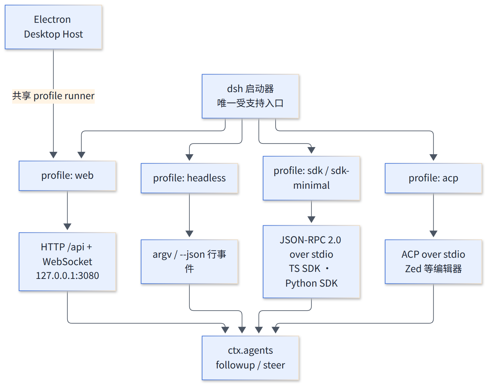

*图 2-8 一个启动器、五种入口：各前端共享 dsh-base，差异只在顶层组合包与传输*

## 3 核心对象与领域模型

### 3.1 概念总览与数据流

#### 3.1.1 从配置行到一次模型请求

DSH 的对象可以按“谁决定谁”串成一条链。启动时，**Profile** 列出若干 **Bundle**，Bundle 携带 `cordis.patch.yml`，各层 patch 叠加出一棵 Cordis 配置树；树上每一行是一个**插件**，插件向上下文贡献**服务**（`ctx.<key>`）、**事件监听器**和**注册项**。运行时，`ctx.agents` 通过 `ctx.agentLoop` 注册的工厂创建 **Agent**；每个 Agent 与一个 **Session** 一一对应，Agent 的 `ctx` 是一个按 Agent 划分的作用域（scope），会话级的工具、提示词段和监听器都挂在这里。Agent 收到输入后开启**轮次（Turn）**，轮次由若干**步骤**（Step）组成，每一步是一次模型请求加上它调用的工具；所有事实都以 **SessionEvent** 的形式追加到会话日志，模型请求、UI 视图、遥测、检索都从日志派生。

这条链有两个刻意的“断点”。其一，配置树和 Agent 之间隔着 **Agent Preset**：同一个进程里的两个会话可以挂载不同的能力集合，preset 中的服务必须放在独立的 `isolate` realm 内，避免泄漏到宿主平面。其二，日志和模型之间隔着**投影**：模型看到的历史是 `deriveMessages()` 计算出来的“surface”，而不是日志本身，压缩、图片省略等插件通过注册纯函数式的消息投影来改变模型所见，而不改写已提交事件。

#### 3.1.2 为什么对象这么多

与参考章节里 Super-agent 刻意保持“概念很少”不同，DSH 的概念数量明显更多：仓库生成的能力图列出 108 个 `ctx` 服务行，配置目录覆盖 163 个包，持久化目录列出 62 种会话事件。这是“一切皆插件”的直接代价——每一个可替换点都需要一个有名字的服务、一个有类型的事件或一个有 schema 的配置项。好在这些概念大多是同一组原语（服务、事件、副作用、作用域）的实例，掌握原语后，读任意一个子系统的成本是线性的。[[1]](#ref-1)[[13]](#ref-13)

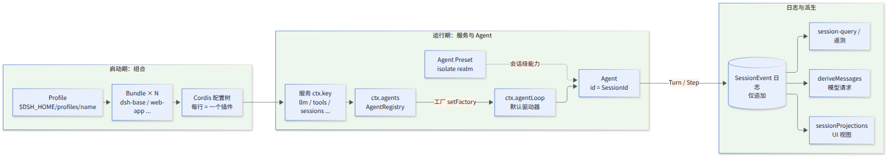

*图 3-1 DSH 核心对象的数据流：从配置行到模型请求，日志是所有派生视图的唯一来源*

### 3.2 插件、服务、副作用与作用域

#### 3.2.1 四个原语

Cordis 入门文档把框架压缩为五条：插件是实现服务的对象；上下文是服务的容器；用 `inject` 声明依赖；用类型化事件通信；注册是可逆的副作用。[[14]](#ref-14)DSH 在此基础上把“注册即副作用”提升为仓库级规则：任何贡献都必须经由 `ctx.effect()` 或 `ctx.on()` 安装，各注册表的 `register()` 必须返回 disposer。这条规则的意义在于**卸载的完备性**：插件卸载时，它安装的工具、提示词段、监听器、适配器会按相反顺序撤销，HMR 和插件管理器因此可以安全地热插拔，而不用担心残留状态。

`inject` 决定了加载顺序。插件在依赖的服务全部就绪前停留在 PENDING 状态，配置文件中的行序没有加载语义；服务消失时依赖它的插件被卸载，服务恢复后重新加载。官方教程举的例子是：卸载 `dsh-bash-local`、挂载另一个 `shell` 提供方，所有注入 `shell` 的插件都会自动重启并使用新实现。插件实例在 Cordis 中称为 Fiber，状态机为 PENDING → LOADING → ACTIVE → UNLOADING → DISPOSED，LOADING 可转入 FAILED（apply 抛错或配置校验失败）。

#### 3.2.2 scope 与 isolate 的区别

DSH 有两种“隔离”，经常被混用。**scope**（`dsh-scope`）控制注册项的可见性和生命周期：在 `agent.ctx` 上注册的工具只对该 Agent 可见，Agent 销毁时随之卸载，作用域工具会遮蔽同名全局工具，且不向子 Agent 继承。**isolate** 控制服务实例属于哪个 realm：同一个服务名在两个 isolate realm 中可以是两份配置不同的实例。Agent Preset 的挂载审计会检查子树是否向根 realm 泄漏服务，发现即抛出 `Preset services require isolate realms` 错误。一句话概括：scope 管“谁看得见这条注册”，isolate 管“这个名字背后是哪一个实例”。[[15]](#ref-15)

#### 3.2.3 配置 schema 与 volatile 字段

每个插件导出与插件同名的 `Config`，既是 TypeScript 接口也是运行时 schema（仓库统一使用 Schemastery，Cordis 本身接受任意 Standard Schema），在 `apply` 之前校验，校验失败使插件进入 FAILED。标记为 `.volatile()` 的字段变化时**不重挂载**插件，而是通过 `.get()` 读取新值并收到 `loader/volatile-update` 事件；Web 设置页正是从当前 profile 条目中投影这些 volatile 字段生成表单，例如每步并行工具调用上限就可以热更新。`!!js` 表达式只在条目的 `config` 与 `disabled` 中有效：`config` 在声明的注入激活后基于插件上下文插值，`disabled` 在每次挂载决策时基于 Loader 上下文求值，其余元数据保持字面值，按环境选择插件应使用 overlay。第 7.5 节的事故 0002 正是因为早期 `disabled` 中的表达式未被插值而导致文件工具被永久禁用，此后 `verify-cordis-config` 门禁专门检查这类写法。

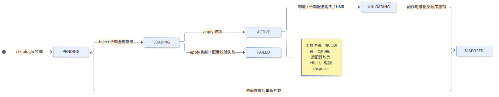

*图 3-2 Cordis Fiber 状态机与“注册即副作用”：卸载时副作用按相反顺序撤销*

### 3.3 Profile、Bundle、Patch 与 Preset

#### 3.3.1 四层组合

**Profile** 是 Harness home 中的具名组装（`$DSH_HOME/profiles/<name>`），其 `package.json` 的 `dsh.profile.bundles` 列出有序的组合包，目录里还放着该 profile 自己安装的树外插件和用户的 `cordis.patch.yml`。**Bundle** 是“Cordis 配置项及其挂载代码的分发格式”，在 `dsh.bundle.patch` 中指向一个或多个 patch 文件。**Patch** 是 YAML 编辑列表：带 `id` 的条目按 id 定位目标行并**整体替换**其顶层键（不做深度合并），带 `insert` 的条目追加新行或插入到某个 group 的子列表。**Preset** 是会话级的子插件列表声明，覆盖内置 preset 时同样整体替换其 `config.plugins`。

层的应用顺序由 `readProfilePatches` 实现：空根 `[]` → 各 bundle 的 patch（按列表顺序）→ profile 的 `cordis.patch.yml` → home 级 `$DSH_HOME/cordis.patch.yml` → 命令行 `--patch` overlay（可重复）→ 若设置了 `DSH_TELEMETRY_DISABLED` 则追加一条禁用遥测行。后应用的层优先。值得注意的是，架构文档只写到 `--patch`，源码多了一层遥测开关，这是文档与实现的细微差异。[[16]](#ref-16)

#### 3.3.2 随附的组合

发行版带五个 profile 模板：`web`（base + web-app）、`headless`（base + headless）、`sdk`（base + sdk-app）、`acp`（base + acp-app）和 `sdk-minimal`（只有 sdk-minimal，自带完整独立的配置树，不经过 base）。`dsh-base` 是共享第一层，共 97 行配置，按功能可分为启动管理、模型、会话持久化、凭据、存储、遥测、Agent 主干、执行与沙箱、工具与工具策略、指令与技能、目标与计划、压缩、子代理与工作流、Web 与 MCP 等十余类。此外还有 15 个可选组合包和 3 个按需组合包（Claude Code 子代理、Codex 子代理、Computer Use）。

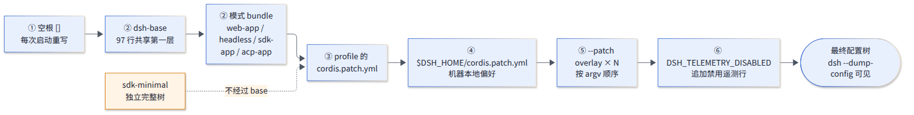

*图 3-3 配置层叠：自下而上依次应用，后应用的层覆盖同 id 的行；sdk-minimal 绕过 base*

### 3.4 Agent、Turn、Step 与 Inbox

#### 3.4.1 “薄身份 + 运行时增强”

`Agent` 的公共接口只有一个字段：`id: SessionId`，Agent 的身份就是 Session 的身份。运行时通过 TypeScript 声明合并为它补上能力：`options`（provider、model、推理强度、最大 token）、`model`（`current()` 解析下一步的模型选择，`select()` 追加持久的 `model/selection` 事件）、`inbox`、`status`（idle 或 running）、`ctx`（Agent 作用域上下文），以及 `cancel`、`whenIdle`、`runMaintenance`、`followup`、`steer`、`inject` 等方法。这种设计让依赖 Agent 的插件只需引用 `dsh-agent` 包的类型和事件，而不必依赖具体的循环实现。[[17]](#ref-17)

#### 3.4.2 三种输入入口

输入统一进入 inbox，inbox 有两条持久列表：`nextTurn` 与 `nextStep`。`followup` 把消息放进 next-turn 并唤醒 Agent，作为一个新轮次的唯一普通消息；`steer` 放进 next-step 并唤醒，运行中的 Agent 会在最近的步骤边界消费它，空闲的 Agent 则开启新轮；`inject` 放进 next-step 但**不唤醒**，用于注入模型可见的上下文，等下一次 pre-step 时一并带入。inbox 的每次变更都写成 `agent/inbox/spliced` 事件，因此即使没有活跃 Agent，也能从日志读出待处理输入。这一设计与 Super-agent 的“订阅直通”有可比之处：后者用 Thread 订阅把后续消息扇出到工单，DSH 则在单会话内用 steer 把后续消息插入到最近的步骤边界。

#### 3.4.3 轮次与步骤的边界

架构文档对两者的定义很精确：一个**步骤**是一次模型请求加上它调用的工具；一个**轮次**包含零个或多个步骤，在领取首条输入之前打开，在不再欠下任何工作时关闭。轮次结束原因是一个可扩展的联合类型：`completed`、`aborted`、`blocked`、`error`、`max-tokens`、`interrupted`、`forked`。其中 `interrupted` 和 `forked` 从不由循环实时发出，前者由崩溃恢复合成，后者由 fork 种子构造合成。

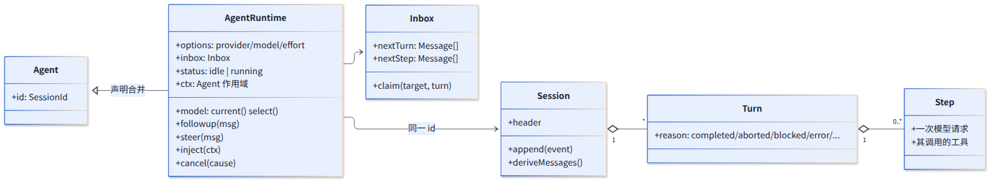

*图 3-4 Agent 的结构：身份即 Session，inbox 的两条列表决定输入在轮次还是步骤边界被消费*

### 3.5 SessionEvent 与持久化格式

#### 3.5.1 事件信封与分类

`SessionEvent` 是以 `type` 为判别字段的可辨识联合，信封包含 `type`、`seq`（单调连续，等于追加前的日志长度）、`time`、`data`，以及可选的 `ignorable: true`。生成的持久化目录列出 62 种事件类型、34 个命名空间组，其中只有 5 种是 **surface 事件**——`system/message`、`developer/message`、`user/message`、`assistant/message`、`tool/result`——会进入模型历史，其余 57 种都是仅日志（log-only）事件，例如 `turn/*`、`step/*`、`request/header`、`request/context`、`assistant/attempt`、`tool/call`、`compaction/*`、`llm/retry`、`approval/*`、`plan/mode`、`goal/change`、`todo/write`。[[18]](#ref-18)

#### 3.5.2 未知事件默认“必需”

一个容易被忽视但很关键的规则是：读者遇到不认识且未标 `ignorable` 的事件类型，必须**拒绝重建**会话，而不是静默丢弃。文档的解释是，忘记标记只会导致过度拒绝，而不会静默恢复一个被掏空的会话。`Session.append` 还会在追加点做无损 JSON 校验，拒绝 BigInt、函数、`undefined`、`-0`、非有限数、循环引用、稀疏数组和 Map/Set/Date，让坏数据在源头失败，而不是在后端 flush 时才暴露。当前写入器格式版本为 `SESSION_FORMAT_VERSION = 4`，最新已发布格式同为 V4。

#### 3.5.3 Header 与日志分离

会话的 `SessionHeader` 与事件日志分开存储，字段包括格式版本、id、创建时间、`cwd`、父会话、是否为种子会话、来源（是否为子代理）、委派深度和所选 Agent preset。这种分离有两个用意。其一，列表与统计操作只需读取 header，不必加载事件，`stat` 与 `list` 会重新扫描每个会话目录、选择数值最高的规范代际，并在不加载事件的情况下转换历史 header。其二，`cwd` 是会话**不可变的**原始项目标识，沙箱的工作区根取自它；用户在会话中切换工作目录时，追加的是 `working-directory/change` 事件，header 保持不变，目录上下文以必需的用户上下文到达模型，而不进入系统提示词。这一细节把“项目身份”“沙箱边界”和“当前工作目录”三件事拆开，避免了模型通过切换目录扩大可写范围。

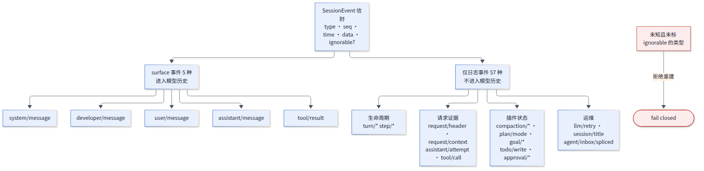

*图 3-5 SessionEvent 的分类：5 种 surface 事件进入模型历史，57 种仅日志事件服务于恢复、审计与 UI*

### 3.6 四种 Agent Preset

#### 3.6.1 同一循环，四种能力组合

Web 应用内置四个 preset，它们共用同一个循环，差别只在挂载的插件。**Standard**（标准模式，默认）挂载完整的编码 Agent 能力：bash、文件读写编辑、glob/grep、后台任务、定时跟进、技能、目标、计划模式、压缩、子代理与 workflow、向用户提问、todo、网页搜索与抓取、交付物呈现。**PTC**（程序化工具调用模式）在 Standard 基础上额外挂载 `dsh-tool-executor-ptc`，模型只看到一个 `run_code` 工具，其余能力以生成的 TypeScript SDK 声明出现在系统提示词中。**Minimal**（极简模式）只保留持久化的 PTY bash 和读图能力，系统提示词用 `complete: true` 固定为一句 “You are a helpful software engineer assistant.”，用于干净的基准测试。**Creator**（创造模式，配置 id 为 `cordis`）在 Standard 能力之上加入 `cordis_inspect_list` / `cordis_inspect_query` 运行时检查工具、Cordis 插件开发与组合编辑技能，以及插件管理和插件市场工具，让 Agent 能检查并重新组合自己的工具集。

#### 3.6.2 两条硬约束

preset 有两条硬约束。第一，**会话产生输出后不能切换 preset**：`select()` 检查轮次边界，已开启过轮次即抛出 `agent-preset/locked`，以免先前的工具调用落在另一套工具集下无法解释。第二，preset 中的服务提供方及其消费方必须共享同一个 `cordis:group` 隔离 realm。preset 的 README 同时提醒，“preset 不是安全沙箱：YAML 及插件可以执行 Host 代码”。

| Preset | 模型可见工具 | 系统提示词 | 典型用途 |
| --- | --- | --- | --- |
| Standard | 约 30 个（bash、read/write/edit、glob/grep、subagent、workflow、web 等） | persona + 工具段 + 运行时上下文 | 日常编码 |
| PTC | 仅 `run_code`，其余以 SDK 声明呈现 | 增加 `tools:ptc-only` 与 `tools:sdk` 段 | 多步工具编排、降低中间结果回流 |
| Minimal | 持久 bash（PTY）+ `read_image` | 固定一句话，不含运行时上下文 | 基准测试、度量模型本身 |
| Creator | Standard + `cordis_inspect_*` + 插件管理/市场 | 增加 Cordis 开发技能目录 | 修改 Agent 本身、实验插件组合 |

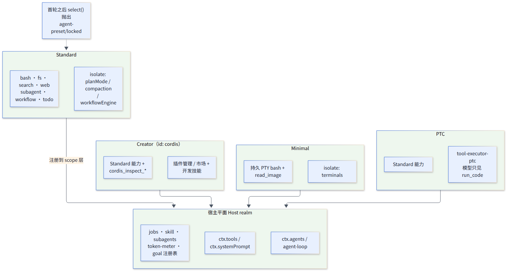

*图 3-6 四种 Agent Preset 共用宿主平面的注册表，各自在独立 isolate realm 中挂载能力*

## 4 启动过程

### 4.1 CLI 入口与参数解析

#### 4.1.1 从 `bin.ts` 到运行器

`dsh` 命令的入口是 `apps/cli/src/bin.ts`：读取运行时版本，调用 `parseDshArgs()` 解析参数，再按模式动态导入对应运行器——`profile`（启动一个 profile）、`plugin`（插件管理）、`dump-config`、`dump-config-schema`。参数解析的规则很克制：启动器自己只认识 `--profile`、`--from-default-profile`、`--patch`（可重复）和三个 dump 开关，`dsh <name>` 展开为 `--profile <name>`；从第一个不认识的 token 开始，后面所有参数原样交给应用（例如 Web 的 `--port`、`--no-open`，Headless 的 `--json`、`--permission-mode`）。`plugin` 被保留为管理命令，`desktop` 被保留给 Electron，CLI 会拒绝直接启动它。[[19]](#ref-19)

#### 4.1.2 环境层与代理

在组装配置之前，启动器先用 `loadLayeredEnv('dsh')` 建立环境层：调用目录的 `.env` 优先于 home 的 `.env`，两者都低于进程继承的环境；`PATH`、`DSH_*`、`XDG_*` 不允许写在 `.env` 中，代理变量只认 home 的 `.env`。随后按启动快照安装出站代理，确保后续插件发起的网络请求经过同一套代理策略。这些细节说明 DSH 把“启动时的环境”当作一份需要冻结的输入，而不是任由插件随时读取的全局状态。

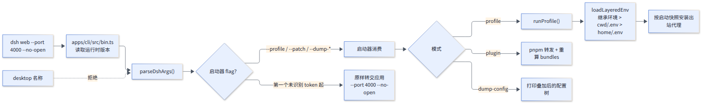

*图 4-1 CLI 入口：参数解析只消费启动器自己的 flag，其余原样交给 profile 中的应用*

### 4.2 配置叠加与 `--dump-config`

#### 4.2.1 组装 profile

`runProfile()` 先调用 `composeProfile()`：`prepareProfile()` 加载 profile 目录（可选用 `--from-default-profile` 重建），报告被跳过的 bundle，并**每次启动都重写空根** `cordis.yml`——注释解释了原因：避免 Loader 回写把组合行“烘焙”进根文件，导致后续 bundle 升级不生效；接着 `createRuntimeResolution()` 在挂载前计算不可变的运行时模块解析表；最后读取 `--patch` overlay。然后构造 `ProfileContext`（名称、目录、patch 路径、安装锚点、已启动的 bundle、cwd、home、overlay 列表、遥测开关），作为纯数据服务提供给插件树。

#### 4.2.2 patch 的唯一实现

patch 语义由 vendored include 插件的 `applyEntryPatches` 唯一实现，`--dump-config` 共用同一个函数，源码注释说“so a dump can never drift from what boots”。三个 dump 开关的区别是：`--dump-default-config` 只打印 bundle 层；`--dump-config` 再叠加 profile patch、home patch 和 `--patch`；二者都会以注释标出每一行来自哪个文件、被哪个 overlay 修改过，`!!js` 表达式保持未求值。`--dump-config-schema` 会导入每个组合模块以读取 schema，只应对受信任的 profile 运行。架构文档的建议是：“它打印出的任何条目，都可以由你自己的 patch 替换。”

#### 4.2.3 一个具体例子

下面的 patch 展示了三种常见定制：把沙箱化 bash 执行器的超时从 60 秒延长到 180 秒、接入一个 stdio MCP 服务器、关闭随模型请求上传会话日志。它可以写进 `$DSH_HOME/cordis.patch.yml` 长期生效，也可以存成文件用 `--patch` 临时叠加；注意按 id 修改时会**整体替换**该行的 `config`，因此需要写出全部想保留的字段。

```yaml
- id: bash-sandbox
  config:
    timeoutMs: 180000
- insert:
    - id: mcp-github
      name: '@deepseek-ai/dsh-mcp-client'
      config:
        serverName: github
        transport: stdio
        command: npx
        args: ['-y', '@modelcontextprotocol/server-github']
        env:
          GITHUB_TOKEN: !!js process.env.GITHUB_TOKEN
- id: session-log-deepseek
  config:
    enabled: false
```

应用后用 `dsh --profile web --dump-config` 检查结果：每一行旁边的注释会标出它来自哪个文件、被哪个 overlay 修改过。若 MCP 服务器的配置写错，插件会停在 FAILED 并在启动日志中报告，但因为它不是必需条目，应用仍会启动。

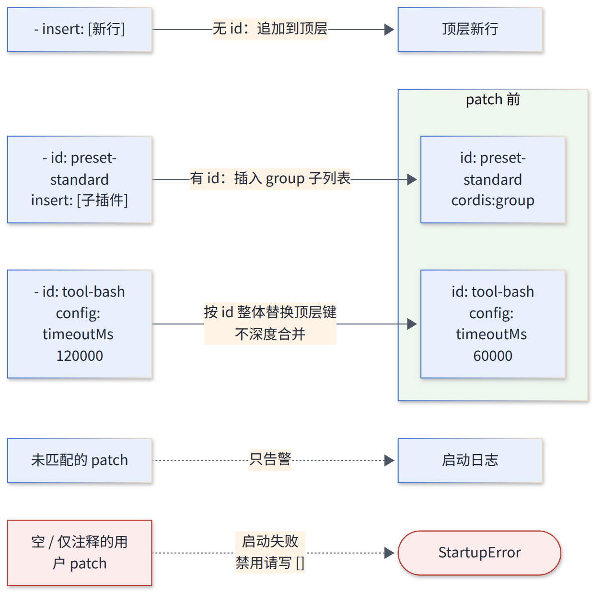

*图 4-2 patch 的三种语义：按 id 整体替换、顶层追加、插入到 group 子列表*

### 4.3 `boot()` 与插件树结算

#### 4.3.1 启动序列

`boot()` 的步骤可以概括为：新建 Cordis `Context` → 提供 `dshHomePath` → 挂载 `Loader` → 调用启动器的 `prepare` 回调（提供 `profileContext`、启动环境、插件包表和命令行服务 `cmdlineArgs`/`appExit`/`appReady`）→ `mountRootInclude()` 注册 `cordis:include` 与 `cordis:group` 两个内建插件、做兼容性预检、挂载根 Include 与各层 patch → `loader.await()` 等待整棵树结算 → `auditStartupEntries()` 检查必需条目。插件的实际挂载顺序**不由行序决定**，而由 `inject` 依赖驱动：例如 Web 组合包里的 `web-startup` 注入 `cmdlineArgs`、产出 `webStartup` 服务，`webserver` 和 `web-runtime` 声明 `inject: [webStartup]`，Loader 才对其 `!!js` 配置求值。

#### 4.3.2 “无特权内核”的边界

严格地说，DSH 并非完全没有宿主代码。`boot()` 在挂载配置树之前由宿主直接 `provide('dshHomePath')`、挂载 Loader，启动器的 `prepare` 回调再提供 profile 上下文和命令行服务。这些是启动器注入的“事实”，不承载产品能力；产品能力（包括循环本身）仍然全部来自配置树。DataCamp 的评论指出“Cordis 本身不可替换”，这与上述观察一致：可替换的是 Cordis 之上的一切，而不是 Cordis 和启动器本身。[[2]](#ref-2)

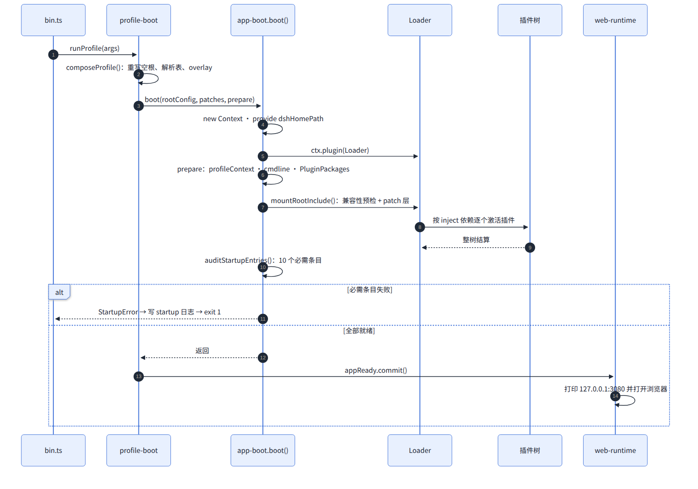

*图 4-3 启动时序：从 `bin.ts` 到 `appReady.commit()`，必需条目审计失败则整体退出*

### 4.4 系统提示词组装

#### 4.4.1 四类输入

`ctx.systemPrompt` 为每个拟议步骤收集提示词的各个部分。输入分四类：**段**（PromptSection，含 name、order、文本或函数、是否插值、是否 complete）、**动态上下文**（PromptContext，成为带来源标注的 user 角色快照）、**变量**（`{{name}}`，循环提供 `provider` 与 `model`）和**工具 schema 提供方**。组装流程是：变量按全局到 scope 链合并（近者胜）→ 段与上下文按 scope 遮蔽合并 → 收集各工具提供方 schema → 段按 order 升序排序（同序按名称），超过一个 complete 段即报错 → 运行按 scope 过滤的 `system-prompt/assemble` waterfall → 若有 complete 段则只保留它。未知变量引用直接抛错。

#### 4.4.2 固定的段序

段的顺序是集中分配的：`HARNESS_IDENTITY`（-1000，“You are an AI agent powered by DeepSeek Harness.”）→ persona 前缀（0）→ 计划策略（500）→ 团队策略（600）→ PTC 专用说明（800）→ 文件引用（900）→ 各工具段（1000～3000）与 MCP 服务器说明（3100）→ SDK 声明（5000）→ 交付物引用（9000）→ 结构化输出（9900）→ Harness 源码说明（10000）→ Web 界面说明（10100）→ persona 后缀（10200）。工作目录、沙箱策略、审批策略、子代理委派、团队身份等**进程相关的事实不进入系统提示词**，而以动态上下文的形式出现，源码注释写明这是为了让系统提示词保持可缓存。渲染后的提示词作为第 0 号 `system/message` 节点进入派生历史，工具 schema 则作为独立的 wire 字段发送。

#### 4.4.3 不同入口的 persona

persona 只是 order 为 0 与 10200 的前后缀段，不同入口的取值不同。base 组合包的默认前缀为空字符串；web、headless、sdk、acp 各自 patch 为 “You are a coding agent powered by the {{model}} model.”，其中 `{{model}}` 由循环在组装时替换为当前模型；Web 下 persona 由 preset 中的 `dsh-persona` 插件提供；Minimal 模式用 `complete: true` 把整段系统提示词固定为一句话，并关闭运行时上下文，从而得到一个几乎没有 harness 痕迹的干净基线。由于 persona 和工具段都是可替换的插件行，团队若要统一 Agent 的身份、语气或行为准则，最稳妥的做法是覆盖 persona 行或增加一个新的提示词段插件，而不是修改工具描述。

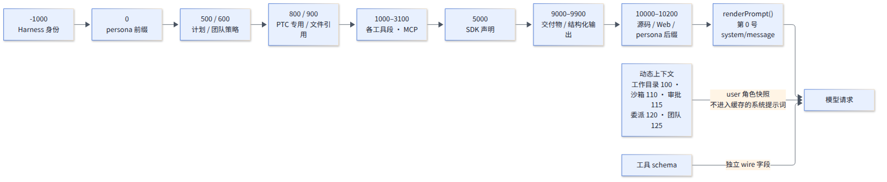

*图 4-4 系统提示词的段序数轴：稳定内容靠前以利缓存，进程相关事实移入动态上下文*

### 4.5 失败策略、HMR 与插件管理

#### 4.5.1 必需条目与可选条目

全局必需条目只有 10 个：`agent-loop`、`tool-executor-native`、`tool-executor-ptc`、`webserver`、`web-runtime`、`modules`、`connection`、`headless-runner`、`acp`、`sdk-jsonrpc-server`。启用的必需条目失败会拆卸整个应用、抛出 `StartupError`、以退出码 1 退出，并写入 `$DSH_HOME/logs/startup-<时间戳>-<uuid>.log`；可选条目失败只告警。错误信息区分“宿主准备失败”与“插件树加载失败”两个阶段。导入插件前，启动器还会按 `engines.dsh`（或 DSH 相关包的 peer 范围）比对运行时版本，不兼容的行被改写为 `disabled: true`，不兼容的 bundle 被跳过，用户的版本豁免存放在 profile 的 `compatibility.json` 中。

#### 4.5.2 HMR 与插件管理器

`dsh-base` 启用只监听配置的 `dsh-hmr`，前提是启动器提供了 `profileContext`；Headless、SDK、ACP 禁用它，`sdk-minimal` 不包含它。HMR 监听 profile manifest、profile patch 和 home patch，重新读取各 bundle 层并重组，配置变更、Loader 更新与自动重载串行化执行。普通 patch 编辑可以热重载，bundle 成员的增删则需要重启。插件管理器同时服务 CLI（`dsh plugin --profile <name> <pnpm 参数>`）和 Web 侧边栏，安装后按依赖是否声明 `dsh.bundle.patch` 重新计算 bundle 列表；面向模型的 `plugin_manager` 工具在 Standard 和 Creator 预设中启用，每次操作都需要 `danger-full-access` 或单次审批。

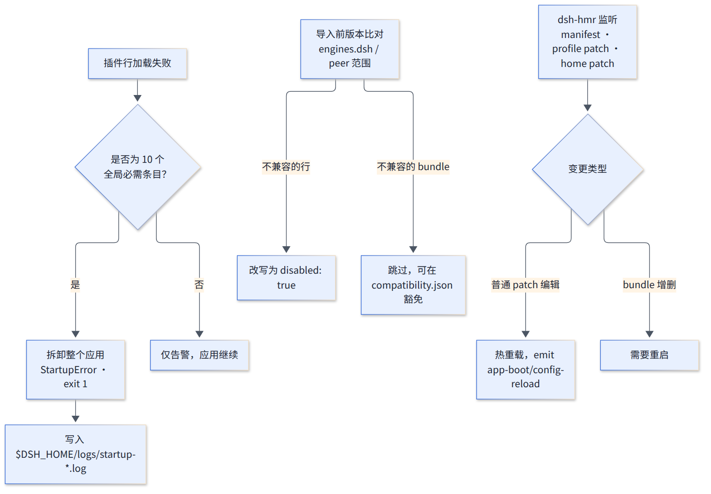

*图 4-5 启动失败策略与热重载：必需条目失败即退出，HMR 只重组 patch 层*

### 4.6 Desktop 与 SDK 的启动差异

#### 4.6.1 Desktop Host

Electron 桌面应用在签名资源中携带精确匹配的 dsh 生产运行时，并占用保留的 `$DSH_HOME/profiles/desktop`。Electron 以 Node 模式启动私有的 Desktop Host，Host 调用共享的 profile runner 与完整 Web 应用，参数固定为不打开浏览器、绑定 `127.0.0.1`、端口由系统分配（避免与 Web 默认的 3080 冲突）；就绪后通过 Node IPC 把 URL 与启动注入发回窗口。窗口立即加载打包的 Web 资源，等待注入后在同一文档中激活客户端插件。base 中部分行按 `profileContext.name === 'desktop'` 条件启用，例如账号登录的桌面平台标识和产品埋点。

#### 4.6.2 Python SDK

Python SDK 遵循同一应用架构：运行时 wheel 把普通的 `dsh` CLI 打包为平台相关的二进制，客户端默认以**显式指定的** Harness home 启动 `dsh --profile sdk`，刻意不发现 `~/.dsh`；极简示例选择 `sdk-minimal`。Python 侧只暴露 profile 选择与有序 patch 文件，不暴露完整的 Cordis 树；持久的外部插件通过 `dsh plugin` 安装。这一设计让 Python 用户获得与 Node 用户完全相同的运行时行为，代价是 SDK 进程里实际运行的是一个完整的 Node 应用。

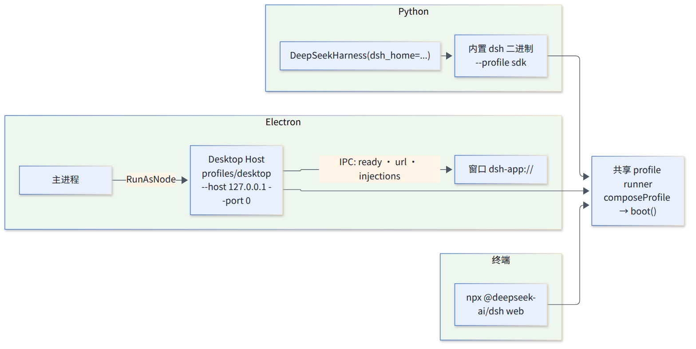

*图 4-6 三种宿主的启动路径：CLI、Desktop Host 与 Python SDK 最终都进入同一个 profile runner*

## 5 Agent 回合处理时序

### 5.1 端到端总览

#### 5.1.1 一次典型请求

以 Web 界面中用户输入“修复这个测试”为例。浏览器经 `/api` 调用会话控制器，Host 侧落到 `ctx.agents` 上对应 Agent 的 `followup()`，消息进入 inbox 的 next-turn 列表并发出 `agent/inbox/inserted`；驱动器从 idle 切换为 running，追加 `turn/start`，领取输入，快照模型选择，解析本步工具集，组装系统提示词，经 `agent/pre-step` waterfall 决定接纳；随后追加 `step/start`，准备调用、写入 `system/message` 与 `user/message`、按需写入 `request/header` 与 `request/context`，从日志派生并冻结历史，发起流式请求；流式 chunk 以 `agent/assistant-stream` 实时推给 UI，结算后写入 `assistant/message`；若模型请求了工具，则逐个写入 `tool/call`、经工具流水线执行、按模型顺序写入 `tool/result`；`step/end` 之后，如果工具结果要求再次请求模型，就进入下一步，否则经 serial 事件 `agent/turn-stopping` 检查后写入 `turn/end`，驱动器回到 idle。

#### 5.1.2 循环本体很小

整个过程的核心代码集中在 `agent-loop/src/agent.ts`，约 745 行。重试、压缩、审批、超时、spill、计划模式、目标续跑都不在循环里，而是挂在 `agent/*` 与 `tools/*` 的 waterfall 上。扩展实操手册给出一张“功能→机制”映射表，声称 hooks、`/goal`、`/loop`、压缩、AGENTS.md、MCP、技能、记忆、定时、子代理、遥测、模型适配器都是扩展点上的监听器，“没有任何一行修改循环本身”。值得注意的是，**循环本身没有最大步数上限**：只有“模型不再请求工具且 next-step 为空”时轮次才结束，失控防护交给 `repeat-tool-reminder`（重复调用提醒阈值 3/5/8 次）、Goal 驱动的 256 轮上限、成本和用户取消等插件。[[20]](#ref-20)

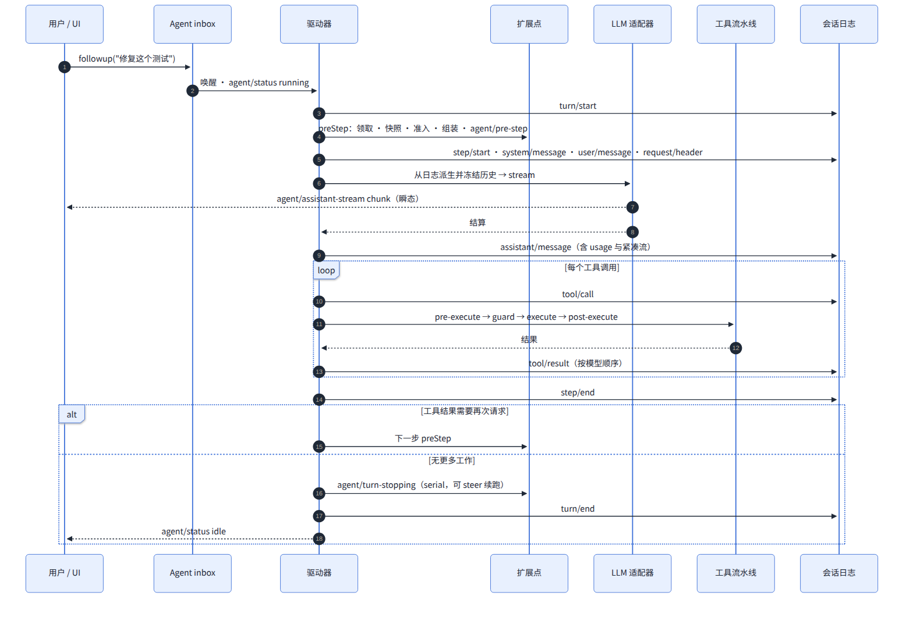

*图 5-1 一个轮次的端到端时序：持久事件写入日志，实时帧推送到 UI*

### 5.2 输入认领与 pre-step

#### 5.2.1 `preStep()` 的五个动作

每个拟议步骤开始前，循环执行 `preStep(target)`：**领取输入**（首步从 next-turn 领取一条普通消息，同时领取全部 next-step 消息，逐条发出 `agent/inbox/claimed`）；**快照模型选择**（`model.current()`，优先级为已记录的 `model/selection` > 上次请求 > Agent options，快照在重试中保持不变）；**工具准入**（`ctx.tools.resolve()`，每步评估一次各注册的 `when` 条件）；**组装提示词**（`systemPrompt.assemble()`，携带模型选择与工具集）；最后派发 **`agent/pre-step` waterfall**，最内层默认实现把渲染出的运行时上下文投影为一条 user 消息附加在已领取消息之后。

#### 5.2.2 pre-step 的监听者

`agent/pre-step` 是 DSH 最繁忙的扩展点之一。根据事件生产者/消费者映射，监听者包括压缩（步骤压力检查）、计划模式（注入计划策略）、重复工具提醒、会话检查点策略（flush 屏障）、Goal 轮次驱动、AGENTS.md 指令加载、时间上下文、技能目录、Claude Code / Codex hooks 桥、会话引用和操作卡片等。监听器可以接纳、改写或拒绝已领取的消息；首次领取被拒绝或为空时，循环关闭一个不含步骤的持久轮次（结束原因 `blocked` 或 `completed`）。enter 决策还可以声明 `startsRequestSeries`，让循环记录新的 `request/header`，这是为前缀缓存服务的显式信号。

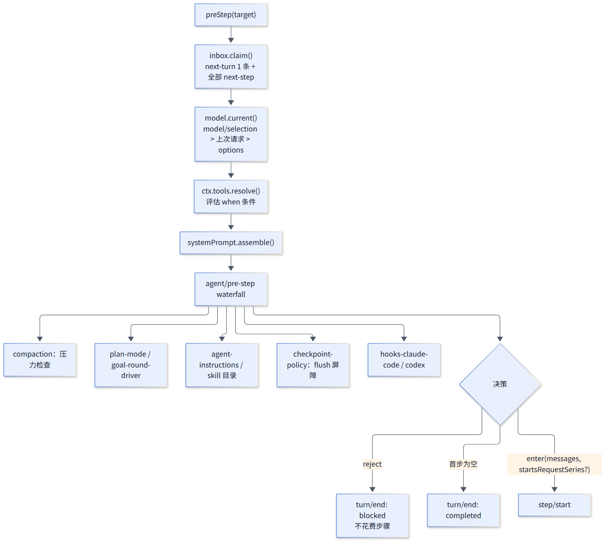

*图 5-2 pre-step 流程：领取、快照、准入、组装，再交给 waterfall 决定接纳或拒绝*

### 5.3 模型请求、流式输出与提交

#### 5.3.1 一次尝试的步骤

`step()` 内部是一个尝试（attempt）循环。每次尝试：渲染提示词（只渲染一次，重试复用）→ `prepareRequest()`（构造种子配置、派发已弃用的 `agent/request` waterfall、校验 provider/model/推理强度未被改动、`llm.prepareCall()` 绑定适配器）→ 刷新运行时事实 → 按已准备调用的能力协调 `system/message` → **仅首次尝试**追加已接纳的 `user/message` → `buildRequest()`（按需追加 `request/header`、工具增删时追加 `developer/message`、追加 `request/context`，再从日志派生历史并深冻结）→ 经 `llm/stream` waterfall 发起流式请求，逐 chunk 发出 `agent/assistant-stream`。

#### 5.3.2 提交语义

提交语义区分三种情况。成功时追加 `assistant/message`，其中嵌入 usage 与紧凑的带时间戳流，空内容和 `max-tokens` 也会记录；流中途因中止而失败、但已有内容时，追加 `interrupted: true` 的 `assistant/message`，保留已交付前缀；其他失败、重试、取消和流错误在没有 surface 消息时落为仅日志的 `assistant/attempt`，保存证据而不虚构历史。架构文档特别说明：循环发送不可变请求，同时保持取消有效；在任一异步阶段取消，系统提示词与用户消息都不会被提交。这保证了“模型可见即已记录”在失败路径上同样成立。

#### 5.3.3 为前缀缓存而设计的请求序列

阅读 `step()` 的实现可以发现，DSH 在多处为服务端的前缀缓存（KV cache）做了专门设计。`request/header` 记录完整的请求信封，并带有 `initial`、`resume`、`change`、`series` 四种原因，`startsRequestSeries` 显式声明“新的请求序列从这里开始”，让缓存失效点成为可审计的事实；工具集变化时不重写开头的工具声明，而是在后续追加 `developer/message` 中的 `tool-addition` / `tool-removal` 块；系统提示词在具备能力的路由上以“历史中的最新 system 消息”更新，而不改写第 0 条消息；计划模式的 `exit_plan_mode` 工具 schema 始终在列，只为保持工具目录稳定；fork 子代理省略模型选择参数以复用父会话前缀。这些设计合在一起，使“同一会话内的后续请求尽量共享前缀”成为运行时层面的不变量，而不是依赖提示词作者的小心。对按缓存命中计价的 DeepSeek API 而言，这直接关系到长任务的成本。

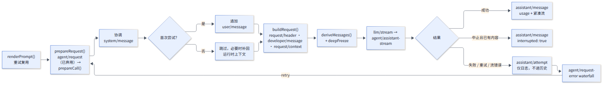

*图 5-3 一次尝试的请求构建与三种提交结果*

### 5.4 工具执行流水线

#### 5.4.1 单次调用的七个阶段

每个工具调用都经过同一条流水线：执行器拒绝（例如 PTC 模式下直接调用非 `run_code` 工具）先于策略 → **`tools/pre-execute` waterfall**（返回 allow / deny / cancel / ask，不允许改写参数，因为参数已经记录并展示）→ ask 时调用 `ctx.approval.request()` 发起一次性审批，无审批服务、无 Agent 或不可回答一律拒绝 → **单调守卫** `tools.guard()`，只能拒绝不能放行，监听器顺序无法把拒绝变回允许 → **`tools/execute` waterfall**，环绕分发实现超时、重试、指标 → 工具正文（文件写入还要经过 `fs/write-intent` 与 `fs/edit-intent` 门禁，“先读后写”策略由 `fs-observation-policy` 提供）→ `projectContent` 与 **`tools/post-execute` waterfall**（可接受、替换、阻断或附加上下文）→ 同步的 `finalizeContent` → 冻结的 `tools/result` 广播 → 会话 `tool/result`。[[21]](#ref-21)

#### 5.4.2 设计要点

这条流水线有三个值得借鉴的设计。其一，**参数不可改写**：与 Claude Code 的 `PreToolUse` 可以返回 `updatedInput` 不同，DSH 认为参数一旦写入日志并展示给用户就不应再变，策略只能允许、拒绝或询问。其二，**守卫单调**：可扩展的 pre-execute 允许任何插件参与决策，但最终的守卫层只能收紧，避免插件之间的顺序依赖造成放行漏洞。其三，**取消优先**：调用方取消会把成功结果替换为取消结果，而工具自身的错误结果保留。

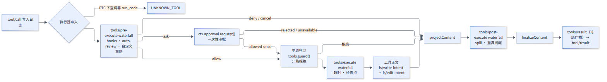

*图 5-4 单次工具调用流水线：可扩展的策略层与只能收紧的守卫层*

### 5.5 批次调度与并发

#### 5.5.1 屏障与滚动池

一次模型回复可能包含多个工具调用。内置调度器 `executeToolBatch()` 先由流水线对每个调用分类：只有工具声明 `isConcurrencySafe(args) === true` 才算 parallel，未声明、抛错或返回非 true 一律是 exclusive（失败即关闭）。exclusive 调用构成屏障单独运行；连续的 parallel 调用进入一个有界滚动池，上限 `maxParallelToolCalls` 默认 10，可热更新。源码注释概括了约束：“函数体可以重叠，但策略、结果与上下文提交保持模型顺序”。`tool/call` 在执行前写入，`tool/result` 按模型顺序写入；批次的附加上下文进入 next-step inbox，因此总在所有工具结果之后才进入下一个请求。

#### 5.5.2 中止时的回放保证

批次被中止时，已开始的调用等待其排空，尚未开始的调用合成 `ABORTED_BEFORE_DISPATCH` 错误结果。步骤抛错时，循环为所有已写入 `tool/call` 但没有 `tool/result` 的调用补写结果。这两条规则确保日志里每个工具调用都有配对的结果，回放和恢复时模型看到的历史始终合法——这是 OpenAI、Anthropic 等提供方对消息格式的硬性要求，也是很多自研 Agent 在中断场景下出错的地方。

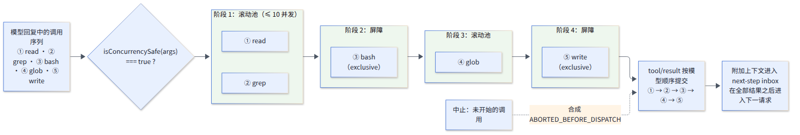

*图 5-5 批次调度示例：parallel 调用在滚动池内重叠执行，exclusive 调用作为屏障，结果按模型顺序提交*

### 5.6 PTC：程序化工具调用

#### 5.6.1 机制

PTC（Programmatic Tool Calling）的设计笔记把思想来源归于 Cloudflare 的 “Code Mode”：多步工具操作若逐次调用，每个中间结果都要回到上下文，开销大且串行；让模型针对生成的 TypeScript API 写一段程序，在沙箱中运行，**只有 print 或 return 的内容回到上下文**。挂载 `tool-executor-ptc` 后，模型只看到 `run_code` 一个工具，参数为 `code`（异步函数体）、`description`，以及可选的 `timeoutMs` 和越权参数。程序内用 `await tools.name(args)` 调用工具，独立的只读调用可以 `Promise.all` 并发。该功能在 2026-08-25 由 “Code Mode” 统一更名为 PTC，未保留兼容别名。[[22]](#ref-22)

#### 5.6.2 子调用不绕过任何策略

PTC 最重要的性质是：程序内的每个工具调用都**完整地重新走一遍工具流水线**——pre-execute、守卫、execute、post-execute、finalize、result，并成对记录仅日志可见的 `tool/ptc-dispatch-start` / `tool/ptc-dispatch` 事件，子调用 id 形如 `<父调用>:ptc:<n>`。拒绝会以程序内的约束性驳回呈现。运行时由 `ctx.ptcRuntime` 接缝提供，默认实现 `ptc-runtime-node` 以 per-call 模式为每段程序启动一个全新的受管 Node 子进程，应用会话的文件沙箱策略；默认超时 120 秒（上限 600 秒），老生代堆 512 MiB，输出上限 64 MiB，程序内并行子调用上限 10。README 坦承 PTC“不承诺普遍减少成本”：省掉了中间结果的回流，但增加了 SDK 声明文本。

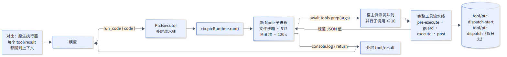

*图 5-6 PTC 架构：模型写程序，子调用逐个回到宿主的完整工具流水线，只有程序输出回到上下文*

### 5.7 重试、压缩与取消

#### 5.7.1 重试只来自一个扩展点

请求失败时，循环追加 `assistant/attempt` 并派发 `agent/request-error` waterfall；只有某个监听器返回 `{ kind: 'retry' }` 才在同一打开步骤内重试，不重复 pre-step 和用户消息。三个监听者分工明确：`llm-retry` 处理瞬态错误（RATE_LIMIT、SERVER、TIMEOUT、TRANSPORT、EMPTY_RESPONSE），默认最多 5 次，500 毫秒起指数退避至 10 秒，10% 抖动，遵守 `Retry-After`，每次重试先写入 `llm/retry` 事件；`compaction-basic` 处理 `CONTEXT_WINDOW_EXCEEDED`，压缩成功后重试，每 Agent 默认 1 次；`compaction-image-offload` 在图片超预算时用占位符替换最旧的图片后重试。

#### 5.7.2 压缩的四个触发点

压缩由 `ctx.compaction` 接缝承担，触发点有四个：pre-step 时的上下文压力、请求失败时的上下文溢出、切换到容量更小的模型时的预压缩，以及用户手动 `/compact`。阈值公式为 `min(上下文窗口 × 0.8, 上下文窗口 − 预留输出 − 65536)`，保留尾部比例 0.16。执行顺序是：先运行不调用模型的 tool-result-pruner（把超过 8192 字符的历史工具结果剪为头 4096 加尾 1024），再测量，仍超阈值才选择可安全压缩的区间，额外调用一次模型生成摘要。摘要以带 `surfaceOp: replace` 的 `user/message` 遮蔽原区间，前后有 `compaction/start` 与 `compaction/end` 加锁，崩溃会留下可检测的遗留锁。取消方面，`cancel(cause)` 默认清空 inbox 并中止当前活动，原因记录在 `turn/end.reason`。

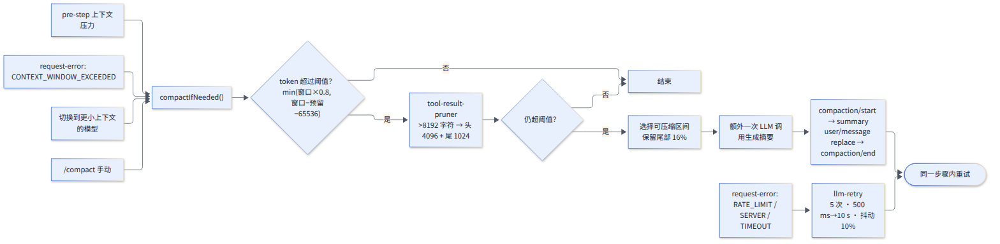

*图 5-7 请求失败与上下文压力的处理：重试与压缩都经由 waterfall 监听器完成*

### 5.8 子 Agent、Workflow 与 Agent Teams

#### 5.8.1 统一的子代理接缝

`ctx.subagents` 是命名提供方注册表，提供方分两类。**本地可继续**的 `spawn`（全新子 Agent，可独立选择 preset 与模型）与 `fork`（以父会话已完成轮次的前缀为种子，为复用 KV cache 省略模型选择参数）运行在进程内，有持久 Session，接受后续消息；**外部一次性**的 `codex`（经官方 app-server 协议运行真实 Codex）、`claude-code`（经官方 Agent SDK 运行真实 Claude Code）、`acp` 与 `dsh-sdk`（另一个 Harness 实例）运行在进程外，只回报单次结果。默认容量为深度 1、活跃子代理 8 个。面向模型的工具包括 `subagent`、`subagent_fork`、`list_subagent_models`，以及父子双向的 `send_message`、`interrupt_agent`、`list_agents`。

#### 5.8.2 Workflow 与 Agent Teams

`workflow` 工具让模型提交一段纯 JavaScript 编排脚本，钩子有 `agent(prompt, opts)`、`parallel()`、`pipeline()`、`phase()`、`log()`，由 `workflow-ptc` 引擎复用 PTC 的 Node 进程运行时执行，默认最多 1000 个子代理，默认后台运行，仅在用户明确要求编排时使用。实验性的 Agent Teams 在可继续子代理之上提供持久 roster、任务 DAG（带 CAS 版本号、`blockedBy` 必须无环、`writeScopes` 只是提示而非锁）与直接 inbox 消息协作，消息一律以 steer 方式投递。与参考章节中 Super-agent 的“主 Session + 执行器 Session”相比，DSH 的子代理是**由模型在会话内发起**的委派，而 Super-agent 的工单是**由宿主 Engine 在授权之后**创建的——这正是两者层次不同的体现。

#### 5.8.3 Jobs、Goal 与计划模式

三个常与子代理配合使用的子系统也值得一提。**Jobs** 是通用的后台任务运行时，任务 id 形如 `<kind>-<16 位十六进制>`，状态为 running、stopping、completed、killed、failed，每个所有者最多 10 个并发任务，输出保留 256 KiB 环形缓冲；任务完成时默认经 `agent.inject()` 加唤醒把通知送回模型，bash 的 `run_in_background` 和 workflow 的后台运行都建立在它之上。**Goal** 是事件溯源的同会话目标，以带版本号的 CAS 更新，阶段为 active、paused、blocked、complete，连续 3 轮无进展才可标记 blocked，Goal 驱动最多 256 轮。**计划模式**激活时注入计划策略段，`exit_plan_mode` 提交计划供审批；文档明确它属于**软性指引**，真正的强制由沙箱与审批负责。

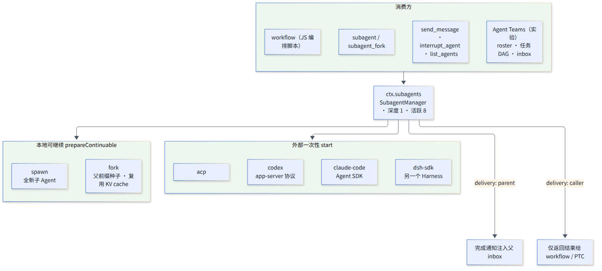

*图 5-8 子代理拓扑：本地可继续提供方与外部一次性提供方共用一个接缝，Workflow 与 Teams 构建其上*

## 6 安全与权限

### 6.1 威胁模型

#### 6.1.1 官方的自我定位

SAFETY 文档的措辞非常直接：DSH 是“实验性的开发者预览软件”，“尚未接受安全审计，不得视为安全或可用于生产环境”；项目会执行模型生成的代码与命令、加载第三方插件，并访问向其开放的网络、进程、凭据和文件；沙箱、审批提示与权限控制“可以降低风险，但不保证隔离”，即使限制正确执行，也无法保护本项目获准访问的资源；不要把 DSH 当作不可信工作负载唯一的安全控制。建议的做法是最小权限、优先在一次性虚拟机或容器中运行、备份可访问的文件、不暴露敏感凭据。[[23]](#ref-23)

#### 6.1.2 资产、不可信输入与攻击者

归纳各子系统文档，需要保护的资产包括：宿主文件系统（工作区内外）、`$DSH_HOME/.credentials.yaml` 中的模型 API key 与 OAuth grant、启动环境中的其他密钥、包含工具输出与文件内容的会话日志、内网与云元数据服务、已安装的插件与 profile 配置、Web GUI 会话。不可信输入来自七个方向：模型输出（命令、路径、URL、越权理由）、工具输出（命令输出、网页正文、MCP 结果）、工作区内容（项目根到 cwd 链上的 AGENTS.md / CLAUDE.md 会在首次请求时自动注入）、MCP 服务器（工具描述与服务器指令以字面文本进入系统提示词）、插件与插件市场索引、远程访问方（浏览器、API Peer、LiveShare 观看者、Webhook 发送方），以及受限子进程自身（可以在 stderr 伪造 runner 失败签名）。

据此可以推断出四类攻击者：被间接提示注入劫持的模型（拥有当前沙箱模式下的全部能力）；恶意插件或 MCP 服务器作者（以宿主用户权限运行，不受文件沙箱约束）；网络上针对 Web GUI 与 Webhook 的攻击者；同机的其他本地用户。文档明确把“对抗性宿主进程”和“同 UID 进程读取凭据”排除在保护范围之外。

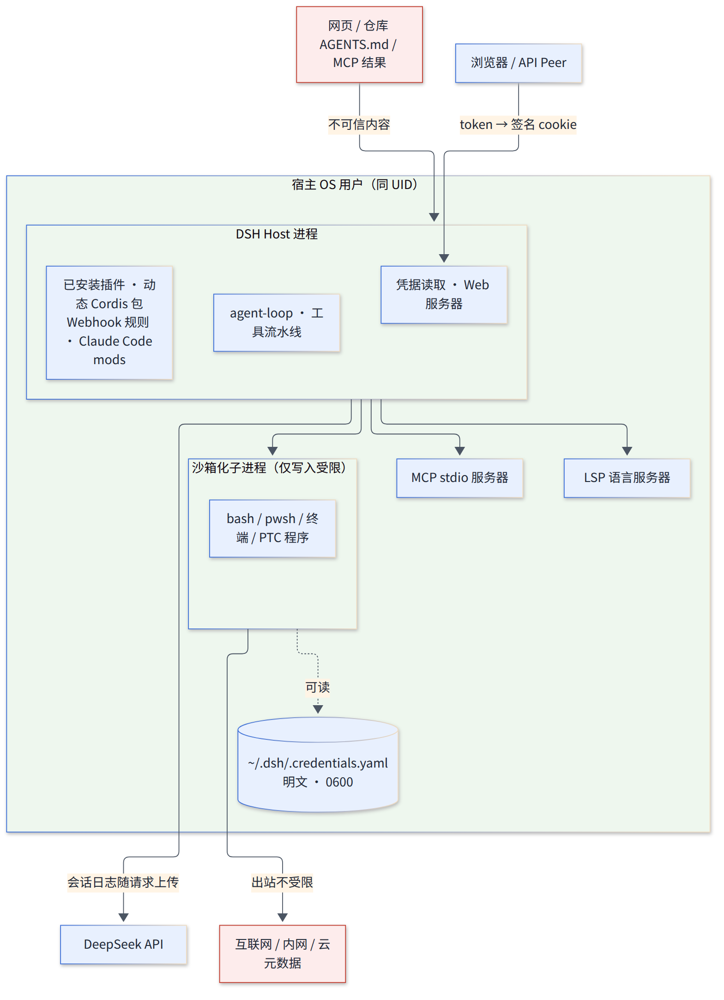

*图 6-1 DSH 的信任边界：只有沙箱化子进程的写入受内核约束，插件、MCP 与 LSP 位于沙箱之外*

### 6.2 沙箱模式、审批策略与权限预设

#### 6.2.1 两个正交的旋钮

DSH 的权限由两个独立旋钮组成。**沙箱模式**有 `read-only`、`workspace-write`、`danger-full-access` 三档，**只管文件效果**；**审批策略**有 `ask` 与 `never` 两档：`ask` 把请求交给应答者链，没有应答者时落为 `unavailable`；`never` 确定性返回拒绝，不询问任何人。权限预设把二者捆绑成具名选项供 UI 单选：`read-only`（read-only + ask）、`workspace-write`（新会话默认，workspace-write + ask）、`danger-full-access`（danger-full-access + never，已无可越之权）；另有实验性 Auto review 插件注册的保留预设 `auto`（danger-full-access + ask，由模型评审每次调用），以及组合不匹配任何预设时显示的派生值 `custom`。生效值从会话日志中最后一条 `sandbox/mode` / `approval/policy` 事件折叠得出，可回放。

#### 6.2.2 没有规则表，而是“先沙箱执行、被拒再申请越权”

与 Claude Code 的命令前缀白名单、OpenCode 的 allow/ask/deny 规则不同，DSH 核心中**没有**按命令或路径书写的规则文件。默认行为是：在当前沙箱模式内的任何 bash 命令与文件读写直接执行，不询问；被沙箱拒绝后，模型可以带上 `sandbox_permissions`（目标模式）和一句非空的 `justification`，对**完全相同**的命令重试一次，此时才触发审批；越权阶梯为 read-only 可升到 workspace-write 或 danger-full-access，workspace-write 只能升到 danger-full-access；批准只对这一次调用生效，不改变会话模式。用户拒绝后，模型收到“保持拒绝，停止并解释，不要绕过”的指示。真正的规则须以插件形式挂到 `tools/pre-execute`，现成实现有实验性的 Claude Code hooks 桥（支持 deny/ask，allow 不会预审批）和 Auto review。

| 前端 | 审批如何呈现 | 无人应答时 |
| --- | --- | --- |
| Web GUI | 接管输入框，Enter 批准一次 / Esc 拒绝，“始终允许”需显式按钮 | — |
| ACP | `session/request_permission`，客户端可自动回答 | 客户端决定 |
| SDK | 初始化时声明 `approvalRequests: true`，服务端发 `approval/request` | 断连时拒绝 |
| Headless | 没有实时审批通道 | `unavailable` → 拒绝 |
| sdk-minimal | 不挂载审批服务，固定 `danger-full-access` | 不适用 |

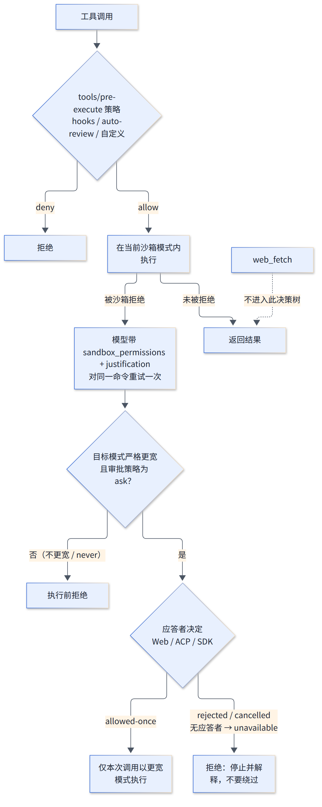

*图 6-2 审批决策树：审批只在越权时出现，任何异常路径都归结为拒绝*

### 6.3 沙箱后端与执行世界

#### 6.3.1 四个平台后端

`ctx.sandbox.confine(argv, policy)` 返回包装后的 argv、执行强度（full 或 partial）、拒绝方言和 runner 失败规则；没有可用后端时以 `SANDBOX_UNAVAILABLE` 拒绝，文档写明“静默的无隔离透传永远不合法”。`dsh-sandbox-local` 的后端选择链按平台固定：Linux 依次尝试 bubblewrap 与 Landlock，macOS 使用 Seatbelt（`sandbox-exec`），Windows 使用 ACL 受限令牌。策略逐调用解析，工作区根取会话**不可变的** cwd，额外可写根每次调用都检查。旧版 Landlock ABI 与 Windows ACL 报告 `partial`，要求绝对边界的消费方必须拒绝或上报。0.1.1-rc.1 的发布说明记录过一次修复：bubblewrap 可经 `/proc/<pid>/root` 逃逸。[[24]](#ref-24)

| 后端 | 文件写入 | 文件读取 | 网络 | 进程可见性 |
| --- | --- | --- | --- | --- |
| Linux bubblewrap | 只读挂载根，工作区与额外根可写，私有 `/tmp` | 全盘可读 | 不限制（未 unshare-net） | 私有 PID 命名空间 |
| Linux Landlock | 仅工作区、`/tmp`、`/dev/null` 可写 | 全盘可读 | 不限制 | 不隔离 |
| macOS Seatbelt | 默认允许、拒绝 file-write 后放行白名单 | 允许 | 不限制 | 不隔离 |
| Windows ACL | 每工作区写 SID，Low 完整性 | 不限制 | 不限制 | 不限制 |

#### 6.3.2 文件工具的进程内围栏

bash 走内核沙箱，文件工具则走进程内围栏 `dsh-fs-sandbox`：workspace-write 下写入前重新规范化目标路径，要求位于可写根之下；该判定函数与 Seatbelt profile 共享，保证文件工具与 bash runner 的边界不漂移。文档坦承它是“策略围栏，而非内核边界”，TOCTOU 窗口被缩小但未消除。base 组合包规定沙箱化 fs 提供方必须是唯一写路径，再挂 `fs-local` 会加载失败。执行世界可以整体迁移到 SSH 远端：`sandbox-ssh` 让远端主机选择本地沙箱后端并执行逐调用策略，SSH 连接强制 BatchMode、严格主机密钥、禁用代理转发，远端 helper 以 SHA-256 校验。

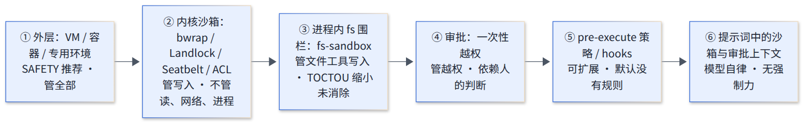

*图 6-3 分层隔离：每一层管什么、不管什么*

### 6.4 凭据、环境清洗与网络

#### 6.4.1 凭据

凭据接缝的设计是：配置只携带引用（环境变量名），值归提供方，消费方每次操作解析一次，因此轮换无需重启；`describe()` 永不返回值，可以安全跨 Remote 传输。本地提供方 `dsh-credentials-local` 把 API key 与插件 grant（例如 OAuth access/refresh token，以及 Web cookie 签名密钥）以**明文 YAML** 存放在 `$DSH_HOME/.credentials.yaml`，以仅属主权限创建，POSIX 上拒绝加载他人可读的文件。OS 钥匙串提供方是延后项。文档的原话是：文件效果沙箱模式不会拒绝读取，同 UID 进程（包括 Agent 的工具进程）可以读该文件，文件权限“是审慎，不是边界”。解析优先级为存储文件 > 启动环境快照 > `<cwd>/.env` > `$DSH_HOME/.env`。

#### 6.4.2 环境清洗与网络

子进程环境按名称启发式清洗：匹配 `/KEY|PASSWORD|SECRET|TOKEN/i` 的变量与全部 `DSH_*` 被移除，`PATH`、`HOME`、locale 与代理变量保留。官方承认 `*PASSPHRASE*` 一类会漏过；据此推断，`DATABASE_URL`（内嵌密码）、`*_CRED*`、`*_AUTH` 等同样可能漏过。网络方面，三种沙箱后端都不限制出站；`web_fetch` 只接受 http/https、拒绝 URL 内嵌凭据、只跟随同源重定向（默认至多 5 跳），README 与子系统文档明确说**任何目标地址都被允许**，包括 loopback、内网与云元数据地址，且在所有沙箱与审批模式下都不询问。需要注意的是，base 组合包中的配置注释声称匿名抓取“只接受公网目标并固定连接”，但本次在 `web-fetch-http` 包内未找到对应实现，以 README 与源码为准应视为**当前没有 SSRF 防护**，这一点需要维护者确认。

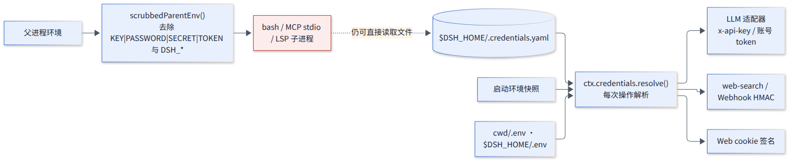

*图 6-4 凭据流向：解析在宿主侧完成，但沙箱内进程仍可直接读取凭据文件*

### 6.5 插件、MCP 与扩展的信任

#### 6.5.1 插件即宿主代码

插件是 Cordis 插件，与 harness **同进程**运行。“注册即副作用”是可靠性机制，不是安全边界。插件管理器支持 registry 包、git、tarball 和本地路径，经 `pnpm add` 安装，默认回退源为 npmmirror；没有签名或完整性校验，只有版本兼容检查。pnpm 拦下的依赖构建脚本需要单独批准，批准后以宿主用户权限执行；文档写明服务“只校验待决定的名字，不核实对话中的批准”。插件市场索引没有签名，索引内容只是索引的声明。Creator 模式下 Agent 可以动态求值 Cordis 包，`node:vm` 只隔离全局变量，“不是安全边界”。实验性的 Claude Code mods 桥同样不对 mod 施加沙箱。

#### 6.5.2 MCP 与语言服务器

MCP 服务器需主动配置，每个服务器一个 `dsh-mcp-client` 条目，工具名由本地服务器名加原始名派生（形如 `mcp__<server>__<tool>`），不采用远端自报的名字；工具调用同样经过 `tools/pre-execute`，但核心没有针对 MCP 工具的默认 ask。MCP stdio 服务器由 MCP SDK 自行启动，只共享环境清洗，不经过 `ctx.sandbox`；LSP 语言服务器经 `ctx.subprocess` 启动，本次未见沙箱包装。由于语言服务器可能按项目配置执行构建脚本，这相当于以宿主权限运行仓库控制的代码（推断）。

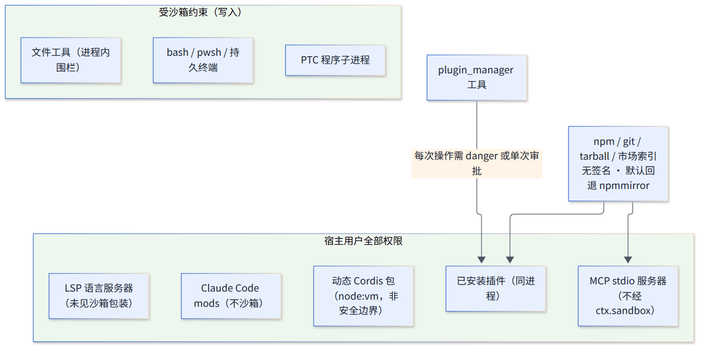

*图 6-5 扩展的信任级别：同进程插件与未沙箱化子进程拥有宿主用户的全部权限*

### 6.6 远程访问与 Web 认证

#### 6.6.1 浏览器认证

Web 服务器默认监听 `127.0.0.1:3080`，配置的 host 必须是具体 IP，`0.0.0.0`、`::` 等通配地址在加载时被拒绝；非 loopback 地址默认明文 HTTP，除非配置 TLS。认证采用“一次性启动令牌换签名 cookie”：每个进程生成随机令牌，`dsh web` 打开带 `?token=` 的 URL，令牌只在 `GET /` 上接受，换成绑定 authority 的签名 cookie（HttpOnly、SameSite=Strict、host-only，TLS 下加 Secure，默认 30 天）后重定向去掉令牌。每个 RPC 与 WebSocket 都要求已认证 Peer，不存在按方法区分的 loopback 豁免。认证前的请求信任检查要求 Host 是 loopback、绑定 IP 或受信主机，带 Origin 时必须同源，`sec-fetch-site: cross-site` 一律拒绝，以防 DNS rebinding 与跨站请求。

#### 6.6.2 非 owner 访问与已知限制

API 客户端经 `GET /connect?token=…` 获取 owner Peer，默认 `interactions: none`，不能回答审批。网关对非 owner Peer 调用前询问 `ctx.remoteAccess.decide()`，被拒时不解析查找、不激活 Agent；回答审批等交互仅限 owner。实验性 LiveShare 让外部观看者只能运行受限替代工具（view 档只读、write 档有界编辑）。已知限制包括：明文 HTTP 会暴露 cookie；没有 logout，撤销全部会话需删除凭据记录并重启；非 owner 可得知 owner 的 home 绝对路径。安全笔记还提示一个待确认的风险：LiveShare 的 view 档允许 `web_fetch`，结合上文的目标地址不受限，观看者可能借 owner 主机访问其内网。

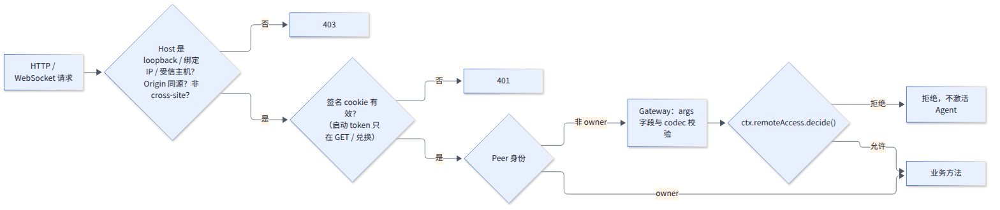

*图 6-6 Web 请求信任流水线：先做来源校验，再做身份认证，最后做非 owner 授权*

### 6.7 数据外发与隐私

#### 6.7.1 随模型请求上传会话日志

DSH 对 DeepSeek 官方 Messages 协议做了两项 wire 扩展，文档强调它们“不会增加模型输入 token，也不会改变模型可见前缀”：`dsh_plugin_packages` 上报当前存活的插件包名与版本；`dsh_session_log` 把权威会话日志的连续后缀增量上传，按水位推进，每次请求至多 8 MiB，服务端 2xx 后追加 `delivery-accepted` 事件实现至少一次交付。**两者默认启用**。文档列出的暴露面包括工作目录、系统提示词快照、用户与助手内容、失败输出、工具参数与结果、压缩摘要和反馈，并提醒经 `baseURL` 选择的网关会收到相同的值。关闭方式是把 `session-log-deepseek.enabled` 设为 false。[[25]](#ref-25)

#### 6.7.2 其他外发通道

第二条通道是 OTel 会话遥测，默认模式 `FEEDBACK_ONLY`，**只有用户显式给出反馈后**才上传截至该反馈的日志前缀，`DSH_TELEMETRY_DISABLED` 非空即退出。第三条是产品埋点，仅 Desktop 启用、默认开启，采集设备与用户 id、环境信息和交互事件，不含消息内容，设置项默认 true 但“暂不提供用户操作入口”。第三方评测对“会话日志是否默认上传”说法不一（有的称 feedback-only），原因正是混淆了这两条通道：OTel 遥测是反馈触发的，而 wire 扩展是随每次请求默认上传的。对企业部署而言，这是评估合规时最需要先处理的配置项。

| 通道 | 默认 | 触发 | 内容 | 关闭方式 |
| --- | --- | --- | --- | --- |
| `dsh_session_log` | 开（DeepSeek Messages 路由） | 每次带会话的模型请求 | 会话日志增量，≤ 8 MiB/请求 | `session-log-deepseek.enabled: false` |
| `dsh_plugin_packages` | 开 | 每次请求 | 存活插件包名与版本 | 禁用 inventory 插件 |
| 请求头 | 开 | 每次请求 | 匿名 home UUID、会话 id、版本 | — |
| OTel 会话遥测 | FEEDBACK_ONLY | 用户显式反馈 | 截至反馈的日志前缀 | `DSH_TELEMETRY_DISABLED` |
| 产品埋点 | 仅 Desktop，开 | 指定交互 | 设备、环境、交互事件 | 设置项（无 UI 入口） |

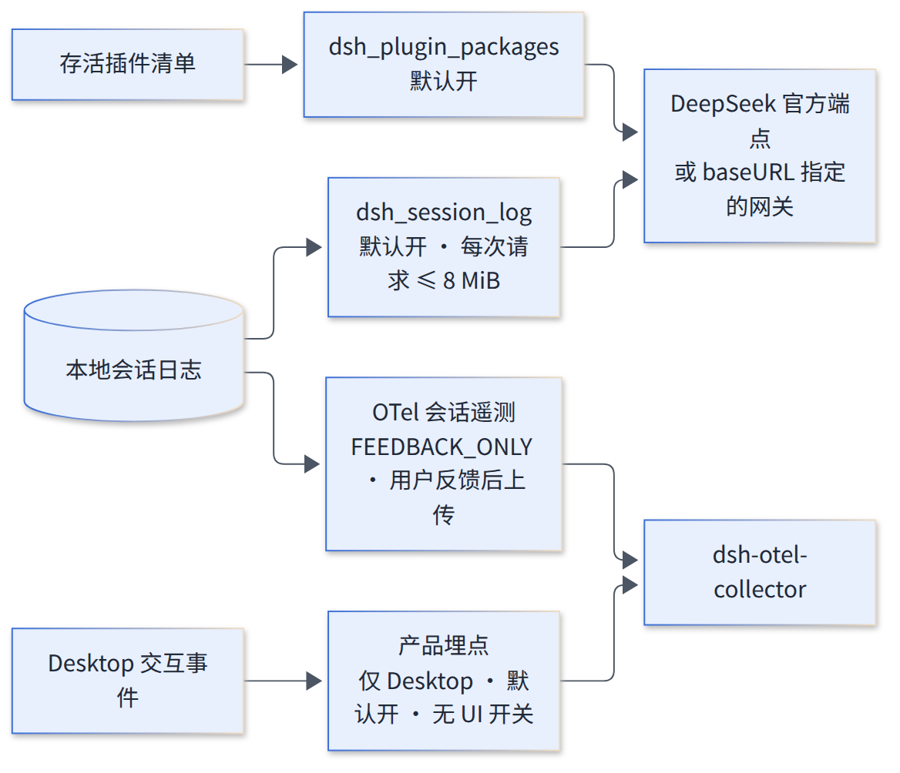

*图 6-7 本地会话日志的三条外发通道及其默认状态*

### 6.8 风险清单与加固建议

#### 6.8.1 风险清单

下表把事实依据与推断影响分开列出，便于在落地评估时逐项核对。

| # | 风险 | 事实依据 | 影响（推断） | 加固建议 |
| --- | --- | --- | --- | --- |
| R1 | 读取与联网都不受沙箱限制 | 沙箱只管写；三种后端不限网络 | 被注入的模型可在默认模式下读取 `~/.ssh`、凭据文件并外发，全程无审批 | 在 VM/容器中运行；出站代理白名单；对 `$DSH_HOME`、`~/.ssh` 做读拒绝 |
| R2 | 凭据明文、同 UID 可读 | credentials-local 文档 | 与 R1 叠加可直接窃取 API key 与 OAuth token | 实现 OS 钥匙串提供方 |
| R3 | `web_fetch` 不限目标且免审批 | README 与源码；注释与实现不一致 | 可访问云元数据与内网管理面 | 默认拒绝私网地址的 pre-execute 策略 |
| R4 | 环境清洗是名称启发式 | subprocess 源码 | 部分密钥泄漏给 bash 与 MCP 子进程 | 改为白名单继承 |
| R5 | 工作区写入可形成沙箱外持久化 | headless 文档对 `.git` 的警告 | 改写 git hooks、构建脚本后在沙箱外执行 | 默认只读 `.git/hooks`、`.git/config` |
| R6 | 插件、MCP、LSP 以宿主权限运行，无签名 | 插件管理器与市场文档 | 供应链投毒即完全控制 | 来源证明；MCP 与 LSP 走沙箱 |
| R7 | 审批依赖人对模型理由的判断 | 越权理由原文进入提示 | 社会工程，一次批准即全盘可写 | 展示精确命令与风险分级，细粒度越权 |
| R8 | 仓库指令文件与 MCP 指令进入上下文 | agent-instructions、MCP 文档 | 打开不可信仓库即受提示注入 | 提供“不加载项目指令”开关 |
| R9 | 会话日志默认随请求上传 | wire 扩展文档 | 代码与读到的密钥离开本机 | 企业部署默认关闭 |
| R10 | sdk-minimal 默认全权限且无审批 | sdk-minimal 配置 | 集成方未自建隔离即全权限执行 | 文档醒目提示或改默认值 |

#### 6.8.2 加固路线

结合 SAFETY 的建议和上表，一条务实的加固路线是：**先补外层隔离**（容器或虚拟机、网络出站白名单、只挂载必要目录），**再收紧默认值**（关闭会话日志上传、在 pre-execute 中加入私网地址拒绝与敏感路径读拒绝、对 MCP 工具默认询问），**最后补审计与度量**（利用会话日志中的 `approval/asked`、`approval/decided`、`sandbox/mode` 事件做越权审计）。这与参考章节对 Super-agent 的结论一致：在没有真正的执行隔离之前，不宜放开授权范围。

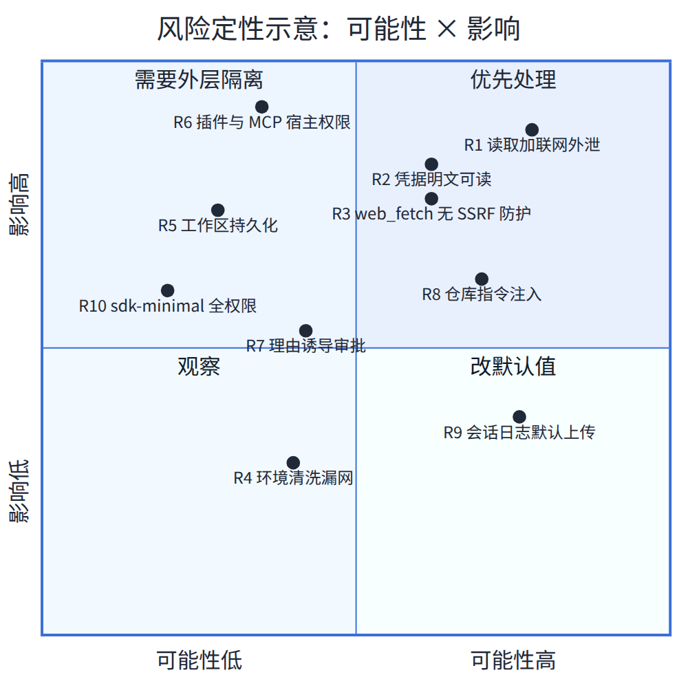

*图 6-8 风险的可能性与影响定性示意（非量化评分）*

## 7 可靠性与恢复

### 7.1 写入路径与检查点

#### 7.1.1 从内存追加到落盘

会话写入分为三段。第一段，`Session.append` 同步写入内存日志并发出 `session/event`，热路径从不阻塞 I/O，观察者失败被隔离、不影响提交。第二段，持久化后端把事件路由进该会话写句柄的 write-behind 窗口：首个待处理事件开启一个固定截止时间（200 毫秒，内部常量），后续事件加入但不重置截止时间，窗口到期时发起一次持久 `append`。第三段，JSONL 提供方写入编码后的行或帧，`fsync`，失败时截断回之前的字节长度并再次 `fsync`，避免重试产生重复 seq。会话采用延迟实体化：`create` 不写盘，首次 `append` 才以临时文件、`fsync`、`link()` 发布、目录 `fsync` 的方式原子写入 header 与首批事件；从未写入的会话“等于从未存在”。[[26]](#ref-26)

#### 7.1.2 语义检查点

200 毫秒窗口意味着进程崩溃时可能丢失最近一批事件。为此，`dsh-session-checkpoint-policy` 在三个语义屏障上强制 flush：模型请求的适配器流构造之前、顶层工具正文运行之前、每个 `agent/pre-step` 边界。flush 失败即阻止后续动作（fail closed）；工具检查点等待期间若被取消，返回 `ABORTED_BEFORE_DISPATCH`。文档写明，未加载该策略时，“仍位于批处理窗口内的写入可能丢失”。sdk-minimal 自 0.2.1-rc.2 起也启用了检查点。这一设计与参考章节中 Super-agent 的“先落库、后执行”同出一辙：对外有副作用的动作开始前，先确认证据已经持久化。

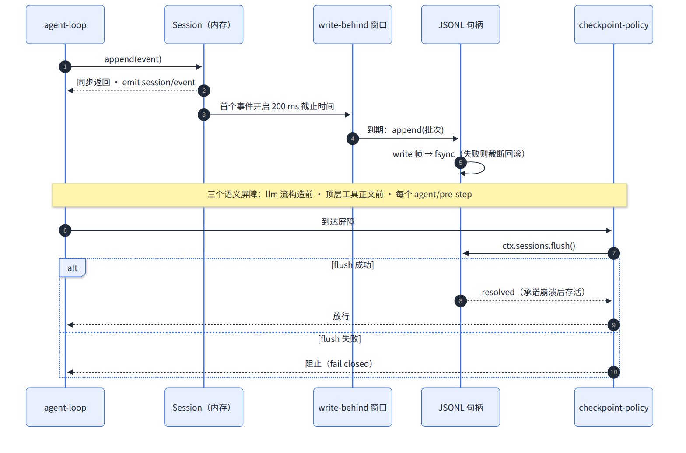

*图 7-1 写入路径：内存追加、200 毫秒批处理窗口与三个强制 flush 的语义检查点*

### 7.2 崩溃恢复与中断的工具调用

#### 7.2.1 读方修复，而不是写方截断

轮次进行中崩溃时，日志以一个开放的 `turn/start` 结束。持久层**不截断也不修复**已提交事件（长任务的单个轮次可能非常庞大），只丢弃撕裂物理尾部中的不完整碎片：不完整的最终原始行被丢弃；撕裂的最终 zstd 帧只贡献能完整解码的记录，写句柄截掉撕裂字节并在第一次新批次前重写恢复出的记录；完整已提交帧中的校验和、解压或结构错误按损坏拒绝。修复由读方完成：Agent 恢复时先以写模式打开会话取得所有权（排斥并发恢复），读取全部事件，计算 `interruptedTurnClosers`——缺失的工具错误结果、未闭合的 `step/end` 和结束原因为 `interrupted` 的 `turn/end`——再通过同一句柄追加。只读观察方（如 session-query）只在内存中配平，不回写。

#### 7.2.2 不盲目重试

中断的工具调用分两类：日志中已有 `tool/call` 但没有结果的，记为 `TOOL_OUTCOME_UNKNOWN`；连启动都没有记录的，记为 `TOOL_NOT_STARTED`。模型看到的措辞是：“结果未知……仅当操作只读或幂等时重试；若可能有副作用，先验证外部状态或询问用户。不要盲目重试。”合成事件的时间戳复用最后一个真实事件，不虚构未来时间；平衡的日志返回空数组，因此重复恢复不会重复追加。单写者由进程内认领加内核锁（POSIX `flock`、Windows 命名信号量）保证，崩溃进程持有的锁随进程消亡。

#### 7.2.3 与 Super-agent 失败规则的对照

参考章节总结了 Super-agent 的一条规则：失败之后“不自动输入”，即主机不会在失败后自动向执行器投递新的输入，而是把决定权留给人或主 Session。DSH 在会话层面有一条精神相近的规则：中断的工具调用以“结果未知”恢复，不会自动重试，检查点策略的 README 写明“中断的工具调用会以未知结果恢复，不会自动重试”。两者都承认同一个事实——**有副作用的动作在崩溃后处于不确定状态，任何自动重放都可能造成重复执行**。区别在于层次：Super-agent 在工单层面阻止自动推进，DSH 在单个工具调用层面阻止自动重放，并把判断交给模型（只读或幂等才重试，否则先验证外部状态或询问用户）。两者叠加，正好构成“任务级不自动推进、动作级不自动重放”的双层保护。

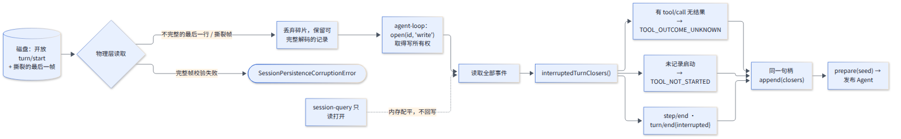

*图 7-2 崩溃恢复：物理层丢弃撕裂尾部，逻辑层由读方在写所有权下追加合成收尾事件*

### 7.3 格式代际与迁移

#### 7.3.1 永不改写已提交的代际

会话目录位于 `~/.dsh/sessions/--<规范化 cwd>--/<编码后的 id>/`，文件名 v0 为 `session.jsonl`，后续版本为 `session.vN.jsonl`，默认 zstd 压缩（每个 append 批次一帧，带校验和）。当前写入器版本为 V4，迁移链由四个相邻迁移包组成（v0→v1→v2→v3→v4），每个包只负责一步。仓库规则写明：迁移“可以新增以版本命名的后继，但绝不移动、覆盖或删除已提交 generation；前代不意味着 fallback 或降级支持”。只读打开单遍解码迁移后直接返回内存结果，不发布；写打开则在同目录编码临时文件，在 Worker 线程中校验（进程级最多 2 个校验器），复查源文件版本，再以不覆盖方式发布后继（POSIX `link()` 加目录 `fsync`，Windows `MoveFileExW` 不覆盖直写）。最高代际若为未来版本即拒绝，即使存在可读的旧代际。

#### 7.3.2 流式迁移的由来

迁移 API 采用有状态的流式 Stage 接口（`transformEvent`、`transformRun`、`finish`），起因是一次真实事故：整文件迁移让一份 116 MB 的真实会话耗尽了 16 GB 内存的 Node 进程——它包含 317,540 个 zstd 帧，约 914 万个 v0/v1 逻辑事件折叠为 72,784 个当前格式事件。提升版本号的门槛很高：仅当“现有判别信息无法阻止不安全解释”时才提升，同版本演进则通过持久化类型指纹加确认记录来审查，`docs/persistence-changes/` 下已有 19 条变更记录。

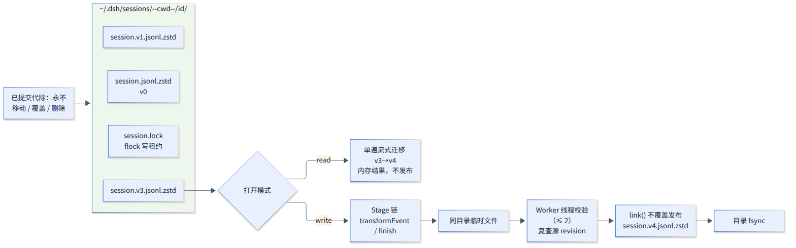

*图 7-3 磁盘布局与代际迁移：旧代际不可变，写打开时经校验后以不覆盖方式发布后继*

### 7.4 Fork、恢复与兼容性承诺

#### 7.4.1 Fork 的种子结构

`SessionStore.fork(source, boundary?)` 取到边界为止的前缀，先追加 `session/end-seed { inherited: true }`，再用合成工具结果与 step/turn 收尾事件（原因 `forked`）闭合开放尾部；`inheritedEventCount` 只计复制的源事件。它拒绝结束于开放轮次内且未闭合的前缀，而不是静默截断。自 0.2.1-rc.3 起，普通 fork 是独立会话，不再写 `parentSession`，子代理则保留直接创建者。`fork` 子代理正是利用这一机制，以父会话已完成轮次为前缀，并省略模型选择参数，以复用服务端的 KV cache。

#### 7.4.2 开发者预览的兼容性

README 用大写写明“THERE WILL BE COMPATIBILITY-BREAKING CHANGES”，仓库规则要求每个外部可感知的破坏性变更立即写入升级指南。截至本次提交，`docs/upgrade-guide/` 下有 11 个版本目录、共 91 篇指南，集中在 0.2.1-alpha.1（22 篇）和 0.2.1-rc.2（27 篇）。破坏性变更大致分四类：插件组合与包入口（如 JSONL 持久化改为无默认导出的命名空间插件、Node.js 24 成为必需）、会话生命周期语义（新会话是否复用空会话、Store 写入时机、独立 fork）、持久化与检查点（投影注册改为句柄、审批服务依赖投影注册表），以及配置键、工具与提供方的改名。值得肯定的是，会话格式自 V4 发布后一直保持 V4，用户数据层面相对稳定，频繁变化的是插件 API 与配置。

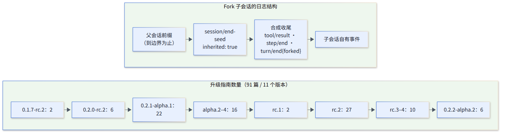

*图 7-4 Fork 种子结构与升级指南的版本分布*

### 7.5 四次事故复盘

#### 7.5.1 事故概要

仓库的 `docs/postmortem/` 公开了四份事故复盘，它们比任何设计文档都更能说明这个系统在哪里容易出错。

**0001 ACP 连接即崩溃**。ACP 服务器在 Zed 第一次 `session/new` 时报 `cannot get property "agents" without inject`，尽管有 178 个绿色单测、100% 行覆盖。根因有二：一个命名空间插件多了一行 `export default apply`，Cordis Loader 优先取 `.default`，拿到裸函数，`inject` 声明丢失；`AgentLoop.resume` 读取了未声明注入的服务，而可追踪 shadow 只向祖先遍历，找不到兄弟分支提供的服务。修复后新增了无密钥的真实 stdio e2e。教训：手工 `ctx.plugin(...)` 的测试无法验证真实加载路径，覆盖率不等于行为覆盖。

**0002 文件系统工具被永久禁用**。条件启用写成 `disabled: !!js ...`，但 Loader 当时只对 `config` 插值，`disabled` 收到的是一个真值对象；快照刷新又把 `UNKNOWN_TOOL` 结果当成新的预期输出接受。教训：快照刷新是 fixture 生产，不是正确性审查。

**0003 Web Agent 验收了替代服务器**。Agent 不知道当前会话的 GUI 地址，先以裸 Vite 的 HTTP 200 宣布成功（实际白屏），再在 3334 端口启动一个不受管的 `dsh web` 并验收它。调查以持久化事件日志为证据。修复是在记录到日志的提示区段中发布规范 URL。教训：传输就绪不等于应用就绪。

**0004 Landlock 部分强制通知导致误归类**。旧 Landlock ABI 下 launcher 打印无害的部分强制提示，harness 以子串加任意非零退出判定 runner 失败，ripgrep 无匹配的退出码 1 被报为 `SANDBOX_UNAVAILABLE`。修复引入 `RunnerFailureRule`。教训：共享前缀不是协议，适配器须保留下层的结构化失败。

#### 7.5.2 共同点

四次事故有一个共同点：**单元测试全绿，但真实组合路径失败**。这正是“一切皆插件”架构的固有风险——每个插件单独正确，组合在一起却可能因加载顺序、导出形式、配置插值或带内信号而失效。DSH 的应对是增加真实入口的 e2e、录制会话快照和配置校验门禁（例如 `verify-cordis-config` 拒绝配置元数据中的表达式），而复盘本身也说明会话日志作为调查证据的价值。

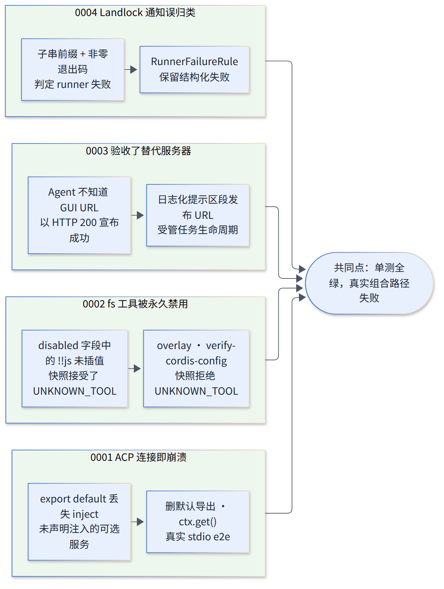

*图 7-5 四次事故的根因与修复：单测全绿而真实组合路径失败*

## 8 扩展生态与二次开发

### 8.1 写一个插件

#### 8.1.1 最小插件与工具

DSH 插件就是一个导出 `name`、可选 `inject`、可选 `Config` 和 `apply(ctx, config)` 的 ES 模块。下面是开发者文档中添加工具的完整示例，它注入 `tools` 服务、注册一个 `greet` 工具：

```ts
import type { Context } from '@deepseek-ai/cordis'
import { defineTool } from '@deepseek-ai/dsh-tools'

export const name = 'greet-tool'
export const inject = ['tools']

export function apply(ctx: Context) {
  ctx.tools.register(defineTool({
    name: 'greet',
    description: 'Greet someone by name.',
    parameters: { name: { type: 'string', required: true } },
    output: { schema: { type: 'string' }, render: (_a, v) => [{ type: 'text', text: v }] },
    async execute(args) { return `Hello, ${args.name}!` },
  }))
}
```

通过一个 patch 文件把它插入配置树即可试用：`- insert: [{ id: greet, name: '/abs/path/greet-tool.ts' }]`，然后 `pnpm dsh web --patch ./scratch/cordis.yml`。由于注册是副作用，插件卸载时工具自动移除，HMR 天然可用。[[27]](#ref-27)

#### 8.1.2 编写约定

工具开发指南有几条值得注意的约定：参数按 schema 预校验，`execute` 返回规范 JSON 值，`output.render` 再转换为模型可见内容；必须遵守 `exec.signal`；长任务用 `ctx.jobs.start()`；**策略不要写进工具**，而是挂到 `tools/pre-execute`（允许/拒绝/询问）、`ctx.tools.guard()`（单调拒绝）、`tools/execute`（包裹）、`tools/post-execute` 和 `tools/result`；PTC 模式下所有工具自动可作为 `await tools.<name>(args)` 调用；UI 卡片通过纯函数 `presentCall` / `presentResult` 声明，回放时同样可用。添加模型适配器的方式类似：继承 `LlmAdapter` 实现 `stream()`，在 `apply` 中 `ctx.llm.registerAdapter(['my-provider'], adapter)`。

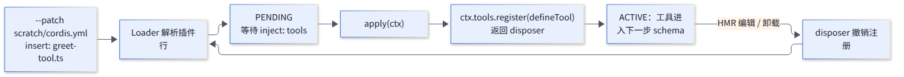

*图 8-1 插件的生命周期：从 patch 插入、依赖等待到注册与自动撤销*

### 8.2 定制 Profile、Bundle 与 Preset

#### 8.2.1 三种粒度的定制

DSH 提供三种粒度的定制。**单次实验**用 `--patch` overlay，不改动任何持久配置；**机器或 profile 级定制**写进 `$DSH_HOME/cordis.patch.yml` 或 `$DSH_HOME/profiles/<name>/cordis.patch.yml`，HMR 会自动重载；**可分发的定制**打包成 bundle：在 `package.json` 中声明 `"dsh": { "bundle": { "patch": "./cordis.patch.yml" } }`，可用 `engines.dsh` 声明兼容版本范围，用 `dsh plugin --profile <name> add <包>` 安装，安装后自动追加进 profile 的 bundle 列表。社区插件通过 GitHub topic `dsh-plugin` 发现；插件市场需要用户在“插件 → 实验性插件”中开启自定义索引，DSH 不内置任何索引源。

#### 8.2.2 定制 Agent Preset

覆盖内置 preset 需要按 `preset-<id>` 行的 id 写 patch，且覆盖会**替换整个子插件列表**，不自动合并内置列表的未来更新，因此需要重述 `id`、`plugins` 等全部字段。Creator 模式把这件事交给 Agent 本身：它可以用 `cordis_inspect_list` / `cordis_inspect_query` 检查运行时，在内存中试验新的插件组合，借助内置的“编辑 Cordis 组合”技能生成 patch，再经插件管理器持久化。官网把这一能力宣传为“在创造模式中通过对话生成插件”。需要提醒的是，preset 和 patch 本质上都是可执行代码，第三方评测（Wavect、ContextOS）都建议把 Creator 模式限制在隔离的工程环境中。

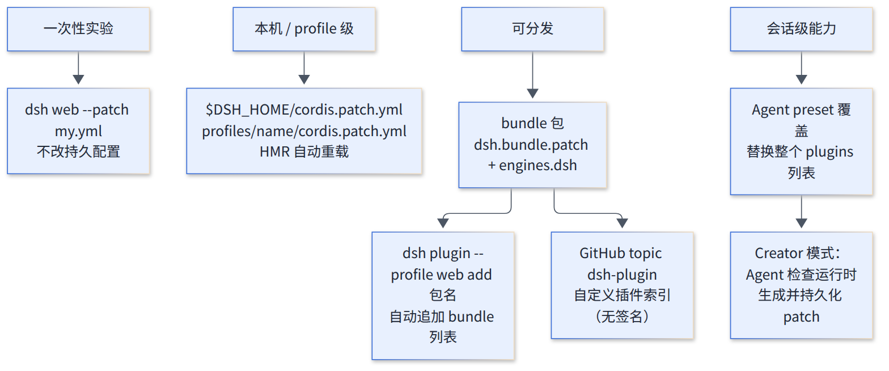

*图 8-2 三种定制粒度：一次性 overlay、持久 patch 与可分发的 bundle*

### 8.3 MCP、Skills 与兼容层

#### 8.3.1 MCP 与 Skills

MCP 客户端插件每个服务器一个条目，支持 stdio 与 streamable-http 两种传输，工具调用默认超时 60 秒，断线自动重连（500 毫秒起、上限 30 秒、至多 10 次）；服务器指令作为字面文本加入系统提示词（上限 32 KiB），资源发现与读取由 `dsh-mcp-resources` 统一提供；不支持 MCP prompt 模板与 elicitation。Skills 是一个标准的三角色接缝：定义 `dsh-skill`，提供方 `skill-filesystem` 与 `skill-office`，消费方 `tool-skill`。本地发现按优先级扫描 `<项目>/.dsh/skills`、`<项目>/.agents/skills`、自定义目录、`<dshHome>/skills`、`<agentsHome>/skills` 和内置目录，会话中以持久的 system-reminder 注入技能名称与描述目录，模型调用 `skill({ name })` 加载正文——与 Claude Code 的 Agent Skills 渐进披露模式兼容。

#### 8.3.2 对 Claude Code 与 Codex 的兼容

DSH 对两个主要竞品采取了“兼容并调用”的策略，这在同类产品中很少见。第一层是**把它们当作子代理**：`subagent-claude-code` 经官方 Agent SDK 运行真实的 Claude Code，`subagent-codex` 经官方 app-server 协议运行真实的 Codex，二者作为按需组合包安装。第二层是**兼容它们的配置**：`hooks-claude-code` 与 `hooks-codex` 把两者的 `hooks.json` 映射到 DSH 的拦截点；实验性的 `claude-code-mods` 加载 Claude Code mods 并在 DSH 扩展点上运行，但不施加沙箱，大量事件可注册而永不触发。第三层是**共用目录约定**：`.agents/skills`、AGENTS.md / CLAUDE.md 指令文件。DeepInfra 的评测据此认为 DSH 适合“希望用一个运行时调用现有 Agent，而把大部分 token 成本交给开源权重模型”的团队。[[28]](#ref-28)

#### 8.3.3 定时、Webhook 与交付物

除了 MCP 与 Skills，还有三个扩展子系统与“让 Agent 在无人值守时工作”直接相关。**Schedule** 提供宿主级的持久提醒，支持 `after`、`at`、`every`、`daily`、`weekly`、`cron`、`rrule` 七种时间类型，可以投递到已有会话或新建会话，模型通过 `schedule_create`、`schedule_list`、`schedule_view`、`schedule_edit` 工具管理。**Webhook** 运行时把经过认证的外部交付转为普通的根会话，仓库附带一个 GitHub 评审 webhook 示例：凭据以引用方式配置，HMAC 在解析 JSON 之前校验，不记录密钥、签名与 payload；Webhook 规则被定义为“受信任的程序化规则”，与宿主同进程运行。**Deliverables** 子系统由 `present` 工具声明交付文件，并基于 git 工作树快照与文件工具前后捕获计算“本轮改动的文件”。这三者让 DSH 具备了事件触发与结果交付的基本能力，但与 Super-agent 相比，它们缺少“谁有权触发”“触发后能做到哪一步”的授权语义，部署时需要用 Webhook 规则与权限预设自行约束。

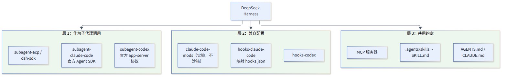

*图 8-3 对外兼容的三个层次：作为子代理调用、兼容配置与共用目录约定*

### 8.4 可观测性

#### 8.4.1 会话日志即 trace

DSH 的可观测性建立在会话日志之上，而不是另一套埋点：重试、压缩、审批、模型切换、插件状态都写入持久事件，回放就是用日志作为种子重新创建会话。Web 界面的 **Trajectory 视图**按轮次组织事件记录表与交互式时间概览，分组展示用户、助手、工具、嵌套子工具与压缩记录，检查器显示 token 用量、耗时、输入输出、图片与附件，长历史虚拟化并流式跟随尾部；长会话基准专门测量 Trajectory 的首次打开耗时。`ctx.tokenMeter` 以最近一次成功调用的 usage 为锚点，对后续 surface 变化做有符号增量估计，供压缩压力判断与 UI 显示。全文检索由 `session-query-sqlite`（FTS5）提供，但 base 组合包默认关闭（`openAt: never`）。

#### 8.4.2 OTel

`dsh-otel` 只是一个共享工厂，挂载本身不创建队列、身份或网络连接；会话遥测与产品埋点各自持有独立通道（见 6.7 节）。对企业而言，更实际的做法是在 `session/event` 上挂一个自有插件，把事件投递到内部日志系统；扩展实操手册的“外部协议驱动”模板展示的正是这种用法。

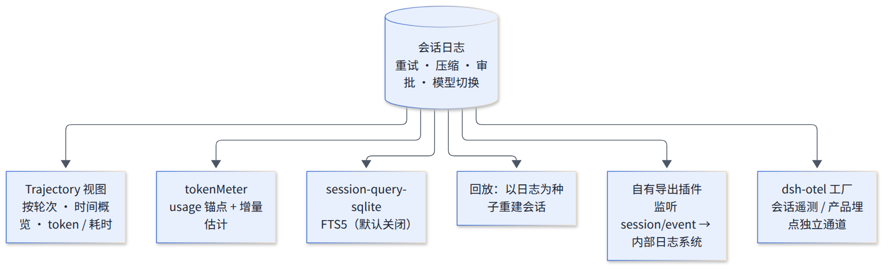

*图 8-4 可观测性的数据来源：所有视图都从会话日志派生，自有导出插件可挂在 `session/event` 上*

### 8.5 案例：Super-agent bundle 如何构建在 DSH 上

#### 8.5.1 用到了 DSH 的哪些能力

参考章节详细分析了 `dsh-superagent-prototype`，这里换一个视角：它用到了 DSH 的哪些扩展机制。第一，**打包形式**：原型在 `package.json` 中声明 `dsh.bundle` 与 `engines.dsh`，把多个 DSH 包列为 peerDependencies，以 `cordis.patch.yml` 插入自己的插件行，这正是本章 8.2 节的“可分发定制”。第二，**会话级能力切分**：它在 `cordis.patch.yml` 中声明两个 Agent preset——`dsh-superagent-router`（主 Session，只有路由与读取类工具）与 `dsh-superagent-worker`（执行器 Session，拥有完整工作工具但不能向人提问），对应本报告 3.6 节的 preset 机制。第三，**Session 与工具运行**：Worker 在 DSH 提供的环境中使用模型和工具，Router 与 Worker 之间通过类型化工具调用通信。第四，**后台化**：原型用“前台命令 5 秒转后台、回合后后台工作上限 30 分钟”近似异步 ReAct，这依赖 DSH 的 jobs 子系统。Super-agent 文章称其异步任务机制“已经在 DeepSeek Harness 中实现，但尚未默认开启”。[[5]](#ref-5)[[4]](#ref-4)

#### 8.5.2 DSH 没有提供、由 bundle 自建的部分

另一方面，Super-agent 的核心概念——Source、Trigger、Thread、Eval、Mandate、Ticket、Outbox、Effects——在 DSH 中都没有对应物，全部由 bundle 自建，持久化也用的是自己的 SQLite 而不是 DSH 的会话日志。这说明 DSH 的边界止于“单个 Agent 会话及其子代理”：它提供了运行一个 Agent 所需的一切，但“谁有权发起工作、多个任务如何调度”属于更上层的编排问题。从这个案例可以得出一个对二次开发者有用的判断：**在 DSH 之上构建多任务系统是可行的，但需要自带任务模型与授权模型**；DSH 的 webhook 运行时（`ctx.webhookRuntime`）和 schedule 子系统可以作为事件入口，但并不提供 Super-agent 那样的授权与工单语义。


*图 8-5 Super-agent bundle 与 DSH 的分工：DSH 提供会话与工具运行，bundle 自建事件、授权与工单*

## 9 测试、评测与工程体系

### 9.1 测试体系

#### 9.1.1 分层与门禁

DSH 的测试体系在开源 Agent 项目中极为少见地严格。测试文档列出的层次包括：单元测试（每个注册表都有 HMR 安全测试）；**按文件 100% 的覆盖率门禁**（`packages/*/*/src`，CI 以 `test:coverage` 而不是 `test` 作为门禁）；真实 API 的 e2e 测试（无密钥时自动跳过，文档原话是“我们是 DeepSeek，不要吝惜真实 API 测试”）；预期输出测试；性能基准；**录制会话快照**（headless、SDK、ACP、Web 四类场景，回放模型输出，无需密钥）；Web 浏览器快照（Chromium 为主、部分 WebKit，CI 强制回放模式）；Web 性能与压力测试。仓库约定要求每个非平凡的、模型或用户可见的改动都更新一份录制会话快照，Agent 循环、会话生命周期和事件映射的改动必须同步更新 TypeScript 与 Python 两个 SDK 的预期输出。[[29]](#ref-29)

#### 9.1.2 规模

按文件名粗略统计，仓库中有约 2,567 个 spec 测试文件、375 个 e2e 文件（其中 32 个为预期输出测试）、10 个基准文件、6 个性能测试文件；录制快照场景目录 session 166 个、web 71 个、sdk 38 个、acp 9 个；Python SDK 测试 26 个。`.ts/.tsx` 代码合计约 138 万行，其中测试目录约 82.7 万行、非测试源码约 55.6 万行，测试代码量约为产品代码的 1.5 倍。测试原则同样值得一提：只 mock 昂贵或不确定的边界（LLM、网络、时钟），其余用真实实现；e2e 从外部重新验证结果，而不是检查 Agent 的自述。第 7.5 节的四次事故说明，即使有这样的门禁，组合路径仍是薄弱环节。


*图 9-1 测试分层与规模（文件数为按文件名的粗略统计）*

### 9.2 性能门禁

#### 9.2.1 `benchmarks/` 是性能回归门禁

一个容易被误解的事实是：仓库中的 `benchmarks/` 目录**不是模型能力评测**，而是 PR 级的性能回归门禁（必需的 Linux PR 检查 `node 24 / benchmarks`）。被计时代码在纯 Node 下运行，用合成输入执行耗时、堆与缩放预算。用例包括：活动流重连（重连时携带 10 万个 reasoning delta 的未完成前缀，客户端折叠成本上限 125 毫秒）、Agent 续聊（SDK 变体执行 100 轮、800 次真实文件读取）、长会话浏览器（Chromium 打开 240 轮合成会话、加载更早页面、访问 Trajectory、流式期间输入）、会话语料（列出 3,000 个会话、搜索 1,000 个、fork 1,000 个，播种约 1.5 GB zstd 日志）、对话折叠（50 万个流式 delta 压成 1,600 条流记录）以及会话打开、终端 I/O、用户文本凭据检测等。

#### 9.2.2 方法学

每个用例取 3～5 个全新进程样本的中位数，报告 CPU 型号、并行度、平台与 Node/V8 版本，并用 PassMark 单线程分把结果缩放到不同机器。配置注释写明，预算“never loosened to accept it”——性能退化必须修复代码，不能放宽预算。这套门禁直接对应用户可感知的场景（长会话、海量会话列表、重连），说明团队把“长时间、大规模使用”视为一等需求。

#### 9.2.3 文档即门禁

DSH 的工程体系还有一个不常见的特点：大量文档是**生成的**并受门禁约束。能力接缝全表、配置目录（163 个包条目）、持久化事件目录（62 种事件）、工具目录、模块依赖图都由脚本从源码生成，生成器会交叉核对运行时 schema 与文档声明，`doc-sync` 门禁拒绝漂移；新增事件必须用 `@mode` JSDoc 声明分发模式，每个导出必须有说明契约的 JSDoc。文档几乎全部中英双语，并附 `.i18n.yaml` 翻译元数据，仓库中约有 2,100 份中文文档。仓库还为编码 Agent 准备了专门的入口：根目录的 AGENTS.md（CLAUDE.md 为其符号链接）规定了约定、命令与防御性模式，`.agents/skills` 下有提交前检查、PR 描述、升级指南、错误处理、文风规范等技能，`.agents/notes` 记录设计决策的理由。Super-agent 原型的 README 也提到其工程大部分由编码 Agent 在日常工作中完成。可以推断，DSH 本身就是一个**被设计为由 Agent 参与开发**的代码库，严格的生成式文档与门禁既服务人类维护者，也是约束 Agent 改动质量的手段。


*图 9-2 性能门禁覆盖的用户场景与预算机制*

### 9.3 能力评测的缺位与第三方数据

#### 9.3.1 仓库中没有能力分数

`BENCHMARK.md` 全文只有 3 行，指示外部评测者安装 Python SDK、运行 `jsonrpc-agent` minimal 变体（即今天的 `sdk-minimal`），并为独立任务使用不同的工作区与会话 id。仓库中**没有公布任何模型能力分数、数据集或方法学**；唯一与编码能力相关的测试是一个带密钥的“SWE-bench 风格”冒烟测试：真实模型只用 bash 工具修复临时目录中一个 `add(a, b)` 返回 `a - b` 的玩具 bug，由 Agent 之外重新运行测试脚本验证。可以推断，DeepSeek 对外运行 Agent 评测时采用的就是 sdk-minimal 组合（持久 bash、读图、工作目录，全权限，自动压缩），这与 SWE-bench、Terminal-Bench 等基准常用的“最小工具集” harness 惯例一致，但仓库没有写明具体基准。

#### 9.3.2 第三方观察

第三方数据只能作为参考。一个社区实验项目报告，DeepSeek V4 Pro 对 API 可见的工具目录高度敏感：在其 Project2 评测中，Standard 与 PTC 分别得 91 和 92 分，官方 Minimal 得 99 和 96 分，据此提出“先以 Minimal 的工具 schema 开局、按需再开放 Standard 工具”的 Anchored Standard 方案——这是第三方测试，不是官方基准。Atlas Cloud 的实测显示，同一任务跑 3 次、3 次都自称完成，只有 1 次真正可用，并测得每个新会话约 11k 输入 token 的开销；DeepInfra 实测 V4-Flash 第一轮耗时 6 分 23 秒、约 3 美分。这些观察共同指向一个结论：**评估 DSH 时应以外部验收为准，而不是 Agent 的自述**，Minimal 模式是建立基线的首选。[[30]](#ref-30)[[31]](#ref-31)


*图 9-3 评测现状：仓库只提供运行入口，能力数据来自第三方，且需外部验收*

## 10 与 Claude Code、Codex、OpenCode、Pi、Hermes Agent 的横向比较

### 10.1 比较框架与口径

#### 10.1.1 只比较同一层的对象

参考章节在比较 Super-agent 时专门说明了“比较的是什么”。本章同样先确定口径：DSH 是 **Harness 层**的运行时，与它处于同一层的是 Claude Code（及其 Agent SDK）、OpenAI Codex（CLI 与 app-server）、OpenCode、Pi 和 Hermes Agent；Super-agent 属于其上的编排层，不在本章比较之列。对其他产品的描述依据 2026-11-03 读取的官方文档与仓库 README，凡涉及版本相关的细节均以“文档所述”理解；第三方评测只作为旁证。[[32]](#ref-32)[[33]](#ref-33)[[34]](#ref-34)[[35]](#ref-35)[[36]](#ref-36)比较维度有六个：定位与形态、循环模型与扩展点、会话持久与恢复、权限与沙箱、多 Agent 与集成接口、模型绑定与许可。

#### 10.1.2 一个粗略的光谱

六个对象可以排在一条“核心可替换性”的光谱上。一端是 **Pi**：核心极小，只有 read、write、edit、bash 四个工具，系统提示加工具定义不到 1,000 token，不做 MCP、不做子代理、不做权限提示，鼓励用户“make it your own”。另一端是 **Claude Code**：循环固定，扩展点丰富（约 30 种 hook 事件、skills、plugins、MCP、子代理），但核心不可替换。**DSH** 在可替换性上走得最远——连循环本身都是插件——但同时又是功能最多的之一，它不是“小”，而是“全部可拆”。Codex、OpenCode、Hermes 则介于其间。


*图 10-1 六个 Harness 在“核心可替换性”与“开箱功能”两个维度上的定性位置（非量化）*

### 10.2 定位与形态

#### 10.2.1 各自的形态

**Claude Code** 有终端、IDE、桌面、Web 与移动端等形态，Agent SDK 被定义为“Claude Code as a library”，运行的就是 Claude Code 二进制；云端会话运行在 Anthropic 管理的隔离 VM 中。**Codex** 的核心是 Rust 编写的 app-server，CLI 的 TUI、VS Code 扩展和桌面应用都是它的客户端，原先的 `codex mcp-server` 已被移除，官方要求迁移到 app-server。**OpenCode** 采用客户端/服务器架构，运行时同时启动 TUI 与 HTTP 服务器，提供 OpenAPI 3.1 规范与 SSE 事件流。**Pi** 支持交互、Print/JSON、RPC 与 TypeScript SDK 四种运行模式。**Hermes Agent** 定位为“自我改进的 AI Agent”，一个 `AIAgent` 编排引擎服务 CLI、消息网关（Telegram、Discord、Slack 等 25+ 平台）、ACP、批处理与 API server。

#### 10.2.2 DSH 的定位

DSH 自称 “agent harness”，第三方普遍用“底盘”（chassis）形容它：DeepInfra 的评语是“less a product than a chassis”，DataCamp 建议“当运行时本身就是工作的一部分时”使用它。官网则把它包装为面向文档、表格、报告、编码、研究和后台长任务的通用助手，提供 macOS 与 Windows 桌面版。两种叙事并存，反映出 DSH 既想做开发者的运行时，又想做终端用户的产品。[[37]](#ref-37)

#### 10.2.3 社区热度与质疑

DSH 的社区热度在同类项目中罕见。据 Star History 统计，仓库首日新增约 7.5 万星，第 2 天达到 10 万，第 15 天达到 20 万，打破 OpenClaw 用 88 天创下的纪录；本次读取时约 26.98 万星、3.28 万 fork、约 2.49 万次提交。eesel 报道截至 10 月初一周的 npm 下载约 45 万次，Hacker News 发布帖获 747 分。同期参照（9 月初）：OpenClaw 约 38.9 万、Hermes Agent 约 24.0 万、OpenCode 约 20.3 万。质疑同样存在：NerdBite 指出命名空间本身不能证明官方背书，星数可能被刷，建议“作为谈资而非结论”；Wavect 的说法是“星数压缩了发现过程，但不能替代尽职调查”；首日星数在不同来源之间也互相冲突（2.4 万、3 万余、7.5 万）。中文媒体中，机器之心强调连 Agent 循环也是插件、会话日志回答了“出错时模型看到了什么”；量子位称其为“Agent 时代的安卓”；网易则认为说 v0.1 能“替代 Claude Code”为时尚早。


*图 10-2 六个对象的形态与主要入口*

### 10.3 循环模型与扩展点

#### 10.3.1 循环大同小异，扩展方式不同

六者的循环本质上都是“模型请求 → 工具调用 → 结果回填”的 ReAct 变体，差别在于扩展点放在哪里。Claude Code 的 hooks 是最成熟的外部扩展机制：事件包括 SessionStart、UserPromptSubmit、PreToolUse、PermissionRequest、PostToolUse、Stop、PreCompact 等，处理器有 command、http、mcp_tool、prompt、agent 五种，`PreToolUse` 可以返回 allow/deny/ask/defer，也可以改写输入。Codex 以 Thread/Turn/Item 三个原语组织协议，turn 可以 start、steer、interrupt。OpenCode 的插件导出返回 hook 对象的异步函数，可以覆盖同名内置工具。Pi 的扩展默认导出一个接收 `ExtensionAPI` 的函数，可以注册工具、修改系统提示、挂生命周期事件。Hermes 的循环是同步的，工具在导入时自注册，系统提示按 stable → context → volatile 分层以保住缓存。

#### 10.3.2 DSH 的差异

DSH 的差异在于**扩展点就是全部**：循环、模型适配器、工具注册表、会话日志都是 Cordis 插件，通过 `agent/*`、`tools/*` 的 waterfall 拦截，通过 profile/bundle/patch 组合。与 Claude Code 的 hooks 相比，DSH 的 pre-execute 不允许改写参数、守卫只能收紧；与 OpenCode 的插件相比，DSH 的插件可以替换服务提供方而不只是挂钩子。代价是学习曲线：要写一个有用的 DSH 插件，需要理解服务、注入、作用域、isolate 和事件模式，而不只是一个 hook 函数签名。值得一提的是，DSH 与 Pi 存在直接的代码依赖：DSH 的多提供方适配器 `llm-pi-ai` 基于 Pi 的 `pi-ai` 模型层。


*图 10-3 扩展点的位置：在固定循环外围挂钩子，还是循环本身也可替换*

### 10.4 会话持久与恢复

#### 10.4.1 各自的持久化

Claude Code 以 JSONL 转录存放在 `~/.claude/projects/<编码后的 cwd>/`，支持 continue、resume、fork，文件回滚依赖 file checkpointing，跨主机恢复可用 SessionStore 适配器。Codex 以 JSONL rollout 日志存储线程，支持 resume、fork（可截断到某个 turn）、read、archive、revert（不回滚文件）与 compaction。OpenCode 把会话存放在数据库中，支持 export/import JSON。Pi 的会话是 JSONL 文件，条目通过 id/parentId 组成树，可以在同一文件内分支。Hermes 使用 SQLite 加 FTS5 全文检索，跨压缩保留父子谱系。

#### 10.4.2 DSH 的差异

DSH 的会话持久化在严格程度上明显领先：**类型化事件 + 版本化格式 + 只增不改的代际迁移 + “模型可见即已记录”的硬规则**。它记录的不只是对话，还包括请求信封（`request/header`）、路由上下文、失败的尝试、重试与压缩，因此每一次模型请求都可以从日志精确重建；崩溃恢复为中断的工具调用标注“结果未知、不要盲目重试”；fork 的种子结构保证合法的工具调用配对。第三方评测（机器之心、redreamality）都把会话日志列为 DSH 最突出的设计。代价是格式复杂、事件种类多，以及默认把这份日志随请求上传。

| 维度 | DSH | Claude Code | Codex | OpenCode | Pi | Hermes |
| --- | --- | --- | --- | --- | --- | --- |
| 存储 | 版本化 JSONL（zstd），62 种事件 | JSONL 转录 | JSONL rollout | 数据库 | JSONL 树 | SQLite + FTS5 |
| 请求可重建 | 是（硬规则） | 部分 | 部分 | 未说明 | 部分 | 未说明 |
| fork / 分支 | 轮次边界 fork，合成收尾 | fork | fork（可截断） | fork | 同文件树分支 | 谱系 |
| 格式迁移 | 相邻迁移链，旧代际不可变 | 未公开 | 未公开 | 未公开 | 未公开 | 未公开 |


*图 10-4 会话持久化的严格程度对比（定性）*

### 10.5 权限、沙箱与审批

#### 10.5.1 两个轴

参考章节把授权分为“动作级”与“请求级”两个轴，Harness 层产品主要在动作级上竞争。**Codex** 的两层控制最为完整：沙箱模式（read-only、workspace-write 默认、danger-full-access）决定技术上能做什么，审批策略（on-request、never、granular、Auto-review）决定何时询问；macOS 用 Seatbelt，Linux 默认 bwrap 加 seccomp，**网络默认关闭**，可选域名白名单代理；workspace-write 下 `.git`、`.codex` 等目录仍只读。**Claude Code** 有六种权限模式（含后台分类器审查的 auto 模式），沙箱默认关闭，开启后不仅限制写入，还让命令经本机代理按 `allowedDomains` 过滤出站流量。**OpenCode** 提供按工具的 allow/ask/deny 通配规则，文档未提及 OS 级沙箱。**Pi** 不提供审批与沙箱，作者认为其他 Agent 的防护“大多是安全剧场”，建议放进容器。**Hermes** 采用 smart/manual/off 三档命令审批加不可覆盖的硬黑名单，容器后端下把容器本身当作边界，并有 SSRF 防护与上下文文件注入扫描。

#### 10.5.2 DSH 的位置

DSH 的沙箱与审批同样正交，后端覆盖 Linux、macOS、Windows 与 SSH 远端，失败即拒绝；但沙箱**只管写入**，读取、网络与进程可见性都不在承诺范围内，审批只在越权时出现，`web_fetch` 不限目标也不询问。在动作级隔离的强度上，DSH 介于 Codex（默认断网、敏感目录只读）与 OpenCode（无 OS 沙箱）之间；其“先沙箱执行、被拒再申请越权”的模式与 Codex 的 on-request 思路接近，而缺少网络隔离是它与 Codex、开启沙箱后的 Claude Code 之间最明显的差距。

#### 10.5.3 请求级授权：六者共同的空白

如果换到参考章节提出的另一个轴——请求级授权，即“谁的消息算数、谁可以发起一次工作、这次工作被授权到哪一步”——六个 Harness 都相当薄弱，这是 Super-agent 选择在 DSH 之上自建 Mandate 与 Ticket 的根本原因。Claude Code 的云端定时任务支持定时、HTTP API（bearer token）与 GitHub 事件三类触发器，授权粒度是“持有令牌即可触发”；Hermes 的消息网关用白名单与 8 位一次性配对码授权用户，是六者中最接近请求级授权的设计；DSH 的 Webhook 运行时把认证后的外部交付转为根会话，规则被定义为“受信任的程序化规则”，Web 与 API 的非 owner 访问则交给 `remoteAccess` 策略；Codex、OpenCode、Pi 基本假设发起者就是本机用户。换言之，Harness 层回答的是“这个动作能不能做”，而“这件事该不该由这个人发起”仍属于编排层的问题。


*图 10-5 动作级隔离强度的定性示意（非量化评分）*

### 10.6 多 Agent 与集成接口

#### 10.6.1 委派模型

Claude Code 的子代理有独立上下文、系统提示、工具与权限，只回传摘要，默认最多嵌套 3 层、并发 20 个，可以 fork 父对话，另有 Agent teams。Codex 的子代理只在用户明确要求时委派，继承父级的沙箱与审批设置，自定义 agent 不能覆盖这些安全设置。OpenCode 分 Primary 与 Subagent，经 Task 工具调用，可按权限过滤。Pi 核心不提供子代理，作者称其为“黑盒中的黑盒”，替代做法是经 bash 或 tmux 自调用。Hermes 的 `delegate_task` 默认扁平（深度 1）、并发 10，子代理看不到父级历史。DSH 的子代理深度 1、活跃 8 个，本地 spawn/fork 可续接、父子双向 `send_message`，并且**可以把 Claude Code 和 Codex 本身当作子代理调用**，这是六者中独有的。

#### 10.6.2 集成接口

| 接口 | DSH | Claude Code | Codex | OpenCode | Pi | Hermes |
| --- | --- | --- | --- | --- | --- | --- |
| SDK | TS / Python（JSON-RPC stdio） | TS / Python Agent SDK | TS / Python SDK | 由 OpenAPI 生成 | TS SDK | Python 库 |
| 服务协议 | Web `/api` + WS | `-p` headless | app-server（JSON-RPC） | HTTP + SSE | RPC（JSONL） | API server |
| ACP | 服务端 + 子代理客户端 | 未见官方服务端 | 未见 | `opencode acp` | 未核验 | ACP adapter |
| MCP | 客户端 | 客户端 | 客户端 | 客户端 | 不支持 | 客户端 |
| 模型 | 默认 DeepSeek，42 个 provider | 仅 Claude | 默认 OpenAI，可自定义 | 75+ provider | 多 provider | 18+ provider |
| 许可 | MIT | 商业条款 | Apache-2.0 | MIT | MIT | MIT |


*图 10-6 委派范式对比：谁可以创建子代理、子代理能否续接、能否委派给外部产品*

### 10.7 综合比较与选型建议

#### 10.7.1 总表

| 维度 | DSH | Claude Code | Codex | OpenCode | Pi | Hermes |
| --- | --- | --- | --- | --- | --- | --- |
| 定位 | 插件化运行时 / 底盘 | 产品级编码 Agent | 编码 Agent + app-server 内核 | 开源编码 Agent | 极简 harness | 自我改进的通用 Agent |
| 核心可替换性 | 最高（循环也是插件） | 低（循环固定） | 低 | 中（服务端核心固定） | 高（核心极小） | 中 |
| 扩展机制 | Cordis 服务 + waterfall + patch | hooks / skills / plugins | hooks / skills / MCP | JS/TS 插件 hooks | TS extensions | 工具自注册 / 插件后端 |
| 会话持久 | 最严格（版本化事件日志） | JSONL + checkpoint | JSONL rollout | 数据库 | JSONL 树 | SQLite + FTS5 |
| 动作级隔离 | 写沙箱，无网络隔离 | 可选沙箱含网络代理 | 默认断网，敏感目录只读 | 规则，无 OS 沙箱 | 无（容器） | 审批 + 黑名单 / 容器 |
| 多 Agent | spawn/fork + 委派 Claude Code/Codex | 子代理 + teams | 子代理 | Task 工具 | 无 | delegate_task |
| 成熟度 | 开发者预览，全部 pre-release | 生产级 | 生产级 | 稳定 | 稳定 | 稳定 |

#### 10.7.2 选型建议

基于上述比较，可以给出四条选型建议。其一，**如果运行时本身是你的工作对象**——研究 Agent 行为、定制循环、构建自己的 Agent 产品、需要可审计的完整轨迹——DSH 是目前可替换性最高、会话日志最严格的开源选择。其二，**如果目标是日常编码效率**，Claude Code 与 Codex 更成熟，OpenCode 是更稳定的开源日常工具（DeepInfra 的结论是 opencode “still the better daily driver”）。其三，**如果需要强默认隔离**，Codex 的默认断网与敏感目录只读最省心，DSH 需要外层容器与网络策略补齐。其四，**组合使用**是 DSH 独有的选项：用 DSH 作为外层运行时与审计层，把部分任务委派给 Claude Code 或 Codex 子代理，同时把大部分 token 交给 DeepSeek 等开源权重模型。一个常见误解需要澄清：DSH “支持 40 余家模型提供方”并不意味着所有能力在所有模型上等价，DeepSeek 专有的 wire 扩展与缓存友好的增量更新只在 DeepSeek Messages 路由上实现。


*图 10-7 选型决策树*

## 11 局限、开放问题与落地建议

### 11.1 局限

#### 11.1.1 工程与成熟度

DSH 的第一类局限来自成熟度。所有 GitHub 发布均标记为 pre-release，README 明确预告破坏性变更，两个半月内积累了 91 篇升级指南；插件 API、配置键、会话生命周期语义仍在频繁调整。体量本身也是门槛：372 个包、108 个上下文服务、62 种会话事件，要写出正确的插件需要理解 Cordis 的注入、作用域、isolate 与事件模式。第三方实测还提到安装体积较大、每个新会话约 11k 输入 token 的固定开销。文档与源码之间存在少量漂移，例如默认模型名并存 `deepseek-flash` 与 `deepseek-v4-flash`、JSONL README 的布局示例仍写着 V3、Web 组合包的注释引用了不存在的文件、`web_fetch` 的配置注释声称有公网地址校验而实现中未见。

#### 11.1.2 安全与行为质量

第二类局限是安全：沙箱只管写入，读取、网络和进程可见性不受限；凭据明文且同 UID 可读；插件、MCP、LSP 以宿主权限运行，插件与市场索引没有签名；会话日志默认随请求上传。第三类局限是行为质量的验证缺口：循环没有内建的最大步数上限，失控防护依赖插件；仓库没有公布任何能力评测；第三方实测反复观察到“Agent 自称完成而实际不可用”的情况。这些问题并非 DSH 独有，但在“可替换一切”的架构中，默认组合的质量更依赖使用者自己的验收。


*图 11-1 三类局限：成熟度、安全与行为质量*

### 11.2 开放问题

#### 11.2.1 值得持续跟踪的问题

结合源码与第三方评论，以下问题值得持续跟踪。第一，**可演化的运行时如何治理自己**：ContextOS 的审计指出，一个连循环都能被 Agent 改写（Creator 模式）的系统，需要一层不可变的治理内核来约束可演化的内层；目前 preset 和插件都能执行宿主代码，这一层尚不存在。[[38]](#ref-38)第二，**网络隔离何时补齐**：Codex 默认断网、Claude Code 的沙箱带出站代理，DSH 的沙箱模式词汇明确把网络排除在外，是否会引入网络维度是安全成熟度的关键指标。第三，**会话日志上传的默认值**：`dsh_session_log` 默认启用，对企业用户和隐私敏感场景影响很大，官方是否会改为显式同意值得关注。第四，**异步任务与 Super-agent 的落地**：Super-agent 文章称异步任务机制已在 DSH 中实现但未默认开启，这一能力何时成为默认、是否会把 Super-agent 的部分概念（事件入口、授权）下沉到 DSH，将决定 DSH 的边界是否上移。第五，**能力评测的透明度**：仓库只提供运行入口而无分数，社区实验显示工具目录对模型表现影响显著，官方是否会发布 harness 级的评测方法学有待观察。


*图 11-2 五个开放问题*

### 11.3 落地建议

#### 11.3.1 从窄处起步

对考虑在团队内引入 DSH 的工程负责人，建议分三个阶段推进。**第一阶段：隔离试点（2～4 周）**。在一次性虚拟机或容器中运行，只挂载试点仓库目录，配置出站代理白名单；关闭 `session-log-deepseek` 上传（或确认合规后再开启）；以 Minimal 模式和 Python SDK 建立 30～50 个真实任务的基线（Wavect 的建议）[[39]](#ref-39)，一律用外部测试验收结果，不采信 Agent 自述。**第二阶段：受控扩展（1～2 个月）**。切换到 Standard 模式，在 `tools/pre-execute` 上挂载团队自有策略插件：拒绝私网地址的 `web_fetch`、对 `$DSH_HOME` 与 `~/.ssh` 的读取拒绝、对 MCP 工具默认询问、对 `.git/hooks` 等敏感路径的写入拒绝；在 `session/event` 上挂载导出插件，把会话日志与 `approval/*`、`sandbox/mode` 事件送入内部审计系统；固定版本号，按升级指南逐版评估。**第三阶段：定制与组合**。按团队需求编写 bundle（自定义工具、技能、preset），评估 PTC 模式对多步工具任务的收益，必要时把部分任务委派给 Claude Code 或 Codex 子代理；Creator 模式只在隔离的工程环境中使用。

#### 11.3.2 度量

落地过程中建议持续度量四类指标：**结果质量**（外部验收通过率，与 Agent 自称完成率的差距）、**成本**（每任务 token 与缓存命中率，DSH 的 usage 字段区分了未命中、缓存读与缓存写）、**安全**（越权申请次数、批准率、被策略插件拦截的调用数）、**稳定性**（崩溃恢复次数、`TOOL_OUTCOME_UNKNOWN` 出现频率、升级引入的回归数）。这些指标大多可以直接从会话日志计算，这正是 DSH 会话设计带来的便利。

#### 11.3.3 适合与不适合的场景

综合全文，DSH 适合四类场景：**Agent 研究与评测**（需要精确重建每次模型请求、对比不同循环策略或工具呈现方式，Minimal 与 PTC 模式和会话日志正好提供了实验条件）；**构建自有 Agent 产品**（以 DSH 为运行时，通过 bundle 与 preset 定制能力，复用其 Web、SDK、ACP 前端）；**多模型、多 Agent 组合**（用一个运行时同时调用 DeepSeek、其他 provider 以及 Claude Code、Codex 子代理）；**需要完整审计轨迹的内部工具**（会话日志天然是审计记录）。不适合的场景同样清晰：对稳定 API 有强依赖的长期集成（预览期破坏性变更频繁）；直接处理不可信仓库或不可信网页而又没有外层隔离的环境（沙箱不管读取与网络）；对数据外发零容忍又无力审查默认配置的团队（会话日志默认上传）；以及只想要一个开箱即用的日常编码助手的个人用户——这种情况下，更成熟的产品通常是更省心的选择。


*图 11-3 三阶段落地路线*

### 11.4 结论

#### 11.4.1 三句话总结

第一，DSH 把 Harness 层从产品中剥离出来，做成了一个“连循环都可替换”的开源运行时，其插件化程度和会话日志的严格程度在同类项目中都属领先。第二，它的安全默认值偏向开发便利——只管写入的沙箱、明文凭据、宿主权限的插件、默认上传的会话日志——在生产环境使用前必须由外层隔离和策略插件补齐。第三，DSH 与 Super-agent 的关系是底座与上层应用：理解 DSH 的边界（单个 Agent 会话及其子代理），才能判断哪些能力需要像 Super-agent 那样在其上自建。


*图 11-4 结论：优势、风险与边界*

## 补充材料

#### 源码索引

| 主题 | 位置（相对仓库根目录，提交 ce7073d） |
| --- | --- |
| 架构总览、轮次流程、归属映射 | `docs/architecture.zh.md` |
| Cordis 入门与 vendored 框架 | `docs/cordis-primer.zh.md`、`docs/cordis-tutorial/`、`vendor/cordis` |
| 能力接缝全表（108 个服务） | `docs/capability-seams.zh.md` |
| CLI 入口与参数解析 | `apps/cli/src/bin.ts`、`apps/cli/src/args.ts` |
| profile 组装与 patch 层 | `apps/cli/src/profile-boot.ts`、`packages/boot/app-boot/src/profile-context.ts`、`vendor/include/src/index.ts` |
| 启动序列与必需条目 | `packages/boot/app-boot/src/index.ts` |
| 组合包与 preset | `packages/bundle/*/cordis.patch.yml`、`packages/bundle/web-app/presets/*.patch.yml` |
| preset 注册与锁定 | `packages/preset/agent-preset-registry/src/index.ts`、`src/mount.ts` |
| Agent 接口与注册表 | `packages/core/agent/src/types.ts`、`runtime-types.ts`、`index.ts` |
| 循环驱动器（turn / step） | `packages/core/agent-loop/src/agent.ts`、`index.ts`、`inbox.ts` |
| 系统提示词组装与段序 | `packages/core/system-prompt/src/index.ts` |
| 工具注册、流水线与批次 | `packages/core/tools/src/index.ts`、`pipeline.ts`、`batch.ts`、`contracts.ts` |
| PTC 执行器与运行时 | `packages/core/tool-executor-ptc/`、`packages/ptc-runtime/ptc-runtime-node/` |
| 会话事件与格式版本 | `packages/core/session/src/types.ts`、`repair.ts`、`fork.ts` |
| JSONL 持久化与迁移 | `packages/session/session-persistence-jsonl/`、`packages/session/session-format-v*-to-v*` |
| 沙箱与越权 | `packages/sandbox/sandbox-local/src/`、`packages/sandbox/sandbox/src/escalation.ts` |
| 凭据与环境清洗 | `packages/credentials/credentials-local/`、`packages/subprocess/subprocess/src/index.ts` |
| DeepSeek 适配器与 wire 扩展 | `packages/llm/llm-deepseek/src/`、`docs/deepseek-llm-api-wire-extensions.zh.md` |
| 子代理提供方 | `packages/subagent/*` |
| 压缩与 spill | `packages/compaction/compaction-basic/`、`packages/spill/spill-policy/` |
| 事故复盘与升级指南 | `docs/postmortem/`、`docs/upgrade-guide/` |
| 性能门禁 | `benchmarks/`、`vitest.bench.config.ts` |

#### 关键默认值

| 项目 | 默认值 | 来源 |
| --- | --- | --- |
| 默认模型 | `deepseek-official` / `deepseek-flash`（SDK、ACP 为 `deepseek-v4-flash`） | `packages/bundle/base/cordis.patch.yml`、`packages/sdk/client/src/api.ts` |
| DeepSeek 协议与地址 | Messages（Anthropic 兼容），`https://api.deepseek.com/anthropic` | `packages/llm/llm-deepseek/src/config.ts` |
| 推理强度 | `high`（可选 off / low / high / max） | `llm-deepseek/src/serialize.ts` |
| Web 监听 | `127.0.0.1:3080`，拒绝通配地址 | `packages/bundle/web-app/cordis.patch.yml` |
| 默认 preset | `standard` | 同上 |
| 新会话权限 | `workspace-write` + `ask`（`DSH_PERMISSION_MODE` 可覆盖） | `packages/bundle/base/cordis.patch.yml` |
| sdk-minimal 权限 | `danger-full-access`，无审批服务 | `packages/bundle/sdk-minimal/cordis.patch.yml` |
| bash 超时 | 60 秒（Minimal 持久 shell 300 秒） | base 组合包、`presets/minimal.patch.yml` |
| 每步并行工具调用 | 10，可热更新 | `packages/core/agent-loop/src/constants.ts` |
| 最大步数 | 无（由插件约束） | `agent-loop/src/agent.ts` |
| LLM 重试 | 5 次，500 毫秒起至 10 秒，10% 抖动 | `packages/llm/llm/src/retry-policy.ts` |
| 流空闲超时 | 5 分钟 | `docs/subsystems/llm-streaming.zh.md` |
| PTC 程序 | 超时 120 秒（上限 600 秒），堆 512 MiB，输出 64 MiB，子调用并发 10 | `ptc-runtime-node/src/config.ts`、`tool-executor-ptc/src/config.ts` |
| 压缩 | 阈值比 0.8，headroom 65,536 token，保留尾部 0.16，重试 1 次 | `compaction-basic/src/config.ts` |
| 工具结果剪枝 | 超过 8,192 字符剪为头 4,096 + 尾 1,024 | `compaction-tool-result-pruner/src/config.ts` |
| spill 内联上限 | 12,500 估算 token（包默认禁用） | base 组合包 `spill-policy` 行 |
| 子代理 | 深度 1，活跃 8 | `packages/subagent/subagent/src/index.ts` |
| Workflow | 总子代理 1,000，结果 50,000 字符 | `workflow-ptc`、`tool-workflow` |
| 重复工具提醒 | 3 / 5 / 8 次 | base 组合包 `repeat-tool-reminder` 行 |
| 会话写批处理窗口 | 200 毫秒（内部常量） | `session-persistence-jsonl/src/storage.ts` |
| 会话格式版本 | V4 | `packages/core/session/src/types.ts` |
| 投影缓存检查点 | 每 200 个事件或 5 秒 | base 组合包 |
| 全文检索 | SQLite `:memory:`，`openAt: never`（默认关闭） | base 组合包 |
| 会话日志上传 | `dsh_session_log` 默认开启，≤ 8 MiB / 请求 | `docs/deepseek-llm-api-wire-extensions.zh.md` |
| OTel 会话遥测 | `FEEDBACK_ONLY` | base 组合包 |
| MCP 工具调用超时 | 60 秒，重连 500 毫秒起至 30 秒，10 次 | `packages/mcp/mcp-client/README.zh.md` |
| 关闭时插件树拆卸 | 至多 5 秒，第二次信号强制退出 | `apps/cli/reference/README.zh.md` |

#### 术语

| 术语 | 含义 |
| --- | --- |
| Harness | 提供模型循环、工具、会话、权限等的智能体运行时，如 DSH、Codex、Claude Code |
| DSH | DeepSeek Harness，本报告的研究对象 |
| Cordis | DSH 的插件框架，源于 Koishi 生态，DSH 以 `@deepseek-ai/cordis` 名义 vendored |
| Profile / Bundle / Patch / Preset | 进程级具名组装 / 可安装的配置层 / YAML 编辑列表 / 会话级子插件列表 |
| Seam（能力接缝） | 定义、提供方、消费方三角色齐备的可替换能力 |
| Turn / Step | 轮次 / 步骤（一次模型请求加其工具） |
| Surface | 进入模型历史的有序消息事件序列 |
| PTC | Programmatic Tool Calling，模型写程序调用工具，原名 Code Mode |
| ACP | Agent Client Protocol，编辑器与自动化客户端驱动 Agent 的标准协议 |
| Super-agent | DSH 团队提出的多任务编排架构及其研究原型，以 DSH bundle 形式运行 |

### 本报告的已知局限

本报告没有构建或运行 DSH，所有关于行为的结论来自源码与文档的静态阅读，未做动态验证；第 6 章中 `web_fetch` 的 SSRF 判断、MCP 工具默认是否询问、LSP 是否沙箱化等结论只基于本次检索范围，需要维护者确认；代码规模、测试文件数等统计为按文件名与行数的粗略估计；对 Claude Code、Codex、OpenCode、Pi、Hermes Agent 的描述基于 2026-11-03 可读取的官方文档，未审阅其源码；GitHub 星数、发布时间等来自第三方统计，各来源存在冲突；第 6.8、10.1、10.5 节的象限图是定性示意，不是量化评分。

## 参考资料

1. <a id="ref-1"></a> DeepSeek-AI，[deepseek-harness 仓库 README（固定提交 ce7073d）](https://github.com/deepseek-ai/deepseek-harness/blob/ce7073d/README.zh.md)。
2. <a id="ref-2"></a> DataCamp，[What Is DeepSeek Harness? The Agent Where Everything Is a Plugin](https://www.datacamp.com/blog/what-is-deepseek-harness)，2026-09-08。
3. <a id="ref-3"></a> 机器之心（新浪转载），[刚刚，DeepSeek Harness 震撼开源：一切皆插件](https://finance.sina.com.cn/tech/roll/2026-08-13/doc-inineuqe4558061.shtml)，2026-08-13。
4. <a id="ref-4"></a> 用户提供的参考章节：《第 23 章 DeepSeek Super-agent：面向自主协作的事件驱动架构》（基于原型提交 6337fc8，调研日期 2026-11-02）。
5. <a id="ref-5"></a> DeepSeek Harness，[dsh-superagent-prototype README](https://github.com/deepseek-ai/dsh-superagent-prototype)。
6. <a id="ref-6"></a> IT之家，[DeepSeek 提出 Super-agent 架构设计](https://www.ithome.com/1/020/615.htm)，2026-10-31。
7. <a id="ref-7"></a> DeepSeek Harness，[架构文档 docs/architecture.zh.md](https://github.com/deepseek-ai/deepseek-harness/blob/ce7073d/docs/architecture.zh.md)。
8. <a id="ref-8"></a> DeepSeek Harness，[vendored 包改名说明 docs/rescope.zh.md](https://github.com/deepseek-ai/deepseek-harness/blob/ce7073d/docs/rescope.zh.md)。
9. <a id="ref-9"></a> Yifan Shi 等，[A Programming Paradigm for Spatiotemporal Composability](https://arxiv.org/abs/2608.25512)，arXiv:2608.25512，2026-08-26。
10. <a id="ref-10"></a> DeepSeek Harness，[术语表 docs/glossary.zh.md](https://github.com/deepseek-ai/deepseek-harness/blob/ce7073d/docs/glossary.zh.md)。
11. <a id="ref-11"></a> DeepSeek Harness，[DeepSeek 适配器配置 llm-deepseek/src/config.ts](https://github.com/deepseek-ai/deepseek-harness/blob/ce7073d/packages/llm/llm-deepseek/src/config.ts)。
12. <a id="ref-12"></a> DeepSeek Harness，[API 网关文档 docs/api-gateway.zh.md](https://github.com/deepseek-ai/deepseek-harness/blob/ce7073d/docs/api-gateway.zh.md)。
13. <a id="ref-13"></a> DeepSeek Harness，[能力接缝全表 docs/capability-seams.zh.md](https://github.com/deepseek-ai/deepseek-harness/blob/ce7073d/docs/capability-seams.zh.md)。
14. <a id="ref-14"></a> DeepSeek Harness，[Cordis 入门 docs/cordis-primer.zh.md](https://github.com/deepseek-ai/deepseek-harness/blob/ce7073d/docs/cordis-primer.zh.md)。
15. <a id="ref-15"></a> DeepSeek Harness，[Agent preset 注册表 README](https://github.com/deepseek-ai/deepseek-harness/blob/ce7073d/packages/preset/agent-preset-registry/README.zh.md)。
16. <a id="ref-16"></a> DeepSeek Harness，[profile patch 层源码 profile-context.ts](https://github.com/deepseek-ai/deepseek-harness/blob/ce7073d/packages/boot/app-boot/src/profile-context.ts)。
17. <a id="ref-17"></a> DeepSeek Harness，[Agent 运行时类型 runtime-types.ts](https://github.com/deepseek-ai/deepseek-harness/blob/ce7073d/packages/core/agent/src/runtime-types.ts)。
18. <a id="ref-18"></a> DeepSeek Harness，[持久化事件目录 docs/persistence-catalog.zh.md](https://github.com/deepseek-ai/deepseek-harness/blob/ce7073d/docs/persistence-catalog.zh.md)。
19. <a id="ref-19"></a> DeepSeek Harness，[CLI 参数解析 apps/cli/src/args.ts](https://github.com/deepseek-ai/deepseek-harness/blob/ce7073d/apps/cli/src/args.ts)。
20. <a id="ref-20"></a> DeepSeek Harness，[Agent 生命周期时序 docs/agent-lifecycle.zh.md](https://github.com/deepseek-ai/deepseek-harness/blob/ce7073d/docs/agent-lifecycle.zh.md)。
21. <a id="ref-21"></a> DeepSeek Harness，[工具执行流水线 docs/tool-execution-pipeline.zh.md](https://github.com/deepseek-ai/deepseek-harness/blob/ce7073d/docs/tool-execution-pipeline.zh.md)。
22. <a id="ref-22"></a> DeepSeek Harness，[PTC 设计笔记 .agents/notes/implemented/feature/2026-06-15-ptc.zh.md](https://github.com/deepseek-ai/deepseek-harness/blob/ce7073d/.agents/notes/implemented/feature/2026-06-15-ptc.zh.md)。
23. <a id="ref-23"></a> DeepSeek Harness，[安全说明 SAFETY.zh.md](https://github.com/deepseek-ai/deepseek-harness/blob/ce7073d/SAFETY.zh.md)。
24. <a id="ref-24"></a> DeepSeek Harness，[沙箱子系统 docs/subsystems/sandbox.zh.md](https://github.com/deepseek-ai/deepseek-harness/blob/ce7073d/docs/subsystems/sandbox.zh.md)。
25. <a id="ref-25"></a> DeepSeek Harness，[DeepSeek LLM API wire 扩展 docs/deepseek-llm-api-wire-extensions.zh.md](https://github.com/deepseek-ai/deepseek-harness/blob/ce7073d/docs/deepseek-llm-api-wire-extensions.zh.md)。
26. <a id="ref-26"></a> DeepSeek Harness，[持久化子系统 docs/subsystems/persistence.zh.md](https://github.com/deepseek-ai/deepseek-harness/blob/ce7073d/docs/subsystems/persistence.zh.md)。
27. <a id="ref-27"></a> DeepSeek Harness，[扩展实操手册 docs/cookbook/extension-cookbook.zh.md](https://github.com/deepseek-ai/deepseek-harness/blob/ce7073d/docs/cookbook/extension-cookbook.zh.md)。
28. <a id="ref-28"></a> DeepInfra，[DeepSeek Harness Review: Agent Loop & Plugin Architecture](https://deepinfra.com/blog/deepseek-harness-review)，2026-09-09。
29. <a id="ref-29"></a> DeepSeek Harness，[测试策略 docs/testing.zh.md](https://github.com/deepseek-ai/deepseek-harness/blob/ce7073d/docs/testing.zh.md)。
30. <a id="ref-30"></a> xiaobright，[dsh-anchored-standard（第三方实验）](https://github.com/xiaobright/dsh-anchored-standard/wiki)。
31. <a id="ref-31"></a> Atlas Cloud，[DeepSeek Harness Review](https://www.atlascloud.ai/blog/tips/deepseek-harness-review)，2026-08-18。
32. <a id="ref-32"></a> Anthropic，[Claude Code 文档：Permission modes、Sandboxing、Hooks、Subagents、Agent SDK](https://code.claude.com/docs/en/permission-modes)。
33. <a id="ref-33"></a> OpenAI，[Codex 文档：Agent approvals & security、App Server、Subagents](https://learn.chatgpt.com/docs/agent-approvals-security)。
34. <a id="ref-34"></a> OpenCode，[OpenCode 文档：Server、Permissions、Plugins、Agents、ACP](https://opencode.ai/docs/)。
35. <a id="ref-35"></a> Mario Zechner，[What I learned building an opinionated and minimal coding agent（Pi）](https://mariozechner.at/posts/2025-11-30-pi-coding-agent/)，2025-11-30；以及 [pi-mono coding-agent README](https://github.com/badlogic/pi-mono/tree/main/packages/coding-agent)。
36. <a id="ref-36"></a> Nous Research，[Hermes Agent 文档：Architecture、Security、Delegation](https://hermes-agent.nousresearch.com/docs/developer-guide/architecture)。
37. <a id="ref-37"></a> DeepSeek，[DeepSeek Harness 官网页面](https://www.deepseek.com/harness)。
38. <a id="ref-38"></a> ContextOS，[DeepSeek Harness 架构与安全审查](https://contextosai.com/blog/deepseek-harness-architecture-security-review)，2026-10-15 更新。
39. <a id="ref-39"></a> Wavect，[DeepSeek Harness Review: Production Readiness](https://wavect.io/blog/deepseek-harness-enterprise-review/)，2026-09-02 复核。
