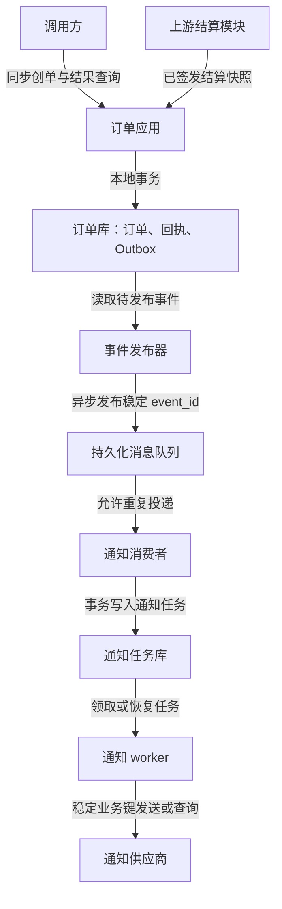

技术方案的核心是把问题转成可验证的设计决策：先确定成功意味着什么，再划定事实与职责边界，最后证明失败后如何恢复。本文面向有 HTTP、数据库事务与消息队列基础、正在编写后端方案的工程师。读完后应能用同一套问题组织自己的方案，并以订单创建与可靠通知案例检查遗漏。

正文中的容量、业务政策和资源安排是教学假设；版本化产品能力来自所列官方文档，文档核验不代表部署、压测或故障演练已经完成。配套旧课件可在文末阅读，涉及过时结论时以对应章节的修订说明为准。

<!-- more -->

## 技术方案解决什么问题

方案让业务、研发、测试和运维对目标、边界、取舍和验证达成一致。它既是开发前的决策材料，也是后续维护者理解“为什么这样做”的依据。组件清单回答用了什么；技术方案还必须回答为什么需要、失败会怎样、怎样证明有效。

围绕一个具体问题写作，比覆盖所有技术名词更有用。比如“创单响应丢失后可能产生两个订单”需要业务意图标识、原子约束和未知结果查询；“数据库提交后通知丢失”需要可靠移交和恢复机制。两者分别验证，不能用“引入微服务和消息队列”代替结论。

| 读者要做的决定 | 方案需要交付的材料 |
|---|---|
| 是否值得做，做到什么程度？ | 当前问题、影响范围、目标、非目标、约束和验收条件 |
| 应怎样实现？ | 容量假设、职责边界、接口和数据契约、正常与失败链路 |
| 为什么选它？ | 可行备选、决定性差异、接受的代价及重新评估条件 |
| 是否可以上线？ | 验证证据、兼容迁移、监控、灰度、回滚和责任人 |

正文按这个决策顺序展开。完整案例提供可仿写的输出形态；小改动可以缩短材料，但不能省略受到影响的不变量和失败处理。

## 目标、约束与验收条件

先区分业务正确性、性能、可靠性、安全与成本，避免把“高可用、可扩展”当作已经可验收的要求。SLI 是观测指标，SLO 是在明确统计窗口与有效请求口径下设定的目标，SLA 是包含责任或后果约定的服务协议。目标需与利益相关者确认，内部性能目标不应一概称为 SLA。[[1]](#ref-1)

| 要定义的内容 | 写法与验收问题 |
|---|---|
| 业务不变量 | 同一结算意图最多一个订单；并发、重放和历史归档后是否仍成立？ |
| 成功语义 | 成功响应确认了本地提交、下游受理还是业务完成？ |
| 性能口径 | 有效请求是什么？窗口、负载、请求大小和 p99 目标是什么？ |
| 故障范围 | 单进程、单节点或整区失效？RPO、RTO 从何时计时、如何核对？ |
| 约束和非目标 | 依赖配额、团队技能、交付期限、预算；本次明确不解决什么？ |
| 验收责任 | 谁在什么环境提交哪些证据？不通过时停止发布还是采用备选？ |

成功率需说明业务拒绝、客户端取消、维护窗口和依赖超时的统计方式；进程存活不能证明用户完成业务。分别定义“结果正确”“确认写入不丢失”和“故障后可恢复”，副本也不能替代备份恢复。案例中的恢复承诺会限定到可接管同步副本与旧主隔离的故障范围。

把约束写成可以反证的假设，例如“供应商持续接受 500 个任务/秒”需要配额和端到端测试；如果实际只能接受 200 个，增加 worker 无法满足恢复目标。尚未验证的假设标明负责人、期限和失败时的决策，不能在验收表中填成已通过。

## 容量估算与假设验证

估算用于找出关键假设与成本，不能凭计算结果决定机器型号。先列输入及来源，计算平均、峰值、突发和热点，再检查请求扇出、重试、工作集与恢复时的余量。下面用图片服务演示单位与口径，后面的订单案例复用这套方法。

### 流量估算：平均、峰值与突发

下面构造一个图片服务的教学示例，所有输入均为假设，不是线上测量或通用经验阈值。沿用同一组输入计算请求、传输与存储，再单独定义缓存工作集。容量规划需要根据实际负载及增长验证这些假设。[[2]](#ref-2)[[3]](#ref-3)

| 输入 | 教学假设 | 口径 |
|---|---|---|
| 日活用户 | 1,000 万 | 每人每天读取 30 次、上传 1 次；一次操作暂按一个请求计算 |
| 峰值系数 | 平均请求速率的 3 倍 | 为演示而选取，需通过实际流量或压测确认 |
| 图片大小 | 每张 1.5 MB | 假设实际传输与存储的压缩后大小相同，不包含额外协议开销 |
| 数据保留时间 | 10 年，每年按 365 天 | 假设不删除、不增长、不重复上传，也不生成额外派生图片 |

本节容量单位采用十进制：1 MB = 10⁶ B，1 GB = 10⁹ B，1 TB = 10¹² B，1 PB = 10¹⁵ B；内存或工具使用 MiB、GiB 时需要另行换算。每天按 86,400 秒计算。

| 指标 | 算式 | 估算结果 |
|---|---|---|
| 日读请求 | 1,000 万 × 30 | 3 亿次 |
| 日写请求 | 1,000 万 × 1 | 1,000 万次 |
| 平均读 / 写 QPS | 各自日请求数 ÷ 86,400 | 约 3,472 / 116 次每秒 |
| 假设峰值读 / 写 QPS | 各自未舍入的平均 QPS × 3 | 约 10,417 / 347 次每秒 |

平均值不能代表峰值，更不能覆盖秒级突发和单个热点。真实方案还需说明峰值统计窗口、访问分布、缓存命中率和请求扇出；多个下游调用或一次分片上传可能让内部请求量大于用户操作量。

### 内存估算：独立对象与驻留工作集

缓存内存取决于驻留的独立对象，而不是读取它们的请求次数。同一对象被读取一万次，不意味着缓存需要存一万份；日请求量乘对象大小再乘固定比例，也不能直接推导缓存容量。工作集需要结合访问分布、TTL、淘汰策略和目标命中率测量。

为演示计算，另行假设缓存中驻留 100 万个独立的图片元数据对象，**不缓存图片本体**；每个值 500 B，键及每条元数据开销暂按 100 B，保存 3 份完整副本，并在已估占用上增加 25% 余量。上述数量、对象开销、副本数和余量都是教学假设，不能由日请求数推出。

| 指标 | 算式 | 估算结果 |
|---|---|---|
| 一份工作集 | 100 万 ×（500 B + 100 B） | 0.6 GB |
| 三份副本合计 | 0.6 GB × 3 | 1.8 GB |
| 包含假设余量的合计 | 1.8 GB × 1.25 | 2.25 GB |

2.25 GB 是三份副本的总量，不是每台机器的配置。实际还需测量进程基础占用、分配器与碎片、连接缓冲、复制缓冲和恢复时的峰值；分片不均匀或某节点故障后，剩余节点也要有足够容量。这里的 25% 余量不是对这些开销的验证结果。

### 带宽估算：传输大小与链路范围

若每次图片读取都向客户端传输 1.5 MB，则每天出站传输量为 3 亿 × 1.5 MB = 450,000 GB；平均速率约为 5.208 GB/s，乘以每字节 8 位后约为 41.667 Gbit/s。按上述假设峰值系数计算，峰值出站速率约为 125 Gbit/s。上传方向平均约为 0.174 GB/s，即 1.389 Gbit/s，应分别规划双向链路。

这些结果只估算图片载荷。协议开销、重试、压缩效果和流量分布需另行验证；如果由 CDN 返回图片，这部分客户端流量不能直接当作源站带宽。源站应按缓存未命中、刷新、预热与故障回源分别估算。

### 存储估算：逻辑数据与物理占用

按假设每天上传 1,000 万张、每张 1.5 MB，新增图片载荷为 15 TB/天；保留 10 年且每年按 365 天，逻辑载荷为 15 TB × 365 × 10 = 54.75 PB。只有在额外假设保存三份完整副本时，图片副本载荷才是 164.25 PB；采用纠删码时应按具体冗余方式计算。

上述计算未包含元数据、索引、缩略图、日志、临时迁移数据与备份。访问增长、生命周期删除和去重也会改变结果。物理容量、备份恢复时长和扩容周期应根据实际产品配置与负载验证，不能仅凭逻辑数据量选定节点数。

### 把估算变成验证计划

每项关键输入都记录“来源或假设、验证方法、通过条件、责任人、失败时的决定”。以下是待填的验证框架；测试环境的产品版本、实例配置、数据规模、负载分布和工具参数应随结果保存，才能解释测量覆盖了什么。容量规划与持续观测的依据见 [[2]](#ref-2)[[3]](#ref-3)。

| 假设 | 验证方法 | 不成立时如何调整 |
|---|---|---|
| 峰值系数与热点分布 | 对照入口流量的时间窗口与键分布，构造持续峰值和突发负载 | 修改峰值、路由或限流政策，重算内部扇出 |
| 缓存工作集与对象开销 | 用目标 TTL 和真实分布观察驻留对象、内存与命中率 | 调整容量、值结构或缓存范围，重新测量回源 |
| 数据库物理开销 | 在目标数据量下测量索引、WAL、备份、查询和恢复 | 修改索引、保留政策或存储方案，核对恢复目标 |
| 故障后剩余处理能力 | 停用一个实例或依赖，保留新增流量，再测恢复速率 | 扩大可用余量、限制入口或接受新的恢复目标 |

验收不只看吞吐峰值：同时检查业务正确性、延迟、错误率、饱和资源和测试后的数据核对。一个依赖越过配额，或者恢复速率不高于新增速率，都需要修订方案；不能靠重复使用未成立的输入让估算继续“通过”。

## 架构视图与职责边界

先画系统与调用方的边界，再展开影响决策的内部组件。C4 用上下文、容器、组件和代码层次组织软件架构视图；按受众选择层次，不必为满足图的数量全部画齐。[[4]](#ref-4) 绘图方法见 。

本文用下表组织关注点，是写作分类，不是对某个架构框架的完整实施。每张图都应标注边界、箭头语义和事实所有者，并能与正文的接口、事务及故障表对应。

| 视图 | 应回答的问题 | 与其他视图的连接 |
|---|---|---|
| 业务流程 | 谁触发什么动作，成功意味着什么？ | 指向接口及业务状态 |
| 应用职责 | 哪个模块持有订单、支付、库存事实？ | 指向契约、认证及跨边界调用 |
| 数据与事务 | 哪些事实一起提交，哪些只能异步收敛？ | 指向约束、事件、索引和恢复 |
| 部署与故障域 | 实例、副本、接入和外部依赖部署在哪里？ | 指向容量、切换、隔离与监控 |

课件第 9 页的“禁止同层调用”只是该图的组织约定，不能泛化为所有架构的禁令；判断依据是是否出现职责混乱、循环依赖或隐含事务耦合。第 10 页的 ODS、DWD、DIM、APP 属于数据仓库分层，不能直接套到在线订单事务架构。

### 单体、微服务与通信方式

业务能力的边界与独立部署需求决定是否拆服务。微服务通常按业务能力组织并独立部署，但会引入远程故障、契约兼容和分布式运维责任。[[5]](#ref-5) 本文建议在团队或交付规模尚小、事务边界紧密时先保留模块化单体；当独立发布、隔离或扩容需求有证据时再比较拆分收益。拆分数据库不能自动解决跨系统一致性。

Service Mesh 是服务通信治理的实现选项。引入前需验证统一流量、安全或观测需求是否足以覆盖数据面、控制面和升级成本。本文不保留未经固定版本核验的 Istio 模式能力清单；实际选型必须补充发行版本、部署模式、协议覆盖、策略生效范围和故障测试，当前标为待调研。

RPC 描述远程调用方式，Protobuf 描述序列化与接口定义，不能当作同一种选项。gRPC 官方概念文档说明 unary、服务端流、客户端流和双向流等调用形态及 deadline；Protobuf 官方概览说明结构化消息及生成代码。这里只引用协议与概念，不宣称某语言 SDK 的具体支持版本。[[6]](#ref-6)[[7]](#ref-7) 选型时核对调用方生态、兼容演进、超时传播、重试副作用和调试成本，不以“二进制一定更快”作结论。

### 接入层：只保留影响决策的判断

| 机制 | 适用条件与决定 | 必须验证的边界及直接来源 |
|---|---|---|
| DNS | 用名称定位服务，规划记录、TTL 与缓存更新 | DNS 缓存意味着记录改变并非立即被全部调用方看到；不能单独承诺瞬时切换。RFC 1034 定义解析与缓存模型 [[8]](#ref-8) |
| 正向代理 | 客户端需要集中出站访问或网络策略 | 核对实际客户端配置、认证、出口故障和可达目标；没有此需求就不加这一跳；HTTP 代理角色定义见 RFC 9110 [[9]](#ref-9) |
| 反向代理 | 入口需要转发请求、隐藏上游或集中处理接入策略 | 核对原始地址、头部、TLS 边界与超时；NGINX 反向代理文档说明向上游转发及头部设置，具体指令仍按部署版本验证 [[10]](#ref-10) |
| 七层负载均衡 | HTTP 请求需要应用层路由或选择上游 | 核对会话状态、失败重试及路由行为；NGINX HTTP 文档列出分发方法，默认算法不是适用于所有负载的最优选择 [[11]](#ref-11) |
| 四层负载均衡 | 需要 TCP/UDP 流量分发 | 不据此承诺 HTTP 路径级策略；NGINX stream 文档说明 TCP/UDP 代理，模块及发行版可用性需按实际构建验证 [[12]](#ref-12) |

这些文档用于解释边界，没有在本文验证 NGINX 的部署版本、商业功能或吞吐。入口高可用还需明确自身故障域、健康检查、存量连接和后端剩余容量；后端无状态也不意味着数据库或供应商可以无限扩容。

## 接口与数据契约

接口设计先确定业务意图、授权和成功语义，再选择交互形式。数据设计先确定权威事实和不变量，再选择存储。两者共同回答并发、重复和未知结果该怎样处理。

### API 架构风格

根据调用方和交互方式选择资源式 HTTP API、GraphQL 或 RPC，并统一认证、版本、错误类型、超时和兼容策略。SOA 描述服务组织方式，不是与 REST、RPC 同一维度的接口协议选项。

### RESTful API

课件第 14 页用资源名称和 HTTP 方法说明接口设计。路径使用名词、统一单复数与大小写，是便于协作的团队约定；HTTP 标准并没有禁止 URI 中出现动词或下划线。需要表达业务动作时，可以建立动作资源，例如订单取消请求，避免把复杂状态转换伪装成随意更新字段。

| 方法 | 典型用途 | 重试与并发注意事项 |
|---|---|---|
| GET | 查询资源或集合 | 保持只读，定义分页与过滤 |
| POST | 创建资源或提交处理请求 | 不天然幂等；重试需要业务幂等契约 |
| PUT | 创建或完整替换指定资源 | 方法语义幂等；仍需处理权限与并发覆盖 |
| PATCH | 按约定补丁格式修改资源 | 不天然幂等；递增等操作重复执行会改变结果 |
| DELETE | 删除指定资源或解除其关联 | 方法语义幂等；重复调用的状态码可以不同 |

HTTP 幂等性针对多次相同请求的预期效果，不要求每次响应相同。PATCH 的具体行为还取决于补丁媒体类型。[[9]](#ref-9)[[13]](#ref-13)

下面是假设接口契约的示例：使用示例域名，PATCH 约定 `application/merge-patch+json`，`If-Match` 使用查询响应中的强 ETag。对于已通过常规检查、原本可以执行的修改请求，若 ETag 前置条件不成立且服务端没有确认同一次修改已完成，则不执行修改，返回 412。订单状态不允许修改等业务冲突可以返回 409；不能把它与条件请求的 412 混用。幂等键是应用契约，不能仅添加一个头就认为服务端实现了去重。JSON Merge Patch 的格式定义见 [[14]](#ref-14)。

```bash
# 查询订单
curl 'https://api.example.com/v1/orders/order-123'

# 创建订单；重试相同业务意图时复用该键
curl -X POST 'https://api.example.com/v1/orders' \
  -H 'Content-Type: application/json' \
  -H 'Idempotency-Key: checkout-attempt-123' \
  -d '{"cart_id":"cart-123","shipping_address_id":"addr-456"}'

# 修改允许变更的配送备注；实际版本取自查询响应
curl -X PATCH 'https://api.example.com/v1/orders/order-123' \
  -H 'Content-Type: application/merge-patch+json' \
  -H 'If-Match: "order-version-3"' \
  -d '{"delivery_note":"工作日送达"}'
```

对于“取消订单”，还需定义允许取消的状态、重复请求的结果，以及退款或释放库存是否同步完成；URI 命名不能替代业务契约。

### API 错误码设计规范

HTTP 状态码用于表达协议层面的结果，响应体提供稳定的业务错误类型和详情。课件第 15 页的“始终返回 200”及旧厂商示例已过时，不应作为通用规范。状态语义应以 HTTP 标准和实际接口契约为准。[[9]](#ref-9)

| 状态码 | 典型语义 | 调用方处理 |
|---|---|---|
| 200 / 201 / 202 | 成功、创建成功、已接受但尚未完成 | 202 需有结果查询或通知机制 |
| 400 | 请求格式或参数非法 | 修正请求后再提交 |
| 401 / 403 | 未提供有效认证 / 拒绝访问 | 按认证或权限政策处理 |
| 404 | 目标资源不存在，或服务端不披露其存在 | 核对资源与访问范围 |
| 409 | 与当前资源状态冲突，例如订单状态不允许取消，或应用自行检查出的版本冲突 | 刷新事实并重新决定业务意图 |
| 412 | `If-Match` 等请求前置条件求值为假 | 重新查询资源与 ETag，确认业务意图后再构造请求 |
| 422 | 内容格式可理解，但无法按请求语义处理 | 按稳定错误类型修正业务输入 |
| 429 | 请求频率受到限制；服务端可提供 `Retry-After` [[15]](#ref-15) | 遵守服务端退避要求与客户端预算 |
| 500 / 502 / 503 / 504 | 服务端异常、网关响应无效、服务不可用、网关超时 | 是否重试取决于错误契约与副作用，不能一概重试 |

可采用 RFC 9457 Problem Details，用 `type` 提供稳定问题类别，`title` 提供简述，`status` 与实际 HTTP 状态一致，`detail` 提供本次问题说明。业务错误码无需编码服务组织结构；数字或字符串均可，重点是唯一、稳定、文档化。[[16]](#ref-16)

```http
HTTP/1.1 409 Conflict
Content-Type: application/problem+json

{
  "type": "https://example.com/problems/cart-version-conflict",
  "title": "Cart version conflict",
  "status": 409,
  "detail": "Refresh the cart before requesting a new quote.",
  "currentVersion": 8
}
```

上述 URL 和版本值均为教学示例。错误响应不应暴露堆栈、数据库详情或敏感数据；超时表示结果可能未知，应结合幂等键查询或安全重试，而不能据此认定写入失败。

### 接口幂等性设计


课件第 16 页从源头、请求处理和数据约束三个层面展开。按钮置灰能减少误操作，但网络重试、多实例并发与重复消息仍需服务端保障。

以创建订单为例，本文建议检查以下契约：

1. **识别同一次业务意图**：调用方在重试时复用幂等键，服务端按租户、操作与键限定作用域，并比较请求摘要；同一个键不能悄悄用于不同订单内容。[[17]](#ref-17)
2. **原子占用与业务写入**：通过唯一约束及事务或受控状态转换处理并发请求，避免“先查询不存在，再分别创建”的竞争。仅有内存去重不能保护多实例；数据库约束与事务范围见 [[18]](#ref-18)[[19]](#ref-19)。
3. **处理执行中和结果未知**：区分执行中、已成功、已失败与待核实。超时只表示调用方未及时拿到结果，不能据此断言订单或支付失败。带副作用的操作需要明确幂等契约后才适合重试。[[20]](#ref-20)
4. **定义保存与清理策略**：说明键的保留范围、重复请求返回方式和到期后的行为；不能让过期去重记录绕过仍需保持的业务唯一约束；晚到请求与保留窗口见 [[17]](#ref-17)。

条件更新和版本号可以阻止不合法状态迁移，但使用锁本身不等于业务幂等。对于支付、发货等外部副作用，还需把业务操作标识传给下游，或通过查询与对账核实结果。

### 如何选择存储组件

课件第 20–25 页从存储类别、建模、分片和副本展开。旧课件的类别勾选图不作为当前选型依据，正文改用下表逐项核对能力。“SQL / NoSQL / NewSQL”只能帮助分类，不能直接推出事务、一致性和可用性结论。选型顺序应从业务不变量和访问模式开始，再验证具体产品、版本与配置。

| 能力 | 需要核对的产品条件 | 不能由分类直接推出的结论 |
|---|---|---|
| 事务与 ACID | 事务范围、隔离级别、读写确认与故障行为；MongoDB 8.0 在副本集和分片集群上支持多文档事务，仍有配置条件与代价 [[21]](#ref-21) | NoSQL 都不支持事务，或支持事务就没有跨系统一致性问题 |
| 水平扩展 | 分片或分布式执行能力、路由、热点、跨片事务与迁移；PostgreSQL 18 的表分区将逻辑表拆成物理分区，本身不提供跨节点分片 [[22]](#ref-22) | SQL 都不能水平扩展，或分区就等同于分布式分片 |
| 可用性与数据持久性 | 副本故障域、写入确认、选主与旧主隔离、切换剩余容量及恢复验证 | NoSQL 或 NewSQL 天然高可用，或多副本就保证已确认数据不丢失 |

上表中的产品行为分别以 MongoDB 8.0 和 PostgreSQL 18 官方文档为核验范围；其他产品或版本需要重新核对，不能把这两个例子推广为类别保证。

| 设计问题 | 需要留下的判断依据 |
|---|---|
| 哪些写入必须同时成功？ | 事务边界、唯一约束、并发冲突与跨系统恢复方案 |
| 数据怎样被读取？ | 查询条件、排序、分页、聚合、访问局部性与索引 |
| 哪些副本或索引可以滞后？ | 权威源、允许陈旧的场景、更新链路与核对方法 |
| 何时需要拆分数据？ | 工作集、读写负载、索引维护、备份恢复时间与增长趋势 |
| 扩容或故障切换影响什么？ | 路由变化、数据迁移、复制延迟和应用兼容性 |

课件第 22 页的“文档数据库不支持事务”已由上述 MongoDB 8.0 条件修正；第 23 页把稀疏列族模型与分析型列式存储放在一起，选型时应分别核对数据模型、物理布局和访问方式，不能互相替代。

建模可沿用“概念模型 → 逻辑模型 → 物理模型”的顺序：先定义订单、支付及库存事实的关系和规则，再落到表、文档、约束与索引。选择文档嵌套时，要考虑更新粒度和文档增长；选择关系模型时，要考虑关联查询与索引成本。

#### 分区、分片与副本的边界

课件第 24 页的“超过 500 万行就分表”只是经验提示，不是容量标准。先用查询计划与压测识别瓶颈，再比较索引优化、归档、扩容和数据拆分。以 PostgreSQL 为例，表分区用于将逻辑表拆成物理分区，是否受益依赖查询与维护方式；分区本身不等于跨节点分片。[[22]](#ref-22)

分片键要同时考虑查询路由、数据倾斜、事务范围与迁移成本。一致性哈希有助于控制节点变化时的键迁移范围，但不能自动消除热点，也不能替代数据迁移协议。

副本设计应回答：从哪里读、复制延迟是否可接受、何时确认写入、谁负责切换、切换后如何避免旧主继续写。课件第 25 页的副本收益需要这些前提；读写分离、跨区恢复与备份恢复应分别验证。PostgreSQL 18 的同步提交、副本配置及切换隔离要求见 [[23]](#ref-23)[[24]](#ref-24)[[25]](#ref-25)。

## 缓存、异步与失败恢复

先确定允许陈旧与结果未知的边界，再决定缓存、消息及重试机制。下面的判断由完整订单案例落到事务、任务和验收材料。

### 缓存：位置、更新与回源保护

课件第 27–30 页关注缓存位置、组织方式、读写模式与失效保护。首先明确缓存中的数据能陈旧多久，以及哪些操作必须读取权威数据；再决定是否引入缓存。

#### 缓存放在哪里

| 位置 | 适用前提 | 需要承担的代价 |
|---|---|---|
| 本地缓存 | 热点读多写少，能接受实例间短暂差异 | 实例内存、失效广播、冷启动与扩容回源 |
| 共享远程缓存 | 多实例需要复用缓存，网络成本可接受 | 网络延迟、缓存集群故障与源站一致性 |
| 多级缓存 | 已验证单层缓存无法满足需求 | 多层失效顺序、容量治理与更复杂的故障定位 |

课件第 27 页的“远程缓存一致性好”应限定为共享数据带来的实例间差异减少；共享缓存减少实例间差异，并不保证与数据库一致；本地缓存还会在每个新实例启动时产生冷读。是否采用多级缓存，应结合负载验证。[[26]](#ref-26)

课件第 28 页的“双 buffer”和 LRU 解决不同问题：前者用于准备新快照并切换读取版本，后者用于容量不足时选择淘汰对象，可以组合使用。LRU 不负责缓存失效通知，也不能保证数据新鲜。

#### 缓存怎样更新

以 Cache-Aside（旁路缓存）为例：读请求先查缓存，未命中时读取数据库并回填；写请求先更新数据库，再使相关缓存失效。即使遵循这个顺序，并发读回填和失效失败仍可能留下旧值，因此旁路缓存不保证强一致性。[[27]](#ref-27)

方案需说明失效失败如何重试、旧版本如何识别、TTL 如何兜底，以及关键业务如何核对事实。“延迟双删”不能脱离读写耗时和失败假设被当作通用一致性保证。对于商品详情，可以接受有界陈旧；对于库存扣减、支付确认，应在权威写入路径检查业务约束。

Write-Through 将缓存更新与存储写入串在一条受控路径上，适用于需要读己之写新鲜度的读多场景，但仍需明确中途失败如何处理。Microsoft 缓存指导给出这一适用条件，并提醒不要只在易失缓存中保存重要事实。[[28]](#ref-28) 若自行设计成先确认缓存写入、再异步持久化，本文据此推导：必须另行承担待写事实的可靠保存、顺序与恢复责任。选择读写模式之前，应先说明成功响应究竟确认了什么。

#### 缓存失效时怎样保护源站

课件第 30 页的保护措施不能单独保证恢复。缓存会降低正常回源量，也可能让数据库容量被低估。应测试冷启动、批量过期和缓存不可用时的行为，并限制最大回源负载。[[26]](#ref-26)

- **热点失效**：合并同一键的并发回源，必要时按业务允许的范围返回旧值。
- **集中失效**：错开过期或刷新时间，配合限流与降级；随机 TTL 只能缓解同步过期。
- **不存在的数据**：校验输入，按需要缓存短期空结果；布隆过滤器有误判，并需维护数据变化。
- **热点键与大值**：分别检查访问频率和对象大小；增加分片不能自动拆开一个热点键。

除命中率外，还应观察回源 QPS、回源错误与延迟、热点分布、缓存内存和淘汰情况。更完整的实现细节见 。

### 异步：任务状态、重试与补偿

课件第 32–33 页介绍异步回调、任务队列、发布订阅及恢复机制。异步化能把工作移出同步响应路径，但不会自动增加下游处理能力；持续生产快于消费时，积压仍会增长。

#### 区分受理、完成与通知

例如支付请求已经被受理，业务处理可能尚未完成；业务已经完成，回调也可能没有送达。接口、任务状态与用户展示应区分这些阶段。HTTP 202 只代表已接受处理，需要另行定义结果查询或通知契约。[[9]](#ref-9)

外部调用超时或回调丢失时，先把结果记为待核实，再通过业务操作标识查询权威状态。只有确认失败且满足业务条件时，才能决定重试或补偿；不要因为“没收到成功”就重新支付。

#### 让任务可以恢复

本文建议在任务设计中明确以下责任：

| 失败位置 | 恢复措施 | 验证信号 |
|---|---|---|
| 业务提交后，消息未发布 | 将业务事实与待发布事件写入同一事务，再由发布器恢复发送 | 未发布事件的数量与最老等待时间 |
| 消费结果已提交，确认失败 | 消费者用业务唯一约束或去重记录识别再次投递 | 重复处理次数与业务结果核对 |
| 外部操作结果未知 | 查询权威状态、对账，必要时进入人工核实 | 待核实任务的年龄与处理记录 |
| 永久业务错误 | 进入明确终态或人工处理流程 | 失败原因分布与人工处理进度 |

第一种方式对应 Transactional Outbox：本地事务保证业务事实和待发布事件一起提交，不代表消息只投递一次；发布器仍可能重复发送，消费者仍需幂等。[[29]](#ref-29)

#### 控制重试、顺序与积压

区分可恢复的暂时错误和需要修改输入的业务拒绝。重试应有超时、次数或总时限预算，使用退避和抖动，避免调用链各层同时重试放大流量。重试耗尽后的任务应有可审计的人工处理或补偿入口；跨系统补偿通常是新业务动作，不是数据库回滚。[[20]](#ref-20)

课件第 33 页的顺序结论需要限定范围：Kafka 4.1 的分区日志提供分区内顺序，不等于所有业务消息全局有序。应用还需检查分区键、消费并发、重试路径与业务版本。Kafka 的事务处理语义也不能直接推导出外部支付、数据库和发货副作用都只执行一次。[[30]](#ref-30)

监控除了消费 lag，还要覆盖最老任务年龄、处理速率、重试次数、失败终态和业务结果。只有记录异常日志，无法证明任务最终完成。可靠发布、投影和去重的进一步讨论见 。

## 完整订单方案与关键决策

以下是本文构造的**订单创建与可靠通知**教学方案，数字、业务政策和资源安排均为假设，不代表线上实现或已经通过压测。它按前文的[容量验证](#容量估算与假设验证)、[职责边界](#架构视图与职责边界)、[接口契约](#接口与数据契约)和[失败恢复](#缓存、异步与失败恢复)组织材料；接口和模型是设计示意，不是可直接运行的工程。

### 案例问题、边界与目标

现有创单接口可能在响应丢失后重复创建订单，也可能在数据库提交后、通知发送前崩溃。此次改造要保证同一结算意图最多创建一个订单，并让通知失败可恢复、可查询、可审计。

| 业务边界 | 本例的契约 |
|---|---|
| 结算与金额 | 上游结算模块签发不可变的结算快照，绑定租户、买家、`checkout_attempt_id`、报价、地址快照和有效期；订单应用可本地验证签名与绑定关系。假设首次创单有效期为 30 分钟，期间快照不被撤销，金额以快照为准，而不是商品详情缓存 |
| 同一次业务意图 | `checkout_attempt_id` 由结算模块生成，不等同于购物车 ID；重新报价或修改地址产生新意图。客户端重试沿用同一意图和幂等键 |
| 创单成功 | 订单、创单回执和待发布事件已在本地事务中提交；初始业务状态为 `CREATED`，不承诺库存已占用、支付成功或可立即履约 |
| 通知成功 | 通知供应商确认已受理该任务，不代表用户已收到或已阅读；供应商受理状态是投递判断的权威来源 |
| 非目标与依赖 | 不实现计价、库存占用、支付扣款和履约；由相应业务系统确认这些事实。其结果未知时查询与对账，不能由通知消费者推定成功或触发重新支付 |

如果报价会在有效期内被撤销，首次创单就需要与上游原子确认报价的契约，本例的本地验签方案不能提供这项保证。这里选择不可变快照，是为了明确本地事务能覆盖哪些事实。

下表的目标值全部是教学假设。SLI 分母、统计窗口和故障范围必须与业务及运维确认，不能把“设计了机制”写成“已经达到指标”。[[1]](#ref-1)

| 指标 | 假设目标与统计口径 | 发布前验证材料 |
|---|---|---|
| 业务正确性 | 同一租户、买家和结算意图最多一个订单；返回成功的创单回执必须对应已提交订单和同一待发布事件 | 并发重放、数据库提交边界故障注入及数据核对 |
| 创单性能与成功率 | 首次合法创单峰值约 232 次/秒，p99 ≤ 300 ms；滚动 28 天成功率 ≥ 99.9%。入口记录有效请求，非法输入、正常业务拒绝与同意图重放单列；限流、服务端错误和超时计入有效请求失败 | 正常、冷启动和故障场景压测；网关与应用的指标口径核对 |
| 通知时效 | 已提交订单中，99.9% 在提交后 60 秒内得到供应商受理确认；未形成任务、失败和结果未知都不能被排除 | 订单提交时间与供应商回执关联报告 |
| 积压恢复 | 验证完整通知路径可持续处理 500 个任务/秒；在上游继续按假设峰值生产时，有能力清空一次 10 分钟停顿积压 | 供应商配额、持久化开销和恢复压测 |
| 数据库恢复 | 对订单主库单节点故障，目标是已确认创单 RPO = 0、RTO ≤ 5 分钟；仅在可接管同步副本持有确认写入且旧主被隔离的故障范围内成立 | 同步提交配置、切换演练与已确认订单核对 |

通知的 60 秒目标在依赖故障期间仍计入统计；积压最终清空不代表当时没有违反时效目标。同步副本和主库一起损坏、误删或区域级灾难不在上述单节点恢复承诺内，需另定备份及容灾指标。

### 容量估算与资源预算

本例另行假设每日 100 万次首次创单，每单产生一个 `OrderCreated` 事件和一种创建通知；峰值系数按 20。请求平均 2 KiB、响应平均 0.5 KiB；下面的记录大小为假设平均逻辑载荷，不包含索引、WAL、碎片、副本和备份。KiB = 1,024 B，结果 GB 使用十进制。[[2]](#ref-2)[[3]](#ref-3)

| 估算项 | 算式 | 结果与边界 |
|---|---|---|
| 平均 / 峰值首次创单 QPS | 100 万 ÷ 86,400；平均值 × 20 | 约 11.6 / 231.5 次每秒；压测按 232 次每秒，重放和异常重试另加 |
| 峰值 API 载荷带宽 | 231.5 ×（2 + 0.5）KiB | 约 0.593 MB/s，即 4.74 Mbit/s；协议、内部复制和事件传输另计 |
| 订单保留 90 天 | 100 万 × 2 KiB × 90 | 184.32 GB |
| 创单回执保留 90 天 | 每单暂按一个键，100 万 × 0.5 KiB × 90 | 46.08 GB；误换幂等键产生的别名记录另计 |
| 已发布事件保留 7 天 | 100 万 × 1 KiB × 7 | 7.168 GB；未发布或尚未确认已形成通知任务的事件不按到期直接删除 |
| 通知任务保留 90 天 | 100 万 × 1 KiB × 90 | 92.16 GB；过期未解决任务转人工归档，不因清理变成可以重发的新任务 |
| 10 分钟峰值生产积压 | 未舍入峰值 QPS × 600 | 约 138,889 个任务 |
| 假设积压清空时间 | 积压 ÷（500 − 未舍入峰值 QPS） | 约 517 秒，即 8.6 分钟；只在端到端处理速率和配额确实达到假设时成立 |

订单、回执和已发布事件的逻辑载荷合计约 237.568 GB；通知任务另计 92.16 GB。不能把这些合计直接当磁盘配置，应在目标环境测量索引、日志保留及恢复峰值，再按各存储的副本数和余量计算物理容量。失效事件、幂等别名和异常流量都可能让估算增长。

教学资源清单为两个订单应用实例、两个事件发布器实例、两个通知 worker 实例，分别使用订单存储与通知存储；订单数据库规划主库和一个可接管的同步副本，消息层使用已有的持久化队列。实例数用于安排故障演练，不能证明吞吐已达标。通知存储和队列同样需要明确持久化确认、故障域及恢复方式。

成本按“应用与 worker 运行费用 + 各存储的物理容量、IO 与备份费用 + 队列费用 + 供应商单次通知费用 + 运维投入”计算。本文不虚构硬件能力或供应商价格；真实方案发布前必须附资源测量和报价，超出预算时先检查保留政策、数据大小及通知渠道，不能通过取消唯一约束或降低提交持久性来省成本。

### 参考架构与职责边界



调用方只等待订单库提交，不等待消息发布或通知供应商响应。通知消费者先把消息转换为可恢复任务，再确认消费；通知 worker 从任务库恢复工作，而不是依赖某条消息一直留在消费内存中。供应商不可用时，已创建订单仍可查询，通知显示待处理或待核实。

服务间调用、消息发布和消费均需认证与最小权限；订单及通知查询校验买家归属。事件只携带必要的订单事实与受控快照引用，签名材料、完整地址、供应商凭证和通知正文中的个人信息不进入普通日志；供应商调用在授权路径中读取固定收件方快照。

| 组件 | 持有的事实与责任 | 不承担的责任 |
|---|---|---|
| 订单应用与订单库 | 买家授权、快照校验、业务唯一约束、订单与回执的原子提交 | 不把通知失败解释为创单失败，不用缓存判断历史创单是否存在 |
| 发布器与队列 | 将已提交事件可靠移交，保留稳定事件标识，恢复未确认发布 | 不保证只发布一次，不把队列确认等同于通知成功 |
| 通知消费者与任务库 | 原子创建任务和消费去重事实，提交后确认消息 | 不因收到重复事件创建另一项相同通知 |
| 通知 worker 与供应商 | 调用预算、业务幂等键、回执保存、未知结果核实及人工接管 | 不把本地去重表当作外部通知一定只发送一次的证据 |

这里应用[缓存更新与权威事实](#缓存怎样更新)的判断：商品详情缓存可以服务浏览，但创单金额取已签发快照。创单回执和结果未知后的查询访问当前订单主库；若引入副本或缓存，必须额外定义读己之写和陈旧结果处理，不能用一次缓存未命中判定首次请求没有提交。

### 数据模型、不变量与事务

下面给出 PostgreSQL 18 语境下的关键模型与约束，而不是全量 DDL。金额用最小货币单位整数和币种表达；唯一键中的租户、买家、意图及业务类型字段均要求 `NOT NULL`，避免可空字段绕过预期唯一性。[[18]](#ref-18)

| 模型 | 关键字段与约束 | 查询或更新依据 |
|---|---|---|
| `orders` | `order_id` 主键；`UNIQUE(tenant_id, buyer_id, checkout_attempt_id)`；`request_digest`、快照、`amount_minor`、`currency`、`status`、`created_event_id`、`created_at`；金额非负 | 主键查询与结算意图查询；买家授权后才能返回 |
| `creation_receipts` | `UNIQUE(tenant_id, buyer_id, operation, idempotency_key)`；请求摘要、`order_id`、稳定创单回执及创建时间 | 同一键必须对应同一请求；多个键可指向同一个订单，但不能绕过订单业务唯一约束 |
| `outbox_events` | `event_id` 主键；`UNIQUE(order_id, event_type, aggregate_version)`；载荷、`schema_version`、发布状态、尝试次数、`next_attempt_at`、租约与领取版本 | 按待处理状态和可重试时间扫描；领取与完成都校验领取版本 |
| `notification_tasks` | `task_id` 主键，按租户、订单和通知类型确定性派生；`UNIQUE(tenant_id, event_id)` 与 `UNIQUE(tenant_id, order_id, notification_kind)`；`event_digest`、供应商业务键、状态、回执、重试预算、租约与领取版本 | 按状态和执行时间调度；同一订单的同类通知只形成一个任务，恢复时不随机生成新的供应商业务键 |

订单、创单回执和初始 Outbox 事件写入**同一个本地事务**：任何一步失败全部回滚，事务外不提前发送消息。历史订单与事件标识不会因为客户端换了幂等键而重新生成。通知任务在另一个本地事务中落库，并在提交后确认消息；这两个数据库之间不宣称原子提交。[[19]](#ref-19)[[29]](#ref-29)

本例没有单独提交、长期驻留的“创单处理中”回执：处理中只是在尚未提交的数据库事务内占用唯一键；回执对外可见时，订单和事件也必须已经提交。并发请求遇到唯一约束竞争，短暂等待后重新读取结果；等待预算耗尽就返回处理中冲突，不伪装成已接受的异步任务。遇到唯一冲突后，应回滚失败事务，在新事务中读取或关联既有结果。

首次创单只接受有效期内的结算意图；已成功的相同意图在假设的 90 天回执窗口内允许重放，不能因为报价现在过期而重新查价或重建订单。删除回执或归档订单时，要保留业务唯一映射直到意图不再可能被合法受理；超过窗口的旧意图拒绝新建，不能因为找不到去重记录就将它当新意图。幂等键保留时间与业务意图生命周期需要一起设计。[[17]](#ref-17)

创单事务采用本地 WAL 持久化及已配置同步副本的确认策略，再向调用方返回成功。以 PostgreSQL 为例，仅设置 `synchronous_commit=on` 而没有配置同步副本，不能保证远端持久化；同步副本失效时，本例暂停成功确认而不是悄悄改为异步提交。切换前必须隔离旧主，并确认接管副本包含应保留的写入。上述机制是恢复目标的前提，不替代故障演练。[[23]](#ref-23)[[24]](#ref-24)[[25]](#ref-25)

### 接口契约与并发处理

这里应用[接口幂等性](#接口幂等性设计)的判断。本例将前面的简化创单接口细化为结算意图契约。结算快照的签名材料由上游提供，下面字符串只是占位示意，不是可验签令牌。请求摘要使用规范化的业务字段与快照事实，不使用 JSON 字段顺序、链路 ID 或签名字符串作为业务差异；签名真实性和租户、买家绑定仍必须检查。

```http
POST /v1/orders HTTP/1.1
Content-Type: application/json
Idempotency-Key: checkout-retry-123

{
  "checkout_attempt_id": "checkout-attempt-123",
  "checkout_snapshot": "signed-snapshot-example"
}
```

首次成功的示意响应如下。`COMMITTED` 表示创单回执，不是支付状态；查询当前订单和通知结果使用 `GET /v1/orders/order-123`。对同一业务意图重放时，本例返回 200 和相同的订单标识与创单事实，不要求重放响应与首次响应的状态码相同。[[9]](#ref-9)

```http
HTTP/1.1 201 Created
Content-Type: application/json
Location: /v1/orders/order-123

{
  "order_id": "order-123",
  "creation_result": "COMMITTED",
  "amount_minor": 19900,
  "currency": "CNY"
}
```

19900 与 CNY 均为假设快照值。接口错误采用前文的 Problem Details；错误类型是本例约定，不是 HTTP 标准规定的业务分类。[[16]](#ref-16)

| 请求场景 | 本例响应 | 服务端与调用方动作 |
|---|---|---|
| 首次合法请求，事务提交确认 | 201 `COMMITTED` | 保存订单标识，异步查询通知结果；响应不等待供应商 |
| 相同键、相同摘要，或新键对应已成功的同一意图 | 200，既有创单回执 | 新键需要关联历史回执；不插入第二个订单或新的创建事件 |
| 相同键对应不同摘要，或同一意图对应不同业务事实 | 409 `idempotency-conflict` | 明确指出意图冲突；不能覆盖原回执，也不能通过换键强行创建 |
| 并发首请求仍在事务中，等待预算耗尽 | 409 `creation-in-progress` | 按客户端预算退避，复用原键；不是 202，没有额外承诺异步任务已入库 |
| 首次请求的快照或意图已失效 | 409 `checkout-expired` | 先核对是否已有成功回执；没有历史成功且确已失效，才要求重新结算 |
| 数据库提交是否完成无法确认 | 503 `creation-result-unknown`，或客户端未收到响应 | 查询权威库中的意图结果，或带原键重试；不能据此认定创单失败 |
| 参数格式非法、未认证、无权访问、入口限流 | 分别使用 400、401、403/404、429 | 按错误类型处理；这些状态不能混为可重试的创单故障 |

另提供 `GET /v1/order-creation-results/checkout-attempt-123`，按已认证租户和买家查询回执。200 表示找到已提交事实；暂时的 404 只表示当前没有可见结果，首事务仍可能完成，因此不能自动换键或重新支付。所有查询都检查资源归属，不通过订单 ID 或幂等键绕过授权。

创单应用按以下顺序处理：先认证、规范化请求并检查历史回执；没有历史结果时，以唯一键占用开始本地事务，再查同一意图是否已有订单。已有订单则核对摘要并关联回执；确为新订单时才检查快照有效期、写订单及 Outbox。事务内只做本地校验与数据库操作，不等待库存、支付或通知的远程调用。客户端总超时和数据库等待预算分别设定，取消调用仍不等于数据库一定没有提交。

### ADR：选择本地事务与可靠发布

本节应用[可恢复任务](#让任务可以恢复)的判断：可靠移交与防止重复副作用是两项责任。

**决策状态：教学方案拟采用，待故障注入与容量验证后才能用于真实发布。** 背景是订单提交与事件发布的双写缺口；驱动因素是订单正确性、通知可恢复、请求延迟和现有团队的运维能力。以下比较使用同一组维度。[[31]](#ref-31)

| 候选方案 | 正确性与恢复 | 请求延迟 | 成本与复杂度 |
|---|---|---|---|
| 订单提交后直接发送消息 | 提交后崩溃可漏发；重试可重复，没有持久待发送事实时难以定位缺口 | 若同步等待消息或供应商，延迟受依赖影响 | 初始实现少，但人工核实和漏发治理成本高 |
| 订单与 Outbox 同事务，发布器恢复 | 保证订单与待发布事实一起提交；允许重复发布，需要消费者和供应商契约继续保护副作用 | 创单只等待本地持久事务；通知有额外排队延迟 | 增加事件表、轮询、清理、告警与对账 |
| 本地事实经 CDC 发布 | 可从变更流衔接发布，但仍要定义事件模型、重复处理、位点恢复和删除边界 | 不要求请求等待发布 | 团队需维护采集、位点、重放和 schema 演进；本例没有已验证的 CDC 基础设施 |

**决策：选择本地事务加 Outbox。** 获得的是可核对的发布意图、崩溃后恢复发送和较短的创单依赖链；主动牺牲的是立即通知和较低的存储、运维复杂度。接受重复投递、发布延迟、同步数据库故障时暂停创单，以及供应商未知结果需要人工核实的风险。它不提供跨数据库原子提交、全局顺序或所有外部动作恰好执行一次。[[29]](#ref-29)

后续按创单 p99、最老待发布事件年龄、扫描成本、通知时效、积压恢复速度和运维投入验证。若峰值压测不达标、轮询影响事务负载、通知时效要求明显收紧，或团队已有可验证的 CDC 平台，再重新比较采集与发布方式；不能仅因“CDC 更先进”替换方案。

### 正常链路与故障恢复

正常链路依次为：调用方提交同一结算意图；订单应用原子提交订单、回执和事件并返回 201；发布器领取事件、收到队列确认后标记已发布；消费者原子保存通知任务后确认消息；worker 带稳定 `task_id` 作为供应商业务键发送；供应商受理后保存回执，再将任务置为 `SUCCEEDED`。同一任务的收件方、渠道和内容快照不随重试变化。

订单状态与通知状态分开维护。通知采用 `PENDING → SENDING → SUCCEEDED` 的正常路径，已明确没有副作用、可安全重试的暂时错误进入 `RETRY_WAIT`；结果不明进入 `UNKNOWN`；永久拒绝进入 `FAILED`，重试预算耗尽或无法核实进入 `MANUAL`。任务状态必须通过领取版本条件更新；数据库租约过期只允许其他 worker 接管，不能证明旧 worker 没有调用供应商。

`SENDING` 租约过期按未知结果核实，不能直接重置为 `PENDING`。查询确认已受理时进入 `SUCCEEDED`；未确认受理但仍有供应商保障的安全重试契约时，才允许进入 `RETRY_WAIT`。仅查到“暂时没有记录”不能排除旧请求晚到；缺少幂等或其他可证明的安全重试保障时进入人工核实。重复事件还需核对摘要，同一事件标识或业务通知键对应不同事实时隔离冲突，不能覆盖原任务的收件方与内容。

| 故障或竞争 | 恢复动作 | 最终需要核对的事实 |
|---|---|---|
| 相同键并发提交，或多个键提交同一意图 | 唯一约束裁决；失败事务回滚后读取既有订单与摘要；关联回执而不再创单 | 一个订单、一个创建事件，所有成功回执指向同一订单 |
| 订单已提交，但 201 响应丢失 | 原键重试或查询意图回执；不再次校验已过期快照来重建订单 | 回执指向已提交订单，金额保持原快照 |
| 提交前任一步骤失败 | 回滚订单、回执与事件；有效意图可按原键重试 | 没有半个订单、孤立成功回执或未提交事件的通知 |
| 已提交事件尚未发布，或发布器崩溃 | 领取租约到期后恢复扫描；按相同 `event_id` 重发 | 待发布事件最终有任务或进入可审计异常处理，不能静默删除 |
| 队列已确认，但发布器未记已发布；任务已提交，但消费确认丢失 | 允许重复发布、投递；通知表按事件及业务通知键返回既有任务，提交后再确认 | 一项业务通知任务，不等同于供应商只调用一次 |
| 供应商已受理，但响应或本地保存丢失 | 置 `UNKNOWN`，用稳定业务键查询供应商；若对方保证覆盖窗口的幂等受理，可安全复用原键 | 供应商权威回执与本地任务一致；不能把超时当作未发送 |
| 供应商既不支持业务幂等，也无法查询结果 | 保留 `UNKNOWN/MANUAL`，由人工核实；不盲目自动重发 | 明确不能保证不重复且不漏发，业务接受限制或更换供应商 |
| 队列数据丢失、任务缺失或异常长期积压 | 对账订单、事件与任务；缺失任务时恢复同一事件标识和供应商业务键，先核实是否已受理，控制重放速率；保障窗口已过则人工核实 | 最终结果由业务事实核对，不仅看队列 lag 为零 |

外部供应商必须确认业务键保留时间覆盖自动重试窗口。本文假设自动重试总预算 24 小时，使用退避、抖动及全局限流；永久业务拒绝不自动重试。预算耗尽后转人工，若幂等键保障已过期，不得以“还是同一个 task_id”为由继续自动发送。较旧事件超出任务去重窗口时也应核实，不能在记录清理后当作全新通知。[[20]](#ref-20)[[17]](#ref-17)

订单应用负责人维护创单与事件不变量，通知负责人维护任务和供应商核实，对账任务按假设每分钟检查超时未完成链路，值班人员处理 `UNKNOWN/MANUAL`。对账、重放和人工重发都记录操作人、原因、原事件与新动作关系。通知失败本身不取消订单；需要取消、退款或释放库存时，必须由相应业务系统确认并执行独立的业务动作。

### 验证、灰度与回滚

下表是**待执行的案例验收计划**，不是本文已经完成的业务测试。压测必须计入同步提交、索引、队列、通知任务落库和供应商配额，不能拿只执行空函数的 worker 吞吐代替完整链路。

| 验收场景 | 假设输入或故障位置 | 通过条件 |
|---|---|---|
| 并发与换键重放 | 同一意图 100 个并发请求，混合原键和新键；另混入不同摘要 | 最多一个订单和创建事件；相同事实关联同一回执，冲突事实被拒绝 |
| 提交边界 | 在写回执、订单、事件和返回响应附近注入进程退出或连接断开 | 未提交全部不可见，已提交可通过原键或意图查询恢复，没有半成功事实 |
| 消息重复与 worker 接管 | 丢失发布确认、消费确认；暂停持有租约的 worker 后再恢复 | 一个业务通知任务；旧 worker 不能覆盖新领取版本，外部请求仍靠供应商契约核实 |
| 供应商未知与幂等过期 | 受理后断开连接；模拟无法查询、无法去重或预算到期 | 状态进入核实或人工流程，不把未知自动改为失败并重发 |
| 容量与积压 | 232 次/秒首次创单，另加入重放；停顿 10 分钟后恢复通知 | 创单目标、500 任务/秒假设和约 8.6 分钟清空估算得到验证或被修订；故障期间的时效违约如实统计 |
| 故障切换与清理 | 主库故障、同步副本不可用、旧主复活；回执和已发布事件到期 | 单节点恢复范围内已确认事实不丢；不以异步确认绕过目标；清理不破坏业务唯一映射或丢失未解决任务 |

监控按阶段拆开：有效创单成功率与 p99、提交结果未知数、幂等冲突、最老未发布事件年龄、最老待通知任务年龄、供应商确认耗时、重试预算、核实任务年龄和对账差异。作为教学告警规则，可在最老未发布事件超过 30 秒、未完成任务超过 60 秒或对账发现缺口时告警；恢复验收同时检查队列、数据库与供应商回执。

发布先核对历史重复订单并明确业务处置，再增加约束、字段和事件版本，不能靠删除历史事实掩盖重复。无法恢复结算意图的旧订单保留在只读历史路径，不补造意图映射；新写路径使用已经完成迁移、验证过的非空与唯一约束。旧消费者需忽略不认识的可选字段；发布兼容消费者、发布器和新创单路径后，再按买家稳定分组灰度。

教学灰度比例为 1% → 10% → 50% → 100%，每次晋级要核对正确性、性能与通知指标。所有同时可写的版本都必须遵守同一业务唯一约束与可靠发布契约；若旧创单路径不满足，应先关闭或迁移，不能让它和新路径随机竞争。历史订单是否需要补发通知另行审核，不因为引入 Outbox 就向所有旧订单发送创建通知。

回滚首先停止扩大灰度，切回仍遵守同一约束、schema 和事件契约的应用版本；若没有这样的版本，暂停新创单，保留订单查询、发布、任务恢复与对账。不要回滚已提交订单、删除待发布事件或将供应商未知结果改成失败。数据库采用兼容的追加式迁移；移除字段或约束需要等旧版本退出和数据核对完成，代码回滚不等于数据库逆向迁移。

### 仿写模板与评审出口

仿写时保留以下输出形态，替换本案例的业务政策、假设和依赖，不必复制组件名称或示例数字。

| 需要交付的材料 | 本例的填法 | 换场景时必须重新回答 |
|---|---|---|
| 问题、目标与非目标 | 同一结算意图最多一个订单，通知可恢复；支付和库存另有所有者 | 业务意图、不变量、成功语义及职责边界是什么？ |
| 约束、容量与成本 | 假设峰值 232 次/秒，分别计算订单、回执、事件和任务 | 流量、保留时间、工作集、物理开销与预算来自哪里？ |
| 架构与数据模型 | 订单本地事务、Outbox、通知任务与供应商回执 | 哪些事实一起提交？哪些阶段只能通过恢复与对账连接？ |
| 接口与状态 | 首次 201、重放 200、冲突 409、未知结果查询；订单与通知状态分开 | 重试、过期、并发、权限和未知结果如何处理？ |
| ADR 与风险 | 在三种发布方式中选择 Outbox，接受重复投递和额外运维 | 获得与牺牲哪些能力？什么变化会触发重新选型？ |
| 验收、发布与恢复 | 故障注入、积压压测、兼容灰度、暂停新写与持续恢复 | 谁提交证据，哪些失败必须停止发布，如何确认最终收敛？ |

评审出口是：每个目标有验证责任人与证据，每个不变量有约束与失败用例，每项跨系统副作用有未知结果处理，每个已接受风险有观测与接管方式。真实方案中容量、供应商能力、恢复与成本证据尚未齐全时，应明确标记待验证，不因表格填满就通过发布评审。

扩展练习可从短链接、文件同步和消息服务中选择一个，复用同样的输出要求；题目与历史案例线索见 System Design Primer。[[32]](#ref-32) 方案进入开发或发布前，可使用  复核。

## 评审、发布与持续维护

### 用场景和决策记录开展评审

课件第 36 页介绍 ATAM。它通过业务驱动、质量属性场景和架构策略识别风险、敏感点与权衡点，还包括利益相关者参与和场景优先级分析。日常评审可以借用这一思路；只有一张评分表不能宣称完成 ATAM。[[33]](#ref-33)

把“缓存性能好”改成场景：“峰值读取下缓存不可用，数据库会怎样，哪些请求允许返回旧值？”再核对响应、负载与恢复证据。TTL 是敏感参数：增大它可减少部分回源，也扩大陈旧窗口。是否接受这项代价由业务容忍度和压测决定。

重要取舍记录为 ADR：背景、状态、决策和后果，包含接受的限制与重新评估条件。旧决策被替代时保留历史并链接新记录。[[31]](#ref-31) 订单案例比较同步直发、Outbox 和 CDC，再依据本地事务边界及运维约束作选择；比较表需要导向决定，不能以“都有优缺点”结束。

### 发布出口与维护责任

| 检查点 | 需要看到的证据 | 未满足时的处理 |
|---|---|---|
| 正确性与失败恢复 | 不变量用例、事务边界故障注入、未知结果及对账记录 | 阻止扩大灰度，修复或明确缩小范围 |
| 性能与成本 | 目标环境压测、热点及冷启动结果、配额与报价 | 更新假设，比较可行备选 |
| 兼容与迁移 | 新旧 API、schema、事件兼容矩阵及历史数据处置 | 先完成兼容迁移，避免同时存在互不兼容写路径 |
| 灰度与回滚 | 逐级放量条件、告警、兼容版本及暂停新写方案 | 保留查询和恢复路径，不能删掉已提交事实 |
| 运行与接管 | 业务指标、最老积压、失败终态、值班责任人与操作记录 | 补齐观测和人工处理入口 |

发布验证以真实场景和证据为准；本文仅验证文章资源和构建，不冒充订单系统的生产验收。进一步复核可使用 。整体质量属性检查可借助 AWS 和 Azure Well-Architected，但仍要落到本方案的场景与证据。[[34]](#ref-34)[[35]](#ref-35)

方案随代码演进：契约、不变量、版本或关键依赖变化时更新正文和 ADR，故障复盘补充曾被遗漏的失败条件。每项未决问题记录负责人和到期时间；依赖升级、官方文档变化或读者纠错触发复核。这里的文档核验日期为 2026-10-14，访问日期只记录实际检查，产品升级时应重新核对，不能沿用本次日期作为新版本证据。

## 参考资料与配套课件

### 课件与正文对应关系

[在线阅读公开版课件（PDF，38 页）](/library/presentations/system-design-overview-public.pdf) · [下载可编辑课件（PPTX）](/library/presentations/system-design-overview-public.pptx)


课件原分享日期为 2024-06-12，公开版于 2026-10-12 整理。PPTX 为可编辑源文件，PDF 是阅读导出版本，保留历史组织方式。正文已用决策表和订单数据流替换重复截图；图的说明与当前论证同步，旧课件的修订提醒分布在对应章节。

| 课件页码 | 对应正文 | 阅读时的重点修订 |
|---|---|---|
| 2–5 | 技术方案解决什么问题；目标、约束与验收条件 | 从内容清单转向决策和证据 |
| 7–12 | 架构视图与职责边界 | 第 9 页绘图约定、第 10 页仓库分层的适用边界 |
| 14–18 | 接口与数据契约 | 第 14 页 URI 约定、第 15 页 HTTP 状态、第 16 页幂等保障 |
| 20–25 | 接口与数据契约中的存储选择 | 产品事务能力、分区与分片、经验阈值和副本条件 |
| 27–30 | 缓存、异步与失败恢复 | 共享不等于强一致、快照切换与淘汰、故障回源 |
| 32–33 | 缓存、异步与失败恢复 | 下游容量、分区内顺序与业务完成证据 |
| 35–36 | 评审、发布与持续维护 | 场景评审不能被通用评分表替代 |

### 简短延伸阅读

工作流、规则或脚本引擎、CI/CD 和大数据平台只在具体需求成立时调研。这里删除未核验版本的产品能力清单，保留选择标准；引入任何实现前，都要补齐实际发行版本、维护状态、安全边界、失败行为与验证记录。

| 方向 | 什么情况值得进一步调研 | 选型前需要验证什么 |
|---|---|---|
| 工作流与规则引擎 | 长流程需持久化恢复，或业务规则频繁变更 | 状态版本、重放、幂等、规则审核和迁移；先与普通任务状态机比较 |
| 脚本引擎 | 已确定需要动态扩展受控逻辑 | 沙箱、CPU/内存/执行时限、权限、审计和回滚；嵌入解释器本身不证明隔离有效 |
| CI/CD | 需要将测试、兼容检查和灰度条件自动执行 | 产物可追溯、凭证边界、门禁、回滚与故障演练 |
| 大数据平台 | 在线存储无法合理承担独立分析负载 | 数据时效、模型、成本、重算、隐私和与交易事实的核对 |

存储与部署专题见 、、 和 ；它们是进一步学习的入口，不能替代当前方案的产品核验。

### 直接来源

以下来源对应正文判断；版本号表示实际查阅的文档版本，不表示本文部署过该产品。动态文档未锁定发行版本的条目只用于概念解释。

1. <a id="ref-1"></a> [Implementing SLOs](https://sre.google/workbook/implementing-slos/)；Google SRE，2018；访问日期：2026-10-14。
2. <a id="ref-2"></a> [Architecture strategies for capacity planning](https://learn.microsoft.com/en-us/azure/well-architected/performance-efficiency/capacity-planning)；Microsoft Learn。访问日期：2026-10-14。
3. <a id="ref-3"></a> [Capacity](https://microsoft.github.io/code-with-engineering-playbook/non-functional-requirements/capacity/)；Microsoft Engineering Fundamentals Playbook。访问日期：2026-10-14。
4. <a id="ref-4"></a> [The C4 model for visualising software architecture](https://c4model.com/)；Simon Brown，官方文档；访问日期：2026-10-14。
5. <a id="ref-5"></a> [What are microservices?](https://microservices.io/)；Chris Richardson，Microservices.io；访问日期：2026-10-14。
6. <a id="ref-6"></a> [Core concepts, architecture and lifecycle](https://grpc.io/docs/what-is-grpc/core-concepts/)；gRPC，官方文档；访问日期：2026-10-14。
7. <a id="ref-7"></a> [Overview](https://protobuf.dev/overview/)；Protocol Buffers，官方文档；访问日期：2026-10-14。
8. <a id="ref-8"></a> [RFC 1034: Domain Names — Concepts and Facilities](https://www.rfc-editor.org/rfc/rfc1034.html)；IETF，1987；访问日期：2026-10-14。
9. <a id="ref-9"></a> [RFC 9110: HTTP Semantics](https://www.rfc-editor.org/rfc/rfc9110.html)；IETF，2022；访问日期：2026-10-14。
10. <a id="ref-10"></a> [NGINX Reverse Proxy](https://docs.nginx.com/nginx/admin-guide/web-server/reverse-proxy/)；NGINX，官方文档；核验范围：请求转发与头部；未锁定部署版本；访问日期：2026-10-14。
11. <a id="ref-11"></a> [HTTP Load Balancing](https://docs.nginx.com/nginx/admin-guide/load-balancer/http-load-balancer/)；NGINX，官方文档；未锁定部署版本；访问日期：2026-10-14。
12. <a id="ref-12"></a> [TCP and UDP Load Balancing](https://docs.nginx.com/nginx/admin-guide/load-balancer/tcp-udp-load-balancer/)；NGINX，官方文档；未锁定部署版本；访问日期：2026-10-14。
13. <a id="ref-13"></a> [RFC 5789: PATCH Method for HTTP](https://www.rfc-editor.org/rfc/rfc5789.html)；IETF，2010；访问日期：2026-10-14。
14. <a id="ref-14"></a> [RFC 7396: JSON Merge Patch](https://www.rfc-editor.org/rfc/rfc7396.html)；IETF，2014；访问日期：2026-10-14。
15. <a id="ref-15"></a> [RFC 6585: Additional HTTP Status Codes](https://www.rfc-editor.org/rfc/rfc6585.html)；IETF，2012；核验范围：429 与 Retry-After；访问日期：2026-10-14。
16. <a id="ref-16"></a> [RFC 9457: Problem Details for HTTP APIs](https://www.rfc-editor.org/rfc/rfc9457.html)；IETF，2023；访问日期：2026-10-14。
17. <a id="ref-17"></a> [Making retries safe with idempotent APIs](https://aws.amazon.com/builders-library/making-retries-safe-with-idempotent-APIs/)；Malcolm Featonby，Amazon Builders’ Library；核验范围：请求标识、参数差异与晚到请求；访问日期：2026-10-14。
18. <a id="ref-18"></a> [Constraints](https://www.postgresql.org/docs/18/ddl-constraints.html)；PostgreSQL Global Development Group，PostgreSQL 18 文档；核验范围：非空、唯一与检查约束；访问日期：2026-10-14。
19. <a id="ref-19"></a> [Transactions](https://www.postgresql.org/docs/18/tutorial-transactions.html)；PostgreSQL Global Development Group，PostgreSQL 18 文档；访问日期：2026-10-14。
20. <a id="ref-20"></a> [Timeouts, retries, and backoff with jitter](https://aws.amazon.com/builders-library/timeouts-retries-and-backoff-with-jitter/)；Amazon，Builders’ Library；访问日期：2026-10-14。
21. <a id="ref-21"></a> [Transactions](https://www.mongodb.com/docs/v8.0/core/transactions/)；MongoDB，8.0 官方文档；访问日期：2026-10-14。
22. <a id="ref-22"></a> [Table Partitioning](https://www.postgresql.org/docs/18/ddl-partitioning.html)；PostgreSQL Global Development Group，PostgreSQL 18 文档；访问日期：2026-10-14。
23. <a id="ref-23"></a> [Write Ahead Log](https://www.postgresql.org/docs/18/runtime-config-wal.html)；PostgreSQL Global Development Group，PostgreSQL 18 文档；核验范围：持久化与同步提交；访问日期：2026-10-14。
24. <a id="ref-24"></a> [Replication](https://www.postgresql.org/docs/18/runtime-config-replication.html)；PostgreSQL Global Development Group，PostgreSQL 18 文档；核验范围：同步副本配置；访问日期：2026-10-14。
25. <a id="ref-25"></a> [Failover](https://www.postgresql.org/docs/18/warm-standby-failover.html)；PostgreSQL Global Development Group，PostgreSQL 18 文档；访问日期：2026-10-14。
26. <a id="ref-26"></a> [Caching challenges and strategies](https://aws.amazon.com/builders-library/caching-challenges-and-strategies/)；Amazon，Builders’ Library；访问日期：2026-10-14。
27. <a id="ref-27"></a> [Cache-Aside Pattern](https://learn.microsoft.com/en-us/azure/architecture/patterns/cache-aside)；Microsoft，Azure Architecture Center；访问日期：2026-10-14。
28. <a id="ref-28"></a> [Caching Guidance](https://learn.microsoft.com/en-us/azure/architecture/best-practices/caching)；Microsoft，Azure Architecture Center；核验范围：Write-Through 条件与易失缓存风险；访问日期：2026-10-14。
29. <a id="ref-29"></a> [Transactional outbox pattern](https://docs.aws.amazon.com/prescriptive-guidance/latest/cloud-design-patterns/transactional-outbox.html)；AWS，Prescriptive Guidance；访问日期：2026-10-14。
30. <a id="ref-30"></a> [Design: Message Delivery Semantics](https://kafka.apache.org/41/design/design/)；Apache Software Foundation，Kafka 4.1 文档；访问日期：2026-10-14。
31. <a id="ref-31"></a> [Documenting Architecture Decisions](https://cognitect.com/blog/2011/11/15/documenting-architecture-decisions)；Michael Nygard，Cognitect，2011；访问日期：2026-10-14。
32. <a id="ref-32"></a> [System Design Primer](https://github.com/donnemartin/system-design-primer)；Donne Martin，持续维护；练习与案例入口；访问日期：2026-10-14。
33. <a id="ref-33"></a> [ATAM: Method for Architecture Evaluation](https://www.sei.cmu.edu/library/atam-method-for-architecture-evaluation/)；Rick Kazman、Mark Klein、Paul Clements，CMU SEI，2000；访问日期：2026-10-14。
34. <a id="ref-34"></a> [AWS Well-Architected](https://aws.amazon.com/architecture/well-architected/)；Amazon Web Services。访问日期：2026-10-14。
35. <a id="ref-35"></a> [Azure Well-Architected Framework](https://learn.microsoft.com/en-us/azure/well-architected/)；Microsoft Learn。访问日期：2026-10-14。
