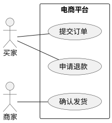

写了多年代码、做过不少技术方案，画图却未必形成了固定的方法。

我们知道什么时候应该写接口、建表、补测试，却不一定知道什么时候该画上下文图，什么时候该画时序图。结果是，所有内容都被塞进一张“架构图”：前端、订单服务、数据库、机房、线程池、优惠券规则混在一起；箭头有时表示调用，有时表示数据流，有时只是表示“这两个东西有关”。

这样的图看起来很完整，评审时却仍然需要作者逐一解释。更重要的是，它可能掩盖真正的设计问题：价格归谁管理？支付超时究竟是失败，还是尚未知道结果？订单取消之后，迟到的支付成功通知该怎么处理？

**工程图的价值，在于让读者看清各部分的职责、协作关系，以及出错后如何处理。**

本文以电商系统为例，介绍 24 类常用图和方案视图，并给出一套可以逐步采用的绘图规范。这 24 类并不是某个标准规定的完整分类，也不意味着一份方案要画 24 张图。读完之后，希望你能解决三个实际问题：

- 这份方案需要画哪些图，每张图要回答什么问题？
- 怎样让不同图中的名称、职责、状态和关系保持一致？
- 怎样借助 AI Agent 生成、检查和修改图，同时保留可维护的源文件？

<!-- more -->

## 不要先问用什么工具，先问这张图要回答什么

面对“介绍一下订单系统”这样的任务，工程师很容易立即打开画布。但这句话至少包含五个不同问题。

| 要回答的问题 | 合适的视图 | 不应该混进去的内容 |
|---|---|---|
| 谁使用系统，系统与外界怎样协作？ | 用例图、系统上下文图 | 内部 DAO、索引、Pod 副本 |
| 谁拥有业务事实和规则？ | DDD 上下文映射图 | 用部署节点代替业务边界 |
| 软件由什么构成，职责如何分配？ | 容器图、组件图、依赖图 | 一次请求的完整时间顺序 |
| 一次操作如何推进，失败后怎么办？ | 时序图、状态机、补偿图 | 全站所有服务和全部数据库 |
| 系统如何部署、观测、迁移和恢复？ | 部署图、网络图、可观测性图、迁移图 | 未说明环境的抽象“高可用” |

C4 的 Context、Container、Component、Code 是不同尺度的结构视图，不是要求每个项目必须交齐的四张图。官方也强调只使用有价值的层次；很多团队先做好系统上下文和容器视图即可。[[1]](#ref-1)

arc42 则把静态构建块、运行时和部署等内容分开组织。这个划分对技术方案很有帮助：结构图解释“有什么”，运行时视图解释“如何协作”，部署视图解释“在哪里运行”。不要指望一张图同时回答所有问题。[[2]](#ref-2)

这里还需要区分几组经常混用的概念。

| 层次 | 例子 | 解决的问题 |
|---|---|---|
| 图类型 / 视图 | 时序图、状态机、部署图 | 选择表达哪个问题 |
| 建模方法 / 记法 | UML、BPMN、C4、DDD Context Map | 定义元素与关系的语义 |
| 文本描述语言 | PlantUML、Mermaid、Structurizr DSL | 把模型写成可维护文本 |
| 绘图工具 / 引擎 | draw.io、Excalidraw、渲染器 | 创建、布局、展示和编辑 |
| Agent Skill | Diagram Design、Excalidraw Skill | 指导 Agent 选图、布局和检查 |
| 工具调用接口 | CLI、MCP、REST API | 让 Agent 调用绘图工具 |

这些层次可以组合使用。例如，时序图是图类型，UML 是记法，PlantUML 是一种描述和渲染方式；Agent 可以按 Skill 中的方法编写 PlantUML，再调用渲染器出图。选型时要同时考虑表达是否准确、修改是否方便，以及源文件能否长期维护，而不只是“这个工具能不能画出来”。

### 图类型速查：24 类图的使用场景

下面按本文的五组主题整理 24 类图和方案视图。先根据使用场景找到需要的图，再阅读后文对应的电商范例；不需要每份方案都画全。

| 分类 | 图类型 | 使用场景 |
|---|---|---|
| 业务与边界 | 用例图 | 需求澄清时，确认买家、商家、客服各自通过系统完成什么目标 |
| 业务与边界 | 流程图 / 活动图 | 梳理业务步骤与条件分支，例如报价不满足、库存不足、支付结果未知时如何处理 |
| 业务与边界 | 泳道图 / BPMN | 设计跨角色、跨系统流程，明确退款审核、渠道处理等步骤由谁负责、如何交接 |
| 业务与边界 | 事件风暴 | 业务建模工作坊中，共同发现命令、事件和规则，例如订单关闭后何时释放库存 |
| 业务与边界 | 系统上下文图 | 方案介绍或新人入门时，说明平台服务谁、依赖哪些外部系统，以及系统边界在哪里 |
| 业务与边界 | DDD 上下文映射图 | 划分业务模型和团队职责，明确商品、营销、计价、订单之间的上下游关系与契约 |
| 结构与数据 | 容器图 | 评审整体软件结构，说明前端、BFF、业务应用和存储的职责及通信方式 |
| 结构与数据 | 组件图 | 设计一个应用的内部结构，例如计价入口、规则引擎、金额分配器和仓储如何分工 |
| 结构与数据 | 领域模型 / 类图 | 讨论业务对象、聚合和约束，例如订单行、报价快照和金额值对象之间的关系 |
| 结构与数据 | ER / Schema | 设计持久化模型，讨论订单表、订单行、快照的键、字段和数量关系 |
| 行为与一致性 | 时序图 | 评审一次具体操作的交互顺序、同步与异步调用、超时及异常分支 |
| 行为与一致性 | 状态机 | 定义订单、支付或退款的生命周期，明确允许的转换、触发事件和冲突处理 |
| 行为与一致性 | 事件拓扑 | 设计事件发布与消费链路，说明 Outbox、Topic、消费组、重试和死信处理 |
| 行为与一致性 | Saga / 补偿图 | 设计跨服务事务，明确预留库存、锁券、保存订单失败后如何查询、补偿和恢复 |
| 行为与一致性 | 数据流 / 血缘图 | 设计数据加工链路，说明商品数据如何通过 CDC、清洗进入搜索索引和分析仓库 |
| 运行与演进 | 部署图 | 上线与高可用评审时，说明应用实例、基础设施、可用区和故障域的分布 |
| 运行与演进 | 网络拓扑 | 设计连通性与隔离，说明公网入口、子网、路由、安全组和数据库访问路径 |
| 运行与演进 | 安全 DFD / 信任边界 | 做威胁建模，识别支付通知等外部输入跨越哪些边界、需要哪些验证与控制 |
| 运行与演进 | 可观测性图 | 设计故障发现与排查链路，说明日志、指标、trace 如何采集、关联和触发告警 |
| 运行与演进 | 迁移 / 灰度 / 回滚图 | 拆库或系统替换时，说明回填、增量同步、读写切换、校验门槛和回滚条件 |
| 治理与决策 | 依赖图 / 包图 | 代码架构评审或重构时，检查模块分层、源码依赖方向、循环依赖和边界违规 |
| 治理与决策 | 故障时间线 | 事故复盘时，按时间整理发布、异常、告警、处置和恢复，并对应证据 |
| 治理与决策 | 甘特图 | 制订改造计划，展示任务持续时间、前后依赖和验收里程碑 |
| 治理与决策 | 决策矩阵 | 比较候选方案，例如编排式与事件协同式 Saga 的责任、耦合和恢复成本 |

## 先统一名称、边界和箭头含义

### 本文的电商案例

下面的图均为**假设设计与教学范例**，不是某个真实生产系统的逆向结果，也不是完整实现规格。配图可以点击打开 SVG 原图，便于查看较密集的标签；文末提供图源入口。

案例包含买家、商家、客服，内部的商品、价格、营销、用户、计价、订单、库存、支付、履约和售后上下文，以及外部支付渠道和物流平台。每张图只展开与当前问题有关的部分。

整个案例遵守几个约定：

- 计价读取带版本号的商品、价格和优惠信息，生成报价，并记录金额如何分摊；订单接受报价后保存成交快照。
- 订单、支付、退款、库存预留各自拥有生命周期，不混成一个巨型状态机。
- 跨服务没有一个天然共享的 ACID 事务，预留、锁券和失败恢复需要显式设计。
- 请求超时可能只是没有及时收到响应，不能直接认定操作失败。
- 已取消订单不因迟到支付通知直接复活，必须进入核对和补偿流程。

这些约定用于让不同视图相互对照，不意味着所有电商都应采用同样的服务拆分。业务上下文可以在模块化单体中实现；把计价认定为核心域，也取决于它是否承载当前业务的竞争优势。

### 每张图都要能独立读懂

C4 的记法建议包括标题、图例、元素类型与职责，以及有明确方向和含义的关系。容器间关系还应写清通信技术。可以把这些要求当作团队绘图规范的起点。[[3]](#ref-3)

| 项目 | 推荐约定 | 电商例子 |
|---|---|---|
| 标题 | 业务 / 系统 + 场景 + 视图类型 | 订单创建与支付确认：关键时序 |
| 范围 | 明确现状或目标，以及环境与版本 | To-be；生产环境；对应设计稿版本 |
| 节点 | 名称、类型、职责；按视图补充技术或状态 | 计价应用：生成可解释报价 |
| 连线 | 明确关系、方向，以及动作或传递的数据 | 读取价格表版本；发布 OrderCreated |
| 图例 | 解释颜色、线型、形状和缩写 | 虚线表示异步事件，不表示“可选” |
| 证据 | 区分已确认、推断和待确认 | 接口契约支持；尚未确认回调重试 |
| 维护 | 记录责任人、图源位置和更新时机 | 修改支付事件定义时同步更新图 |

线型不能全局一刀切。普通架构示意可以约定实线表示主连接、虚线表示事件，但 UML 的依赖、实现、返回消息等关系已有自己的记法；BPMN 也有顺序流和消息流。团队约定不应覆盖这些标准语义。

图变得拥挤时，可以先让主图只保留关键节点，把内部细节拆成子图。是否需要拆分，取决于读者能否快速找到主要关系，而不是节点数量有没有达到某个固定上限。

## 业务与边界：先把“做什么”和“谁负责”画清楚

### 用例图：谁通过系统完成什么目标

用例图适合需求澄清。它关注角色与功能目标，不描述执行顺序。PlantUML 可以用 actor、usecase 和系统边界表达这些关系。[[4]](#ref-4)

[](/diagrams/07-engineering-diagrams-ai-workflow/01-use-case.svg)

图中买家提交订单、申请退款，商家确认发货，客服审核售后。角色关联不是“先浏览再下单”的步骤箭头。

这个范例用 Mermaid 表达角色与用例的语义，**不是完整的 UML 用例图形记法**。需要正式 UML 记法时，可以使用下面的 PlantUML 源：



如果评审开始讨论支付回调和数据库事务，就需要另画时序图。用例图只负责说明用户目标，不必承担执行细节。

### 流程图 / 活动图：规则在哪里分叉

[](/diagrams/07-engineering-diagrams-ai-workflow/02-process.svg)

流程图强调动作与判断。这个例子要表达的是：报价与库存条件不满足时不能生成订单；支付结果有成功、失败、未知三种语义，未知结果需要查询和对账。

画这种图时，判断分支要写清条件，拒绝路径要有终点。用户拒付、网络断开和渠道结果未知，需要采取的后续动作不同，不应都合并到一个“支付失败”节点中。

### 泳道图 / BPMN：跨角色交接是否清楚

[](/diagrams/07-engineering-diagrams-ai-workflow/03-swimlane.svg)

退款往往涉及多个角色和系统：买家提出申请，售后系统验证资格，必要时由人工审核，再由支付渠道处理并通知结果。泳道图把每一步放到对应的责任区域，便于讨论谁接手、在哪里等待。

上图是分组流程示意，并非严格 BPMN。正式 BPMN 需要遵循任务、事件、网关、池、泳道以及不同流类型的记法，不能把有分组框的普通流程图直接命名为 BPMN。[[5]](#ref-5)

人工流程尤其要补上：谁可以批准、拒绝后如何反馈、等待多久、超时由谁处理。这些通常比图标是否标准更早暴露问题。

### 事件风暴：发现业务事实与规则

EventStorming 是探索复杂业务领域的协作工作坊方法，而不是消息队列拓扑模板。[[6]](#ref-6)

[](/diagrams/07-engineering-diagrams-ai-workflow/04-eventstorming.svg)

这里区分了：

- 命令：提交订单、关闭超时订单，是希望发生的动作。
- 事件：订单已创建、订单已关闭，是已经发生的事实。
- 策略：创建订单后启动支付期限，订单关闭后释放预留，是后续规则。

事件用已经发生的事实命名，命令用希望执行的动作命名；颜色只起辅助作用，标签本身也要能说明类型。这样，团队就可以进一步追问：“订单已关闭”之后，库存是否真的已经释放？两者之间是否还需要一个异步处理步骤？

AI 可以帮助整理事件清单，但不能替代真实业务参与者确认。没有订单、支付、运营等角色参与，就不应把 AI 推演当作团队共识。

### 系统上下文图：系统在外部世界中的位置

[](/diagrams/07-engineering-diagrams-ai-workflow/05-system-context.svg)

C4 的系统上下文视图把电商平台看成一个整体，外围是人和外部软件系统。它适合放在方案开头，帮助读者理解系统负责什么、依赖什么。

这一层不需要 Redis、订单表或 Pod。若把这些对象一起画进去，读者就无法判断哪些是平台内部实现，哪些是真正的外部依赖。

### DDD 上下文映射图：模型与规则的边界

Context Map 描述限界上下文及其关系。上下游方向表达模型或契约的影响，不应直接从 HTTP 调用方向推导；反腐层 ACL 用于把外部模型转译成内部语言。[[7]](#ref-7)

[](/diagrams/07-engineering-diagrams-ai-workflow/06-ddd-context.svg)

在本例中，计价使用商品分类、价格表版本、营销规则和会员信息生成报价；订单接收报价及其分摊明细，保存成交依据。

这张图回答的不是“调用经过几个服务”，而是：

- 谁拥有业务事实？
- 谁负责价格组合、舍入和分摊，保证金额计算规则成立？
- 谁接受报价并承担成交承诺？
- 契约变化由哪一方影响另一方？

U / D 是相对某条关系的角色，不是一个上下文永久的全局身份。计价相对价格上下文是下游，相对订单又可以是上游。

更多领域建模背景可结合  阅读。图中只需保留本次讨论所需的边界和关系，详细规则放在正文或配套模型里。

## 结构与数据：把逻辑分解和持久化模型分开

### 容器图：应用与存储如何协作

C4 中的 Container 是应用或数据存储，不等于 Docker 容器。容器视图说明职责分配、技术选择与通信方式；副本、故障域与切换策略属于部署视图。[[8]](#ref-8)

[](/diagrams/07-engineering-diagrams-ai-workflow/07-container.svg)

这张图展示了订单、计价和支付应用的逻辑边界，并明确订单库与支付库的访问所有权。它没有承诺“每个应用都必须独立部署”，也没有解释高可用。

相比“订单连数据库”，标注“订单应用通过 SQL 访问订单库”更有用。若支付应用还会直接写订单库，就应该明确画出来，并解释为什么允许这个例外。

### 组件图：一个应用内部怎么分配职责

[](/diagrams/07-engineering-diagrams-ai-workflow/08-component.svg)

组件图进一步展开计价应用的内部职责：入口适配请求协议，应用组件组织处理步骤，事实解析器读取带版本号的输入，规则引擎组合价格与优惠，金额分配器处理舍入与分摊，仓储保存计算结果及其依据。

这一层用于评审职责与依赖，不是列出所有类。如果每个 DTO、Mapper、工具函数都拥有一个方框，结构就会被实现细节淹没。

先写清一句话职责，再决定是否值得成为图上的节点。一个只有包名、没有职责的方框，很难支撑设计评审。

### 领域模型 / 类图：对象与不变量

[](/diagrams/07-engineering-diagrams-ai-workflow/09-domain-class.svg)

领域模型关注业务概念和约束。订单作为聚合根包含订单行与成交证据，金额带有币种，操作用 `acceptQuote()`、`confirmPayment()` 等业务意图命名。

组合关系和数量约束描述的是业务模型，并不等于声明数据库外键。类图也不应该只是 `getX()`、`setX()` 的目录。它需要帮助读者回答：哪个对象负责保证哪些业务规则，哪些修改必须一起完成？

订单、支付账本和退款不一定在一个聚合里。把它们都画成 Order 的组成部分，可能掩盖实际跨边界的一致性问题。

### ER / Schema：持久化什么，如何约束

[](/diagrams/07-engineering-diagrams-ai-workflow/10-er.svg)

同样是订单，ER 视图关注的是数据键、基数、字段和存储关系。Mermaid 支持 ER 图，可以把这类定义作为文本维护。[[9]](#ref-9)

这个简化 Schema 表达：订单包含至少一个订单行，并保存一个报价快照。金额与币种存入订单，`buyer_id` 和 `sku_id` 是业务标识，不默认声明跨服务数据库外键。

不能从这张图推出表已经可以上线。物理设计还需要补充精度、索引、唯一约束、状态并发控制与快照结构。尤其不能让订单历史金额依赖实时商品价格。

类图和 ER 图可以映射，但并非一一对应。一个值对象可能展开成多个列，一个聚合也可能持久化到多张表。

## 行为与一致性：正常路径只是开始

### 时序图：时间顺序和交互语义

[](/diagrams/07-engineering-diagrams-ai-workflow/11-sequence.svg)

这张图把一次具体操作展开为：订单提交、库存预留、订单保存、支付发起与结果确认。支付结果未知时进入查询与对账，而不是直接宣告失败。

时序图尤其适合检查服务交互中容易遗漏的问题：

- `idempotencyKey` 是请求级幂等，还是业务订单标识？
- 预留成功但订单保存失败，谁释放库存？
- 通知重复到达，如何去重并原子推进状态？
- 支付确认时订单已经关闭，走哪条路径？

主时序图不必展开所有分支，但重要的异常情况应另附处理表或子时序图。只画正常路径，还不足以说明支付流程已经设计完整。

### 状态机：一个实体允许怎样变化

[](/diagrams/07-engineering-diagrams-ai-workflow/12-state.svg)

状态机描述一个实体的生命周期，而不是整个购买流程。每次状态转换都应说明触发事件、允许转换的条件，以及转换时执行的动作。

本例禁止已取消订单因迟到支付成功通知直接回到已支付。实际处理可能要求发起退款、对账或人工核实，取决于已发生的外部事实。

建议同时维护一张转换规则表：

| 当前状态 | 事件 | 转换条件 | 结果 | 重复 / 冲突处理 |
|---|---|---|---|---|
| 待支付 | 支付成功已确认 | 订单仍可接受，金额币种一致 | 已支付 | 同一确认幂等 |
| 待支付 | 取消 / 到期 | 尚未完成支付确认 | 已取消 | 与支付确认竞争原子状态更新 |
| 已取消 | 迟到支付成功 | 核对渠道成功事实 | 保持已取消，进入补偿 | 不复活订单 |
| 已支付 | 重复支付通知 | 同一支付事实 | 保持已支付 | 去重；不重复启动履约 |

订单、支付和退款分别维护自己的状态机，再用时序图解释它们如何协作。这样可以避免把多个生命周期组合成一个难以维护的巨型状态机，也更容易明确每种状态由谁管理。

### 事件拓扑：可靠发布和消费，而不只是一个 MQ

Transactional Outbox 将业务更新和待发事件写入同一本地事务，再由 Relay 投递。Relay 可能重复发布，因此消费者仍然需要幂等。[[10]](#ref-10)

[](/diagrams/07-engineering-diagrams-ai-workflow/13-event-topology.svg)

图应体现事件名、Topic、消费组与失败去向，而不是画一个 MQ 圆柱后连接全部系统。

这里的实线表示本地写入或读取，虚线表示事件投递。`orderId` 作为消息键只是顺序设计的一部分，不能自动保证所有跨分区、跨 Topic、跨消费者的处理顺序。

设计图之外，还要记录投递重试、消费幂等存储、保留期、死信处理责任和积压恢复方式。“用了消息队列”不等于“系统已经 exactly-once”。

### Saga / 补偿图：失败如何收敛

Saga 由多个本地事务组成，通过显式补偿应对跨服务失败。补偿不是数据库事务的自动回滚。[[11]](#ref-11)

[](/diagrams/07-engineering-diagrams-ai-workflow/14-saga.svg)

这张图以库存预留、锁券和订单保存为例。锁券确定失败时释放库存；订单保存确定失败时先解锁优惠券，再释放库存；结果未知时先按请求标识查询事实。

一个合格的补偿视图应同时解释：

- 哪些步骤可撤销，撤销的业务含义是什么？
- 哪些结果未知，不能直接开始补偿？
- 补偿是否幂等，重试由谁推动？
- 补偿一直失败时，如何进入人工恢复？

如果前一步已经产生外部扣款，补偿可能是新建一笔退款，而不是抹掉扣款事实。业务历史和审计证据应保留。

### 数据流 / 血缘图：数据怎样产生和加工

[](/diagrams/07-engineering-diagrams-ai-workflow/15-data-flow.svg)

数据流图的箭头表示数据内容和转换，不表示方法调用的时间顺序。它适合解释商品数据如何进入搜索索引与报表。

本例中，商品库保存原始商品数据，搜索索引是异步更新的查询副本。搜索结果展示的库存或价格可能尚未更新，下单时仍需向相应业务系统核实，不能直接据此成交。

还应标明或在图外说明数据新鲜度要求、删除传播、版本去重与回放策略。没有这些信息，一条 CDC 箭头只能说明“有数据在传”，不能说明消费者看到的数据正确到什么程度。

## 运行与演进：把上线之后的问题画出来

### 部署图：实例与故障域

C4 部署视图把软件实例映射到指定环境的基础设施节点，节点可以嵌套，也可以包含入口等基础设施。[[12]](#ref-12)

[](/diagrams/07-engineering-diagrams-ai-workflow/16-deployment.svg)

这张图是生产部署假设，不是可用性承诺。应用分布在两个 AZ，仍可能因数据库主节点、切换机制或共同依赖而整体不可用。

评审至少继续追问：主节点失效时谁切换？同步副本不可用时写入策略是什么？客户端怎样重连？切换是否丢失已确认数据？故障演练是否覆盖这个拓扑？

逻辑架构图中的一个“订单应用”，可以在部署图中对应多个实例。前者解释应用负责什么，后者解释它在哪里运行、有哪些副本，两者不要混用。

### 网络拓扑：连通性与网络隔离

[](/diagrams/07-engineering-diagrams-ai-workflow/17-network.svg)

网络拓扑解释公网与私网区域、入口出口和允许的路径。本例仅允许应用安全组访问 MySQL 与 Redis，数据库没有公网入口。

网络许可不等于应用授权。某个服务能够连接数据库，并不代表它应该读写所有表；TLS 也不能替代身份、权限和业务校验。

应按需要补上 DNS、NAT、代理、路由和管理入口，但不要把每根网线同时解释成业务调用。

### 安全 DFD / 信任边界：不可信输入在哪里进入

威胁建模需要理解系统、数据流、信任边界与资产，并把威胁和控制措施联系起来。OWASP 的威胁建模指南可以作为检查框架。[[13]](#ref-13)

[](/diagrams/07-engineering-diagrams-ai-workflow/18-threat.svg)

支付渠道通知通过 HTTPS 进入系统，仍然是需要验证的输入。图中强调验签、重放检测、商户与订单核对、金额币种检查，以及幂等账本更新。

这是信任边界的简化示意，不是完整威胁清单。真实方案还要逐项记录攻击面、威胁、缓解措施和残余风险，例如密钥泄露、伪造通知、日志暴露和管理员越权。

### 可观测性图：故障怎么被发现与关联

OpenTelemetry 将 traces、metrics、logs 等作为不同遥测信号。画观测链路时，业务请求和遥测输出应分开表达。[[14]](#ref-14)

[](/diagrams/07-engineering-diagrams-ai-workflow/19-observability.svg)

上图的实线表示请求或后续处理，虚线表示遥测流。订单与支付沿请求传播关联上下文，遥测送往 Collector，再进入不同查询和告警链路。

除了采集链路，还要说明监控哪些业务异常，例如支付结果长期未确认、订单确认延迟、库存预留未及时释放，以及谁负责响应。只有画上监控系统，还不足以说明故障能够被及时发现。

`orderId` 可用于具体日志与 trace 关联，但不宜无控制地成为指标标签。指标基数、采样和敏感字段都需要治理。

### 迁移 / 灰度 / 回滚图：何时切换读写，失败后怎么退回

[](/diagrams/07-engineering-diagrams-ai-workflow/20-migration.svg)

迁移图不能只有“旧库 → 新库”一条箭头，还要说明每个阶段以哪个库为准，满足什么条件才能推进，何时切换读写，以及还能不能退回旧库。

本例先只向旧库写入，回填历史数据，并通过 CDC 同步增量；校验通过后，逐步把读请求切到新库；最后停止旧库写入，确认数据追平，再把写请求切到新库。新库开始接收写入后，旧库不再天然拥有完整数据。要切回旧库，必须先解决反向同步和一致性校验等问题。

这里的关键不是让箭头看起来顺畅，而是明确什么时候可以安全推进，以及失败时还能退到哪里。

## 补充视图：代码治理、事故、计划与决策

### 依赖图 / 包图：源码依赖能否支撑边界

[](/diagrams/07-engineering-diagrams-ai-workflow/21-dependency.svg)

这张图的箭头表示编译或源码依赖，不是一次请求的执行顺序。基础设施实现领域端口，因此可以在源码上依赖领域层；运行时调用仍可能经过该适配器。

如果要确认“没有循环依赖”或“领域层不依赖 ORM”，需要检查实际 import、构建依赖或模块关系。图上的设计要求，不能替代对代码的检查。

### 故障时间线：先还原事实，再讨论原因

[](/diagrams/07-engineering-diagrams-ai-workflow/22-timeline.svg)

这是一份假设事故，时间采用 UTC+8。时间线排列发布、异常、告警、回滚和恢复，帮助团队对齐事实。

时间先后并不自动证明因果。发布发生在异常前，不意味着发布必然是根因。复盘时应给关键节点附日志、指标、trace 或操作记录，对时钟误差和证据缺口作说明。

### 甘特图：任务依赖与交付里程碑

[](/diagrams/07-engineering-diagrams-ai-workflow/23-gantt.svg)

甘特图（Gantt）表达任务安排、持续时间和前后依赖，不描述系统运行过程。图中的日期只是示例计划，不代表实际工期承诺。

依赖明确后，团队还需要定义“影子读验证完成”的标准。没有验收条件的里程碑，容易变成日历上的一个日期。

Diagram Design 的类型目录同时包含 timeline、Gantt、架构与数据可视化等类型。这个目录有助于拓展表达方式，但不应直接转换为“每份工程方案的必画清单”。[[15]](#ref-15)

### 决策矩阵：同一组维度比较方案

[](/diagrams/07-engineering-diagrams-ai-workflow/24-decision.svg)

上图只是候选方向的示意。真正的属性比较，使用表格通常比方框图更清楚。

| 维度 | 编排式 Saga | 事件协同式 Saga |
|---|---|---|
| 流程责任 | 编排器显式管理步骤与状态 | 分散在参与者和策略中 |
| 全局排查 | 可围绕流程实例追踪 | 需要跨消费者关联 |
| 耦合方式 | 编排器依赖参与者契约 | 参与者依赖事件与策略 |
| 主要复杂度 | 流程中心增长与恢复治理 | 隐式链路、循环触发与全局理解 |
| 采用前提 | 需要集中查看流程并统一推动恢复 | 各参与方职责清楚、事件治理成熟 |

这是定性比较，不是性能测试结果，也不是固定结论。做出选择后，还应在架构决策记录（ADR）中写清约束、选择理由、收益与代价、接受的风险、验证指标，以及什么时候需要重新评估。

没有实际依据时，不要把“性能、可维护性、可扩展性”随意打成雷达分数。漂亮的数字不一定增加信息量。

## 工具怎么选：讨论、维护和发布各有侧重

### 不同工具解决不同成本

| 工具 | 适合什么 | 建议保留的源文件 | 主要取舍 |
|---|---|---|---|
| PlantUML | UML、复杂时序、状态、活动、包与部署 | `.puml` | 语义表达明确；需要语法和布局经验 |
| Mermaid | Markdown 中的流程、时序、类、状态、ER 与计划 | `.mmd` | 易集成；需核对文档平台支持的版本 |
| Structurizr | 同一架构模型生成多种 C4 视图 | DSL / 模型 | 降低多视图漂移；有建模治理成本 |
| draw.io | 正式可编辑架构、云组件、网络与业务流程 | `.drawio` | 图形生态丰富；XML 差异不一定容易审查 |
| Excalidraw | 白板讨论、业务边界、可拖拽方案图 | `.excalidraw` | 修改灵活；图例和关系含义需要自行约定 |
| Diagram Design | 文章、演示、发布级图 | HTML + 内嵌 SVG | 展示质量强；不等同于结构化架构模型 |
| D2 | 文本化服务结构、分组和依赖 | `.d2` | 声明式布局；不是严格 UML / BPMN 的替代品 |

draw.io 推荐使用 `.drawio` 保存原生图，也支持在 SVG、PNG 等格式中嵌入图数据。因此，不能简单地说“SVG/PNG 一定不可编辑”：能否还原为原生图形，取决于导出时有没有嵌入图数据。[[16]](#ref-16)

Structurizr DSL 将模型与视图分开：先定义系统、应用和关系，再从同一模型生成不同的 C4 视图。对于长期维护多张架构图的团队，这有助于减少重复定义和人工同步。[[17]](#ref-17)

D2 也是文本描述和渲染工具，可用于结构示意；不必为了每种新图都更换整个工具栈。[[18]](#ref-18)

我的建议是从一个小组合开始：

- 一种文本图工具：PlantUML 或 Mermaid，承担高频工程图。
- 一种共同编辑画布：Excalidraw 或 draw.io。
- 一种发布方式：需要品牌化展示时，再使用 Diagram Design。

如果主要写 Markdown 方案，Mermaid 往往降低集成成本；如果复杂 UML 与时序是日常工作，PlantUML 更值得投入。先根据团队维护方式选择，不要根据支持类型数量排名。

### 你真正要保存的是什么

建议同时验收“图能不能展示”和“以后能不能修改”。本文把持续维护、用于生成展示图的文件称为**图源**：

```text
图源：记录业务关系、状态或原生图形元素
  ↓
渲染与布局
  ↓
展示文件：SVG / PNG / HTML
```

`.mmd`、`.puml` 和 DSL 便于通过文本差异审查变更；`.drawio` 和 `.excalidraw` 保留可拖拽的原生图形。HTML/SVG 也可以修改代码，但坐标和路径的变化，未必能直接告诉评审者“新增了一条支付补偿关系”。

不要假设 Mermaid → Excalidraw → SVG → draw.io 可以无损往返。导入可能重新布局、退化成图像，或失去某些关系语义。跨工具转换后需要再次验收。

本文的范例使用 SVG 保证浏览器展示，同时保留同名 Mermaid 图源。正式 UML 用例另附 PlantUML 源；泳道与安全边界等图已明确标为简化语义示意。

### 三个参考项目的定位

PlantUML 帮助定义与渲染图语法；Diagram Design 指导 Agent 做发布级布局；Cole 的 Excalidraw Diagram Skill 则指导 Agent 生成场景 JSON，并通过渲染检查布局。[[19]](#ref-19)

Cole 的 `references` 中，元素模板负责矩形、文本、箭头等组合，schema 负责场景文件格式。它们是绘图实现参考，不是新的架构图语义标准。[[20]](#ref-20) [[21]](#ref-21)

这三者可以配合使用，但没有必要把同一张图维护成三份源文件。先决定今后主要通过文本修改，还是在画布上拖拽修改，再选择对应的图源；其他格式作为导出结果即可。

## AI Agent 绘图：从生成初稿到持续维护

### 先区分生成图片和生成工程图

工程绘图的验收重点，是关系表达准确、文字清晰、后续可修改。按这个目标，可以把 AI 辅助绘图分成三条路线：

| 路线 | Agent 主要做什么 | 适用场景 | 建议保留什么 |
|---|---|---|---|
| 生成图描述文本 | 编写 Mermaid、PlantUML、D2 或 DSL，再调用渲染器 | 时序、状态、ER、结构与依赖 | 文本图源与渲染结果 |
| 生成或操作原生场景 | 编写图形元素，或调用工具修改节点和连线 | 白板讨论、业务边界、自由布局 | `.excalidraw` / `.drawio` 与导出图 |
| 生成展示图片 | 根据描述或参考图生成位图 | 配图、概念插画、视觉草稿 | 原图及生成说明 |

这是按维护方式做的实践分类，不是工具之间的能力排名。比如，一张支付时序图需要频繁修改异常分支，我会优先用文本图源；一张 DDD 战略设计图需要与同事一起拖拽调整边界，我会优先用原生画布。博客或演示则从图源导出 SVG / PNG，不再单独维护第二套关系。

### 可以使用哪些 GitHub 绘图 Skill 和工具

下面从此前调研中整理出 18 个工程绘图及相关架构分析项目，说明各自解决什么问题。**这些项目并不都是 Skill，也不都采用允许商业使用的开源许可**：有的提供绘图方法和生成脚本，有的提供画布运行时，有的侧重架构分析或通过 MCP 操作图。项目名旁的引用编号对应文末的 GitHub 入口；Nereid 的使用限制单独标明。

| GitHub 项目 | 类型 | 主要作用 | 主要输出 | 电商方案中的用法 |
|---|---|---|---|---|
| `yctimlin/mcp_excalidraw` [[22]](#ref-22) | Skill + CLI + MCP + REST + 本地画布 | 创建、查询、修改图形元素；对齐、分组；读取场景和截图；导入导出与保存快照 | `.excalidraw`、`.excalidraw.md`、SVG、PNG | 画 DDD 业务边界，评审后只调整计价与订单之间的关系，保留可编辑图源 |
| `coleam00/excalidraw-diagram-skill` [[19]](#ref-19) | 生成与设计 Skill | 从描述组织视觉结构，使用元素模板和配色规范生成场景 JSON，再通过 Playwright 渲染检查 | `.excalidraw`，PNG 检查图 | 把下单链路整理成结构清晰的方案图，检查分组、标签和箭头布局 |
| `excalidraw/excalidraw-mcp` [[23]](#ref-23) | 官方 MCP App | 在支持 MCP Apps 的客户端中流式展示图形，控制视口，并提供交互式全屏编辑 | 对话内的 Excalidraw 交互视图 | 在方案讨论中快速画出订单、支付与库存的关系，并继续编辑 |
| `axtonliu/axton-obsidian-visual-skills` [[24]](#ref-24) | 面向 Obsidian 的 Skill 集合 | 将笔记转成 Excalidraw、Mermaid 或 Obsidian Canvas；按目标格式组织可视化内容 | `.excalidraw`、Obsidian 插件 Markdown、Mermaid、`.canvas` | 把商品、营销、计价的知识笔记整理成概念关系图 |
| `jgraph/drawio-mcp` [[25]](#ref-25) | 官方 MCP + 绘图 Skill / 插件 | 在对话或 draw.io 编辑器中打开图；插件生成原生文件，并可调用本地 Desktop CLI 导出 | `.drawio`；插件可导出 PNG、SVG、PDF | 画需要在 draw.io 中继续编辑的部署、网络或正式架构图 |
| `robonuggets/excalidraw-skill` [[26]](#ref-26) | 配合 MCP 使用的设计 Skill | 指导 Agent 使用分区、语义配色、箭头绑定、字号层级和布局检查；通过截图反复修正 | 借助配套工具输出 `.excalidraw`、PNG、SVG | 已有本地画布，希望让订单、支付、履约分区更清晰、布局更一致 |
| `robtaylor/excalidraw-diagrams` [[27]](#ref-27) | Skill + Python 生成器 | 提供通用图、流程图和架构图构建器，程序化创建节点和连线，保存原生场景 | `.excalidraw`，可在编辑器中导出图片 | 用脚本批量生成相似的订单处理流程或服务结构示意 |
| `cathrynlavery/diagram-design` [[15]](#ref-15) | 发布与视觉设计 Skill | 选择图类型，统一品牌配色、字体和版式，将结构整理成适合文章或演示的图 | 自包含 HTML + SVG，可导出 SVG / PNG | 将已经确认的计价架构或迁移方案整理成博客配图 |
| `tt-a1i/archify` [[28]](#ref-28) | 交互式技术图 Skill | 根据描述或仓库证据生成架构、流程、时序、数据流和生命周期图，支持浏览器内探索关系 | 结构化 JSON 图源、自包含 HTML + SVG，支持图片导出 | 给新同事展示电商服务关系，搜索节点并聚焦某条请求或数据路径 |
| `Agents365-ai/drawio-skill` [[29]](#ref-29) | 架构建模与绘图 Skill + CLI，可选 MCP | 从代码、Terraform、Kubernetes、SQL、API Schema 提取结构，生成原生图；支持增量同步、多视图和架构规则检查 | `.drawio`；可导出 SVG、PNG、PDF、HTML、PPTX 等 | 从订单服务部署配置生成架构图，变更后保留人工布局并同步节点关系 |
| `bybit-exchange/svg-diagram` [[30]](#ref-30) | 纯 SVG 绘图 Skill + 校验器 | 规定坐标、间距、字体、语义配色和连线规范，直接编写 SVG，并检查文本溢出、重叠等问题 | 独立 SVG | 为计价文章生成轻量配图，通过源文件差异审查标签和关系变更 |
| `imxv/Pretty-mermaid-skills` [[31]](#ref-31) | Mermaid 美化与渲染 Skill | 将已有 Mermaid 源码按主题渲染，支持流程、时序、状态、类、ER、XY 图和批量导出 | SVG、PNG、ASCII / Unicode | 保留支付时序 `.mmd`，统一方案中的图形主题并导出展示图 |
| `aetox-skills/senior-architect-agent` [[32]](#ref-32) | 架构分析与评审 Skill | 先检查现有系统证据，再梳理模块、依赖、数据流、边界问题、技术债和待确认项 | 架构说明、模块与流程文档、Mermaid 图、风险清单 | 先分析计价服务的实际代码，再画模块关系，说明哪些连接已确认、哪些是推断 |
| `vijayjoshi24/ea-agent-skills` [[33]](#ref-33) | 企业架构 Skill 集合 | 包含 C4 图、业务能力地图、ADR、技术债扫描和架构评审等技能 | 交互式 SVG、能力地图、ADR、评审报告；部分技能输出治理清单 | 梳理商品、交易、履约能力及改造缺口，并为服务拆分记录决策 |
| `Ztsdut/ml-architecture-diagram-skill` [[34]](#ref-34) | ML 专用 Skill + 架构 IR + 渲染器 | 从模型代码或规格恢复计算路径，组织层、张量和分支，生成可编辑的模型结构图 | YAML / JSON 图源、SVG、`.drawio`、PPTX、PNG、PDF | 展示推荐、排序或多模态商品模型；不用于替代订单微服务架构图 |
| `lcapossio/hdldiagZero` [[35]](#ref-35) | HDL / RTL / SoC 专用 Skill + 渲染器 | 从硬件描述整理模块、时钟域、总线与跨时钟域连接，生成并校验方框图 | JSON 规格、SVG | 通常不用于普通电商后端；涉及硬件加速器或芯片设计时再考虑 |
| `naorsabag/openhop` [[36]](#ref-36) | 代码流程讲解 Skill + CLI + 本地交互界面 | 将代码中的请求、数据或状态流程整理成 YAML，支持逐步播放、暂停和展开子流程 | YAML 图源、交互式流程页面 | 逐步讲解提交订单后如何预留库存、确认支付和触发履约 |
| `bnomei/nereid` [[37]](#ref-37) | Mermaid 终端工作台 + MCP；**非商业源码可见许可** | 在终端查看和编辑图，持久化会话，并通过 MCP 查询或修改图结构 | `.mmd`、文本预览、会话元数据 | 可作为终端协作候选；公司内部业务使用须先取得许可，不列为默认推荐 |

表中的能力来自项目文档；电商用法是本文给出的应用示例，不是这些项目已经提供的电商模板，也不是横向性能测试。

选择时，可以先按工作方式缩小范围：

- **要保留可拖拽、可反复修改的 Excalidraw 图源**：从 `mcp_excalidraw` 开始，后文给出完整操作示例。
- **主要想改善图的组织和表达**：考虑 Cole 的 Skill；已有 MCP 画布时，也可以参考 robonuggets 的布局规则。
- **要用 Python 脚本生成一批相似的图**：考虑 robtaylor 的生成器。
- **图主要进入知识库或博客**：Obsidian 笔记考虑 Axton 的技能集合；发布配图考虑 Diagram Design。
- **要交互浏览服务关系**：考虑 Archify；要在对话中直接讨论和编辑，则看官方 Excalidraw MCP 或 draw.io MCP。
- **要从代码、IaC 或 Schema 生成并持续同步图**：考虑 Agents365 的 drawio-skill；它与 draw.io 官方集成不是同一个项目。
- **要轻量静态图或美化现有 Mermaid**：直接编写 SVG 选 svg-diagram；保留 Mermaid 语义文本并美化选 Pretty Mermaid。
- **还没弄清架构，不能直接开始画图**：先用 senior-architect-agent 梳理证据；需要能力地图、C4 和 ADR 等交付物时参考 EA Agent Skills。
- **要逐步讲解代码执行流程**：考虑 OpenHop；ML 和硬件结构图则选择对应的专用工具，不必加入常规电商方案工具栈。

几个容易混淆的地方，需要单独说明：

`robonuggets/excalidraw-skill` 的文档要求安装并运行 `yctimlin/mcp_excalidraw`。它主要补充绘图规则和检查流程，不是另一套独立画布；没有必要因为名字不同，就把两套服务都安装一遍。[[26]](#ref-26)

`robtaylor/excalidraw-diagrams` 的基础生成器使用 Python 标准库，适合脚本化生成；这不意味着渲染、浏览器导出或其他可选集成都不需要额外环境。生成文件后，仍应打开或渲染检查。[[27]](#ref-27)

官方 Excalidraw MCP 支持交互编辑，不能简单概括为“只能一次生成”。draw.io 项目也不只有 MCP：其仓库中的绘图 Skill / 插件可以不配置 MCP，直接生成 `.drawio`；本地图片导出则依赖 draw.io Desktop CLI。[[23]](#ref-23) [[25]](#ref-25)

Axton 的项目明确标为实验性原型，输出质量和边界情况需要自行验收。Archify 可以结合仓库证据绘图，但不能据此把任意输出都称为完整、准确的代码依赖分析结果。[[24]](#ref-24) [[28]](#ref-28)

Agents365 的 drawio-skill 更侧重代码、基础设施和 Schema 到架构模型的提取与同步；jgraph 的官方项目更侧重编辑器、形状库和 Agent 集成。它们都能产出可编辑图，但具体导出、布局和格式转换受环境及版本限制，不代表可以无损还原所有输入。[[29]](#ref-29) [[25]](#ref-25)

svg-diagram 的最终 SVG 不需要网页运行时，但其 `svg-lint` 校验器需要 Node.js。“零依赖”指不需要额外安装 Node 包，不能理解成校验过程不需要 JavaScript 运行环境。Pretty Mermaid 也通过本地 Node.js 渲染；它解决展示和导出问题，不会自动核实 Mermaid 中的业务关系。[[30]](#ref-30) [[31]](#ref-31)

架构分析技能可以帮助形成图的依据，但不会自动替团队完成 DDD 建模或证明设计正确。ML 与 HDL 工具的模型、符号和校验规则也有专门的领域含义，不能把它们的“架构图”与服务架构图混为一谈。

Nereid 当前公开说明采用 **Source-Available Noncommercial License**，并明确要求商业、产品和内部业务等使用另行取得书面许可。因此，本表保留它作为此前调研记录，不把它列为可直接用于企业工程工作的通用开源推荐；实际采用前应核对当时的 LICENSE。[[37]](#ref-37)

安装第三方技能前，应阅读 `SKILL.md`、脚本与许可证，确认依赖、文件写入和网络访问行为。本清单是项目文档核验后的能力摘要，不代表这些项目已在你的环境中逐一安装或测试，也不构成“全部安装”的建议。

### 工作原理：Agent 操作的是元素，不是像素

以 `mcp_excalidraw` 为例，可以把各部分的职责理解为：[[22]](#ref-22)

```text
工程师提供问题、资料与约束
  ↓
Agent 读取 Skill，规划节点、关系和布局
  ↓
CLI / MCP / REST API 传递操作
  ↓
本地 Canvas Server 管理场景
  ├── Excalidraw 网页：人工查看和编辑
  ├── REST / WebSocket：操作和同步场景
  └── 导入、导出与渲染
          ├── .excalidraw：可编辑图源
          └── SVG / PNG：展示文件
```

Skill 告诉 Agent 如何选图、安排布局、连接箭头和检查结果；CLI、MCP 和 REST 是三种操作入口；Canvas Server 保存运行中的场景，网页让人查看和继续编辑。没有配置 MCP 的编程 Agent，也可以通过 CLI 完成绘图。

场景中记录了矩形、文字、箭头的 ID、坐标、尺寸、颜色和连接关系。因此，Agent 可以只移动一个节点，或只修改一条连线，不必重新生成整张图片。

需要注意，工具的输入格式与原生 Excalidraw 文件格式不是一回事。下面的 `text`、`startElementId` 和 `endElementId` 是该项目 CLI 提供的便捷字段，工具会把它们转换成原生的文本元素和箭头绑定；不能把这几个对象直接当作完整的 `.excalidraw` 文件。原始 REST 请求的字段结构也不同，接入时要查对应接口文档。[[22]](#ref-22)

```json
[
  {
    "id": "demo-order",
    "type": "rectangle",
    "x": 100,
    "y": 100,
    "width": 220,
    "height": 80,
    "text": "订单应用",
    "backgroundColor": "#d3f9d8"
  },
  {
    "id": "demo-inventory",
    "type": "rectangle",
    "x": 520,
    "y": 100,
    "width": 220,
    "height": 80,
    "text": "库存应用",
    "backgroundColor": "#a5d8ff"
  },
  {
    "id": "demo-reserve",
    "type": "arrow",
    "x": 0,
    "y": 0,
    "startElementId": "demo-order",
    "endElementId": "demo-inventory",
    "text": "预留库存"
  }
]
```

这个小例子只表示应用之间的关系，不是完整的下单时序。库存预留失败、订单保存失败等处理，仍应在相应行为图中展开。

### 从安装到交付：一个最小操作示例

下面按调研时核验的 `mcp-excalidraw-server` **2.1.2** 编写，要求 Node.js 20 或更新版本。示例固定版本是为了便于复现，不表示以后始终推荐这个版本；升级后应重新核对命令和输出。[[22]](#ref-22)

先安装项目级 Skill，并启动画布：

```bash
npx -y mcp-excalidraw-server@2.1.2 install-skill --dir .agents/skills
npx -y mcp-excalidraw-server@2.1.2 start
npx -y mcp-excalidraw-server@2.1.2 status
```

Skill 会放到 `.agents/skills/excalidraw-skill/`。实际安装根目录要与 Agent 的技能发现规则一致；如果需要 Codex 用户级安装，可以改用 `install-skill --target codex`。安装命令会替换目标目录中的旧技能，升级前不要把自己的定制文件只保存在该目录中。[[22]](#ref-22)

画布默认地址是 `http://127.0.0.1:3000`，可以在浏览器中观察绘图过程。若端口已有其他服务，先确认占用情况并另行配置端口，不要直接停止未知服务。开始操作前，也应先用 `describe` 查看画布内容，避免覆盖别人的图。

假设上面的 JSON 已保存为 `elements.json`，创建元素、检查结果并导出：

```bash
mkdir -p diagrams
npx -y mcp-excalidraw-server@2.1.2 describe
npx -y mcp-excalidraw-server@2.1.2 add elements.json
npx -y mcp-excalidraw-server@2.1.2 screenshot --out diagrams/order-inventory.png

# 查看截图后，如有必要，再调整具体元素
npx -y mcp-excalidraw-server@2.1.2 update demo-order --set '{"width":260}'

# 保存可编辑图源，并从最终图源生成展示图
npx -y mcp-excalidraw-server@2.1.2 export --out diagrams/order-inventory.excalidraw
npx -y mcp-excalidraw-server@2.1.2 render diagrams/order-inventory.excalidraw \
  --out diagrams/order-inventory.svg
```

这是一个面向独立示例画布的操作模板。实际复用时要检查节点 ID 是否已存在，输出路径是否会覆盖已有文件，并在最后一次修改后重新检查最终渲染结果。

该版本的普通截图和 SVG / PNG 导出可以在服务端无浏览器渲染：Excalidraw 的 `exportToSvg` 负责生成 SVG，jsdom 提供所需的 DOM 环境，resvg 将 SVG 转成 PNG。`render` 可以直接读取已保存的场景，不需要启动画布服务；Mermaid 转换和视口控制仍需要打开画布页面。内置字体主要覆盖拉丁文字，中文渲染依赖运行机器上的字体，所以“无需浏览器”不等于“中文在所有环境下都一样”。[[22]](#ref-22)

### 生成、观察、修正：把两种验收分开

Agent 的绘图流程可以组织成一个循环：

```text
提取事实 → 创建节点与连线
                ↓
       describe 读取场景结构
       screenshot 查看渲染结果
                ↓
       定位问题 → 按元素 ID 修改
                ↓
       再次渲染 → 人工确认 → 导出图源
```

在这个流程中，`describe` 帮助 Agent 找到节点、标签和连接关系，截图帮助它检查文字与布局。但检查和修正需要 Agent 实际执行，不能把“提供截图工具”写成“工具自动保证没有重叠”。[[22]](#ref-22)

| 验收层面 | 检查什么 | 电商例子 |
|---|---|---|
| 视觉检查 | 中文是否完整，文字是否截断，节点是否重叠，箭头是否穿过标签 | “库存预留”是否被节点遮挡 |
| 语义检查 | 职责是否正确，箭头含义是否一致，异常路径是否完整，是否有资料依据 | 预留成功但订单保存失败，谁负责释放库存 |

前一类问题可以通过渲染与布局调整解决；后一类必须结合业务规则和实现证据判断。再整齐的支付状态图，也不能替代对重复通知、迟到成功和补偿失败的设计。

### 先生成事实表，再生成图

“帮我画一个电商架构”给模型留下了过多自由。它可能补出推荐服务、库存中心、Kafka 和 Redis，却没有说明这些组件是否存在。

更可靠的流程是：

1. 确认读者、场景、范围、现状 / 目标和图层级。
2. 从需求、代码、接口、DDL、部署配置与 trace 提取事实。
3. 对关系标注证据，并区分推断和未知。
4. 定义权威数据源、不变量、状态和失败语义。
5. 生成合适的图源并执行渲染。
6. 检查布局，再检查跨图一致性。
7. 人工确认后纳入版本管理。

| 图中事实 | 可参考的证据 | 证据不能自动证明什么 |
|---|---|---|
| 模块依赖 | import、构建配置、依赖分析 | 实际运行时完整路径 |
| 接口关系 | OpenAPI、客户端代码、服务契约 | 请求一定发生或没有超时 |
| 数据模型 | DDL、迁移文件、持久化代码 | 所有业务不变量都由数据库保证 |
| 部署结构 | IaC、工作负载与环境配置 | 实际容灾恢复能力 |
| 运行路径 | 日志与 trace | 未采样路径不存在 |

自动生成的图应附一张关系与来源的对应表，说明每条关键关系依据哪份资料。现状图要有实现证据；目标图要标明设计意图，不能让读者误以为已经落地。

### 一份可以复用的提示词

```text
你是我的方案建模助手。
主题：电商订单创建与支付确认。
目标：评审业务正确性和失败恢复。
资料：需求、接口契约、相关代码、DDL、事件定义和部署配置。

先输出事实表：
元素 / 职责 / 关系 / 来源 / 已确认、推断或待确认。
未知项保留，不补造服务、吞吐量、超时或 SLO。
区分 As-is 与 To-be，声明每张图的范围、层级与箭头含义。

生成边界图、关键正常与异常时序、订单状态机和数据模型。
涉及跨服务状态时追加 Saga；涉及外部通知时检查信任边界。
保持服务、状态、事件、业务 ID 在不同图中一致。

保留一种主要图源：PlantUML、Mermaid 或原生 Excalidraw。
逐图渲染，检查空图、文字截断、重叠与连线。
再审查回调重复、乱序、结果未知、迟到成功和补偿失败。

输出图源、展示物、证据映射、缺口与跨图矛盾。
不得未经请求清空已有画布、上传公司资料或生成公开分享链接。
```

提示词中的异常集合来自本电商案例，不是模型应为所有系统自动套用的模板。换成搜索、结算或仓储系统时，应换成相应的不变量与失败条件。

### 增量修改，避免每轮重新生成

后续修改可以要求：

```text
保留已确认的节点 ID、位置和关系。
仅新增“支付结果未知 → 渠道查询 → 对账”的分支。
输出新增和变更的关系清单，不修改其他已确认语义。
渲染检查后，再核对时序图与支付状态定义。
```

这种方式有助于保留手工调整，但仍需检查 Agent 有没有误改其他节点或连线。多人使用同一画布时，要约定谁正在修改哪张图，避免互相覆盖；结构修改前先导出场景，再保存快照。

`mcp_excalidraw` 默认将画布状态保存在内存中，服务重启后不能依赖它恢复图。配置 `EXCALIDRAW_DATA_DIR` 可以启用本地持久化，恢复场景、图片资源和命名快照；未开启持久化时，服务内的快照也不能代替磁盘文件。正式交付仍应导出 `.excalidraw`，而不是把运行中的画布当作唯一备份。[[22]](#ref-22)

对于代码仓库，我建议把可编辑源文件、展示图和简短说明放在一起：

```text
diagrams/
  order-payment.excalidraw
  order-payment.svg
  README.md
```

README 记录图的用途、现状或目标版本、资料依据、待确认问题、负责人和更新时机。评审时既看渲染结果，也看“新增了哪些节点或关系”的变更说明；不能只审查场景 JSON 中的坐标差异。

如果图要进入 Obsidian，则按插件格式导出 `.excalidraw.md`。该项目支持根据文件扩展名导出这种格式，它与普通 Markdown 中嵌入一张 PNG 不同，仍然保留可编辑场景。[[22]](#ref-22)

### 本地绘图不等于端到端数据留在本地

官方 draw.io MCP 文档区分了托管 MCP、自托管和本地插件的数据路径：托管 MCP 会接收图数据，本地插件可以本地保存与导出。文档也提醒，远程大模型是独立的数据处理环节。[[25]](#ref-25)

`mcp_excalidraw` 的核心绘图运行在本地，但画布网页会加载 CDN 字体，`share` 命令会上传加密场景并生成分享链接；服务默认只监听回环地址，API 本身没有内置认证，不应直接暴露到公网。[[22]](#ref-22)

因此，处理敏感生产图时，要分别检查模型、MCP、渲染器、字体资源、日志、持久化目录和分享出口。公司源码、客户信息、密钥与真实生产日志应遵循组织的数据分类要求。画布运行在 localhost，只说明画布服务的位置，不代表整个流程没有外部数据传输。

## 从下一份方案开始，把规范变成习惯

不建议第一次就制定几十页标准。先选一份真实方案，建立一个最小图集，再从评审反馈里补规则。

| 方案场景 | 建议的最小组合 | 何时追加 |
|---|---|---|
| 普通 API / 功能改造 | 范围图 + 关键时序 + 受影响数据或状态 | 跨团队时补边界；规则复杂时补活动图 |
| 下单 / 支付 / 退款 | 边界 + 逻辑架构 + 时序 + 状态 + 数据模型 | 补偿、事件、回调安全按风险追加 |
| 系统拆分 / 拆库 | 边界 + 依赖 + 目标结构 + 迁移回滚 | 补契约兼容、故障域与验证指标 |
| 高可用 / 基础设施 | 部署 + 网络 + 失败恢复路径 | 补容量、RPO/RTO 与演练证据 |
| 事故复盘 | 时间线 + 故障链路 + 受影响状态 | 补根因证据与改进验收 |

对长期写方案的工程师，可以先固定六种高频视图：**边界、逻辑架构、关键时序、状态机、数据模型、部署或迁移**。不是每次交满六张，而是明确什么时候需要其中哪一张。

交付前，用下面的清单自查：

- 图是否回答了一个明确问题，而不是展示“所有东西”？
- 名称、层级、范围与现状 / 目标是否清楚？
- 节点负责什么、关键数据由谁管理，是否清楚？
- 箭头是否有单一含义，图例能否独立解释？
- 正常、失败、未知和补偿路径是否有去向？
- 时序、状态、数据和架构视图是否互相矛盾？
- 事实、推断与假设是否区分，有没有来源？
- 图是否可读，图源能否找到，变更由谁维护？

代码评审可以继续结合 ，核对实现是否遵守图中已经确认的边界与规则。

本文的 24 个电商范例 SVG 与同名 `.mmd` 图源位于站内 `/diagrams/07-engineering-diagrams-ai-workflow/`，可从 [系统上下文图源](/diagrams/07-engineering-diagrams-ai-workflow/05-system-context.mmd)、[支付时序图源](/diagrams/07-engineering-diagrams-ai-workflow/11-sequence.mmd)、[迁移图源](/diagrams/07-engineering-diagrams-ai-workflow/20-migration.mmd) 开始复用。图源是示例，不是可直接用于生产的完整规格。

最终要形成的不是一种固定画风，而是一套工作习惯：**按问题选图，统一名称和关系，保留资料依据，并随方案变更更新图源。** AI 可以帮助起草、渲染和修改；工程师仍要确认图表达的设计是否正确、风险是否可以接受。

## 参考资料

以下官方文档与项目资料访问日期均为 2026-10-10。文中的电商图、最小图集和提示词为本文构造的实践示例，不是来源提供的生产架构。

1. <a id="ref-1"></a> Simon Brown，C4 model，[Diagrams](https://c4model.com/diagrams)。
2. <a id="ref-2"></a> arc42，[Building Block View](https://docs.arc42.org/section-5/)；并参阅 [Runtime View](https://docs.arc42.org/section-6/) 与 [Deployment View](https://docs.arc42.org/section-7/)。
3. <a id="ref-3"></a> Simon Brown，C4 model，[Notation](https://c4model.com/diagrams/notation)。
4. <a id="ref-4"></a> PlantUML 项目，[Supported UML and Non-UML Diagrams](https://plantuml.com/) 与 [Use Case Diagram](https://plantuml.com/use-case-diagram)。
5. <a id="ref-5"></a> Object Management Group，[Business Process Model and Notation 2.0.2](https://www.omg.org/spec/BPMN/2.0.2/About-BPMN)。
6. <a id="ref-6"></a> Alberto Brandolini / EventStorming，[EventStorming](https://www.eventstorming.com/)。
7. <a id="ref-7"></a> Context Mapper，[Context Map](https://contextmapper.org/docs/context-map/)。
8. <a id="ref-8"></a> Simon Brown，C4 model，[Container Diagram](https://c4model.com/diagrams/container)。
9. <a id="ref-9"></a> Mermaid 项目，[About Mermaid](https://mermaid.js.org/intro/)。
10. <a id="ref-10"></a> Chris Richardson，[Transactional Outbox](https://microservices.io/patterns/data/transactional-outbox.html)。
11. <a id="ref-11"></a> Chris Richardson，[Saga](https://microservices.io/patterns/data/saga.html)。
12. <a id="ref-12"></a> Simon Brown，C4 model，[Deployment Diagram](https://c4model.com/diagrams/deployment)。
13. <a id="ref-13"></a> OWASP Foundation，[Threat Modeling Cheat Sheet](https://cheatsheetseries.owasp.org/cheatsheets/Threat_Modeling_Cheat_Sheet.html)。
14. <a id="ref-14"></a> OpenTelemetry 项目，[Signals](https://opentelemetry.io/docs/concepts/signals/)。
15. <a id="ref-15"></a> Cathryn Lavery，[Diagram Design](https://github.com/cathrynlavery/diagram-design)。
16. <a id="ref-16"></a> draw.io，[Save a Diagram in Various Formats](https://www.drawio.com/docs/manual/editor/save-file-formats/)。
17. <a id="ref-17"></a> Structurizr，[DSL](https://docs.structurizr.com/dsl)。
18. <a id="ref-18"></a> D2 项目，[D2 Tour](https://d2lang.com/tour/intro/)。
19. <a id="ref-19"></a> coleam00，[Excalidraw Diagram Skill](https://github.com/coleam00/excalidraw-diagram-skill)。
20. <a id="ref-20"></a> Excalidraw Diagram Skill，[Element Templates](https://github.com/coleam00/excalidraw-diagram-skill/blob/main/references/element-templates.md)。
21. <a id="ref-21"></a> Excalidraw Diagram Skill，[JSON Schema Reference](https://github.com/coleam00/excalidraw-diagram-skill/blob/main/references/json-schema.md)。
22. <a id="ref-22"></a> yctimlin，[Excalidraw MCP Server, CLI and Agent Skill](https://github.com/yctimlin/mcp_excalidraw)。
23. <a id="ref-23"></a> Excalidraw，[Excalidraw MCP App Server](https://github.com/excalidraw/excalidraw-mcp)。
24. <a id="ref-24"></a> Axton Liu，[Obsidian Visual Skills Pack](https://github.com/axtonliu/axton-obsidian-visual-skills)。
25. <a id="ref-25"></a> draw.io / JGraph，[Official draw.io MCP Server](https://github.com/jgraph/drawio-mcp)。
26. <a id="ref-26"></a> robonuggets，[Excalidraw Skill for Claude Code](https://github.com/robonuggets/excalidraw-skill)。配套 MCP 依赖、视觉规则、截图检查与导出流程。
27. <a id="ref-27"></a> Rob Taylor，[Excalidraw Diagrams](https://github.com/robtaylor/excalidraw-diagrams)。Python 图形构建器、原生图源生成及使用要求。
28. <a id="ref-28"></a> tt-a1i，[Archify](https://github.com/tt-a1i/archify)；[Skill 定义](https://github.com/tt-a1i/archify/blob/main/archify/SKILL.md)。技术图类型、结构化图源、交互式 HTML 与仓库证据工作流。
29. <a id="ref-29"></a> Agents365-ai，[drawio-skill](https://github.com/Agents365-ai/drawio-skill)。代码 / IaC / Schema 提取、原生图源、增量同步与导出能力。
30. <a id="ref-30"></a> Bybit，[svg-diagram](https://github.com/bybit-exchange/svg-diagram)。纯 SVG 绘图规范与 Node.js 校验器。
31. <a id="ref-31"></a> imxv，[Pretty Mermaid](https://github.com/imxv/Pretty-mermaid-skills)。Mermaid 主题、批量渲染及 SVG / PNG / 文本导出。
32. <a id="ref-32"></a> aetox-skills，[senior-architect-agent](https://github.com/aetox-skills/senior-architect-agent)。现有系统检查、证据映射、架构评估与 Mermaid 文档。
33. <a id="ref-33"></a> Vijay Joshi，[EA Agent Skills](https://github.com/vijayjoshi24/ea-agent-skills)。C4、能力地图、ADR、技术债与架构评审技能。
34. <a id="ref-34"></a> Ztsdut，[ML Architecture Diagram Skill](https://github.com/Ztsdut/ml-architecture-diagram-skill)。模型计算路径、架构 IR 与可编辑科学图输出。
35. <a id="ref-35"></a> Leonardo Capossio，[hdldiagZero](https://github.com/lcapossio/hdldiagZero)。硬件模块、时钟域、总线图与 SVG 几何校验。
36. <a id="ref-36"></a> Naor Sabag，[OpenHop](https://github.com/naorsabag/openhop)。YAML 流程规格、代码讲解 Skill 与逐步交互演示。
37. <a id="ref-37"></a> bnomei，[Nereid](https://github.com/bnomei/nereid)。Mermaid 终端工作台、MCP 与会话持久化；采用非商业源码可见许可，使用限制见仓库 LICENSE。
